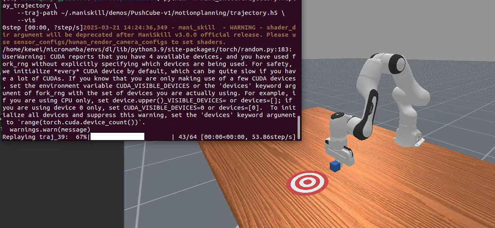
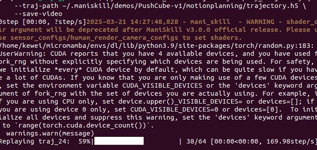
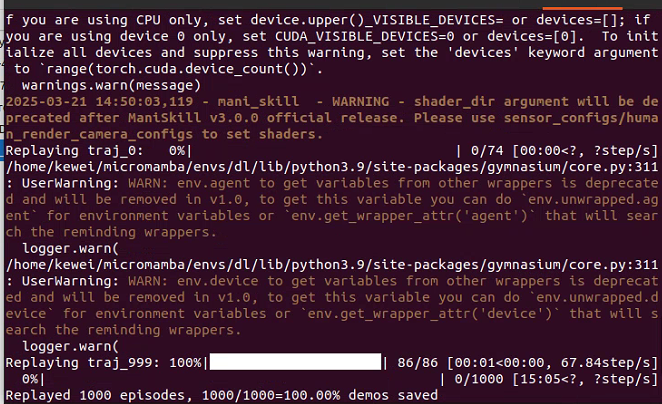
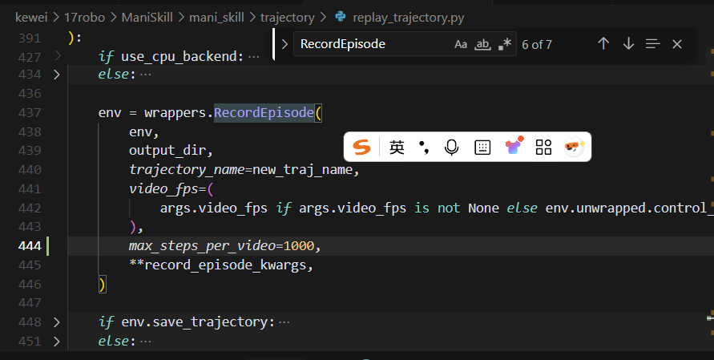
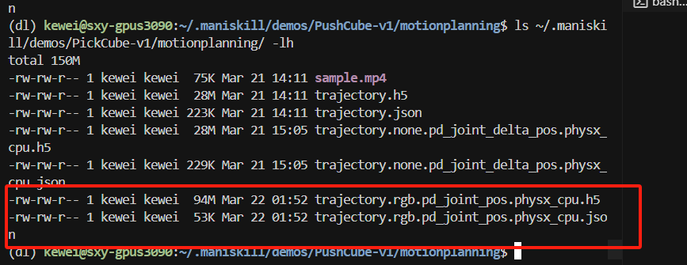
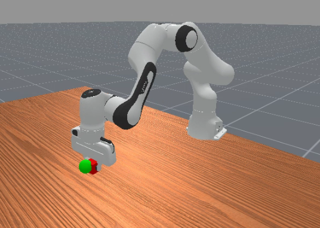

# Наборы сцен

Мы предоставляем инструмент командной строки для загрузки наборов данных сцен (обычно адаптированных из исходных наборов).

ManiSkill может построить любую сцену, если для неё есть нужные ресурсы. По умолчанию ManiSkill содержит код и ссылки для загрузки наборов сцен [RoboCasa](https://github.com/robocasa/robocasa), [ReplicaCAD](https://aihabitat.org/datasets/replica_cad/) и [AI2THOR](https://github.com/allenai/ai2thor) (см. ниже). Эти сцены выбраны, поскольку в целом у них высокое качество моделирования и они интерактивны.

ManiSkill также поддерживает гетерогенную GPU-симуляцию, в которой у каждой параллельной среды могут быть свои объекты и текстуры. Ниже пример изображения сверху, созданного симулятором, — кухня RoboCasa.

Чтобы начать работу с этими сценами, скачайте их следующими командами. Обратите внимание: если вы используете эти сцены в работе, cсылайтесь и на ManiSkill3, и на авторов набора сцен.

```bash
# Список всех доступных для загрузки наборов сцен
python -m mani_skill.utils.download_asset --list "scene"
python -m mani_skill.utils.download_asset ReplicaCAD # Небольшие сцены, быстрая загрузка
python -m mani_skill.utils.download_asset RoboCasa # Много процедурно сгенерированных сцен, быстрая загрузка
python -m mani_skill.utils.download_asset AI2THOR # Много сцен, медленная загрузка
```

## Знакомство с наборами сцен

Чтобы изучить набор сцен, укажите идентификатор среды и seed (если доступно несколько сцен, можно сменить выбираемую сцену) и запустите скрипт случайных действий. Ниже показаны готовые среды для взаимодействия с RoboCasa, ReplicaCAD и ArchitecTHOR (вариантом AI2THOR).

```bash
python -m mani_skill.examples.demo_random_action \
  -e "ReplicaCAD_SceneManipulation-v1" \
  --render-mode="rgb_array" --record-dir="videos" # Запуск без GUI и сохранение видео

python -m mani_skill.examples.demo_random_action \
  -e "ArchitecTHOR_SceneManipulation-v1" --render-mode="human" \
  -s 3 # Открыть GUI и выбрать сцену с seed 3

# Загрузить 4 среды и выбрать сцены с seed 0, 1, 2, 3
# Использовать робота fetch
python -m mani_skill.examples.demo_random_action \
  -e "RoboCasaKitchen-v1" \
  -n 4 -s 0 1 2 3 \
  --render-mode="human" -r "fetch"
```

Можно также передать `-r "none"`, чтобы запустить среду без агента.

## Обучение на наборах сцен

Большие наборы сцен, такие как ReplicaCAD и AI2THOR, содержат сотни объектов и могут использоваться для обучения более универсальных роботов и агентов; их также можно использовать как источник синтетических данных. Мы продолжаем добавлять примеры кода и документацию, чтобы лучше использовать эти наборы сцен; сейчас уже доступен код для изучения этих наборов и взаимодействия с ними.

### Обучение с подкреплением / имитационное обучение

Сейчас мы создаём код задач, аналогичных испытанию ReplicaCAD Rearrange, и откроем его после завершения. Кроме этого, пока нет обучающих задач с определёнными условиями успеха и неудачи и/или наградой, которые использовали бы большие наборы сцен.

# Демонстрации

Мы предоставляем инструмент командной строки, который скачивает демонстрации напрямую из нашего [набора данных Hugging Face](https://huggingface.co/datasets/haosulab/ManiSkill_Demonstrations) по идентификатору задачи. Инструмент сохраняет файлы демонстраций в папку и также скачивает видео, которые показывают, как выглядят демонстрации. Список всех поддерживаемых задач и их демонстраций см. на [странице задач](https://maniskill.readthedocs.io/en/latest/tasks/index.html).

```bash
# Скачать набор демонстраций для конкретной задачи
python -m mani_skill.utils.download_demo ${ENV_ID}
python -m mani_skill.utils.download_demo # Без аргументов выводит все доступные наборы данных
# Скачать полный набор данных (может быть очень медленно)
python -m mani_skill.utils.download_demo all
```

Наборы демонстраций обычно хранятся в упрощённом формате (например, без данных наблюдений); вместо этого сохраняются состояния среды для сжатия. Мы предоставляем гибкий инструмент, который может воспроизводить наборы демонстраций и изменять их, например добавлять визуальные наблюдения, записывать видео и т. д. Подробности см. в [документации по воспроизведению траекторий](https://maniskill.readthedocs.io/en/latest/user_guide/datasets/replay.html). Если вы хотите создать исходный сжатый набор данных локально, все скрипты генерации данных находятся в папке [data_generation](https://github.com/haosulab/ManiSkill/tree/main/scripts/data_generation). Тем, кто хочет сравнивать имитационное обучение, мы настоятельно рекомендуем следовать инструкциям на [странице настройки имитационного обучения](https://maniskill.readthedocs.io/en/latest/user_guide/learning_from_demos/setup.html), чтобы воспроизводить сжатый набор данных для сравнения обучающих наборов.

## Формат

Все демонстрации каждой задачи сохраняются в формате HDF5, который можно открыть через [h5py](https://github.com/h5py/h5py). Каждый набор HDF5 называется `trajectory.{obs_mode}.{control_mode}.{sim_backend}.h5` и имеет одноимённый JSON-файл с метаданными. Если не сказано иное, `trajectory.h5` — сокращение от `trajectory.none.pd_joint_pos.physx_cpu.h5`: в нём лежат исходные демонстрации, созданные контроллером `pd_joint_pos`, с режимом наблюдения `none` (без данных наблюдения) и в симуляции на CPU. Однако возможны демонстрации, созданные другими контроллерами. **Поэтому проверьте связанный JSON-файл, чтобы убедиться, какой контроллер использовался.**

## Метаинформация (JSON)

Каждый JSON-файл содержит:

- `env_info` (словарь): информация о задаче (также называемой средой), которую можно использовать для её инициализации.
  - `env_id` (строка): идентификатор задачи.
  - `max_episode_steps` (целое число).
  - `env_kwargs` (словарь): именованные аргументы для инициализации задачи. **Это необходимо для воспроизведения среды.**
- `episodes` (список[словарь]): информация об эпизодах.
- `source_type` (необязательно, строка): краткая классификация, описывающая процесс генерации данных траекторий.
- `source_desc` (необязательно, строка): более подробное объяснение процесса генерации данных.

Информация об эпизоде (элементы `episodes`) включает:

- `episode_id` (целое число): уникальный идентификатор эпизода.
- `reset_kwargs` (словарь): именованные аргументы для сброса задачи. **При воспроизведении траектории эти параметры обязательны.**
- `control_mode` (строка): режим управления, используемый в этом эпизоде.
- `elapsed_steps` (целое число): длина траектории.
- `info` (словарь): информация по окончании эпизода.

Обычно по одним метаданным можно воспроизвести задачу так же, как она создавалась при сборе траекторий:

```python
env = gym.make(env_info["env_id"], **env_info["env_kwargs"])
episode = env_info["episodes"][0] # Выбираем первый
env.reset(**episode["reset_kwargs"])
```

Иногда траектории собираются в GPU-симуляции, и тогда рандомизация зависит не только от seed, но и от числа параллельных сред. Чтобы начальные состояния совпадали, можно использовать данные первого состояния среды, сохранённые в траектории, и соответствующим образом задать состояние среды.

## Данные траекторий (HDF5)

Каждый набор демонстраций HDF5 состоит из нескольких траекторий. Ключ каждой траектории имеет вид `traj_{episode_id}`, например `traj_0`.

Каждая траектория — это `h5py.Group`, которая содержит:

- actions: [T, A], `np.float32`. `T` — число переходов.
- terminated: [T], `np.bool_`. Показывает, завершилась ли задача на каждом шаге.
- truncated: [T], `np.bool_`. Показывает, была ли задача обрезана на каждом шаге.
- env_states: [T+1, D], `np.float32`. Состояния среды. Их можно использовать, чтобы через `env.set_state_dict` задать среде определённое состояние; однако этого может быть недостаточно для воспроизведения траектории.
- success (необязательно): [T], `np.bool_`. Показывает, была ли задача успешна на каждом шаге. Включается, если задача определяет успех.
- fail (необязательно): [T], `np.bool_`. Показывает, была ли задача неуспешной на каждом шаге. Включается, если задача определяет неудачу.
- obs (необязательно): [T+1, D] данные наблюдений.

Обратите внимание: `env_states` хранятся в виде словаря (наблюдения тоже могут так храниться, в зависимости от режима наблюдения); он оформлен как словарь списков. Например, типичное состояние среды выглядит так:

```python
env_state = env.get_state_dict()
"""
env_state = {
  "actors": {
    "actor_id": [...numpy_actor_state...],
    ...
  },
  "articulations": {
    "articulation_id": [...numpy_articulation_state...],
    ...
  }
}
"""
```

В файле траекторий `env_states` имеет ту же структуру, но каждое значение или лист словаря — это последовательность состояний соответствующей сущности в симуляции во времени.

На практике удобнее работать с срезами данных `env_states` (или наблюдений). Это можно сделать так:

```python
import mani_skill.trajectory.utils as trajectory_utils
env_states = trajectory_utils.dict_to_list_of_dicts(env_states)
# Теперь env_states[i] — это данные, которые вернул бы env.get_state_dict() на i-м шаге
i = 10
env_state_i = trajectory_utils.index_dict(env_states, i)
# Теперь env_state_i — это данные, которые вернул бы env.get_state_dict() на i-м шаге
```

Эти инструменты также используются в нашей реализации набора данных PyTorch; подробности — в следующем разделе.

## Загрузка наборов траекторий

### PyTorch

Мы предоставляем пример того, как построить набор данных PyTorch и легко загружать данные траекторий в формате .h5: см. https://github.com/haosulab/ManiSkill/tree/main/mani_skill/trajectory/datasets.py. Хотя он не особенно оптимизирован, он показывает, как гибко обрабатывать наш формат данных. Копия кода приведена ниже в раскрывающемся блоке.

:::{dropdown} dataset.py
:color: primary
:icon: code

```python
from typing import Union
import h5py
import numpy as np
from torch.utils.data import Dataset
from tqdm import tqdm

from mani_skill.utils.io_utils import load_json
from mani_skill.utils import sapien_utils
from mani_skill.utils import common

# Загружает данные h5 в память для более быстрого доступа
def load_h5_data(data):
    out = dict()
    for k in data.keys():
        if isinstance(data[k], h5py.Dataset):
            out[k] = data[k][:]
        else:
            out[k] = load_h5_data(data[k])
    return out

class ManiSkillTrajectoryDataset(Dataset):
    """
    Универсальный набор данных PyTorch: им можно сразу загрузить любые траекторные .h5-данные, созданные ManiSkill.
    Этот класс — просто стартовый код для удобной загрузки данных траекторий, без преобразований данных и продвинутых операций.
    Мы рекомендуем скопировать этот код и изменять его под более сложные сценарии.

    Параметры:
        dataset_file (str): путь к загружаемому .h5-файлу данных
        load_count (int): число траекторий, загружаемых в память. Если -1, загружаются все данные
        success_only (bool): пропускать ли траектории, которые в итоге оказались неуспешными. По умолчанию False
        device: где хранить данные. Если None, данные хранятся в формате numpy (по умолчанию), иначе данные переносятся на указанное устройство
    """

    def __init__(self, dataset_file: str, load_count=-1, success_only: bool = False, device = None) -> None:
        self.dataset_file = dataset_file
        self.device = device
        self.data = h5py.File(dataset_file, "r")
        json_path = dataset_file.replace(".h5", ".json")
        self.json_data = load_json(json_path)
        self.episodes = self.json_data["episodes"]
        self.env_info = self.json_data["env_info"]
        self.env_id = self.env_info["env_id"]
        self.env_kwargs = self.env_info["env_kwargs"]

        self.obs = None
        self.actions = []
        self.terminated = []
        self.truncated = []
        self.success, self.fail, self.rewards = None, None, None
        if load_count == -1:
            load_count = len(self.episodes)
        for eps_id in tqdm(range(load_count)):
            eps = self.episodes[eps_id]
            if success_only:
                assert "success" in eps, "episodes in this dataset do not have the success attribute, cannot load dataset with success_only=True"
                if not eps["success"]:
                    continue
            trajectory = self.data[f"traj_{eps['episode_id']}"]
            trajectory = load_h5_data(trajectory)
            eps_len = len(trajectory["actions"])

            # Исключаем последнее наблюдение, так как большинство процессов обучения его не использует
            obs = common.index_dict_array(trajectory["obs"], slice(eps_len))
            if eps_id == 0:
                self.obs = obs
            else:
                self.obs = common.append_dict_array(self.obs, obs)

            self.actions.append(trajectory["actions"])
            self.terminated.append(trajectory["terminated"])
            self.truncated.append(trajectory["truncated"])

            # Обрабатываем данные, которые могут присутствовать в траектории необязательно
            if "rewards" in trajectory:
                if self.rewards is None:
                    self.rewards = [trajectory["rewards"]]
                else:
                    self.rewards.append(trajectory["rewards"])
            if "success" in trajectory:
                if self.success is None:
                    self.success = [trajectory["success"]]
                else:
                    self.success.append(trajectory["success"])
            if "fail" in trajectory:
                if self.fail is None:
                    self.fail = [trajectory["fail"]]
                else:
                    self.fail.append(trajectory["fail"])

        self.actions = np.vstack(self.actions)
        self.terminated = np.concatenate(self.terminated)
        self.truncated = np.concatenate(self.truncated)

        if self.rewards is not None:
            self.rewards = np.concatenate(self.rewards)
        if self.success is not None:
            self.success = np.concatenate(self.success)
        if self.fail is not None:
            self.fail = np.concatenate(self.fail)

        def remove_np_uint16(x: Union[np.ndarray, dict]):
            if isinstance(x, dict):
                for k in x.keys():
                    x[k] = remove_np_uint16(x[k])
                return x
            else:
                if x.dtype == np.uint16:
                    return x.astype(np.int32)
                return x

        # Тип uint16 используется, чтобы экономить место на диске и в памяти.
        # Этот код набора данных можно оптимизировать, чтобы хранить данные как uint16 и обрабатывать их самостоятельно.
        # Для простоты мы приводим данные к int32, чтобы их можно было автоматически преобразовать в тензоры torch без ошибок
        self.obs = remove_np_uint16(self.obs)

        if device is not None:
            self.actions = sapien_utils.to_tensor(self.actions, device=device)
            self.obs = sapien_utils.to_tensor(self.obs, device=device)
            self.terminated = sapien_utils.to_tensor(self.terminated, device=device)
            self.truncated = sapien_utils.to_tensor(self.truncated, device=device)
            if self.rewards is not None:
                self.rewards = sapien_utils.to_tensor(self.rewards, device=device)
            if self.success is not None:
                self.success = sapien_utils.to_tensor(self.terminated, device=device)
            if self.fail is not None:
                self.fail = sapien_utils.to_tensor(self.truncated, device=device)
    def __len__(self):
        return len(self.actions)


    def __getitem__(self, idx):
        action = sapien_utils.to_tensor(self.actions[idx], device=self.device)
        obs = common.index_dict_array(self.obs, idx, inplace=False)

        res = dict(
            obs=obs,
            action=action,
            terminated=self.terminated[idx],
            truncated=self.truncated[idx],
        )
        if self.rewards is not None:
            res.update(reward=self.rewards[idx])
        if self.success is not None:
            res.update(success=self.success[idx])
        if self.fail is not None:
            res.update(fail=self.fail[idx])
        return res
```

:::

# Воспроизведение / преобразование траекторий

ManiSkill предоставляет инструменты, которые не только собирают и загружают траектории, но и воспроизводят их и преобразуют наблюдения и действия.

Чтобы воспроизвести демонстрацию (без изменения режима наблюдения и режима управления):

```bash
# Воспроизвести и посмотреть траекторию через окно sapien
python -m mani_skill.trajectory.replay_trajectory \
    --traj-path ~/.maniskill/demos/PushCube-v1/motionplanning/trajectory.h5 \
    --vis

# Сохранить видео траектории (сохраняется в тот же каталог, что и траектория)
python -m mani_skill.trajectory.replay_trajectory \
    --traj-path ~/.maniskill/demos/PushCube-v1/motionplanning/trajectory.h5 \
    --save-video

# Посмотреть все доступные параметры
python -m mani_skill.trajectory.replay_trajectory -h
```

Результаты показаны на следующих снимках:





:::{note}
Скрипт требует, чтобы файлы `trajectory.h5` и `trajectory.json` находились в одном каталоге.
:::

По умолчанию исходный файл демонстраций содержит всю информацию, необходимую для воспроизведения траектории (например, начальное состояние, действия, seed). Поскольку постобработки не было, данные наблюдений обычно не включены, так как они могут сделать файл слишком большим. Кроме того, действия в этих файлах не охватывают все режимы управления. Поэтому исходный файл нужно преобразовать к нужному режиму наблюдений и управления. Мы предоставляем служебный скрипт, который используется так:

```bash
# Воспроизвести демонстрацию с режимом управления pd_joint_delta_pos
python -m mani_skill.trajectory.replay_trajectory \
  --traj-path ~/.maniskill/demos/PickCube-v1/motionplanning/trajectory.h5 \
  --save-traj --target-control-mode pd_joint_delta_pos \
  --obs-mode none #--num-procs 10
```



:::{dropdown} Нажмите, чтобы увидеть параметры инструмента воспроизведения траекторий

```
╭─ options ──────────────────────────────────────────────────────────────────────────────────────────────────────────────────────────────────────╮
│ -h, --help              показать эту справку и выйти                                                                                       │
│ --traj-path STR         путь к файлу траектории .h5 для воспроизведения (обязательно)                                                       │
│ --sim-backend {None}|STR, -b {None}|STR                                                                                                          │
│                         используемый бэкенд симуляции: 'physx_cpu' или 'physx_gpu'. Если не указан, используется бэкенд, на котором собраны  │
│                         траектории (по умолчанию: None)                                                                                    │
│ --obs-mode {None}|STR, -o {None}|STR                                                                                                             │
│                         целевой режим наблюдения, который записывается в траекторию. Полный список поддерживаемых режимов см. в             │
│                         https://maniskill.readthedocs.io/en/latest/user_guide/concepts/observation.html (по умолчанию: None)              │
│ --target-control-mode {None}|STR, -c {None}|STR                                                                                                  │
│                         целевой режим управления, в который нужно преобразовать действия.                                                 │
│                         Учтите, что не все режимы управления успешно преобразуются и не у всех роботов есть режимы, которые легко           │
│                         преобразовать. Сейчас лучше всего преобразование поддерживается для робота Panda. Кроме того, преобразование        │
│                         режимов управления не поддерживается в средах с GPU-параллелизацией (по умолчанию: None)                          │
│ --verbose, --no-verbose                                                                                                                        │
│                         печатать ли подробную информацию во время воспроизведения траектории (по умолчанию: False)                          │
│ --save-traj, --no-save-traj                                                                                                                    │
│                         сохранять ли траекторию на диск. Исходный файл траектории при этом не перезаписывается (по умолчанию: False)        │
│ --save-video, --no-save-video                                                                                                                  │
│                         сохранять ли видео (по умолчанию: False)                                                                           │
│ --num-procs INT         число процессов для распараллеливания воспроизведения траекторий. Для бэкенда CPU обычно используется               │
│                         многопроцессность Python.                                                                                          │
│                         Для параллельного бэкенда симуляции, например physx_gpu, распараллеливание идёт внутри одного процесса Python через   │
│                         использование GPU (по умолчанию: 1)                                                                                │
│ --max-retry INT         максимальное число попыток воспроизвести траекторию до того, как задача успешно завершится (по умолчанию: 0)         │
│ --discard-timeout, --no-discard-timeout                                                                                                        │
│                         отбрасывать ли эпизоды, которые вышли по тайм-ауту и были обрезаны (зависит от параметра max_episode_steps задачи)  │
│                         (по умолчанию: False)                                                                                              │
│ --allow-failure, --no-allow-failure                                                                                                            │
│                         включать ли неуспешные эпизоды в сохраняемые видео и данные траекторий, исходя из метки "success", которую возвращает │
│                         оценка среды (по умолчанию: False)                                                                                 │
│ --vis, --no-vis         визуализировать ли воспроизведение траектории через GUI (по умолчанию: False)                                       │
│ --use-env-states, --no-use-env-states                                                                                                          │
│                         воспроизводить ли по состояниям среды, а не по действиям. Так среда на каждом шаге будет выглядеть точно как        │
│                         исходная траектория (по умолчанию: False)                                                                          │
│ --use-first-env-state, --no-use-first-env-state                                                                                                │
│                         использовать ли первое состояние среды из траектории для задания начального состояния. Это полезно, чтобы           │
│                         воспроизвести в GPU-симуляции демонстрации, собранные в CPU-симуляции, поскольку GPU-симуляция рандомизирует         │
│                         начальные состояния иначе, даже при одинаковом seed (по умолчанию: False)                                          │
│ --count {None}|INT      число демонстраций для воспроизведения до выхода. По умолчанию воспроизводятся все демонстрации (по умолчанию: None) │
│ --reward-mode {None}|STR                                                                                                                       │
│                         тип награды, который должна использовать среда. По умолчанию выбирается первый поддерживаемый режим награды.        │
│                         Большинство сред поддерживают 'sparse' и 'none', некоторые также 'normalized_dense' и 'dense' (по умолчанию: None)  │
│ --record-rewards, --no-record-rewards                                                                                                          │
│                         включать ли награды в воспроизводимые траектории (по умолчанию: False)                                             │
│ --shader {None}|STR     изменить шейдер, который используется для рендеринга всех камер. По умолчанию используется шейдер, на котором        │
│                         собирались исходные данные. Можно выбрать 'rt' для трассировки лучей и фотореалистичного рендеринга, либо 'rt-fast' │
│                         для более быстрой, но менее качественной трассировки лучей (по умолчанию: None)                                     │
│ --video-fps {None}|INT  частота кадров сохраняемого видео. По умолчанию равна частоте управления (по умолчанию: None)                        │
│ --render-mode STR       режим рендеринга для сохранения видео. Обычно также есть режимы 'sensors' и 'all', которые рендерят все выходы      │
│                         датчиков, например камер (по умолчанию: rgb_array)                                                                 │
│ --num-envs INT, -n INT  число сред для воспроизведения траекторий. Для бэкенда CPU обычно используется многопроцессность Python.            │
│                         Для параллельного бэкенда симуляции, например physx_gpu, распараллеливание идёт внутри одного процесса Python через   │
│                         использование GPU (по умолчанию: 1)                                                                                │
╰────────────────────────────────────────────────────────────────────────────────────────────────────────────────────────────────────────────────╯
```

В новой версии параметры изменились:

╭─ Опции ──────────────────────────────────────────────────────────────────╮
│ -h, --help                                                                 │
│     показать справку и выйти                                               │
│ --traj-path STR                                                            │
│     путь к файлу траектории .h5 для воспроизведения (обязательно)          │
│ -b {None}|STR, --sim-backend {None}|STR                                    │
│     используемый бэкенд симуляции: 'physx_cpu' или 'physx_gpu'. Если не    │
│     указан, используется бэкенд, на котором собраны траектории (по         │
│     умолчанию: None)                                                       │
│ -o {None}|STR, --obs-mode {None}|STR                                       │
│     целевой режим наблюдения для записи в траекторию. Полный список        │
│     поддерживаемых режимов см. в документации ManiSkill (по умолчанию: None) │
│ -c {None}|STR, --target-control-mode {None}|STR                            │
│     целевой режим управления для преобразования демонстрационных действий │
│     в другой режим. Учтите, что не все режимы управления преобразуются      │
│     успешно и не у всех роботов их легко преобразовать. Сейчас лучше всего │
│     поддерживается Panda; в средах с GPU-параллелизацией преобразование    │
│     режимов управления не поддерживается (по умолчанию: None)              │
│ --verbose, --no-verbose                                                    │
│     печатать ли подробную информацию при воспроизведении (по умолчанию: False) │
│ --save-traj, --no-save-traj                                                │
│     сохранять ли траекторию на диск. Исходный файл при этом не перезаписывается │
│     (по умолчанию: False)                                                  │
│ --save-video, --no-save-video                                              │
│     сохранять ли видео (по умолчанию: False)                               │
│ --max-retry INT                                                            │
│     максимальное число попыток воспроизвести траекторию до успешного       │
│     завершения задачи (по умолчанию: 0)                                    │
│ --discard-timeout, --no-discard-timeout                                    │
│     отбрасывать ли эпизоды, завершившиеся по тайм-ауту и обрезанные        │
│     (зависит от параметра max_episode_steps задачи) (по умолчанию: False)  │
│ --allow-failure, --no-allow-failure                                        │
│     включать ли неуспешные эпизоды в сохраняемые видео и данные траекторий │
│     по метке "success", которую возвращает оценка среды (по умолчанию: False) │
│ --vis, --no-vis                                                            │
│     визуализировать ли воспроизведение траектории через GUI (по умолчанию: False) │
│ --use-env-states, --no-use-env-states                                      │
│     воспроизводить ли по состояниям среды, а не по действиям. Это гарантирует, │
│     что на каждом шаге среда совпадает с исходной траекторией (по умолчанию: False) │
│ --use-first-env-state, --no-use-first-env-state                            │
│     использовать ли первое состояние среды из траектории как начальное.    │
│     Полезно, чтобы воспроизвести в GPU-симуляции демонстрации, собранные    │
│     в CPU-симуляции, поскольку GPU-симуляция при одинаковом seed иначе     │
│     рандомизирует начальные состояния (по умолчанию: False)                │
│ --count {None}|INT                                                         │
│     число демонстраций для воспроизведения до выхода. По умолчанию          │
│     воспроизводятся все демонстрации (по умолчанию: None)                  │
│ --reward-mode {None}|STR                                                   │
│     тип награды, который должна использовать среда. По умолчанию выбирается │
│     первый поддерживаемый режим. Большинство сред поддерживают 'sparse' и   │
│     'none', некоторые также 'normalized_dense' и 'dense' (по умолчанию: None) │
│ --record-rewards, --no-record-rewards                                      │
│     включать ли награды в воспроизводимую траекторию (по умолчанию: False) │
│ --shader {None}|STR                                                        │
│     изменить шейдер для рендеринга всех камер. По умолчанию None: используется │
│     шейдер исходного сбора данных или шейдер среды по умолчанию. Можно задать │
│     'rt' для трассировки лучей и фотореалистичного рендеринга или 'rt-fast' │
│     для более быстрого, но менее качественного рендерера (по умолчанию: None) │
│ --video-fps {None}|INT                                                     │
│     частота кадров сохраняемого видео. По умолчанию равна частоте управления │
│     (по умолчанию: None)                                                   │
│ --render-mode STR                                                          │
│     режим рендеринга при сохранении видео. Обычно есть также режимы         │
│     'sensors' и 'all', которые рендерят все выходы датчиков, например камер │
│     (по умолчанию: rgb_array)                                              │
│ -n INT, --num-envs INT                                                     │
│     число сред для воспроизведения траекторий. Для CPU-бэкенда обычно      │
│     используется многопроцессность Python; для параллельного бэкенда,      │
│     например physx_gpu, распараллеливание идёт на GPU внутри одного        │
│     процесса Python (по умолчанию: 1)                                      │
╰────────────────────────────────────────────────────────────────────────────╯

В таблице ниже сравниваются параметры старой и новой версий:

| Параметр | Описание в старой версии | Описание в новой версии | Примечание |
| ----------------------------------------------------- | -------------------------------------------------------------------------------- | -------------------------------- | ------------ |
| **--traj-path STR** | путь к файлу траектории .h5 для воспроизведения (обязательно) | то же | Без изменений |
| **--sim-backend {None}\|STR, -b {None}\|STR** | используемый бэкенд симуляции: 'physx_cpu' или 'physx_gpu'; если не указан, используется бэкенд сбора траекторий (по умолчанию: None) | то же | Без изменений |
| **--obs-mode {None}\|STR, -o {None}\|STR** | целевой режим наблюдения для записи в траекторию; список поддерживаемых режимов — в документации (по умолчанию: None) | то же | Без изменений |
| **--target-control-mode {None}\|STR, -c {None}\|STR** | целевой режим управления для преобразования демонстрационных действий; не все режимы преобразуются, лучше всего поддерживается Panda; в GPU-средах не поддерживается (по умолчанию: None) | то же | Без изменений |
| **--verbose, --no-verbose** | печатать ли подробную информацию при воспроизведении (по умолчанию: False) | печатать ли подробную информацию при воспроизведении (по умолчанию: False) | Описание немного отличается, но функция та же |
| **--save-traj, --no-save-traj** | сохранять ли траекторию на диск, без перезаписи исходного файла (по умолчанию: False) | то же | Без изменений |
| **--save-video, --no-save-video** | сохранять ли видео (по умолчанию: False) | то же | Без изменений |
| **--num-procs INT** | число процессов для распараллеливания воспроизведения; CPU-бэкенд — через многопроцессность Python, physx_gpu — внутри одного процесса на GPU (по умолчанию: 1) | **Удалён** | В новой версии параметр убран |
| **--max-retry INT** | максимальное число попыток воспроизведения до успешного завершения задачи (по умолчанию: 0) | то же | Без изменений |
| **--discard-timeout, --no-discard-timeout** | отбрасывать ли эпизоды, завершившиеся по тайм-ауту и обрезанные (по умолчанию: False) | то же | Без изменений |
| **--allow-failure, --no-allow-failure** | включать ли неуспешные эпизоды в сохраняемые видео и данные по метке "success" оценки среды (по умолчанию: False) | то же | Без изменений |
| **--vis, --no-vis** | визуализировать ли воспроизведение через GUI (по умолчанию: False) | то же | Без изменений |
| **--use-env-states, --no-use-env-states** | воспроизводить ли по состояниям среды, а не по действиям, чтобы на каждом шаге среда совпадала с исходной траекторией (по умолчанию: False) | то же | Без изменений |
| **--use-first-env-state, --no-use-first-env-state** | использовать ли первое состояние среды из траектории как начальное; полезно для воспроизведения в GPU-симуляции демонстраций, собранных в CPU-симуляции (по умолчанию: False) | то же | Без изменений |
| **--count {None}\|INT** | число демонстраций для воспроизведения до выхода; по умолчанию все (по умолчанию: None) | то же | Без изменений |
| **--reward-mode {None}\|STR** | тип награды среды; большинство сред поддерживают 'sparse' и 'none', некоторые — 'normalized_dense' и 'dense' (по умолчанию: None) | то же | Без изменений |
| **--record-rewards, --no-record-rewards** | включать ли награды в воспроизводимую траекторию (по умолчанию: False) | то же | Без изменений |
| **--shader {None}\|STR** | шейдер для рендеринга всех камер; по умолчанию — шейдер исходного сбора или шейдер среды; можно 'rt' или 'rt-fast' (по умолчанию: None) | то же | Без изменений |
| **--video-fps {None}\|INT** | частота кадров сохраняемого видео; по умолчанию равна частоте управления (по умолчанию: None) | то же | Без изменений |
| **--render-mode STR** | режим рендеринга при сохранении видео: 'rgb_array', 'sensors', 'all' (две последние рендерят все данные датчиков) (по умолчанию: rgb_array) | то же | Без изменений |
| **--num-envs INT, -n INT** | число сред для воспроизведения; CPU-бэкенд — через многопроцессность Python, physx_gpu — внутри одного процесса на GPU (по умолчанию: 1) | то же | Без изменений |

Как видно из таблицы, новая версия в основном убрала параметр **--num-procs**; остальные параметры и их функции почти не изменились.

:::

:::{caution}
Некоторые демонстрации собраны не в квазистатическом режиме (объекты во время манипуляции не закреплены на манипуляторе), а некоторые сложные задачи (например, PushT-v1 или PickSingleYCB-v1) требуют высокой точности. Поэтому воспроизведение действий или их преобразование может завершиться неудачей из-за недетерминированности симуляции. Значит, для воспроизведения траекторий и гарантии того, что данные состояний и наблюдений совпадают с исходной траекторией, нужно передавать `--use-env-states`.
:::

## Примеры использования

Инструмент воспроизведения траекторий богат возможностями и довольно сложен, поэтому ниже приведено несколько рекомендуемых рабочих процессов для разных случаев.

### Воспроизведение траектории из одного режима управления в режим, который легче изучать

В рабочих процессах машинного обучения иногда проще учиться в некоторых режимах управления (например, в режиме управления концевым эффектором). Пример ниже как раз это и делает:

```bash
python -m mani_skill.trajectory.replay_trajectory \
  --traj-path path/to/trajectory.h5 \
  -c pd_ee_delta_pose -o state \
  --save-traj
```

Учтите, что из-за фундаментальных различий между контроллерами и поведением демонстраций некоторые целевые режимы управления могут быть трудны для преобразования.

1. **Задача PickCube-v1**: относительно простая задача, подходит для первоначальной проверки.

   - `~/.maniskill/demos/PickCube-v1/rl/trajectory.none.pd_joint_delta_pos.physx_cuda.h5` (исходный режим управления: управление суставами)
   - Цель преобразования: `pd_ee_delta_pose` (управление позой концевого эффектора)

2. **Задача PushCube-v1**: задача толкания куба, действия относительно простые.

   - `~/.maniskill/demos/PushCube-v1/rl/trajectory.none.pd_joint_delta_pos.physx_cuda.h5` (исходный режим управления: управление суставами)
   - Цель преобразования: `pd_ee_delta_pos` (управление положением концевого эффектора)

3. **Задача StackCube-v1**: более сложная задача укладки, требующая более точного управления.

   - `~/.maniskill/demos/StackCube-v1/rl/trajectory.none.pd_ee_delta_pos.physx_cuda.h5` (исходный режим управления: управление положением концевого эффектора)
   - Цель преобразования: `pd_ee_delta_pose` (управление позой концевого эффектора)

Чтобы проверить результат, можно:

1. **Посмотреть созданный файл траектории**: после воспроизведения создаётся новый h5-файл, в имени которого есть целевой режим управления.
2. **Посмотреть созданное видео**: с параметрами `--render-mode rgb_array --render-camera third_view --replay-render` можно получить видео воспроизведения.
3. **Сравнить траектории до и после**: можно сравнить MP4-видео исходной траектории и воспроизведённой, чтобы увидеть, похоже ли поведение робота.

Рекомендуем начинать с задачи **PickCube-v1**, потому что это самая базовая задача захвата. Выполните такую команду:

```bash
python -m mani_skill.trajectory.replay_trajectory \
  --traj-path ~/.maniskill/demos/PickCube-v1/rl/trajectory.none.pd_joint_delta_pos.physx_cuda.h5 \
  -c pd_ee_delta_pose -o state \
  --render-mode rgb_array --render-camera third_view --replay-render \
  --save-traj
```

Эта команда:

1. читает исходный файл траектории (режим управления суставами);
2. воспроизводит её в режиме управления позой концевого эффектора;
3. сохраняет новый файл траектории;
4. создаёт видео воспроизведения.

После выполнения можно сравнить `sample_pd_joint_delta_pos.mp4` с новым видео, чтобы увидеть различия в поведении робота в разных режимах управления.

Если появится ошибка, связанная с максимальным числом шагов, не забудьте изменить этот параметр:



У преобразования режимов управления в ManiSkill есть ограничения, в частности:

1. Из `pd_joint_delta_pos` можно преобразовать только в `pd_joint_pos`.
2. Из `pd_joint_pos` можно преобразовать в управление концевым эффектором (`pd_ee_delta_pose` и т. д.).

Чтобы обойти это, нужно выполнить преобразование в два шага:

1. Сначала из `pd_joint_delta_pos` в `pd_joint_pos`.
2. Затем из `pd_joint_pos` в `pd_ee_delta_pose`.

Решение:

```bash
# Шаг 1: преобразовать в pd_joint_pos
python -m mani_skill.trajectory.replay_trajectory \
  --traj-path ~/.maniskill/demos/PickCube-v1/rl/trajectory.none.pd_joint_delta_pos.physx_cuda.h5 \
  --target-control-mode pd_joint_pos \
  --obs-mode state \
  --render-mode rgb_array \
  --save-traj \
  --sim-backend physx_cpu \
  --num-envs 1

# Шаг 2: преобразовать из pd_joint_pos в pd_ee_delta_pose
python -m mani_skill.trajectory.replay_trajectory \
  --traj-path ~/.maniskill/demos/PickCube-v1/rl/trajectory.state.pd_joint_pos.physx_cpu.h5 \
  --target-control-mode pd_ee_delta_pose \
  --obs-mode state \
  --render-mode rgb_array \
  --save-traj \
  --save-video \
  --video-fps 30 \
  --sim-backend physx_cpu \
  --num-envs 1
```

Если хотите увидеть, какие пути преобразования поддерживает код, посмотрите файл `utils/actions/conversion.py`. По нашему анализу, основные поддерживаемые пути преобразования такие:

1. `pd_joint_pos` → `pd_ee_delta_pose` (через функцию `from_pd_joint_pos_to_ee`)
2. `pd_joint_delta_pos` → `pd_joint_pos` (через функцию `from_pd_joint_delta_pos`)

### Добавление награды и данных наблюдений в траекторию

Чтобы экономить память, демонстрации обычно не содержат данных наблюдений и наград. Ниже пример того, как добавить в траекторию обратно награды, RGB-наблюдения и нормированную плотную награду (если среда её поддерживает). Параметр `--use-env-states` добавлен, чтобы гарантировать точное совпадение состояний и наблюдений воспроизведённой и исходной траекторий.

```bash
python -m mani_skill.trajectory.replay_trajectory \
  --traj-path path/to/trajectory.h5 \
  --record-rewards --reward-mode="normalized_dense" -o rgb \
  --use-env-states \
  --save-traj
# Например:
python -m mani_skill.trajectory.replay_trajectory \
  --traj-path ~/.maniskill/demos/PickCube-v1/motionplanning/trajectory.h5 \
  --record-rewards --reward-mode="normalized_dense" -o rgb \
  --use-env-states \
  --save-traj \
  --sim-backend physx_cpu \
  --num-envs 1
```



Это файл, который только что создан.

Теперь визуализация:

```
python -m mani_skill.trajectory.replay_trajectory \
  --traj-path ~/.maniskill/demos/PickCube-v1/motionplanning/trajectory.rgb.none.physx_cpu.h5 \
  --vis \
  --sim-backend physx_cpu \
  --num-envs 1
```



По сути, это создаёт вот эту зелёную точку.

### Воспроизведение траекторий, собранных в CPU/GPU-симуляции, в CPU/GPU-симуляции

Некоторые демонстрации могут быть собраны в CPU-симуляции, но их хочется использовать в GPU-симуляции, и наоборот. Поскольку CPU- и GPU-симуляция при одинаковых действиях и начальных состояниях ведут себя немного по-разному, нужно убедиться, что демонстрации можно использовать для обучения.

Например, если демонстрации собраны телеуправлением, их обычно записывают в CPU-симуляции — это даёт больше гибкости и более высокую скорость однопоточной работы. Однако обучение по имитации или с подкреплением может проходить в GPU-симуляции. Чтобы убедиться, что из демонстраций можно учиться, мы можем воспроизвести их в GPU-симуляции и сохранить только те, которые успешно воспроизведены. Это делается с помощью первого состояния среды, принудительного использования GPU-симуляции (`-b "physx_cuda"`) и задания нужных режимов управления и наблюдения:

```bash
python -m mani_skill.trajectory.replay_trajectory \
  --traj-path path/to/trajectory.h5 \
  --use-first-env-state -b "physx_cuda" \
  -c pd_joint_delta_pos -o state \
  --save-traj
# Например
python -m mani_skill.trajectory.replay_trajectory \
  --traj-path ~/.maniskill/demos/PushCube-v1/motionplanning/trajectory.h5 \
  --use-first-env-state -b "physx_cuda" \
  -c pd_joint_delta_pos -o state \
  --save-traj

# Результат:
~/.maniskill/demos/PushCube-v1/motionplanning/trajectory.state.pd_joint_delta_pos.physx_cuda.h5

# Визуализация:
python -m mani_skill.trajectory.replay_trajectory \
  --traj-path ~/.maniskill/demos/PushCube-v1/motionplanning/trajectory.state.pd_joint_delta_pos.physx_cuda.h5 \
  --vis
```
