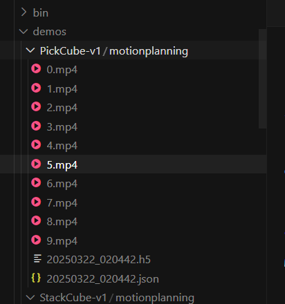

# Планирование движения

ManiSkill предоставляет простые средства для генерации траекторий роботов с помощью планирования движения; в основе — открытая библиотека [mplib](https://github.com/haosulab/MPlib). Если ManiSkill установлен, mplib устанавливается вместе с ним, отдельная установка не нужна.

Подробное руководство по более сложным возможностям mplib см. в их документации: https://motion-planning-lib.readthedocs.io/latest/. В этом разделе описан примерный код, с помощью которого можно изменять и генерировать демонстрации планирования движения. Примеры написаны для манипулятора Panda, но их можно адаптировать к другим роботам.

## Планирование движения с манипулятором Panda

Для некоторых задач с манипулятором Panda есть встроенные решения планирования движения: https://github.com/haosulab/ManiSkill/tree/main/mani_skill/examples/motionplanning/panda. Можно запустить быструю демонстрацию: она сохраняет данные траектории в формате .h5 в `demos/motionplanning/<env_id>`, а также при желании сохраняет видео и/или показывает визуализацию в GUI.

```bash
python -m mani_skill.examples.motionplanning.panda.run -e "PickCube-v1" --save-video # Запуск без GUI, только сохранение видео
python -m mani_skill.examples.motionplanning.panda.run -e "StackCube-v1" --vis # Открыть GUI
python -m mani_skill.examples.motionplanning.panda.run -h # Открыть справку и показать, для каких задач есть решения
```

Решения этих задач обычно сводятся к разбиению задачи на простые шаги: взять, положить, переместить. Примерный код управляет концевым эффектором манипулятора Panda, чтобы он перемещался в любую позу в рабочем пространстве, а также закрывал и открывал захват.

Например, задача PickCube-v1 состоит из таких шагов:

1. Переместить захват прямо над красным кубиком и повернуть его так, чтобы ориентация совпадала с ориентацией кубика.
2. Опустить захват, чтобы пальцы охватили кубик.
3. Закрыть захват.
4. Переместить захват над целевой точкой так, чтобы центр инструмента (tcp) оказался в целевой позиции.

Важно понимать ограничение: хотя планирование движения позволяет генерировать и решать самые разные задачи, обычно требуется, чтобы инженер вручную настраивал и писал решение, а для более динамичных задач решения оно не создаёт.

```text
(dl) user@host:~$ python -m mani_skill.examples.motionplanning.panda.run -e "PickCube-v1" --save-video

/home/user/micromamba/envs/dl/lib/python3.9/site-packages/torch/random.py:183: UserWarning: CUDA reports that you have 4 available devices, and you have used fork_rng without explicitly specifying which devices are being used. For safety, we initialize *every* CUDA device by default, which can be quite slow if you have a lot of CUDAs. If you know that you are only making use of a few CUDA devices, set the environment variable CUDA_VISIBLE_DEVICES or the 'devices' keyword argument of fork_rng with the set of devices you are actually using. For example, if you are using CPU only, set device.upper()_VISIBLE_DEVICES= or devices=[]; if you are using device 0 only, set CUDA_VISIBLE_DEVICES=0 or devices=[0].  To initialize all devices and suppress this warning, set the 'devices' keyword argument to `range(torch.cuda.device_count())`.
  warnings.warn(message)
Motion Planning Running on PickCube-v1
proc_id: 0: 100%|█| 10/10 [00:59<00:00,  5.91s/it, success_rate=1, failed_motion_pla

Генерация пути

~/demos/PickCube-v1/motionplanning/0.mp4
```



# Телеуправление

ManiSkill предоставляет несколько систем телеуправления, которые помогают собирать демонстрационные данные для задач. Ниже подробно описан каждый вариант: как им пользоваться, демонстрационные видео, аппаратные требования, доступность и ограничения.

Сейчас есть удобная система «щелчок + перетаскивание», а также системы с использованием, например, 3D-мыши; систем на VR-гарнитурах пока нет, но они готовятся.

## Система «щелчок + перетаскивание»

**Требования:** монитор, мышь, клавиатура.

**Доступность:** очень удобно для создания детальных демонстраций.

**Ограничения:** подходит только для задач с невысокими динамическими требованиями и с двухпальцевым захватом, например для захвата кубика. Задачи вроде бросания кубика невыполнимы.

Чтобы запустить систему, укажите идентификатор задачи через `-e` и выполните:

```bash
python -m mani_skill.examples.teleoperation.interactive_panda -e "StackCube-v1"
```

После этого конечный эффектор руки робота можно перетаскивать в любую позицию и ориентацию, а нажатие клавиши «n» строит траекторию в эту точку (через планирование движения). После каждого шага система выводит текущую информацию о том, решена ли задача.

Клавиша «g» переключает захват между закрытым и открытым положением.

Чтобы завершить сбор одной траектории и перейти к следующей, нажмите «c»: последняя траектория сохранится.

Чтобы остановить сбор данных, нажмите «q». Траектории будут сохранены в папку `demos/teleop/<env_id>`. Кроме того, после этого генерируются видео демонстраций, которые помещаются в ту же папку; эту генерацию можно остановить нажатием CTRL+C.

Клавиша «h» в любой момент открывает меню справки с описанием команд клавиатуры.

Для обзора используются клавиши wasd и правая кнопка мыши, а колесо мыши меняет приближение.

## Meta Quest 3

В разработке (WIP).

## Apple Vision Pro

В разработке (WIP).
