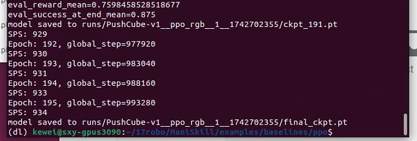

# Проксимальная оптимизация политики (PPO)

Код алгоритма PPO адаптирован из [CleanRL](https://github.com/vwxyzjn/cleanrl/) и [LeanRL](https://github.com/pytorch-labs/LeanRL/). Код написан в одном файле, его легко понимать и читать; он поддерживает как обучение с подкреплением на основе состояния, так и на основе зрения.

Обратите внимание: ManiSkill ещё находится в стадии тестирования, поэтому обучающие скрипты готовы не для всех встроенных задач (некоторые из них сами по себе трудно решить одним только RL).

Официальные результаты бенчмарков можно получить, запустив скрипты из файла baselines.sh. Результаты систематизированы и опубликованы в нашем [отчёте wandb](https://api.wandb.ai/links/stonet2000/k6lz966q).

Также есть экспериментальная поддержка на основе LeanRL: компилируемый PPO и включённые CUDA Graphs. Код находится в ppo_fast.py; для него нужно установить [torchrl](https://github.com/pytorch/rl) и [tensordict](https://github.com/pytorch/tensordict/):

```bash
pip install torchrl tensordict
```

## Обучение с подкреплением на основе состояния

Ниже примеры команд, которые обучают политику на основе состояния для решения нескольких слегка настроенных задач PPO. Самая быстрая — PushCube-v1: на GPU обучение занимает меньше минуты, а PickCube-v1 — 2–5 минут на GPU.

Бенчмарк PPO не гарантированно подходит для всех задач: у некоторых нет плотной награды или они не настроены должным образом, либо стандартный PPO с ними просто не справляется.

```bash
python ppo.py --env_id="PushCube-v1" \
  --num_envs=2048 --update_epochs=8 --num_minibatches=32 \
  --total_timesteps=2_000_000 --eval_freq=10 --num-steps=20
```

Для оценки можно запустить:

```bash
python ppo.py --env_id="PushCube-v1" \
   --evaluate --checkpoint=path/to/model.pt \
   --num_eval_envs=1 --num-eval-steps=1000
```

Обратите внимание: при использовании `--evaluate` траектории сохраняются из GPU-симуляции. Чтобы правильно воспроизвести эти траектории инструментом `maniskill.trajectory.replay_trajectory`, для некоторых задач число сред оценки должно быть равно `1`. Это нужно для воспроизводимости задач с рандомизацией геометрии (например, PickSingleYCB). Задачи без рандомизации геометрии (например, PushCube) могут использовать больше сред оценки.

В файле examples.sh есть полный список проверенных команд для успешного запуска PPO на основе состояния на многих задачах.

Результаты скриптов бенчмарка PPO на основе состояния здесь: https://api.wandb.ai/links/stonet2000/k6lz966q.

## Обучение с подкреплением на основе зрения (RGB)

Ниже примеры команд для обучения PPO на изображениях с небольшой настройкой. Самая быстрая тоже PushCube-v1 — около 1–5 минут, PickCube-v1 — 15–45 минут. Параметр `--num_envs` нужно подобрать под объём памяти GPU, потому что рендеринг визуальных наблюдений требует много памяти. Все приведённые ниже настройки должны использовать меньше 15 ГБ памяти GPU. В файле examples.sh есть полный список проверенных команд для успешного запуска PPO на основе зрения на многих задачах.

```bash
python ppo_rgb.py --env_id="PushCube-v1" \
  --num_envs=256 --update_epochs=8 --num_minibatches=8 \
  --total_timesteps=1_000_000 --eval_freq=10 --num-steps=20
python ppo_rgb.py --env_id="PickCube-v1" \
  --num_envs=256 --update_epochs=8 --num_minibatches=8 \
  --total_timesteps=10_000_000
python ppo_rgb.py --env_id="AnymalC-Reach-v1" \
  --num_envs=256 --update_epochs=8 --num_minibatches=32 \
  --total_timesteps=10_000_000 --num-steps=200 --num-eval-steps=200 \
  --gamma=0.99 --gae_lambda=0.95
```



Чтобы оценить обученную политику, запустите:

```bash
python ppo_rgb.py --env_id="PickCube-v1" \
  --evaluate --checkpoint=path/to/model.pt \
  --num_eval_envs=1 --num-eval-steps=1000
```

Видео будет сохранено в `path/to/test_videos`.

В файле examples.sh есть полный список проверенных команд для успешного запуска PPO на RGB на многих задачах.

Результаты скриптов бенчмарка PPO на RGB здесь: https://api.wandb.ai/links/stonet2000/k6lz966q

## Обучение с подкреплением на основе зрения (RGB+глубина)

В разработке.

## Обучение с подкреплением на основе зрения (облако точек)

В разработке.

## Воспроизведение траекторий оценки

Бывает полезно получить более красивое видео. Простой способ — сначала запустить описанный выше скрипт оценки. Он сохранит файлы .h5 и .json с именем, соответствующим дате и времени; затем эти траектории можно воспроизвести с другими настройками:

```bash
python -m mani_skill.trajectory.replay_trajectory \
  --traj-path=path/to/trajectory.h5 --use-env-states --shader="rt-fast" \
  --save-video --allow-failure -o "none"
```

Эта команда воспроизводит траекторию по состояниям среды, включает трассировку лучей (есть также "rt" — качество выше, но медленнее) и сохраняет все видео, включая неуспешные траектории.

## Некоторые замечания

- Оценка с GPU-симуляцией (особенно для рандомизированных объектов) — дело непростое. Мы рекомендуем прочитать [нашу документацию](https://maniskill.readthedocs.io/en/latest/user_guide/reinforcement_learning/baselines.html#evaluation), чтобы понять, как честно оценивать политику с GPU-симуляцией.
- Многие задачи поддерживают визуальные наблюдения, но мы пока не проверили тщательно, подобраны ли позиции камер так, чтобы некоторые задачи можно было решить по визуальным наблюдениям.

## Цитирование

Если вы используете этот бенчмарк, цитируйте следующее:

```
@article{DBLP:journals/corr/SchulmanWDRK17,
  author       = {John Schulman and
                  Filip Wolski and
                  Prafulla Dhariwal and
                  Alec Radford and
                  Oleg Klimov},
  title        = {Proximal Policy Optimization Algorithms},
  journal      = {CoRR},
  volume       = {abs/1707.06347},
  year         = {2017},
  url          = {http://arxiv.org/abs/1707.06347},
  eprinttype    = {arXiv},
  eprint       = {1707.06347},
  timestamp    = {Mon, 13 Aug 2018 16:47:34 +0200},
  biburl       = {https://dblp.org/rec/journals/corr/SchulmanWDRK17.bib},
  bibsource    = {dblp computer science bibliography, https://dblp.org}
}
```
