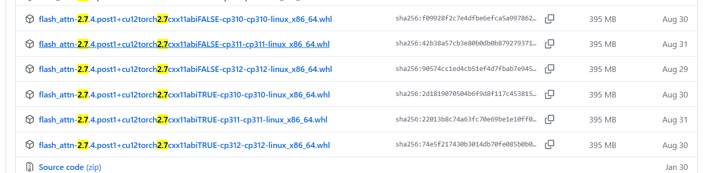

# Быстрая установка flash-attn

```bash
python -V
# 3.10
python -c "import torch; print(f'Torch: {torch.__version__}'); print(f'CUDA: {torch.version.cuda}')"
# Torch: 2.7.0+cu126
# CUDA: 12.6

python -c "import torch; print(f'GLIBCXX_USE_CXX11_ABI={torch._C._GLIBCXX_USE_CXX11_ABI}')"
# GLIBCXX_USE_CXX11_ABI=True
```

По результатам проверки окружения:
*   **Версия PyTorch**: `2.7.0+cu128` (CUDA 12.8)
*   **Версия Python**: `3.10`

Нужная версия `flash-attn`: `2.7.4.post1`.

### 1. Ссылка для загрузки
Откройте страницу **Flash Attention GitHub Releases**:
[https://github.com/Dao-AILab/flash-attention/releases/tag/v2.7.4.post1](https://github.com/Dao-AILab/flash-attention/releases/tag/v2.7.4.post1)

### 2. Имя файла
В списке Assets на этой странице найдите файл, название которого соответствует CUDA 12.8 и Torch 2.7:

**Предполагаемое имя файла:**
`flash_attn-2.7.4.post1+cu128torch2.7cxx11abiTrue-cp310-cp310-linux_x86_64.whl`

*Примечание: если сборки для `cu128` нет, возможно, официальный релиз ещё не содержит предварительно собранного пакета для CUDA 12.8. В этом случае можно попробовать ближайший вариант из серии `cu12x`, но при несовпадении возможны ошибки. Если нужна именно эта версия и готового пакета нет, остаётся сборка из исходников, которая занимает много времени.*

### 3. Установка
Загрузите `.whl`-файл на сервер и выполните:

```bash
pip install flash_attn-2.7.4.post1+cu128torch2.7cxx11abiTrue-cp310-cp310-linux_x86_64.whl
```

### 4. Проверка
После установки проверьте, что пакет импортируется:
```bash
python -c "import flash_attn; print(flash_attn.__version__)"
```



Скачайте именно этот файл:

```
flash_attn-2.7.4.post1+cu12torch2.7cxx11abiTRUE-cp310-cp310-linux_x86_64.whl
```
