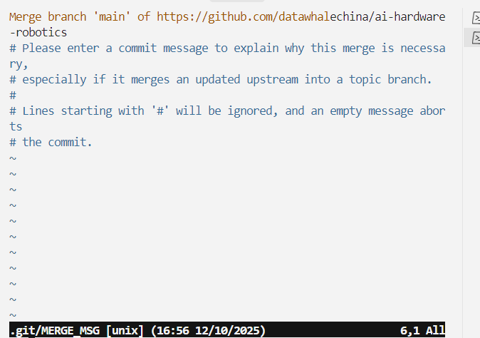

# Git: синхронизация с удалённой веткой при отклонённом push

При отправке изменений может появиться такая ошибка:

```text
git push
To https://github.com/datawhalechina/ai-hardware-robotics
! [rejected] main -> main (fetch first)
error: failed to push some refs to 'https://github.com/datawhalechina/ai-hardware-robotics'
hint: Updates were rejected because the remote contains work that you do not
hint: have locally. This is usually caused by another repository pushing to
hint: the same ref. If you want to integrate the remote changes, use
hint: 'git pull' before pushing again.
hint: See the 'Note about fast-forwards' in 'git push --help' for details.
```

- Ветка `main` на удалённом сервере новее, чем ваш локальный `origin/main`, поэтому push отклонён. Ваш локальный коммит нужно сначала объединить с новыми коммитами из удалённого репозитория (через merge или rebase).
- Порядок действий:
  1. `git fetch origin`: получаем последнее состояние удалённого репозитория.
  2. (необязательно) `git log --oneline --graph --decorate origin/main..main`: смотрим, чем ваши коммиты отличаются от удалённых.
  3. `git pull --rebase origin main` (или просто `git pull`): интегрируем новые коммиты в локальную ветку. Если возникли конфликты, исправьте их, выполните `git add <файл>` и затем `git rebase --continue`.
  4. Обычный `git push`.
- Если вы используете `git pull` (слияние по умолчанию), тоже подходит, но в истории появится дополнительный merge-коммит.
- После завершения rebase или merge push пройдёт без отклонения.



Во время `git pull` Git создаёт merge-коммит и открывает редактор по умолчанию (в этом примере Vim) с текстом сообщения для слияния. Строка `Merge branch 'main' of https://github.com/datawhalechina/ai-hardware-robotics` — это стандартное сообщение, а строки с `#` — комментарии, которые при сохранении игнорируются.

- Чтобы принять сообщение по умолчанию, нажмите `Esc`, введите `:wq` и нажмите Enter. Редактор закроется, Git создаст merge-коммит, и `git pull` завершится.
- Если хотите избежать merge-коммита, после завершения или отмены текущей операции используйте `git pull --rebase origin main`.
