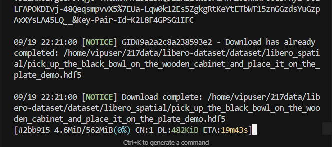

# Быстрая загрузка с Hugging Face без лишних файлов других веток

Скрипты в этом разделе позволяют загружать модели и датасеты с Hugging Face (и ModelScope) по списку ссылок через `aria2c`. Так можно скачать только нужную ветку или подкаталог, не получая файлы других веток и служебные данные.

## Быстрый запуск

Скрипт `download_hf_files.py` запускается так (аргументы: идентификатор репозитория, ветка, тип репозитория и путь загрузки):

```bash
python3 download_hf_files.py IPEC-COMMUNITY/spatialvla-4b-224-pt main --repo-type model --download_path /data1/spatialvla-4b-224-pt

python3 download_hf_files.py google/gemma-3-1b-it main --repo-type model --download_path ./gemma-3-1b-it

python3 download_hf_files.py lerobot/smolvla_base main --repo-type model --download_path ./smolvla_base

python3 download_hf_files.py nikriz/aopoli-lv-libero_combined_no_noops_lerobot_v21 main --repo-type dataset --download_path /home/user/data/aopoli-lv-libero

python3 hf_downloader.py nikriz/aopoli-lv-libero_combined_no_noops_lerobot_v21 main --repo-type dataset --download_path /home/user/data/aopoli-lv-libero-new

python3 hf_downloader.py openvla/modified_libero_rlds main --repo-type dataset --download_path ./modified_libero_rlds_data

python3 download_hf_files.py IPEC-COMMUNITY/spatialvla-4b-224-sft-bridge main --repo-type model --download_path ./spatialvla-4b-224-sft-bridge

python3 download_hf_files.py IPEC-COMMUNITY/spatialvla-4b-224-sft-bridge main --repo-type model --download_path ./spatialvla-4b-224-sft-bridge
```

Новая версия скрипта `download_hf_files_new.py` разделяет этапы: сначала создаётся список ссылок (`--generate-only`), затем выполняется загрузка (`--download-only`):

```bash
python3 download_hf_files_new.py IPEC-COMMUNITY/spatialvla-4b-224-sft-bridge main --repo-type model --download_path ./spatialvla-4b-224-sft-bridge --generate-only

python3 download_hf_files_new.py IPEC-COMMUNITY/spatialvla-4b-224-sft-bridge main --repo-type model --download_path ./spatialvla-4b-224-sft-bridge --download-only

python3 download_hf_files_new.py IPEC-COMMUNITY/spatialvla-4b-224-sft-fractal main --repo-type model --download_path ./spatialvla-4b-224-sft-fractal

python3 download_hf_files_new.py facebook/dinov3-vits16-pretrain-lvd1689m main --repo-type model --download_path ./dinov3-vits16-pretrain-lvd1689m

python hf_downloader.py yifengzhu-hf/LIBERO-datasets main --repo-type dataset --subfolder libero_spatial --download_path ./libero-dataset/dataset/ --download-only
```

Ниже пример с изображениями из раздела VLA:




Чтобы докачка работала (`-c`), запускайте команду из каталога, где лежит сессия загрузки:

```bash
aria2c -c -i download_links.txt
```

Для датасетов с подкаталогом можно сначала сгенерировать ссылки, а затем загрузить:

```bash
python hf_downloader.py yifengzhu-hf/LIBERO-datasets main --repo-type dataset --subfolder libero_spatial --download_path ./libero-dataset/dataset/ --generate-only

python hf_downloader.py yifengzhu-hf/LIBERO-datasets main --repo-type dataset --subfolder libero_10 --download_path ./libero-dataset/dataset/ --generate-only

python hf_downloader.py spatialverse/InteriorAgent main --repo-type dataset --download_path ./interiornav_data/scene_data --generate-only

python hf_downloader.py spatialverse/InteriorAgent main --repo-type dataset --download_path ./interiornav_data/scene_data --download-only

python hf_downloader.py nvidia/GR00T-N1.6-3B main --repo-type model --download_path ./GR00T-N1.6-3B

python hf_downloader.py shashuo0104/phystwin-toy main --repo-type model --download_path ./rope

python hf_downloader.py shashuo0104/phystwin-rope main --repo-type model --download_path ./sloth

python hf_downloader.py shashuo0104/phystwin-T-block main --repo-type model --download_path ./T
```

Для ModelScope используется параметр `--provider ms`:

```bash
# Для публичных датасетов запускайте напрямую:
python hf_downloader.py agibot_world/GenieSimAssets master --provider ms --repo-type dataset --download_path ./assets

python hf_downloader.py agibot_world/GenieSimAssets master --provider ms --repo-type dataset --download_path ./assets1

# Если ModelScope просит войти в аккаунт, сначала задайте токен:
# export MS_TOKEN=ваш_токен_ModelScope_SDK
```

## Код скрипта `hf_downloader.py`

```python
import os
import requests
import argparse
from urllib.parse import quote, urlencode
import re

def fetch_file_list(repo_id, branch, repo_type, provider, token):
    all_files = []
    headers = {"Authorization": f"Bearer {token}"} if token else {}
    
    if provider == 'hf':
        next_url = f"https://huggingface.co/api/{repo_type}s/{repo_id}/tree/{branch}?recursive=true"
        while next_url:
            response = requests.get(next_url, headers=headers)
            if response.status_code != 200: return None
            all_files.extend(response.json())
            match = re.search(r'<([^>]+)>;\s*rel="next"', response.headers.get("Link", ""))
            next_url = match.group(1) if match else None
    else:  
        # Адаптация для ModelScope
        ms_repo_type = "datasets" if repo_type == "dataset" else "models"
        # Интерфейс списка файлов ModelScope: /repo/tree
        api_url = f"https://modelscope.cn/api/v1/{ms_repo_type}/{repo_id}/repo/tree"
        
        page_number = 1
        while True:
            params = {"Recursive": "true", "Revision": branch, "PageNumber": page_number, "PageSize": 1000}
            response = requests.get(api_url, params=params, headers=headers)
            if response.status_code != 200:
                print(f"Failed to fetch list at page {page_number}: {response.text}")
                return None if page_number == 1 else all_files
            
            data = response.json()
            files_data = data.get('Data', {}).get('Files', [])
            if not files_data:
                break
                
            for f in files_data:
                all_files.append({
                    'path': f['Path'],
                    'type': 'file' if f['Type'].lower() == 'blob' else 'folder'
                })
            
            # Если в текущей странице меньше файлов, чем PageSize, значит это последняя страница
            if len(files_data) < 1000:
                break
            page_number += 1
    return all_files

def generate_links_file(file_list, repo_id, branch, download_path, repo_type, provider, subfolder=None):
    os.makedirs(download_path, exist_ok=True)
    download_links = []
  
    # Фильтруем файлы
    prefix = subfolder.strip('/') + '/' if subfolder else ""
    filtered_list = [f for f in file_list if f.get('type') == 'file' and f['path'].startswith(prefix)]

    for file_info in filtered_list:
        file_path = file_info['path']
        
        if provider == 'hf':
            base = f"https://huggingface.co/{'datasets/' if repo_type == 'dataset' else ''}{repo_id}/resolve/{branch}/"
            url = base + quote(file_path)
        else:
            ms_type = "datasets" if repo_type == "dataset" else "models"
            # Формируем URL загрузки: интерфейс /repo с параметрами Revision и FilePath
            params = urlencode({"Revision": branch, "FilePath": file_path})
            url = f"https://modelscope.cn/api/v1/{ms_type}/{repo_id}/repo?{params}"

        # Настройка aria2c: out должен быть именем файла, но структуру каталогов мы сохраняем
        # Опция out с путём гарантирует, что aria2c положит файл в нужный подкаталог
        aria2_out = f"  out={file_path}" 
        download_links.append((url, aria2_out))

    if not download_links:
        print("No files found.")
        return

    links_txt = os.path.join(download_path, "download_links.txt")
    with open(links_txt, "w") as f:
        for url, out in download_links:
            f.write(f"{url}\n{out}\n")
    print(f"Total files: {len(download_links)}. Links saved to {links_txt}")

def start_download(download_path, token):
    links_txt = os.path.join(download_path, "download_links.txt")
    header = f'--header="Authorization: Bearer {token}"' if token else ""
    # Важно: API ModelScope возвращает перенаправление 302 на CDN, поэтому aria2c должен обрабатывать редиректы
    # Добавляем --check-certificate=false, чтобы избежать ошибок сертификатов в некоторых контейнерах
    cmd = (f'aria2c -x 16 -s 16 -c --check-certificate=false '
           f'-i "{links_txt}" -d "{download_path}" {header} --file-allocation=none')
    os.system(cmd)

def main():
    parser = argparse.ArgumentParser()
    parser.add_argument("repo_id")
    parser.add_argument("branch")
    parser.add_argument("--provider", default="hf", choices=["hf", "ms"])
    parser.add_argument("--repo-type", default="model", choices=["model", "dataset"])
    parser.add_argument("--download_path", default=None)
    parser.add_argument("--subfolder", default=None)
    
    args = parser.parse_args()
    token = os.getenv("MS_TOKEN") if args.provider == "ms" else os.getenv("HF_TOKEN")
    path = args.download_path or f"./{args.repo_id.split('/')[-1]}"

    files = fetch_file_list(args.repo_id, args.branch, args.repo_type, args.provider, token)
    if files:
        generate_links_file(files, args.repo_id, args.branch, path, args.repo_type, args.provider, args.subfolder)
        start_download(path, token)

if __name__ == "__main__":
    main()
```
