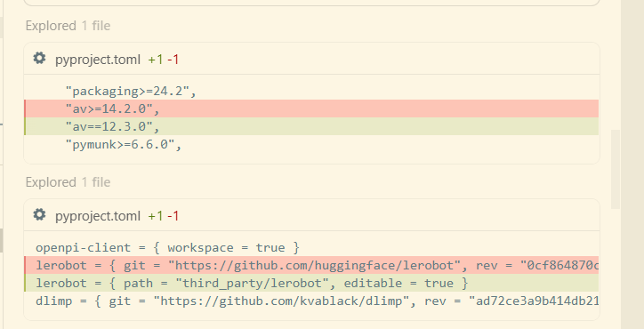
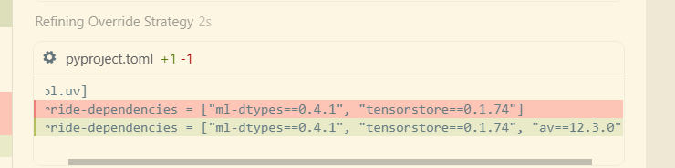

# Ошибка установки зависимости PyAV (av) для LeRobot

При `uv sync` в проекте OpenPI может возникнуть ошибка сборки пакета `av==14.4.0`, который является зависимостью `lerobot`.

```text
(isaac) root@<host>:~/<data-dir>/openpi# uv sync
warning: The `tool.uv.dev-dependencies` field (used in `packages/openpi-client/pyproject.toml`) is deprecated and will be removed in a future release; use `dependency-groups.dev` instead
Resolved 281 packages in 1m 04s
    Updated https://github.com/huggingface/lerobot (0cf8
      Built openpi-client @ file:///<data-dir>/openpi/packages/openpi-client
      Built openpi @ file:///<data-dir>/openpi
      Built lerobot @ git+https://github.com/huggingface
      Built tree==0.2.4
      Built antlr4-python3-runtime==4.9.3
      Built evdev==1.9.2
  × Failed to build `av==14.4.0`
  ├─▶ The build backend returned an error
  ╰─▶ Call to
      `setuptools.build_meta:__legacy__.build_wheel`
      failed (exit status: 1)

      [stdout]

      Warning! You are installing from source.
      It is EXPECTED that it will fail. You are
      REQUIRED to use ffmpeg 7.
      You MUST have Cython, pkg-config, and a C
      compiler.

      pkg-config could not find libraries ['avformat',
      'avcodec', 'avdevice', 'avutil', 'avfilter',
      'swscale', 'swresample']

      [stderr]
      Package libavformat was not found in the
      pkg-config search path.
      Perhaps you should add the directory containing
      `libavformat.pc'
      to the PKG_CONFIG_PATH environment variable
      No package 'libavformat' found
      Package libavcodec was not found in the
      pkg-config search path.
      Perhaps you should add the directory containing
      `libavcodec.pc'
      to the PKG_CONFIG_PATH environment variable
      No package 'libavcodec' found
      Package libavdevice was not found in the
      pkg-config search path.
      Perhaps you should add the directory containing
      `libavdevice.pc'
      to the PKG_CONFIG_PATH environment variable
      No package 'libavdevice' found
      Package libavutil was not found in the
      pkg-config search path.
      Perhaps you should add the directory containing
      `libavutil.pc'
      to the PKG_CONFIG_PATH environment variable
      No package 'libavutil' found
      Package libavfilter was not found in the
      pkg-config search path.
      Perhaps you should add the directory containing
      `libavfilter.pc'
      to the PKG_CONFIG_PATH environment variable
      No package 'libavfilter' found
      Package libswscale was not found in the
      pkg-config search path.
      Perhaps you should add the directory containing
      `libswscale.pc'
      to the PKG_CONFIG_PATH environment variable
      No package 'libswscale' found
      Package libswresample was not found in the
      pkg-config search path.
      Perhaps you should add the directory containing
      `libswresample.pc'
      to the PKG_CONFIG_PATH environment variable
      No package 'libswresample' found

      hint: This usually indicates a problem with the
      package or the build environment.
  help: `av` (v14.4.0) was included because `openpi`
        (v0.1.0) depends on `lerobot` (v0.1.0) which
        depends on `av`
```

Сборка из исходников требует FFmpeg 7 и заголовков разработки (`libavformat` и других), которых нет в системе. Ниже обходной путь: клонировать LeRobot локально и зафиксировать совместимую версию `av`.

```bash
mkdir -p <data-dir>/openpi/third_party && git clone https://github.com/huggingface/lerobot <data-dir>/openpi/third_party/lerobot && cd <data-dir>/openpi/third_party/lerobot && git checkout 0cf864870cf29f4738d3ade893e6fd13fbd7cdb5
```





1.  **Клонируем LeRobot и меняем версию `av`**: в `third_party/lerobot` клонируется нужная версия LeRobot, а в его `pyproject.toml` требование `av>=14.2.0` заменяется на `av==12.3.0`. Для этой версии обычно есть готовый wheel, поэтому FFmpeg 7 не нужен.
2.  **Настраиваем локальную зависимость**: в `openpi/pyproject.toml` источник `lerobot` меняется с удалённого репозитория на локальный путь, и добавляется принудительное переопределение `av==12.3.0` (override).
3.  **Синхронизируем окружение**: `uv sync` успешно устанавливает все зависимости без ошибки компиляции `av`.

### Текущее состояние

Окружение готово. Обратите внимание: в команде запуска, которую вы приводили, в конце попал `@<host>/openpi`. Это, похоже, приглашение shell (prompt), которое случайно скопировали вместе с командой. **При запуске его нужно убрать.**

**Итоговая команда для запуска:**

```bash
XLA_PYTHON_CLIENT_MEM_FRACTION=0.5 uv run scripts/serve_policy.py policy:checkpoint \
    --policy.config=pi0_fast_droid_jointpos_polaris \
    --policy.dir=gs://openpi-assets/checkpoints/pi0_fast_droid_jointpos
```

### Что произойдёт при запуске

1.  **Загрузка конфигурации**: используется конфигурация `pi0_fast_droid_jointpos_polaris`. Это модель π₀-FAST для управления манипулятором DROID в режиме управления положением суставов.
2.  **Загрузка модели**: `uv` автоматически скачает параметры модели из Google Cloud Storage и сохранит их в кэше `~/.cache/openpi/openpi-assets/checkpoints/pi0_fast_droid_jointpos`.
3.  **Запуск сервиса**: локально запускается WebSocket-сервер инференса (по умолчанию порт 8000).
4.  **Контроль видеопамяти**: `XLA_PYTHON_CLIENT_MEM_FRACTION=0.5` ограничивает предварительное выделение памяти JAX половиной видеопамяти и оставляет место для Isaac Sim.

**Важно:** `uv` работает в собственном виртуальном окружении `.venv`, созданном им самим, и **не меняет и не ломает ваше окружение conda `isaac`**.
