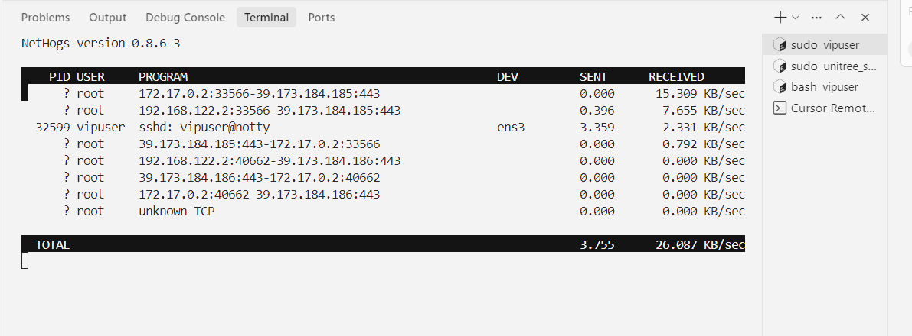

# Проверка пропускной способности и подключения в Linux

Сетевые проблемы удобно делить на три группы: нагрузка от процессов, сквозная пропускная способность и доступность внешних сайтов. На этой странице для их диагностики используются `nethogs`, `iperf3` и `curl`.

## Просмотр пропускной способности по процессам

```bash
sudo apt-get update
sudo apt-get install -y nethogs
sudo nethogs
```

Программа показывает скорость загрузки и отдачи по каждому процессу в реальном времени. Выход — клавиша `q`.



## Проверка пропускной способности между двумя машинами

Установите `iperf3` на обе машины:

```bash
sudo apt-get install -y iperf3
```

На сервере выполните:

```bash
iperf3 -s
```

На клиенте выполните:

```bash
iperf3 -c <SERVER_IP> -P 4
```

## Проверка и устранение неполадок

Если `curl` ещё не установлен, сначала выполните:

```bash
sudo apt-get install -y curl
```

```bash
curl -I --connect-timeout 10 https://github.com
ip route
```

`iperf3` показывает пропускную способность между двумя машинами в локальной сети. `curl` проверяет подключение к конкретному сайту и его ответ. `nethogs` показывает, какие процессы на этом компьютере используют канал. Результаты этих трёх инструментов нельзя подменять друг другом.

Если домен не открывается, а IP-адрес доступен, проверьте настройки DNS. Если `iperf3` не подключается, проверьте порт сервера и правила файрвола. Если канал полностью занят одним процессом, найдите его в `nethogs` и затем уменьшите число параллельных соединений.
