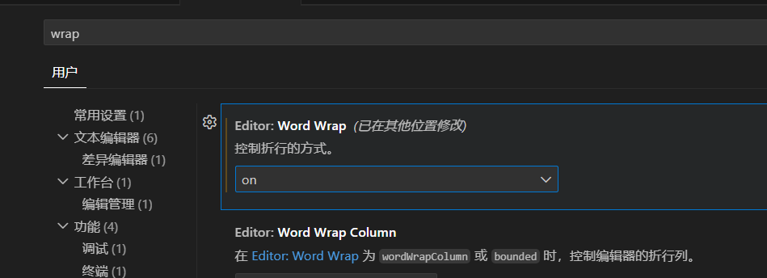

# Автоматический перенос строк в VS Code

1. Нажмите `Ctrl+Shift+P`, чтобы открыть командную строку. Введите `settings` и выберите **Preferences: Open User Settings**.
2. Перейдите на вкладку **Commonly Used** или нажмите `Ctrl+F` и найдите `wrap`. Откройте раздел **Editor**.
3. Найдите параметр **Editor: Word Wrap** и измените значение с `off` на `on`. После этого длинные строки будут переноситься.

