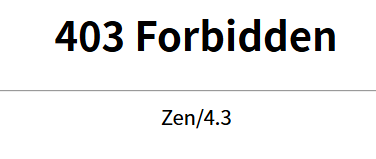
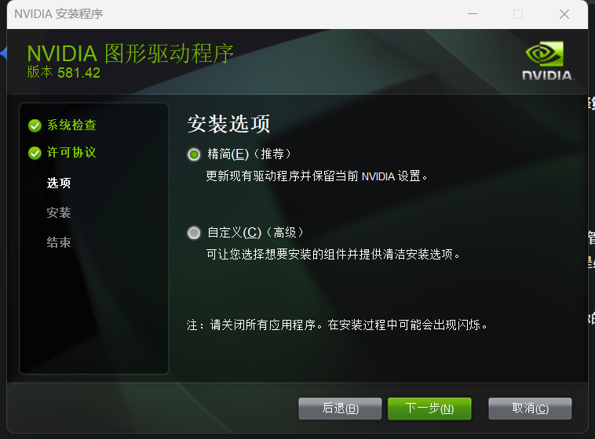
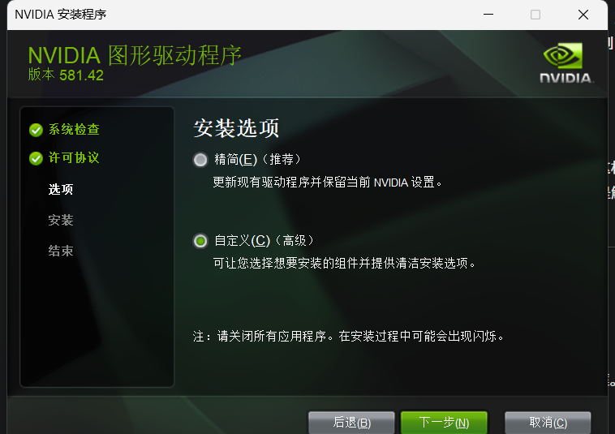
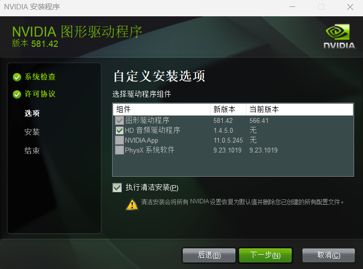

# Установка драйвера CUDA и nvcc в WSL

```bash
wget https://developer.download.nvidia.com/compute/cuda/repos/wsl-ubuntu/x86_64/cuda-wsl-ubuntu.pin
sudo mv cuda-wsl-ubuntu.pin /etc/apt/preferences.d/cuda-repository-pin-600
wget https://developer.download.nvidia.com/compute/cuda/12.5.1/local_installers/cuda-repo-wsl-ubuntu-12-5-local_12.5.1-1_amd64.deb
sudo dpkg -i cuda-repo-wsl-ubuntu-12-5-local_12.5.1-1_amd64.deb
sudo cp /var/cuda-repo-wsl-ubuntu-12-5-local/cuda-*-keyring.gpg /usr/share/keyrings/
sudo apt-get update

sudo apt-get -y install cuda-toolkit-12-5

export PATH=/usr/local/cuda/bin:$PATH
# Добавьте в ~/.bashrc
export PATH=/usr/local/cuda/bin${PATH:+:${PATH}}
export LD_LIBRARY_PATH=/usr/local/cuda/lib64${LD_LIBRARY_PATH:+:${LD_LIBRARY_PATH}}

mamba activate py311
nvcc --version
```

Затем установите драйвер NVIDIA для Windows.

Официальная страница загрузки драйверов: https://www.nvidia.com/zh-cn/geforce/drivers/

**Ручной выбор параметров**:

1. Откройте ссылку выше.
2. В выпадающих списках выберите:
   - **Product Type**: GeForce;
   - **Product Series**: GeForce RTX 30 Series (Notebooks), где Notebooks означает версию для ноутбуков;
   - **Product**: GeForce RTX 3060 Laptop GPU;
   - **Operating System**: Windows 11 (или ваша версия Windows);
   - **Download Type**: Game Ready Driver (GRD).
3. Нажмите **Search** и скачайте последнюю версию драйвера со страницы результатов.

Обязательно войдите в аккаунт NVIDIA, иначе загрузка вернёт ошибку 403 Forbidden.








