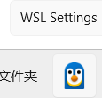

# Настройка графического интерфейса WSL

```bash
wsl
```


После установки перезагрузите компьютер и установите дистрибутив:

```bash
# Нужна перезагрузка компьютера

wsl --install -d Ubuntu-22.04

# sudo apt update && sudo apt upgrade
# Обновление можно пока пропустить
```

Этот способ запасной. Заголовки ядра часто приходится собирать заново. Если это сложно, вернитесь к этому способу позже:

```bash
ls /usr/src/linux-headers-5.15.0-156
sudo mkdir -p /lib/modules/5.15.0-156
cd /lib/modules/5.15.0-156
sudo ln -fs /usr/src/linux-headers-5.15.0-156 build
sudo ln -fs /usr/src/linux-headers-5.15.0-156 source
```

Если система повреждена, восстановите её из резервной копии:

```bash
# mkdir -p /mnt/c/WSL_Backup && tar -czf /mnt/c/WSL_Backup/home_user_backup_$(date +%Y%m%d_%H%M%S).tar.gz -C /home user
# Рекомендуется использовать этот способ
rsync -ah --info=progress2 /home/user/ /mnt/c/WSL_Backup/user/
wsl --list --verbose
wsl --shutdown
wsl --unregister Ubuntu-22.04

# Пересоздаём окружение

cd ~
tar -xzf /mnt/c/WSL_Backup/home_user_backup_*.tar.gz -C /home/user/ --strip-components=1
```

Далее рассмотрим более надёжный способ подключения: **xrdp**.

Если появляется предупреждение `wsl: обнаружена настройка прокси localhost, но она не зеркалирована в WSL. В режиме NAT WSL не поддерживает прокси localhost`, в настройках WSL (WSL Settings) выберите сетевой режим **Mirrored**.



Установите рабочий стол Xfce:

```bash
sudo apt update
sudo apt install -y xfce4 xfce4-goodies
```

# Запуск графического интерфейса WSL через xrdp

## 1. Установка графической среды

Сначала выберите и установите рабочий стол. Ниже два распространённых варианта.

### Вариант A: Xfce (лёгкий, рекомендуется)

```bash
sudo apt update
sudo apt install -y xfce4 xfce4-goodies
```

### Вариант B: Ubuntu Desktop (полный рабочий стол)

```bash
sudo apt update
sudo apt install -y ubuntu-desktop
```

## 2. Установка xrdp

```bash
sudo apt install -y xrdp
```

## 3. Настройка xrdp

```bash
# Настраиваем xrdp на использование Xfce
echo "xfce4-session" > ~/.xsession

# Редактируем скрипт запуска xrdp
sudo sed -i 's/^test -x \/etc\/X11\/Xsession && exec \/etc\/X11\/Xsession$/startxfce4/' /etc/xrdp/startwm.sh

# Или вручную откройте /etc/xrdp/startwm.sh и добавьте в конец файла:
# startxfce4
```

## 4. Настройка порта xrdp (необязательно)

```bash
# Порт по умолчанию — 3389. При необходимости отредактируйте конфигурацию
sudo nano /etc/xrdp/xrdp.ini
# Найдите строку port=3389 и при необходимости замените порт
```

## 5. Запуск службы xrdp

```bash
sudo service xrdp start

# Проверка состояния службы
sudo service xrdp status
```

## 6. Автозапуск при старте системы (необязательно)

```bash
# В WSL2 можно добавить в конец ~/.bashrc или ~/.zshrc:
# sudo service xrdp start
```

## 7. Подключение к графическому интерфейсу

**В Windows:**

1. Нажмите `Win + R`, чтобы открыть окно «Выполнить».
2. Введите `mstsc` и нажмите Enter, чтобы открыть «Подключение к удалённому рабочему столу».
3. В поле «Компьютер» введите `localhost:3389` или `127.0.0.1:3389`.
4. Нажмите «Подключить».
5. Введите имя пользователя и пароль WSL.

## 8. Устранение неполадок

### Чёрный экран или нет подключения

```bash
# Перезапускаем службу xrdp
sudo service xrdp restart

# Проверяем, не занят ли порт
netstat -an | grep 3389

# Смотрим журналы xrdp
cat /var/log/xrdp.log
cat /var/log/xrdp-sesman.log
```

### Оптимизация настроек

В `/etc/xrdp/xrdp.ini` можно изменить:

```ini
# Глубина цвета (для повышения производительности)
max_bpp=16

# Настройки сжатия
compression_level=9
```

## 9. Дополнительные советы

**Производительность:**
- Если возникают проблемы с производительностью, используйте Xfce, а не GNOME или KDE.
- Снижение глубины цвета ускоряет отклик.

**Безопасность:**
```bash
# Разрешаем подключения только с локального компьютера
sudo ufw allow from 127.0.0.1 to any port 3389
```

**Скрипт запуска (в Windows PowerShell):**
```powershell
# Создаём скрипт запуска
wsl -d Ubuntu sudo service xrdp start
```

## 10. Альтернативные варианты

Если xrdp не работает, можно попробовать:

- **VcXsrv** или **X410**: X-сервер для Windows;
- **WSLg**: встроенная в WSL2 поддержка графики (нужна Windows 11 или последняя версия Windows 10).

Затем выполните:

```bash
sudo bash -c 'cat > /etc/xrdp/startwm.sh << "EOF"
#!/bin/sh
# Сбрасываем переменные, которые ломают сессию
unset DBUS_SESSION_BUS_ADDRESS
unset XDG_RUNTIME_DIR

# Подключаем profile, чтобы получить PATH и другие переменные окружения
. /etc/profile

# Запускаем сессию рабочего стола Xubuntu/Xfce
exec startxfce4
EOF'
```

Для рабочего стола MATE используется такой скрипт:

```bash
sudo bash -c 'cat > /etc/xrdp/startwm.sh << "EOF"
#!/bin/sh
# Сбрасываем переменные, которые ломают сессию
unset DBUS_SESSION_BUS_ADDRESS
unset XDG_RUNTIME_DIR

# Подключаем profile, чтобы получить PATH и другие переменные окружения
. /etc/profile

# Запускаем сессию рабочего стола MATE
exec mate-session
EOF'
```

Для рабочего стола MATE нужно установить дополнительные пакеты. В исходном материале список этих пакетов не приведён.
