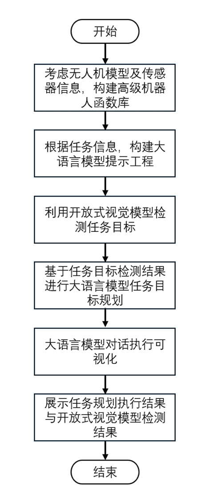
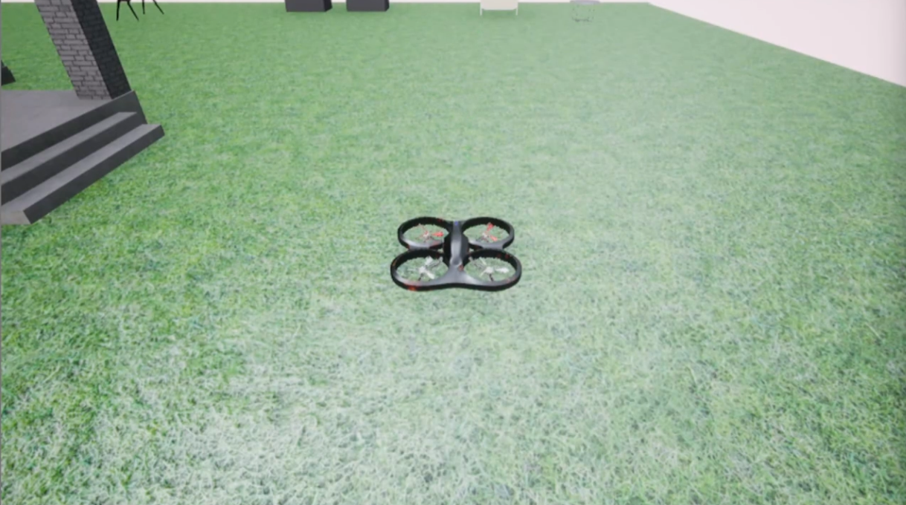
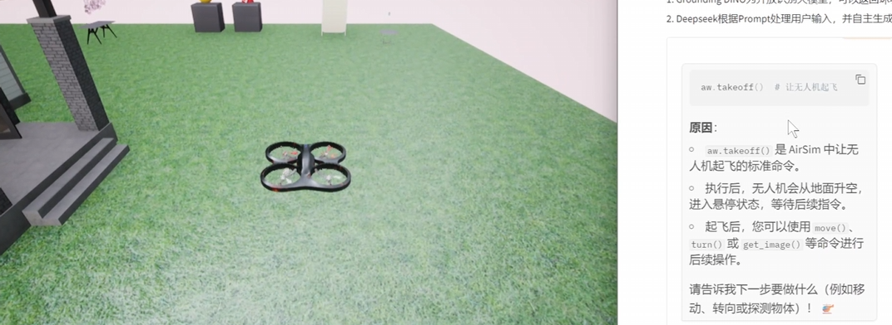
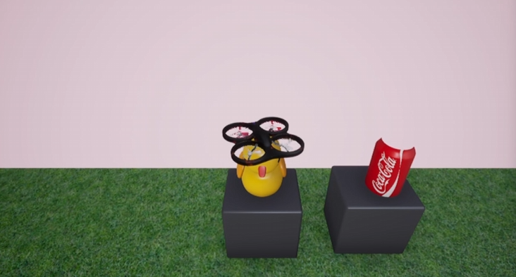
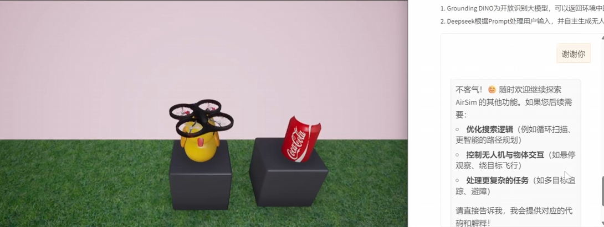

# Мультимодальная большая модель для беспилотника и базовая практика с Grounding DINO

Мультимодальная большая языковая модель для беспилотника объединяет DeepSeek и мультимодальное открытое распознавание Grounding DINO. Так получается замкнутый цикл от самовосприятия до автономного поведения. Основные технологии:

1. Grounding DINO — модель открытого распознавания: она возвращает метки и координаты различных объектов в окружении.
2. DeepSeek обрабатывает пользовательский ввод согласно промпту и самостоятельно генерирует код, который может выполнить беспилотник, чтобы решить задачу.

Для руководства достаточно знать основы Python.

Если вы совсем новичок, можно сначала изучить другие руководства Datawhale, например happy-llm.

## 1. Окружение и основы

### 1. Windows
### 2. Python 3.10 или новее
### 3. torch
### 4. GroundingDINO

Инструкция по установке: https://github.com/IDEA-Research/GroundingDINO?tab=readme-ov-file

Клонируйте проект GroundingDINO с GitHub:

```python
git clone https://github.com/IDEA-Research/GroundingDINO.git
```

Перейдите в папку GroundingDINO:

```python
cd GroundingDINO/
```

Установите необходимые зависимости в этой папке:

```python
pip install -e .
```

Загрузите предобученные веса модели:

```python
mkdir weights
cd weights
wget -q https://github.com/IDEA-Research/GroundingDINO/releases/download/v0.1.0-alpha/groundingdino_swint_ogc.pth
cd ..
```

### 5. Среда AirSim

Среду AirSim можно запустить напрямую через файл `House.exe` из папки `env`.

Путь для загрузки: https://huggingface.co/datasets/Datawhale/house_win

> **Примечание.** В исходном материале в папке `code/external-libraries` лежат сторонние библиотеки (airsim 1.8.1, msgpack, tornado 4.5.3), которые `robot_library.py` подключает через `sys.path.append('./external-libraries')`. В учебнике эта папка не включена. Установите AirSim-клиент через pip (`pip install airsim`) и проверьте совместимость версий зависимостей. Тогда строку `sys.path.append` можно удалить.

### 6. Установка Gradio

Установите Gradio через pip:

```python
pip install --upgrade gradio
```

## 2. Общая структура проекта

1. Определена библиотека функций беспилотника.
2. Большая языковая модель с помощью промпт-инжиниринга описывает задачу и управляет беспилотником для её выполнения.
3. Grounding DINO выполняет открытое обнаружение объектов и распознаёт предметы, нужные для задачи.
4. Диалог с большой языковой моделью выводится на веб-страницу.



## 3. Разбор кода

```python
parser = argparse.ArgumentParser()
parser.add_argument("--prompt", type=str, default="prompts.txt")
parser.add_argument("--sysprompt", type=str, default="system_prompts.txt")
args = parser.parse_args()
```

Библиотека навыков беспилотника и системный промпт импортируются и используются как основа промпт-инжиниринга для большой языковой модели. Функции робота, определённые в файле, такие:

```python
aw.takeoff():взлёт беспилотника.
aw.land():посадка беспилотника.
aw.get_image():получение изображения с фронтальной камеры агента.
aw.get_drone_position():возвращает текущее положение беспилотника в виде списка из трёх чисел с плавающей точкой, соответствующих координатам XYZ.
aw.turn(angle):поворачивает робота на заданный угол в градусах; angle — это угол.
aw.move(distance):перемещает робота прямо вперёд на заданное расстояние в метрах; distance — это расстояние.
aw.ob_objects(obj_name_list):возвращает наблюдаемые в окружении объекты с их названием, углом и расстоянием в виде списка [(имя_объекта1, расстояние, угол), (имя_объекта1, расстояние, угол), ...], где угол указан в градусах, например obj_name_list = ['yellow duck', 'coca cola', 'mirror', 'flower'].
Перед вызовом aw.ob_objects(obj_name_list) нужно сначала выполнить get_image(), чтобы получить информацию об изображении.
```

Для вызова большой языковой модели DeepSeek используется API. Замените `your-key` на свой ключ API, его можно получить здесь: https://platform.deepseek.com/api_keys

```python
client = OpenAI(api_key="your-key", base_url="https://api.deepseek.com", http_client=httpx.Client(verify=False))
with open(args.sysprompt, "r", encoding="utf-8") as f:
    sysprompt = f.read()
```

Ниже самый важный код большой языковой модели. Через созданный выше `client` выполняется вывод модели. В параметре `model="deepseek-chat"` значение `deepseek-chat` можно заменить на другую модель DeepSeek.

```python
def ask(prompt):
    chat_history.append(
        {
            "role": "user",
            "content": prompt,
        }
    )
    completion = client.chat.completions.create(
        model="deepseek-chat",
        messages=chat_history,
        temperature=0
    )
    chat_history.append(
        {
            "role": "assistant",
            "content": completion.choices[0].message.content,
        }
    )
    return chat_history[-1]["content"]
```

Содержимое prompt.txt выглядит так:

```python
Вопрос: можете задать мне уточняющий вопрос, но обязательно обозначьте его как «Вопрос».

Код:
python
    здесь выводится команда кода, которая достигает ожидаемой цели.

Причина: после вывода кода нужно объяснить, зачем это сделано.
```

Видно, что промпт также может ограничивать вывод большой модели. Поскольку вывод уже ограничен, его можно обработать по-своему, с помощью функции `extract_python_code`.

```python
def extract_python_code(content):
    code_blocks = code_block_regex.findall(content)
    if code_blocks:
        full_code = "\n".join(code_blocks)

        if full_code.startswith("python"):
            full_code = full_code[7:]

        return full_code
    else:
        return None
```

Вывод большой модели визуализируется через Gradio.

```python
with gr.Blocks() as demo:
    # gr.Markdown("# Мультимодальная большая языковая модель для беспилотника")
    gr.Markdown("""
                # Мультимодальная большая языковая модель для беспилотника

                Мультимодальная большая языковая модель для беспилотника объединяет языковую модель DeepSeek и открытое мультимодальное распознавание Grounding DINO, формируя замкнутый цикл от самовосприятия до автономного поведения.
                1. Grounding DINO — модель открытого распознавания: она возвращает метки и координаты различных объектов в окружении.
                2. DeepSeek обрабатывает пользовательский ввод согласно промпту и самостоятельно генерирует код, который может выполнить беспилотник, чтобы решить задачу.
                """)
    with gr.Row():
        with gr.Column():
            chatbot = gr.Chatbot()
            msg = gr.Textbox()
            clear = gr.ClearButton([msg, chatbot])
            def respond(message, chat_history):
                response = ask(message)
                bot_message = response
                chat_history.append((message, bot_message))
                code = extract_python_code(response)
                if code is not None:
                    print("Пожалуйста, подождите, пока я выполню код в AirSim...")
                    exec(extract_python_code(response))
                    print("Готово!\n")
                # time.sleep(2)
                return "", chat_history
            msg.submit(respond, [msg, chatbot], [msg, chatbot])
        with gr.Column():
            img = gr.Image("datawhale.jpg")
            image_button = gr.Button("Display")
        image_button.click(display_image, inputs=img, outputs=img)

demo.launch()
```

## 4. Порядок выполнения

### 1. Запустите файл `house.exe` из папки `env`, чтобы открыть среду



### 2. Запустите файл `main_gradio.py`

В терминале появится ссылка, откройте её в браузере:

```python
Running on local URL: http://127.0.0.1:7860
To create a public link,set`share=True`in launch()
```

### 3. Введите в терминале команды 1), 2) и 3), чтобы выполнить задачи

#### 1) Взлетай

Вы увидите следующий вывод, и код будет выполнен автоматически.



#### 2) Найди yellow duck и подлети к нему



#### 3) Спасибо



## 5. Ссылки

1. Статья: ChatGPT for Robotics: Design Principles and Model Abilities
2. Среда для сравнения: AIStudio — пример полёта беспилотника с помощью большой модели ERNIE (мультимодальная модель восприятия)
