# Комплексное практическое введение в воплощённую навигацию

### Вы прошли базовый курс, но всё ещё не понимаете, как перейти к практике? Вы воспроизвели современный код, но он слишком сложен, и непонятно, как устроен алгоритм? Среда слишком сложна, датасеты очень большие, загрузка слишком запутанная, и неясно, как использовать большие модели и другие алгоритмы?

### Этот курс использует простейшую тестовую среду: каждый алгоритм вынесен в отдельный файл, а главная функция собирает их вместе. Модули можно свободно заменять (достаточно понимать их входы и выходы). Модули в основном отделены от среды, поэтому их можно перенести в другой симулятор или даже развернуть в реальной навигационной среде. Курс использует подход zero-shot navigation, то есть воплощённая навигация выполняется без какой-либо дообучения.

### Курс подробно объясняет всё: от базовой установки окружения и загрузки весов моделей до описания и интеграции алгоритмов. Пройти путь от восприятия и принятия решений до планирования и управления можно примерно за «полдня». Алгоритмы курса можно использовать и как вход в воплощённую навигацию, и как основу для дальнейших исследований. Надеемся, что это хоть немного поможет в вашей научной работе. Начнём!

## 1. Начнём с настройки окружения

Если не хотите настраивать окружение вручную, для курса есть готовый образ. Его можно взять на Autodl по адресу: https://www.autodl.art/i/datawhalechina/every-embodied/datawhale-navigation

В README к образу Autodl есть подробная инструкция по запуску. Образ также доступен на gpu-free: найдите в каталоге образов `datawhale` и выберите образ «Комплексное практическое введение в воплощённую навигацию».

### 1. Настройка окружения conda

Создайте окружение navigation и активируйте его:

```bash
conda create -n navigation python=3.9 cmake=3.14.0
conda activate navigation
```

Установите habitat-sim 0.2.5:

```bash
conda install habitat-sim=0.2.5 withbullet headless -c conda-forge -c aihabitat
```

Установите habitat-lab 0.2.5. В облачном образе он уже развёрнут. Если хотите запускать на собственном компьютере, выполните следующие шаги. Важно: версия habitat-lab должна совпадать с версией habitat-sim.

1)Откройте репозиторий habitat-lab на GitHub: https://github.com/facebookresearch/habitat-lab.git

2)Перейдите в раздел Releases.

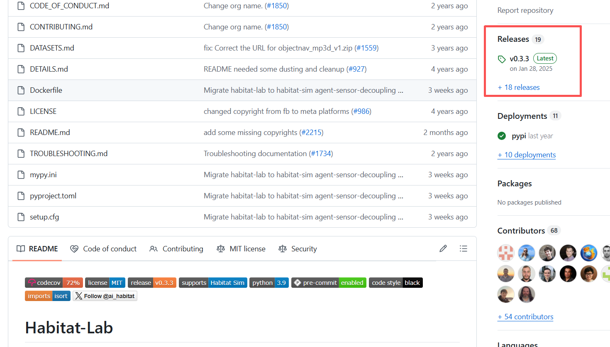

3)Выберите версию v0.2.5 и в разделе Assets скачайте Source code (zip), затем распакуйте архив.

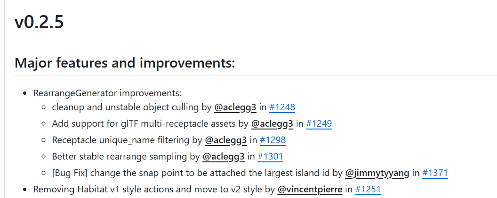

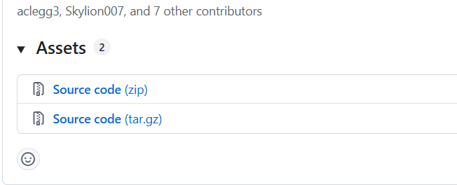

4)После распаковки должна получиться папка habitat-lab-0.2.5. Перейдите в неё и начните установку habitat-lab:

```bash
cd habitat-lab-0.2.5
pip install -e habitat-lab
```

**Если при установке появляется ошибка `no model named "torch"` или другие ошибки, попробуйте:**

```bash
pip install -e habitat-lab --no-build-isolation
```

### 2. Настройка окружения для алгоритмов

1)Установите модуль визуального восприятия:

```bash
pip install ultralytics
```

2)Установите компоненты, необходимые для больших моделей:

```bash
pip install openai
pip install transformers
```

3)Загрузите тестовые сцены симулятора:

```bash
python -m habitat_sim.utils.datasets_download --uids habitat_test_scenes --data-path /data
```

**Если вы хотите работать только через API, на этом настройка всех алгоритмов завершена.**

Некоторые спросят: а есть ли локальная версия? Да, есть. Если хотите развернуть модель локально, продолжите настройку ниже. Если нужен только API, пропустите следующий раздел и сразу переходите ко второй части. Локальное развёртывание тоже несложно.

1)Установка зависимостей:

```bash
pip install accelerate
pip install modelscope
```

2)Загрузка весов модели:

```bash
modelscope download --model Qwen/Qwen3-VL-4B-Instruct --local_dir /path/to/every_embodied_navigation/Qwen3-VL-4B-Instruct/
```

Путь можно изменить. Например, если главная функция находится в папке `every_embodied_navigation`, в ней нужно создать вложенную папку `Qwen3-VL-4B-Instruct` для весов модели. Если не создать эту папку, все файлы весов будут загружены прямо в папку с главной функцией. Из-за ограничений памяти в облачном образе использована модель Qwen3-VL-4B. Вы можете скачать Qwen3-VL-8B или другую модель на ModelScope и протестировать её. Для этого достаточно изменить файлы в папке `vlm`, файл `navigator.py` и файл `config.py`.

После загрузки полная структура каталогов выглядит так:

```
every_embodied_navigation/
├── main.py                    # Точка входа (поддерживает --mode local/api)
├── navigator.py               # EmbodiedNavigator, основной навигатор
│
├── config/
│   └── config.py              # Единая конфигурация
│
├── utils/
│   ├── simulator.py           # Инициализация habitat-sim и внутренние параметры камеры
│   └── geometry.py            # Поворот кватернионом, обратная проекция глубины
│
├── perception/
│   └── detector.py            # YOLODetector (детекция YOLOv8 и визуализация)
│
├── mapping/
│   └── map_utils.py           # Туман войны, поиск точек фронтира, преобразование координат
│
├── planning/
│   └── planner.py             # PathPlanner (планирование пути и выполнение навигации)
│
├── vlm/
│   ├── base_engine.py         # BaseVLMDecisionEngine (промпты, разбор ответа, деградация, журнал)
│   ├── local_engine.py        # LocalVLMDecisionEngine (локальный Qwen3-VL)
│   ├── api_engine.py          # APIVLMDecisionEngine (API, совместимый с OpenAI)
│   └── __init__.py            # create_vlm_engine()
│
├── output/
│   └── visualizer.py          # VisualOutput (HUD, панель карты, сохранение видео)
│
└── Qwen3-VL-4B-Instruct/      # Файлы весов
```

На этом установка завершена. Всё оказалось проще, чем кажется.

Возможно, кто-то скажет, что такая структура кода удобна, но для новичка из множества папок трудно разобраться. Поэтому для тех, кому пока не нужна полная навигационная архитектура, курс также предлагает два файла: `navigation_api.py` (вызов большой модели через API) и `navigation_local.py` (локальный запуск модели). Они работают без дополнительных зависимостей.

## 2. Пути к файлам и пояснения

1. Изменение способа вызова большой модели

* В главной функции можно выбрать, будет ли модель работать локально или через API, изменив параметр `mode`.
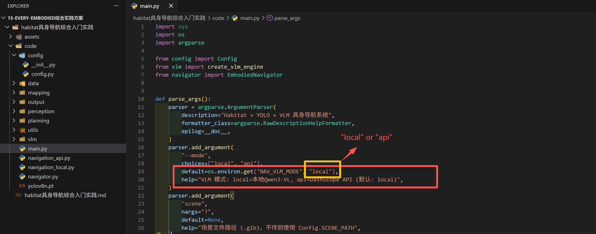

2. Изменение путей в config

* Путь к сцене задан относительно, обычно его менять не нужно.

* Путь к локальной VLM — это путь к локально развёрнутой модели. Лучше использовать абсолютный путь. Иначе система может искать модель в кэше `.cache`. Если возникают проблемы с доступом к huggingface, чаще всего причина в неверном пути: система считает, что веса не загружены, и пытается скачать их с сайта huggingface.

* `API_BASE_URL` — адрес платформы-посредника для моделей. В курсе используется платформа Alibaba Cloud Bailian. Если вы по-прежнему используете модели Qwen, менять адрес не нужно, для других моделей его надо изменить. `API_KEY` — ключ, полученный на платформе. `API_MODEL_NAME` — имя выбранной модели, его можно узнать на Alibaba Cloud Bailian или на другой платформе.

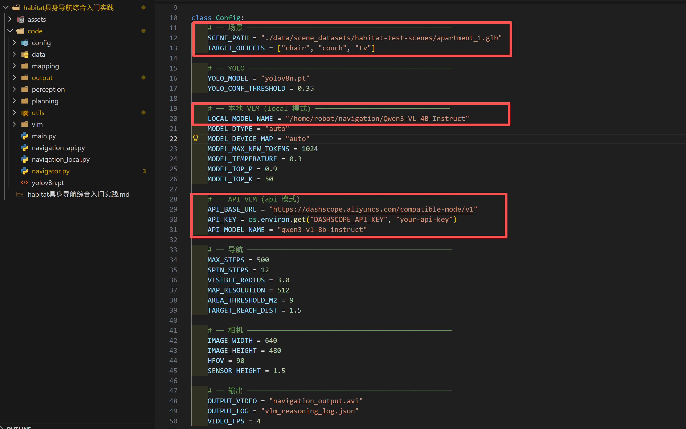

Получить API-ключ можно на примере Alibaba Cloud Bailian: https://bailian.console.aliyun.com/

Войдите в аккаунт, нажмите «Модели» в левом верхнем углу, затем «Управление ключами» в левом нижнем углу.

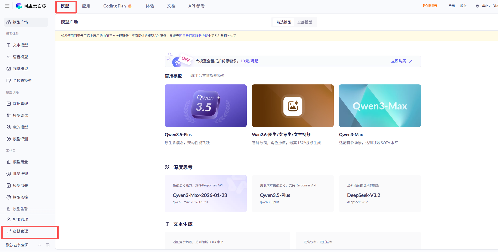

Затем нажмите «Создать API Key» в правом верхнем углу, чтобы получить API-ключ.


Откройте документацию и выберите список моделей: там видно, какие модели доступны через API. В этом курсе используется Qwen-VL. Нажав «Ещё модели» внизу, можно выбрать и другие версии qwen2.5-vl с разным числом параметров.
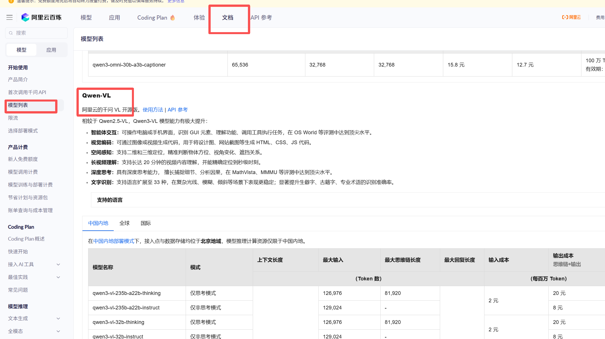

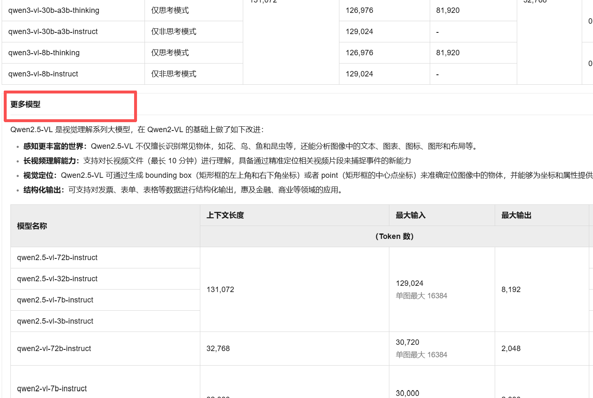

На этом все параметры и пути настроены. Можно запускать.

## 3. Запуск кода

После настройки всех параметров запустите код командой `python main.py`. Если возникает ошибка, сначала посмотрите раздел 6, «Борьба с ошибками». Если ошибка другая, сообщите о ней.

Полный процесс рассуждений модели виден в консоли, а также сохраняется в файл `vlm_reasoning_log.json`:

```text
============================================================
  📝 Полный процесс рассуждений большой модели
============================================================

--- Решение #1 ---
  Позиция: [0.9390037655830383, -1.5215539932250977, -2.021697998046875]
  Детекции: 13 объектов, фронтиры: 1 шт.
  Действие: go_to_object
  Уверенность: 0.85
  Рассуждение: На текущем изображении видны жалюзи, цели не видно. YOLO нашёл несколько диванов (couch), но они далеко (от 3.94 до 4.00 м) и ещё не посещались. По правилам сначала выбирается ближайшая непосещённая цель. Ближайший диван имеет индекс 9 и находится на расстоянии 2.36 м, что соответствует условию приоритета. Поэтому нужно идти к нему.

--- Решение #2 ---
  Позиция: [2.7892143726348877, -1.600250005722046, -0.646697998046875]
  Детекции: 17 объектов, фронтиры: 3 шт.
  Действие: explore_frontier
  Уверенность: 0.85
  Рассуждение: Среди найденных целей диван уже посещён, а искомый стул (chair) не обнаружен. В результатах YOLO стула нет, поэтому идти к цели напрямую нельзя. По правилу 3 нужно выбрать лучший фронтир для исследования. Среди доступных точек фронтир [1] с координатами [2.44, -1.60, 2.33] находится на расстоянии 3.00 м и ведёт в неисследованную область, а расстояние умеренное. Поэтому выбираем его.

--- Решение #3 ---
  Позиция: [2.423809766769409, -1.600250005722046, 2.2950756549835205]
  Детекции: 8 объектов, фронтиры: 5 шт.
  Действие: go_to_object
  Уверенность: 0.81
  Рассуждение: Я вижу несколько стульев. Ближайший стул находится в точке [4.55, -2.64, 3.86], расстояние 2.84 м, уверенность 0.81. Это соответствует правилу приоритета ближайшей цели. Стульев несколько, но ближайший непосещённый — лучший выбор. Поэтому идём к ближайшему стулу.
```

Программа также сохраняет видеофайл `navigation_output.avi`. На видео слева — текущее изображение робота. В левом верхнем углу показаны текущая позиция, найденные объекты и объекты, которые ещё нужно найти. Справа находится 2D-карта: жёлтым цветом показаны фронтиры, зелёным — точки фронтиров, тёмно-синим кругом — сам робот, светло-синим — пройденный путь, фиолетовым — текущий запланированный путь:

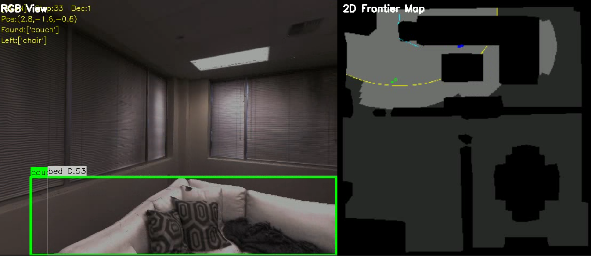

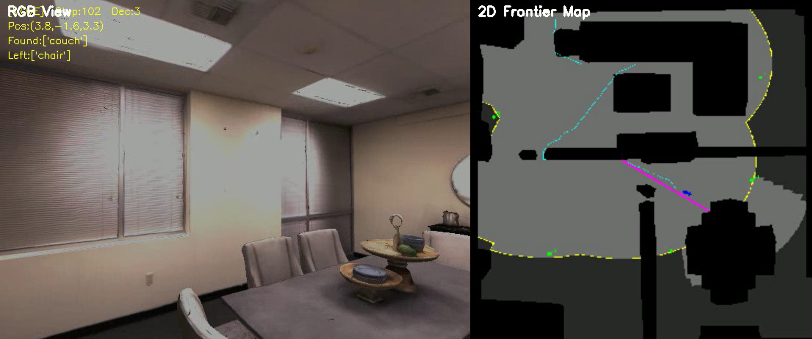

Для удобства обучения также подготовлены отдельные файлы для запуска и отладки. Их можно запускать без дополнительных зависимостей:

1)`local_test.py`. Основной код навигационной среды использует локальное развёртывание через библиотеку transformers. Тестовый файл `local_test.py` показывает другой способ локального развёртывания: через modelscope. В файле нужно указать путь к загруженным весам модели и путь к изображению. Изображение уже подготовлено.

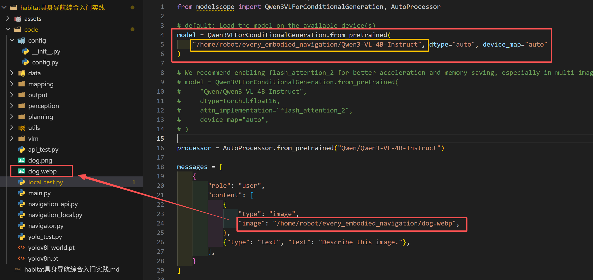

Вывод программы:

```text
['Это крупный план, фотография на уровне глаз: маленькая пушистая белая собака, вероятно самоедская или похожая порода, например померанский шпиц, сидит в помещении на светлом деревянном полу.\n\nУ собаки густая, пышная шерсть чисто белого цвета, она выглядит мягкой и объёмной, особенно на шее и груди. Уши острые и стоячие, видна слегка розоватая внутренняя часть. Морда круглая и выразительная, большие тёмные круглые глаза смотрят прямо в камеру с наивным и любопытным взглядом. Нос маленький и чёрный, рот слегка приоткрыт, что придаёт ей мягкий вид']
```

2)`api_test.py`. Это файл для работы с большой моделью через API. Нужно указать API-ключ, полученный выше, и изменить путь к изображению. Обратите внимание: в примере с сайта API не принимает изображение напрямую, его нужно преобразовать. Преобразование уже сделано. Для наглядности подготовлены два формата изображения: PNG и WebP. Кроме пути к файлу, нужно поменять формат в `base64_url`. Этот же способ используется при преобразовании изображения в навигационной среде.

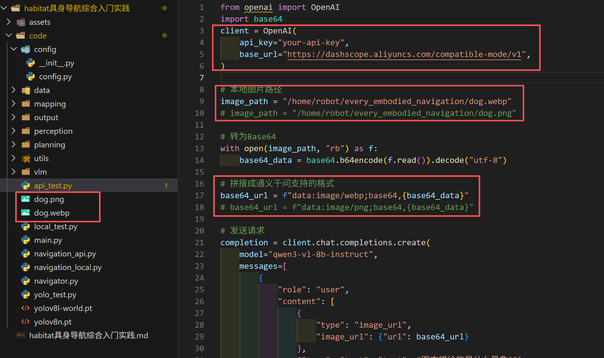

Вывод программы:

```text
На изображении изображена милая белая собачка. Она сидит на деревянном полу в помещении и смотрит в камеру. Шерсть у собаки пушистая и белая, глаза тёмные и блестящие, нос чёрный. Выражение морды очень послушное и милое. Фон размыт, видны части мебели или декора, атмосфера уютная. Похоже, это самоедская собака или маленькая порода, похожая на неё.
```

3)`yolo_test.py`. Помимо yolov8 из навигационной среды, в файле есть тест YOLO-World. Для визуального обнаружения достаточно нескольких строк кода. Важно: открытое визуальное обнаружение YOLO-World требует заранее задать список классов. Модель yolov8l-world.pt слишком большая, поэтому её нужно скачать по [ссылке](https://docs.ultralytics.com/zh/models/yolo-world/).

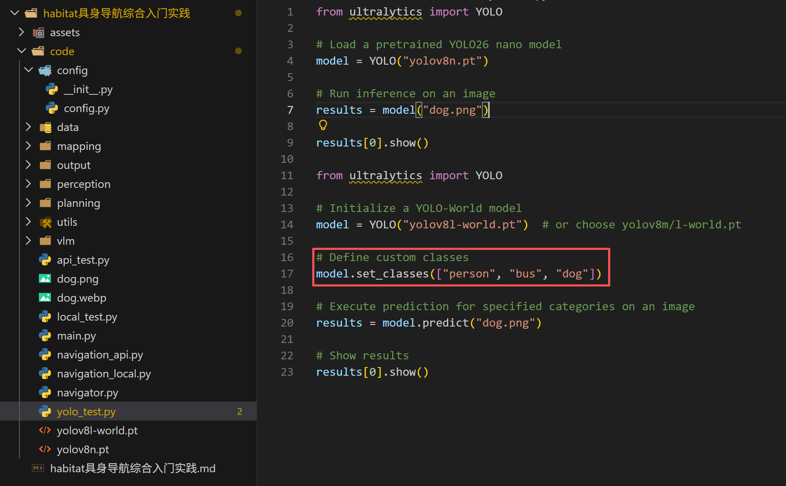

Результаты двух моделей YOLO приведены ниже. Видно, что после заранее заданного списка классов YOLO-World чётко распознаёт самоедскую собаку.

<div style="display: flex; justify-content: space-between;">
  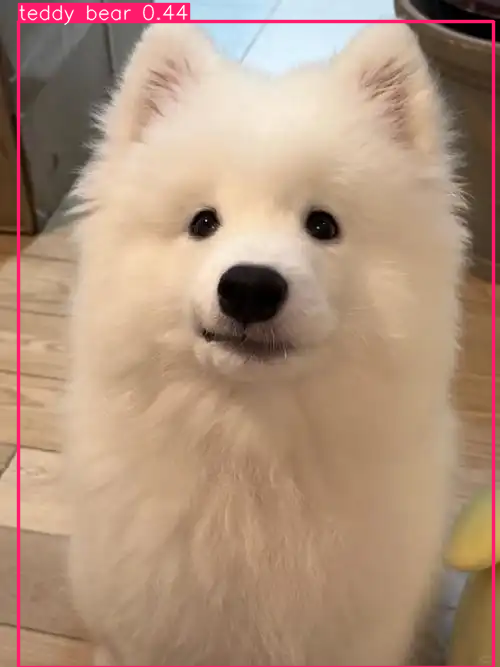
  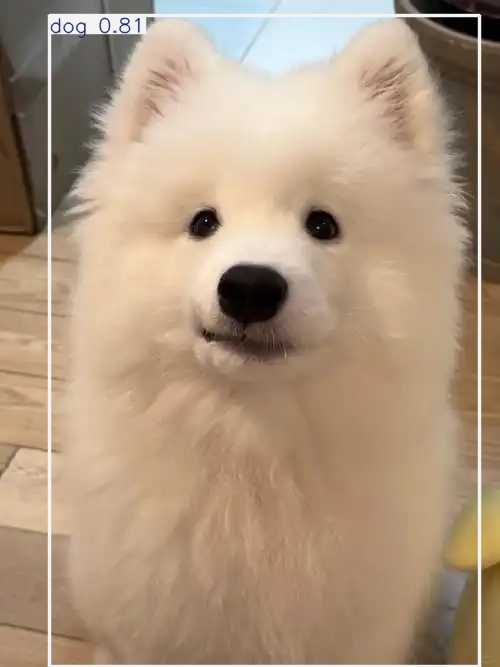
</div>

## 4. Разбор кода

Большинство алгоритмов воплощённой навигации вам уже знакомы: визуальный алгоритм YOLO, большие языковые модели и алгоритмы планирования. Как применить их в воплощённой навигации — вот что нужно изучить. Курс помогает понять весь процесс воплощённой навигации, рассказывает о подводных камнях, на которые мы наступали при обучении, и надеется стать небольшой опорой для будущих исследований.

Ниже разбирается основной процесс принятия решения VLM в коде. Принципы работы отдельных алгоритмов можно найти в других руководствах Datawhale, например по YOLO и большим языковым моделям.

Сначала общая схема одного решения VLM:

1)Поворот для наблюдения: 12 шагов влево, детекция YOLO, обратная проекция в 3D и обновление тумана войны.

2)Объединение: результаты 12 кадров объединяются. Для одинаковой позиции и одного класса сохраняется результат с максимальной уверенностью.

3)Получение фронтиров: находятся фронтиры, отфильтровываются уже посещённые, затем точки сортируются по расстоянию и берутся первые 8.

4)Формирование входа VLM: собирается сводка детекций, сводка фронтиров, история и 4 ключевых кадра.

5)Решение VLM: вызывается большая модель, её ответ в формате JSON разбирается.

6)Выполнение решения: робот идёт к целевому объекту, к точке фронтира или к случайной точке в зависимости от действия.

7)Проверка достижения: если расстояние меньше порога, цель отмечается как найденная.

8)Проверка завершения: цикл заканчивается, если найдены все цели или исчерпаны шаги.

Так выглядит полный цикл одного решения в воплощённой навигации. Теперь разберём модули кода по отдельности.

### 1. config

```python
# ── YOLO ──────────────────────────────────────────────────
YOLO_MODEL = "yolov8n.pt"
YOLO_CONF_THRESHOLD = 0.35

# ── Локальная VLM (режим local) ───────────────────────────
LOCAL_MODEL_NAME = "/path/to/navigation/Qwen3-VL-4B-Instruct"
MODEL_DTYPE = "auto"
MODEL_DEVICE_MAP = "auto"
MODEL_MAX_NEW_TOKENS = 1024
MODEL_TEMPERATURE = 0.3
MODEL_TOP_P = 0.9
MODEL_TOP_K = 50

# ── Навигация ─────────────────────────────────────────────
MAX_STEPS = 500
SPIN_STEPS = 12
VISIBLE_RADIUS = 3.0
MAP_RESOLUTION = 512
AREA_THRESHOLD_M2 = 9
TARGET_REACH_DIST = 1.5
```

Кроме параметров из файла конфигурации, ниже объясняется, на чём основаны эти значения.

1)`YOLO_CONF_THRESHOLD = 0.35` — эмпирическое значение. Если поставить слишком низкое значение (0.1), тень на стене будет принята за стул. Если слишком высокое (0.6), при плохом освещении цель будет пропущена.

2)`TARGET_REACH_DIST = 1.5` (метра). При слишком малом значении (0.5 м) робот может упереться в стену. При слишком большом (3 м) VLM может ошибочно решить, что робот уже пришёл к цели.

3)`MODEL_TEMPERATURE` сильно влияет на качество решений. Значение 0.3 — консервативный выбор, ответы стабильнее. При повышении до 0.8 и выше модель может «галлюцинировать» и придумывать объекты, которых нет.

### 2. utils

1)`simulator.py`

Файл в основном создаёт среду habitat. Если что-то непонятно, можно обратиться к восьмой главе проекта every-embodied, где есть базовое объяснение: [глава 8](https://github.com/datawhalechina/every-embodied/tree/main/08-%E5%85%B7%E8%BA%AB%E5%AF%BC%E8%88%AA%E5%8F%8AVLN).

2)`geometry.py`

```python
def depth_to_3d_world(depth_map: np.ndarray, bbox, agent_state, K: np.ndarray):
    x1, y1, x2, y2 = [int(v) for v in bbox]
    mx = max(1, (x2 - x1) // 4)
    my = max(1, (y2 - y1) // 4)
    region = depth_map[y1 + my:y2 - my, x1 + mx:x2 - mx]
    if region.size == 0:
        return None
    valid = region[region > 0]
    if valid.size == 0:
        return None
    d = float(np.median(valid))
    if d <= 0 or d > 10.0:
        return None

    cx_px = (x1 + x2) / 2.0
    cy_px = (y1 + y2) / 2.0
    fx, fy = K[0, 0], K[1, 1]
    cx_c, cy_c = K[0, 2], K[1, 2]

    point_cam = np.array([
        (cx_px - cx_c) * d / fx,
        -(cy_px - cy_c) * d / fy,
        -d,
        1.0,
    ])

    rot = agent_state.rotation
    q = np.array([rot.w, rot.x, rot.y, rot.z])
    R = quaternion_to_rotation_matrix(q)
    T = np.eye(4)
    T[:3, :3] = R
    T[:3, 3] = np.array(agent_state.position)
    return (T @ point_cam)[:3]
```

Функция `depth_to_3d_world` переводит пиксели детекции в координаты мира. YOLO выдаёт только координаты изображения (положение пикселя), а нам нужны 3D-координаты мира: где находится робот и где находится объект. Карта глубины показывает расстояние для каждого пикселя. Вместе с внутренними параметрами камеры это позволяет обратно спроецировать 2D-рамку детекции в трёхмерное пространство. Этот процесс называется обратной проекцией глубины и является ключевым звеном между визуальным восприятием и пространственной навигацией.

### 3. perception

Модуль восприятия подробно не разбирается: код простой, он просто выполняет визуальную детекцию с помощью YOLO.

### 4. mapping

```python
def detect_frontiers(full_map: np.ndarray, explored_mask: np.ndarray,
                     min_area: int = 8):
    navigable = (full_map > 0).astype(np.uint8)
    explored = (explored_mask > 0).astype(np.uint8)
    unexplored_nav = (navigable & (1 - explored)).astype(np.uint8)

    border = cv2.morphologyEx(explored, cv2.MORPH_GRADIENT, np.ones((3, 3), np.uint8))
    frontier_mask = (border & unexplored_nav).astype(np.uint8)

    n, labels, stats, centroids = cv2.connectedComponentsWithStats(frontier_mask, 8)
    pts = []
    for i in range(1, n):
        if stats[i, cv2.CC_STAT_AREA] >= min_area:
            c = centroids[i]
            pts.append(np.array([int(c[1]), int(c[0])]))  # строка, столбец
    return pts, frontier_mask
```

Самое важное в построении карты — поиск фронтиров. Этот модуль используется почти во всех статьях о навигации в неизвестной среде. Принцип при этом несложный.

```python
    border = cv2.morphologyEx(explored, cv2.MORPH_GRADIENT, np.ones((3, 3), np.uint8))
    frontier_mask = (border & unexplored_nav).astype(np.uint8)
```

Эти две строки находят границу исследованной области. Граница & неисследованная проходимая область = фронтир.

```python
    n, labels, stats, centroids = cv2.connectedComponentsWithStats(frontier_mask, 8)
```

Затем для каждой отдельной области фронтира берётся центроид, то есть одна точка фронтира. Всё довольно просто.

### 5. vlm

Традиционная навигация принимает решения по правилам: если цель близко, идём к ней, иначе исследуем ближайший фронтир. Мы же используем мультимодальную большую модель, которая понимает сцену и принимает более разумные решения.

1)`base_engine.py`

Файл `base_engine.py` отвечает за построение промптов, форматирование пользовательского текста, разбор JSON, правила деградации и журналирование. Логика одна и та же для API и локального развёртывания: это общий вход для мультимодальной большой модели.

```python
    def _build_system_prompt(self) -> str:
        return f"""Вы — «мозг» принятия решений навигационного робота для воплощённого ИИ. Ваша задача — найти в помещении все следующие целевые объекты: {self.targets}

На основе текущего изображения, результатов YOLO (включая 3D-координаты и расстояние до объектов) и доступных фронтиров вы должны принять навигационное решение.

Правила принятия решений:
1. Если целевой объект обнаружен и расстояние до него разумно (< 8 м), в первую очередь переходите к нему.
2. Если обнаружено несколько целевых объектов, выбирайте ближайший непосещённый.
3. Если целевых объектов не обнаружено, выбирайте лучший фронтир для исследования.
4. При выборе фронтира предпочитайте направление с умеренным расстоянием и большей неисследованной областью.
5. Если все цели уже посещены, верните "task_complete".

Отвечайте строго в следующем формате JSON без какого-либо другого текста:
{{
    "thinking": "Ваш подробный ход рассуждений: 1) что вы видите 2) анализ вариантов 3) обоснование решения",
    "action": "go_to_object" или "explore_frontier" или "task_complete",
    "target_index": индекс выбранной цели в соответствующем списке (с 0),
    "confidence": уверенность от 0 до 1
}}"""
```

Системный промпт сообщает модели, кто она, и какие правила нужно строго соблюдать. Конкретно:

* определена роль: «мозг» принятия решений навигационного робота;
* заданы пять правил принятия решений в порядке убывания приоритета;
* задан строгий формат вывода: строгий JSON, чтобы модель не выходила за рамки.

Ключи JSON (`thinking`, `action`, `target_index`, `confidence`) и значения действий (`go_to_object`, `explore_frontier`, `task_complete`) должны оставаться без изменений: по ним код разбирает ответ.

```python
    def _build_user_text(self, agent_pos, visited_targets,
                         detection_summary, frontier_info, nav_history) -> str:
        text = f"""## Решение № {self.count}

### Текущее состояние
- Положение агента: [{agent_pos[0]:.2f}, {agent_pos[1]:.2f}, {agent_pos[2]:.2f}]
- Посещённые цели: {visited_targets if visited_targets else 'нет'}
- Цели для поиска: {[t for t in self.targets if t not in visited_targets]}

### Результаты YOLO (сводка по полному повороту на 360°)
"""
        if detection_summary:
            for i, d in enumerate(detection_summary):
                p = (f"[{d['world_pos'][0]:.2f}, {d['world_pos'][1]:.2f}, {d['world_pos'][2]:.2f}]"
                     if d.get("world_pos") else "неизвестно")
                dist = f"{d['distance']:.2f} м" if d.get("distance") is not None else "неизвестно"
                tag = "цель" if d["is_target"] else "не цель"
                text += f"  [{i}] {d['class']} (уверенность:{d['confidence']:.2f}) 3D-позиция:{p} расстояние:{dist} {tag}\n"
        else:
            text += "  При повороте на полный круг объекты не обнаружены\n"

        text += "\n### Доступные фронтиры\n"
        if frontier_info:
            for i, f in enumerate(frontier_info):
                text += (f"  [{i}] позиция:[{f['position'][0]:.2f}, {f['position'][1]:.2f}, "
                         f"{f['position'][2]:.2f}] расстояние:{f['distance']:.2f} м\n")
        else:
            text += "  Нет доступных фронтиров\n"

        text += f"\n### История навигации\n{nav_history}\n"
        return text
```

В user_prompt попадает информация, которую получает большая модель:

1)Визуальные изображения: при повороте на круг равномерно берутся 4 ключевых кадра, которые сжимаются в JPEG и кодируются в base64.

2)Текстовая сводка детекций: класс, уверенность, 3D-координаты, расстояние и признак «цель» или «не цель».

3)Информация о фронтирах: позиции и расстояния до не более чем 8 кандидатов.

4)История навигации: последние 5 решений, чтобы модель знала, где уже была.

```python
def _fallback(self, dets, fronts, visited) -> dict:
    """Стратегия деградации на основе правил при сбое вызова VLM."""
    if dets:
        tgts = [d for d in dets if d["is_target"] and d["class"] not in visited
                and d.get("distance") is not None and d["distance"] < 8]
        if tgts:
            tgts.sort(key=lambda x: x["distance"])
            idx = dets.index(tgts[0])
            return {"action": "go_to_object", "target_index": idx,
                    "reasoning": f"[деградация] Обнаружен {tgts[0]['class']}", "confidence": 0.6}
    if fronts:
        return {"action": "explore_frontier", "target_index": 0,
                "reasoning": "[деградация] Целей нет, исследуем фронтир", "confidence": 0.3}
    return {"action": "explore_frontier", "target_index": 0,
            "reasoning": "[деградация] Случайное исследование", "confidence": 0.1}
```

Этот код нужен, чтобы при реальном развёртывании система продолжала работать даже при обрыве сети или сбое модели.

### 6. planning

Модуль использует встроенный в habitat-sim `habitat_sim.GreedyGeodesicFollower` и выводит управляющие действия. Этот фрагмент можно переделать под конкретную симуляционную среду: после получения целевой точки можно добавить собственный планировщик или контроллер, чтобы добиться лучшего результата.

### 7. output

Этот модуль отвечает за визуализацию. Его тоже можно изменить по своему усмотрению.

Вы прочитали разбор кода. Теперь вы должны хорошо понимать каждый модуль. Наконец, `navigator.py` объединяет модули, а запуск выполняется в `main.py`. Если сложно понять, как модули вызывают друг друга, можно сразу работать с отдельными файлами `navigation_api.py` и `navigation_local.py`. Курс стремится дать простой и понятный путь изучения базового процесса воплощённой навигации, чтобы он помогал в учёбе и научной работе. Надеемся, что вы останетесь довольны.

В курсе намеренно не рассматриваются более сложные темы, такие как сегментация изображений, 3D-гауссово картографирование или развёртывание vLLM. Причина в том, что курс стремится объяснить базовый процесс с минимальным кодом и минимальной установкой, а мощности облачного образа ограничены. При желании эти темы можно изучить и добавить самостоятельно.

## 5. Проблемы и направления развития

Важно честно сказать о проблемах этой навигационной системы. Она не идеальна. Надеемся, что эти проблемы подскажут идеи для будущих исследований, и будем рады, если это поможет.

Основных проблем в коде две:

1)Ошибки детекции в модуле восприятия:

<div style="display: flex; justify-content: space-between;">
  
  
</div>

В результатах отдельного запуска YOLO видно, что yolov8 иногда ошибается. Некоторые предлагают просто использовать YOLO-World с заданными классами. Но в наших исследованиях выяснилось, что даже открытая детекция YOLO-World полностью не решает проблему ложных срабатываний: нестандартные объекты по-прежнему не распознаются. Поэтому модуль восприятия нужно улучшать.

2)Проблема перехода от 2D к 3D:

Когда задача состояла только в поиске стула (chair) и дивана (couch), особых проблем не было: система работала очень хорошо, и это радовало. Проблему удалось заметить, когда мы повторно тестировали систему и просили найти телевизор (TV). Расстраивало ли это тогда? Нет, мы всё равно были рады: в науке обнаружить проблему означает, что её можно решить, а значит, внести пусть небольшой вклад в эту область.

```text
============================================================
  📝 Полный процесс рассуждений большой модели
============================================================

--- Решение #1 ---
  Позиция: [0.9390037655830383, -1.5215539932250977, -2.021697998046875]
  Детекции: 13 объектов, фронтиры: 1 шт.
  Действие: go_to_object
  Уверенность: 0.63
  Рассуждение: Обнаружено несколько целевых объектов: tv (расстояние 4.56 м), couch (расстояние 3.94 м) и bed (не цель). По правилу 2 выбираем ближайшую непосещённую цель. Couch находится на 3.94 м, tv на 4.56 м, поэтому предпочтителен couch. Фронтир на расстоянии 2.86 м, но цель важнее, поэтому исследование не выбираем. Уверенность 0.63 основана на результатах детекции.

--- Решение #2 ---
  Позиция: [3.9896955490112305, -1.600250005722046, -0.521697998046875]
  Детекции: 14 объектов, фронтиры: 4 шт.
  Действие: go_to_object
  Уверенность: 0.61
  Рассуждение: Обнаружено две целевые: tv (расстояние 2.64 м) и непосещённый chair. Но стул в результатах детекции не появился, поэтому напрямую к нему идти нельзя. По правилу нужно выбрать ближайшую непосещённую цель. Расстояние до tv минимальное (2.64 м), он входит в список поиска, поэтому выбираем tv. Уверенность 0.61 говорит о надёжности распознавания.

--- Решение #3 ---
  Позиция: [3.0499484539031982, -1.600250005722046, 2.3973488807678223]
  Детекции: 14 объектов, фронтиры: 3 шт.
  Действие: go_to_object
  Уверенность: 0.85
  Рассуждение: Обнаружено несколько стульев на расстоянии менее 8 м, что соответствует правилу приоритета целей. Посещены couch и tv, остался chair. Среди стульев ближайший — [12], его положение [4.61, -2.42, 3.64], расстояние 2.16 м, уверенность 0.79. Это лучший выбор, поэтому идём к ближайшему непосещённому стулу.
```

Почему все решения — переход к объектам? Модель ни разу не выбрала исследование фронтиров. Стул находился в другой комнате, так почему модель не исследовала фронтиры? Она стала «сверхразумной»? Нет. Посмотрите:

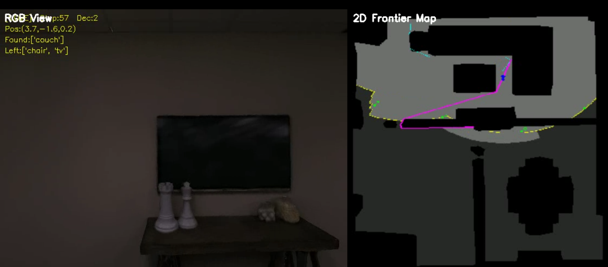

На этом изображении робот подошёл к дивану (couch), затем заметил висящий на стене телевизор (tv) и направился к нему. Проблема возникла здесь. При переходе от 2D-координат к 3D тонкий телевизор, закреплённый у стены, был спроецирован за стену. Это ошибка алгоритма преобразования. Поэтому робот проехал прямо за стену, то есть в комнату, где находился стул. Посмотрите на следующий рисунок:

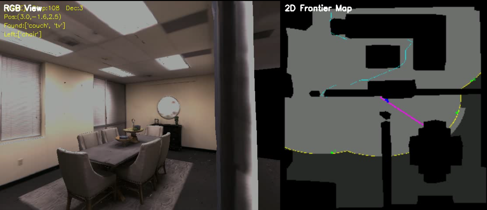

Видно, что после перехода в комнату со стулом система из-за близости к стене решила, что робот уже рядом с телевизором. В верхнем левом углу видео появилась отметка «tv найден», и детекция начала работать заново. В этой комнате был обнаружен стул (chair). Именно поэтому в процессе решений VLM было только три `go_to_object`.

Как это исправить?

Вот несколько статей с открытым кодом, которые помогут разобраться:

1)[GaussNav: Gaussian Splatting for Visual Navigation](https://ieeexplore.ieee.org/abstract/document/10870413/)

Организация: Китайский университет науки и технологий.

Страница проекта: https://xiaohanlei.github.io/projects/GaussNav/

Код: https://github.com/XiaohanLei/GaussNav

Подход: локализация и навигация по отдельным экземплярам объектов в 3D с помощью 3DGS.

2)[Towards Physically Executable 3D Gaussian for Embodied Navigation](https://arxiv.org/abs/2510.21307)

Организация: Чжэцзянский университет.

Страница проекта: https://sage-3d.github.io

Код: https://github.com/Galery23/SAGE-3D_Official?tab=readme-ov-file

Подход: построение для VLN среды на основе 3DGS с семантическим и физическим выравниванием, что обеспечивает исполнимую 3D-локализацию объектов и взаимодействие с ними.

3)[EmbodiedSAM: Online Segment Any 3D Thing in Real Time](https://arxiv.org/abs/2408.11811)

Организация: Университет Цинхуа.

Страница проекта: https://xuxw98.github.io/ESAM/

Код: https://github.com/xuxw98/ESAM?tab=readme-ov-file

Подход: онлайн-сегментация 3D-объектов в реальном времени. Маски SAM в 2D переводятся в маски облаков точек в 3D, что даёт воплощённой навигации 3D-координаты объектов.

Если у вас есть другие вопросы, пишите.

## 6. Борьба с ошибками

Пусть все избегают ошибок, а если ошибка возникла, она быстро исправляется.

* BUG-1

```text
ImportError: libEGL.so.1: cannot open shared object file: No such file or directory
```

Если возникла ошибка с `libEGL.so.1`, достаточно обновить и установить следующие библиотеки:

```bash
apt update
apt install -y libegl1-mesa libegl1-mesa-dev libgl1-mesa-glx
```

* BUG-2

```text
GL::Context: cannot retrieve OpenGL version: GL::Renderer::Error::InvalidValue
```

Если возникла ошибка GL, её можно обойти, выполнив следующую команду:

```bash
export LD_PRELOAD=/lib/x86_64-linux-gnu/libGLX_nvidia.so.0:/lib/x86_64-linux-gnu/libGLdispatch.so.0
```

Если вы встретили другие ошибки, сообщите о них.

## 7. Благодарности

Курс построен на основе [habitat-sim](https://github.com/facebookresearch/habitat-sim), [habitat-lab](https://github.com/facebookresearch/habitat-lab), [3D-Mem](https://github.com/UMass-Embodied-AGI/3D-Mem), [vlfm](https://github.com/naokiyokoyama/vlfm), [Alibaba Cloud Bailian](https://help.aliyun.com/zh/model-studio/vision?spm=a2c4g.11186623.help-menu-2400256.d_0_3_0_1.bdd430113HDDc6), [YOLO](https://docs.ultralytics.com/zh/models/yolov8/#overview) и [ModelScope](https://www.modelscope.cn/models/Qwen/Qwen3-VL-4B-Instruct). Большое спасибо авторам этих работ за открытый код и вклад. Также благодарим Doubao, Claude Opus 4.6 и Gemini 3.1 Pro за помощь в оптимизации курса.
