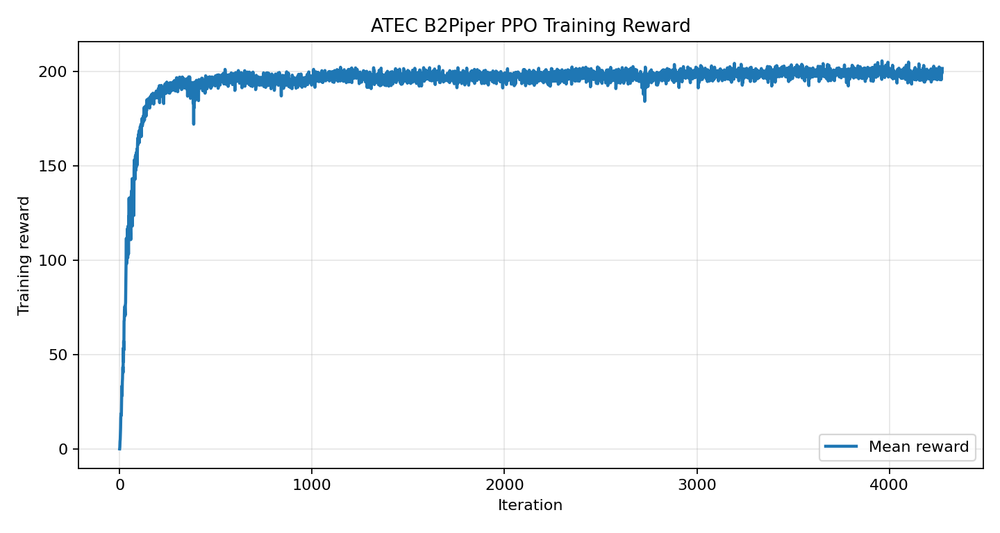
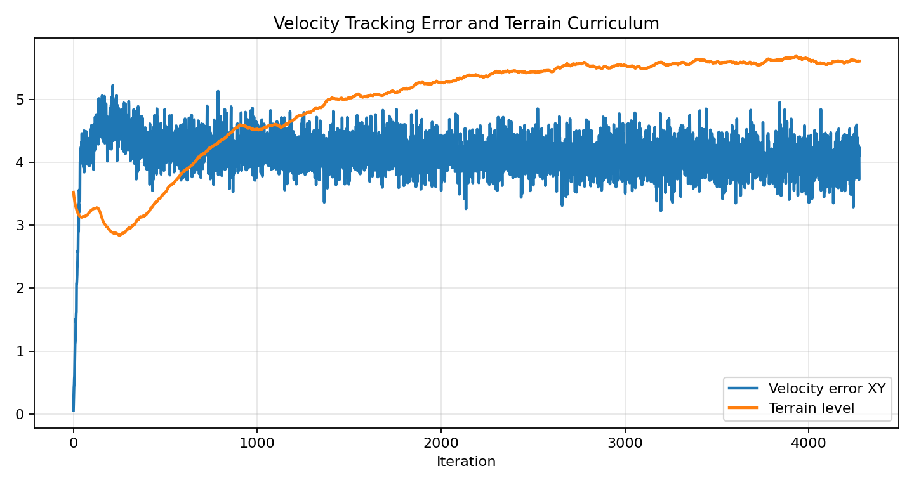
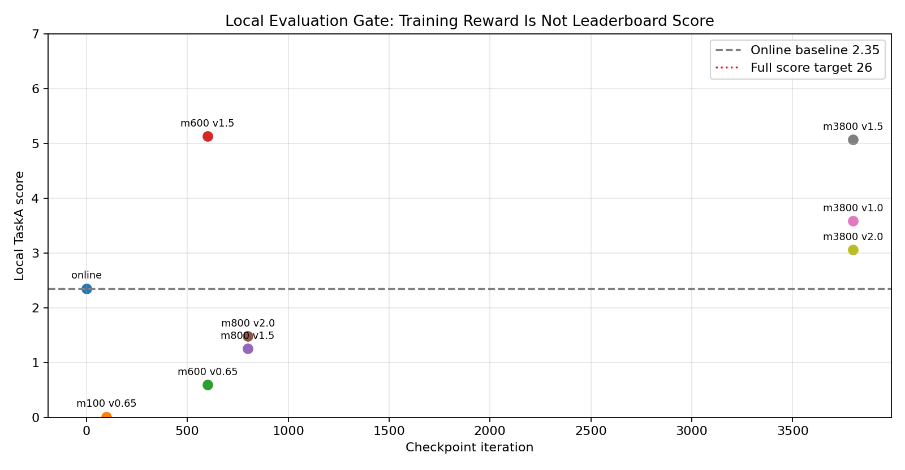

# ATEC2026, онлайн-этап, трек 1 L0: воспроизведение и штурм рейтинга в задаче «Ходьба робота» (Locomotion)

Этот материал для тех, кто хочет воспроизвести трек 1 онлайн-этапа ATEC2026, «Ходьба робота» (Locomotion). Мы начинаем с регистрации, загрузки официального кода, установки Isaac Sim / Isaac Lab, запуска официального baseline и отправки решения в онлайн. Затем подробно разбираем реальный локальный эксперимент по повышению результата: почему официальный baseline вообще принимается и получает действительный балл, почему промежуточный checkpoint поднимает балл примерно с 2.35 до 5, и почему локальная оценка на промежуточных шагах важнее слепого долгого обучения.

Это не «секрет чемпиона». Скорее это протокол воспроизводимого эксперимента: сначала запустите весь путь соревнования, а затем продолжайте улучшать свою политику, опираясь на описанные этапы повышения результата.

## 1. Что проверяет соревнование

Тема ATEC2026 — **AI and Robotics Real-World Extreme Challenge**: цель — проверить долгосрочную устойчивость, адаптацию к реальной среде и воспроизводимость систем воплощённого ИИ в онлайн-симуляции и в офлайн-сценариях.

Онлайн-этап трека 1 делится на L0 и L1:

| Уровень | Задача | Основная цель |
|---|---|---|
| L0 | Ходьба робота | стабильно пройти с ногами и манипулятором маршрут около 400 м: ровное покрытие, неровная поверхность, подъёмы и спуски, лестницы |
| L1 задача 1 | подбор мусора и его выброс | в зоне 20 м × 20 м распознать цель, перемещаться, захватить, перенести и выбросить |
| L1 задача 2 | преодоление препятствий | пройти ров или высокую платформу; можно использовать коробки и другие предметы, чтобы изменить среду, за это начисляются дополнительные баллы |

Здесь мы рассматриваем только L0. Причина простая: L0 — лучший вход для новичков. Не нужно сначала решать задачи распознавания и захвата; достаточно довести до рабочего состояния управление locomotion, оценку и цепочку отправки. Это уже половина инженерного цикла в соревновании по воплощённому ИИ.

Официальные страницы соревнования:

- Сайт ATEC: [https://www.atecup.com/competitions/100017](https://www.atecup.com/competitions/100017)
- Пример страницы трека: [https://www.atecup.com/matchHomeDetails/100017/1000210](https://www.atecup.com/matchHomeDetails/100017/1000210)
- Официальный baseline: [https://github.com/atecup/ATEC2026_Simulation_Challenge](https://github.com/atecup/ATEC2026_Simulation_Challenge)

По открытым данным, регистрация на ATEC2026 открылась 1 апреля 2026 года и закрывалась 15 июня 2026 года в 22:00 (UTC+8); онлайн-этап проходит с 1 мая 2026 года в 10:00 по 30 июня 2026 года в 22:00 (UTC+8). Условия могли измениться, следите за обновлениями. Если вы читаете материал уже после окончания регистрации, его по-прежнему можно использовать как учебный эксперимент по соревновательной робототехнике на Isaac Lab.

## 2. Как зарегистрироваться и попасть на страницу отправки

Регистрация и отправка решений проходят на сайте ATEC. Интерфейс может меняться, но порядок примерно такой:

1. Откройте сайт ATEC, зарегистрируйтесь и войдите в аккаунт.
2. Перейдите на страницу соревнования ATEC2026.
3. Нажмите «Зарегистрироваться» или «Присоединиться», заполните данные команды.
4. Перейдите в «Личный кабинет / Мои соревнования / Страница трека».
5. На странице трека откройте вкладку «Ресурсы» и скачайте демо, руководство участника и объявления об обновлениях.
6. На вкладке «Отправка» выберите задачу, например L0 «Ходьба робота».
7. Выберите конфигурацию робота и загрузите архив с исходным кодом или отправьте образ.
8. Дождитесь сборки, запуска и оценки на платформе; результаты смотрите в разделе «История отправок».

На отправке L0 нужно выбрать модель робота. В нашем эксперименте использовался `B2Piper`: четвероногая платформа Unitree B2 с манипулятором Piper. Для загрузки исходного кода в корне архива обычно должны быть:

```text
solution.py
policy.pt
requirements.txt
```

`solution.py` — точка входа, которую вызывает система соревнования; `policy.pt` может быть политикой, экспортированной через TorchScript; `requirements.txt` может быть пустым. Базовые зависимости, например PyTorch, уже входят в официальное окружение, поэтому пустой requirements означает лишь, что дополнительных pip-пакетов не нужно, а не что зависимостей нет.

## 3. Вычислительные ресурсы: локальная машина или аренда L40

Официальный baseline L0 зависит от Isaac Sim 5.1 и Isaac Lab 2.3.x, обычный ноутбук стабильно обучать на них не сможет. Есть два варианта:

| Вариант | Для каких задач | На что обратить внимание |
|---|---|---|
| Локальная рабочая станция | есть мощная NVIDIA GPU с большим объёмом памяти и можно установить Isaac Sim / Isaac Lab | установка окружения и совместимость драйверов требуют времени |
| Аренда облачной GPU-машины | нужно быстро воспроизвести, обучить и увидеть симуляцию на рабочем столе | выбирайте образ, уже настроенный под Isaac Sim / Isaac Lab |

Если используете облачную платформу вычислений, выбирайте образ с удалённым рабочим столом, драйверами NVIDIA и окружением Isaac Sim / Isaac Lab. L40 — подходящая стартовая карта: памяти хватает для средне большого числа параллельных сред, а стоимость обычно ниже, чем у A100/H100, что удобно для учебных экспериментов.

В учебнике по LeHome мы уже делали так: сначала объясняли, что одиночная L40 стабильно запускается, затем приводили размер батча, журналы и кривые загрузки GPU, а не обещали выигрыш в соревновании. Здесь то же самое: L40 помогает быстро запустить и обучить модель, но результат зависит от награды (reward), наблюдений, учебного плана и стратегии отправки.

Проверьте GPU:

```bash
nvidia-smi
```

Если видите L40, RTX 4090, A6000, RTX PRO 6000 или другую NVIDIA GPU с достаточной памятью, можно продолжать. Наш локальный эксперимент проводился на мощной рабочей станции NVIDIA. Если используете L40, начинайте с небольшого числа параллельных сред, например `--num_envs 1024` или `2048`, и только после проверки отсутствия OOM переходите к `4096`.

## 4. Загрузка официального кода и модели робота

Официальный репозиторий можно клонировать напрямую:

```bash
export PROJECT_ROOT=$HOME/ATEC2026_Simulation_Challenge

git clone https://github.com/atecup/ATEC2026_Simulation_Challenge "$PROJECT_ROOT"
cd "$PROJECT_ROOT"
```

Если берёте код с GitHub, модель робота нужно загрузить отдельно:

```bash
curl https://static.atecup.com/atec2026/atec_robot_model.zip -o atec_robot_model.zip
unzip atec_robot_model.zip -d atec_robot_model
```

Если скачали со страницы «Ресурсы» на сайте архив `ATEC2026_Simulation_Challenge.zip`, в нём обычно уже есть `atec_robot_model`, и повторно загружать не нужно.

Рекомендуется фиксировать версии официальных ресурсов:

```bash
sha256sum atec_robot_model.zip
git rev-parse HEAD
```

В ходе соревнования организаторы могут публиковать обновления: например, новые начальные позиции суставов робота, обновлённые Action Configuration, описания журналов, новые диапазоны сканирования LiDAR. Перед каждой отправкой проверяйте, что локальный код совпадает с актуальными официальными ресурсами; иначе онлайн и локальные баллы могут не сойтись.

## 5. Установка расширения Isaac Lab

В Python-окружении, где уже установлены Isaac Sim / Isaac Lab, установите официальное расширение:

```bash
cd "$PROJECT_ROOT/source/atec_rl_lab"
pip install -e .
```

Вернитесь в корень проекта:

```bash
cd "$PROJECT_ROOT"
```

Проверка окружения:

```bash
python - <<'PY'
import torch
print("torch:", torch.__version__)
print("cuda:", torch.cuda.is_available())
PY
```

При работе со скриптами Isaac Sim установите переменные принятия лицензионного соглашения (EULA):

```bash
export ACCEPT_EULA=Y
export OMNI_KIT_ACCEPT_EULA=YES
```

## 6. Запуск официального baseline L0

Официальный блог и baseline обычно рекомендуют сначала обучить rough locomotion:

```bash
python scripts/rsl_rl/train.py \
  --task ATEC-Isaac-Velocity-Rough-Unitree-B2-v0 \
  --headless
```

Экспортированная политика после обучения обычно лежит в:

```text
logs/rsl_rl/unitree_b2_rough/<дата>/exported/policy.pt
```

Локальный просмотр:

```bash
python scripts/rsl_rl/play.py \
  --task ATEC-Isaac-Velocity-Rough-Unitree-B2-v0
```

Для отправки положите экспортированный `policy.pt` в каталог `demo` или в корень пакета отправки и убедитесь, что `solution.py` его загружает.

## 7. Первая версия для онлайна: балл есть, но он низкий

Сначала мы отправили официальный `unitree_b2_flat/policy.pt`. Этот вес полностью совпадает с `policy.pt` из demo и представляет собой актёра locomotion Unitree B2 на плоской поверхности с входом 45 измерений и выходом действий 12 измерений.

Действительная онлайн-отправка:

| Параметр | Значение |
|---|---|
| Робот | `B2Piper` |
| Балл | `2.35` |
| Время в симуляции | `00:03:18.40` |
| Физическое время | `00:07:25.55` |
| Место в онлайн-таблице | середина нижней части таблицы |

Это показывает, что baseline проходит загрузку исходного кода, сборку, запуск и оценку, но до максимального балла `26` ему очень далеко. Причина понятна: flat-политика обучалась на относительно простом рельефе, и на сложном составном маршруте длиной 400 м она застревает уже на первом участке.

Лучшая локальная настройка flat-политики была примерно такой:

```bash
ATEC_VEL_X=0.65
ATEC_VEL_Y=-0.40
ATEC_VEL_YAW=0.0
```

Локальный лучший результат — около `2.31`, что близко к онлайн-результату `2.35`, так что локальная оценка даёт разумный ориентир.

## 8. Почему выбран B2Piper, а не колёсно-ногая конфигурация сразу

Страница отправки L0 поддерживает несколько конфигураций: `G1`, `Tron1Piper`, `Tron2ALegged`, `Tron2AWheel`, `B2Piper`, `B2wPiper`.

Наши соображения:

| Конфигурация | Преимущества | Риски |
|---|---|---|
| `B2Piper` | 12 измерений действий ног полностью совпадают с официальным актёром B2 flat, легче всего переносить | предел скорости ниже, чем у колёсно-ногих |
| `B2wPiper` | теоретически выше скорость, подходит для погони за временем | нужно обучать ноги и колёса вместе, готовой предобученной политики нет |
| `Tron2AWheel` | колёсно-ногая структура подходит для высокой скорости | конфигурацию обучения нужно строить с нуля |
| `G1` | гуманоид гибкий | длительное стабильное движение на L0 обходится дорого в обучении |

Поэтому в первом раунде нельзя сразу брать самую агрессивную конфигурацию. Сначала на `B2Piper` стоит построить воспроизводимый цикл обучения и оценки, а когда он стабильно даёт высокий балл, переходить к `B2wPiper` или `Tron2AWheel` ради времени.

## 9. Один реальный эксперимент с высокой скоростью

Мы пробовали путь, который сначала выглядел разумно, но в итоге оказался проблемным:

1. Инициализировать актёра B2Piper весом официального `unitree_b2_flat/policy.pt`.
2. Добавить задачу rough locomotion с высокой скоростью.
3. Расширить диапазон команд скорости до `0.5 ~ 4.5 м/с`.
4. Провести долгое обучение PPO на 4096 параллельных средах.
5. Периодически экспортировать политику и оценивать её локально на TaskA.

Команда обучения эквивалентна:

```bash
cd "$PROJECT_ROOT"

export ACCEPT_EULA=Y
export OMNI_KIT_ACCEPT_EULA=YES
export ATEC_INIT_ACTOR_POLICY=atec_robot_model/baseline/unitree_b2_flat/policy.pt

python scripts/rsl_rl/train.py \
  --task ATEC-Isaac-Velocity-FastRough-Unitree-B2Piper-v0 \
  --headless \
  --num_envs 4096 \
  --max_iterations 5000 \
  --run_name fast_actorinit_4096x5000
```

Важно здесь не число `4096`, а `ATEC_INIT_ACTOR_POLICY`. Мы добавили в скрипт обучения точку инициализации актёра, так что политика rough для B2Piper стартовала не случайно, а дообучалась из официального актёра B2 flat.

### 9.1 Кривые обучения

Награда в обучении, судя по графику, растёт:



По этому графику легко решить, что рост награды в обучении означает рост балла в рейтинге. Дальнейшая локальная оценка показала, что такой вывод ненадёжен.

Ошибка скорости и учебный план по рельефу:



Особенно заметно, что `Velocity error XY` долго остаётся высокой. То есть политика получала больше награды в учебной среде, но устойчиво не выдерживала заданную высокую скорость.

### 9.2 Локальная оценка checkpoint

Несколько checkpoint экспортировали и оценили локально на TaskA:



Ключевые результаты:

| checkpoint | Команда скорости | Локальный балл TaskA | Что наблюдалось |
|---|---:|---:|---|
| официальный flat / онлайн | около `0.65` | `2.35` | проходит, но застревает в начале |
| `model_100` | `0.65` | `0.0086` | почти стоит на месте |
| `model_600` | `1.5` | `5.1265` | заметно лучше baseline, доходит до `x≈-52` |
| `model_800` | `1.5` | `1.2543` | деградация, быстро падает |
| `model_3800` | `1.5` | `5.0660` | близко к `model_600`, но всё ещё далеко от максимума |

Это показывает, что рост награды на поздних этапах обучения не означает рост балла TaskA. `model_600` оказался лучшей промежуточной точкой.

## 10. Что дало это поэтапное повышение результата

Эксперимент не был «бесполезным»: он поднял локальный балл TaskA с уровня baseline около `2.35` примерно до `5.12`, что выше, чем у части команд в таблице. Однако рост награды в обучении не превратился устойчиво в способность пройти весь маршрут, поэтому это не окончательное решение для максимального балла.

### 10.1 Награда научила «держаться», но не «пройти маршрут»

Во время обучения длина эпизода почти достигала максимума, награда росла: политика научилась сохранять позу на обучающем рельефе. Но TaskA требует идти по заданному маршруту, непрерывно продвигаясь вперёд через несколько реальных участков оценки.

То есть награда среды обучения не совпадает с наградой за прогресс в соревновании.

### 10.2 Слишком агрессивная команда скорости разрушила официальный prior

Мы сразу расширили диапазон команд до `0.5 ~ 4.5 м/с`. Для официального актёра flat это слишком большой скачок: PPO легко ухудшает исходный prior, который изначально умел ходить. Кратковременное улучшение `model_600` и последующая деградация `model_800` — типичный признак этой проблемы.

Более надёжный путь — постепенно повышать скорость, например:

```text
0.5 ~ 1.0 м/с
1.0 ~ 1.5 м/с
1.5 ~ 2.0 м/с
```

На каждом этапе нужно пройти порог локальной оценки TaskA и только потом переходить к следующему.

### 10.3 Актёр не получает данных о высоте рельефа

Текущие 45 измерений наблюдений актёра включают:

- угловую скорость основания;
- спроецированную гравитацию;
- команду скорости;
- положения суставов;
- скорости суставов;
- предыдущее действие.

Критик получает скан высоты (height scan), а актёр — нет. TaskA включает склоны, ступени и неровную поверхность; если актёр полностью не видит рельеф, он может двигаться только по собственной проприоцепции. На простых участках такой подход ещё работает, но на сложном составном рельефе он часто застревает или уходит вбок.

### 10.4 Боковой дрейф недостаточно наказывался

`model_3800` при `vx=1.5` прошёл:

```text
x ≈ -53.68
y ≈ 10.06
termination = illegal_contact
```

Это значит, что политика не шла прямо по маршруту, а явно уходила в сторону. В обучении было отслеживание скорости, но не хватало сильного ограничения маршрута и штрафа за боковое смещение.

## 11. Правильная промежуточная оценка

В соревновательном обучении не стоит слепо ждать конца. Мы рекомендуем добавить к скрипту обучения шлюз проверки checkpoint:

1. Дождаться checkpoint, например `model_100.pt`, `model_300.pt`, `model_600.pt`.
2. Экспортировать TorchScript `policy.pt` через `scripts/rsl_rl/play.py`.
3. Временно заменить `policy.pt` в каталоге отправки.
4. Запустить локальную оценку `ATEC-TaskA-B2Piper`.
5. Записать балл, время, причину завершения и максимальное значение x.
6. Вернуть исходную отправляемую baseline-политику.

Во время оценки есть два подводных камня:

- в среде TaskA есть камеры, поэтому нужно добавить `--enable_cameras`;
- не запускайте параллельно оценку нескольких checkpoint: процессы будут одновременно заменять `demo/policy.pt`, и результаты окажутся испорчены.

Пример процедуры:

```bash
export ATEC_MAX_STEPS=5000

scripts/eval_l0_checkpoint.sh \
  logs/rsl_rl/unitree_b2_piper_rough/<run>/model_600.pt \
  quick_model_600 \
  "0.65 1.5"
```

Результаты удобно записывать таблицей:

```text
checkpoint, vx, score, elapsed_time, max_robot_x, termination
model_600, 1.5, 5.1265, 59.98s, -52.47, unfinished
```

## 12. Что менять в следующей версии

В следующей версии не нужно слепо удлинять обучение; надо менять цель обучения.

Рекомендуемый приоритет:

1. **Курс от низкой скорости к высокой.**
   Не начинать с `4.5 м/с`. Сначала стабильно превзойти baseline, затем постепенно ускорять.

2. **Добавить награду за прогресс по маршруту.**
   В награду обучения включить прогресс по `x`, преодоление ключевых участков рельефа, награду за достижение порогов, которые ближе к TaskA.

3. **Подавлять боковой дрейф.**
   Усилить штраф за `|y|` или явно требовать от команд и награды держаться центральной линии маршрута.

4. **Дать актёру данные о рельефе.**
   Добавить в актёра скан высоты или низкоразмерное кодирование рельефа, а не только в критик.

5. **Выбирать модель по checkpoint.**
   В нашем эксперименте `model_600` оказалась лучше `model_3800`. В соревновании нужно выбирать checkpoint по локальному баллу задачи, а не брать последний по номеру итерации.

6. **Потом рассматривать колёсно-ножную ветку.**
   Когда B2Piper стабильно даёт высокий балл, можно открыть ветку `B2wPiper` или `Tron2AWheel` для улучшения времени.

## 13. Чек-лист перед отправкой

Перед загрузкой архива с исходным кодом проверьте:

```text
solution.py        обязан присутствовать
policy.pt          обязан загружаться через torch.jit.load
requirements.txt   может быть пустым
server.py          не загружать, используйте официальную версию
run.sh             не загружать, используйте официальную версию
```

Локальный тест импорта:

```bash
python - <<'PY'
import torch
m = torch.jit.load("policy.pt", map_location="cpu")
print(m(torch.zeros(1, 45)).shape)
PY
```

Если вывод:

```text
torch.Size([1, 12])
```

значит, размерность политики ног B2Piper, по крайней мере, правильная.

Выбор при онлайн-отправке:

```text
задача: ходьба робота
робот: B2Piper
способ загрузки: исходный код
```

Если возникла неизвестная ошибка, сначала проверьте:

- лежит ли `solution.py` непосредственно в корне архива;
- не загрузили ли по ошибке вложенную папку;
- не слишком ли большой `policy.pt` и загружается ли он вообще;
- не требует ли `requirements.txt` сложных зависимостей, которых нет в официальном образе;
- не зависит ли `solution.py` от абсолютного локального пути.

## 14. Итоги главы

Самый ценный вывод этого эксперимента — не «мы уже набрали высокий балл», а следующее:

- официальная flat-политика позволяет пройти путь отправки, но для штурма рейтинга её недостаточно;
- RobotLab / rough locomotion — хорошая учебная структура, но награду нужно привести в соответствие с заданием соревнования;
- рост награды в обучении не означает рост балла в таблице;
- промежуточная локальная оценка — основной инженерный процесс в соревновании с подкреплением;
- на сегодняшний момент лучший промежуточный результат — `model_600` при `vx=1.5`, около `5.13` балла локально, но этого недостаточно, чтобы считать его окончательной отправкой.

Если вы продолжаете эту линию, сначала исправляйте награду и наблюдения, а не наращивайте время обучения.

## 15. Открытое обновление после соревнования: полный путь, который мы прошли

После окончания соревнования мы собрали в этом каталоге историю воспроизведения ATEC2026, рост результата, ошибочные выводы и их исправления. Это не «код лидера», а реальная инженерная запись: от baseline, который дал первый балл, через попытки RobotLab / RoboGauge / SAC / MoE к объяснимому высокоуровневому трекеру команд и шлюзу опций.

### 15.1 Что мы установили в итоге

Первое: официальный baseline важен. Он не даёт высокого балла, но позволяет проверить цепочку отправки, размерности действий и платформу. Наш первый действительный онлайн-балл:

| Задача | Робот | Балл | Время в симуляции | Физическое время |
|---|---|---:|---:|---:|
| Трек 1 L0, ходьба робота | `B2Piper` | `2.35` | `00:03:18.40` | `00:07:25.55` |

Второе: промежуточные checkpoint нельзя оценивать только по награде обучения. Локальный балл мы поднимали до `5.x`, в онлайне также появлялся действительный балл около `7.x`, но политика по-прежнему могла провалиться на rough-участке, у вершины склона или около границы. Это значит, что она уже лучше многих baseline, но ещё не научилась проходить 400 м целиком.

Третье: RobotLab / RoboGauge полезны, но их веса нельзя напрямую использовать как готовые веса ATEC B2Piper. Мы попробовали:

- нативную оценку RobotLab B2 fixed-forward;
- обучение RobotLab B2Piper с нагрузкой Piper;
- длительное PPO-обучение на 20K;
- ветку SAC-RSL-RL;
- нативную оценку MoE-checkpoint RoboGauge Go2;
- быструю прямую перенос на ATEC.

Вывод: эти проекты подходят как ориентир для награды, учебного плана по рельефу, MoE, схемы учитель-ученик и протокола оценки. Но если не согласовать их с ATEC `B2Piper` по ассетам, актуаторам, масштабу действий, 45-мерному наблюдению актёра, распределению в TaskA и ограничениям на стороне отправки, прямой перенос checkpoint часто даёт низкий балл или зацикливание на месте.

Четвёртое: нужно различать L0 и L1. L0 — собственная базовая задача трека:

| Трек | L0 |
|---|---|
| Трек 1 | ходьба робота |
| Трек 2 | уборка стола |

L1 — общая продвинутая задача двух треков:

```text
Итог L1 = подбор мусора и выброс + преодоление препятствий
```

Для допуска к офлайн-отборочному этапу важен `Топ-100 итогового рейтинга L1`, а не место в L0. В таблице трека 2 L0 «уборка стола» мы видели команду `DatawhaleEAI` на `28/70` с баллом `15`: это хороший результат для L0 уборки стола, но он не равен допуску в офлайн-этап — для него нужен объединённый итог L1.

### 15.2 Что мы нашли в открытом доступе

По состоянию на 18.07.2026 по запросам вроде «ATEC2026 робот-ходьба 26 баллов открытый код» (китайский поисковый запрос), «ATEC2026 B2Piper policy.pt», «ATEC2026 Simulation Challenge locomotion open source» мы не нашли публично объявленного полного кода и весов «ATEC2026 L0 робот-ходьба 26 баллов / победитель».

В основном найдено:

- официальный репозиторий baseline ATEC;
- руководства по воспроизведению на платформах вроде «Суаньли цзыю» (gpufree) и Zhihu;
- пресс-релизы ATEC и описания соревнования;
- общие проекты locomotion: RobotLab, RoboGauge, MoE-Loco, Unitree RL Lab.

Поэтому при воспроизведении не стоит ожидать «готового пакета на 26 баллов». Реалистичный путь — опираться на структурный опыт этих проектов:

```text
официальный baseline сохраняет походку
+ локальная оценка TaskA
+ диагностика по типам рельефа: rough / slope / stairs
+ высокоуровневый трекер команд
+ MoE / шлюз опций
+ выбор пакета отправки через шлюз повторов
```

### 15.3 Открытый каркас кода

В этом каталоге есть читаемый и изменяемый каркас отправки L0 для B2Piper:

```text
code/l0_b2piper_option_moe/
  README.md
  solution.py
  solution_rl.py
  requirements.txt
```

Код получен из версии `protected04 option-MoE rough escape progress gate`, которую мы сформировали после соревнования. Бинарного `policy.pt` здесь нет: его нужно поместить туда самостоятельно — это официальный baseline или собственный экспортированный TorchScript-актёр.

Для воспроизведения также загружена лёгкая модельная упаковка на Hugging Face:

- репозиторий модели: [https://huggingface.co/Datawhale/atec2026-b2piper-l0](https://huggingface.co/Datawhale/atec2026-b2piper-l0)

В репозитории модели есть `policy.pt`, `solution.py`, `solution_rl.py` и `requirements.txt`. SHA256 файла `policy.pt`:

```text
c932411fb326d732ba4f42eb74e56406b65b8bcacfbbc0a9ccaa823cfb287c84
```

В репозитории модели дополнительно сохранены заметки после очистки, сжатая рабочая память проекта и архив рабочей области до очистки:

```text
archive_notes/local_cleanup_manifest.md
archive_notes/WORKSPACE_MEMORY.md
local_archive/ATEC2026_Simulation_Challenge.tar.zst
local_archive/official_materials.tar.zst
local_archive/tools.tar.zst
local_archive/WORKSPACE_MEMORY.md
local_archive/SHA256SUMS.txt
```

Каталог `local_archive/` был дозагружен после окончания соревнования, чтобы освободить локальный диск; в нём лежат `ATEC2026_Simulation_Challenge`, `tools`, `официальные материалы` и `WORKSPACE_MEMORY.md`, которые ещё оставались на машине до очистки. Из первого этапа очистки `robot_lab`, `competition_refs`, `runs`, `feishu_docs` оригинальные каталоги не дозагружались; в частности, в `feishu_docs` находились кеш Feishu и индексы токенов, которые могут быть связаны с правами доступа к совместным материалам. Для долгосрочного воспроизведения в первую очередь используйте учебный материал, каркас отправки, пакет модели на HF и `archive_notes/WORKSPACE_MEMORY.md`.

Основная идея каркаса:

```text
сохранить низкоуровневый актёр без изменений
по score / progress определять этап рельефа
на rough-участке использовать более осторожные команды скорости
при застревании запускать короткий импульс опции выхода
не давать ручным или эвристическим большим поворотам yaw длительно управлять роботом, чтобы не получить illegal_contact
```

Пример каталога отправки:

```text
solution.py
solution_rl.py
policy.pt
requirements.txt
```

Если `policy.pt` — TorchScript-актёр `45 -> 12`, можно сначала выполнить дымовой тест:

```bash
cd code/l0_b2piper_option_moe
python - <<'PY'
import torch
m = torch.jit.load("policy.pt", map_location="cpu")
print(m(torch.zeros(1, 45)).shape)
PY
```

Ожидаемый вывод:

```text
torch.Size([1, 12])
```

### 15.4 Почему робот застревает на rough-участке

В ходе ручного просмотра и анализа логов траекторий мы обнаружили типичный сценарий сбоя:

```text
на гладком участке идёт нормально
на песчано-каменистом rough-участке остаётся по центру дороги
не сползает с края
но стопы попадают в плохое контактное состояние
большой yaw иногда временно «выталкивает» его
но если большой yaw держать слишком долго, корпус закручивается и возникает illegal_contact
```

Значит, проблема не в навигации и не в неверной центральной линии, а в недостаточной способности низкоуровневой походки адаптироваться к rough-контакту. Решать её одним только «ещё более сильным yaw» нельзя; разумнее ввести управляемые опции выхода:

```text
обычная опция продвижения
осторожная опция продвижения на rough
опция выхода из застревания на rough
опция продвижения на склоне
опция восстановления у края
```

Так мы пришли к option-MoE. На первом этапе не обязательно обучать несколько нейросетей: можно использовать один и тот же `policy.pt` с разными опциями команд скорости и проверить гипотезу. Если какая-то опция реально помогает, тогда уже можно обучать отдельных экспертов по rough и по склону.

### 15.5 Ошибки, на которых мы споткнулись

1. **Не путайте награду обучения с баллом таблицы.**
   Рост награды PPO может означать лишь то, что политика научилась «держаться» на обучающем рельефе, но это не означает прохождение маршрута TaskA.

2. **Не разрушайте официальный prior походки без нужды.**
   Длительное обучение от 04-инициализации при ненастроенной награде легко портит походку, которая и так работала.

3. **Нативное прохождение gate у RobotLab не равно готовности к отправке в ATEC.**
   Нативный gate B2/B2Piper на rough и задача TaskA ATEC — не одно и то же. Нужно экспортировать и запустить локальную оценку ATEC.

4. **Не давайте ручным или правилам большой yaw управлять долго.**
   Большой yaw помогает выйти из застревания, но может развернуть робота. Нужны короткие импульсы, смена направления и обнаружение прогресса.

5. **Структура пакета отправки должна быть чистой.**
   Обычно на сайте требуется, чтобы в корне архива лежали `solution.py`, `solution_rl.py`, `policy.pt`, `requirements.txt`, без дополнительной вложенной папки.

6. **Имена файлов при поштучной загрузке должны быть понятны.**
   Мы договорились ставить номер перед именем версии, например `77-...`, `78-...`, `79-...`, чтобы на сайте было удобно сверять версии по одной.

### 15.6 Если бы мы начинали заново

Если бы соревнование повторялось, мы бы шли в таком порядке:

1. Сначала защитить официальный baseline и построить локальную оценку, запись видео и проверку пакета отправки.
2. Получить действительный балл на `B2Piper`, не торопясь переходить на `B2wPiper` или `Tron2AWheel`.
3. Вручную разметить среднюю линию TaskA и зоны вознаграждения, записывать видео по всем сбоям.
4. Заморозить низкоуровневый актёр и сначала построить высокоуровневый трекер команд.
5. Собирать траектории отдельно по rough / slope / stairs и анализировать причины сбоев по группам.
6. Использовать RobotLab / RoboGauge как структурный ориентир для обучения, а не как источник готовых весов.
7. Сначала проверить переключение рельефа через option-MoE, и только потом переходить к настоящим нейросетевым экспертам.
8. Каждую кандидатную отправку прогнать не меньше трёх раз через шлюз повторов, и только потом решать, отправлять ли её онлайн.

Этот путь не содержит «мистики чемпионского штурма», зато он гораздо ближе к тому, что реально переносится на другие инженерные соревнования.

## Ссылки

- Сайт ATEC: [https://www.atecup.com/competitions/ATEC2026](https://www.atecup.com/competitions/ATEC2026)
- Репозиторий ATEC2026 Simulation Challenge на GitHub: [https://github.com/atecup/ATEC2026_Simulation_Challenge](https://github.com/atecup/ATEC2026_Simulation_Challenge)
- Описание соревнования ATEC2026 (Quantum Bit): «Кто пройдёт проверку реального мира? ATEC2026 запускает «тест Тьюринга» для воплощённого ИИ» [https://www.qbitai.com/2026/04/403753.html](https://www.qbitai.com/2026/04/403753.html)
- Руководство по воспроизведению baseline ATEC от «Суаньли цзыю» (gpufree): [https://blog.gpufree.cn/blogs/ATEC2026.html](https://blog.gpufree.cn/blogs/ATEC2026.html)
- Проект RobotLab: [https://github.com/fan-ziqi/robot_lab](https://github.com/fan-ziqi/robot_lab)
- Проект RoboGauge: [https://github.com/wty-yy/RoboGauge](https://github.com/wty-yy/RoboGauge)
- Проект MoE-Loco: [https://github.com/hrh6666/MoE-Loco](https://github.com/hrh6666/MoE-Loco)
- Unitree RL Lab: [https://github.com/unitreerobotics/unitree_rl_lab](https://github.com/unitreerobotics/unitree_rl_lab)
- Datawhale: модельная упаковка ATEC2026 B2Piper L0 на Hugging Face: [https://huggingface.co/Datawhale/atec2026-b2piper-l0](https://huggingface.co/Datawhale/atec2026-b2piper-l0)
- Учебник LeHome в этом репозитории: [../../LeHome/README.md](../../LeHome/README.md)
