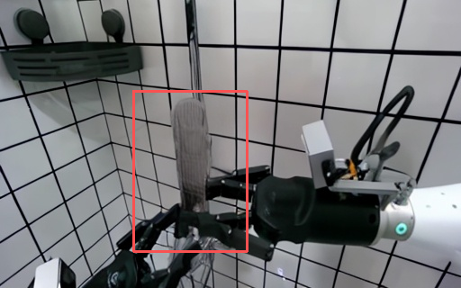
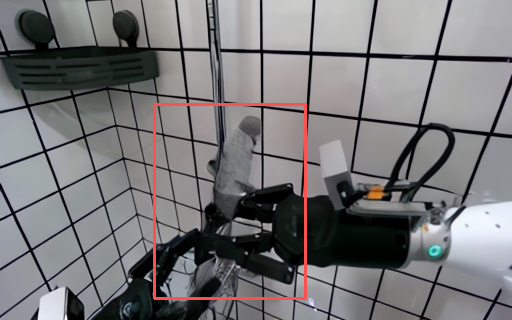
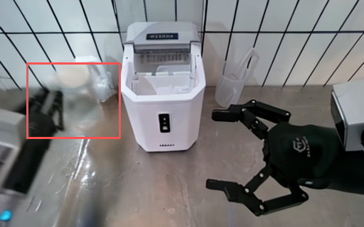
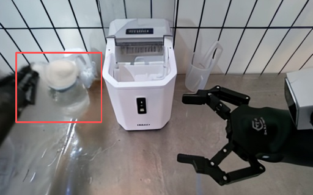
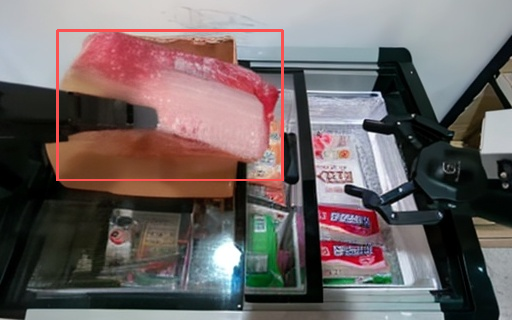
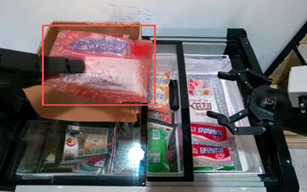
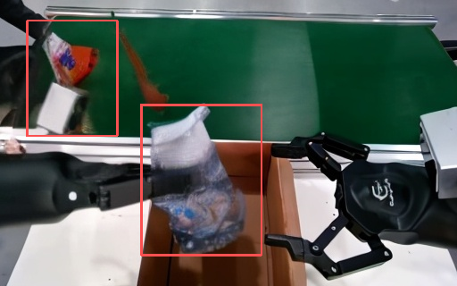
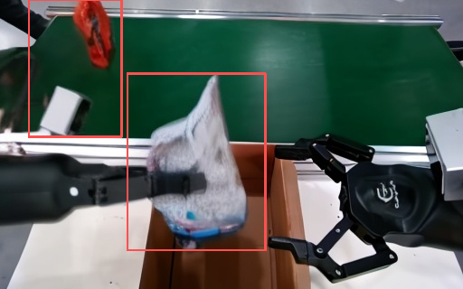
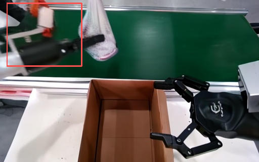
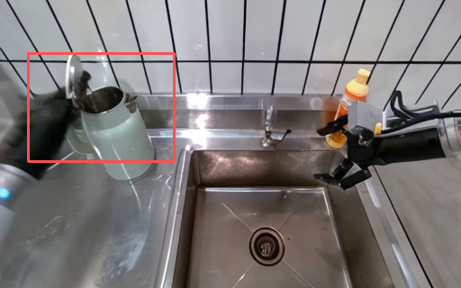

# AgiBot World Model: учебник по воспроизведению и улучшению решения соревнования

Этот учебник посвящён воспроизведению и методическим улучшениям для трека AgiBot World Model. Он состоит из четырёх частей: установка и настройка, базовый метод, улучшенный метод и процесс инференса. В разделе о базовом методе объясняется принцип работы видеодиффузионной модели с условием по действию EVAC; в разделе об улучшениях описаны уже реализованные в проекте LoRA-дообучение, временная разностная потеря (temporal difference loss), потеря по краям Собеля (Sobel edge loss) и фиксация первого кадра (first-frame anchoring). Надеемся, что материал окажется полезным для изучения: модели мира сейчас очень востребованы, и мы продвигаемся в этом направлении вместе с читателями.

## 1. Установка и настройка

### 1.1 Создание окружения

Создайте окружение Python 3.10:

```bash
conda create -n enerverse python=3.10.4
conda activate enerverse
```

Перейдите в каталог проекта и установите зависимости:

```bash
cd /path/to/project
pip install -r requirements.txt
```

В проекте на самом деле используются `jsonlines` и `fairscale`. Если при запуске не хватает пакетов, установите их напрямую:

```bash
pip install jsonlines
pip install fairscale
```

Улучшенная версия использует LoRA: в коде вызываются `peft.LoraConfig` и `get_peft_model`, поэтому нужно установить и `peft`:

```bash
pip install peft
```

Установите PyTorch3D:

```bash
pip install --no-index --no-cache-dir pytorch3d \
  -f https://dl.fbaipublicfiles.com/pytorch3d/packaging/wheels/py310_cu121_pyt240/download.html
```

Если версии видеокарты, CUDA или PyTorch не совпадают с requirements по умолчанию, сначала установите версию PyTorch, соответствующую вашей CUDA, а затем остальные зависимости. В ходе реального воспроизведения на новых видеокартах чаще возникают не логические ошибки кода, а несогласованность версий `torch`, `torchvision`, `xformers` и wheel-пакетов CUDA.

### 1.2 Исправления в исходном коде

#### 1) Совместимость с xformers

В `requirements.txt` зафиксировано:

```text
xformers==0.0.27.post2
```

Если `xformers` несовместим с текущими PyTorch и CUDA, при инференсе или обучении может возникнуть ошибка в attention. В этом проекте применено консервативное решение: в `evac/lvdm/models/vae_models.py` xformers отключён, и работа продолжается по обычному пути attention.

Ключевой фрагмент кода приведён ниже. Он сохраняет исходную логику `try import xformers`, но при запуске принудительно отключает быстрый путь xformers:

```python
logpy = logging.getLogger(__name__)

# try:
#     import xformers
#     import xformers.ops
#
#     XFORMERS_IS_AVAILABLE = True
# except:
#     XFORMERS_IS_AVAILABLE = False
#     logpy.warning("no module 'xformers'. Processing without...")

XFORMERS_IS_AVAILABLE = False
logpy.warning("no module 'xformers'. Processing without...")
```

Цена такого решения — снижение скорости инференса и эффективности использования памяти, но зато код легче запускается на разных машинах. Для учебного воспроизведения важнее сначала получить работающую генерацию, чем ускорять attention.

#### 2) Ошибка «attention initialized to none»

Кроме того, исходный код мог выдавать ошибку, связанную с тем, что attention «инициализирован как none». Исправление находится в логике прямого прохода attention в `evac/lvdm/modules/attention.py`. Исходная проблема заключалась в следующем: при `context=None` код всё равно выполнял `self.to_k(context)` или `self.to_v(context)`, то есть пустой контекст передавался в линейный слой, и вычисление attention ломалось.

Решение в этом проекте не сводится к правке конфигурации: в `forward()` явно различаются self-attention и cross-attention. Если `context is None`, то `q/k/v` берутся из входа `x`; если `context` задан, то `q` берётся из `x`, а `k/v` из `context`. Полный исправленный блок:

```python
def forward(self, x, context=None, mask=None, seq_length=None):
    spatial_self_attn = (context is None)
    k_ip, v_ip, out_ip = None, None, None

    # Ключевое исправление: различаем self-attention и cross-attention по наличию context
    if context is None:
        # self-attention: q/k/v берутся из входа x
        q = self.to_q(x)
        k = self.to_k(x)
        v = self.to_v(x)
    else:
        # cross-attention: q берётся из x, k/v из контекста context
        q = self.to_q(x)
        k = self.to_k(context)
        v = self.to_v(context)

    k_vpre, v_vpre, out_vpre = None, None, None

    h = self.heads
    q = self.to_q(x)
    context = default(context, x)
```

Смысл этого изменения в том, что при отсутствии внешнего контекста attention автоматически превращается в self-attention, а не продолжает передавать `None` как контекст cross-attention. Так устраняется ошибка с пустым объектом при `context=None`, а ветка cross-attention с условием по изображению и по траектории сохраняется.

#### 3) Ошибки FairScale и стратегии обучения

Старая версия `FairScale` может вызывать ошибку в стратегии обучения. Обычно это происходит, когда PyTorch Lightning по умолчанию использует sharded strategy или стратегию deepspeed: локальные версии `fairscale`, `torch` и `pytorch-lightning` не полностью совпадают, и обучение падает ещё до прямого прохода модели.

В этом проекте стратегия не создаётся по умолчанию: в `trainer/trainer.py` напрямую задаётся `"ddp"`. Полный блок изменений:

```python
# strategy_cfg = get_trainer_strategy(lightning_config)
# trainer_kwargs["strategy"] = strategy_cfg if type(strategy_cfg) == str else instantiate_from_config(strategy_cfg)
trainer_kwargs["strategy"] = "ddp"

trainer_kwargs["precision"] = lightning_config.get("precision", 32)
trainer_kwargs["sync_batchnorm"] = False
```

Здесь два ключевых момента. Во-первых, адаптер LoRA нужно применять после загрузки базовых весов: иначе адаптер может привязаться к структуре модели, в которую ещё не загружены веса. Во-вторых, `trainer_kwargs["strategy"] = "ddp"` нужен, чтобы обойти проблемы совместимости старого `FairScale` или sharded strategy и в первую очередь обеспечить стабильный запуск обучения.

#### 4) Несогласованность имени параметра guidance rescale

В исходном коде написано:

```python
guidanc_erescale=args.gr
```

Нужно заменить на `guidance_rescale=args.gr`. Рекомендуемый полный фрагмент вызова:

```python
with torch.cuda.amp.autocast(dtype=torch.bfloat16):
    model.inference(
        config, img, action, delta_action,
        c2w, w2c, intrinsic,
        save_path, n_chunk_to_pred,
        chunk=chunk,
        n_previous=n_previous,
        n_valid=n - n_previous,
        unconditional_guidance_scale=args.cfg,
        guidance_rescale=args.gr,
        ddim_steps=args.ddim_steps,
        saving_tag="",
        saving_video=True,
        video_dir=os.path.join(args.save_root + "_video", task, clip, str(args.gid), "video")
    )
    torch.cuda.empty_cache()
```

Иначе функция инференса модели может не получить корректный параметр guidance rescale: в лучшем случае параметр не будет действовать, в худшем возникнет ошибка неизвестного аргумента или отсутствующего параметра.

### 1.3 Настройка путей к весам и данным

Файл конфигурации обучения:

```text
configs/agibotworld/train_config_challenge_wm.yaml
```

Нужно проверить три группы путей.

Первое — предобученные веса EVAC:

```yaml
model:
  pretrained_checkpoint: /path/to/EnerV_AC_deepspeed_v0.1.pt
```

Второе — веса кодировщика изображений CLIP:

```yaml
model:
  params:
    img_cond_stage_config:
      params:
        abspath: /path/to/open_clip_pytorch_model.bin
```

Третье — корневой каталог обучающих данных:

```yaml
data:
  params:
    train:
      params:
        data_roots: ["/path/to/agibot/world_model/train"]
```

Каждый эпизод в каталоге данных должен содержать как минимум:

```text
episode_x/
  frame.png
  head_intrinsic_params.json
  head_extrinsic_params_aligned.json
  proprio_stats.h5
```

Эти файлы содержат начальное визуальное наблюдение, внутренние параметры камеры, внешние параметры камеры и состояние собственного тела робота. Цель World Model — не безусловная генерация видео, а предсказание будущего видео при заданном начальном изображении и действиях робота.

### 1.4 Ключевая конфигурация улучшенной версии

Все основные улучшения включаются в одном и том же файле конфигурации:

```yaml
model:
  params:
    use_lora: True
    lora_config:
      r: 16
      alpha: 16
      dropout: 0.05
      target_modules: ['to_q', 'to_k', 'to_v', 'to_out.0']
    lora_checkpoint: null

    temporal_loss_weight: 0.05
    edge_loss_weight: 0.02
    anchor_first_frame: True
```

Фиксацию первого кадра также нужно включить в настройках выборки данных:

```yaml
data:
  params:
    train:
      params:
        anchor_first_frame: True
```

Настройки, влияющие на стабильность обучения:

```yaml
data:
  params:
    batch_size: 1

lightning:
  precision: 32
  trainer:
    gradient_clip_val: 0.5
```

Здесь `batch_size: 1` выбран для снижения нагрузки на видеопамять, а `precision: 32` — чтобы добавленные временная разностная потеря и потеря по краям Собеля работали стабильнее. Если видеопамяти достаточно, можно попробовать увеличить размер батча; если её мало, сначала стоит оставить batch size равным 1.

### 1.5 Команды обучения

Запуск обучения:

```bash
bash scripts/train.sh configs/agibotworld/train_config_challenge_wm.yaml
```

Если используется только один GPU:

```bash
CUDA_VISIBLE_DEVICES=0 bash scripts/train.sh configs/agibotworld/train_config_challenge_wm.yaml
```

Скрипт внутри вызывает `torchrun` и задаёт число процессов по числу видимых GPU:

```bash
NGPU=`nvidia-smi --list-gpus | wc -l`
torchrun --nnodes=1 \
  --nproc_per_node=$NGPU \
  trainer/trainer.py \
  --base $config_file \
  --train
```

В процессе обучения рекомендуется сначала наблюдать за первыми 100–300 шагами:

- корректно ли загружаются предобученные веса EVAC;
- выводится ли число обучаемых параметров LoRA;
- появляется ли в логах `train/loss_temporal`;
- появляется ли в логах `train/loss_edge`;
- не появляется ли NaN в общей потере.

### 1.6 Команда инференса

Скрипт инференса улучшенной версии:

```text
scripts/infer_lora.sh
```

В нём нужно указать входные данные, каталог вывода, базовые веса, веса LoRA и конфигурацию модели:

```bash
input_root=/path/to/test/info_dataset
save_root=/path/to/save/results
ckp_path=/path/to/EnerV_AC_deepspeed_v0.1.pt
lora_ckp_path=/path/to/epoch=1-step=30000.ckpt
config_path=/path/to/configs/agibotworld/train_config_challenge_wm.yaml
n_pred=3
```

Запуск:

```bash
bash scripts/infer_lora.sh
```

Основная команда скрипта:

```bash
python evac/main/infer_all.py \
  -i $input_root \
  -s $save_root \
  --ckp_path $ckp_path \
  --config_path $config_path \
  --lora_ckp_path $lora_ckp_path \
  --n_pred $n_pred
```

`n_pred=3` означает, что для каждого входного эпизода генерируются 3 кандидата. Код последовательно задаёт разные random seed:

```python
for gid in range(args.n_pred):
    args.seed = gid
    args.gid = gid
    model = main(args, model=model)
```

## 2. Базовый метод из официального решения: видеомодель мира с условием по действию

### 2.1 Постановка задачи

Трек World Model можно абстрагировать как условную задачу предсказания видео. По начальному кадру наблюдения, последовательности действий робота, внешним и внутренним параметрам камеры и состоянию тела робота нужно сгенерировать фрагмент будущего видео манипуляции.

Формально это можно записать так:

```text
вход: I_0, A_{1:T}, K, E, S
выход: I_{1:T}
```

где:

- `I_0` — начальное изображение;
- `A_{1:T}` — последовательность будущих действий;
- `K` — внутренние параметры камеры;
- `E` — внешние параметры камеры;
- `S` — состояние собственного тела робота;
- `I_{1:T}` — будущие кадры, которые модель должна сгенерировать.

Эта задача сложнее обычной генерации видео, потому что результат должен одновременно удовлетворять трём ограничениям:

1. Визуальное ограничение: внешний вид сцены, объектов, стола и контейнеров должен оставаться стабильным.
2. Ограничение по действию: движение объектов должно соответствовать движению захвата и конечного эффектора робота.
3. Временное ограничение: соседние кадры не должны перескакивать, а длинная последовательность не должна постепенно уходить в дрейф.

### 2.2 Как входные данные попадают в модель

В проекте каждый файл эпизода выполняет свою роль.

| Файл | Как используется моделью | Назначение |
|---|---|---|
| `frame.png` | визуальное условие на входе | задаёт текущий внешний вид сцены |
| `head_intrinsic_params.json` | построение геометрии камеры | описывает параметры формирования изображения камерой |
| `head_extrinsic_params_aligned.json` | построение позы камеры | выравнивает мировые координаты, координаты камеры и действия робота |
| `proprio_stats.h5` | извлечение действий и состояния | содержит данные о захвате, положении и ориентации конечного эффектора |

`evac/main/infer_all.py` читает `proprio_stats.h5`, а затем через `get_actions()` получает условия по действиям. Обычно условия действий включают два типа величин:

- абсолютные действия или состояние: описывают положение конечного эффектора и захвата в текущий момент;
- относительные изменения действий: описывают изменение движения робота между соседними моментами времени.

Почему одновременно используются действия и геометрия камеры? Потому что в видео манипуляций одно и то же действие даёт разное смещение пикселей при разных ракурсах камеры. Параметры камеры помогают модели перевести утверждение «робот движется в трёхмерном пространстве так-то» в утверждение «на изображении должно измениться вот так».

### 2.3 Базовая идея латентной диффузии

Модель не генерирует видео прямо в пространстве пикселей. Сначала кадры кодируются в латентное пространство, затем в нём выполняется диффузионное шумоподавление.

Схема процесса:

```text
реальные кадры видео
  -> энкодер VAE
  -> латентное представление
  -> добавление шума
  -> 3D UNet предсказывает направление шумоподавления
  -> пошаговое сэмплирование даёт будущие латенты
  -> декодер VAE
  -> сгенерированные кадры видео
```

Это даёт два преимущества:

1. Меньше вычислений: латентное пространство имеет меньшее разрешение, чем пиксельное.
2. Лучше подходит для видео: 3D UNet одновременно моделирует пространственную текстуру и изменения во времени.

### 2.4 Механизм внедрения условий

Модель не является безусловной диффузией. Сеть шумоподавления получает несколько источников условий:

| Условие | Способ внедрения | Назначение |
|---|---|---|
| Начальное изображение | кодирование CLIP + модуль проекции | задаёт семантическую и визуальную априорную информацию |
| Последовательность действий | кодирование действий и delta action | управляет будущим движением |
| Карта траектории | условие trajectory / ray map | задаёт пространственное геометрическое направление |
| Параметры камеры | построение геометрического входа из внутренних и внешних параметров | выравнивает ракурс и движение |
| Историческая память | memory frames | поддерживает непрерывность контекста |

В конфигурации это выглядит так:

```yaml
first_stage_key: ["video", "traj"]
cond_stage_key: delta_action
conditioning_key: hybrid
use_raymap_dir: True
use_raymap_origin: True
use_cat_mask: True
image_cross_attention: true
traj_cross_attention: true
```

`hybrid` означает, что модель одновременно использует несколько условий, а не только одно изображение или одно действие. `image_cross_attention` и `traj_cross_attention` означают, что условия по изображению и по траектории поступают в UNet через cross-attention.

### 2.5 Цель обучения

Ядро диффузионного обучения состоит в том, чтобы случайно выбрать момент времени `t`, добавить шум к настоящему латентному представлению и обучить модель предсказывать цель шумоподавления.

В конфигурации проекта:

```yaml
parameterization: "v"
```

То есть используется v-prediction. Цель обучения можно изложить так:

```python
if parameterization == "v":
    target = get_v(x_start, noise, t)

loss_simple = mse(model_output, target)
loss = weighted(loss_simple) + original_elbo_weight * loss_vlb
```

Здесь `x_start` — настоящий латент видео, `noise` — случайный шум, `model_output` — выход UNet. Модель учится не генерировать изображение напрямую, а правильно предсказывать направление шумоподавления при любом уровне шума.

Важная деталь задачи: основная потеря вычисляется только для блока будущих кадров, который предсказывается. Историческая память служит условием, а учиться генерировать нужно только будущие кадры.

### 2.6 Авторегрессивная генерация по блокам

Видео в соревновании может быть длинным, поэтому одновременная генерация всех будущих кадров создаёт нагрузку на память и на моделирование времени. Поэтому модель предсказывает блоками:

```text
1-й блок: по начальной памяти и условиям действий генерируются несколько будущих кадров
2-й блок: часть уже сгенерированного видео становится новой памятью, и генерируется следующий отрезок
3-й блок: генерация продолжается по тому же принципу
```

Преимущество такого подхода — возможность генерировать более длинные видео; недостаток — накопление ошибок. Если предыдущий отрезок уже размыт, следующий будет использовать размытый результат как условие: мелкие объекты исчезают, края становятся мягче, а действие и визуальный результат постепенно расходятся.

Следующие улучшения как раз направлены на эту проблему.

## 3. Улучшенный метод, использованный в соревновании

Цель улучшенной версии — устранить три вида деградации при авторегрессивной генерации длинных последовательностей:

1. Края объекта и захвата постепенно размываются.
2. Движение между соседними кадрами перестаёт быть непрерывным.
3. После нескольких блоков инференса модель забывает исходный внешний вид.

Соответствующие решения в реализации:

- дообучение LoRA;
- временная разностная потеря (Temporal Difference Loss);
- потеря по краям Собеля (Sobel Edge Loss);
- фиксация первого кадра (first-frame anchoring).

### 3.1 Дообучение LoRA

#### 3.1.1 Зачем нужен LoRA

Полное дообучение видеодиффузионной модели стоит дорого: у UNet большое число параметров, память расходуется сильно, а общие способности генерации предобученной модели легко разрушить. Идея LoRA состоит в том, чтобы добавить рядом с проекциями attention низкоранговые матрицы и обучать только небольшое число новых параметров.

Для нашей задачи LoRA позволяет адаптировать модель к сценам робототехнических манипуляций из данных соревнования и при этом сохранить видеопредварительные знания исходной модели.

#### 3.1.2 Настройка

В конфигурации включается:

```yaml
use_lora: True
lora_config:
  r: 16
  alpha: 16
  dropout: 0.05
  target_modules: ['to_q', 'to_k', 'to_v', 'to_out.0']
lora_checkpoint: null
```

Значения параметров:

| Параметр | Значение |
|---|---|
| `r: 16` | ранг низкоранговых матриц LoRA |
| `alpha: 16` | коэффициент масштабирования LoRA |
| `dropout: 0.05` | dropout в ветке LoRA |
| `target_modules` | проекции attention, в которые вставляется LoRA |
| `lora_checkpoint` | веса LoRA, загружаемые при инференсе |

Модули `to_q`, `to_k`, `to_v`, `to_out.0` выбраны потому, что именно эти слои напрямую определяют, как attention извлекает информацию из условий и контекста. Лёгкая адаптация этих слоёв меняет то, как модель использует условия по изображению, по действиям и по временному контексту.

#### 3.1.3 Реализация

В `evac/lvdm/models/ddpm3d.py` при инициализации модели сохраняется конфигурация LoRA:

```python
self.use_lora = use_lora
self._lora_config = lora_config or {}
self._lora_checkpoint = lora_checkpoint
```

После загрузки базовых весов вызывается `apply_lora()`. Функция выполняет три шага:

```python
for param in self.model.parameters():
    param.requires_grad = False

peft_config = LoraConfig(
    r=lora_r,
    lora_alpha=lora_alpha,
    lora_dropout=lora_dropout,
    target_modules=target_modules,
    bias="none",
)

self.model.diffusion_model = get_peft_model(
    self.model.diffusion_model, peft_config
)
```

Первый шаг — заморозить исходный UNet, второй — построить конфигурацию LoRA, третий — внедрить LoRA в диффузионную модель.

Оптимизатор собирает только обучаемые параметры:

```python
if self.use_lora:
    params = [p for p in self.model.parameters() if p.requires_grad]
```

Поэтому при обучении в основном обновляется адаптер LoRA, а не вся видеодиффузионная модель целиком.

#### 3.1.4 Загрузка LoRA при инференсе

`evac/main/infer_all.py` передаёт путь к checkpoint LoRA из командной строки в конфигурацию:

```python
if hasattr(args, 'lora_ckp_path') and args.lora_ckp_path:
    config.model.params.lora_checkpoint = args.lora_ckp_path
```

После загрузки модели LoRA применяется:

```python
model = load_checkpoints(model, config.model, ignore_mismatched_sizes=False)
if hasattr(model, 'apply_lora'):
    model.apply_lora()
```

Таким образом, при инференсе работают два набора весов:

```text
базовые веса EVAC + веса LoRA
```

Базовые веса обеспечивают общую способность генерации, а веса LoRA — адаптацию к данным соревнования.

### 3.2 Temporal Difference Loss

#### 3.2.1 Мотивация

Исходная диффузионная потеря в основном требует, чтобы предсказанный латент каждого кадра был близок к настоящему латенту. Однако видео манипуляций также требует правильного «процесса изменения». Например, после того как захват схватил объект, объект должен непрерывно двигаться вместе с захватом, а не перескакивать между соседними кадрами.

Временная разностная потеря напрямую ограничивает разности между соседними кадрами, так что модель учится тенденциям движения реального видео.

#### 3.2.2 Математическая форма

Пусть предсказанный будущий латент равен `x_pred`, а настоящий будущий латент равен `x_gt`. Разности соседних кадров:

```text
Δx_pred(t) = x_pred(t+1) - x_pred(t)
Δx_gt(t)   = x_gt(t+1) - x_gt(t)
```

Временная разностная потеря:

```text
L_temporal = MSE(Δx_pred, Δx_gt)
```

Общая потеря с добавкой:

```text
L = L_diffusion + λ_t L_temporal
```

где `λ_t` соответствует настройке:

```yaml
temporal_loss_weight: 0.05
```

#### 3.2.3 Реализация

В `p_losses()` сначала из v-prediction восстанавливается `x0_pred`:

```python
x0_pred = self.predict_start_from_z_and_v(x_noisy, t, model_output)
x0_pred_chunk = x0_pred[:, :, -self.chunk:]
x0_gt_chunk = x_start[:, :, -self.chunk:]
```

Затем вычисляются разности соседних кадров:

```python
pred_diff = x0_pred_chunk[:, :, 1:] - x0_pred_chunk[:, :, :-1]
gt_diff = x0_gt_chunk[:, :, 1:] - x0_gt_chunk[:, :, :-1]
loss_temporal = F.mse_loss(pred_diff, gt_diff)
loss += self.temporal_loss_weight * loss_temporal
```

Эта потеря действует только на блок предсказания и не меняет роль истории памяти как условия.

### 3.3 Sobel Edge Loss

#### 3.3.1 Мотивация

Ключевые объекты в задачах манипуляций часто очень малы: это захваты, кубики, горлышки бутылок, края контейнеров. Обычная потеря MSE может усреднить эти высокочастотные детали при длинной генерации: граница становится размытой, объект расплывается, а в второй половине последовательности цель исчезает.

Потеря по краям Собеля направлена на усиление структуры границ, чтобы предсказанный латент по пространственным градиентам был близок к настоящему.

#### 3.3.2 Форма метода

Оператор Собеля вычисляет горизонтальный и вертикальный градиенты:

```text
Gx = Sobel_x(x)
Gy = Sobel_y(x)
Edge(x) = sqrt(Gx^2 + Gy^2)
```

Потеря по краям:

```text
L_edge = MSE(Edge(x_pred), Edge(x_gt))
```

Настройка веса:

```yaml
edge_loss_weight: 0.02
```

#### 3.3.3 Реализация

Ядра Собеля инициализируются так:

```python
sobel_x = torch.tensor([[-1, 0, 1], [-2, 0, 2], [-1, 0, 1]])
sobel_y = torch.tensor([[-1, -2, -1], [0, 0, 0], [1, 2, 1]])
self.register_buffer('sobel_x', sobel_x)
self.register_buffer('sobel_y', sobel_y)
```

К латенту применяется depthwise-свёртка:

```python
edge_x = F.conv2d(x_2d, self.sobel_x, padding=1, groups=c)
edge_y = F.conv2d(x_2d, self.sobel_y, padding=1, groups=c)
edges = torch.sqrt(edge_x ** 2 + edge_y ** 2 + 1e-6)
```

Добавление в общую потерю:

```python
sobel_pred = self._apply_sobel(x0_pred_chunk)
sobel_gt = self._apply_sobel(x0_gt_chunk)
loss_edge = F.mse_loss(sobel_pred, sobel_gt)
loss += self.edge_loss_weight * loss_edge
```

Этот метод вычисляет края в латентном пространстве. Латент — не пиксели, но энкодер VAE сохраняет пространственную структуру, поэтому локальные градиенты латента всё же довольно хорошо отражают границы объектов и изменения текстуры.

### 3.4 Фиксация первого кадра

#### 3.4.1 Мотивация

При авторегрессивной генерации видео накапливаются ошибки. Модель сначала генерирует первый отрезок, а затем использует результат как условие для следующего. Если в первом отрезке уже появились размытие или небольшой дрейф, второй отрезок будет усиливать эти ошибки.

Идея фиксации первого кадра: независимо от номера блока сохранять исходный первый кадр как неизменную память, чтобы модель всё время видела исходный внешний вид объектов и компоновку сцены.

#### 3.4.2 Реализация на этапе обучения

В `dataset/agibotworld_challenge_dataset.py` добавлен параметр:

```python
anchor_first_frame=False
```

Сохранение в объект:

```python
self.anchor_first_frame = anchor_first_frame
```

При выборке кадров памяти, если фиксация включена, принудительно задаётся первый индекс памяти равным 0:

```python
if self.anchor_first_frame and len(mem_indexes) > 0:
    mem_indexes[0] = 0
```

Так модель во время обучения привыкает к тому, что в первой позиции памяти всегда находится исходный первый кадр.

#### 3.4.3 Реализация на этапе инференса

В `inference()` в `evac/lvdm/models/ddpm3d.py` при `i_chunk > 0` индексы истории больше не выбираются полностью равномерно: нулевой кадр сохраняется:

```python
if self.anchor_first_frame:
    remaining = n_previous - 2
    if remaining > 0:
        idx_history = [0] + [
            1 + (n_history - 1) * i // remaining
            for i in range(remaining)
        ]
    else:
        idx_history = [0]
```

Пояснение:

```text
слот памяти 0: всегда исходный первый кадр
остальные слоты памяти: равномерный выбор из уже сгенерированной истории
последний кадр: повторяет самый свежий сгенерированный кадр для сохранения стыка блоков
```

Эта конструкция в первую очередь смягчает проблему забывания внешнего вида во второй половине длинной последовательности.

### 3.5 Итоги трёх основных улучшений

| Проблема | Улучшение | Эффект |
|---|---|---|
| скачки между соседними кадрами | Temporal Difference Loss | ограничивает непрерывность движения |
| размытость краёв объектов | Sobel Edge Loss | усиливает высокочастотную структуру |
| забывание исходного внешнего вида на длинной последовательности | фиксация первого кадра | сохраняет визуальный ориентир |

Общая целевая функция при обучении:

```text
L_total = L_diffusion
        + λ_t L_temporal
        + λ_e L_edge
```

Здесь потери Temporal и Sobel определяют, что именно оптимизируется, а фиксация первого кадра определяет, какой контекст получает модель.

## 4. Процесс инференса

Этот раздел объясняет только, как запустить `infer` и получить генерацию, которую можно отправить или просмотреть. После обучения и получения checkpoint LoRA инференс делится на четыре шага: подготовка входных данных, настройка скрипта инференса, запуск команды инференса и проверка выходных файлов.

### 4.1 Подготовка входных данных инференса

Входной каталог инференса организуется по задачам и эпизодам. В каждом эпизоде должны быть как минимум начальное изображение, параметры камеры и файл состояния робота:

```text
info_dataset/
  task_x/
    episode_y/
      frame.png
      head_intrinsic_params.json
      head_extrinsic_params_aligned.json
      proprio_stats.h5
```

`frame.png` даёт начальное визуальное наблюдение, два файла JSON — внутренние и внешние параметры камеры, `proprio_stats.h5` — действия робота и состояние собственного тела. Входная точка инференса читает эти файлы и преобразует последовательность действий в action и delta action, которые нужны модели.

### 4.2 Настройка скрипта инференса

В скрипте инференса нужно указать пять путей: входной каталог, выходной каталог, базовые веса модели, веса LoRA и файл конфигурации. Рекомендуемая запись в `scripts/infer_lora.sh`:

```bash
input_root=/path/to/test/info_dataset
save_root=/path/to/save/results
ckp_path=/path/to/EnerV_AC_deepspeed_v0.1.pt
lora_ckp_path=/path/to/epoch=1-step=30000.ckpt
config_path=/path/to/configs/agibotworld/train_config_challenge_wm.yaml
n_pred=3
```

`ckp_path` — базовые веса World Model, `lora_ckp_path` — checkpoint LoRA, полученный после улучшенного обучения. `n_pred=3` означает, что для каждого эпизода генерируются 3 кандидата, которым соответствуют random seed `0, 1, 2`.

Основная команда скрипта:

```bash
python evac/main/infer_all.py \
  -i $input_root \
  -s $save_root \
  --ckp_path $ckp_path \
  --config_path $config_path \
  --lora_ckp_path $lora_ckp_path \
  --n_pred $n_pred
```

Чтобы сначала быстро проверить работу процесса, можно установить `n_pred=1`, а после того как изображения и видео генерируются нормально, вернуть значение `3`.

### 4.3 Запуск инференса

Из корня проекта выполните:

```bash
bash scripts/infer_lora.sh
```

Программа инференса сначала загружает конфигурацию и базовые веса, а затем записывает в конфигурацию модели путь к checkpoint LoRA из командной строки:

```python
config.model.pretrained_checkpoint = args.ckp_path
if hasattr(args, 'lora_ckp_path') and args.lora_ckp_path:
    config.model.params.lora_checkpoint = args.lora_ckp_path
```

После этого модель загружает адаптер LoRA:

```python
model = instantiate_from_config(config.model)
model = load_checkpoints(model, config.model, ignore_mismatched_sizes=False)
if hasattr(model, 'apply_lora'):
    model.apply_lora()
```

Наконец, программа циклически генерирует несколько кандидатов согласно `n_pred`:

```python
model = None
for gid in range(args.n_pred):
    args.seed = gid
    args.gid = gid
    model = main(args, model=model)
```

### 4.4 Проверка выходных данных инференса

После окончания инференса проверьте два выходных каталога:

```text
results/
results_video/
```

В `results/` сохраняются покадровые изображения; типичная структура:

```text
results/
  task_x/
    episode_y/
      0/video/frame_00000.jpg
      0/video/frame_00001.jpg
      ...
      1/video/frame_00000.jpg
      ...
      2/video/frame_00000.jpg
      ...
```

В `results_video/` сохраняются собранные видео; типичная структура:

```text
results_video/
  task_x/
    episode_y/
      0/video/outputs.mp4
      1/video/outputs.mp4
      2/video/outputs.mp4
```

Проверяйте, что для каждого эпизода созданы все каталоги кандидатов, и откройте `outputs.mp4`, чтобы убедиться, что видео воспроизводится. Если появились только изображения без видео, сначала проверьте путь сохранения видео и зависимости для кодирования видео; если не появилось ни изображений, ни видео, сначала проверьте структуру входного каталога, пути к весам и возможность чтения `proprio_stats.h5`.

### 4.5 Сравнение с официальным базовым решением

После инференса слева показан результат официального базового решения, справа — результат предложенного улучшенного метода; все результаты получены для одного и того же входа и показаны на последнем кадре, чтобы сравнение было корректным.

| Группа сравнения | Результат официального базового решения | Результат улучшенного метода |
|---|---|---|
| группа 1 |  |  |
| группа 2 |  |  |
| группа 3 |  |  |
| группа 4 |  |  |

Видно, что после улучшений объекты выглядят чётче, а их структура — более полной.

Однако проблемы остаются. По результатам улучшенной модели видно, что хотя метод превосходит официальное базовое решение, общее визуальное качество всё ещё недостаточно хорошее. Помимо визуального качества есть и другие проблемы.



На этом кадре видно, что при продолжении генерации после окклюзии объекты легко исчезают и искажаются. Вероятно, для решения нужно улучшать память модели или её структуру.



На этом кадре видно, что модель плохо понимает физическую структуру шарнира при операции закрытия крышки бутылки, поэтому манипулятор проходит сквозь объект. Мы планируем дальше улучшать понимание физической информации в модели мира.

## 5. Итоги

Учебник описывает воспроизведение и улучшение модели мира с видеодиффузией, условленной действиями, по улучшенному коду. Базовый метод использует латентную диффузию для предсказания будущих видео манипуляций роботом; улучшенный метод без полного переобучения большой модели добавляет LoRA-дообучение, временную разностную потерю, потерю по краям Собеля и фиксацию первого кадра.

Распределение задач между методами:

- LoRA обеспечивает недорогую адаптацию к данным соревнования.
- Temporal Difference Loss ограничивает непрерывность движения.
- Sobel Edge Loss усиливает края объектов и мелкие детали.
- Фиксация первого кадра смягчает забывание внешнего вида на длинной последовательности.

Полный путь воспроизведения выглядит так:

```text
установка зависимостей
  -> настройка путей к весам EVAC, CLIP и данных
  -> включение LoRA, Temporal Loss, Sobel Loss и фиксации первого кадра
  -> обучение checkpoint LoRA
  -> инференс через infer_lora.sh
  -> проверка каталогов results и results_video
  -> подтверждение, что покадровые изображения и outputs.mp4 создаются нормально
```

Надеемся, что этот учебник поможет лучше понять модели мира. Мы также продолжим углублённо работать в области моделей мира для роботов и будем рады видеть ваши публикации; мы сами стремимся публиковаться на ведущих конференциях и надеемся встретиться с вами там.
