# Задание 03: демонстрационная практика — от идеи к реализации

## 1. Обзор раздела

В первые два дня вы уже сформировали представление о том, «что такое воплощённый ИИ» и «каковы основные технические пути». Сегодня задача — превратить эти абстракции в видимую цепочку разработки. Новички часто слышат термины «сбор данных», «дообучение модели», «отладка в симуляции», «проверка развёртывания», но если не увидеть всё целиком, легко воспринимать их как независимые этапы. В воплощённом ИИ эти звенья — не отдельные существительные, а строго связанный конвейер.

Поэтому сегодняшний день не требует от вас самостоятельно обучить модель или выполнить сложную настройку окружения. Главное — пройти «видимую цепочку» целиком: откуда берутся данные, как модель осваивает навык, какую роль играет симуляционная платформа и как платформа «Лэйюнь» организует эти шаги для учащегося.

## 2. Как робот осваивает новый навык?

Типичный процесс разработки воплощённого навыка выглядит примерно так:

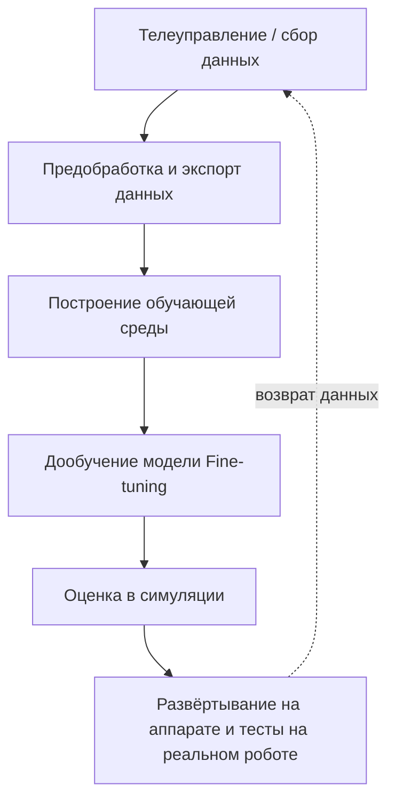

Сложность этой цепочки в том, что это не чисто программная задача. Недостаточно уметь писать код модели и управлять манипулятором. Здесь участвуют телеуправление, данные, симуляция, обучение, развёртывание и аппаратура одновременно; если сбой случится в любом звене, это проявится как вопрос «почему робот не справился». Для отдельного учащегося основные барьеры обычно два: без реального робота трудно самостоятельно собрать качественные данные; без полноценной среды сложно понять, как обучение, отладка и развёртывание связаны между собой. Поэтому роль платформы «Лэйюнь» в этом курсе предельно ясна: она не заменяет всю низкоуровневую инженерию, а сначала показывает, как выглядит весь путь целиком.

## 3. Краткий обзор платформы «Лэйюнь»

Если рассматривать платформу «Лэйюнь» как учебный вход в замкнутый цикл разработки воплощённого ИИ, то сначала стоит понять не отдельную функцию, а распределение обязанностей между основными модулями. Платформа состоит из трёх основных модулей:

| **Модуль** | **Назначение** | **Что может делать учащийся** |
| --- | --- | --- |
| **Витрина моделей** | предустановленные модели π0, RynnVLA, GR00T и др. | знакомиться с имеющимися моделями и вызывать их |
| **Управление данными** | загрузка, управление и разметка данных | просматривать наборы данных с реального робота и из симуляции (например, кривые углов суставов и видео) |
| **Сервис моделей** | обучение, настройка и развёртывание моделей | проходить отладку навыков и процесс развёртывания модели |

Одной фразой о связи этих модулей: витрина моделей отвечает за «смотреть и выбирать», управление данными — за «смотреть данные», а сервис моделей — за «запуск навыка в работу». За этой короткой формулой стоит вполне типичная инженерная логика. Витрина показывает, какие базовые возможности уже предоставлены платформой; управление данными помогает увидеть данные, на которых стоит модель; а сервис моделей показывает, как эти возможности доходят до обучения, настройки и развёртывания. Для новичка достаточно понять связь этих трёх частей, чтобы перестать воспринимать платформу как набор разрозненных страниц. По сути, этот раздел учит не «куда нажимать», а сначала строить инженерную карту.

## 4. Цели практики

Сегодняшняя цель — полный цикл практики в симуляции: **вход на платформу → знакомство с моделями → симуляционный сбор данных → обучение модели → развёртывание и отладка**. Пройдя этот круг до конца, вы начнёте понимать, почему платформу воплощённого ИИ нельзя считать просто витриной моделей: это инженерная платформа, которая объединяет данные, модели, исполнение и результаты.

## 5. Рекомендуемый путь практики

### Шаг 1: вход на платформу

Операция простая: войдите в «Экосистему разработчиков DAMO», нажмите «Попробовать» и откройте платформу «Лэйюнь». Но с точки зрения обучения ценность этого шага — не сам факт входа, а то, что вы начинаете сопоставлять абстрактный учебный материал с реальной системой. Многие читатели воспринимают «платформу» как пустое слово и понимают её лишь тогда, когда видят вход, главную страницу и раскладку модулей.

Платформа «Лэйюнь»: [https://developer.damo-academy.com/playground?spm=a1z26upx.zdxx.0.0&from=zdxx](https://developer.damo-academy.com/playground?spm=a1z26upx.zdxx.0.0&from=zdxx)

Ориентиры в интерфейсе:

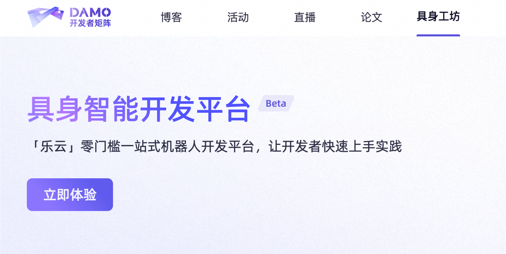


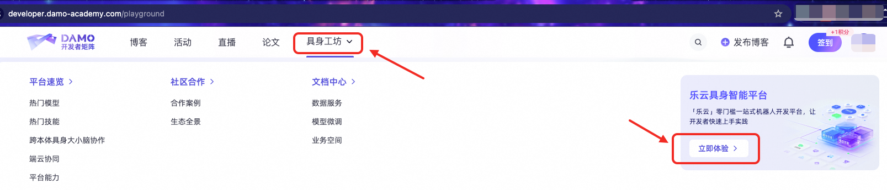

### Шаг 2: сначала возможности платформы, без спешки с действиями

При первом входе полезно получить «ощущение карты», а не сразу нажимать все функции. Как минимум стоит понять, какие части платформы соответствуют такой цепочке:

```plaintext
данные -> модель -> отладка -> исполнение -> просмотр результатов
```

Важнее всего на этом этапе не пройтись по каждой кнопке, а построить «карту платформы»: где находятся витрина моделей, управление данными, сервис моделей, управление агентами и устройствами и какой этап цикла каждый из них закрывает. С такой картой конкретные модули выглядят не как разрозненные экраны, а как разные срезы одного непрерывного процесса.

Ориентиры в интерфейсе:

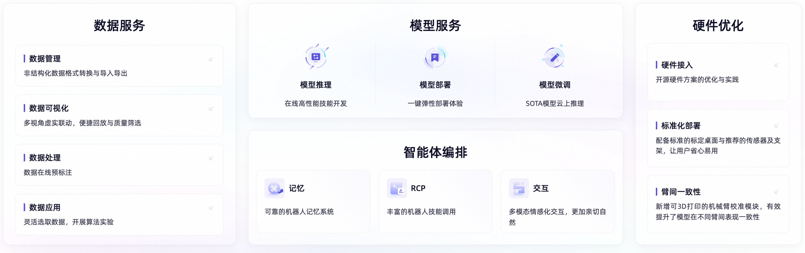


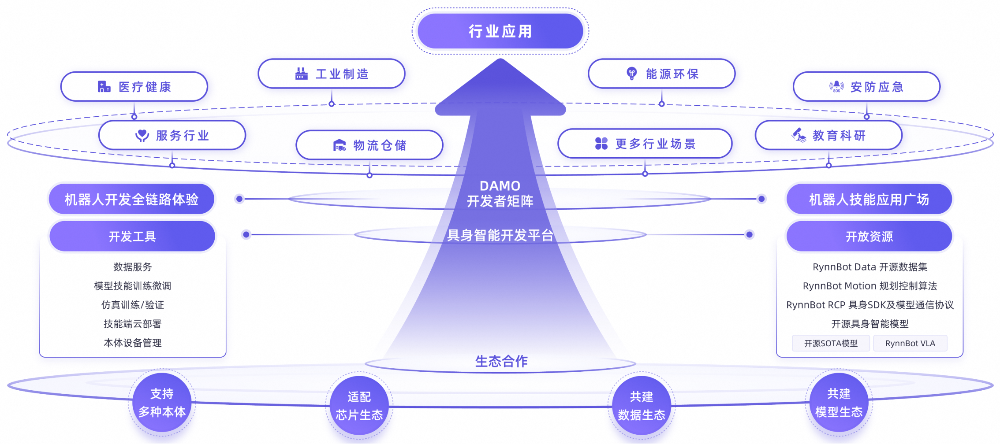

### Шаг 3: базовые страницы back-office

При первом знакомстве достаточно понимать, зачем нужна каждая страница, а не разбирать все подробности. Страница устройств относится в основном к подключению и активации реального робота, страница агентов — к организации задач и вызову способностей через диалог. Это не главный объект сегодняшнего занятия, но они помогают понять: платформа — не просто набор демо моделей, она в конечном счёте решает системные задачи — как управлять роботами и как организовывать задачи.

Стоит запомнить: сложность платформ воплощённого ИИ связана не с количеством страниц, а с тем, что они стоят между моделью и реальной системой. Управление устройствами отвечает за аппаратуру и объекты исполнения, управление агентами — за организацию задач и композицию способностей. Снаружи это не самые «эффектные» разделы, но без них система не заработает в реальности.

Ориентиры в интерфейсе:

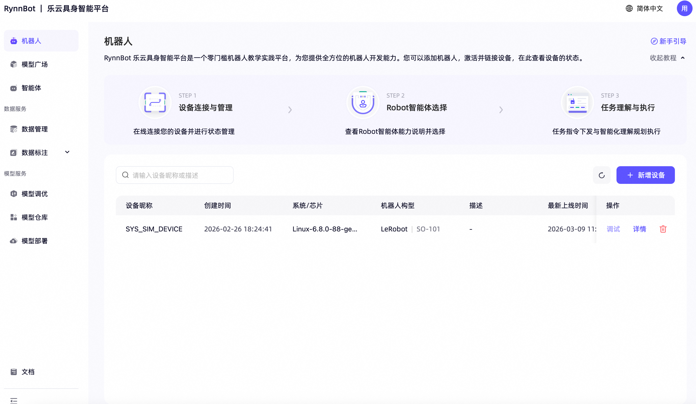

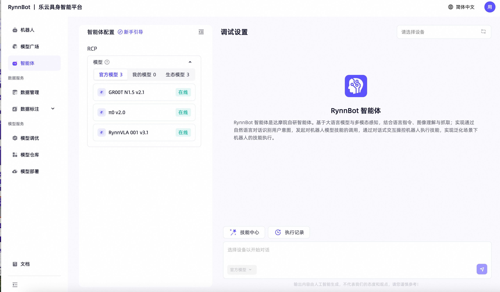

### Шаг 4: отладка модели в симуляции

Начинайте с модели, которая поддерживает симуляцию, — так вы сначала почувствуете, что платформа умеет, а потом уже будете разбираться в принципах.

На этом шаге обратите внимание на три вещи. Во-первых, какие модели уже предустановлены, например Pi0 или GR00T, и для каких задач они предназначены. Во-вторых, какие страницы проходит навык от загрузки до исполнения — это поможет понять реальный смысл «сервиса моделей». В-третьих, как платформа воспроизводит и показывает результаты после выполнения, ведь именно это отвечает на вопрос «действительно ли модель выполнила задачу». Вы увидите, что «попробовать модель» — это не просто нажатие кнопки запуска, а минимум несколько последовательных этапов: выбор модели, вызов навыка, наблюдение за исполнением и просмотр результата.

Если копнуть глубже, этот шаг раскрывает большое слово «способность модели». Мы говорим «эта модель умеет захватывать», «эта — навигировать», но на платформе вы увидите, что за этим результатом стоят конфигурация, загрузка, исполнение, запись и просмотр. Именно поэтому в материале так много скриншотов: в инженерии «способность» — не лозунг, а процесс, который можно отследить и проверить.

Ориентиры в интерфейсе:

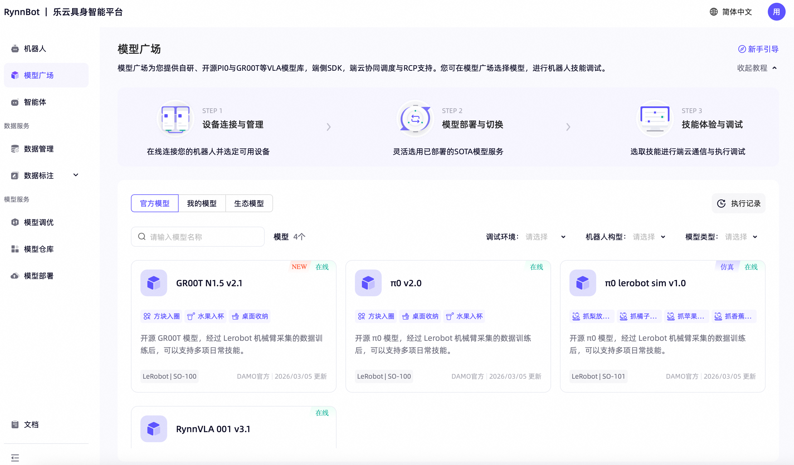

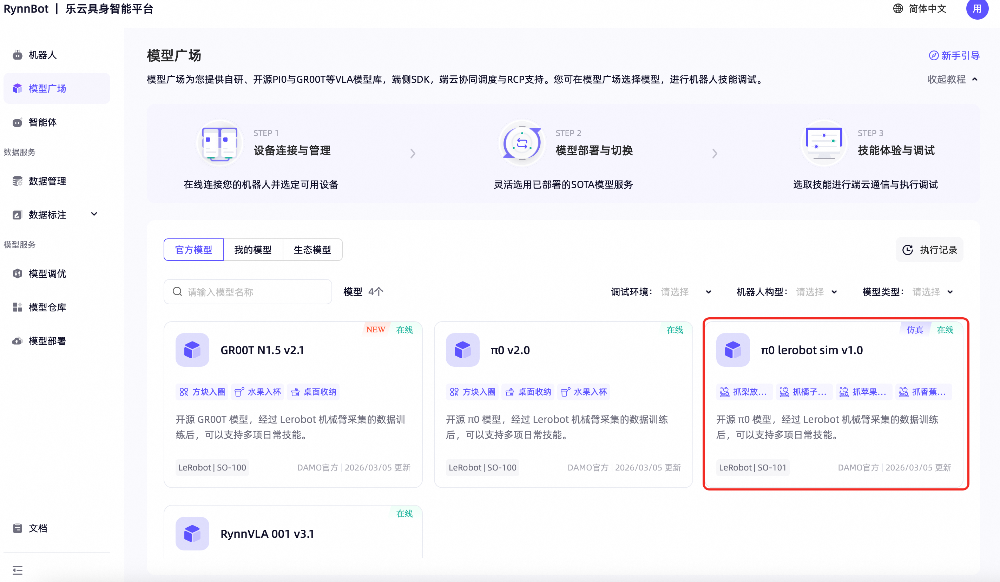

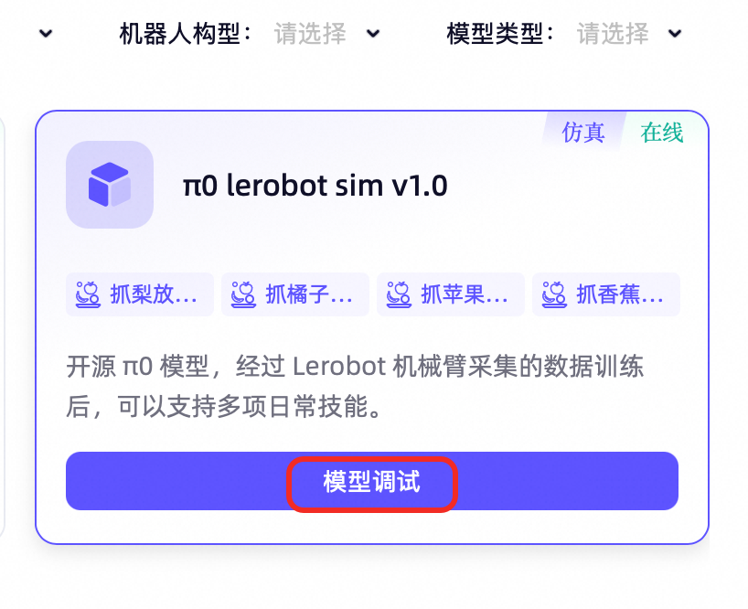

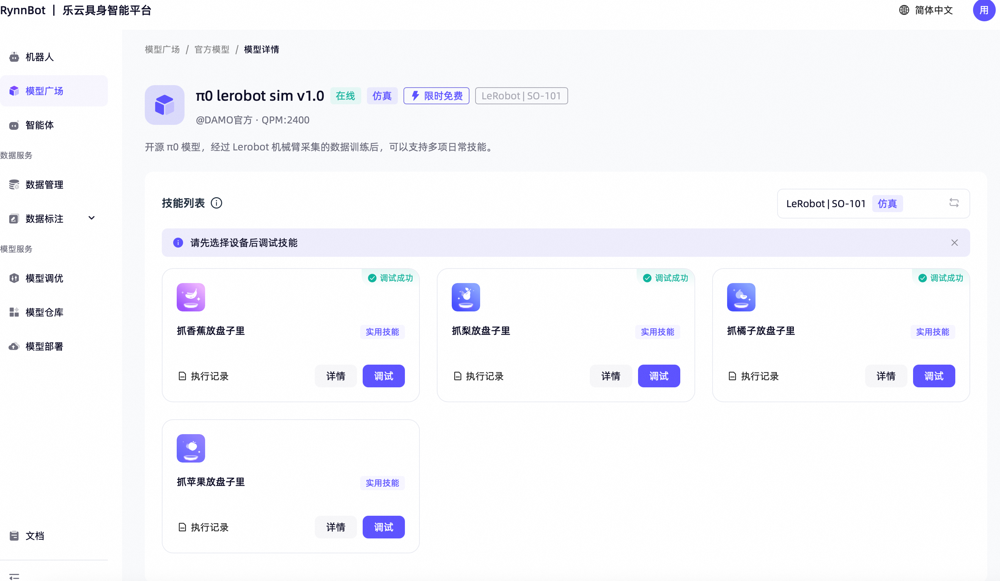

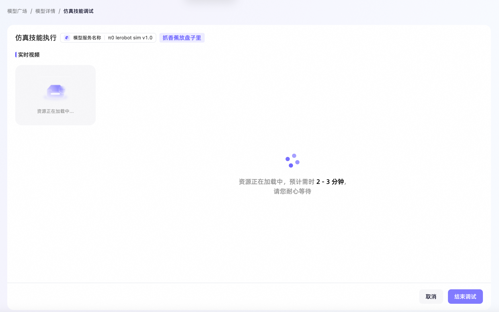

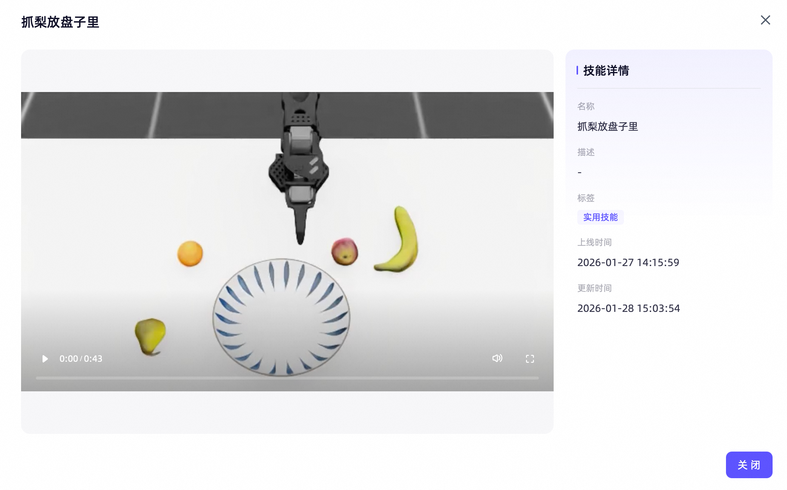

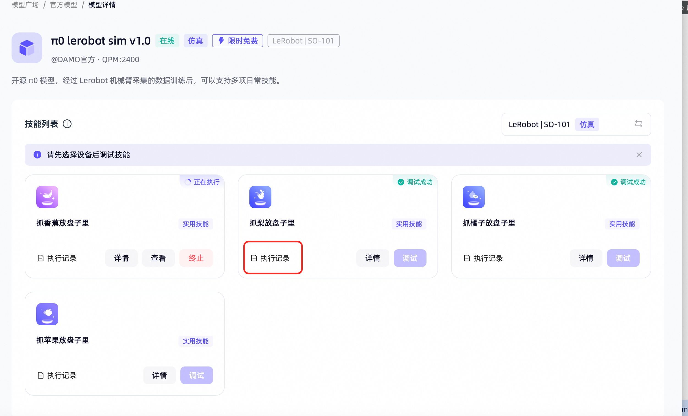

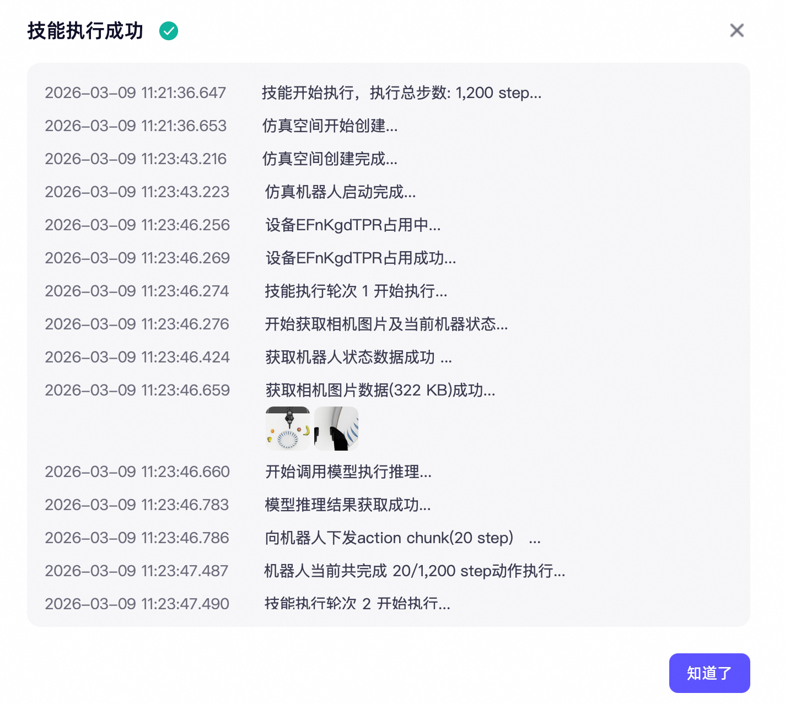

### Шаг 5: наборы данных и подробности данных

После опыта с навыком загляните на страницу управления данными — тогда станет понятнее, зачем сначала говорилось о сборе данных и отладке модели. Модель не делает ничего сама собой: за ней стоят данные, обучение и оценка. Здесь вы видите не просто таблицы и поля, а материал, на котором навык вообще мог быть обучен.

Обратите внимание на три вещи: как организован набор данных, какие поля есть у каждой записи и как платформа выводит видео, кривые углов суставов и числовые значения в одном окне. Последнее особенно важно, потому что показывает отличие воплощённых данных от текстовых. Для воплощённых задач данные — не предложения, а временные ряды из изображений, действий и состояний робота.

Поэтому тем, кто работал с большими языковыми моделями, первое знакомство с воплощёнными данными часто даётся с трудом. Текст обычно дискретен, тогда как воплощённые данные — непрерывный процесс во времени. Чтобы понять, почему действие удалось, нужно смотреть на весь фрагмент наблюдений, изменение позы и сигналы управления до и после. Платформа, которая выводит всё это рядом, — хороший учебный инструмент: она делает тезис «воплощённые задачи труднее» наглядным фактом.

Ориентиры в интерфейсе:


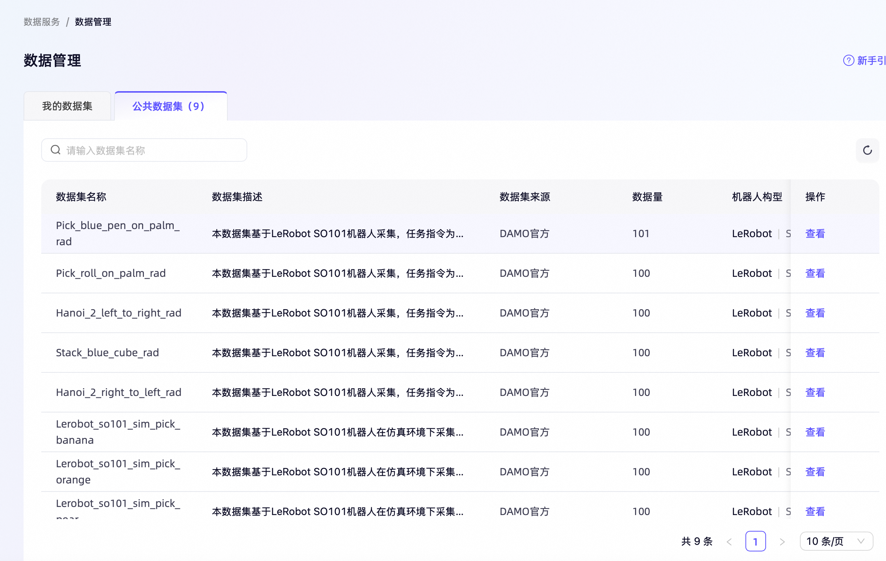


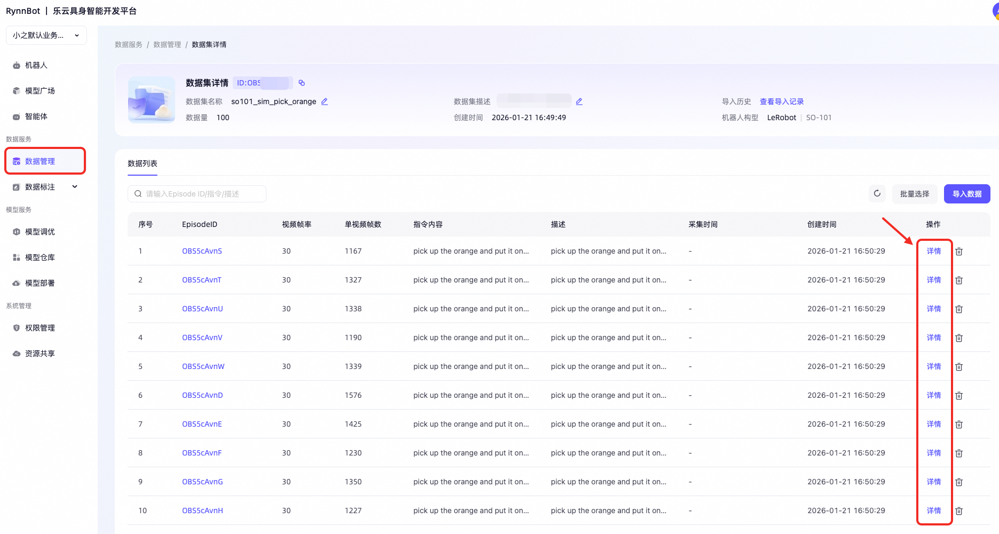


## 6. Дополнительная практика

Если времени достаточно, можно познакомиться со входами настройки модели и развёртывания. Этот блок вынесен в дополнительные, а не в основные задания, потому что относится к дальнейшему расширению и не является обязательным ядром для новичка. Сначала важнее понять, как модель выбирается, отлаживается и проверяется. Но если общая картина уже сложилась, взгляд на эти входы показывает: воплощённые возможности развиваются не как демонстрационные ролики, а в сторону непрерывной оптимизации и выпуска в продакшн.

Ориентиры в интерфейсе:

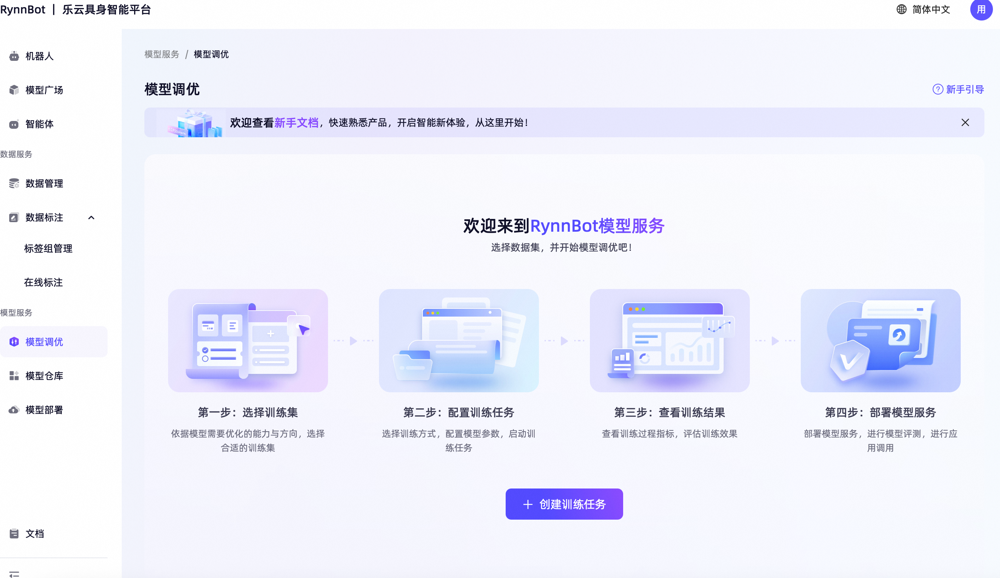
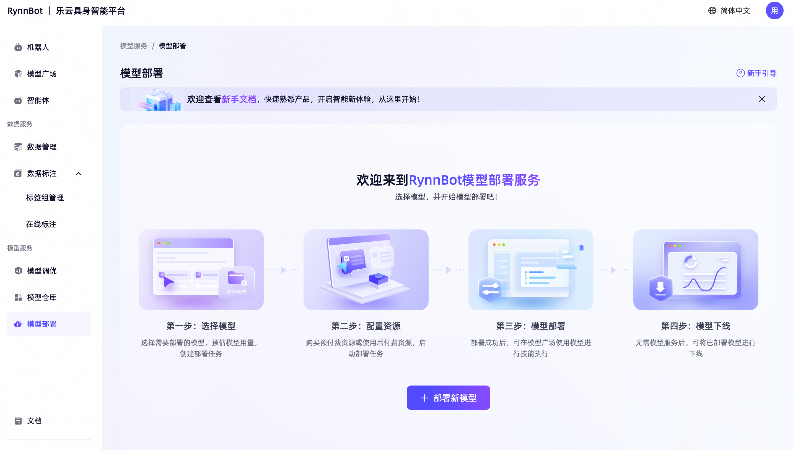

## 7. Что вы должны понять из этого раздела

Сегодня нужно не научиться самостоятельно развёртывать полную систему робота, а действительно понять следующее:

> Навык робота — это не «модель вдруг научилась», а результат постепенного формирования по всей цепочке: данные, обучение, отладка, развёртывание.

Если вы это поняли, то дальше, читая открытый код, изучая обучение VLA или работая с реальными наборами данных, вы не будете останавливаться на терминах. Вы будете знать, что за каждым термином стоят конкретные страницы, конкретные формы данных и конкретные инженерные шаги. Умение связать абстрактные понятия с реальным процессом — именно то, что новичкам труднее всего освоить, но что важнее всего.

## 8. Ключевые действия и задание

Задание для отметки несложное, но должно показывать, действительно ли вы поняли цепочку платформы. Вызовите одну предустановленную модель в симуляционной среде «Лэйюнь» и выполните базовую задачу, например захват предмета или перемещение манипулятора. Войти можно прямо из [**витрины моделей**](https://developer.damo-academy.com/allSpark/EFnKQ5eSb/model).

После этого отправьте один скриншот успешной отладки навыка на платформе и текстовое пояснение объёмом 100–200 слов. Здесь не требуется многословности: важнее, чтобы вы своими словами объяснили увиденную цепочку. Можно выбрать любой угол: какой вы видите цепочку платформы; что делают управление данными, витрина моделей и сервис моделей; где, по-вашему, платформа заметнее всего снижает порог входа. Если вы смогли описать «страницы» как «процесс», практика достигла цели.

## 9. Дополнительное чтение

*   Введение в GR00T: [**Isaac-GR00T README**](../../10-simulation-tools-and-frontiers/Isaac-GR00T/README.md)
    
*   Главы о симуляции и развёртывании: [**Другие инструменты симуляции воплощённого ИИ и передовые направления симуляции**](../../10-simulation-tools-and-frontiers/README.md)
