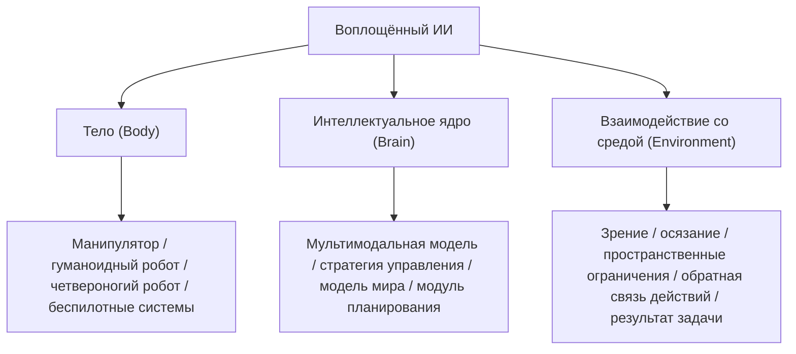

# Задание 01: теория и тенденции

## 1. Что вы должны понять после этого раздела

После изучения этого раздела вы должны уметь ответить хотя бы на три вопроса:

1. В чём принципиальное различие между воплощённым ИИ и обычной языковой большой моделью?
2. Почему манипуляторы, гуманоидные роботы, беспилотные автомобили и четвероногие роботы-собаки можно обсуждать в одной рамке?
3. Каковы главные возможности и самые реальные трудности воплощённого ИИ сейчас?

## 2. Что такое воплощённый ИИ

Легче всего запомнить так:

> Воплощённый ИИ = система, которая умеет воспринимать, понимать, принимать решения и действовать в физическом мире.

По сравнению с ИИ, который работает только с текстом, изображениями и речью на экране, воплощённый ИИ обязан учитывать одно важное ограничение: ему приходится иметь дело с реальным миром. Реальный мир — не текстовая среда: в нём есть пространство, время, трение, окклюзии, столкновения, задержки, ошибки и цена неудачи.

В этом и заключается главный смысл слова «воплощённый» (embodied). Оно не означает «похожий на человека», а указывает на наличие носителя, который реально взаимодействует с миром. Таким носителем может быть:

- манипулятор;
- двуногий или колёсный гуманоидный робот;
- четвероногий робот;
- беспилотный автомобиль, дрон или судно;
- промышленное оборудование со встроенным ИИ.

## 3. Три ключевых элемента воплощённого ИИ

### 3.1 Тело

Тело определяет, какие действия система может выполнять. Манипуляторы хороши в захвате и работе с предметами, гуманоидные роботы — в перемещении в сложном пространстве и координированной работе двумя руками, беспилотные автомобили — в навигации и перевозке.

### 3.2 Интеллектуальное ядро

Интеллектуальное ядро определяет, как система понимает ситуацию и принимает решения. Это могут быть модули восприятия, VLA, модели мира, модули планирования, контроллеры и другие компоненты.

### 3.3 Взаимодействие со средой

Взаимодействие со средой определяет, можно ли по-настоящему применить систему на практике. Действие, которое на бумаге выглядит очень простым, в реальной среде сталкивается с изменением освещения, перекрытием видимости, ошибками захвата, накоплением задержек и другими проблемами.

Именно это отличает воплощённый ИИ от чисто программного интеллекта.

## 4. Почему все сейчас говорят о воплощённом ИИ

За прошедший год воплощённый ИИ добился прорыва в двигательных способностях на спортивных площадках и научился рабочим навыкам в учебных полигонах, что заложило основу для применения в реальных сценариях. В отрасли заметны черты «слияния», «разнообразия» и «расцвета»:

1. **Слияние программного и аппаратного, знания и действия, виртуального и реального**: развивается совместная эволюция программно-аппаратных решений, базовых моделей воплощённого ИИ и структуры тела; создаются замкнутые цепочки «восприятие — решение — действие»; прокладываются пути перехода от симуляции к реальной практике.
2. **Разнообразные продукты для «полётов в небо, погружений в море и опасных задач»**: аппаратные носители переходят от одного назначения к многофункциональному использованию, от структурированной среды к неструктурированной природной, демонстрируя заметный интеллектуальный прорыв:
   - **Мобильные продукты (решают вопрос «куда ехать»)**: четырёх-, многоногие и колёсно-ножные роботы; беспилотные автомобили, дроны, беспилотные суда и т. д.
   - **Манипуляционные продукты (решают вопрос «что делать»)**: коллаборативные манипуляторы, составные колёсно-манипуляционные роботы, гуманоидные роботы (двуногие и колёсные) и т. д.
3. **Постепенно формируется промышленная экосистема**: четыре блока — отраслевые приложения, продукты и сервисы, технические услуги и инфраструктура — постепенно образуют полную цепочку. Перспективы применения широки: «инструменты», «предметы быта», «транспорт», «игрушки»; возможно появление умных сотрудников, помощников в быту, интеллектуальных водителей и умных партнёров.

Последние несколько лет большие модели быстро продвинули «понимание» и «генерацию». Но многие по-настоящему ценные задачи решаются не в окне чата, а в физическом мире, например:

- сортировка, сборка и перенос на заводах;
- уборка, доставка и сопровождение в домах;
- комплектация, перемещение и размещение на складах и в логистике;
- осмотр, спасение и разведка в опасных условиях.

С этой точки зрения смысл воплощённого ИИ состоит не только в том, чтобы сделать роботов умнее, но и в том, чтобы перенести ИИ из цифрового пространства в реальное.

## 5. Распространённые формы воплощённого ИИ

Их можно грубо разделить на два типа.

### 5.1 Мобильные носители

Они в основном отвечают на вопрос «куда ехать».

- беспилотные автомобили;
- дроны;
- четвероногие роботы;
- колёсно-ножные роботы.

### 5.2 Манипуляционные носители

Они в основном отвечают на вопрос «что делать».

- коллаборативные манипуляторы;
- двурукие роботы;
- гуманоидные роботы;
- колёсно-манипуляционные роботы.

Многие реальные системы объединяют оба типа способностей: они умеют и перемещаться, и манипулировать предметами.

## 6. Почему отрасль одновременно горячая и трудная

Воплощённый ИИ рассматривают как необходимый путь к общему искусственному интеллекту (AGI). Его основная ценность опирается на два краеугольных камня: «маховик повышения интеллекта» и «многомерный замкнутый контур ценности». Благодаря постоянному глубокому взаимодействию «модели интеллекта», «воплощённого носителя» и «физического мира» система формирует положительную обратную связь: масштабный эффект мультимодальных данных и высокоточное физическое взаимодействие позволяют модели извлекать опыт из реальных сцен, а закон масштабирования (Scaling Law) обеспечивает скачок обобщающей способности.

Однако воплощённый ИИ — это не прорыв одной технологии, а глобальная волна, которую движут вместе технологии, инженерия, сценарии и капитал. Это длинный и трудный трек, и за горячим интересом скрываются три «неочевидных» вопроса:

1. **Спор о пути**: при реализации цепочки «восприятие — познание — решение — исполнение» что важнее — данные или модели?
2. **Спор о конструкции носителя**: создавать одну универсальную финальную форму или специализированные конструкции под конкретные сценарии?
3. **Спор о схеме данных**: как выбирать, обрабатывать и смешивать реальные данные с симуляционными и синтетическими при обучении?

Сейчас возможности и инфраструктура воплощённого ИИ всё ещё находятся на стадии «первых шагов», переходя от коммерческой проверки в ограниченных сценах к повышению обобщающей способности универсальных роботов. Этот процесс сталкивается с четырьмя ключевыми вызовами:

- **Системный уровень**: нестандартность программного и аппаратного обеспечения, низкая интеграция, разрозненность протоколов ограничивают масштабное внедрение.
- **Уровень данных**: объём высококачественных данных ограничен, сбор дорог, а между данными симуляции и данными реального физического мира существует разрыв (Sim2Real Gap).
- **Уровень моделей**: техническая парадигма ещё не сложилась, методы RLHF для воплощённых больших моделей всё ещё исследуются.
- **Уровень кадров**: специалистов, сочетающих знания из нескольких областей, мало; разработчикам ИИ нужны одновременно навыки в алгоритмах, аппаратуре и управлении.

Итак, воплощённый ИИ многие считают важным направлением на пути к более сильному общему интеллекту, но он всё ещё находится на стадии «высокого интереса и высокой сложности».

### 6.1 Почему у направления есть потенциал

- оно напрямую связано с реальными потребностями промышленности, логистики, быта, медицины и инспекции;
- оно соединяет мультимодальные модели, управление роботами, симуляционные платформы и системы данных в замкнутую цепочку;
- у него выраженная инженерная и отраслевая ценность, а не только академическая.

### 6.2 Почему всё ещё трудно

Сейчас основные проблемы на четырёх уровнях:

- системный уровень: сильная фрагментация аппаратных интерфейсов, коммуникационных протоколов и программных стеков;
- уровень данных: высококачественные реальные данные взаимодействия дороги, их мало, их трудно собирать;
- уровень моделей: обобщение, долгосрочное планирование и стабильное управление пока недостаточно зрелы;
- инженерный уровень: существует заметный разрыв Sim2Real между симуляцией и реальным роботом.

## 7. Итоги раздела

На этом этапе у вас должно сложиться базовое понимание:

- воплощённый ИИ — это не просто «запихнуть большую модель в робота»;
- по сути это замкнутая система «тело + интеллект + обратная связь от реальной среды»;
- его возможности приходят из реальных сценариев, и его трудности тоже приходят из реальных сценариев.

## 8. Задание на день

### Задание 1

Посмотрите на самый обычный предмет рядом с вами, например на чашку, коробку салфеток или дверную ручку, и подумайте:

- если робот увидел этот предмет, что он должен распознать в первую очередь?
- что ему нужно определить на втором шаге?
- какое действие он должен выполнить на третьем шаге?

### Задание 2

Отправьте лёгкий результат, достаточно одного из двух вариантов:

- ручной набросок;
- текстовое описание объёмом 150–300 слов.

Тема:

> «Сценарий применения воплощённого ИИ, который я себе представляю»

## 9. Дополнительное чтение

- Обзор основ воплощённого ИИ:
  [01 Обзор воплощённого ИИ](../../01-embodied-ai-overview/01-overview-of-embodied-ai.md)
- Аппаратура роботов и управление:
  [Аппаратура роботов, lerobot и управление платой разработчика RDK-X5 от Horizon](../../03-robot-hardware-lerobot-and-rdk-x5/04-lerobot-dual-arm-heterogeneous-system-remote-manipulation.md)
