# **Задание 02: технический обзор**

## **1. Почему этот раздел важен**

Почти каждый, кто впервые знакомится с воплощённым ИИ, быстро натыкается на несколько частых терминов: VLA, мир-модель (world model), VLM, базовая модель поведения, согласованная работа периферии и облака. Проблема в том, что в новостях и описаниях проектов эти слова обычно стоят рядом, а когда начинаешь учиться, непонятно, в каких отношениях они находятся. Например: VLA и мир-модель — это одно и то же или нет? RynnBrain — это модель действий или скорее «воплощённый мозг»? Почему в одних работах делают ставку на сквозное предсказание действий, а в других — на внутреннее моделирование и рассуждение?

Цель этого раздела — превратить эти понятия из модных слов в инструменты для понимания структуры моделей. После чтения вам не нужно сразу освоить все детали обучения из статей, но должно сложиться устойчивое представление: какие методы работают по принципу «увидел — сразу делаю», какие — «сначала формирую внутреннее понимание среды, а потом решаю, что делать», и как RynnBrain, который подчёркивается в этом курсе, связывает «понимание сцены», «понимание пространства» и «планирование действий».

## **2. От традиционного управления к воплощённым большим моделям**

Сначала можно представить воплощённую систему как базовый замкнутый контур:

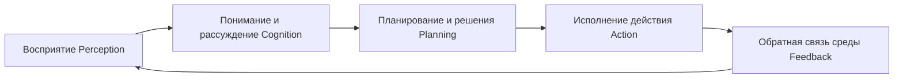

Раньше многие роботы опирались на правила управления, классические планировщики и специализированные сети политики. Они часто стабильно работали в одной конкретной задаче, но плохо переносились на другие и почти не понимали инструкции на естественном языке. Когда большие модели пришли в воплощённую область, заметно изменилось одно: восприятие, понимание, планирование и действие, которые раньше были сильно разделены по модулям, стали объединяться в более единую архитектуру. Поэтому сегодня, говоря о воплощённом ИИ, обсуждают уже не только контроллеры и планировщики, но и саму парадигму моделей.

## **3. Что такое VLA**

VLA — это сокращение от `Vision-Language-Action` (визуальный вход — язык — действие). Самое прямое понимание такое: модель пытается объединить визуальный вход, языковую инструкцию и выход действий в одну модель, так чтобы система напрямую переходила от «что я вижу и что от меня требуют» к «как мне двигаться дальше».

Модели подаются изображение, текстовая инструкция и некоторые признаки состояния самого робота, а на выходе она сразу предсказывает следующее действие или последовательность действий.

С точки зрения задачи VLA одновременно решает три вещи. Во-первых, он должен извлечь из изображения или видео сведения, относящиеся к задаче. Во-вторых, он должен понять в языке цель и ограничения — например, что в «положи баклажан в миску» нужно взять, куда и как положить. В-третьих, он должен объединить первые два результата и превратить их в представление действий, которое можно исполнить. Именно поэтому за последние пару лет VLA стал одним из главных ключевых слов воплощённого ИИ: он очень близок к интуитивному представлению о том, что «робот услышал фразу и действительно её выполнил».

### **3.1 Базовый принцип работы VLA**

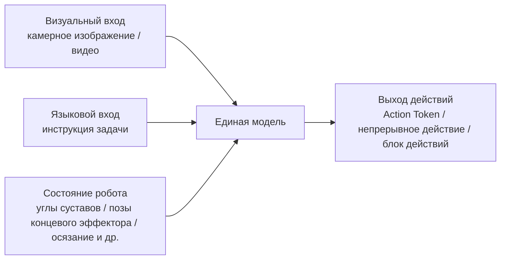

### **3.2 Почему VLA важен**

VLA важен не потому, что он просто склеивает три слова, а потому, что действительно превращает «смотреть, понимать команды, двигаться» в одну задачу, которую можно обучать и выполнять вместе. Это даёт два явных преимущества: во-первых, он естественно подходит для манипуляций, управляемых языком; во-вторых, из данных с демонстрациями множества задач он легче выучивает относительно универсальное представление навыков. Для учащегося ценность VLA в том, что он сводит разрозненные задачи к более наглядной парадигме.

### **3.3 Типичные ограничения VLA**

Но VLA — не решение, после которого «всё в порядке». Его самые типичные проблемы как раз вытекают из сложности реального мира. Во-первых, он обычно чувствителен к распределению обучающих данных: задачи, которые часто встречались в обучении, усваиваются быстро, а незнакомые детали — с ошибками. Во-вторых, многие VLA-модели накапливают ошибки на длинных последовательностях, потому что отклонение на одном шаге влияет на все последующие. В-третьих, хотя модель извлекает из изображения много информации, явного моделирования трёхмерной структуры пространства, физических ограничений и контактных отношений часто не хватает. Из-за этих ограничений исследователи продолжают искать мир-модели, явные пространственные представления и более сильные механизмы планирования.

### **3.4 Официальная схема: OpenVLA**

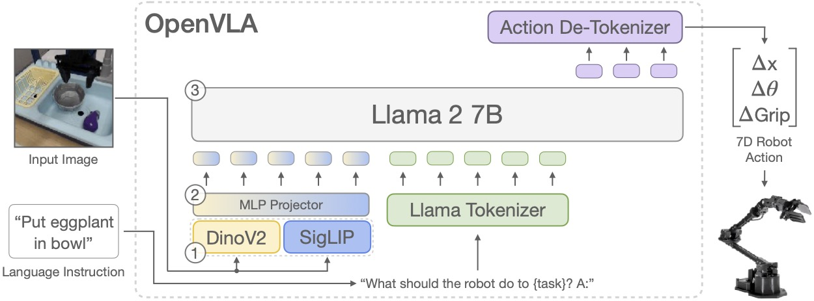

Схема архитектуры OpenVLA

Источник: [**страница проекта OpenVLA**](https://openvla.github.io/)

Если читать схему OpenVLA как учебный рисунок, важнее всего разобраться в потоке данных, а не запоминать названия каждого модуля. Слева — входы: сверху изображение сцены, снизу языковая инструкция, например «положи баклажан в миску». В центре — основная часть модели. Внизу видны два визуальных модуля — DinoV2 и SigLIP, которые извлекают разные виды визуальных признаков. Эти признаки после промежуточного `MLP Projector` (проекционного MLP) превращаются в представление, которое можно подать в Llama 2 7B. Тем временем языковая инструкция через токенизатор тоже кодируется в языковые токены. В итоге визуальные и языковые токены вместе участвуют в выводе внутри одной языковой модели.

Самое важное на схеме — `Action De-Tokenizer` справа вверху. Это значит, что OpenVLA не заставляет Llama 2 напрямую выдавать управляющие сигналы моторов. Сначала действие представляется в виде токенов, которые модель может предсказать, а затем эти токены обратно декодируются в 7 измерений действия робота: приращения положения, приращения углов и открытие-закрытие захвата. Иначе говоря, схема очень ясно показывает основную идею VLA: сначала «увиденное» и «услышанное» объединяются в токены, которые модель может обрабатывать, а затем выход модели переводится обратно в действия, которые робот может выполнить.

Отмеченные на схеме `1-2-3` тоже удобно использовать как навигацию по процессу. `1` соответствует этапу визуального кодирования, то есть извлечению семантических и пространственных признаков из изображения. `2` — этапу выравнивания признаков, то есть переводу визуальной информации в пространство представлений, которое принимает языковая модель. `3` — этапу единого вывода, на котором визуальный и языковой вход в одной основной модели вместе определяют следующее действие. Это и есть лучшее объяснение того, почему VLA называют интегрированной моделью «визуальное — языковое — действие».

### **3.5 Дополнительное чтение**

- Обзор VLA и генеалогия моделей: [**Сводный обзор VLA**](../../06-manipulation-and-vla/01-vla-overview-and-survey.md)

## **4. Что такое мир-модель**

Если VLA больше делает упор на «увидел указание — сразу выполнил действие», то мир-модель делает упор на «сначала сформировать внутреннее предсказание изменений среды, а потом на его основе спланировать действия». Это различие очень существенно, потому что оно отражает два разных взгляда на интеллект.

Внутри системы сначала строится механизм предсказания изменений среды, и уже на его основе планируются действия.

Можно понимать это так: робот «заранее прокручивает в голове» происходящее.

### **4.1 Что именно моделирует мир-модель**

Мир-модель обычно пытается описать три связи: каково текущее состояние среды, как среда изменится после выполнения определённого действия и какой из возможных путей развития будущего ближе всего к цели. Для робота это равносильно тому, чтобы до физического действия «продумать внутри себя», что произойдёт дальше. Это не простая реактивная система, а скорее решающая система с внутренним симулятором.

### **4.2 Основная ценность мир-модели**

Многие исследователи ценят мир-модели, потому что задачи в реальном мире обычно не решаются одним шагом. Перед захватом манипулятор должен оценить ориентацию предмета и окружающие препятствия, навигационная система при движении вперёд должна предсказать, какой путь будет доступен через несколько секунд, а при совместной работе двух рук нужно учитывать временную связь между действиями. В таких задачах опора только на принцип «что вижу — то и делаю» часто приводит к ошибкам, тогда как внутреннее предсказание заметно улучшает способность планировать.

### **4.3 Схема мир-модели для понимания**

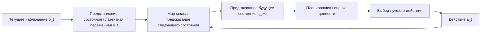

### **4.4 Почему многие считают мир-модели очень важными**

Реальный мир — не статичная картинка, а система, которая непрерывно эволюционирует. Цели перемещаются, порядок действий меняет последующие состояния, а ранние ошибки в многошаговой задаче со временем усиливаются. Ценность мир-модели в том, что она лучше подходит для задач, где «действие меняет мир». Поэтому многие исследователи считают мир-модели одним из ключевых направлений перехода воплощённого ИИ от «реактивных систем» к «плановым».

## **5. В чём разница между VLA и мир-моделью**

Чтобы разделить понятия, можно использовать таблицу ниже. Её не следует воспринимать как выбор «или-или»; скорее это сопоставление двух центров моделирования:

| **Аспект** | **VLA** | **Мир-модель** |
| -------- | --------------------------------- | ------------------------------ |
| Основная цель | напрямую получить действие из визуального и языкового входа | явно предсказывать развитие среды и помогать планированию |
| Сильные стороны | понимание инструкций, сопоставление нескольких задач, сквозная унификация | долгосрочное предсказание, моделирование состояния, планирование |
| Типичные проблемы | накопление ошибок на длинном пути, слабое пространственное и физическое моделирование | сложность обучения, трудности с представлением состояния и проектированием планирования |
| На что похоже | «увидел — сразу сделал» | «сначала продумал — затем сделал» |

В реальных системах эти два подхода не исключают друг друга. Всё чаще работы в одной системе одновременно используют сквозное предсказание действий и внутреннее моделирование мира. Иначе говоря, VLA и мир-модель — не взаимоисключающие ярлыки, а взаимодополняющие технические направления.

## **6. RynnBrain от DAMO Academy: почему стоит рассмотреть отдельно**

RynnBrain лучше всего понимать на линии «VLM + усиление мир-моделью». Вместо того чтобы считать его моделью, которая только выдаёт действия, полезнее воспринимать его как систему, которая скорее «воплощённый мозг»: она не только распознаёт и отвечает, но и определяет местоположение, понимает, рассуждает и организует задачи.

### **6.1 Официальная архитектурная схема**

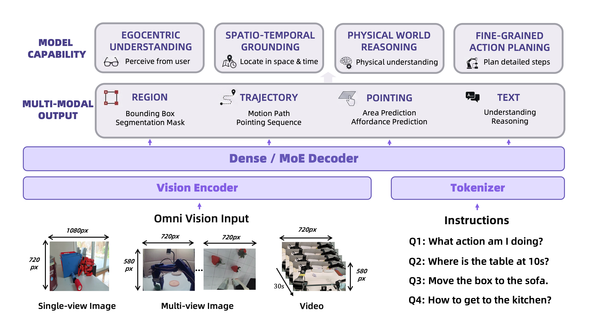

Официальная архитектурная схема RynnBrain

Источник: [**страница проекта RynnBrain**](https://alibaba-damo-academy.github.io/RynnBrain.github.io/)

Эту схему полезно читать внимательно. Самый нижний слой — входной, слева обозначен `Omni Vision Input`, который явно перечисляет три типа визуального входа: одиночное изображение, многоракурсные изображения и видео. Справа — входы инструкций, например «Что я сейчас делаю?», «Где находится стол в 10-й секунде?», «Переложи коробку на диван». Эти примеры уже подсказывают: RynnBrain ориентирован не на одну задачу, а на целый набор воплощённых задач — распознавание, локализацию, манипуляции и навигацию.

Над этим слоем находятся `Vision Encoder` и `Tokenizer`. Это значит, что RynnBrain сначала кодирует визуальную информацию и языковые инструкции отдельно, а затем передаёт их в центральный большой декодер. Самая широкая полоса по середине — `Dense / MoE Decoder` — ядро всей схемы: она показывает, что система не делает один узкий выход, а работает в едином декодирующем каркасе, поддерживающем несколько прикладных возможностей. Особенно важна в середине часть «мультимодального вывода»: она делится не на один вектор действия, а на четыре формы — `Region` (области), `Trajectory` (траектории), `Pointing` (указание точек) и `Text` (текст). То есть выход RynnBrain может быть рамкой вокруг цели и маской сегментации, траекторией движения и областью указания, а также текстовым пониманием и рассуждением.

Самая верхняя часть `Model Capability` дополнительно объясняет, зачем нужен такой мультимодальный вывод. `Egocentric Understanding` — понимание с первого лица: модель умеет понимать сцену с точки зрения пользователя. `Spatio-Temporal Grounding` — пространственно-временная привязка: модель знает не только «что это», но и «где и когда». `Physical World Reasoning` — рассуждение о физическом мире: её выводы опираются не только на абстрактную семантику, но и на связь с предметами, пространством и ограничениями действий. `Fine-Grained Action Planning` — детальное планирование действий, которое в конечном счёте снова приводит к точному движению. Так эта схема чётко определяет позицию RynnBrain: это не просто модель вопросов и ответов и не просто модель действий, а базовая воплощённая модель, которая соединяет понимание, локализацию, рассуждение и планирование в единое целое.

Поэтому разницу между RynnBrain и обычным VLA можно сформулировать точнее: обычный VLA больше подчёркивает единое отображение от текущего входа к действию, а RynnBrain — организацию сцены во времени, явную локализацию пространственных объектов и поддерживаемую этим способность к оркестрации задач. Новичку достаточно запомнить три ключевых слова: «пространственно-временная память», «пространственное рассуждение», «оркестрация задач».

Демонстрация проекта:

### **6.2 Попробовать модель RynnBrain**

RynnBrain — это «воплощённый мозг» с физическим восприятием: он наблюдает сцену с первого лица, привязывает язык к физическому пространству и времени и предоставляет последующим роботизированным системам надёжные выходы локализации и планирования.

👉🏻 Ссылка на опыт использования: [Попробовать модель RynnBrain](https://developer.damo-academy.com/allSpark/model/rynnBrainExperience?modelId=183456791d8d4378925e9f29388b81bb&workspaceId=EFnKQ5eSb)

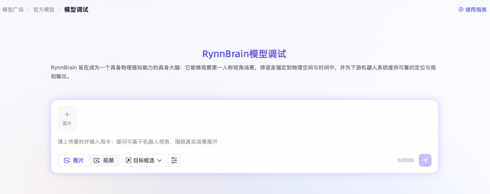

Теперь вы можете сфотографировать или загрузить изображение реальной среды либо видеофрагмент и попросить RynnBrain с первого лица выполнить общие вопросы и ответы, обнаружение точек для взаимодействия, выделение целевой рамкой, предсказание траектории и предсказание областей.

| Возможность | Описание |
| ------------ | ------------------------------------------------------------ |
| Общие вопросы и ответы | подходит для обычного диалога и открытых вопросов; модель гибко оценивает инструкцию и отвечает текстом или ставит визуальную отметку на изображении |
| Обнаружение точек для взаимодействия | находит на объекте ключевые точки, наиболее подходящие для взаимодействия, и отмечает их яркими точками на изображении, наглядно показывая место воздействия |
| Выделение целевой рамкой | находит целевой предмет по инструкции и обводит его прямоугольной рамкой, чётко обозначая границы цели |
| Предсказание траектории | по инструкции планирует путь движения предмета от начала до конца и отмечает ключевые точки маршрута на изображении, наглядно показывая траекторию |
| Предсказание областей | находит на изображении области, удовлетворяющие заданным условиям, и распределяет внутри них несколько ключевых точек, показывая допустимый диапазон пространства |

| **Пример 1: выделение целевой рамкой** | |
| ------------------------------------------------------------ | ------------------------------------------------------------ |
| Сделайте снимок кухни в квартире и попросите робота распознать сцену с первого лица. Запрос: найди на столе бутылку минеральной воды. 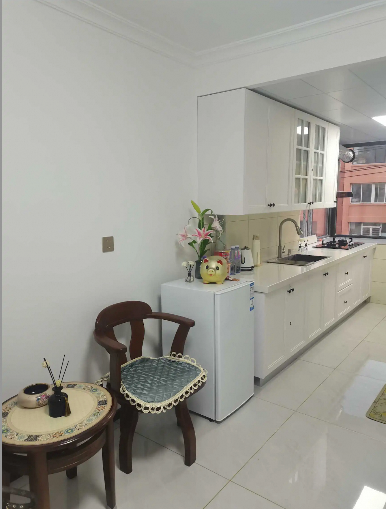 | Ответ: RynnBrain с учётом сцены распознаёт бутылку минеральной воды на столе и отмечает её. 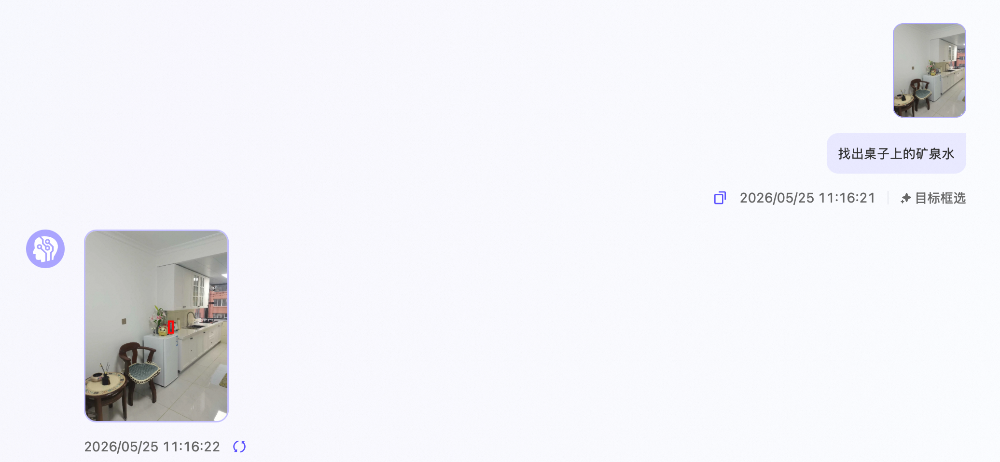 |
| **Пример 2: предсказание траектории** | |
| ------------------------------------------------------------ | ------------------------------------------------------------ |
| Сделайте снимок гостиной в квартире и попросите робота распознать сцену с первого лица. Запрос: положи бутылку минеральной воды со столика под телевизором в мусорную корзину | Ответ: RynnBrain с учётом сцены распознаёт бутылку минеральной воды на столике под телевизором и мусорную корзину рядом, и отмечает траекторию движения. 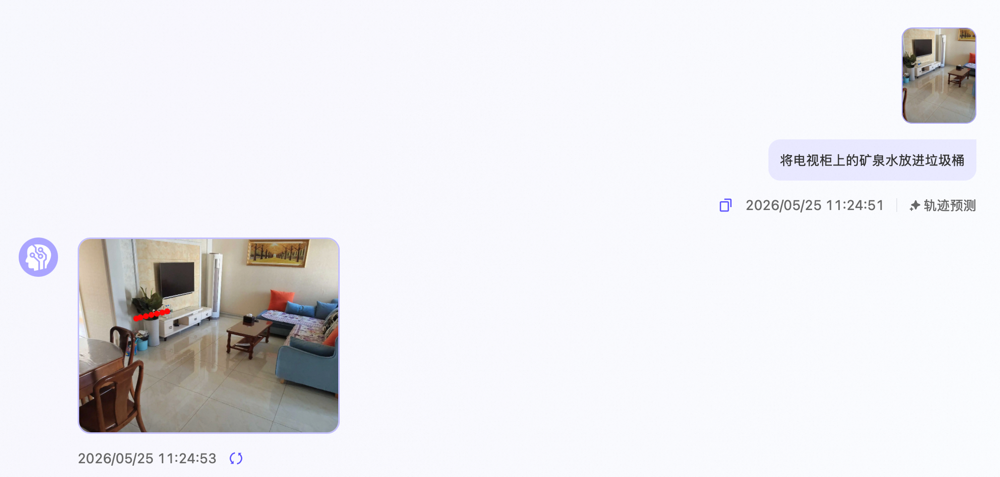 |

Связанная статья: [Справочная документация по вызову модели RynnBrain](https://developer.damo-academy.com/documentation?id=100)

## **7. RynnRCP: зачем нужен уровень протокола**

Даже очень сильная модель не решает автоматически проблему фрагментации робототехнических систем. На практике вам всё равно придётся сталкиваться с тем, что интерфейсы роботов не унифицированы, типы датчиков различаются, контур управления и контур вывода не синхронизированы, а задержки на периферии и вычислительные ресурсы в облаке конфликтуют. Именно здесь нужен RynnRCP (Robotics Context Protocol): он добавляет инженерный слой соединения под моделью.

Проще всего понимать RynnRCP как протокол и набор интерфейсов, которые облегчают подключение моделей, датчиков и модулей действий. Он не конкурирует с моделью, а помогает ей получить устойчивые «руки» и «органы чувств».

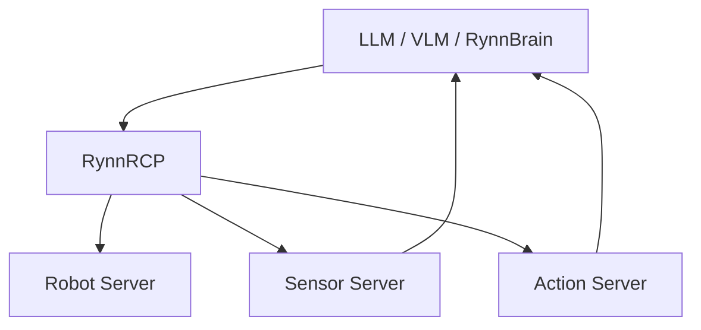

Его значение не в том, чтобы «заменить модель», а в том, чтобы «модель могла гладко подключиться к реальной робототехнической системе». Это особенно важно для новичков: многие поначалу думают, что если модель достаточно сильна, система сама заработает. На деле уровень протокола, интерфейсов и интеграции систем часто и определяет, сможет ли модель реально войти в реальную среду.

## **8. Официальная схема: NVIDIA GR00T**

Следующая схема лучше читается с точки зрения «экосистемного замкнутого цикла», а не как детальная архитектура отдельной модели. Её главная мысль — не то, как соединены внутренние сети, а то, как NVIDIA организует базовые модели, синтетические данные, симуляционные платформы и вычислительные платформы роботов в единую систему:

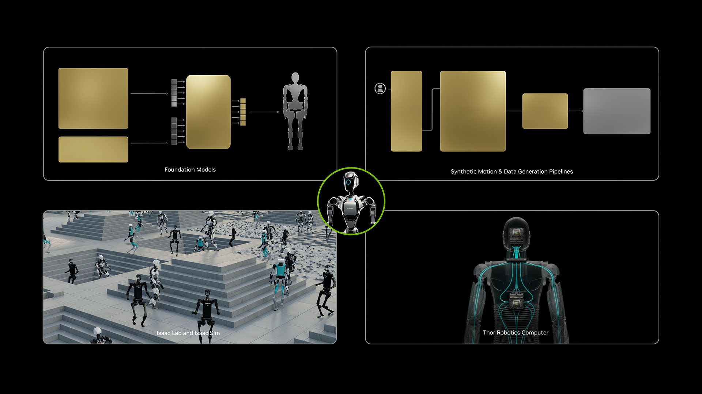

Официальная схема NVIDIA GR00T

Источник: [**официальная страница NVIDIA Isaac GR00T**](https://developer.nvidia.com/project-GR00T)

В левой верхней части изображено `Foundation Models` — показывает, что сама модель является одним из центральных элементов системы; в правой верхней — `Synthetic Motion & Data Generation Pipelines`, то есть конвейеры генерации синтетических движений и данных; в левой нижней — `Isaac Lab and Isaac Sim`, что подчёркивает важную роль симуляционной платформы в обучении, проверке и генерации данных; в правой нижней — `Thor Robotics Computer`, вычислительная платформа на реальном роботе. Робот в зелёном кружке в центре связывает все четыре блока: модель не обучается и не развёртывается изолированно, а встроена в замкнутый цикл «модель — данные — симуляция — аппаратура».

Эта схема важна для учебника тем, что напоминает: сегодня воплощённый ИИ — это уже не просто разговор об отдельных алгоритмах, а о полном техническом стеке. Тот, кто эффективнее организует модели, симуляцию, данные и аппаратуру, с большей вероятностью приведёт систему к воспроизводимости и внедрению.

## **9. Итоги раздела**

Если запомнить одно предложение, то такое:

VLA — это «напрямую переводить увиденное и услышанное в действие», а мир-модель — «сначала предсказать, как изменится мир, и только потом решить, как действовать».

Значение систем вроде RynnBrain в том, что они возвращают в воплощённые задачи более сильные способности к пониманию, памяти и пространственному рассуждению. Они показывают, что ключевая конкурентоспособность воплощённого ИИ в будущем — не просто «умеет ли он выдавать действие», а «умеет ли сначала понять мир, а потом устойчиво и точно организовать действия».

## **10. Задание на день**

### **Задание 1**

Попробуйте демо RynnBrain и обратите внимание:

- отвечает ли он только на вопросы или делает что-то большее;
- проявляется ли в его выводах понимание сцены и пространственная локализация;
- чем он отличается от того, что вы представляли себе под «моделью действий».

Прямая ссылка: [**Попробовать модель RynnBrain**](https://developer.damo-academy.com/allSpark/model/rynnBrainExperience?modelId=183456791d8d4378925e9f29388b81bb&workspaceId=EFnKQ5eSb)

### **Задание 2**

Напишите короткую запись в любом формате. Можно в трёх-пяти предложениях объяснить различие VLA и мир-модели, а можно составить небольшую таблицу, сравнивающую, на что больше всего делают упор Pi0, GR00T и RynnBrain. Важно не охватить всё, а проверить, сложилось ли у вас понимание того, что разные модельные парадигмы решают задачи разного уровня.

## **11. Дополнительное чтение**

- Обзор моделей VLA: [**Сводный обзор VLA**](../../06-manipulation-and-vla/01-vla-overview-and-survey.md)
- Введение в GR00T: [**Isaac-GR00T README**](../../10-simulation-tools-and-frontiers/Isaac-GR00T/README.md)
