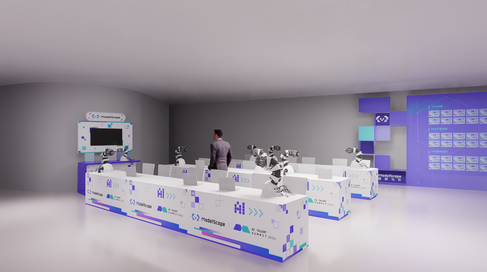

# Задание 04: итоги и обмен

## 1. Что делаем сегодня

В последний день уже не добавляем много новых понятий, а связываем воедино всё, что проходили за предыдущие три дня, и подводим итог. Многие участники к концу тематического курса испытывают знакомое ощущение: вроде бы видели много терминов и открывали страницы платформы, но трудно понять, что именно усвоено. На самом деле последний шаг обучения — не добавить ещё одну новую тему, а перестроить уже встреченные понятия и опыт в структуру.

Поэтому сегодняшнее задание состоит из трёх частей: сначала — обзор того, что дали четыре дня, затем — определение того, куда двигаться дальше, и, наконец, оформление собственного понимания в виде собственной идеи применения воплощённого ИИ. Только так учеба не останется на уровне «слышал, но не знаю».

## 2. Обзор пути за четыре дня

Вы прошли полный маршрут. В первый день вы построили **концептуальный каркас**: поняли, что воплощённый ИИ — не просто «большая модель, поставленная на робота», а замкнутая система из тела, интеллектуального ядра и обратной связи среды. Во второй день вы построили **технические различия**: научились примерно разделять VLA, в котором подчёркивается отображение от восприятия и языка к действию, модели мира, которая делает акцент на предсказании эволюции среды и планировании, и такие системы, как RynnBrain, в которых важны пространственно-временная память, пространственное рассуждение и оркестрация задач. В третий день вы получили **инженерное чутьё**: по платформе «Лэйюнь» увидели, как организованы данные, как отлаживаются и вызываются модели, как выполняется и пересматривается навык.

Эти три слоя соединяются в полный вводный цикл. Большинство новичков сталкиваются не с нехваткой одного понятия, а с тем, что знакомы только с одним слоем: либо знают отраслевые истории, но не понимают парадигмы моделей; либо знают аббревиатуры моделей, но не видят системной цепочки; либо смотрели скриншоты платформы, но не сформировали понимания сути задачи. Ценность ваших занятий в этих четырёх днях — в том, что вы соединили все три слоя.

## 3. Куда двигаться дальше

Если после этого курса вам кажется, что «уже что-то понятно, но пока мало», дальше можно идти по трём направлениям.

Первое направление — **заполнить базу**. Оно подходит тем, кто ещё не освоил основы робототехники, управления и описания пространства. Продолжая, такие учащиеся чаще всего спотыкаются на системах координат, кинематике и цепочке управления, поэтому сначала стоит вернуться к [**обзору воплощённого ИИ**](../../01-embodied-ai-overview/01-overview-of-embodied-ai.md) и к [**основам роботов, управлению и координации «глаз — рука»**](../../02-robot-basics-control-and-hand-eye-coordination/05-comprehensive-practice-and-simulation.md), чтобы выстроить нижний уровень: логику тела и управления.

Второе направление — **углубиться в модели и симуляцию**. Оно подходит тем, кто уже заинтересовался концепциями и хочет дальше разбираться в VLA, наборах данных, симуляционных средах и процессе обучения. Этот путь ближе к «связующему слою между исследованиями и инженерией», поэтому стоит начать с [**обзора VLA**](../../06-manipulation-and-vla/01-vla-overview-and-survey.md), [**набора данных LIBERO**](../../09-data-and-benchmarks/01-libero.md) и [**других симуляционных инструментов воплощённого ИИ и передового опыта симуляции**](../../10-simulation-tools-and-frontiers/README.md). Эти материалы помогут связать «как модель учится» с «как система проверяется».

Третье направление — **реальный робот и практика**. Оно подходит тем, кто хочет по-настоящему поработать с манипулятором, платами разработчика и цепочкой телеуправления. Это самый ощутимый путь, но и самый требовательный к среде и оборудованию, поэтому он лучше подходит как продолжение курса. Материалы для старта: [**телеуправление двуручной гетерогенной системой LeRobot**](../../03-robot-hardware-lerobot-and-rdk-x5/04-lerobot-dual-arm-heterogeneous-system-remote-manipulation.md) и [**подключение манипулятора LeRobot к RDK-X5 для телеуправления**](../../03-robot-hardware-lerobot-and-rdk-x5/03-rdk-x5-connects-to-the-lerobot-robotic-arm-for-remote-manipulation.md).

## 4. Какие сценарии стоит рассматривать

На этот вопрос нет стандартного ответа, но и фантазировать без оснований тоже не стоит. Надёжный подход — начинать со сценариев, где **реальная потребность сильна, повторяющегося труда много и ограничения среды понятны**. Пока воплощённый ИИ далёк от полной зрелости, первыми взрываются не самые романтичные сценарии, а те, где границы задачи чёткие, стоимость труда высока и выгода автоматизации заметна.

С этой точки зрения промышленное производство, логистика и складирование, домашние услуги и специальные работы остаются самыми перспективными направлениями. Сборка, сортировка, перенос и контроль качества на производстве по природе высоко повторяемы; комплектация, перемещение и размещение на складах имеют очень явные требования к эффективности; в домашних услугах уборка, доставка, помощь пожилым людям напрямую связаны с представлением людей о том, что роботы войдут в быт; а инспекция, разведка и замена человека в опасных условиях демонстрируют уникальную ценность воплощённого ИИ в условиях высокого риска.

## 5. Итоговая работа: книга идей о применении

Пожалуйста, подготовьте **«Книгу идей о применении воплощённого ИИ»**. Документ не должен быть грандиозным, и не обязательно раскрывать все технические детали сразу. Главное — ясно изложить логику. Лучше всего не перечислять термины, а по-настоящему связать четыре вопроса: **сценарий, роль, навык, ценность**.

Начните со сценария, то есть ответьте на вопрос «где это используется». Это может быть дом престарелых, производственная линия на заводе, домашняя кухня, торговый центр или склад — главное, чтобы речь шла о конкретном пространстве, границы которого вы можете описать. Затем опишите роль: какую форму будет иметь робот — двуногий гуманоид, колёсный манипулятор, стационарный коллаборативный манипулятор или небольшой беспилотный инспекционный аппарат. Третий шаг — навык: чему должен научиться робот — распознавать предметы, выполнять многошаговый захват и размещение, обходить препятствия при навигации или выполнять сложные задачи по языковой команде. Наконец, ценность: почему проект стоит реализовать — для экономии труда, снижения опасности, повышения стабильности или улучшения качества сервиса.

Если эти четыре части естественно связываются друг с другом, документ уже обладает важным качеством: он перестаёт быть обычным «восторгом от того, что робот круто», а начинает серьёзно обсуждать вопрос: «какой системе какая задача по силам».

## 6. Короткий пример

> Сценарий: вечерняя раздача лекарств в доме престарелых
> Роль: колёсная мобильная платформа + небольшой манипулятор
> Навык: распознать упаковку с лекарством, перейти в комнату, подтвердить адресата, выполнить передачу и записать статус
> Ценность: снизить повторяющуюся нагрузку на персонал, повысить эффективность ночного обслуживания

## 7. Что вы должны вынести из курса

Если вы пройдёте эти четыре дня, у вас должны остаться как минимум три уровня знаний. Первый — **понимание проблем**: вы знаете, в чём состоят основные вопросы воплощённого ИИ. Второй — **техническое суждение**: вы понимаете, почему VLA и модели мира так часто обсуждаются и какие задачи решает каждое из этих направлений. Третий — **инженерное чутьё**: вы понимаете, как выглядит базовая цепочка от данных к навыку. Имея эти три уровня, вы уже не находитесь на стадии «слышал пару модных слов», а действительно вошли в эту область.

**8. Маленький бонус** 🎁

Пройдя курс, хотите «поиграть с реальным роботом»? И как раз вы в Нанкине!

22 марта, Нанкин, Цзяньье · Международный молодёжный конгресс-центр: DAMO Developer Matrix проведёт на интерактивном рынке обмена опытом демонстрацию работы реального манипулятора; мест мало, кто раньше пришёл — тот и занял~

Ссылка для записи: [https://developer.damo-academy.com/activity/detail/32026031317733911743293071](https://developer.damo-academy.com/activity/detail/32026031317733911743293071)

Схема зоны демонстрации (ориентировочно, смотрите по факту)
