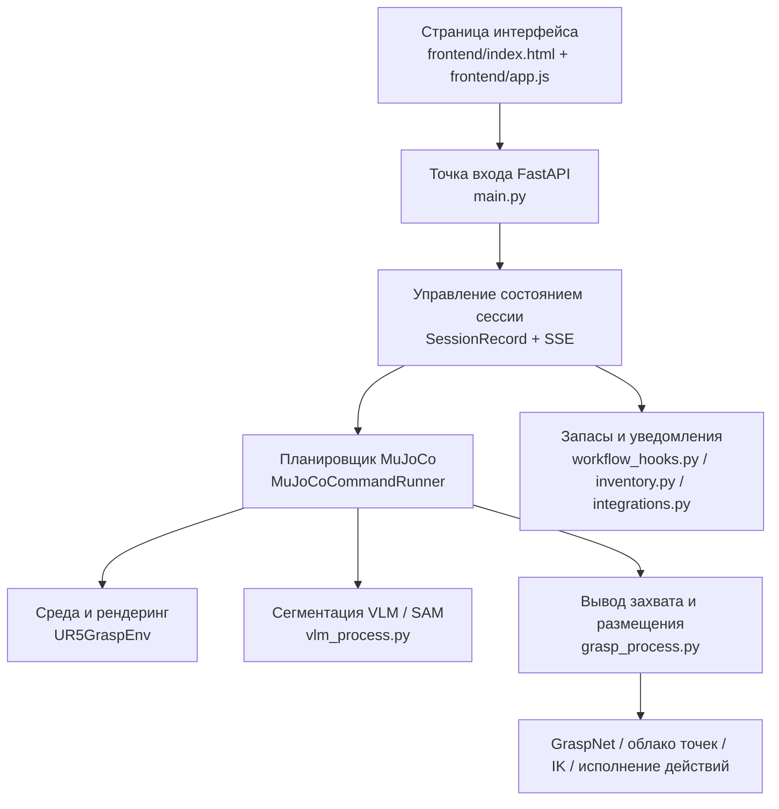

# TuntunClaw

<div align="center">
  
</div>

# TuntunClaw

TuntunClaw («Туньтунь-клешня») — домашний воплощённый помощник для повседневной жизни в доме. Проект построен на операционной системе искусственного интеллекта OpenClaw и объединяет в одной рабочей цепочке диалог на естественном языке, визуальное понимание, сегментацию объектов, предсказание захвата, исполнение в симуляторе MuJoCo и веб-визуализацию в реальном времени. Цель — показать полный путь «от одной фразы на китайском языке до выполнения роботизированной рукой задачи по уборке домашних вещей».

## 1. Предыстория проекта и позиционирование

В быстром современном ритме управление домашними запасами — например, запоминание мест хранения мелочей и контроль остатков повседневных расходников — нередко становится скрытой когнитивной нагрузкой. Традиционные умные бытовые устройства умеют выполнять отдельные простые команды, но обычно не имеют «хозяйственного» подхода: они не берут на себя заботы по собственной инициативе и не умеют естественно общаться и сотрудничать с человеком.

Чтобы освободить людей от утомительного запоминания и учёта, проект ориентирован на реальный бытовой сценарий и построен на операционной системе OpenClaw. Он создан как домашний воплощённый помощник «TuntunClaw». Это не просто робот, выполняющий физические действия, а домашний партнёр, который понимает быт и умеет естественно общаться с человеком. Через сопровождающее голосовое взаимодействие и интеллектуальное управление домашними запасами он берёт на себя бытовую рутину и стремится сделать домашнюю жизнь теплее, удобнее и естественнее.

С точки зрения позиционированияTuntunClaw — не просто демонстрация одного захвата, а прототип воплощённого приложения для домашних услуг на базе OpenClaw. OpenClaw здесь выступает основой — операционной системой и базой возможностей, аTuntunClaw ориентирован на реальные домашние задачи и строит на них дизайн взаимодействия и оркестрацию возможностей: «найти вещь», «навести порядок», «вернуть на место», «напомнить о пополнении», «естественное общение».

## 2. Особенности проекта

### 2.1 Естественное взаимодействие для дома

Система принимает задачи на естественном китайском языке, например:

- `请把巧克力放到盘里` — «Положи шоколад на тарелку»
- `将菜板上的苹果放置有苹果的架子上保存` — «Переложи яблоко с разделочной доски на полку, где лежат яблоки, и сохрани его там»
- `请把玻璃杯扔到地上` — «Брось стакан на пол» (система поддерживает безопасное взаимодействие: OpenClaw напрямую отклонит такую команду)

Пользователю не нужно помнить сложный формат команд: достаточно сформулировать задачу близко к обычной речи, и система сама выполнит разбор задачи, понимание цели и исполнение действий.

### 2.2 Цепочка воплощённого исполнения на базе OpenClaw

Проект переносит идеи интерактивного интеллектуального управления OpenClaw на сценарий домашних запасов и в одной системе соединяет:

- ввод команд на естественном языке
- понимание целей VLM
- сегментацию целей SAM
- вывод кандидатов захвата GraspNet
- исполнение движений манипулятора в MuJoCo
- обратную связь в веб-интерфейсе в реальном времени

Благодаря этомуTuntunClaw умеет и «понимать команды», и «действительно выполнять их».

### 2.3 Фронтенд для демонстрации и презентации

Веб-интерфейс предоставляет полноценный экран показа задач, в том числе:

- поле для ввода команд на китайском языке
- кнопки быстрых предустановок
- предпросмотр сцены в реальном времени
- временную шкалу выполнения
- область отладочного вывода

Поэтому проект подходит не только для локальной отладки, но и для конкурсов, защит, демонстраций и записи видео.

### 2.4 Непрерывное выполнение задач

Система поддерживает непрерывные рабочие процессы: последующая команда выполняется на состоянии сцены после предыдущей, а не сбрасывает симуляционную среду каждый раз.

Например:

1. Сначала выполняется `请把巧克力放到盘里` («Положи шоколад на тарелку»)
2. После размещения шоколад остаётся на тарелке
3. Затем выполняется `将菜板上的苹果放置有苹果的架子上保存` («Переложи яблоко с разделочной доски на полку с яблоками и сохрани его»)
4. Вторая задача продолжается от состояния, которое осталось после первой

Эта возможность особенно важна для задач «домашнего порядка», потому что реальная уборка в доме сама по себе происходит непрерывно.

## 3. Архитектура системы

Текущая система делится на четыре уровня:

1. слой интерфейса и отображения
2. веб-сервис и уровень сессий
3. слой восприятия и понимания
4. слой исполнения в симуляции



Эта архитектура расширяет возможности OpenClaw от низкоуровневого исполнения до полного цикла домашнего обслуживания с взаимодействием.

## 4. Основные возможности

### 4.1 Понимание задач на китайском языке

Система превращает команду на естественном языке в структурированную цель исполнения, например:

- исходный объект;
- целевой контейнер;
- пространственные отношения;
- нужно ли выполнять пакетно.

### 4.2 Сегментация и локализация объектов

Система сочетает VLM и SAM, чтобы находить на симуляционном изображении целевой предмет и зону размещения, и формирует промежуточные результаты сегментации для отладки и визуализации.

### 4.3 Вывод захвата

Система использует GraspNet, чтобы по облаку точек целевой области генерировать кандидатов захвата, а затем с помощью фильтрации столкновений, геометрических ограничений и априорных знаний о сцене выбирает позу захвата, подходящую для текущей задачи.

### 4.4 Специальная логика для домашних сценариев

Проект адаптирован под типичные задачи уборки в доме. Например:

- шоколад сначала распознаётся по конкретной упаковке;
- яблоко на разделочной доске отличается от яблока в фруктовой корзине;
- место размещения — не просто «центр полки», а эффективная область внутри контейнера, соответствующая логике бытового порядка.

### 4.5 Цепочка запасов и напоминаний

Помимо исполнения движений манипулятора, в систему добавлены возможности учёта запасов и уведомлений, которые расширяют домашний учёт. ПоэтомуTuntunClaw умеет не только «переносить предметы», но и потенциально выполнять роль службы домашнего снабжения.

## 5. Структура каталогов проекта

```text
tuntunclaw/
├─ frontend/                       # Веб-фронтенд
├─ manipulator_grasp/             # Среда MuJoCo, манипулятор и ресурсы сцены
├─ graspnet-baseline/             # Код GraspNet
├─ openclaw_like/                 # Облегчённые обёртки стратегий и взаимодействия
├─ main.py                        # FastAPI и единая точка входа
├─ grasp_process.py               # Захват, размещение, IK, исполнение действий
├─ vlm_process.py                 # Логика сегментации VLM / SAM
├─ inventory.py                   # Управление состоянием запасов
├─ integrations.py                # Внешние уведомления и webhook
├─ workflow_hooks.py              # Бизнес-эффекты после успешной задачи
└─ project-development-process-and-system-architecture-description.md    # Подробное описание архитектуры
```

Примечание: имена каталогов и файлов в коде сохранены, так как на них ссылаются пути в программе. Подробный документ по архитектуре и процессу разработки — отдельный файл в этом же каталоге.

## 6. Быстрый старт

### 6.1 Окружение

Окружение по умолчанию — `vlm_grasp311`.

### 6.2 Крупные ресурсы

Чтобы не раздувать git-репозиторий, следующие крупные файлы хранятся на Hugging Face:

- `assets/fig.png`
- `manipulator_grasp/assets/target_basket_medium/materials/textures/texture.png`
- `manipulator_grasp/assets/libero_basket/texture.png`

Перед первым запуском выполните в корне проекта:

```powershell
python scripts/download_large_assets.py
```

Скрипт загрузит эти файлы из [Datawhale/tuntunclaw-assets](https://huggingface.co/datasets/Datawhale/tuntunclaw-assets) и восстановит их по исходным путям. Если репозиторий Hugging Face требует авторизации, сначала задайте `HF_TOKEN` или `HUGGINGFACE_HUB_TOKEN`.

### 6.3 Запуск

```powershell
micromamba run -n vlm_grasp311 python main.py
```

После запуска по умолчанию откроется:

```text
http://127.0.0.1:8000/
```

### 6.4 Примеры задач

В веб-интерфейсе можно ввести напрямую:

```text
请把巧克力放到盘里                     # «Положи шоколад на тарелку»
将菜板上的苹果放置有苹果的架子上保存     # «Переложи яблоко с доски на полку с яблоками и сохрани»
请把玻璃杯扔到地上     # «Брось стакан на пол» (система поддерживает безопасное взаимодействие: OpenClaw напрямую отклонит такую команду)
```

Команды на китайском языке вводятся как есть: систему обучали на китайских формулировках, поэтому переводить их в интерфейсе не нужно.

## 7. Типичный демонстрационный сценарий

Полная демонстрация уборки в доме может выглядеть так:

1. В веб-интерфейсе вводится `请把巧克力放到盘里` («Положи шоколад на тарелку»).
2. Система распознаёт шоколад, выполняет захват и размещение.
3. Вводится `将菜板上的苹果放置有苹果的架子上保存` («Переложи яблоко с доски на полку с яблоками и сохрани»).
4. Система продолжает уборку яблока в текущей сцене.
5. Фронтенд одновременно показывает ход выполнения, текущее состояние и отладочную информацию.

Этот процесс демонстрирует не захват одного предмета, а «непрерывную помощь в повседневных задачах».

---

TuntunClaw стремится показать не просто «манипулятор выполнил одно действие», а более близкое к повседневной жизни видение воплощённого ИИ: робот становится партнёром по совместной работе с членами семьи и берёт на себя повторяющуюся, мелкую и требующую долгой памяти хозяйственную работу.

В этом смыслеTuntunClaw — конкретная попытка применить OpenClaw в домашнем сценарии и один из шагов от лабораторной демонстрации к бытовому обслуживанию.
