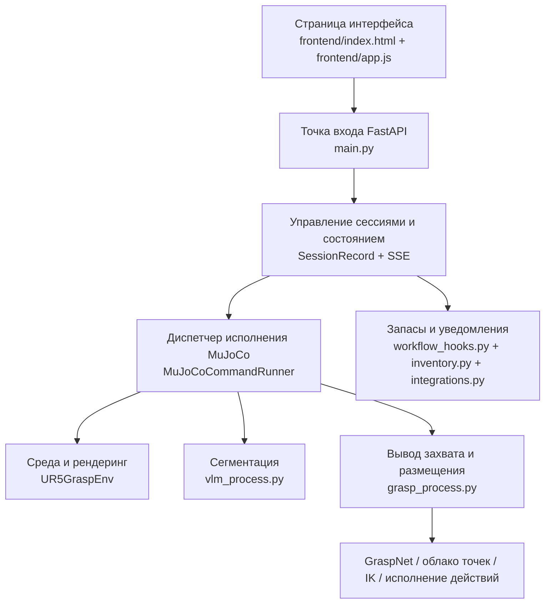

# Процесс разработки проекта и описание архитектуры системы

Этот документ предназначен для сопровождающих проекта и тех, кто расширяет его. Он системно описывает текущую архитектуру `VLM_Grasp_Interactive`, цепочку вызовов «фронтенд — бэкенд», механизм исполнения в MuJoCo, механизм непрерывных задач и распределение обязанностей между ключевыми файлами проекта.

После прочтения вы должны уметь:

- понимать полный путь проекта от «ввода естественного языка на веб-странице» до «захвата и размещения в MuJoCo»;
- понимать, как связаны фронтенд, FastAPI, сегментация VLM/SAM, GraspNet, исполнение движений и уведомления о запасах;
- понимать, почему проект поддерживает «непрерывные задачи», а не сбрасывает среду при каждой команде;
- продолжать расширять проект новыми объектами, новой логикой размещения и новыми бизнес-интерфейсами, не ломая уже работающие задачи захвата.

## 1. Цели проекта

Цель проекта — не просто интерфейс управления роботом, а «наглядная, интерактивная и непрерывно выполняемая» демонстрационная система в симуляции. Система получает задачу на естественном языке, показывает ход выполнения в веб-интерфейсе, а на бэкенде вызывает модули визуальной сегментации, вывода кандидатов захвата и исполнения в MuJoCo; в итоге выполняются захват, размещение, бросок и другие действия.

Сейчас в проекте уже в первую очередь реализованы следующие возможности:

- ввод команд на китайском языке в естественной форме и быстрые предустановки;
- связка веб-фронтенда и бэкенда FastAPI;
- показ симуляции MuJoCo в реальном времени в веб-интерфейсе;
- определение и сегментация целей VLM + SAM;
- вывод кандидатов захвата GraspNet;
- адаптация специальной логики для целевых объектов: шоколад, яблоко, губка, тарелка, фруктовая корзина и др.;
- непрерывное выполнение задач: вторая команда выполняется на состоянии сцены после первой.

## 2. Способы запуска и точки входа

Сейчас используется единое окружение `vlm_grasp311`.

### 2.1 Единая точка входа: веб-фронтенд и бэкенд

```powershell
micromamba run -n vlm_grasp311 python main.py
```

После выполнения запускается сервис FastAPI, и браузер открывается автоматически. Адрес по умолчанию:

```text
http://127.0.0.1:8000/
```

### 2.2 Прочие исторические точки входа

- [main_openclaw.py](./main_openclaw.py): ранняя главная программа.
- [main_vlm.py](./main_vlm.py): экспериментальная точка вызова VLM.

Актуальная демонстрационная цепочка описана в [main.py](./main.py).

## 3. Общая архитектура

Систему можно разделить на пять слоёв:

1. слой взаимодействия с фронтендом;
2. слой веб-сервиса и управления сессиями;
3. слой восприятия и понимания задач;
4. слой вывода захвата и исполнения движений;
5. слой бизнес-расширений.

Ниже показана основная схема вызовов проекта.



## 4. Описание основных каталогов

### 4.1 Веб-слой

- [frontend/index.html](./frontend/index.html)
  Структура страницы, статические кнопки, резервные скрипты событий, шаблоны кнопок предустановок.

- [frontend/app.js](./frontend/app.js)
  Конечный автомат фронтенда, отправка сессий, подписка на SSE, обновление предпросмотра, запись предустановок в текстовое поле, вывод отладочной информации.

- [frontend/styles.css](./frontend/styles.css)
  Стили страницы, эффект свечения панелей при наведении, раскладка области предпросмотра и общая визуальная тема.

### 4.2 Веб-бэкенд и главный управляющий слой

- [main.py](./main.py)
  Главная точка входа системы. Отвечает за:
  - запуск FastAPI;
  - подключение статических файлов фронтенда;
  - приём команд `/api/command`;
  - создание и ведение сессий;
  - передачу задач исполнителю MuJoCo;
  - передачу состояния фронтенду через `/api/session/{id}` и `/api/session/{id}/events`;
  - вывод кадров предпросмотра в реальном времени через `/api/session/{id}/frame`.

### 4.3 Слой восприятия и исполнения

- [vlm_process.py](./vlm_process.py)
  Модуль VLM и сегментации изображений. Отвечает за:
  - вызов мультимодальной модели для понимания команды и изображения;
  - вывод текстового описания цели и рамок на изображении;
  - вызов локального или удалённого SAM для сегментации;
  - формирование `mask_source`, `mask_destination` и отладочных наложений.

- [grasp_process.py](./grasp_process.py)
  Основной модуль вывода захвата и размещения. Отвечает за:
  - построение облака точек по карте глубины и маске;
  - вызов GraspNet для генерации кандидатов захвата;
  - оценку точек захвата и размещения по геометрии целевого объекта;
  - решение обратной кинематики (IK);
  - управление манипулятором в MuJoCo: захват, подъём, перемещение, размещение, возврат;
  - специальную логику для отдельных объектов, например сопоставление для шоколада, яблока, губки и яблочной корзины.

- [manipulator_grasp/env/ur5_grasp_env.py` (manipulator_grasp/env/ur5_grasp_env.py)`
  Обёртка среды MuJoCo. Отвечает за:
  - загрузку XML-сцены;
  - инициализацию манипулятора и захвата;
  - управление офлайн-рендерингом и пассивным окном просмотра (viewer);
  - унификацию ракурса между веб-интерфейсом и симулятором;
  - при сбое рендеринга пересоздаёт только бэкенд рендеринга, не сбрасывая состояние мира.

### 4.4 Сцены и конфигурация ракурса

- [scene_robocasa_layout51_style34.xml](manipulator_grasp/assets/scenes/scene_robocasa_layout51_style34.xml)
  Основная сцена, которая используется сейчас.

- `scene_robocasa_layout51_style34.view.json`
  Файл настройки ракурса по умолчанию для основной сцены. Веб-интерфейс и окно MuJoCo читают один и тот же ракурс. Этот файл может создаваться локальным процессом отладки и не обязан входить в публичный учебный код.

### 4.5 Бизнес-расширения

- [workflow_hooks.py](./workflow_hooks.py)
  Побочные эффекты после успешной задачи: изменение запасов, уведомление о низком остатке, синхронизация с внешними системами.

- [inventory.py](./inventory.py)
  Система запасов с хранением в файлах: фиксирует изменения количества после выполнения некоторых задач.

- [integrations.py](./integrations.py)
  Внешние webhook и интерфейсы уведомлений Feishu.

## 5. Порядок работы фронтенда

Основная задача фронтенда — не управлять роботом, а организовать ввод команды, состояние сессии на бэкенде и изображение симуляции в интерфейс, который можно демонстрировать и отлаживать.

### 5.1 Состав страницы

Веб-интерфейс состоит из трёх панелей:

- слева: поле ввода команд;
- в центре: предпросмотр сцены;
- справа: временная шкала выполнения и отладочный вывод.

Левая панель служит для ввода команд на естественном языке и быстрого заполнения текстового поля кнопками предустановок. Центральная область показывает текущий кадр MuJoCo в реальном времени или заглушку. Правая панель показывает, как продвигается сессия: разбор языка, сегментация целей, вывод захвата, решение IK, исполнение движений и итоговый результат.

### 5.2 Отправка команды

Сейчас фронтенд поддерживает два способа отправки:

- нажать кнопку «Выполнить команду»;
- нажать `Enter` в поле ввода.

Логика находится в [frontend/app.js](./frontend/app.js). Фронтенд отправляет команду на адрес:

```text
POST /api/command
```

После отправки фронтенд переходит в состояние «running» и начинает подписку на SSE-поток этой сессии.

### 5.3 Обновление состояния сессии

Фронтенд получает ход выполнения через такие интерфейсы:

- `GET /api/session/{session_id}`
- `GET /api/session/{session_id}/events`
- `GET /api/session/{session_id}/frame`

Здесь:

- `events` передаёт структурированное состояние: trace, журналы, названия стадий, результаты;
- `frame` отдаёт текущий последний кадр предпросмотра в PNG.

Это означает, что фронтенд не обращается к MuJoCo напрямую и не участвует в планировании исполнения: вся работа идёт через состояние сессии FastAPI.

## 6. Сессии и планирование на бэкенде

### 6.1 Объект сессии

В [main.py](./main.py) каждая команда соответствует одному объекту `SessionRecord`. Он хранит:

- `session_id`;
- строку команды;
- разобранную структуру задачи;
- список trace;
- текущее состояние: `running`, `success`, `failure`;
- текст результата;
- адрес URL предпросмотра;
- отладочные журналы;
- снимок запасов.

При каждой отправке команды фронтенд бэкенд создаёт новую сессию или продолжает указанную, затем запускает фоновый поток, который выполняет настоящую задачу MuJoCo.

### 6.2 Разбор команды

Разбор команды выполняется в [main.py](./main.py) и в основном обеспечивается функциями:

- `_normalize_text`
- `_extract_objects`
- `_infer_relation`
- `_parse_task`

Результат разбора приводится к структурированной задаче:

```python
{
    "type": "pick_place",
    "source": "apple",
    "destination": "apple_rack",
    "relation": "in",
    "all_items": False,
}
```

Этот шаг — вход всей системы и основа для дальнейшего распределения по специальной логике.

### 6.3 Общие и специальные задачи

Бэкенд сейчас не полностью полагается на унифицированную общую логику, а использует схему «общий каркас + адаптация под конкретный объект».

Например:

- задача шоколада в первую очередь закрепляет за собой сущность сцены, соответствующую `SNICKERS`;
- задача яблока различает яблоко на разделочной доске и яблоко в фруктовой корзине;
- задача губки различает губку на столе и губку в подставке;
- места размещения для фруктовой корзины и подставки для губки — не просто «центр полки», а специально вычисляемые эффективные слоты.

Причина простая: одного только общего понимания текста и одной только сегментации недостаточно для сложной сцены — часто система путает одинаковые предметы или выбирает неподходящее место размещения. В проекте такие частые ошибки устраняются правилами для конкретных объектов.

## 7. Основной путь исполнения в MuJoCo

Фактическое исполнение происходит в `MuJoCoCommandRunner`.

Основной путь одной операции захвата и размещения можно описать так:

1. убедиться, что среда инициализирована;
2. получить RGB и глубину;
3. выполнить сегментацию исходного объекта;
4. оценить мировые координаты точки захвата;
5. выполнить сегментацию целевой зоны размещения или сразу использовать специальный слот размещения;
6. построить облако точек и запустить GraspNet;
7. решить IK для захвата, подъёма, перемещения, размещения и возврата;
8. пошагово исполнить движения в MuJoCo;
9. непрерывно передавать кадры и состояние стадий на фронтенд.

### 7.1 Получение RGB-D

Логика получения находится в:

- [main.py](./main.py): функция `_capture_rgbd`;
- [ur5_grasp_env.py` (manipulator_grasp/env/ur5_grasp_env.py)`: функция `render`.

Бэкенд получает:

- `img`: RGB-изображение текущей камеры;
- `depth`: карту глубины для того же ракурса.

Все последующие сегментация, облако точек и вывод захвата строятся на этой паре синхронизированных данных RGB-D.

### 7.2 Сегментация исходного объекта

Сегментация исходного объекта выполняется функцией `segment_image` в [vlm_process.py](./vlm_process.py) и связанной с ней логикой.

Поддерживаются три варианта входа:

- только текст команды;
- текст + подсказка в виде рамки (bbox) сцены;
- текст + явное переопределение метки.

В проекте многие исправления стабильности относятся именно к этому слою. Например:

- для шоколада добавляется подсказка «на упаковке написано SNICKERS»;
- для губки добавляется подсказка «предпочтительно губка, обведённая красным кругом»;
- для яблочной подставки используется специальная цель, а не только общее слово «полка».

### 7.3 Облако точек и GraspNet

Вывод кандидатов захвата находится в [grasp_process.py](./grasp_process.py).

Основная цепочка обработки:

1. по RGB, глубине и маске построить организованное облако точек;
2. отфильтровать недействительные точки по порогу глубины;
3. вызвать GraspNet для генерации кандидатов захвата;
4. выполнить фильтрацию по коллизиям;
5. отсортировать по центру цели, направлению захвата и расстоянию;
6. выбрать итоговую позу захвата.

Если при этом появляется ошибка:

```text
No valid masked point cloud points after depth filtering
```

обычно проблема не в IK, а во входе на более раннем этапе. Типичные причины:

- маска попала не на тот объект;
- карта глубины неисправна;
- произошёл сбой офлайн-рендеринга.

### 7.4 IK и исполнение движений

Исполнение движений также реализовано в [grasp_process.py](./grasp_process.py).

Порядок стадий сейчас такой:

- `home`
- `hub`
- `hover_pick`
- `pregrasp`
- `grasp`
- `grasp_close`
- `lift`
- `hover_place`
- `preplace`
- `place`
- `release`
- `retreat`
- `hub_return`
- `reset`

Каждая стадия через callback передаётся на фронтенд, который показывает название текущей стадии и последний кадр.

## 8. Механизм непрерывных задач

Это одна из ключевых инженерных особенностей проекта.

### 8.1 Цель проекта

Проект требует, чтобы вторая задача выполнялась на состоянии мира после завершения первой, а не заново возвращала MuJoCo-сцену в начальное состояние.

Например:

1. сначала выполняется «Положи шоколад на тарелку» (请把巧克力放到盘里);
2. шоколад оказывается на тарелке;
3. затем выполняется «Переложи яблоко с доски на полку с яблоками и сохрани его» (将菜板上的苹果放置有苹果的架子上保存);
4. в этот момент в симуляции шоколад всё ещё должен оставаться на тарелке.

### 8.2 Текущая реализация

Управление средой находится в `MuJoCoCommandRunner` в [main.py](./main.py).

Принцип такой:

- `UR5GraspEnv` вызывает `reset()` только при первом использовании;
- последующие задачи переиспользуют тот же `self._env`;
- поэтому `mj_model` и `mj_data` сохраняют состояние после предыдущей задачи.

### 8.3 Стратегия восстановления при сбое рендеринга

В ходе непрерывных задач однажды сломался бэкенд офлайн-рендеринга, и веб-интерфейс показывал:

- чёрный предпросмотр;
- глубину с постоянным большим значением;
- сбой последующего построения облака точек.

Чтобы решить эту проблему, в [ur5_grasp_env.py` (manipulator_grasp/env/ur5_grasp_env.py)` добавлены следующие механизмы:

- при обнаружении некорректного вывода рендеринга не сбрасывается вся сцена MuJoCo;
- пересоздаются только ресурсы офлайн-рендеринга: renderer, окно GLFW, офлайн-контекст;
- `mj_model` и `mj_data` сохраняются.

Поэтому система сейчас одновременно обеспечивает два свойства:

- непрерывность состояния мира;
- восстановление после сбоя рендеринга.

## 9. Ракурс камеры и редактор сцены

### 9.1 Единый источник ракурса

Ракурс по умолчанию в веб-интерфейсе и в окне MuJoCo берётся из одного файла настроек сцены:

```text
scene_robocasa_layout51_style34.view.json
```

Логика чтения находится в:

- [ur5_grasp_env.py` (manipulator_grasp/env/ur5_grasp_env.py)`

### 9.2 Как действует настройка ракурса

Если файл `scene_robocasa_layout51_style34.view.json` существует, симулятор читает эту настройку камеры. После этого:

- окно просмотра симулятора использует этот ракурс;
- офлайн-рендеринг веб-интерфейса тоже использует этот ракурс.

Так обеспечивается согласованность: камера, которую видит пользователь в веб-интерфейсе, совпадает с камерой локального отладчика MuJoCo. Публичный репозиторий сохраняет нужную для работы сцену и логику чтения, но не содержит локальный инструмент редактирования сцены.

## 10. Отладочные артефакты и промежуточные файлы

Проект записывает много промежуточных результатов в каталог `temp/`, чтобы упростить поиск неисправностей.

### 10.1 Изображения и результаты сегментации

Типичный каталог вывода:

```text
temp/images/
```

Там находятся:

- `*_mask_source.png`
- `*_mask_destination.png`
- `*_mask_source_overlay.png`
- `*_mask_destination_overlay.png`

По этим файлам легко проверить:

- правильно ли VLM/SAM нашли целевой объект;
- попадает ли рамка на нужный предмет;
- совпадает ли наложение с реальным изображением.

### 10.2 Состояние запасов

Состояние запасов сохраняется в:

```text
temp/inventory/
```

Это основа для демонстрации бизнес-логики.

## 11. Расширение: запасы, заказы и уведомления Feishu

Помимо демонстрации захвата, в проект подключён небольшой бизнес-контур.

### 11.1 Списание запасов

После некоторых успешных задач вызывается функция из [workflow_hooks.py](./workflow_hooks.py):

```python
record_task_success_effects(...)
```

Она:

- обновляет локальные запасы;
- определяет, не наступил ли низкий остаток;
- отправляет уведомление во внешний webhook;
- при необходимости отправляет напоминание в Feishu.

### 11.2 Внешние интеграции

[integrations.py](./integrations.py) отвечает за:

- внешние webhook робота;
- уведомления Feishu;
- чтение локального конфигурационного файла.

Этот слой не участвует в управлении захватом; он лишь передаёт события успешного выполнения в другие системы.

## 12. Специальная логика для отдельных объектов

В проекте уже сделаны специальные адаптации для отдельных объектов, и это одна из главных причин устойчивой работы системы.

### 12.1 Шоколад

- Использует подсказку с семантикой `SNICKERS` для точного выбора нужного шоколада.
- Не даёт перепутать шоколад с другими мелкими предметами сцены.

### 12.2 Яблоко

- `apple` по умолчанию сопоставляется с яблоком на разделочной доске.
- `apple_rack` сопоставляется с фруктовой корзиной.
- Точка размещения яблока — не центр всей полки, а специальная позиция внутри фруктовой корзины.

### 12.3 Губка

- Поддерживается раздельное моделирование губки и её подставки.
- Поддерживается логика пакетной уборки.
- Точка размещения — специальный слот внутри подставки для губки, а не абстрактный «центр полки».

## 13. Рекомендуемый порядок разработки

Если вы продолжаете разработку, рекомендуем следующий порядок.

### 13.1 Порядок подключения нового объекта

1. Определить имя body целевого объекта в XML сцены.
2. В [main.py](./main.py) добавить псевдонимы команд на китайском языке.
3. В [grasp_process.py](./grasp_process.py) добавить сопоставление `SCENE_BODY_NAMES`.
4. При необходимости написать функцию мировых координат для специальной зоны размещения.
5. Выполнить в веб-интерфейсе две задачи подряд и проверить, сохраняется ли состояние.

### 13.2 Порядок отладки

При сбое проверяйте в таком порядке:

1. показывает ли журнал веб-интерфейса переход к реальному исполнению в MuJoCo;
2. правильны ли маски исходного и целевого объектов в `temp/images`;
3. не чёрный ли предпросмотр в веб-интерфейсе и не сбит ли цвет;
4. нет ли сбоев в карте глубины;
5. правильно ли сопоставлены исходный и целевой объекты в `grasp_process.py`;
6. используется ли для точки размещения общая логика вместо специальной.

## 14. Типичные сбои и способы восстановления

### 14.1 Чёрный экран в веб-интерфейсе

В первую очередь подозревайте сбой бэкенда офлайн-рендеринга, а не код фронтенда. Система уже умеет автоматически пересоздавать ресурсы рендеринга, но если старый процесс уже сломался, самый прямой способ восстановления — перезапустить [main.py](./main.py).

### 14.2 После фильтрации по глубине не осталось точек облака

Типичный текст ошибки:

```text
No valid masked point cloud points after depth filtering
```

Сначала проверьте:

- правильна ли сегментация цели;
- нормальна ли глубина;
- попадает ли цель в зону видимости камеры при текущем ракурсе.

### 14.3 Объект захвачен или размещён неправильно

Сначала проверьте:

- есть ли для этого объекта специальное сопоставление;
- не используется ли ещё общая цель `shelf`;
- не является ли точка размещения центром всего большого контейнера вместо допустимой точки внутри контейнера.

## 15. Направления дальнейшего развития

Исходя из текущего состояния кода, в первую очередь стоит заняться тремя направлениями.

### 15.1 Стабильность

- подключить специальные сопоставления для большего числа частых объектов;
- для контейнеров создать логику «допустимых слотов внутри контейнера»;
- стандартизировать обнаружение сбоев рендеринга.

### 15.2 Поддерживаемость

- вынести псевдонимы объектов, имена сущностей сцены и стратегии размещения в единый конфигурационный файл;
- выделить правила для объектов, которые сейчас разбросаны по `main.py` и `grasp_process.py`, в отдельный модуль.

### 15.3 Демонстрационные возможности

- добавить больше скриптов непрерывных задач;
- добавить кнопку сброса среды, чтобы в одном проекте уживались режим «непрерывного выполнения» и режим «ручного возврата в исходное состояние»;
- показывать на фронтенде больше промежуточных состояний: наложения сегментации, количество кандидатов захвата, текущее имя целевой сущности.

## 16. Ключевые файлы, упомянутые в этом документе

- [main.py](./main.py)
- [grasp_process.py](./grasp_process.py)
- [vlm_process.py](./vlm_process.py)
- [manipulator_grasp/env/ur5_grasp_env.py` (manipulator_grasp/env/ur5_grasp_env.py)`
- [workflow_hooks.py](./workflow_hooks.py)
- [inventory.py](./inventory.py)
- [integrations.py](./integrations.py)
- [frontend/index.html](./frontend/index.html)
- [frontend/app.js](./frontend/app.js)
- [frontend/styles.css](./frontend/styles.css)

В зависимости от задачи этот документ можно читать по трём путям:

- как руководство по запуску для тех, кто демонстрирует систему;
- как описание архитектуры для разработчиков;
- как справочник по поиску неисправностей для тех, кто отлаживает систему.
