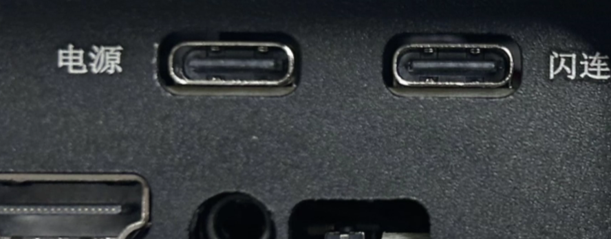
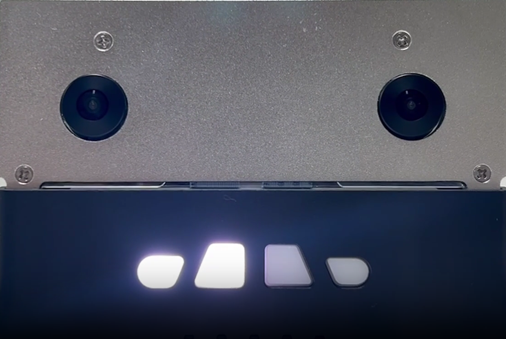
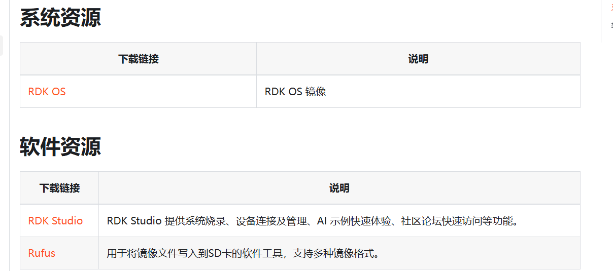
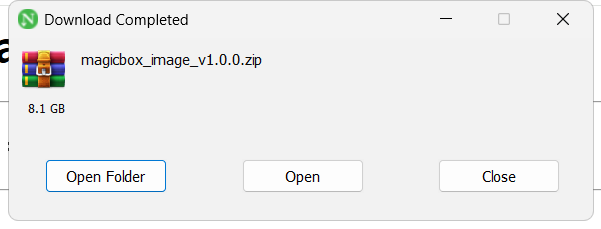
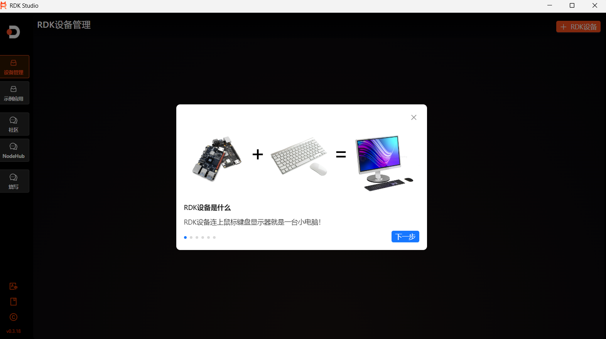
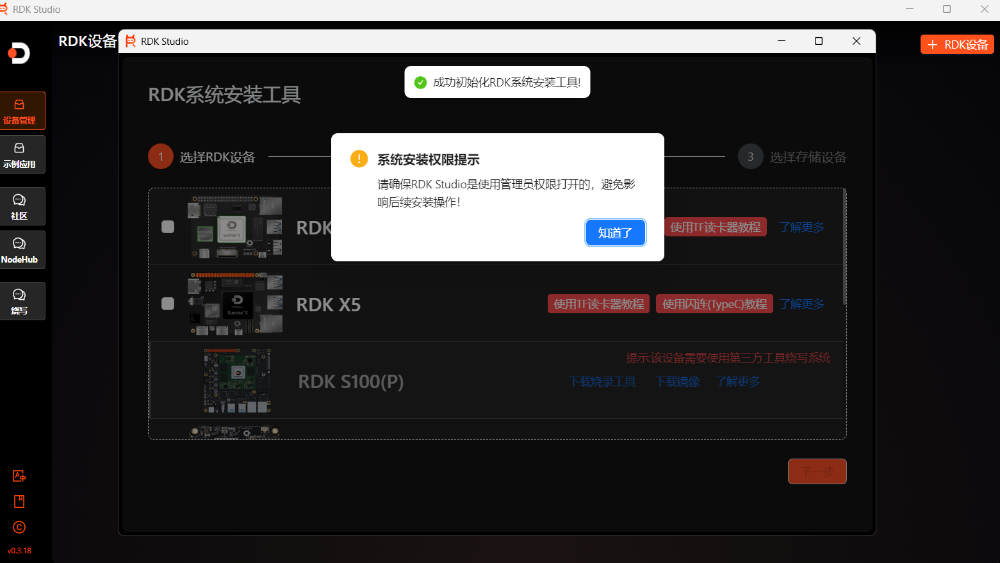
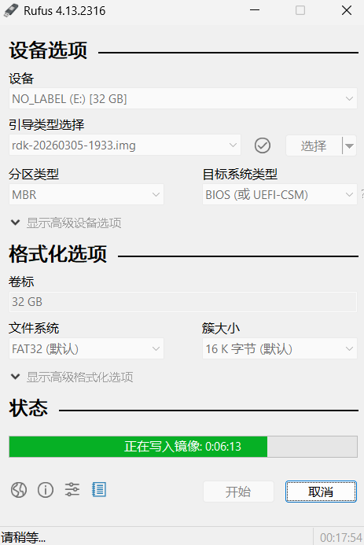
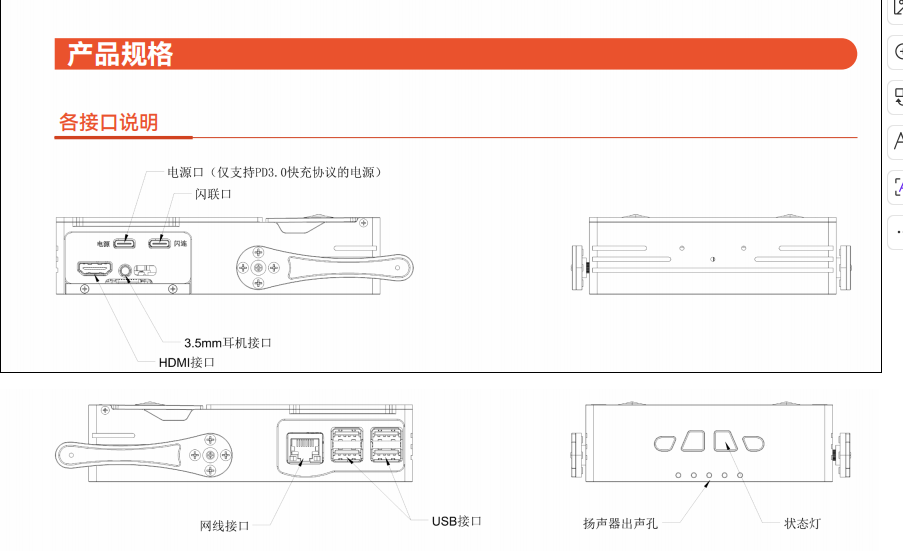

# Часть 01: подготовка окружения и прошивка

Задача этой главы — не просто «записать образ на карту», а довести Magicbox от состояния только что распакованного устройства до стабильной отправной точки для дальнейшей разработки. Если эта глава выполнена тщательно, последующие шаги — проводное подключение, кнопки, периферия, голосовая цепочка и отладка алгоритмов — пойдут гораздо легче.

## 1. Материалы, которые используются в главе

Ссылки на официальные страницы и файлы для загрузки приведены в тексте. Копии сайта производителя в книгу, как правило, не включаются: это веб-страницы с большим объёмом служебного кода, который быстро устаревает. Исключение — локальная копия списка образов, она короткая и не содержит китайского текста.

Рекомендуется сначала открыть страницу загрузки ресурсов и каталог образов:

`https://d-robotics.github.io/magicbox_doc/resource-download`
`https://archive.d-robotics.cc/downloads/rdk_x5_magicbox/images/`

Локальная копия списка образов: `./assets/official_pages/rdk_x5_magicbox_images_index.html`.

Установочные файлы, которые уже сохранены локально, находятся в отдельном каталоге загрузок. Там лежат образ системы, RDK Studio и Rufus.

## 2. Перед включением проверьте состояние оборудования

В первый раз с Magicbox лучше подключить минимум: питание, необходимый кабель передачи данных и карту памяти. Не подключайте сразу много периферии. Так вы сначала убедитесь, что сама плата не имеет проблем с питанием и загрузкой, и не будете путать «проблемы кабеля», «проблемы образа» и «проблемы совместимости периферии».

Питание Magicbox подаётся через Type-C; рекомендуется стабильный блок питания с поддержкой PD. После подключения питания лента подсветки загорается последовательно, затем раздаётся звуковой сигнал. Если подсветка работает неправильно, сигнала нет слишком долго или устройство постоянно перезагружается, не стоит сразу прошивать и подключаться к сети — сначала проверьте питание и кабели.

## 3. Зачем всё же готовить образ полностью

Хотя некоторые устройства поставляются с установленной системой, при серьёзном обучении не стоит полностью полагаться на состояние «с завода сразу работает». Причины три.

Во-первых, версия заводского образа не обязательно совпадает с текущей официальной документацией. Во-вторых, для повторяемости шагов нужно, чтобы версия образа, путь прошивки и версия инструментов были прослеживаемы. В-третьих, если позже возникнут непонятные сбои, повторная прошивка заведомо известного состояния часто экономит больше времени, чем угадывание настроек.

Поэтому стандартный порядок в этой главе такой: сначала сохранить официальный образ, инструменты прошивки и страницы описания, и только потом подготавливать систему.

## 4. Образы, инструменты и источники загрузки

Страница загрузки ресурсов от производителя:

`https://d-robotics.github.io/magicbox_doc/resource-download`

Ключевые файлы, которые используются в учебнике:

`magicbox_image_v1.0.0.zip`
`rdk-20260305-1933.img`
`RDKStudio_signed_Setup.exe`
`rufus-4.13.exe`

С практической точки зрения пути прошивки делятся на два типа.

Первый — прошивка через **RDK Studio**. Это официальный инструмент, он подходит для полного знакомства с экосистемой Horizon, а также для последующего подключения дополнительных примеров приложений.
Второй — прямая запись образа на SD-карту через **Rufus**. Для тех, кто регулярно пишет учебные материалы, часто перепрошивает карты и восстанавливает окружение, этот способ обычно прямой и надёжный.

Чтобы шаги было легко повторить, в этом учебнике основным выбран путь **Rufus + SD-карта**, а RDK Studio рассматривается как запасной вариант. Так читателю проще выполнить стабильную прошивку, а поддерживать учебник тоже проще.

## 5. Что важно при прошивке через RDK Studio

При прошивке через RDK Studio важно не то, какую кнопку нажать, а правильный порядок входа в режим прошивки. Стандартная последовательность такая:

Сначала выключите плату, вставьте SD-карту, подключите устройство к компьютеру кабелем **USB 2.0 Type-C**. Затем нажмите и удерживайте кнопку **Sleep**, подайте питание и подождите около пяти секунд, чтобы устройство вошло в режим прошивки. Только в этом режиме программа на ПК стабильно видит устройство.

RDK Studio лучше запускать **от имени администратора**. Иначе даже при открытом приложении возможны сбои на этапе распознавания устройства или записи из-за прав доступа.

## 6. Почему Rufus рекомендуется как основной путь

Rufus нацелен на задачу «просто записать образ на карту»: процесс короткий, точек отказа меньше. Если у читателя уже есть кардридер или SD-карта подготовлена отдельно, запись файла `.img` через Rufus обычно самый простой вариант.

Основной порядок этой главы:

1. Убедитесь, что файл образа полный.
2. В Rufus выберите образ `.img`.
3. Убедитесь, что выбранное устройство — именно та SD-карта, которую нужно прошить.
4. Запустите запись и дождитесь окончания.
5. Вставьте карту обратно в плату и включите её.

Этого достаточно, и это соответствует задаче долгосрочной поддержки учебника.

## 7. Правильный порядок проверки после первого включения

После первой записи и включения не спешите сразу запускать алгоритмы, ставить репозитории или менять систему. Лучше действовать по порядку.

Сначала убедитесь, что устройство нормально загружается.
Затем проверьте, работают ли подсветка и звуковой сигнал.
После этого решите, будете ли вы использовать беспроводное соединение (Flash-Link) или проводной сетевой порт.
И только потом переходите к входу в систему, подключению к сети и знакомству с приложениями.

В этом учебнике основной путь — **проводной сетевой порт**, поэтому адреса для разных режимов разделяются так: для **режима Flash-Link** — `192.168.128.10`, для **прямого проводного подключения** — `192.168.127.10`. Не объединяйте эти два адреса в один неопределённый вариант «`192.168.128.10 или 192.168.127.10`».

Подробный порядок входа см. здесь: `./02-cable-network-port-connection-and-login.md`.

## 8. Интерфейсы и правила безопасности

Magicbox легко начинают часто трогать, поднимать или придавливать, как только он заработал. На практике чаще всего ломаются не программы, а механизм складывания камеры, опорные ножки и способ установки SD-карты. Поэтому советы по безопасности лучше сохранить в учебнике, а не удалять.

Ниже — рекомендации, которые должны остаться в учебном тексте.

Устройство нужно ставить на устойчивую, ровную и непроводящую поверхность.
Не поворачивайте опорные ножки силой руками; вне демонстраций держите их параллельно корпусу.
Не перегибайте механизм камеры и не превышайте разрешённый производителем угол.
При установке SD-карты смотрите на положение слота и не вставляйте её в зазор корпуса по ошибке.
Перед подключением периферии проверьте, совпадают ли питание и стандарт интерфейса.

## 9. Каким должно быть состояние после главы

После выполнения этой главы вы должны убедиться, что все четыре пункта выполнены.

Первое: у вас есть воспроизводимый комплект образа и инструментов.
Второе: плата успешно загрузилась хотя бы один раз.
Третье: вы понимаете, что дальше используете проводное подключение по сетевому порту, а не Flash-Link.
Четвёртое: вы готовы перейти к следующей главе и настроить правильный адрес проводного подключения на сетевой карте компьютера и войти в плату.

Если хотя бы один из пунктов ещё не выполнен, не переходите к разделам с опытом использования и алгоритмами. Главная ценность первой главы — создать повторяемую отправную точку для всего учебника.
