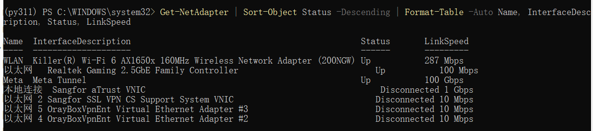
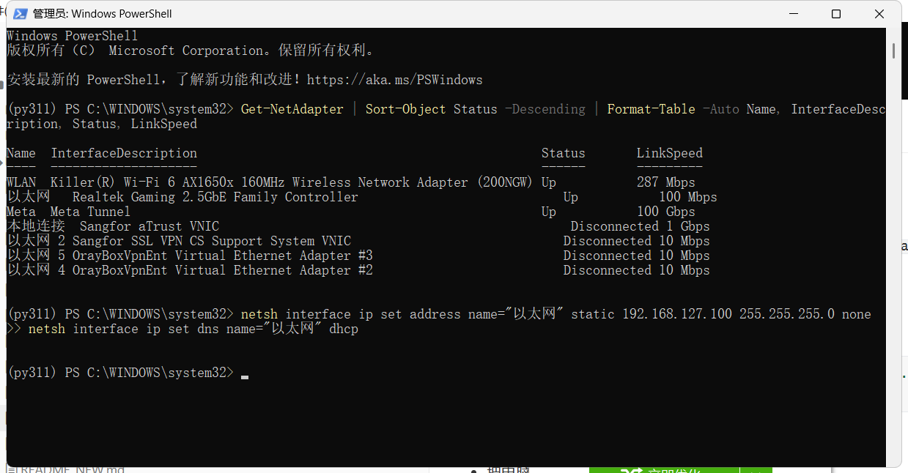
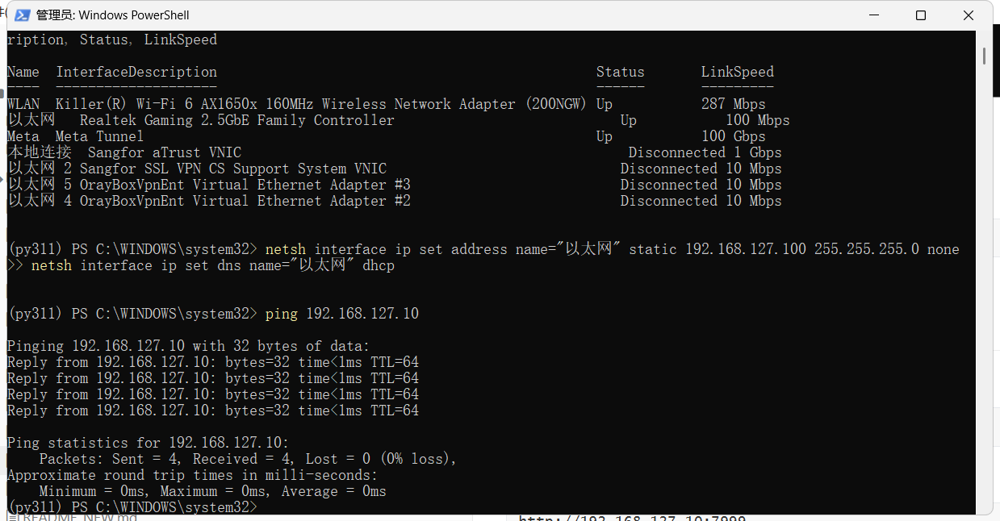
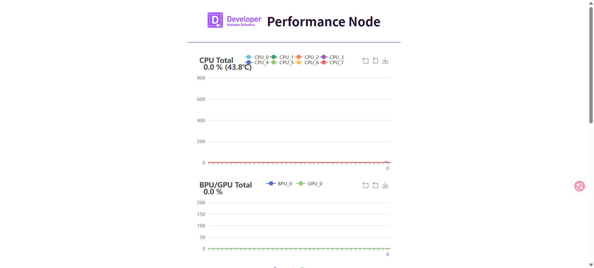
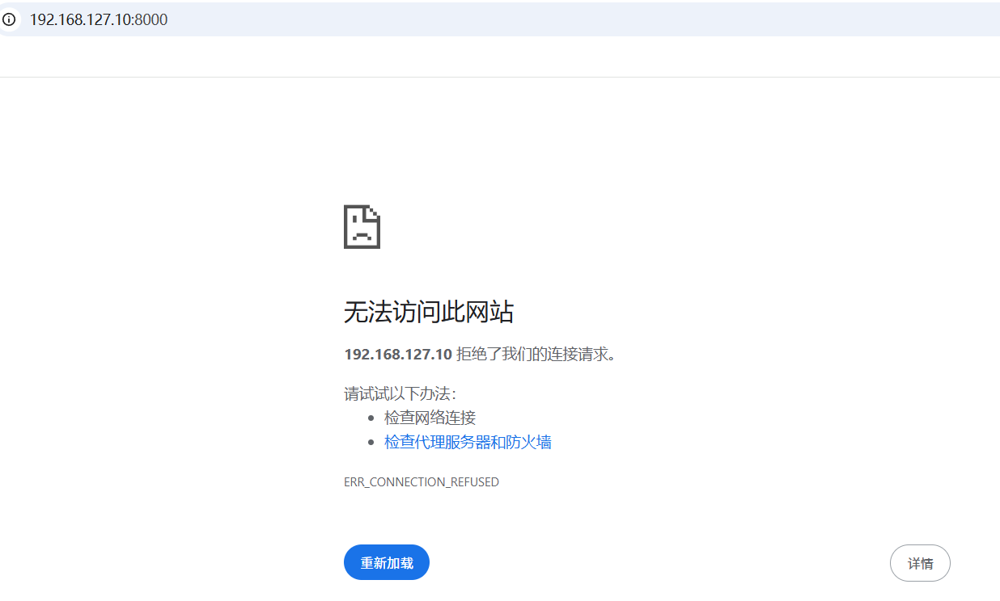
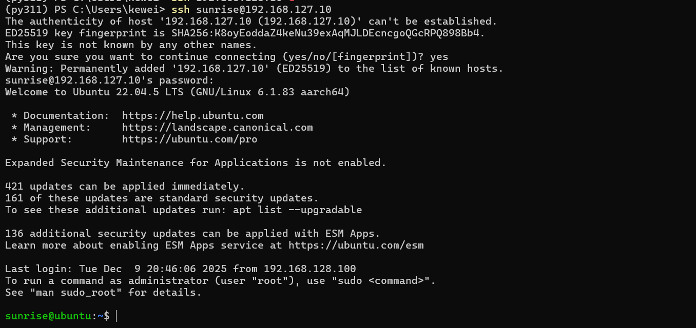
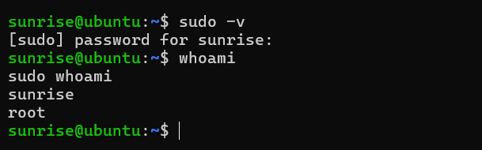

# Часть 02: проводное подключение и вход

В этой главе решается практическая задача: как подключить Windows-компьютер и Magicbox напрямую по сетевому кабелю и выполнить первый вход. Для долгой разработки это обычно надёжнее, чем Flash-Link, и ближе к реальному рабочему процессу.

## 1. Сетевые предпосылки, принятые в главе

По умолчанию в учебнике используется такая схема подключения:

Компьютер подключён к университетской сети или к интернету через `WLAN`.
Компьютер напрямую соединён с Magicbox через `Ethernet`.
Magicbox работает как устройство в отдельной закрытой сети и общается с компьютером по фиксированному адресу.

Если университетская сеть работает через `Wi-Fi`, то перевод сетевой карты `Ethernet` на статический адрес обычно не мешает подключению к сети. Причина в том, что вы меняете только проводной адаптер, который подключён к плате, и не задаёте для него шлюз по умолчанию. Поэтому Windows по-прежнему выходит в сеть через `WLAN`, а `Ethernet` отвечает только за связь с платой.

Официальная страница быстрого старта:

`https://d-robotics.github.io/magicbox_doc/quickstart`

## 2. Два адреса, которые нельзя смешивать

Что чаще всего путает новичков в сетевой части Magicbox — это когда адрес Flash-Link и адрес проводного подключения считают одним и тем же. Производитель даёт их чётко.

Если вы используете **Flash-Link**, адрес платы:

```text
192.168.128.10
```

Если вы используете **прямое проводное подключение**, адрес платы:

```text
192.168.127.10
```

В этой главе речь идёт только о втором варианте — прямом проводном подключении. Поэтому все `ping`, открытие страниц в браузере и `ssh`-вход нужно выполнять прежде всего по адресу `192.168.127.10`.

## 3. Сначала определите, какую сетевую карту менять

На компьютере могут одновременно быть Wi-Fi, Ethernet, VPN-адаптеры и другие программные виртуальные сетевые карты. Менять нужно только тот физический проводной адаптер, через который будет подключение к плате.

В PowerShell выполните:

```powershell
Get-NetAdapter | Sort-Object Status -Descending | Format-Table -Auto Name, InterfaceDescription, Status, LinkSpeed
```

Если вы видите результат примерно такого вида:

```text
以太网   Realtek Gaming 2.5GbE Family Controller   Up
```

то это, скорее всего, та самая сетевая карта, которая подключена к плате. (Имя `以太网` в русскоязычной системе обычно отображается как «Ethernet» или «Подключение по локальной сети»; в командах ниже используйте то имя, которое выдала команда на вашем компьютере.)



Этот шаг очень важен: если поменять не ту карту, плата не подключится или вы сломаете рабочую сеть компьютера.

## 4. Зачем компьютеру задавать статический адрес

Когда компьютер подключён к плате напрямую кабелем, между ними обычно нет маршрутизатора, DHCP-сервера или сетевого шлюза, который выдал бы адреса автоматически. Если компьютер оставлен в режиме «получать IP автоматически», Windows часто назначает себе адрес из диапазона `169.254.x.x` (локальный адрес канала). Этот диапазон не совпадает с адресом `192.168.127.10`, поэтому два устройства не могут общаться напрямую.

Поэтому нужно вручную перевести эту проводную карту в подсеть `192.168.127.x`.

## 5. Правильная настройка Windows

Этот шаг нужно выполнять **от имени администратора**. Без прав администратора Windows выдаст ошибку вроде `The requested operation requires elevation`.

Если имя вашей сетевой карты — `以太网` (в русской версии — обычно «Ethernet»), можно выполнить в PowerShell или CMD с правами администратора:

```cmd
netsh interface ip set address name="以太网" static 192.168.127.100 255.255.255.0 none
netsh interface ip set dns name="以太网" dhcp
```

Смысл этих команд простой:

- адрес компьютера — `192.168.127.100`;
- маска подсети — `255.255.255.0`;
- основной шлюз не задаётся;
- DNS остаётся в автоматическом режиме.



Если имя вашей сетевой карты не «以太网», сначала выполните:

```powershell
Get-NetAdapter
```

и замените в команде `"以太网"` на фактическое название.

## 6. Как убедиться, что связь установлена

После настройки первым делом не открывайте браузер, а выполните самую простую проверку сети:

```powershell
ping 192.168.127.10
```



Если `ping` проходит, значит, связь между компьютером и платой на канальном и сетевом уровнях установлена. После этого можно проверить два веб-адреса:

```text
http://192.168.127.10:7999
http://192.168.127.10:8000
```

Порт `7999` — страница мониторинга ресурсов, порт `8000` — страница демонстрационного вывода.





Здесь важно уточнить: `8000` не всегда что-то показывает. Обычно он зависит от того, что соответствующее демонстрационное приложение уже запущено. Поэтому если `ping` проходит, страница `7999` открывается, а на `8000` пусто, не нужно сразу считать устройство неисправным: сначала пройдите процесс запуска кнопками, описанный в третьей главе.

## 7. Как правильно выполнить первый вход по SSH

В большинстве официальных предустановленных систем рекомендуется входить под обычным пользователем, а не сразу под `root`. Дело в том, что при последующей работе — установке пакетов, загрузке репозиториев, отладке скриптов — обычный пользователь вместе с `sudo` соответствует стандартному процессу разработки в Linux и безопаснее.

Рекомендуемая команда:

```bash
ssh sunrise@192.168.127.10
```

Учётные данные по умолчанию для входа указаны в официальной документации производителя (раздел «Быстрый старт»); в этом учебнике они намеренно не приводятся. Используйте те, что указаны в документации именно для вашей версии образа, и сразу меняйте пароль на собственный.

Если действительно нужен вход от имени `root`, используйте:

```bash
ssh root@192.168.127.10
```

Учётные данные `root` также берутся из официальной документации; вход под `root` оставляйте для системного обслуживания и отладки прав доступа.



## 8. Как выбирать между обычным пользователем, root и sudo

На практике полезно сначала разделить их роли, а не считать, что «подходит любой».

Обычный пользователь `sunrise` подходит для повседневной работы: входа, просмотра каталогов, загрузки исходного кода, запуска обычных команд и работы в собственном рабочем пространстве.
`sudo` нужен, когда требуются права администратора, но хочется сохранить стандартный рабочий процесс: установка программ, изменение системных настроек, управление службами.
`root` подходит для системного обслуживания, диагностики прав и редких задач, которые требуют полного доступа к суперпользовательскому окружению.

Поэтому рекомендуемый путь по умолчанию в учебнике такой:

```bash
ssh sunrise@192.168.127.10
sudo -v
sudo -i
```

Если системе выдано право sudo для пользователя `sunrise`, повышение прав выполняется вводом его собственного пароля.

## 9. Как проверить, что sudo работает

После входа выполните:

```bash
sudo -v
```

затем:

```bash
whoami
sudo whoami
```

Если результат:

```text
sunrise
root
```

значит, повышение прав через обычного пользователя работает правильно.



## 10. Как вернуть автоматическое получение адреса после отладки

Иногда после работы с платой нужно вернуть сетевую карту в обычный режим. Для этого не обязательно вручную нажимать множество окон — достаточно выполнить две команды в терминале с правами администратора:

```cmd
netsh interface ip set address name="以太网" dhcp
netsh interface ip set dns name="以太网" dhcp
```

В корне проекта также есть два вспомогательных сценария:

`./set_magicbox_wired_static.cmd`
`./reset_magicbox_wired_dhcp.cmd`

## 11. Каким должно быть состояние после главы

Если глава выполнена правильно, у вас должны быть следующие умения.

Во-первых, вы различаете адрес Flash-Link `192.168.128.10` и адрес проводного подключения `192.168.127.10` и не путаете их.
Во-вторых, с компьютера уверенно проходит `ping` до платы.
В-третьих, вы можете войти по `ssh sunrise@192.168.127.10`.
В-четвёртых, у вас есть всё необходимое, чтобы в следующей главе запускать кнопки и смотреть каталог предустановленных примеров.

Только в этом состоянии Magicbox становится устройством, с которым можно работать, отлаживать и продолжать разработку.
