# Часть 03: быстрый старт и базовая периферия

Эта глава продолжает предыдущие. Её цель — связать три функции Magicbox, которые работают сразу после включения, с базовой периферией устройства. Читатель должен не только знать, какую кнопку нажать и какую страницу открыть, но и понимать, какой программе, какому участку ROS-цепочки и какому коду управления оборудованием соответствует каждое из явлений.

Чтобы текст не превратился в запись «нажимай кнопки по инструкции», материал выстроен как учебник: сначала явление, затем команды, потом структура каталогов и, наконец, логика исходного кода и рекомендации по размещению на USB-накопителе.

## 1. Материалы главы

Официальные страницы главы:

`https://d-robotics.github.io/magicbox_doc/magicbox`
`https://d-robotics.github.io/magicbox_doc/quickstart`
`https://d-robotics.github.io/magicbox_doc/basic-peripherals`

Внешние изображения, на которые ссылается глава, тоже скачаны локально:

`./assets/official_images/Depth-Estimation.png`
`./assets/official_images/Gesture.png`
`./assets/official_images/audio-io.png`
`./assets/official_images/Steering-Gear.png`
`./assets/official_images/light.png`

Кроме того, в учебнике есть важное дополнение:

`./03-quick-start-and-basic-peripherals-supplement-materials.md`

Оно содержит исходный текст нескольких Python-скриптов из каталога `basic_function_demo` на плате и помогает понять управление периферией.

## 2. Что на самом деле делает «быстрый старт»

Главная особенность официального быстрого старта в том, что пользователю почти не нужно писать код: достаточно нажать разные кнопки, и устройство переключается между демонстрационными режимами. С точки зрения пользователя это выглядит как «три кнопки — три демо». С точки зрения системы это уже настроенная точка входа, которая распределяет запуск приложений.

Официальная страница описывает команды включения и отключения автозапуска:

```shell
systemctl enable magicbox-start
systemctl disable magicbox-start
```

Значит, на плате есть служба systemd с именем `magicbox-start`. По уже подтверждённой структуре каталогов, соответствующие входные файлы находятся здесь:

```text
/userdata/magicbox/launch/start.py
/userdata/magicbox/launch/start.sh
```

Эта цепочка уже проверена на устройстве, а не только предполагается по структуре каталогов. Заводская логика такая: `magicbox-start` запускает `start.sh`, который настраивает окружение и рабочее пространство ROS2, а затем `start.py` отслеживает нажатия кнопок и переключает режимы. Поэтому описанные ниже левый, средний и правый режимы можно однозначно сопоставить с заводскими файлами запуска.

## 3. Правильное использование трёх кнопок

В описании ниже направления «левая/правая» указаны так, как их видит пользователь, глядя на ленту подсветки.

### 1. Левая кнопка: бинокулярная оценка глубины

После нажатия крайней левой кнопки подсветка становится красной. Теперь в браузере можно открыть страницу `8000` устройства и увидеть интерфейс, связанный с бинокулярной оценкой глубины.

В режиме Flash-Link адрес такой:

```text
http://192.168.128.10:8000
```

В режиме прямого проводного подключения:

```text
http://192.168.127.10:8000
```

В этом учебнике используется проводное подключение, поэтому нужно открывать второй адрес.

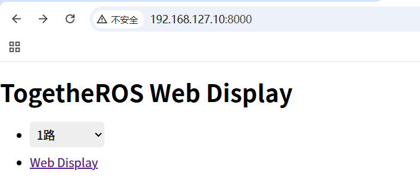

На веб-странице выберите доступный поток данных и нажмите `Web display`, чтобы увидеть результат.

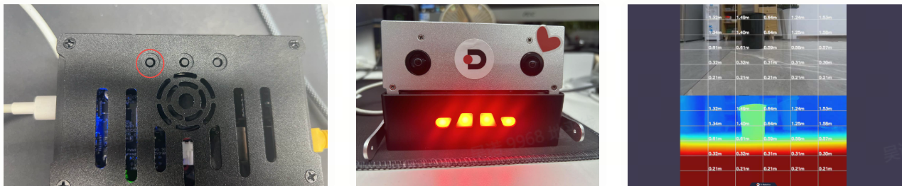

Основная алгоритмическая часть бинокулярной оценки — репозиторий, уже склонированный локально:

`./repos/hobot_stereonet`

Один из типичных входных файлов запуска для X5:

`./repos/hobot_stereonet/launch/x5/stereonet_model_web_visual_v2.4_int16.launch.py`

Сам этот файл делает немного: сначала задаёт файл модели `DStereoV2.4_int16.bin`, затем подключает более общий файл `stereonet_model_web_visual.launch.py`. Но в готовом виде Magicbox левая кнопка запускается не тем, что пользователь вручную вызывает этот launch-файл, а заводской цепочкой:

```text
magicbox-start
-> /userdata/magicbox/launch/start.sh
-> /userdata/magicbox/launch/start.py
-> app/ros_ws/src/magicbox/hobot_stereonet/script/run_stereo.sh
```

`run_stereo.sh` в свою очередь вызывает общий launch-файл `hobot_stereonet`. Иными словами, левый режим — это целая прикладная цепочка «заводская подготовка окружения + бинокулярный алгоритм + веб-визуализация», а не отдельная веб-программа.

Таким образом, левая кнопка запускает не простое приложение с интерфейсом, а целую цепочку: «вход камеры, вывод глубины, публикация результатов, показ в вебе».

### 2. Средняя кнопка: жестовое взаимодействие

После нажатия средней кнопки подсветка становится зелёной, и система переходит в режим жестов. Этот режим запускает `mipi_cam`, `hobot_codec_republish` и `websocket`, поэтому при открытии страницы `8000` можно увидеть и интерфейс взаимодействия, и результаты распознавания.

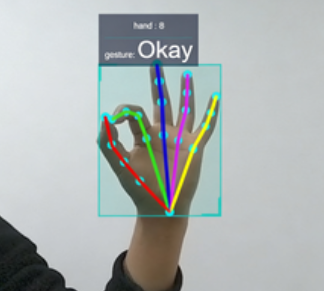

Соответствие жестов и действий:

| Жест | Значение | Действие |
| --- | --- | --- |
| ThumbUp | большой палец вверх | покачивание ушами |
| Victory | знак «виктория» (V) | упор на обе ноги |
| ThumbLeft | большой палец влево | поднятие левой руки |
| ThumbRight | большой палец вправо | поднятие правой руки |
| Okay | жест «ОК» | мигание подсветки |

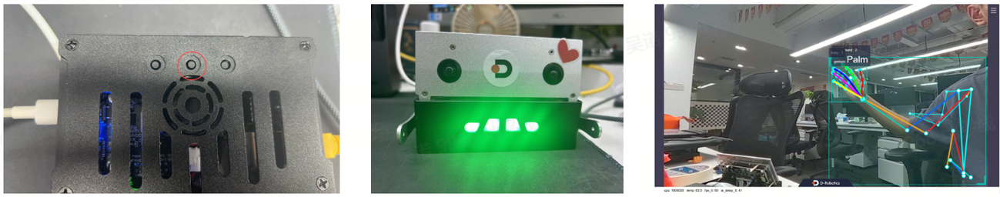

Этот раздел лучше всего подкреплён исходным кодом, потому что соответствующий репозиторий уже есть локально:

`./repos/magicbox_gesture_interaction`

Здесь стоит обратить внимание на три группы файлов.

Первая группа — точка входа программы:

`./repos/magicbox_gesture_interaction/src/main.cpp`

Файл простой: инициализирует ROS2, создаёт узел `GestureControlNode` и переходит в цикл `spin`. Это означает, что основная логика жестов сосредоточена в самом классе узла.

Вторая группа — основная логика сопоставления результатов распознавания жестов с действиями:

`./repos/magicbox_gesture_interaction/src/gesture_control_node.cpp`

В этом файле происходят три ключевых действия. Во-первых, узел подписывается на сообщения восприятия типа `ai_msgs::msg::PerceptionTargets`. Во-вторых, из сообщения извлекается числовое значение жеста и сглаживается простой очередью, чтобы отдельный кадр с шумом не вызывал ложного срабатывания. В-третьих, итоговый номер жеста сопоставляется с типом управляющего действия: например, `ThumbLeft` — подъём левой ноги, `Victory` — упор на обе ноги, `Okay` — мигание подсветки.

Третья группа — слой исполнения действий:

`./repos/magicbox_gesture_interaction/src/actuators_control.cpp`

Здесь реально управляются сервоприводы и подсветка. Например:

`standStraight()` отвечает за упор на обе ноги.
`shakeEars()` имитирует покачивание ушами быстрым поворотом левого и правого сервопривода.
`flashingLight()` гасит подсветку, делает паузу и затем включает зелёный эффект.

Кроме того, заводская цепочка запуска среднего режима тоже проверена. Он вызывает не отдельный скрипт `run_gesture.sh`, а следующую последовательность:

```text
magicbox-start
-> /userdata/magicbox/launch/start.sh
-> /userdata/magicbox/launch/start.py
-> ros2 launch gesture_interaction gesture_interaction.launch.py
```

Поэтому средняя кнопка — это не «веб-распознавание жестов», а «после заводской подготовки окружения результаты визуального восприятия продолжают управлять сервоприводами и подсветкой». Веб-страница служит только точкой показа, а ощущение взаимодействия возникает на уровне исполнения движений.

### 3. Правая кнопка: голосовое взаимодействие

После нажатия крайней правой кнопки подсветка становится синей, устройство произносит фразу «你好, 请问有什么可以帮助你的吗» («Здравствуйте, чем могу помочь?») и переходит в режим диалога.

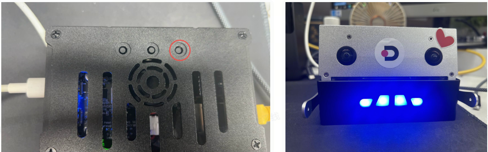

В официальном руководстве есть две важные голосовые команды:

первая — «结束对话» («завершить диалог»), после которой система переходит в режим сна или ожидания;
вторая — «你好地瓜» («Привет, Дигуа»), которой система пробуждается снова.

Эти команды остаются на китайском языке, потому что именно на них обучена система распознавания речи; переводить их в интерфейсе не нужно.

Цепочка этого режима в исходном коде затрагивает как минимум два репозитория.

Голосовой модуль, включая логику TTS, KWS и ASR, находится в:

`./repos/magicbox_audio_io`

Его файл запуска:

`./repos/magicbox_audio_io/launch/audio_io.launch.py`

Из этого файла запуска можно непосредственно прочитать несколько важных фактов.

Микрофон по умолчанию — `plughw:0,0`.
Результаты ASR публикуются в топик `/prompt_text`.
Текст для TTS поступает через подписку на топик.
Каталог модели TTS по умолчанию — `/userdata/magicbox/dep/matcha-icefall-zh-baker`.
Каталог модели KWS по умолчанию находится в `/userdata/magicbox/dep/sherpa-onnx/...`.
Путь к модели ASR по умолчанию — `/userdata/magicbox/config/sense-voice-small-fp16.gguf`.

Более низкий уровень, с потоками и топиками, описан здесь:

`./repos/magicbox_audio_io/src/hb_audio_io.cpp`

Этот файл показывает, что аудиоузел внутри одновременно ведёт поток захвата с микрофона, поток TTS и поток воспроизведения через динамик. Он публикует результаты распознавания и затем ждёт текст для озвучивания от последующих компонентов.

Логика диалога относится к репозиторию:

`./repos/magicbox_qwen_llm`

В его README прямо указано, что входной текстовый топик по умолчанию — `/prompt_text`, а выходной — `/tts_text`. Это точно соответствует архитектуре `audio_io`, и вместе они образуют цикл «распознавание речи → вывод большой модели → озвучивание».

Поэтому с точки зрения исходного кода правая кнопка, скорее всего, запускает не отдельную голосовую программу, а как минимум сочетание:

`audio_io + qwen_llm`

Это утверждение пока полностью не подтверждено прямым чтением `start.py` на плате, но по официальным проявлениям, структуре каталогов, значениям параметров по умолчанию в launch-файлах и архитектуре репозиториев оно выглядит очень согласованным.

## 4. Почему после экспериментов лучше отключить автозапуск

Быстрый режим отлично подходит для первого знакомства, но не обязательно нужен при длительной разработке. Причина простая: режимы распознавания глубины, жестов и голоса — это не статичные страницы. Они используют камеру, микрофон, динамик, ресурсы ROS2 и часть ресурсов CPU, BPU/NPU или памяти. Если вы собираетесь компилировать проект, запускать собственные скрипты или отлаживать связку логики, постоянно работающие заводские службы только добавят переменных.

Поэтому после знакомства рекомендуется отключить автозапуск:

```shell
sudo systemctl disable magicbox-start
```

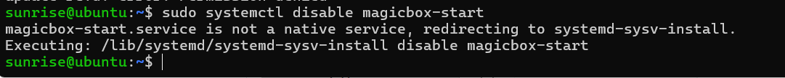

## 5. Почему стоит оставить страницу мониторинга ресурсов

Даже если вы больше не запускаете заводские демо, страница мониторинга ресурсов `7999` остаётся полезной. Она помогает быстро понять одну вещь: в системе «программа не запущена» или «программа запущена, но ресурсы уже исчерпаны».

В режиме Flash-Link откройте:

```text
http://192.168.128.10:7999
```

В проводном режиме:

```text
http://192.168.127.10:7999
```

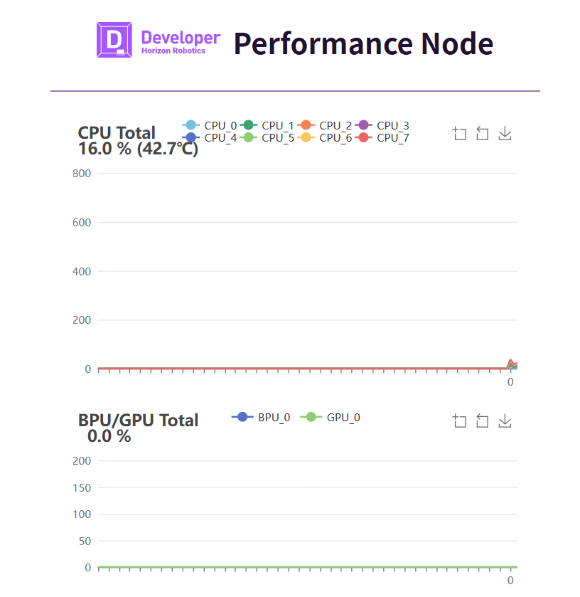

Эта страница удобна как точка диагностики, потому что нагляднее журнала.

## 6. Как понимать структуру каталогов на плате

Структура каталогов на плате помогает потом быстро находить скрипты, конфигурации и журналы. Ниже — назначение основных каталогов.

```text
/userdata/magicbox
├── app
│   ├── ros_ws
│   └── Web_RDK_Performance_Node
├── basic_function_demo
│   ├── button.py
│   ├── imu.py
│   ├── servo.py
│   └── ws2812b.py
├── config
├── dep
│   ├── llama.cpp
│   ├── matcha-icefall-zh-baker
│   └── sherpa-onnx
├── launch
│   ├── lamp
│   ├── start.py
│   └── start.sh
├── log
└── voice
```

Эта структура показывает, что Magicbox построен не так, будто весь код сложен в один пакет ROS2. Система разделена на несколько слоёв.

`basic_function_demo` — слой отдельных скриптов для быстрой проверки оборудования.
`app/ros_ws` — рабочее пространство приложений с более полными функциями ROS2.
`dep` — модели и сторонние зависимости.
`launch` — файлы, которые объединяют функции в приложения, между которыми можно переключаться.
`voice` и `log` — ресурсы медиа и журналы работы.

Когда это понятно, становится ясно, что оставлять на системном диске, а что переносить на USB-накопитель.

## 7. Базовые скрипты периферии — лучший вход в аппаратуру

Этот раздел соответствует дополнению, которое сохранено в учебнике:

`./03-quick-start-and-basic-peripherals-supplement-materials.md`

### 1. Скрипт сервоприводов `servo.py`

Команда запуска:

```python
python3 /userdata/magicbox/basic_function_demo/servo.py
```

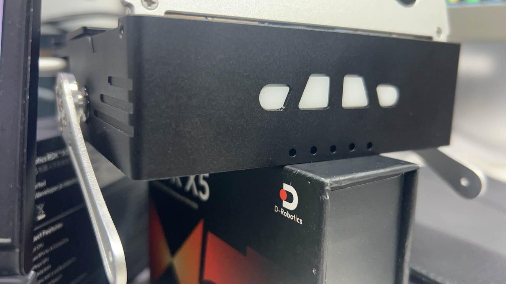

Из исходного кода дополнения видно, что скрипт использует возможности PWM библиотеки `Hobot.GPIO` и управляет двумя выводами `32` и `33` в нумерации `BOARD` на частоте `50 Гц`. Скважность двух каналов задаётся значениями `5` и `11`; затем скрипт ждёт около двух секунд, останавливает PWM и очищает GPIO.

То есть это не «постоянная работа сервопривода», а минимальный тест движения. Его ценность в том, что он проверяет две вещи: корректно ли работает PWM-канал и выполняет ли опора ожидаемое движение.

### 2. Скрипт подсветки `ws2812b.py`

Команда запуска:

```python
python3 /userdata/magicbox/basic_function_demo/ws2812b.py
```

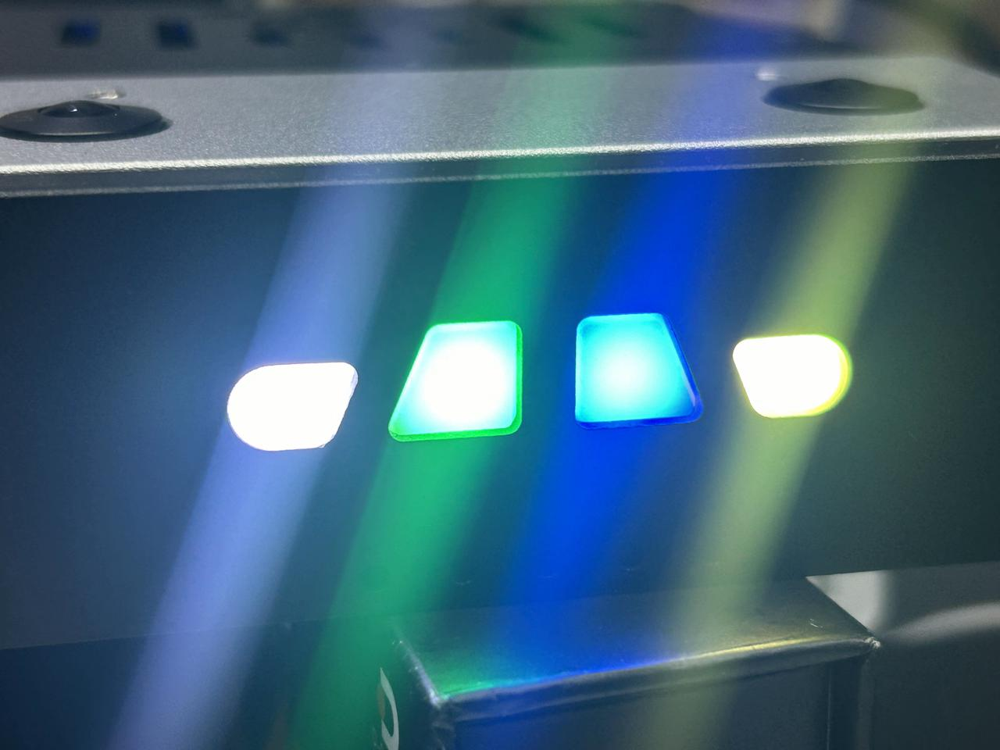

Этот скрипт интереснее, чем кажется. Он не вызывает готовую библиотеку для цветной подсветки, а сам преобразует битовое кодирование WS2812B в поток SPI и отправляет его через `spidev`. В скрипте явно записаны трёхбитовые SPI-шаблоны для «0» и «1» WS2812B, а также учтён порядок `GRB` и сборка итоговых байтов. Для читателя такой код отлично объясняет, почему лента, которая выглядит как RGB-подсветка, на физическом уровне может управляться через SPI.

### 3. Скрипт IMU `imu.py`

Команда запуска:

```python
python3 /userdata/magicbox/basic_function_demo/imu.py
```

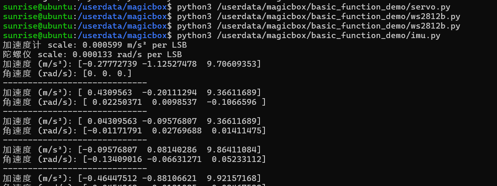

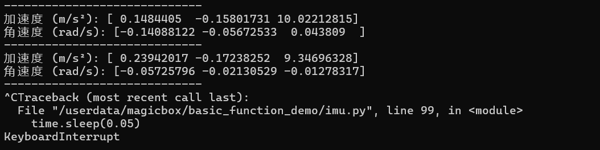

В дополнении `imu.py` обращается к ICM20948 через `smbus2` по шине 5 с адресом `0x68`. Скрипт сначала переключает банк регистров, затем читает конфигурацию акселерометра и гироскопа, вычисляет коэффициент масштаба для диапазона и постоянно выводит пересчитанные ускорения и угловые скорости.

Учебная ценность этого кода в том, что он наглядно показывает: данные IMU сами по себе не имеют единиц. Сырые значения регистров нужно пересчитывать с учётом настройки диапазона, и только тогда получаются величины в м/с² и рад/с.

### 4. Скрипт кнопок `button.py`

Команда запуска:

```python
python3 /userdata/magicbox/basic_function_demo/button.py
```

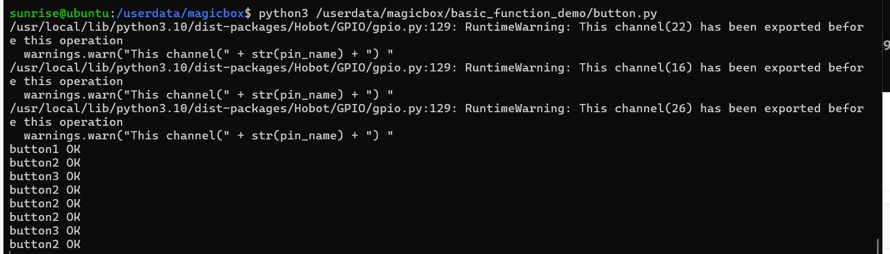

Скрипт отслеживает три входных вывода `22`, `16` и `26` в нумерации BCM. Логика очень проста: ждётся спад сигнала, после срабатывания печатается `button1 OK`, `button2 OK` или `button3 OK`. Значит, это низкоуровневый скрипт проверки входа, а не полноценный диспетчер приложений.

Это хорошо объясняет структуру быстрого режима: `button.py` доказывает, что кнопки физически работают, а логика, которая сопоставляет «нажатие» с запуском глубины, жестов или голоса, находится в верхнем скрипте `launch/start.py`.

## 8. Как строить понимание цепочки кнопок

Самое полезное в главе — не то, как нажимать кнопки, а то, какие программы стоят за ними. Порядок такой.

Во-первых, после загрузки системы служба `magicbox-start` запускает встроенное приложение-демонстрацию.
Во-вторых, `launch/start.sh` и `launch/start.py` отвечают за переключение приложений.
В-третьих, три кнопки не управляют веб-страницей напрямую, а переключают разные режимы.
В-четвёртых, эти режимы вызывают соответствующие низкоуровневые программы: бинокулярного зрения, жестов или голоса.

На основе уже имеющихся материалов можно составить такую достаточно надёжную картину:

Левый режим соответствует бинокулярной оценке глубины; её алгоритмическое ядро совпадает с `hobot_stereonet`.
Средний режим соответствует жестовому взаимодействию; его соответствие действий можно прочитать непосредственно в `magicbox_gesture_interaction`.
Правый режим соответствует голосовому взаимодействию; аудио- и речевая логика берётся из `magicbox_audio_io`, а логика диалога с большой моделью — из `magicbox_qwen_llm`.

Эту часть ещё предстоит дополнительно проверить по фактическому содержимому `start.py` на плате и соответствующему файлу службы systemd. Нынешнее описание логики выбора трёх режимов основано на подтверждённой структуре каталогов, наблюдаемом поведении кнопок и профильных ROS-пакетах, поэтому это обоснованный вывод, а не построчно проверенный результат. Когда будет доступ по SSH, стоит дополнительно проверить `start.py` и файл службы systemd.

## 9. Что класть на USB-накопитель, а что оставлять на системном диске

После выполнения `df -h` на устройстве системный корневой раздел показывает примерно `29G` всего, `18G` занято и около `9.1G` свободно. USB-накопитель при этом смонтирован в каталог:

```text
/media/<идентификатор-usb>
```

Его объём около `118G`. Это значит, что стратегия размещения теперь должна опираться не на вопрос «хватит ли места на системном диске», а на то, что обязательно должно остаться на системном диске и что лучше как можно раньше перенести на USB.

На системном диске стоит оставить:

предустановленный каталог `/userdata/magicbox/launch`;
скрипты `basic_function_demo` — они небольшие и тесно связаны с оборудованием;
файлы служб systemd и обязательную базовую конфигурацию;
минимальные рабочие точки входа, которые система уже использует.

На USB-накопитель стоит перенести в первую очередь:

образы, установочные пакеты и кеши загрузок;
собственные клонированные репозитории с исходным кодом;
каталоги `build`, `install`, `log` ваших рабочих пространств ROS;
модели голоса, каталоги сторонних зависимостей и крупные ресурсы;
снимки для учебника, экспериментальные журналы и выгруженные результаты.

Если говорить о конкретных путях, сначала стоит вынести на USB-накопитель такие элементы:

`/userdata/magicbox/dep/matcha-icefall-zh-baker`
`/userdata/magicbox/dep/sherpa-onnx`
`/userdata/magicbox/config/sense-voice-small-fp16.gguf`
ваше собственное рабочее пространство с исходным кодом и результатами сборки

Модель `qwen_llm` по умолчанию использует путь `/dev/shm/qwen2.5-1.5b-instruct-q5_k_m.gguf`. Разумнее не держать её постоянно на системном диске, а хранить постоянную копию файла модели на USB и копировать её в `/dev/shm` перед запуском. Так и запуск быстрее, и системный диск не занят постоянно.

## 10. Что вы должны освоить после главы

После этой главы недостаточно помнить, какая кнопка включает какой свет. Нужно понимать устройство в целом: `magicbox-start` — единая точка входа для встроенных демонстраций; левая, средняя и правая кнопки запускают три цепочки возможностей — бинокулярную, жестовую и голосовую; эти возможности опираются на конкретные локальные репозитории и аппаратные узлы; а базовые скрипты периферии — не «тестовые файлы-безделушки», а первоисточник для понимания того, как устройство управляется.

Кроме того, нужно сделать важный инженерный вывод: место на системном диске ограничено, поэтому новые репозитории, модели, журналы и результаты экспериментов не стоит накапливать на системном диске, а лучше переносить на внешний накопитель. Этот вывод напрямую влияет на последующие части: развёртывание голосовых моделей, подключение OpenClaw и долгосрочное сопровождение учебника.
