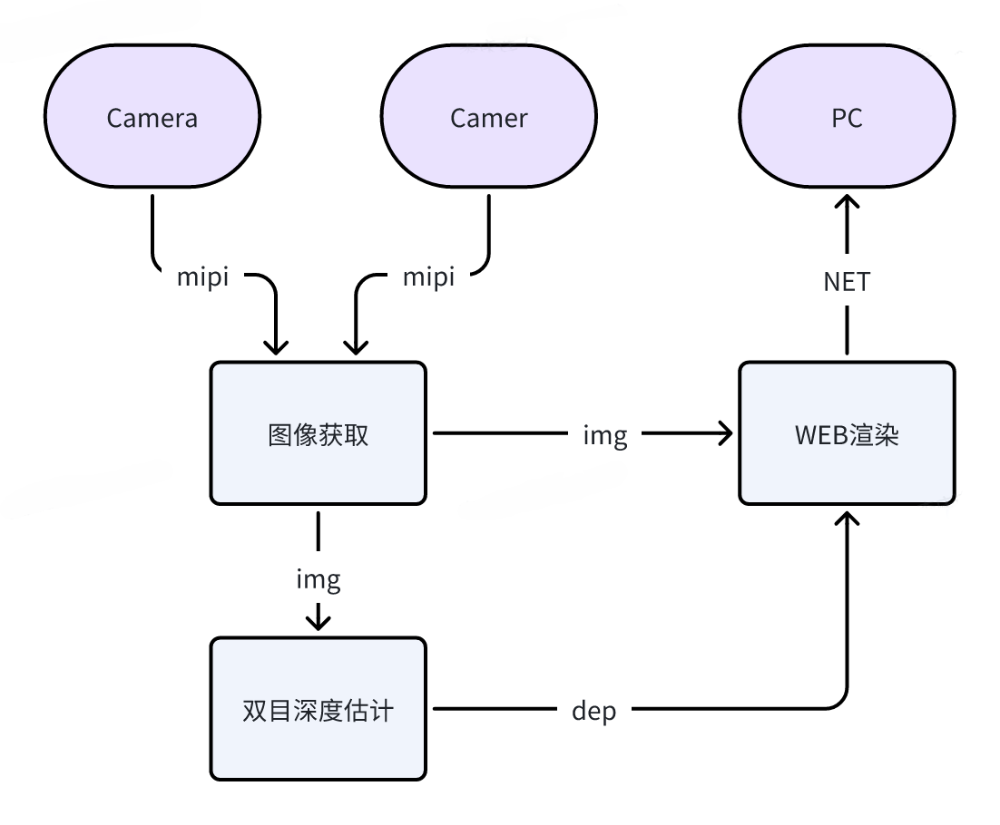
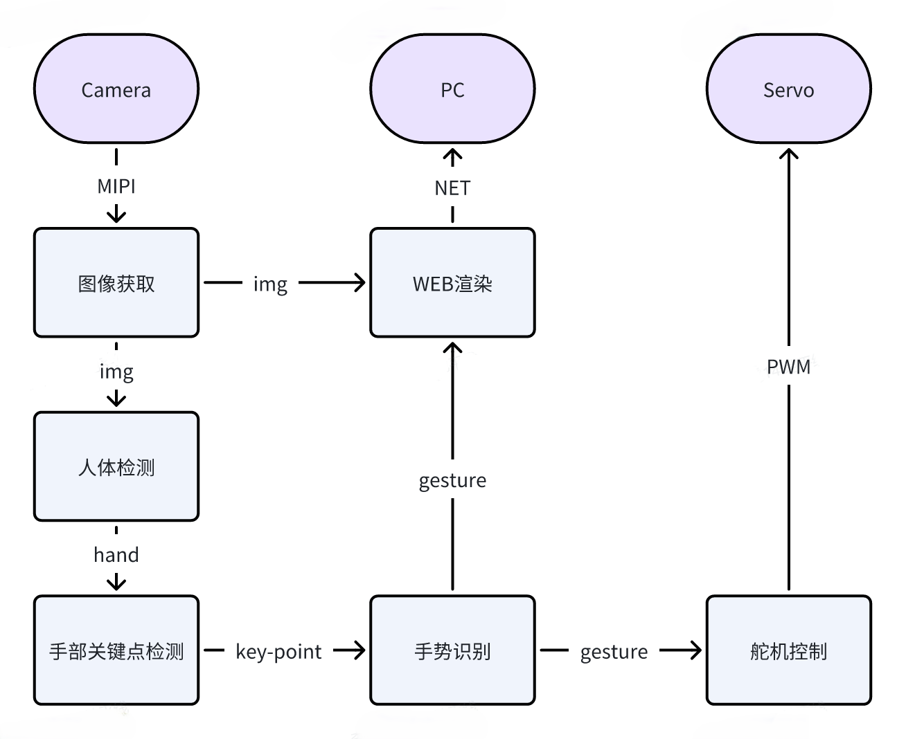

# Часть 04: демонстрации алгоритмов — бинокулярная глубина и жестовое взаимодействие

После этой главы читатель должен уметь самостоятельно запустить две визуальные демонстрации. Первая — бинокулярная глубина: она отвечает на вопрос, может ли устройство оценить расстояние до предметов в пространстве. Вторая — жестовое взаимодействие: она отвечает на вопрос, может ли устройство распознать жест человека и выполнить заложенное действие. Сначала глава заставляет работать сами демонстрации, а затем объясняет, какие точки входа в исходном коде за ними стоят, каков путь данных и как наблюдать результат.

## 1. Четыре условия, которые нужно проверить до начала

Эта глава предполагает, что предыдущие три главы уже пройдены, и выполнены четыре условия.

Первое: плата включена и к ней можно подключиться по SSH, например:

```bash
ssh sunrise@192.168.127.10
```

Второе: системное время выставлено правильно. Если системные часы показывают `2000-01-01`, журналы будут искажены, а сетевые функции могут работать некорректно. Проверьте:

```bash
date
```

Если время неверно, на стороне Windows выполните:

```powershell
powershell -ExecutionPolicy Bypass -File "<путь_к_проекту>\openclaw_magicbox\tools\sync_magicbox_time.ps1"
```

Здесь `<путь_к_проекту>` — путь к каталогу проекта на вашем компьютере.

Третье: бинокулярная камера подключена, левый и правый разъёмы не перепутаны. Для RDK X5 Magicbox бинокулярная демонстрация — это не только программная задача: состояние подключения камеры напрямую определяет результат.

Четвёртое: работать рекомендуется под обычным пользователем `sunrise` и при необходимости использовать `sudo`. Все команды этой главы по умолчанию выполняются от имени `sunrise`.

## 2. Почему эта глава не начинается с нажатия кнопок

Многие читатели впервые знакомятся с Magicbox, нажимая левую, среднюю или правую кнопку, которые запускают три предустановленных режима. Такой способ подходит для знакомства с устройством, но не годится в качестве основной линии обучения, и причина простая.

Режим кнопок удобен своей скоростью: после включения достаточно нажать левую кнопку, чтобы попытаться войти в бинокулярный режим, или среднюю — чтобы попытаться войти в режим жестов. Для первого знакомства это хороший опыт.

Однако изучение алгоритмических демонстраций не должно ограничиваться скоростью. Важно добиться воспроизводимости, возможности диагностировать сбои и понимания исходного кода. За кнопками стоит не одна алгоритмическая команда, а целая цепочка предустановленного запуска. Сначала сервис `magicbox-start` запускает `/userdata/magicbox/launch/start.sh`, затем `start.sh` задаёт переменные окружения, загружает рабочую область и поднимает базовые модули, и наконец `start.py` решает, какой скрипт функции выполнить в ответ на событие нажатия.

Иными словами, режим кнопок — это «пользовательский вход», а в этой главе используется «учебный вход». Учебный вход должен показывать читателю, где именно выполняется команда, кто задаёт переменные окружения, какой скрипт действительно запускает алгоритм и на каком уровне искать причину при сбое. Поэтому путь главы такой: сначала ручной запуск, потому что он нагляднее для обучения и диагностики, а затем объяснение, как ручной запуск связан с режимом кнопок. Когда вы разберётесь с главой, режим кнопок станет понятен: он просто упаковывает те же шаги в одно действие.

## 3. Какие материалы и репозитории относятся к этой главе

Глава опирается на две официальные страницы документации и два локальных репозитория.

- Архив официальной страницы бинокулярной глубины: `page_algorithm-development_stereo-depth.html`
- Архив официальной страницы жестового взаимодействия: `page_algorithm-development_gesture-interaction.html`
- Репозиторий бинокулярной глубины: `repos/hobot_stereonet`
- Репозиторий жестового взаимодействия: `repos/magicbox_gesture_interaction`

Если вы просто хотите сначала запустить демонстрацию, читать исходный код не обязательно. Лучше сначала убедиться, что явление воспроизводится, и только потом возвращаться к исходным файлам.

## 4. Демонстрация бинокулярной глубины: сначала запуск, затем результат

На вход бинокулярной глубины подаются изображения двух камер, а на выходе получаются карта глубины и веб-визуализация. Новичку важнее всего не теория стереосопоставления, а понимание цепочки запуска: два потока с камер, вывод алгоритма, отображение в браузере.



Источник: официальная документация D-Robotics Magicbox по бинокулярной глубине; локальная копия изображения находится в `./assets/official_images/Depth-Estimatio-Architecture-Diagram.png`.

### 4.1. Сначала исправьте права на каталог журналов

При реальном запуске этой главы было установлено, что общий launch-файл `hobot_stereonet` жёстко записывает каталог журналов ROS в `/userdata/.roslog`. Соответствующий исходный код находится здесь:

- `repos/hobot_stereonet/launch/stereonet_model_web_visual.launch.py`

В нём есть такая строка:

```python
os.environ['ROS_LOG_DIR'] = '/userdata/.roslog'
```

Если этого каталога нет или у пользователя `sunrise` нет прав на запись, процесс завершится сразу, потому что не сможет создать файл журнала. Сначала выполните:

```bash
sudo mkdir -p /userdata/.roslog
sudo chown sunrise:sunrise /userdata/.roslog
```

Пока этот шаг не выполнен, даже правильно написанная команда бинокулярного режима выдаст ошибку:

```text
Failed opening file /userdata/.roslog/... Permission denied
```

### 4.2. Что на самом деле запускает кнопка в оригинальной прошивке

В оригинальном режиме кнопки не выполняется одна простая команда `ros2 launch`. Цепочка выглядит так:

```text
magicbox-start
-> /userdata/magicbox/launch/start.sh
-> /userdata/magicbox/launch/start.py
-> app/ros_ws/src/magicbox/hobot_stereonet/script/run_stereo.sh
```

Для левой кнопки `start.py` вызывает такую команду:

```bash
bash app/ros_ws/src/magicbox/hobot_stereonet/script/run_stereo.sh \
  --mipi_rotation 0.0 \
  --stereonet_version v2.4_int8 \
  --camera_info_topic /image_combine_raw/right/camera_info
```

Это важно, потому что объясняет распространённое недоумение: почему нажатие кнопки работает, а ручной ввод одной команды `ros2 launch ...` не делает ровно то же самое. Ответ в том, что перед режимом кнопки уже выполняется подготовка окружения в `start.sh`, а когда вы вводите команду вручную, этого контекста автоматически не существует.

### 4.3. Какой способ ручного запуска рекомендуется

Для учебника лучше не давать самую короткую команду, а описать ручной запуск, эквивалентный режиму кнопки. Выполните переход в каталог:

```bash
cd /userdata/magicbox
```

Затем выполните весь набор команд целиком:

(Рекомендуется выполнять все эти команды с правами root.)

```bash
sudo su -
export RMW_IMPLEMENTATION=rmw_fastrtps_cpp
export LD_LIBRARY_PATH=/userdata/magicbox/app/ros_ws/install/qwen_llm/lib:$LD_LIBRARY_PATH
export HOME=/userdata/magicbox
export ROS_LOG_DIR=/userdata/magicbox/log
mkdir -p /userdata/magicbox/log
source /opt/tros/humble/setup.bash
source /userdata/magicbox/app/ros_ws/install/local_setup.bash
bash app/ros_ws/src/magicbox/hobot_stereonet/script/run_stereo.sh \
  --mipi_rotation 0.0 \
  --stereonet_version v2.4_int8 \
  --camera_info_topic /image_combine_raw/right/camera_info
```

Этот набор команд рекомендуется потому, что он максимально воспроизводит окружение, на которое опирается режим кнопки, а не запускает отдельный launch-файл.

### 4.4. Почему не стоит использовать `sudo ros2 launch ...` напрямую

На практике проверялся такой вариант:

```bash
sudo -E env "PATH=$PATH" ros2 launch hobot_stereonet stereonet_model_web_visual_v2.4_int16.launch.py
```

Он приводит к ошибке, что `ros2cli` не найден. Это не повреждение пакета алгоритма, а следствие того, что после `sudo` окружение ROS2 для Python-части команд не передаётся полностью:

```text
importlib.metadata.PackageNotFoundError: No package metadata was found for ros2cli
```

Поэтому в этой главе не стоит выдавать «прямой `sudo` с ros2» за стандартный способ. Надёжнее запускать под обычным пользователем с правильным окружением или выполнять точный скрипт, который использует оригинальная прошивка.

### 4.5. Где смотреть результат после запуска

Веб-вход бинокулярной глубины обычно находится по адресу:

```text
http://192.168.127.10:8000
```

В некоторых версиях страница автоматически переходит на:

```text
http://192.168.127.10:8000/TogetherROS/
```

Оба адреса относятся к одной и той же визуализации. Если цепочка камер и поток изображений в бэкенде работают, на странице появится информация о глубине.

### 4.6. Почему страница фиолетовая, но пустая

Фиолетовая страница означает, что веб-интерфейс загрузился, но бэкенд не получает поток изображений. Журнал из практики прямо указывает на причину:

```text
[init]->cap capture init failture.
[init]->mipinode init failure.
Error opening GPIO direction file for writing
Failed to set GPIO direction
Expected Chip ID ... Actual Chip ID Read ...
create_and_run_vflow failed, ret -10
```

Проблема не в браузере, а на этапе инициализации камеры. Модуль `mipi_cam` не запустился, поэтому `hobot_codec_republish` и `websocket` могут только повторять сообщение «за 5 секунд не получено ни одного кадра».

Поэтому глава прямо предупреждает: если страница пустая и фиолетовая, не стоит сначала подозревать неверный адрес. Сначала посмотрите в терминал, не завершился ли `mipi_cam`.

### 4.7. Как понять, что демонстрация действительно работает

После успешного запуска бинокулярной глубины нужно убедиться минимум в трёх вещах.

Первое: в терминале процессы `mipi_cam`, `stereonet_model_node`, `hobot_codec_republish` и `websocket` не завершаются из-за прав или ошибок инициализации.

Второе: браузер открывает `http://192.168.127.10:8000`, и страница уже не пустая, а показывает постоянно обновляющийся результат.

Третье: при перемещении камеры к предметам разного удаления эффект глубины меняется, а не остаётся неподвижным.

Если все три условия выполнены, демонстрация бинокулярной глубины действительно работает.

### 4.8. Что проверить, если результат не совпадает

Если результат отличается от описанного, проверяйте в таком порядке.

Первое: правильны ли права каталога журналов:

```bash
ls -ld /userdata/.roslog /userdata/magicbox/log
```

Второе: действительно ли система видит камеру:

```bash
i2cdetect -r -y 4
i2cdetect -r -y 6
```

Третье: не завершился ли `mipi_cam`. Если он завершился, изображения на странице точно не появятся.

Четвёртое: только после этого смотрите на адрес страницы, а не сначала подозревайте фронтенд.

## 5. Как читать исходный код бинокулярной глубины

Чтобы понять, почему всё это работает, полезно разобрать три уровня.

Первый уровень — общая точка входа оригинальной прошивки:

- `/userdata/magicbox/launch/start.sh`
- `/userdata/magicbox/launch/start.py`

Эти файлы показывают, как режим кнопок связывает низкоуровневое окружение с конкретным скриптом функции.

Второй уровень — скрипт входа для бинокулярного режима:

- `/userdata/magicbox/app/ros_ws/src/magicbox/hobot_stereonet/script/run_stereo.sh`

Этот скрипт не просто пересылает команду. Он собирает набор параметров и только после этого вызывает настоящий ROS2 launch.

Третий уровень — общий launch алгоритма:

- `repos/hobot_stereonet/launch/x5/stereonet_model_web_visual_v2.4_int16.launch.py`
- `repos/hobot_stereonet/launch/stereonet_model_web_visual.launch.py`

С этой точки зрения бинокулярная глубина — это не «нажал кнопку и появилась картинка», а полноценная цепочка данных: вход с камер, вывод модели глубины, кодирование изображения и веб-визуализация.

## 6. Демонстрация жестового взаимодействия: от результата распознавания до физического действия

Жестовое взаимодействие устроено иначе, чем бинокулярная глубина. Бинокулярная глубина в большей степени «воспринимает пространство», а жесты — «распознают действия человека и заставляют устройство выполнить движение». Ценность демонстрации в том, что читатель сразу видит связь между визуальным алгоритмом, сервоприводами и подсветкой.



Источник: официальная документация D-Robotics Magicbox по жестовому взаимодействию; локальная копия изображения находится в `./assets/official_images/Gesture-Architecture-Diagram.png`.

### 6.1. Что запускает средняя кнопка в оригинальной прошивке

Режим жестов устроен не так, как бинокулярный. Для бинокулярного режима в оригинальной цепочке есть отдельный скрипт `run_stereo.sh`, а для режима жестов скрипта `run_gesture.sh` нет. Оригинальный режим средней кнопки запускает такую цепочку:

```text
magicbox-start
-> /userdata/magicbox/launch/start.sh
-> /userdata/magicbox/launch/start.py
-> ros2 launch gesture_interaction gesture_interaction.launch.py
```

То есть режим жестов в оригинальной прошивке по сути выглядит так: сначала `start.sh` готовит окружение, затем `start.py` напрямую выполняет `ros2 launch gesture_interaction gesture_interaction.launch.py`.

Поэтому правильный учебный способ описать эту часть — не придумывать несуществующий «специальный скрипт жестов», а честно показать два уровня: подготовка окружения и прямой запуск launch.

### 6.2. Где выполнять эти команды

Если на плате уже есть готовая рабочая область, каталог сборки жестового взаимодействия находится здесь:

```bash
/userdata/magicbox/app/ros_ws
```

Для запуска лучше вернуться в каталог:

```bash
/userdata/magicbox
```

### 6.3. Ручной запуск, эквивалентный оригинальному режиму

Если вы хотите максимально приблизиться к оригинальному режиму средней кнопки, выполняйте команды с правами root в таком порядке:

```bash
sudo su -
cd /userdata/magicbox
export RMW_IMPLEMENTATION=rmw_fastrtps_cpp
export LD_LIBRARY_PATH=/userdata/magicbox/app/ros_ws/install/qwen_llm/lib:$LD_LIBRARY_PATH
export HOME=/userdata/magicbox
export ROS_LOG_DIR=/userdata/magicbox/log
mkdir -p /userdata/magicbox/log
source /opt/tros/humble/setup.bash
source /userdata/magicbox/app/ros_ws/install/local_setup.bash
ros2 launch gesture_interaction gesture_interaction.launch.py
```

Разница между этим набором и оригинальным режимом очень мала. Оригинал вызывает команду косвенно через `start.py`, а здесь ту же команду launch выполняют напрямую, чтобы её было удобно изучать и диагностировать.

Здесь есть распространённая ловушка: не разбивайте эти команды на несколько не связанных между собой shell-сессий. `source /opt/tros/humble/setup.bash` и `source /userdata/magicbox/app/ros_ws/install/local_setup.bash` влияют только на текущую оболочку. Если открыть новую root-оболочку, `PATH` и окружение ROS2, загруженные через `source`, исчезнут, и при вводе `ros2` может появиться ошибка:

```text
-bash: ros2: command not found
```

Поэтому самый надёжный способ — выполнить `sudo su -` один раз и весь набор команд провести в этой же оболочке, не переключая её.

Ещё одна проблема, которая воспроизводилась на реальной плате: цепочка `gesture_interaction` направляет `ROS_LOG_DIR` в `/userdata/magicbox/log`, но если этот каталог принадлежит `root:root` и обычный пользователь не может в него писать, то `ros2 launch` завершится ещё до запуска узлов, потому что сам фреймворк launch не может создать каталог журналов. Типичная ошибка:

```text
PermissionError: [Errno 13] Permission denied: '/userdata/magicbox/log/...'
```

Если вы собираетесь отлаживать под пользователем `sunrise`, а не постоянно под root, сначала исправьте права каталога:

```bash
sudo mkdir -p /userdata/magicbox/log
sudo chown -R sunrise:sunrise /userdata/magicbox/log
sudo chmod 755 /userdata/magicbox/log
```

После этого повторите предыдущий набор команд. На этой плате было проверено: в окружении, эквивалентном оригинальному, `gesture_interaction.launch.py` успешно поднимает `mipi_cam`, `hobot_codec_republish`, `websocket`, `hand_gesture_detection`, `tros_perception_fusion` и сам узел `gesture_interaction`.

Если вы изменили исходный код, его нужно пересобрать и затем отдельно запустить:

```bash
sudo su -
cd /userdata/magicbox/app/ros_ws
source /opt/tros/humble/setup.bash
colcon build --packages-select gesture_interaction
cd /userdata/magicbox
source /opt/tros/humble/setup.bash
source /userdata/magicbox/app/ros_ws/install/local_setup.bash
ros2 launch gesture_interaction gesture_interaction.launch.py
```

Здесь везде используется `local_setup.bash`, потому что оригинальный `start.sh` тоже подключает именно его:

```bash
source /userdata/magicbox/app/ros_ws/install/local_setup.bash
```

Поэтому этот раздел лучше держать в соответствии с оригиналом.

### 6.4. Почему вставка целым блоком иногда не работает, а построчное выполнение работает

Это не особенность самого пакета жестов, а свойство интерактивной оболочки. Больше всего проблем создаёт первая строка `sudo su -`. Она сразу переключает на новую root-оболочку входа, и терминал Windows или SSH-клиент при вставке всего блока иногда отправляет следующие строки раньше, чем новая оболочка полностью готова. В результате:

- одни команды выполняются в старой оболочке;
- другие — в новой;
- оболочка, где сработал `source`, не совпадает с той, в которой вы вводите `ros2 launch`.

Так возникают два почти «мистических» симптома: либо `ros2: command not found`, либо «вставка целым блоком ничего не делает, а построчно всё работает».

Поэтому в учебнике не рекомендуется давать блок с `sudo su -` как «безусловно годную к вставке» команду. Надёжнее сделать одно из двух.

Первый способ — сначала выполнить отдельно:

```bash
sudo su -
```

и только после того, как приглашение стало `user@ubuntu:~#`, вставить остальной блок:

```bash
cd /userdata/magicbox
export RMW_IMPLEMENTATION=rmw_fastrtps_cpp
export LD_LIBRARY_PATH=/userdata/magicbox/app/ros_ws/install/qwen_llm/lib:$LD_LIBRARY_PATH
export HOME=/userdata/magicbox
export ROS_LOG_DIR=/userdata/magicbox/log
mkdir -p /userdata/magicbox/log
source /opt/tros/humble/setup.bash
source /userdata/magicbox/app/ros_ws/install/local_setup.bash
ros2 launch gesture_interaction gesture_interaction.launch.py
```

Второй способ — выполнить всё одной командой в одной root-оболочке. Это самый удобный вариант для копирования целиком, и он меньше всего зависит от переключения оболочки:

```bash
sudo bash -lc '
cd /userdata/magicbox
export RMW_IMPLEMENTATION=rmw_fastrtps_cpp
export LD_LIBRARY_PATH=/userdata/magicbox/app/ros_ws/install/qwen_llm/lib:$LD_LIBRARY_PATH
export HOME=/userdata/magicbox
export ROS_LOG_DIR=/userdata/magicbox/log
mkdir -p /userdata/magicbox/log
source /opt/tros/humble/setup.bash
source /userdata/magicbox/app/ros_ws/install/local_setup.bash
exec ros2 launch gesture_interaction gesture_interaction.launch.py
'
```

Если одну и ту же команду приходится повторять, используйте второй способ: он совпадает с оригинальным окружением и при этом надёжнее первого.

### 6.5. Где смотреть результат после запуска

Основной результат жестового взаимодействия находится на самом устройстве, но веб-страница тоже доступна. Согласно исходному файлу `gesture_interaction.launch.py` из оригинальной прошивки, этот launch одновременно поднимает:

- `mipi_cam`;
- `hobot_codec_republish`;
- `websocket`;
- узлы распознавания жестов;
- `gesture_interaction`.

Поэтому после запуска режима жестов страницу можно открыть в браузере:

```text
http://192.168.127.10:8000
```

или:

```text
http://192.168.127.10:8000/TogetherROS/
```

Эта страница нужна для проверки того, что визуальный вход, распознавание и отображение работают. Однако успешность режима жестов в итоге определяется тем, выполняет ли само устройство действие в ответ на жест.

Из текущих README и исходного кода следует такое соответствие жестов и действий:

- `ThumbUp` («большой палец вверх»): покачивание ушей;
- `Victory` («victory», знак V): упор на обе ноги;
- `ThumbLeft` («большой палец влево»): поднимание левой ноги или движение влево;
- `ThumbRight` («большой палец вправо»): поднимание правой ноги или движение вправо;
- `Okay` («ок»): мигание подсветки.

Поэтому проверять эту демонстрацию нужно не только по веб-странице и не только по движению устройства, а по обоим источникам одновременно:

- страница в браузере подтверждает, что визуальный вход и цепочка отображения работают;
- движение устройства и реакция подсветки подтверждают, что цепочка взаимодействия замкнута.

Если страница `8000` полностью пуста, сначала проверьте в терминале, поднялись ли `mipi_cam`, `hobot_codec_republish` и `websocket`. Если же изображение на странице есть, а устройство не двигается, проверяйте цепочку исполнения от `/tros_perc_fusion` до `gesture_interaction`.

### 6.6. Что делать, если устройство не двигается

Жестовое взаимодействие состоит из двух цепочек. Первая — цепочка визуального распознавания, вторая — цепочка исполнения действия. Если любое звено второй цепочки разорвано, читатель видит примерно такое: «распознавание как будто работает, но устройство не двигается».

Сначала проверьте три пункта.

Первое: запустил ли launch вместе с собой `hand_gesture_detection`. Файл `gesture_interaction.launch.py` запускает не один узел, а включает ещё:

- `hand_gesture_detection/launch/hand_gesture_fusion.launch.py`

Второе: работают ли топики, на которые подписан узел управления жестами. В исходном коде `GestureControlNode` подписан на топик:

```text
/tros_perc_fusion
```

Третье: исправен ли уровень аппаратного исполнения. Файл `gesture_control_node.cpp` передаёт результаты распознавания в `ActuatorsControl`, а уже он управляет сервоприводами и лентой подсветки.

Четвёртое: если есть подозрение на проблемы с правами, сначала используйте root-вариант запуска из предыдущего раздела. На этой плате GPIO, подсветка и часть низкоуровневых устройств в реальных условиях надёжнее проверяются при запуске от root.

Пятое: если после команды вы сразу возвращаетесь к приглашению, почти без вывода, не спешите считать, что программа «пустая». Сначала проверьте две вещи. Первая — доступна ли команда `ros2` в текущей оболочке:

```bash
command -v ros2
```

Вторая — доступен ли для записи каталог `/userdata/magicbox/log`:

```bash
ls -ld /userdata/magicbox/log
```

На этой плате режим жестов был проверен и успешно запускался. Самая частая причина «ничего не видно» — не поломка пакета, а то, что переменные окружения не остались в текущей оболочке, либо каталог журналов для launch недоступен для записи.

## 7. Как читать исходный код жестового взаимодействия

Для этого раздела полезно сначала посмотреть три файла.

Первый файл — общая точка входа оригинальной прошивки:

- `/userdata/magicbox/launch/start.sh`
- `/userdata/magicbox/launch/start.py`

Они показывают, что режим средней кнопки не обходит какой-то закрытый механизм: после подготовки окружения он напрямую вызывает `ros2 launch gesture_interaction gesture_interaction.launch.py`.

Второй файл — входной launch-файл:

- `repos/magicbox_gesture_interaction/launch/gesture_interaction.launch.py`

Он показывает, что демонстрация при запуске включает две части: распознавание жестов и управление действиями. Это не отдельная программа для движений.

Третий файл — основной узел управления:

- `repos/magicbox_gesture_interaction/src/gesture_control_node.cpp`

Логика этого файла понятна. Сначала узел подписывается на `/tros_perc_fusion` и получает `PerceptionTargets`. Затем извлекает значение распознавания, отбрасывает недействительные жесты и использует очередь длиной 25 для голосования по большинству, чтобы уменьшить ложные срабатывания из-за дрожания распознавания. Наконец стабилизированное значение жеста сопоставляется с конкретным действием.

Четвёртый файл — заголовочный файл с определениями:

- `repos/magicbox_gesture_interaction/include/gesture_interaction/gesture_control_node.h`

В нём напрямую определено кодирование жестов и их значения, например `ThumbUp=2`, `Victory=3`, `Okay=11`, `ThumbRight=12`, `ThumbLeft=13`. Благодаря этому глава может связать три вещи: название жеста, числовой код и физическое действие, а не ограничиваться словесным описанием.

## 8. Что читатель должен усвоить из этой главы

После этой главы читатель должен не просто «запустить две демонстрации», а понять три вещи.

Первое: режим кнопок и ручной режим — это два уровня одного входа. Режим кнопок удобен для знакомства, ручной режим нужен для обучения и диагностики.

Второе: полная цепочка бинокулярной глубины — это вход с камер, инференс модели глубины, кодирование изображения и веб-визуализация. Если страница фиолетовая и пустая, не стоит сначала винить браузер; сначала проверьте, не завершился ли `mipi_cam`.

Третье: в оригинальной прошивке у жестового взаимодействия нет отдельного специального скрипта запуска. `start.sh` подготавливает окружение, а затем запускается `ros2 launch gesture_interaction gesture_interaction.launch.py`.

Четвёртое: жестовое взаимодействие тоже поднимает собственную веб-страницу, поэтому порт `8000` не относится только к бинокулярному режиму. Однако для режима жестов страница подтверждает лишь работу визуального входа и отображения, но не заменяет проверку самого действия устройства.

После этой главы читатель должен знать, какой скрипт цепочки запускает кнопка в оригинальной прошивке, где смотреть результат бинокулярной глубины, какое физическое действие должно наблюдаться в демонстрации жестов, и уметь назвать для каждой из двух функций соответствующий launch-файл и основной файл исходного кода.
