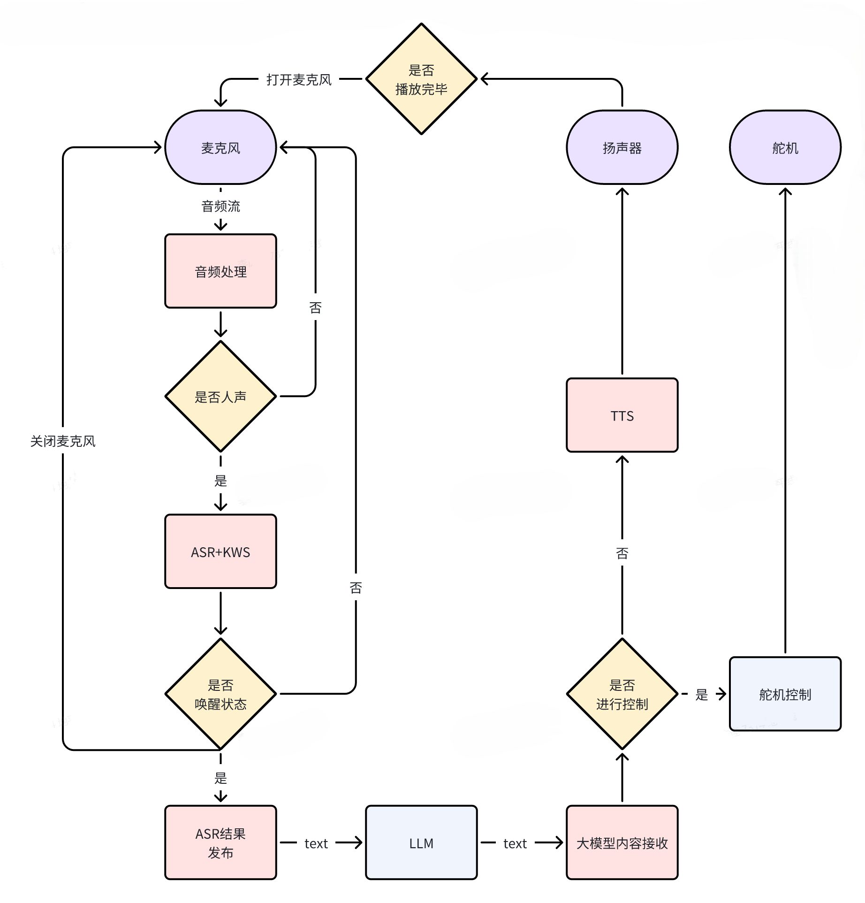

# Часть 05: демонстрация алгоритмов — голос и LLM

После этой главы читатель должен уметь самостоятельно запустить нативную цепочку голосовых вопросов и ответов на Magicbox и точно знать, из каких моделей, ROS2-топиков и launch-файлов она состоит. Конкретно глава проводит полный замкнутый цикл: устройство слышит фразу, распознаёт текст, передаёт его локальной LLM на плате, получает ответ и озвучивает его. Любая дальнейшая работа — подключение OpenClaw или собственный конечный автомат питомца — опирается на то, что эта цепочка уже работает стабильно.

## 1. Четыре условия, которые нужно проверить до начала

Первое: плата стабильно подключается по проводной сети, и системное время выставлено правильно. Если часы показывают `2000-01-01`, журналы будет трудно читать, а проверка сети и зависимостей окажется ненадёжной. Проверьте:

```bash
date
```

Второе: динамик и микрофон платы работают. Как минимум плата должна воспроизводить звуки подтверждения, а устройство записи не должно быть отключено системой. Если голосовая цепочка не работает, чаще всего причина не в LLM, а в захвате и воспроизведении звука.

Третье: оригинальное предустановленное окружение на месте. В первом проходе проверки эта глава опирается не на перенос на U-диск, а на реальные пути оригинального `magicbox-start`. Перенос моделей и зависимостей имеет смысл рассматривать только после того, как оригинальный путь заработал.

Четвёртое: на плате существуют следующие рабочая область и каталоги:

- корень рабочей области: `/userdata/magicbox/app/ros_ws`
- каталог конфигурации оригинала: `/userdata/magicbox/config`
- каталог зависимостей оригинала: `/userdata/magicbox/dep`

Все команды этой главы выполняются на плате, если не сказано иное, и по возможности от имени пользователя `sunrise`, а не `root`. Это особенно важно для `audio_io`: при ручной проверке root чаще сталкивается с помехами из-за пользовательских аудиосервисов, путей к журналам и занятых устройств. Оригинальный штатный режим тоже работает в окружении обычного пользователя, а внешний скрипт выбирает нужный режим.

## 2. Какие материалы и репозитории относятся к этой главе

- Репозиторий голосовой цепочки: `./repos/magicbox_audio_io`
- Репозиторий LLM на плате: `./repos/magicbox_qwen_llm`
- Справочные материалы по зависимости для речи: `./repos/sherpa-onnx`
- Архив официальной страницы голосового взаимодействия: `page_algorithm-development_voice-interaction.html`
- Локальная схема функциональной структуры: `./assets/official_images/Audio-Architecture-Diagram.png`



Источник: официальная документация D-Robotics Magicbox по голосовому взаимодействию; локальная копия изображения находится в `./assets/official_images/Audio-Architecture-Diagram.png`.

## 3. Что делает эта цепочка

Нативная голосовая цепочка Magicbox состоит из четырёх последовательных этапов.

Первый этап — вход звука. Микрофон непрерывно записывает звук, а `audio_io` отвечает за обнаружение ключевого слова пробуждения, распознавание речи и управление воспроизведением.
Второй этап — граница текстового входа. Когда `audio_io` распознаёт осмысленную китайскую фразу, он публикует результат в `/prompt_text`.
Третий этап — вывод LLM. `qwen_llm` подписан на `/prompt_text`, выполняет вывод по тексту и публикует ответ в `/tts_text`.
Четвёртый этап — озвучивание. `audio_io` подписан на `/tts_text`, вызывает синтез речи TTS и воспроизводит результат через динамик.

Поэтому главное в этой главе — не запомнить одну строку запуска, а понять две границы между узлами:

- `/prompt_text`
- `/tts_text`

Как только эти два топика работают, неважно, продолжаете ли вы пользоваться нативной голосовой цепочкой или подключаете OpenClaw к возможностям платы: вы всегда знаете, откуда сообщение входит и куда выходит.

## 4. Сначала сверьте реальные пути моделей с оригинальным скриптом

Оригинальная голосовая цепочка `magicbox-start`, которую проверял учебник, читает модели не с `/media/sunrise/...`, а из `/userdata/magicbox/config` и `/userdata/magicbox/dep`. Поэтому сначала стоит проверить оригинальные пути конфигурации, а не сразу разбираться с placeholder-путями на U-диске.

Вот фактические пути, которые были сверены с оригинальным скриптом:

```text
Модель ASR: /userdata/magicbox/config/sense-voice-small-fp16.gguf
Постоянное хранение модели LLM: /userdata/magicbox/config/qwen2.5-1.5b-instruct-q5_k_m.gguf
Каталог зависимостей KWS: /userdata/magicbox/dep/sherpa-onnx/sherpa-onnx-kws-zipformer-wenetspeech-3.3M-2024-01-01
Каталог зависимостей TTS: /userdata/magicbox/dep/matcha-icefall-zh-baker
Рабочая копия LLM во время выполнения: /dev/shm/qwen2.5-1.5b-instruct-q5_k_m.gguf
```

Ключевые действия в `/userdata/magicbox/launch/start.sh` выглядят так:

```bash
dd if=/userdata/magicbox/config/qwen2.5-1.5b-instruct-q5_k_m.gguf \
   of=/dev/shm/qwen2.5-1.5b-instruct-q5_k_m.gguf
ros2 launch audio_io audio_io.launch.py &
```

А `audio_io.launch.py` по умолчанию читает такие пути:

```text
tts_config_path=/userdata/magicbox/dep/matcha-icefall-zh-baker
asr_model_path=/userdata/magicbox/config/sense-voice-small-fp16.gguf
kws_config_path=/userdata/magicbox/dep/sherpa-onnx/sherpa-onnx-kws-zipformer-wenetspeech-3.3M-2024-01-01
```

Поэтому правильный порядок такой:

1. Сначала проверьте голосовую цепочку и LLM по оригинальным путям.
2. Только после того, как оригинальный путь заработал, решайте, переносить ли модели на U-диск.

## 5. Сначала проверьте, что оригинальные пути существуют

Перед запуском любого узла выполните явную проверку. Смысл этого шага в том, чтобы убедиться, что оригинальные ресурсы на плате полны, а не выяснять это после ошибки launch.

```bash
ls -ld \
  /userdata/magicbox/config/sense-voice-small-fp16.gguf \
  /userdata/magicbox/config/qwen2.5-1.5b-instruct-q5_k_m.gguf \
  /userdata/magicbox/dep/sherpa-onnx/sherpa-onnx-kws-zipformer-wenetspeech-3.3M-2024-01-01 \
  /userdata/magicbox/dep/matcha-icefall-zh-baker
```

Если хотя бы один из этих четырёх путей не существует, не продолжайте отладку голосовой цепочки.

## 6. Сначала запустите `audio_io` отдельно

Прежде чем подключать LLM, проверьте сам ввод звука, распознавание речи и воспроизведение. Причина простая: если уровень `audio_io` не работает, подключение `qwen_llm` только расширит область поиска неисправности.

Из `repos/magicbox_audio_io/launch/audio_io.launch.py` видно, что при запуске важны три пути:

- `tts_config_path`
- `asr_model_path`
- `kws_config_path`

Это значит, что работоспособность `audio_io` прежде всего зависит от того, существуют ли реальные каталоги моделей и зависимостей.

### 6.1. Каталог выполнения и подготовка окружения

Вернитесь в корень рабочей области на плате и загрузите окружение ROS2:

```bash
cd /userdata/magicbox/app/ros_ws
source /opt/tros/humble/setup.bash
source /userdata/magicbox/app/ros_ws/install/local_setup.bash
```

### 6.2. Сначала проверьте, не занято ли устройство микрофона

Устройство захвата по умолчанию для `audio_io` в проверенной конфигурации:

```text
plughw:0,0
```

В списке звуковых карт должны быть видны такие устройства:

```text
card 0: duplexaudioi2s1, device 0
card 1: duplexaudio, device 0
```

Если по-прежнему появляется ошибка:

```text
alsa_device_init snd_pcm_open plughw:0,0 failed
ret=-16
```

это означает не «устройство не найдено», а «устройство занято другим процессом». Чаще всего его занимает:

```text
pulseaudio
```

Поэтому перед ручной проверкой `audio_io` остановите пользовательский аудиосервис, который держит микрофон. Выполните под пользователем `sunrise`:

```bash
pulseaudio -k || true
systemctl --user stop pulseaudio.service pulseaudio.socket 2>/dev/null || true
```

Если вы сейчас находитесь в root-оболочке, сначала вернитесь к обычному пользовательскому терминалу и только потом выполните эти две команды. Команду ниже стоит использовать только для временной диагностики, запуская её от root:

```bash
pkill -f pulseaudio || true
```

После этого можно сделать минимальную проверку записи:

```bash
arecord -D plughw:0,0 -f S16_LE -r 16000 -c 1 -d 1 /tmp/test.wav
```

Пока эта команда не выдаёт `Device or resource busy`, можно запускать `audio_io`.

### 6.3. Команда запуска

Если вы хотите сначала проверить только звуковое устройство, можно задать `wait_for_llm` равным `False`. В этом случае `audio_io` запускает звуковую часть даже тогда, когда LLM ещё не поднята. Параметры ниже совпадают с оригинальными значениями по умолчанию; они просто записаны явно, чтобы их было удобно изучать и диагностировать.

```bash
exit  # если сейчас root-оболочка, сначала вернитесь к пользователю sunrise
cd /userdata/magicbox/app/ros_ws
source /opt/tros/humble/setup.bash
source /userdata/magicbox/app/ros_ws/install/local_setup.bash
ros2 launch audio_io audio_io.launch.py \
  asr_model_path:=/userdata/magicbox/config/sense-voice-small-fp16.gguf \
  kws_config_path:=/userdata/magicbox/dep/sherpa-onnx/sherpa-onnx-kws-zipformer-wenetspeech-3.3M-2024-01-01 \
  tts_config_path:=/userdata/magicbox/dep/matcha-icefall-zh-baker \
  wait_for_llm:=False
```

### 6.4. Где смотреть результат после запуска

На этом этапе веб-страница не нужна. Смотрите два типа признаков.

Первый — журнал терминала. Вы должны видеть, что `audio_io` запустился нормально, а не завершился сразу на этапе разбора путей к моделям.
Второй — поведение самого устройства. Плата должна переходить в режим ожидания и реагировать на голосовой ввод.

Если в системе уже есть логика для `/prompt_text` и `/tts_text`, можно открыть отдельный терминал и посмотреть топики.

В новом терминале выполните:

```bash
sudo su -
cd /userdata/magicbox/app/ros_ws
source /opt/tros/humble/setup.bash
source /userdata/magicbox/app/ros_ws/install/local_setup.bash
ros2 topic list | grep text
```

Если топики есть, выполните:

```bash
ros2 topic echo /prompt_text
```

Если после вашей речи в `/prompt_text` появляется осмысленный текст, значит, этап ASR работает.

## 7. Подключите `qwen_llm` и получите замкнутый цикл вопрос-ответ

Когда `audio_io` стабильно публикует `/prompt_text`, подключайте `qwen_llm`. В этой цепочке `qwen_llm` выполняет простую роль: читает распознанный текст, генерирует ответ и передаёт его в `/tts_text`.

### 7.1. Сначала скопируйте модель в `/dev/shm`

Команды можно выполнять в каталоге рабочей области на плате:

```bash
exit  # если сейчас root-оболочка, сначала вернитесь к пользователю sunrise
cp /userdata/magicbox/config/qwen2.5-1.5b-instruct-q5_k_m.gguf /dev/shm/
ls -lh /dev/shm/qwen2.5-1.5b-instruct-q5_k_m.gguf
```

Продолжайте, только если копирование прошло успешно.

Здесь часто возникает вопрос: почему модель `qwen` уже есть в `/userdata/magicbox/config`, но её нужно копировать ещё и в `/dev/shm`?

Дело не в том, что модель отсутствует, а в том, что это разные места хранения. Оригинальная схема устроена так:

- постоянная модель хранится в `/userdata/magicbox/config`;
- при запуске модель копируется в `/dev/shm`;
- во время работы `qwen_llm` читает `/dev/shm/qwen2.5-1.5b-instruct-q5_k_m.gguf`.

Смысл в том, что разделяемая память ускоряет загрузку, а последующий прогрев (warmup) проходит быстрее. То есть файл в `/userdata/magicbox/config` — это долговременный исходник, а файл в `/dev/shm` — рабочая копия. Лишним дублированием это не является.

### 7.2. Запуск `qwen_llm`

Если `audio_io` уже работает в предыдущем терминале, откройте второй терминал и выполните:

```bash
cd /userdata/magicbox/app/ros_ws
source /opt/tros/humble/setup.bash
source /userdata/magicbox/app/ros_ws/install/local_setup.bash
ros2 launch qwen_llm qwen_llm.launch.py wait_for_audio:=True
```

### 7.3. Где смотреть результат после запуска

Результат на этом этапе можно проверить в трёх местах.

Первое — журнал терминала `qwen_llm`: убедитесь, что узел не завершился сразу на этапе загрузки модели.
Второе — топик `/tts_text`: появляется ли текст ответа. Для этого откройте третий терминал:

```bash
cd /userdata/magicbox/app/ros_ws
source /opt/tros/humble/setup.bash
source /userdata/magicbox/app/ros_ws/install/local_setup.bash
ros2 topic echo /tts_text
```

Третье — звучит ли ответ на самом устройстве.

Если вы произносите простой вопрос, например «你好, 你是谁» («Здравствуйте, кто вы?»), ожидаемая последовательность такая:

1. `audio_io` распознаёт текст и публикует его в `/prompt_text`;
2. `qwen_llm` получает подсказку и генерирует ответ;
3. ответ публикуется в `/tts_text`;
4. `audio_io` озвучивает ответ.

Если все четыре шага выполняются, цикл «услышал — понял — ответил» работает.

## 8. Где в оригинальной прошивке звуки подтверждения, синяя подсветка и логика кнопок

Если вы пользуетесь голосом через оригинальный режим правой кнопки, а не запускаете `audio_io` вручную, наблюдаемое поведение не ограничивается запуском голосового узла. Логика кнопок оригинала находится здесь:

- `/userdata/magicbox/launch/start.py`

В этом файле явно прописано:

- режим правой кнопки сначала переводит подсветку в синий цвет;
- затем вызывает `ros2 launch qwen_llm qwen_llm.launch.py`.

Кроме того, при инициализации `start.py` воспроизводит звук:

- `/userdata/magicbox/voice/wakeup.mp3`

и проводит один цикл мигания подсветкой. То есть звук включения и часть световых эффектов относятся не к самому узлу `audio_io`, а к внешнему слою — скрипту, который управляет кнопками и подсветкой.

Именно поэтому, запустив вручную только:

```bash
ros2 launch audio_io audio_io.launch.py ...
```

вы не получите автоматически полный продуктовый сценарий «звук включения + синяя подсветка + переключение режима». Эти явления в основном не принадлежат `audio_io`.

Что касается того, какие слова пробуждают запись, то в проверенных `start.py` и launch-файлах это явно не записано. Подтверждено следующее:

- сам правый режим воспроизводит звук оригинала;
- результат распознавания речи попадает в `/prompt_text`;
- текст для озвучивания возвращается из `/tts_text` в `audio_io`.

Конкретные слова пробуждения относятся к настройкам модели KWS. Чтобы записать их в учебнике как установленный факт, нужно дополнительно проверить конфигурацию `sherpa-onnx` или официальную документацию. Пока это не проверено, в тексте их нельзя выдавать за подтверждённые.

## 9. Какие ошибки можно пока не учитывать, а какие нельзя игнорировать

Ошибки голосовой и LLM-цепочки нельзя рассматривать одинаково: часть записей в журнале — лишь предупреждения, а часть означает, что цепочка вообще не запустилась.

Следующие случаи обычно нельзя игнорировать.

Первый: путь к модели не существует, например:

```text
No such file or directory
```

Если хотя бы один путь к моделям ASR, KWS, TTS или GGUF отсутствует, не нужно разбирать дальнейшую логику.

Второй: узел завершается сразу после старта. Если процесс `audio_io` или `qwen_llm` завершился сразу после запуска, это не «плохой эффект», а «цепочка не поднялась».

Третий: топики `/prompt_text` и `/tts_text` вообще отсутствуют. Если ни один из них не создан, проблема находится на уровне запуска узлов.

Следующие случаи обычно можно запомнить, но не считать главной проблемой.

Первый: медленная загрузка модели. Первое копирование GGUF в `/dev/shm` или первый запуск могут быть заметно медленнее, чем демонстрация с кнопками.

Второй: предупреждения о производительности или версиях, например несовпадение версии сборки модели и версии SDK среды выполнения. Если функция стабильно работает, такие предупреждения можно зафиксировать и решить позже вместе с общим обновлением.

Третий: случайные сбои пробуждения. Если `/prompt_text` стабильно выдаёт текст, но пробуждение срабатывает неровно, сначала доведите цепочку до рабочего состояния, а уже потом настраивайте пробуждение. Не стоит с самого начала считать, что система в целом не работает.

## 10. Как части кода связаны между собой

Чтобы понять эту цепочку по-настоящему, полезно начать с двух входных файлов.

Первый:

- `repos/magicbox_audio_io/src/hb_audio_io.cpp`

Этот файл разбивает весь звуковой тракт на несколько потоков. Поток захвата микрофона непрерывно читает аудиоданные. Движок речи выполняет ASR и KWS. Поток TTS превращает текст в буфер речи. Поток динамика отвечает за фактический вывод звука. Важнее всего то, что файл реализует управление ходами диалога: после распознавания осмысленного содержимого захват с микрофона приостанавливается, и только после окончания воспроизведения и получения маркера завершения микрофон снова открывается. Поэтому диалог на плате выглядит как завершённый ход, а не как ситуация, когда микрофон и динамик мешают друг другу.

Второй:

- `repos/magicbox_qwen_llm/launch/qwen_llm.launch.py`

В этом launch-файле хорошо описана граница с LLM-стороной. По умолчанию он принимает `/prompt_text` как вход, а `/tts_text` — как выход, и поддерживает расширения, например переключатель `enable_function_call`. То есть пакет изначально задуман не только для чистых текстовых ответов, но и для того, чтобы после ответа можно было вызывать возможности устройства.

С точки зрения потока данных всю цепочку можно описать так:

```text
Вход с микрофона
-> audio_io
-> /prompt_text
-> qwen_llm
-> /tts_text
-> audio_io
-> воспроизведение через динамик
```

Если удерживать эту схему в голове, чтение реализации становится заметно проще.

## 11. Что проверять, если результат не совпадает с описанием

Если результат отличается от описанного в главе, проверяйте в таком порядке.

Первое: сначала оригинальные пути моделей и зависимостей, а не подсказки:

```bash
ls -ld \
  /userdata/magicbox/config/sense-voice-small-fp16.gguf \
  /userdata/magicbox/config/qwen2.5-1.5b-instruct-q5_k_m.gguf \
  /userdata/magicbox/dep/sherpa-onnx/sherpa-onnx-kws-zipformer-wenetspeech-3.3M-2024-01-01 \
  /userdata/magicbox/dep/matcha-icefall-zh-baker
```

Второе: действительно ли модель скопирована в `/dev/shm`:

```bash
ls -lh /dev/shm/qwen2.5-1.5b-instruct-q5_k_m.gguf
```

Третье: работают ли оба узла:

```bash
ps -ef | grep -E "audio_io|qwen_llm" | grep -v grep
```

Четвёртое: не занят ли микрофон. Выполните:

```bash
lsof /dev/snd/* 2>/dev/null || fuser -v /dev/snd/* 2>/dev/null
```

Если в выводе по-прежнему виден `pulseaudio`, держащий управляющее устройство, не продолжайте проверку LLM.

Пятое: существуют ли нужные топики:

```bash
cd /userdata/magicbox/app/ros_ws
source /opt/tros/humble/setup.bash
source /userdata/magicbox/app/ros_ws/install/local_setup.bash
ros2 topic list | grep -E "prompt_text|tts_text"
```

Шестое: выясните, на каком именно этапе сбой. Не стоит сразу объявлять, что «голос не работает»: возможно, не выдаёт текст ASR, не отвечает LLM или не озвучивает TTS.

## 12. Как переносить модели на U-диск, если это понадобится

Переносить модели и зависимости на U-диск стоит только после того, как оригинальный путь стабильно работает. Цель переноса — не «изменить путь на первом шаге», а освободить место на системном диске для OpenClaw, других репозиториев и журналов экспериментов.

При переносе действует правило: сначала сохраните понятную структуру каталогов, а затем заменяйте значения по умолчанию явными параметрами. Использовать следующие пути можно, только если они реально существуют:

```bash
export USB_ROOT=/media/sunrise/MAGICBOX_DATA
ls -ld \
  "$USB_ROOT/models/sense-voice-small-fp16.gguf" \
  "$USB_ROOT/models/qwen2.5-1.5b-instruct-q5_k_m.gguf" \
  "$USB_ROOT/dep/sherpa-onnx-kws-zipformer-wenetspeech-3.3M-2024-01-01" \
  "$USB_ROOT/dep/matcha-icefall-zh-baker"
```

После проверки запускайте `audio_io` с новыми путями:

```bash
ros2 launch audio_io audio_io.launch.py \
  asr_model_path:=$USB_ROOT/models/sense-voice-small-fp16.gguf \
  kws_config_path:=$USB_ROOT/dep/sherpa-onnx-kws-zipformer-wenetspeech-3.3M-2024-01-01 \
  tts_config_path:=$USB_ROOT/dep/matcha-icefall-zh-baker \
  wait_for_llm:=False
```

Модель `qwen` тоже сначала копируется с U-диска в `/dev/shm`:

```bash
cp "$USB_ROOT/models/qwen2.5-1.5b-instruct-q5_k_m.gguf" /dev/shm/
```

Если точка монтирования вашего U-диска не `/media/sunrise/MAGICBOX_DATA`, обязательно сначала измените `USB_ROOT` на реальную точку монтирования и только потом выполняйте эти команды.

## 13. Почему эта глава должна идти раньше OpenClaw

С точки зрения демонстрации многим читателям хочется сразу перейти к OpenClaw: он выглядит современнее и создаёт впечатление готового продукта с подключённым ИИ-ассистентом. Но с точки зрения инженерного порядка сначала стоит довести до рабочего состояния собственные нативные топики, действия, подсветку и цепочку воспроизведения Magicbox.

Причина проста. Только когда границы самой платы чётко определены, внешний шлюз знает, куда направлять сообщения. Для этого проекта важнее всего две границы:

- `/prompt_text`
- `/tts_text`

Если эта глава выполнена, при подключении OpenClaw читатель не «вставляет внешнюю систему силой», а добавляет новый входной слой поверх уже понятной локальной возможности.

## 14. Что читатель должен усвоить по итогам главы

К концу этой главы читатель должен не просто «один раз запустить голосовую команду», а владеть пятью вещами.

Первое: понимать, за какой участок цепочки отвечают `audio_io` и `qwen_llm`.
Второе: знать, что фактические пути, которые проверяет учебник, находятся в `/userdata/magicbox/config` и `/userdata/magicbox/dep`, а не в каком-то заранее заданном пути на U-диске.
Третье: знать, где смотреть результат: `/prompt_text`, `/tts_text`, журналы терминала и воспроизведение на самом устройстве.
Четвёртое: при сбое сначала проверять оригинальные пути моделей, состояние узлов и ключевые топики, а не сводить всё к формуле «LLM не работает».
Пятое: понимать, что перенос на U-диск — это расширение, которое выполняется после того, как нативная цепочка уже работает, а не предварительное условие первого запуска.

Если эти пять пунктов выполнены, глава действительно усвоена.
