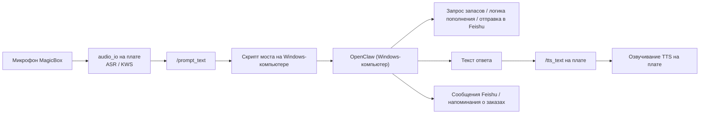

# Голосовой мост OpenClaw на Windows-компьютере и помощник по домашним запасам

Этот документ описывает фактическую архитектуру настольного питомца, порядок запуска, файлы данных, цепочку Feishu и то, как представлять эту схему в отчётах.

## 1. Цели проекта

Задача системы — не загрузить все возможности в плату, а разделить роли чётко:

1. Плата отвечает только за голосовой ввод и голосовой вывод.
2. Windows-компьютер отвечает за работу OpenClaw, ответы о домашних запасах и отправку заказов в Feishu.
3. Feishu отвечает за удалённые уведомления, напоминания о пополнении и просмотр заказов.

Причины такого разделения простые:

1. Плата сама по себе уже умеет распознавание и синтез речи (ASR/TTS), поэтому хорошо подходит для «слушать» и «говорить».
2. OpenClaw уже развёрнут на Windows-компьютере, поэтому именно там удобно делать «понимание» и «решения».
3. Таблица домашних запасов, заказы на пополнение и сообщения Feishu логично хранить на стороне компьютера.

## 2. Текущая архитектура

Система построена как «голосовой фронтенд на плате + центр OpenClaw на компьютере».



Кратко:

плата превращает звук в текст и текст ответа снова в звук;
Windows-компьютер делает «настоящее мышление».

## 3. Что уже реализовано

### 3.1 Список оставшихся домашних запасов

Текущий список запасов хранится в локальных CSV-файлах, чтобы его было удобно вести и просматривать в долгосрочной перспективе.

Расположение файлов (пути указаны относительно каталога проекта на компьютере):

- `household_data/inventory.csv`
- `household_data/locations.csv`
- `household_data/restock_orders.csv`
- `household_data/README.md`

В `inventory.csv` хранится основная информация о запасах. Поля:

1. `物资名字` — название товара
2. `阈值` — порог
3. `所在位置` — место хранения
4. `剩余个数` — остаток
5. `购买链接` — ссылка на покупку
6. `建议补货量` — рекомендуемое количество для пополнения
7. `最近更新时间` — время последнего обновления

Примечание: названия полей в файле записаны по-китайски, потому что именно так их читает скрипт; при переводе интерфейса их нужно менять одновременно в файле и в коде.

### 3.2 Вопросы о домашних запасах

Сейчас поддерживаются три типа вопросов:

1. Поиск товаров, ближе всего подошедших к порогу.
2. Поиск места хранения конкретного предмета.
3. Создание заказа на пополнение для указанного товара.

Локальный скрипт запросов находится в `openclaw_magicbox/tools/household_inventory_cli.py`.

Типичные команды:

```bash
python <путь_к_проекту>\openclaw_magicbox\tools\household_inventory_cli.py top --limit 3 --format text
python <путь_к_проекту>\openclaw_magicbox\tools\household_inventory_cli.py locate --name 剪刀 --format text
python <путь_к_проекту>\openclaw_magicbox\tools\household_inventory_cli.py create-order --name 苹果 --send-feishu --format text
```

Здесь `<путь_к_проекту>` — путь к каталогу проекта на вашем компьютере. Слова `剪刀` («ножницы») и `苹果` («яблоко») — названия товаров, которые используются в данных; их менять не нужно, пока не поменяли данные.

### 3.3 Напоминания о пополнении и отправка заказов в Feishu

Сейчас можно прямо с Windows-компьютера отправлять в Feishu напоминания о пополнении, а содержимое заказа записывается в `restock_orders.csv`.

Это означает, что система уже умеет:

1. находить низкий остаток;
2. создавать запись о пополнении;
3. отправлять напоминание в Feishu.

В отчёте этот блок можно описать так: «Настольный питомец принимает запрос пользователя, OpenClaw понимает запрос и формирует действие по пополнению, а Feishu доставляет результат пользователю».

## 4. Голосовой мост на плате

### 4.1 На плате остаются только ASR и TTS

Проект больше не использует встроенную языковую модель `qwen_llm` как основное «мышление».

На плате сейчас остаётся:

1. `audio_io`;
2. распознавание ключевых слов пробуждения;
3. распознавание речи (речь → текст);
4. синтез речи (текст → речь).

Промежуточные рассуждения на плате больше не выполняются: их выполняет OpenClaw на Windows-компьютере.

### 4.2 На компьютере работает «мышление»

На стороне Windows-компьютера выполняется:

1. приём распознанного на плате текста;
2. вызов локального OpenClaw;
3. запросы по запасам, поиск места хранения, создание заказов на пополнение;
4. отправка текста ответа обратно на TTS платы.

Скрипты моста:

- `openclaw_magicbox/tools/magicbox_voice_bridge.py`
- `openclaw_magicbox/tools/start_magicbox_voice_bridge.ps1`

### 4.3 Текущие слова пробуждения

Файл ключевых слов на плате уже адаптирован под имя «TuntunClaw» (囤囤钳). Основные слова пробуждения:

1. `囤囤钳` («TuntunClaw»)
2. `囤囤` («Туньтунь»)
3. `豚豚` («Тунтун», по созвучию)
4. `吞吞` («Тунтун», по созвучию)
5. `屯屯` («Туньтунь», по созвучию)

Кроме того, сохранены прежние слова:

1. `你好地瓜` («Здравствуй, Дигуа»)
2. `地瓜你好` («Дигуа, здравствуй»)
3. `地瓜地瓜` («Дигуа, Дигуа»)
4. `开始对话` («Начать диалог»)
5. `结束对话` («Завершить диалог»)
6. `束对话` (сокращённый вариант «завершить диалог»)

Все эти слова — китайские, потому что на них обучен распознаватель речи; их нельзя заменять переводом.

### 4.4 Команды выхода

Мост на компьютере считает сигналами выхода или перехода в режим сна такие начала фраз:

1. `再见` («До свидания»)
2. `拜拜` («Пока»)
3. `休眠` («Сон»)
4. `关闭` («Закрыть»)

Если распознано что-то вроде «再见囤囤» («До свидания, TuntunClaw»), мост гасит подсветку и прекращает диалог.

## 5. Логика подсветки

Логика подсветки сейчас имеет три состояния:

1. Не пробуждён: все четыре подсветки выключены.
2. Слушает: «дыхание» (плавное изменение яркости).
3. Отвечает: «бегущая дорожка» (последовательное включение огней).

Скрипт подсветки на плате расширен:

- `openclaw_magicbox/bin/magicbox-hw`

Добавлены эффекты:

1. `led breathe` — «дыхание»
2. `led marquee` — «бегущая дорожка»

Теперь на плате можно выполнять:

```bash
sudo python3 /userdata/magicclaw/runtime/bin/magicbox-hw led breathe cyan 2 0.04
sudo python3 /userdata/magicclaw/runtime/bin/magicbox-hw led marquee blue 12 0.08
```

## 6. Порядок запуска

### 6.1 Запуск шлюза OpenClaw

На Windows-компьютере:

```powershell
openclaw gateway restart
```

### 6.2 Подготовка голосового фронтенда на плате

На Windows-компьютере выполните:

```powershell
python <путь_к_проекту>\openclaw_magicbox\tools\magicbox_voice_bridge.py prepare
```

Этот шаг выполняет четыре действия:

1. синхронизирует слова пробуждения;
2. отключает встроенный `qwen_llm` на плате;
3. запускает `audio_io` в режиме «только ASR/TTS»;
4. запускает вспомогательный скрипт подписки на `prompt` на плате.

### 6.3 Запуск моста на компьютере

На Windows-компьютере выполните:

```powershell
powershell -ExecutionPolicy Bypass -File "<путь_к_проекту>\openclaw_magicbox\tools\start_magicbox_voice_bridge.ps1"
```

или напрямую:

```powershell
python <путь_к_проекту>\openclaw_magicbox\tools\magicbox_voice_bridge.py run
```

В обеих командах `<путь_к_проекту>` нужно заменить на фактический путь к каталогу проекта на вашем компьютере.

## 7. Рекомендуемый порядок демонстрации

Рекомендуемый порядок показа:

1. Сначала объяснить разделение ролей.
2. Показать локальную таблицу запасов.
3. Показать отправку сообщения в Feishu.
4. Показать пробуждение голосом и вопрос-ответ.

Примерные фразы для демонстрации (в скобках — перевод):

### Демонстрация 1: запрос предупреждения о запасах

Пользователь говорит:

```text
你好你好，我想知道现在剩余物资最少的 3 样是哪 3 样？
```

(«Здравствуй, здравствуй, какие 3 вещи сейчас осталось меньше всего?»)

Пример ответа системы:

```text
当前最接近阈值的 3 样物资分别是：
第一，洗衣液，当前剩余 1，阈值 1，已经贴近补货线。
第二，牙膏，当前剩余 2，阈值 3，已经低于阈值。
第三，卷纸，当前剩余 5，阈值 6，也已经接近阈值。
```

（«Ближе всего к порогу три товара: первый — стиральный гель, остаток 1, порог 1, уже у линии пополнения; второй — зубная паста, остаток 2, порог 3, уже ниже порога; третий — туалетная бумага, остаток 5, порог 6, тоже близко к порогу».）

(«Ближе всего к порогу сейчас три товара: первое — жидкое моющее средство, остаток 1, порог 1, уже у линии пополнения. Второе — зубная паста, остаток 2, порог 3, уже ниже порога. Третье — туалетная бумага, остаток 5, порог 6, тоже близко к порогу.»)

### Демонстрация 2: создание заказа на пополнение

Пользователь говорит:

```text
我想把苹果补一下货，请你直接生成一下订单，推送到我的飞书上。
```

(«Хочу пополнить яблоки, сформируй заказ и отправь его мне в Feishu.»)

Пример ответа:

```text
好的，已为您生成苹果的补货单，请到飞书查阅。
```

(«Хорошо, заказ на пополнение яблок создан, посмотрите в Feishu.»)

После этого в Feishu появляется напоминание о пополнении.

### Демонстрация 3: поиск места хранения

Пользователь говорит:

```text
我想问一下我的剪刀在哪？
```

(«Подскажите, где мои ножницы?»)

Пример ответа:

```text
剪刀在您身后的柜子上。
```

(«Ножницы — на шкафу позади вас.»)

## 8. Ключевые файлы

### 8.1 Домашние запасы и заказы

- `household_data/inventory.csv`
- `household_data/locations.csv`
- `household_data/restock_orders.csv`

### 8.2 Логика на стороне компьютера

- `openclaw_magicbox/tools/household_inventory_cli.py`
- `openclaw_magicbox/tools/magicbox_voice_bridge.py`
- `openclaw_magicbox/tools/start_magicbox_voice_bridge.ps1`

### 8.3 Управление платой

- `openclaw_magicbox/bin/magicboxctl`
- `openclaw_magicbox/bin/magicbox-hw`

## 9. Текущее состояние

Основная идея уже сформулирована и реализована в коде:

1. Плата отвечает только за ASR/TTS.
2. Windows-компьютер отвечает за работу OpenClaw.
3. Запасы домашнего хозяйства хранятся в локальных CSV-файлах.
4. Feishu используется для сообщений о пополнении и просмотра заказов.
5. Слова пробуждения и подсветка адаптированы под сценарий «TuntunClaw».

Если нужно одно предложение для отчёта, можно использовать такое:

> Система настольного питомца переведена с модели «всё на плате с большой языковой моделью» на схему «голосовой фронтенд на плате + центр OpenClaw на Windows-компьютере»: это сохраняет то, что плата умеет лучше всего — голосовой ввод и вывод, — а понимание задач, анализ домашних запасов и отправку заказов в Feishu передаёт более гибкому агенту на стороне компьютера.
