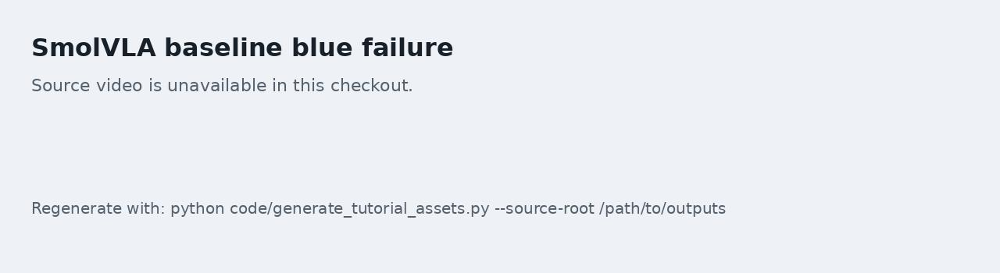
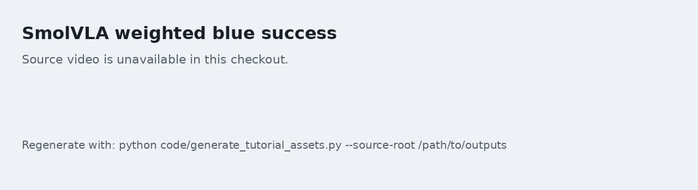
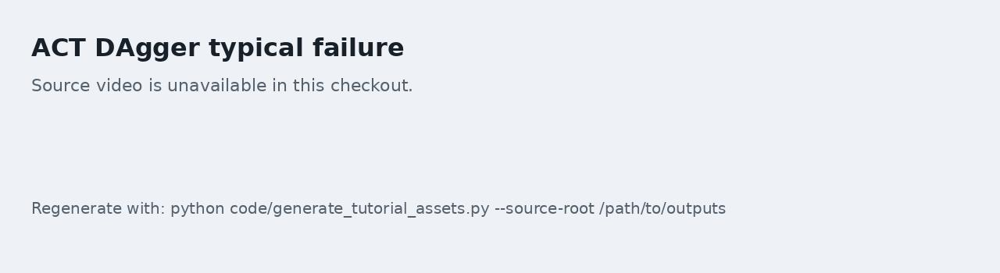
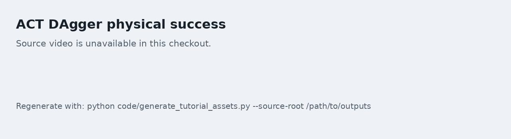

# 02. Оценка физического успеха и проверка видео

Эта задача отвечает на главный вопрос: если журнал показывает успех, действительно ли стратегия выполнила захват? Здесь раздельно считаются исходный процент успеха среды и процент физического успеха, а типичные успешные и неуспешные попытки проверяются по видео.

Практический Notebook к этой задаче: [02_physical_success_review.ipynb](./notebooks/02_physical_success_review.ipynb).

## Почему нельзя ориентироваться только на успех среды

В задаче «взять кружку и положить на тарелку» исходная функция `check_success()` часто проверяет геометрические условия. Стратегия может не захватить кружку, а лишь подтолкнуть её к тарелке. Кружка может упасть, но при этом формально попасть в условие завершения.

Поэтому тема рекомендует сообщать два показателя:

| Показатель | Смысл |
| --- | --- |
| `legacy_success` | Исходное условие успеха среды |
| `physical_success` | Целевая кружка поднята, положена на тарелку и в итоговом состоянии стоит почти вертикально |

Если эти показатели расходятся, решают видео и состояние объектов.

## Рекомендуемое физическое определение

Минимальное физическое определение успеха:

1. `legacy_success` равен истине;
2. целевая кружка поднята над начальной высотой как минимум на `0.03 м`;
3. подъём сохраняется в течение нескольких управляющих тактов;
4. в итоговом состоянии кружка заметно не падает.

Пороговые значения не обязаны оставаться неизменными. Важнее другое: при сравнении моделей должно использоваться одно и то же определение.

## Форма пакетной оценки

Пакетную оценку лучше оформить как скрипт Python, а не повторять вручную в Notebook. Вызов может выглядеть так:

```bash
python tools/audit_language_policy_physical.py \
  --policy-type smolvla \
  --policy-path "$MODEL_ROOT/checkpoints/000500/pretrained_model" \
  --instruction "Place the red mug on the plate." \
  --seeds 0 1 2 3 4 5 6 7 8 9 \
  --max-action-steps 600 \
  --output-jsonl outputs/eval_red.jsonl \
  --summary-json outputs/summary_red.json
```

Вывод скрипта должен содержать:

- seed;
- инструкцию;
- `legacy_success`;
- `physical_success`;
- номер первого шага успеха;
- максимальную высоту подъёма;
- расстояние по осям xy между итоговой кружкой и тарелкой;
- показатель вертикальности в итоговом состоянии;
- корзину причин неудачи.

## Проверка видео

Для каждого checkpoint запишите как минимум два вида видео:

1. один реальный успешный;
2. одну типичную неудачную попытку.

Рядом с видео должно быть указано, какому виду доказательства оно соответствует:

```html
<video controls muted preload="metadata" width="100%">
  <source src="assets/videos/seed0_blue_success.mp4" type="video/mp4">
</video>
```

Пример подписи:

> Рисунок 1: реальный успешный rollout SmolVLA в задаче с синей кружкой. При проверке обращайте внимание, захвачена ли кружка, положена ли она на тарелку и сохраняется ли вертикальное положение в итоговом состоянии.

Не показывайте только успешные видео. Неудачные попытки полезнее для обучения, потому что они объясняют, почему нужны более строгие критерии оценки.

## Ключевые кадры

Ниже приведены ключевые кадры из одного и того же процесса проверки физического успеха. Анализируя видео, смотрите не только на положение кружки в последнем кадре, а на всю временную последовательность: устойчивый захват, подъём, перенос и освобождение.



Рисунок 1: типичная неудача SmolVLA baseline по инструкции о синей кружке. Стратегия многократно приближается к тарелке или красной кружке, но синяя кружка не захвачена устойчиво, поэтому физический успех не засчитывается.



Рисунок 2: успешный пример SmolVLA с синей кружкой после взвешивания выборки по кадрам blue frame. Синяя кружка сначала захвачена, затем перенесена на тарелку, а итоговое состояние соответствует строгому физическому критерию.



Рисунок 3: типичная неудача, которая может сохраняться даже после DAgger у ACT. Кружка задевается, но быстро теряет устойчивость и в итоге не удовлетворяет условию вертикального размещения.



Рисунок 4: пример физического успеха ACT с DAgger. Последовательность показывает весь путь: приближение, захват, перенос и освобождение над тарелкой; её можно использовать как справочный образец для проверки rollout.

## Checkpoint

После выполнения задачи сохраните следующие доказательства:

- по одному файлу JSONL с оценкой для красной и синей кружек;
- сводку в формате JSON или Markdown;
- минимум одно успешное видео и одно неудачное;
- краткую классификацию причин неудач.
