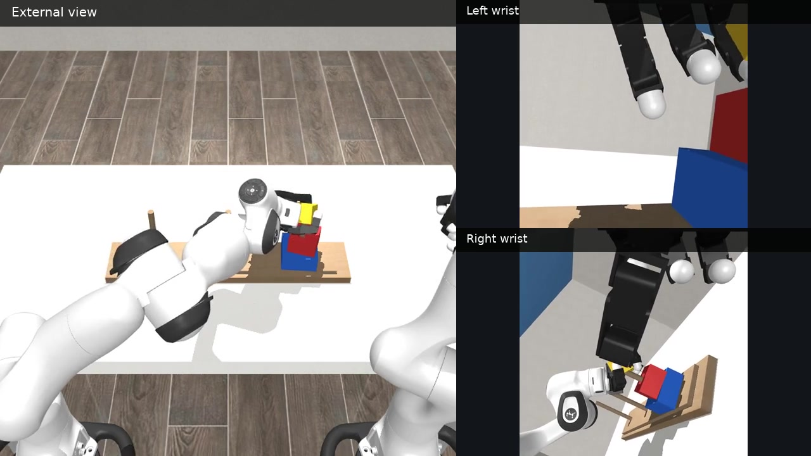
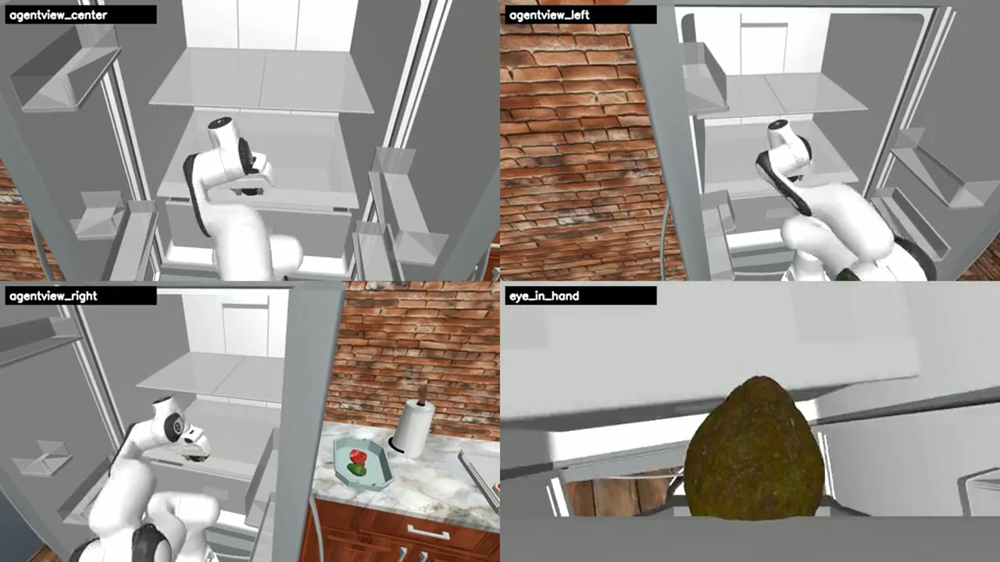

# AMD Physical AI: бенчмарки симуляции и воспроизведение длинных видео

Эта глава объединяет симуляцию, оценку стратегий и мультивидовое видео из проекта AMD AI DevMaster Physical AI в единый путь обучения, который можно повторить. Здесь рассмотрены Every Embodied, RoboCasa365, DexJoCo, DISCOVERSE, RoboWits и управление Unitree G1 с безопасностью; описаны общий протокол задач, путь выполнения на AMD ROCm, правила подсчёта результатов и способы экспорта видео.

Этот раздел отвечает за обзор и выбор маршрута. Загрузка, окружение, перенос, обучение, оценка и команды видео для каждого бенчмарка вынесены в отдельные главы:

| Этап | Подробная глава |
| --- | --- |
| Общая подготовка | [Загрузка бенчмарков, авторизация, докачка и единый каталог](./10-simulation-benchmark-download-and-unified-directory.md) |
| Бытовые операции | [RoboCasa365: ресурсы, обучение GR00T/Pi0.5 и оценка 16 задач](./11-robocasa365-rocm-download-training-and-evaluation.md) |
| Ловкие манипуляции | [DexJoCo: Pi0.5, нативный ROCm JAX и оценка 11 задач](./12-dexjoco-pi05-rocm-jax-migration-training-and-evaluation.md) |
| Синтетические данные | [DISCOVERSE: экспертные данные, ACT/Diffusion Policy и мультивидовое видео](./13-discoverse-rocm-data-generation-training-and-multi-view-video.md) |
| Творческое решение задач | [RoboWits: ограниченные данные, ACT/Pi0/Pi0.5 и оценка с мутациями условий](./14-robowits-rocm-download-training-and-creative-task-evaluation.md) |
| Безопасное управление | [Unitree G1: предсказательный CBF (control barrier function) и повтор позы всего тела](./15-unitree-g1-prediction-cbf-rocm-reproduction.md) |
| Публикация результатов | [Единая оценка, кодирование видео и архивация результатов](./16-unify-the-evaluation-videos-and-result-archiving.md) |

## 1. Начнём с двух длинных успешных примеров

Оба видео записаны на AMD Ryzen AI MAX+ 395 в процессе замкнутого вывода и записи симуляции. Нажмите на обложку, чтобы посмотреть полный MP4 с сохранённым темпом действий.

| Двуручная Ханойская башня в DexJoCo | Длинная уборка в RoboCasa365 |
| --- | --- |
| [](https://ethan-chen-plus.github.io/amd-physical-ai-showcase/assets/videos/dexjoco/recovery/bimanual-hanoi.mp4) | [](https://ethan-chen-plus.github.io/amd-physical-ai-showcase/assets/videos/robocasa-recovery/pack-success.mp4) |
| Контрольная точка Pi0.5 для нескольких задач: двуручная координация, перенос и укладка; внешняя камера и обе камеры запястий записаны синхронно, 47,6 с. | Контрольная точка GR00T N1.5 для нескольких задач: PandaOmron непрерывно работает на кухне; четыре вида записаны синхронно, 195 с. |

Эти два примера показывают два взаимодополняющих навыка. DexJoCo относится к двуручным и ловким манипуляциям, RoboCasa365 — к длинным последовательностям задач в бытовой обстановке. У них общий инженерный принцип: вывод стратегии должен реально продвигать симулятор, условие успеха задачи должен определять окружение, а видео должно соответствовать результатам конкретного эпизода.

## 2. Матрица симуляций и стратегий

| Система | Робот и задача | Стратегия или контроллер | Что выполняется на AMD | Архивированные результаты |
| --- | --- | --- | --- | --- |
| Every Embodied | MuJoCo: захват кружки и устойчивая укладка | SmolVLA, Pi0, ACT | Сбор данных, обучение, замкнутая оценка, видео с четырёх видов | SmolVLA, строгий физический успех `57/60`: красная `27/30`, синяя `30/30` |
| RoboCasa365 | PandaOmron, кухонные операции, 16 фиксированных задач | GR00T N1.5, Pi0.5 | Вывод PyTorch, одинаковый протокол 16×50, видео с четырёх видов | GR00T `230/800`; Pi0.5 `142/800` |
| DexJoCo | 11 двуручных и ловких задач | Многозадачная модель Pi0.5 | Нативный вывод JAX на ROCm, замкнутая оценка, видео с трёх видов | Официальный фиксированный seed [random seed] даёт `5/11`; в архиве фиксированных seed у 10 из 11 задач есть воспроизводимые успешные примеры |
| DISCOVERSE | AIRBOT, MMK2, экспертные траектории и синтетические данные | Экспертная конечная машина, ACT и др. | Проверка запуска, выполнение задач, генерация данных, три 1080p-видео, рендеринг 3DGS (3D Gaussian Splatting) | Проверки запуска `18/18`; AIRBOT `12/12`; MMK2 `8/8`; задачи высокой чёткости `4/4` |
| RoboWits | Задачи в неожиданных условиях | ACT | Обучение на W7900, сохранение checkpoint, вывод и оценка по видео | Полная цепочка обучения и оценки для анализа аномальных условий |
| Unitree G1 | Всё тело, уклонение от брошенного мяча | Предсказательный CBF (control barrier function) | Предсказатель PyTorch, повтор фиксированных эпизодов, метрики безопасности | Фиксированный seed `8/8`, минимальный зазор `0.422 м` |

Эту матрицу можно изучать по трём маршрутам:

1. **Маршрут обучения стратегий**: по управляемой задаче захвата кружки в Every Embodied поймите данные, обучение и строгую оценку успеха.
2. **Маршрут многозадачной оценки**: на RoboCasa365 и DexJoCo изучите загрузку многозадачных checkpoint, интерфейс действий, пакетную замкнутую оценку и индексацию видео.
3. **Маршрут инженерии симуляций**: на DISCOVERSE, 3DGS и Unitree G1 поймите проверки запуска нескольких роботов, синтетические данные, рендеринг и безопасное управление.

## 3. Единый порядок воспроизведения

Команды для разных симуляторов различаются, но порядок воспроизведения можно описать одинаково в шесть этапов:

```text
Зафиксировать версию вышестоящего проекта и конфигурацию задачи
        ↓
Проверить AMD GPU, ROCm и бэкенд фреймворка
        ↓
Загрузить ресурсы, роботов, камеры и условия успеха задачи
        ↓
Загрузить checkpoint, статистику нормализации и интерфейс действий
        ↓
Запустить замкнутую оценку с фиксированным seed и сохранить результаты по эпизодам
        ↓
Экспортировать видео с нескольких видов, свести процент успеха и метрики этапов
```

Для каждого эксперимента рекомендуется сохранять минимальную структуру:

```text
runs/{system}/{model}/{task}/
├── run_config.json
├── episodes/
│   ├── seed_000.json
│   └── seed_000.mp4
├── stats.json
└── videos/
```

В `run_config.json` записываются задача, модель, камеры, частота управления и seed [random seed]. Результаты по эпизодам в JSON [структурированные данные] фиксируют условия успеха и состояния этапов, а `stats.json` агрегируется из этих файлов, чтобы процент успеха нельзя было вписать вручную.

## 4. RoboCasa365: оценка бытовых задач по одинаковому протоколу

Официальное сравнение RoboCasa365 использует 16 задач, по 50 эпизодов на каждую. GR00T N1.5 и Pi0.5 работают с одним каталогом задач, одинаковым числом эпизодов и одинаковыми условиями успеха, поэтому их результаты можно сравнивать напрямую:

| Модель | Задач | Эпизодов | Успешных | Успешность |
| --- | ---: | ---: | ---: | ---: |
| GR00T N1.5 | 16 | 800 | 230 | 28,75% |
| Pi0.5 | 16 | 800 | 142 | 17,75% |

Видео RoboCasa365 записывается с четырёх камер: центральной и боковых камер третьего лица (левой и правой) и камеры «глаз-рука». Четыре кадра склеиваются в один момент симуляции, поэтому можно одновременно видеть общий путь, позу руки, перекрытия и контакт концевого эффектора.

Обложка на главной странице главы — `PackIdenticalLunches` с успешным эпизодом GR00T N1.5. Она последовательно показывает распознавание цели, подход, захват, перенос и укладку, поэтому лучше подходит как пример длинной последовательности, чем переключение одной двери.

## 5. DexJoCo: многозадачный вывод на нативном ROCm JAX

Все 11 задач DexJoCo используют один официальный многозадачный checkpoint Pi0.5. Среда AMD работает на Python 3.12, ROCm 7.14.0 и JAX/JAXlib 0.10.0; выполняются предварительная проверка матрицы GPU, загрузка модели, генерация действий и замкнутый цикл в симуляторе.

Официальная оценка использует фиксированный seed 0 и по одному эпизоду на задачу; результат — `5/11`. Затем только для неуспешных задач последовательно проверяются seed 1–10, и проверка прекращается на первом успешном эпизоде. Этот зафиксированный архив даёт воспроизводимые успешные видео для 10 из 11 задач. Оба набора данных служат разным целям: первый нужен для сравнения моделей, второй — для изучения хода выполнения задач и отладки интерфейса действий.

Видео двуручной Ханойской башни использует три синхронных вида:

- внешний вид: координация двух рук, положение кубиков и итоговая укладка;
- вид с левого запястья: приближение и захват левой рукой;
- вид с правого запястья: перенос и укладка правой рукой.

## 6. DISCOVERSE: запуск, экспертные данные и рендеринг высокой чёткости

Перенос DISCOVERSE связывает в одну цепочку проверки запуска, задачи роботов, экспертные данные и экспорт видео:

- все 18 проверок запуска пройдены;
- 12 задач AIRBOT и 8 задач MMK2 прошли проверку выполнения;
- экспертные траектории можно преобразовать в обучающие данные;
- задачи высокой чёткости одновременно экспортируют три камеры 1920×1080;
- 3DGS (3D Gaussian Splatting) используется для рендеринга сцен и динамического повтора.

Ключевой интерфейс здесь — не одна функция вывода, а согласованность состояния симулятора, камер, действий, условий успеха и записи данных. Рекомендуемый порядок: сначала экспертная конечная машина создаёт полную траекторию, затем наблюдения и действия переводятся в формат данных LeRobot, и только после этого подключаются стратегии ACT, SmolVLA или семейство Pi0.

## 7. Every Embodied: от обучения до строгого физического успеха

Задача захвата кружки в Every Embodied хорошо подходит как точка входа: она короткая, условия успеха понятны, а стоимость обучения контролируема. Итоговый результат SmolVLA получен на 30 фиксированных seed для красной и 30 для синей кружки; строгий физический успех требует поднять кружку, перенести её, положить и удерживать в устойчивом положении. Итог — `57/60`.

Полные этапы обучения и оценки вынесены в эту тему:

- [Сбор данных, обучение и развёртывание](./07-rocm-end-to-end-collection-training-and-deployment.md)
- [Предобученные веса и опыт без обучения](./08-pre-trained-weights-and-zero-training-experience.md)
- [Оценка физического успеха и проверка видео](./02-physical-success-evaluation-and-video-review.md)

## 8. Экспорт мультивидового видео

Мультивидовое видео нужно записывать в одном и том же цикле симуляции: все камеры используют один индекс кадра. Общая структура выглядит так:

```python
frames = {name: [] for name in camera_names}

for step in range(max_steps):
    action = policy.select_action(observation)
    observation, reward, terminated, truncated, info = env.step(action)

    for camera_name in camera_names:
        frames[camera_name].append(env.render(camera_name=camera_name))

    if terminated or truncated:
        break
```

При экспорте сохраняйте:

- исходное видео одной камеры для покадровой диагностики по каждому виду;
- сводное многовидовое видео для быстрой проверки;
- кадр-постер успешного эпизода для README [описание проекта] и главной страницы курса;
- JSON по каждому эпизоду, чтобы связать видео с результатом задачи.

## 9. Результаты обучения

После этой главы составьте собственный пакет воспроизведения AMD для симуляций:

| Результат | Содержание |
| --- | --- |
| Запись окружения | Устройство AMD, версии ROCm, PyTorch или JAX |
| Конфигурация задачи | Робот, задача, камеры, частота управления, число эпизодов и seed |
| Запись модели | Источник checkpoint, статистика нормализации и интерфейс действий |
| Результаты | Число успехов по каждой задаче, общий знаменатель и метрики этапов |
| Видео | Минимум один полный успешный эпизод и соответствующий JSON по эпизоду |
| Разбор | Самые важные места адаптации: интерфейс среды, интерфейс модели и критерий физического успеха |

## 10. Дополнительные материалы

- [Главная страница темы AMD ROCm](./README.md)
- [Публичный сайт результатов AMD Physical AI](https://ethan-chen-plus.github.io/amd-physical-ai-showcase/)
- [RoboCasa](https://github.com/robocasa/robocasa)
- [DexJoCo](https://github.com/brave-eai/dexjoco)
- [DISCOVERSE](https://github.com/discoverse-dev/DISCOVERSE)
- [RoboWits](https://umass-embodied-agi.github.io/RoboWits/)
- [PAC-MAN: безопасное управление Unitree G1](https://github.com/lzyang2000/perceptive_cbf_rl)

Полные материалы конкурсного проекта доступны по следующим открытым ссылкам:

- [Radeon Physical AI Evidence Suite: исходный код и документация по воспроизведению](https://github.com/Ethan-Chen-plus/radeon-physical-ai-evidence-suite)
- [Английское демонстрационное видео продолжительностью 4 мин 59 с](https://ethan-chen-plus.github.io/amd-physical-ai-showcase/assets/videos/amd-physical-ai-demo-en.mp4)
- [Английский технический отчёт](https://github.com/Ethan-Chen-plus/radeon-physical-ai-evidence-suite/blob/main/output/pdf/datawhale-eai-radeon-physical-ai-technical-report.pdf)
- [Модель SmolVLA](https://huggingface.co/Datawhale/every-embodied-smolvla-mujoco-pnp)
- [Модель Pi0](https://huggingface.co/Datawhale/every-embodied-pi0-mujoco-pnp)
- [Модель ACT](https://huggingface.co/Datawhale/every-embodied-act-mujoco-pnp)
- [Модель RoboWits ACT](https://huggingface.co/Datawhale/robowits-act-amd-rocm)
