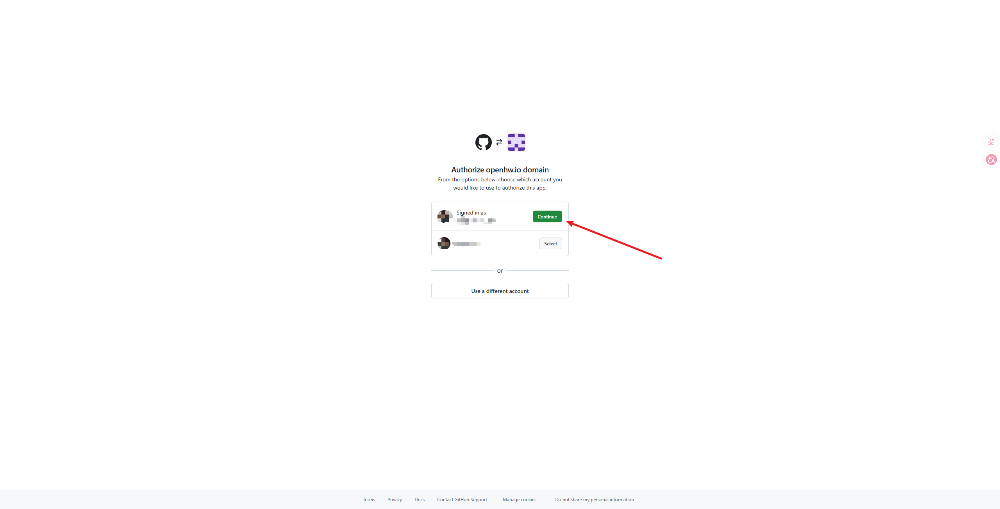
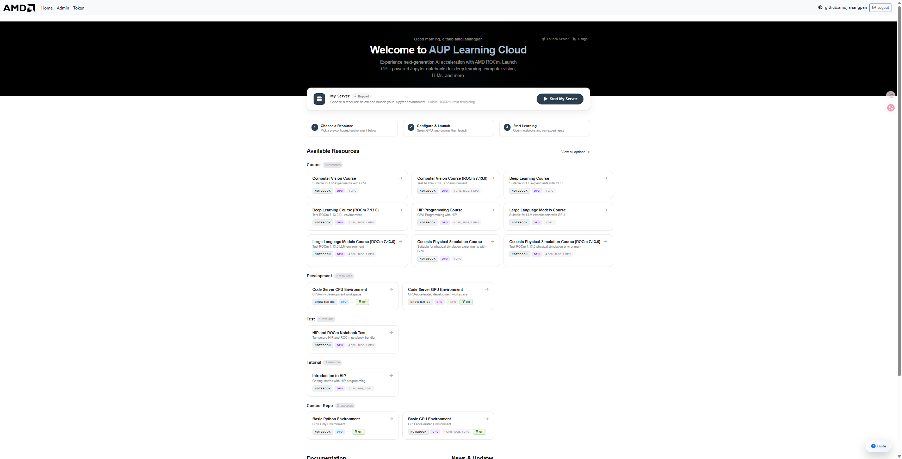
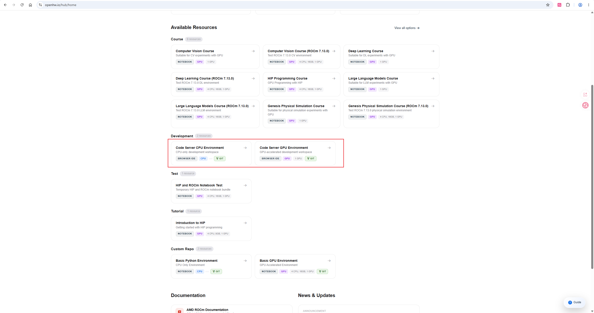
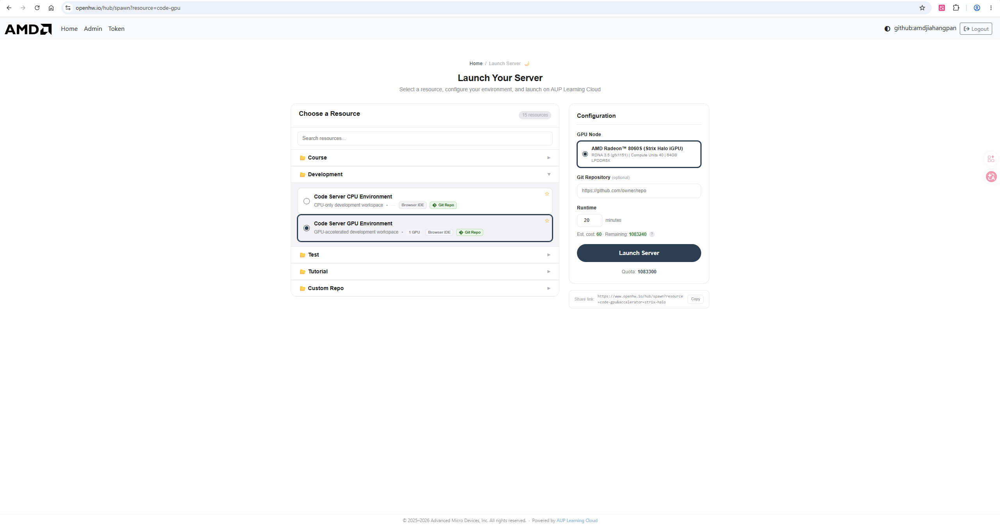
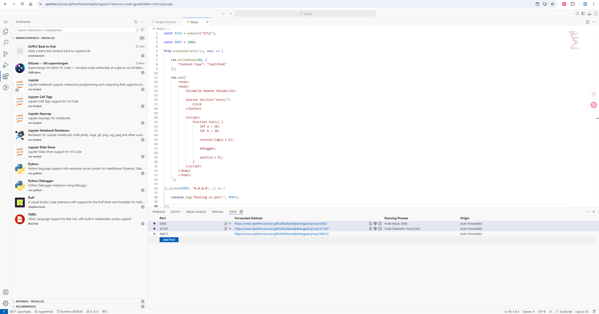
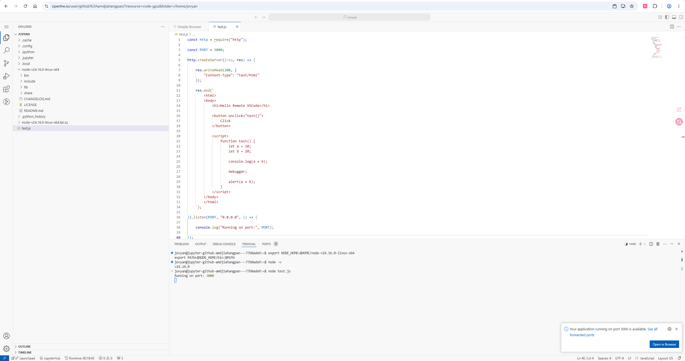
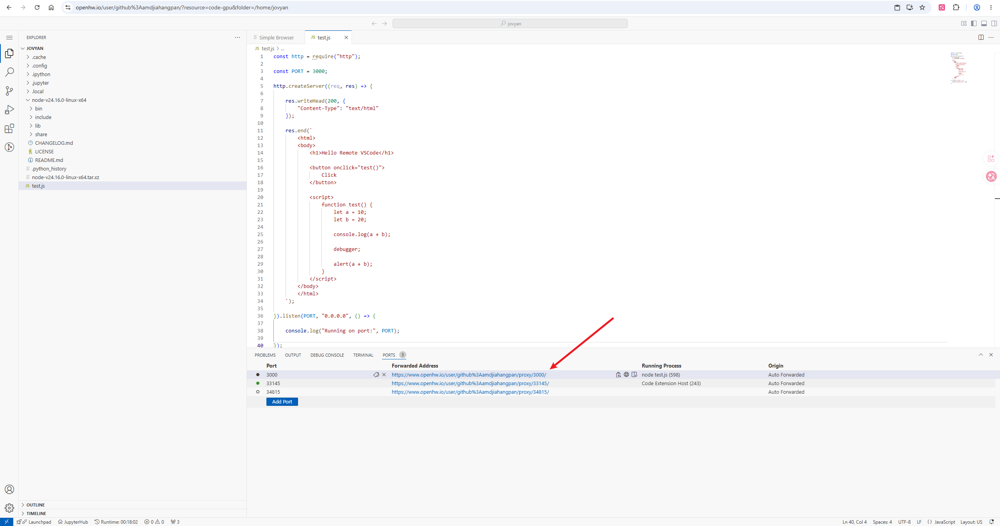
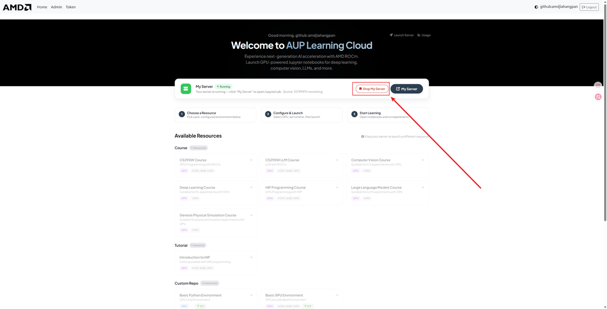

# Приложение: работа в браузерной среде AUP (JupyterHub, Notebook и Code Server)

В этом приложении описаны действия в интерфейсе JupyterHub, Jupyter Notebook и Code Server в AUP Learning Cloud. Постоянные каталоги, переменные окружения и команды запуска курса приведены в [главе о облачной платформе и удалённой разработке](../00-amd-aup-free-cloud-platform-usage-guide.md).

## 1. Выбор инструмента

| Инструмент | Для чего использовать | Вход |
| --- | --- | --- |
| Jupyter Notebook | Пошаговое выполнение кода, просмотр графиков, воспроизведение видео оценки | Образ Notebook или запускатор JupyterHub |
| Code Server | Редактирование многофайловых проектов, команды в терминале, отладка скриптов, работа с версиями | Code Server GPU Environment |
| Терминал в браузере | Установка зависимостей, проверка устройства, запуск обучения и оценки | Terminal в JupyterLab или Terminal в Code Server |

Обучение и пакетная оценка выполняются скриптами; Notebook нужен для пояснений, проверки конфигурации и просмотра результатов. Оба инструмента должны использовать один и тот же постоянный рабочий каталог.

## 2. Вход и выбор окружения

1. Откройте `https://tpe.aupcloud.io`.
2. Выберите **Use GitHub Login** и пройдите авторизацию GitHub.
3. На стартовой странице выберите образ курса или образ для разработки.
4. Задайте длительность сеанса и запустите рабочую область.



Входы на стартовой странице платформы делятся на четыре категории:

- **Course**: учебные образы с предустановленными зависимостями курса;
- **Development**: окружения Code Server с CPU или GPU;
- **Test**: проверки HIP и ROCm;
- **Custom Repo**: собственное окружение на основе базового образа.



Перед запуском проверьте версии ROCm, Python и PyTorch в образе. Исходный код, модели, данные и результаты, которые нужно сохранить, размещайте в `/home/jovyan`; каталог `/ryzers/notebooks` — временная рабочая папка текущего образа.

## 3. Работа в Jupyter Notebook

### 3.1 Создание и запуск

В запускателе выберите **Python 3**, чтобы создать Notebook. Основные действия:

| Действие | Клавиши |
| --- | --- |
| Запустить текущую ячейку | `Shift + Enter` |
| Сохранить документ | `Ctrl + S` или `Cmd + S` |
| Прервать выполнение | Пункт Interrupt в меню Kernel |
| Перезапустить ядро | Пункт Restart в меню Kernel |

Минимальная проверка устройства:

```python
import torch

print(torch.__version__)
print(torch.cuda.is_available())
print(torch.cuda.get_device_name(0) if torch.cuda.is_available() else "GPU unavailable")
```

PyTorch для ROCm использует интерфейс `torch.cuda`, поэтому если `torch.cuda.is_available()` возвращает `True`, нужно дополнительно проверить имя устройства и выполнить тестовое тензорное вычисление.

### 3.2 Сохранение в постоянном каталоге

```bash
mkdir -p /home/jovyan/every-embodied
cp -a /ryzers/notebooks/<project-name> /home/jovyan/every-embodied/
```

Лучше сразу открывать проект из постоянного каталога, чтобы не копировать его перед завершением образа:

```bash
cd /home/jovyan/every-embodied
git clone https://github.com/datawhalechina/every-embodied.git
```

### 3.3 Порядок выполнения Notebook курса

Notebook курса выполняются в таком порядке:

1. настройка устройства и каталогов;
2. проверка путей к наборам данных и моделям;
3. прямой и обратный проход на одном батче;
4. короткое обучение;
5. длительное обучение;
6. замкнутая оценка;
7. вывод видео и статистики.

Ячейки длительного обучения включаются явным переключателем. После запуска сохраните журналы обучения и выходной каталог и не полагайтесь на то, что страница браузера останется подключённой.

## 4. Работа в Code Server

### 4.1 Запуск окружения разработки

Выберите **Code Server GPU Environment**, затем нужную конфигурацию AMD Radeon GPU и запустите её.





Интерфейс делится на четыре области:

- левая панель: файлы, поиск, версии, запуск и расширения;
- центральная область: редактирование исходного кода и документов Markdown;
- нижняя панель: терминал, журналы и состояние процессов;
- панель Ports: проброшенные порты локальных сервисов.

### 4.2 Рекомендуемые расширения

| Расширение | Назначение |
| --- | --- |
| Python | Синтаксис Python, отладка и выбор окружения |
| Jupyter | Запуск Notebook в редакторе |
| Ruff | Форматирование и статический анализ Python |
| YAML | Поддержка синтаксиса конфигурационных файлов |
| GitLens | История версий и переход к коммитам |
| C/C++ | Разработка на HIP или нативных расширениях |



Если расширения сохраняются только в текущем образе, записывайте список нужных расширений в документацию проекта, чтобы можно было воссоздать окружение.

### 4.3 Проверка в терминале

```bash
rocm-smi
python -V
python -c "import torch; print(torch.__version__, torch.cuda.is_available())"
df -h /home/jovyan
```

Перед обучением проверьте текущий каталог и выходные каталоги:

```bash
pwd
echo "$WORK_ROOT"
echo "$OUTPUT_ROOT"
```

## 5. Проброс портов

Code Server обнаруживает HTTP-сервисы, запущенные в терминале, и создаёт для них записи в панели **Ports**.

```bash
python -m http.server 8080 --bind 0.0.0.0
```





Адрес проброса обычно выглядит так:

```text
https://tpe.aupcloud.io/user/<username>/proxy/<port>/
```

Сервис должен слушать на `0.0.0.0` или на интерфейсе, который разрешает платформа. Если страница недоступна, проверьте по очереди:

```bash
ss -lntp | grep 8080
curl -I http://127.0.0.1:8080
```

После этого в панели Ports убедитесь, что номер порта и адрес проброса совпадают.

## 6. Модели, данные и авторизация

Кэш и результаты храните в постоянном каталоге:

```bash
export WORK_ROOT=/home/jovyan/every-embodied-work
export HF_HOME="$WORK_ROOT/cache/huggingface"
export TORCH_HOME="$WORK_ROOT/cache/torch"
export DATA_ROOT="$WORK_ROOT/datasets"
export MODEL_ROOT="$WORK_ROOT/models"
export OUTPUT_ROOT="$WORK_ROOT/outputs"
mkdir -p "$HF_HOME" "$TORCH_HOME" "$DATA_ROOT" "$MODEL_ROOT" "$OUTPUT_ROOT"
```

Учётные данные Hugging Face сохраняются только в пользовательском каталоге конфигурации или в переменных окружения. Открытые Notebook, Markdown, скриншоты и журналы не должны содержать токенов доступа.

```bash
huggingface-cli login
huggingface-cli whoami
```

После загрузки проверьте каталог моделей и метаданные наборов данных:

```bash
find "$MODEL_ROOT" -maxdepth 2 -type f | head
find "$DATA_ROOT" -maxdepth 3 -type f | head
du -sh "$MODEL_ROOT" "$DATA_ROOT" "$HF_HOME"
```

## 7. Смена образа и завершение работы

Перед сменой образа выполните:

1. сохраните Notebook и исходный код;
2. убедитесь, что выходные каталоги обучения находятся в `/home/jovyan`;
3. запишите команды для возобновления незавершённых задач;
4. остановите работающие сервисы;
5. на стартовой странице выберите **Stop my server**;
6. запустите новый образ.



Перед завершением проверьте расположение крупных файлов:

```bash
du -sh /home/jovyan/* 2>/dev/null | sort -h
find /ryzers/notebooks -type f -size +100M -print 2>/dev/null
```

## 8. Частые проблемы

### Страница загружается медленно

Войдите заново и проверьте сетевое соединение браузера; после восстановления страницы сначала убедитесь, что серверный процесс ещё работает.

### Ячейки Notebook выполняются не по порядку

Перезапустите ядро и выполняйте ячейки сверху вниз, начиная с проверок устройства, каталогов и данных. Длительное обучение пишет в отдельный выходной каталог, поэтому существующие результаты не перезаписываются.

### Не устанавливаются расширения Code Server

Обновите индекс расширений и повторите попытку; если сеть ограничена, выполняйте основные действия, используя расширения, уже доступные в образе.

### Порт не появляется автоматически

Убедитесь, что сервис запущен и слушает порт, затем добавьте порт вручную в панели Ports. Доступ через прокси зависит от входа текущего пользователя в систему.

### Файлы пропали после завершения рабочей области

Проверьте, не записаны ли файлы в `/ryzers/notebooks`. При следующем запуске задавайте все корневые каталоги исходного кода, данных, моделей и результатов внутри `/home/jovyan`.

## 9. Возврат к основной линии курса

После настройки платформы продолжите в таком порядке:

1. [Проверка устройства и окружения](../01-amd-rocm-device-and-environment-confirmation.md)
2. [Загрузка бенчмарков и единый каталог](../10-simulation-benchmark-download-and-unified-directory.md)
3. [Указатель Notebook](../notebooks/README.md)
4. [Единая оценка, видео и архивация результатов](../16-unify-the-evaluation-videos-and-result-archiving.md)
