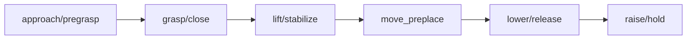
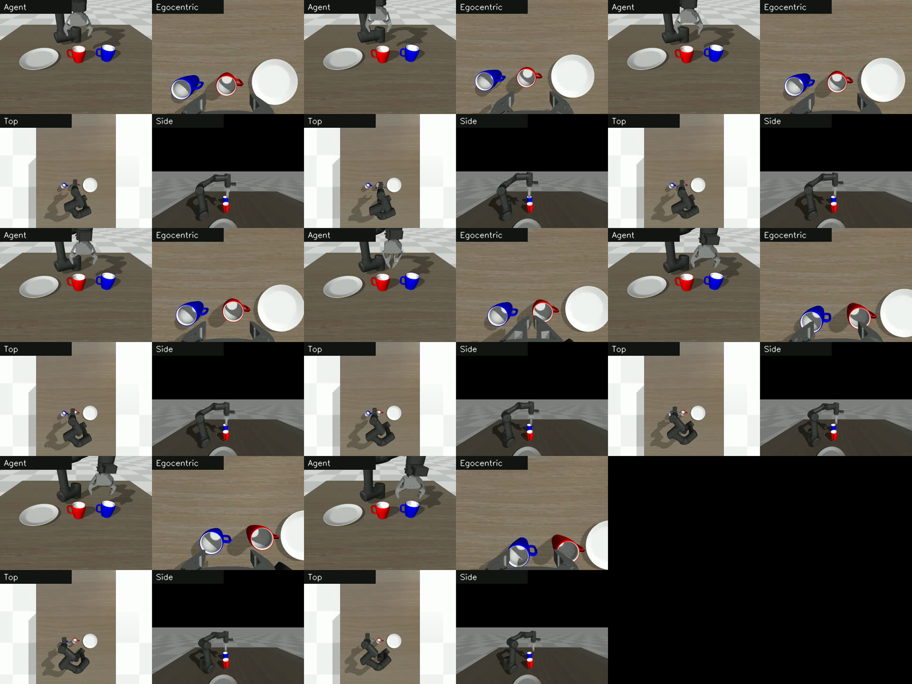
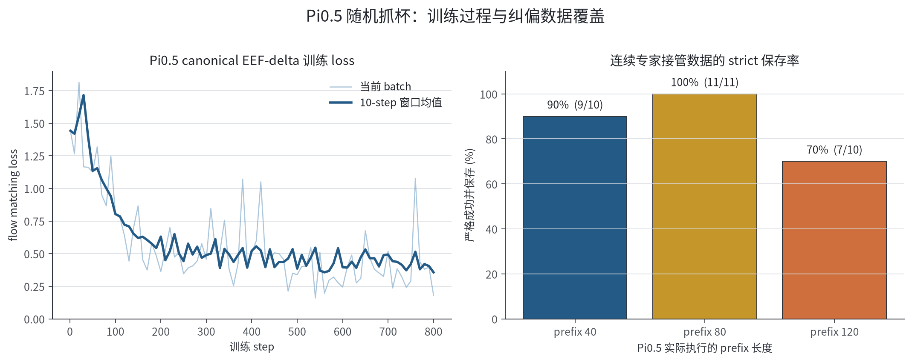
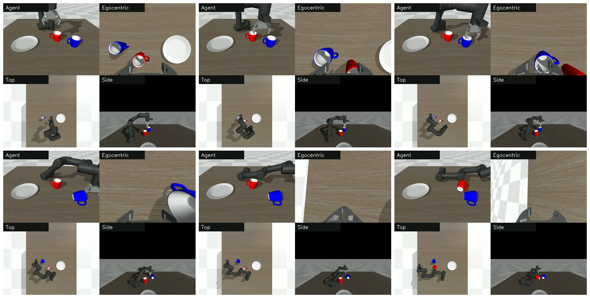
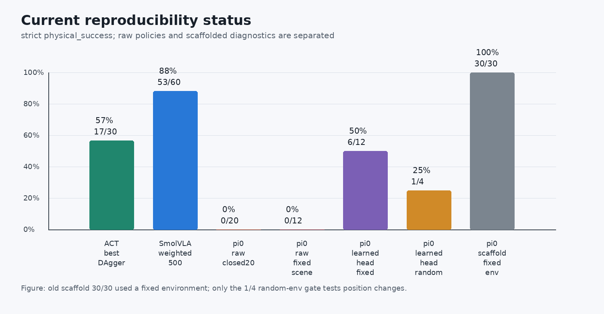

# Pi0/Pi0.5: записи экспериментов

Эта задача посвящена pi_0. Сложность воспроизведения pi_0 состоит не только в обучении: нужно получить доступ к закрытой модели, загрузить веса, управлять кэшем и инициализировать большую модель. Сначала проводится дымовой тест (smoke test), и только после него решается, запускать ли длительное обучение.

Основной метод описан в главе [Pi0/Pi0.5: права доступа, короткое обучение и замкнутая оценка](../05-pi0-rocm-permission-smoke-and-training-gatekeeping.md); практический Notebook: [05_pi0_smoke_gate.ipynb](../notebooks/05_pi0_smoke_gate.ipynb).

## Важное исправление: старые 30 оценок не проверяют обобщение по положению

При разборе `mujoco_env/y_env2.py` выяснилось, что старый код был записан как `if seed != None: np.random.seed(seed=0)`. Оценка передавала seed `1010-1039`, и это действительно меняло случайность выборки действий Pi0, но начальные положения кружки и тарелки всегда задавались средой с seed 0. Поэтому старый результат `30/30` по-прежнему доказывает, что при одной и той же сцене разные выборки стратегии стабильно выполняют задачу, но не доказывает обобщение по положению.

Код исправлен на `if seed is not None: np.random.seed(seed=seed)`. После исправления на реально изменяемых средах с seeds `41-44` gate визуального и исторического блока strict-input дал только `1/4`. Контрольный опыт при фиксированной среде seed 0 и одних и тех же 12 seeds выборки стратегии даёт: raw pi0 — `0/12`, pi0 с обученным блоком — `6/12`. Итоговый вывод: собственные полные данные для задачи и обученный блок заметно улучшают фиксированную сцену, но в следующем раунде нужно заново собрать данные с несколькими положениями предметов. Старый результат `30/30` нельзя больше использовать как показатель успеха при обобщении по пространству.

## Сначала проверьте доступ к Hugging Face

Pi0 использует PaliGemma. Проверьте:

1. аккаунт Hugging Face принял условия закрытой модели `google/paligemma-3b-pt-224`;
2. токен имеет право чтения публичных закрытых репозиториев;
3. удалённая машина имеет доступ к Hugging Face;
4. токен не появлялся в командной строке, выводе Notebook или журналах.

Рекомендуемый вид скрипта:

```bash
HF_TOKEN_STDIN=1 REQUIRE_PROXY=1 ./install_hf_token_for_pi0.sh
```

Скрипт должен получать токен из скрытого ввода или stdin, сначала проверить `whoami`, PaliGemma и `lerobot/pi0`, и только после того, как все проверки пройдены, сохранить токен.

## Дымовой тест на 1 шаг

Когда права подтверждены, выполните дымовой тест на 1 шаг:

```bash
RUN_SMOKE=1 RUN_FULL_TRAIN=0 ./run_pi0_train_eval_after_hf_ready.sh
```

Этот тест подтверждает, что:

- права на закрытую модель работают;
- набор данных загружается;
- политику pi_0 можно построить;
- хотя бы один шаг прямого прохода, обратного прохода и оптимизатора выполняется;
- цепочка сохранения checkpoint работает.

Он не доказывает, что стратегия сошлась, и не даёт итоговой успешности.

## Ворота для запуска полного обучения

Полное обучение запускается только после успешного дымового теста:

```bash
RUN_SMOKE=1 RUN_FULL_TRAIN=1 PI0_STEPS=20000 PI0_BATCH_SIZE=4 ./run_pi0_train_eval_after_hf_ready.sh
```

Перед полным обучением проверьте:

| Пункт | Статус |
| --- | --- |
| Права на PaliGemma | Пройдено |
| Права на `lerobot/pi0` | Пройдено |
| Дымовой тест на 1 шаг | Пройдено |
| Температура GPU | Приемлемая |
| Видеопамять и оперативная память | Есть запас |
| Каталог checkpoint | Места достаточно |
| Прокси или сеть | Стабильны |

## Ворота обучения после восстановления общей базы

Если локальный checkpoint или временный корень данных утрачены, не продолжайте эксперименты на неполных каталогах. Сначала вернитесь к открытому учебному набору данных и заново постройте чистую базу pi_0:

```bash
git clone https://huggingface.co/datasets/Datawhale/datawhale_eai_pnp_language demo_data_language
```

Этот открытый набор соответствует конфигурациям `pi0_omy.yaml` и `smolvla_omy.yaml` учебника: 20 эпизодов захвата кружки и укладки на тарелку, 2621 кадр, `observation.state` имеет размерность 6, `action` — 7. После восстановления проходите ворота в таком порядке:

| Контрольная точка | Что должно наблюдаться | Пояснение |
| --- | --- | --- |
| Инициализация политики при `steps=0` | Политика pi_0 создаётся и веса загружаются | Подтверждает права на закрытую модель, кэш и конфигурацию политики |
| Один шаг только на экспертных данных | Выполняется один прямой проход, обратный проход и шаг оптимизатора | Подтверждает цепочку данных, модели и обратного прохода на GPU |
| Checkpoint на 20 шагов | Записывается `pretrained_model` и он снова загружается на GPU | Подтверждает сохранение checkpoint и загрузку safetensors |
| Checkpoint на 500 шагов | Loss заметно снижается, например с примерно 5 до ниже 0,2 | Подтверждает здоровое обучение, но ещё не говорит об успехе задачи |
| Малая панель оценки для красной и синей кружки | Несколько seeds для инструкций с красной и синей кружкой | По `physical_success` определяется, действительно ли стратегия выполняет задачу |

В примере эксперимента loss у 500-шагового checkpoint, обученного только на экспертных данных из общего набора, снизился примерно с `5.28` до `0.179`. Это значит, что цепочка обучения восстановлена. Однако замкнутая строгая оценка на красных seeds `0-2` и синих seeds `0-2` дала `0/3 physical_success` в обоих случаях, а старый геометрический успех тоже был `0/3`. На видео модель уже касается кружки, толкает её и иногда поднимает, но кружка падает, поднимается недостаточно или улетает.

После продолжения обучения с 500-го шага до 1500-го итоговый loss составил примерно `0.046`; промежуточные и финальный checkpoint сохранились нормально. Это показывает, что восстановлены возобновление, планировщик скорости обучения, состояние оптимизатора и запись checkpoint. Однако на тех же красных и синих seeds `0-2` строгая замкнутая оценка снова дала red `0/3` и blue `0/3`, а старый геометрический успех — 0. Ошибки на 1500 шаге в основном связаны с отсутствием подъёма: кружка почти не удерживается и не поднимается устойчиво или получает лишь очень малое смещение.

Смысл этих результатов однозначен: checkpoint на 500 и на 1500 шагах — это здоровые базовые варианты обучения, но не успешные модели. Снижение loss не означает успешность в замкнутом цикле. Дальше нужно проводить диагностику teacher-forced / open-loop, проверять представление действий и проектировать данные по этапам, а не бесконтрольно добавлять шаги BC или подгонять постобработку под один неудачный rollout.

## Диагностика успеха после обучения

В примерном эксперименте этой темы pi_0 уже прошёл проверку прав, загрузку, построение политики, обучение и диагностику воспроизведения open-loop. Главный вывод здесь не в том, что «pi_0 уже успешен», а в том, что raw-политику и гибридную диагностическую схему нужно докладывать раздельно.

Сначала на уменьшенном наборе из 2 синих и 2 красных кружек проводилась строгая оценка `physical_success`. Цель малого набора — уменьшить смещение по цвету и наблюдать, учится ли pi_0 захватывать, переносить и освобождать кружку в конце. Затем та же raw-политика была запущена на полном наборе `demo_data_language` из 20 эпизодов в режиме teacher-forced open-loop replay, чтобы получить более представительный результат прогнозирования действий.

| Схема | Строгий physical success | Как понимать |
| --- | --- | --- |
| raw-политика pi_0, эталонный прогон на малом наборе | 0/4 | raw-политика уже доставляет кружку близко к тарелке, но финальные release / raise / stabilize нестабильны |
| raw-политика pi_0, повторный прогон на малом наборе | 1/4 | Пограничные образцы иногда ненадолго переходят порог; на малой выборке успешность нестабильна, поэтому воспроизведение не объявляется успешным |
| raw-политика pi_0, открытый цикл на полных 20 эпизодах | 1/20 в конце, 3/20 когда-либо | Наиболее представительный вывод для raw-политики: модель выучила часть действий, но успех в финальном состоянии остаётся низким |
| raw-политика pi_0, строгий замкнутый цикл на 20 seeds | 0/20 строгих, старый геометрический 2/20 | Ближе всего к условиям развёртывания; raw-политику пока нельзя считать перенесённым успехом |
| pi_0 + скриптовый финишер, малый набор | 4/4 | Хвост доводится скриптом со средним хвостом набора данных и останавливается сразу после `physical_success`; это диагностика узкого места хвостовой фазы, а не успех raw-политики |
| pi_0 + финишер по шаблону хвоста, открытый цикл на полных 20 эпизодах | 4/20 в конце, 4/20 когда-либо | На полном наборе фиксированный финишер спасает лишь часть образцов; ошибки контакта, переноса и ориентации в начале всё ещё не дают хвосту восстановиться |


Рисунок 1: в типичном эпизоде raw-политика pi_0 уже очень близка к цели, но высота конечного эффектора и устойчивость при освобождении не пересекают строгий порог успеха. Скриптовый финишер подключает то же состояние префикса к более стабильному хвосту release / raise / stabilize; значит, основное узкое место сосредоточено в хвостовой фазе задачи.

Видео ниже показывает левое и правое сравнение одного и того же эпизода. Слева — raw pi_0, справа — гибридная диагностика с добавленным скриптовым финишером:

<video controls muted preload="metadata" width="100%">
  <source src="../assets/pi0_ep2_raw_vs_finisher_side_by_side.mp4" type="video/mp4">
</video>

Рисунок 2: сравнение raw и гибридного варианта для episode 2 у pi_0. Видео нужно для объяснения механизма отказа; оно не означает, что raw pi_0 достигает 100% успеха.

Из этой диагностики следуют два вывода:

1. Цепочка обучения pi_0 уже работает на устройстве AMD ROCm, и модель не просто не выучила действия;
2. raw-политику по-прежнему нельзя докладывать как воспроизведённый успех. Дальнейшую оптимизацию нужно строить вокруг освобождения захвата, подъёма и устойчивой укладки — через данные или цели обучения.

Полный открытый прогон на 20 эпизодах выявил важную деталь: старый геометрический успех и строгий физический успех — не одно и то же. У raw-политики только 1 из 20 эпизодов заканчивается `physical_success`; 3 эпизода когда-либо кратковременно проходили `physical_success`; ещё 2 эпизода соответствуют старому геометрическому успеху. То есть pi_0 не полностью не умеет приближаться к цели, но её захват, освобождение, стабилизация ориентации и удержание в конечном состоянии недостаточно надёжны. При воспроизведении нужно смотреть одновременно `final_physical_success`, `physical_success_ever`, старый `success` и видео, а не какой-то один логический флаг.

После того как было проведено 20 замкнутых прогонов со строгой оценкой по seeds, raw pi_0 показала `0/20` строгого физического успеха при `2/20` по старому геометрическому критерию. Это ближе к реальному развёртыванию, чем открытый цикл, и показывает, что сбой не сводится к ошибке действий в конце на кадрах датасета. Когда изображение, состояние и действия в замкнутом цикле постепенно дрейфуют, ошибки в начальных контактах, устойчивости захвата и удержании конечного состояния усиливаются.

Важно учитывать границы для небольшого набора с захватом и укладкой. Pi_0 в статье ориентирована на крупномасштабные многозадачные данные с разных роботов и тщательно спроектированный рецепт постобучения. В статье также много внимания уделено корректирующим данным и данным восстановления, то есть состояниям с отклонением: [π0: A Vision-Language-Action Flow Model for General Robot Control](https://arxiv.org/html/2410.24164v1). Наш набор с кружками очень мал. Если в эпизодах не записаны стабильно фазы «открыть захват, поднять руку, дождаться устойчивости кружки, при необходимости скорректировать», модель сама такую фазу не выучит.

Кроме того, pi_0 использует идею блочного предсказания действий (action chunking): модель выдаёт сразу сегмент непрерывных действий. В работе [Real-Time Action Chunking](https://www.pi.website/research/real_time_chunking) Physical Intelligence подробно разбирает границы блоков, задержку и проблему пауз, которых не было в обучении; статья [Real-Time Execution of Action Chunking Flow Policies](https://arxiv.org/html/2506.07339v1) тоже выносит границы блоков и исполнение в реальном времени в число ключевых проблем. В нашей задаче с малым набором начальное движение модель ещё может усреднить, а последние несколько сантиметров фаз release / raise / stabilize легко ломаются накопленной ошибкой.

Поэтому скриптовый финишер — не «нечестное объявление успеха», а чистый диагностический инструмент. Если добавление фиксированного хвоста превращает неудачу в успех, значит, основной пробел raw-политики действительно связан с моделированием хвостовой фазы. Однако шаблонный хвост на всех 20 эпизодах даёт только `4/20`, то есть контакт в начале, захват, перенос и управление ориентацией тоже очень важны. Дальше нужно либо добавить данные по этапам и коррекционные данные, либо отдельно докладывать скриптовый финишер как инженерную страховку, не смешивая его с успехом raw pi_0.

## Как поднять успешность pi_0

Сначала зафиксируем текущую жёсткую базовую линию:

| Показатель | Текущий результат | Назначение |
| --- | --- | --- |
| raw teacher-forced open-loop, полные 20 эпизодов | `1/20` в конце, `3/20` когда-либо | Проверка, насколько предсказания модели на состояниях из данных близки к эксперту |
| raw closed-loop strict, 20 seeds | `0/20` | Ближе всего к условиям развёртывания; raw-политика пока не успешна |
| Скриптовый финишер, малый набор | `4/4` | Показывает, что release / raise / stabilize в хвосте — одно из узких мест |
| Финишер по шаблону хвоста, полные 20 эпизодов | `4/20` | Показывает, что фиксированный хвост спасает лишь часть образцов и не является общим решением |
| Oracle prefix + 10 эпизодов, перебор момента передачи финишеру | prefix `120/180/240/300` — во всех случаях `0/2` | Даже при префиксе от oracle текущий финишер всё равно уносит кружку с тарелки; момент передачи не главная причина |
| Oracle prefix180 + phase schedule + финишер `tcp_to_plate` | strict `5/10`, legacy `6/10` | Первый заметный рост успешности pi_0 на хвосте; это всё ещё диагностический каркас, а не успех raw-политики |
| Предыдущая строка + скриптовый gripper по фазам | strict `7/10`, legacy `7/10` | Тайминг захвата — одно из узких мест хвоста; оставшиеся ошибки сосредоточены на переносе и посадке красной кружки |
| Seeds политики 1010-1039 (среда фактически фиксирована на seed 0), schedule 0..9 циклически | strict `21/30`, legacy `23/30` | Подход сохраняется и на большей выборке, но все ошибки сосредоточены в коротком шаблоне schedule `move_preplace` |
| Seeds политики 1010-1039 (среда фактически фиксирована на seed 0), принудительно длинный schedule episode 0 | strict `30/30`, legacy `30/30` | Главное узкое место — слишком короткий шаблон переноса; это улучшенный каркас, а не сквозная raw-политика pi_0 |
| Предыдущая строка, gripper по фазам заменён на learned head только по фазам | strict `30/30`, legacy `30/30` | Первый элемент каркаса заменён обучаемым модулем; oracle prefix и длинный schedule пока сохранены |
| Обычный цикл schedule 0..9 + адаптивный gate `move_preplace` + learned gripper head | strict `30/30`, legacy `30/30` | Принудительный длинный episode 0 больше не нужен: продолжение переноса определяется живым прогрессом TCP-к-тарелке |
| Обычный цикл schedule 0..9 + learned transition head + learned gripper head | strict `30/30`, legacy `30/30` | Второй элемент каркаса тоже стал обучаемым: 29/30 переключаются через transition head, 1/30 — через страховку по максимальному числу шагов |
| Префикс политики + контактный каркас относительно цели + heads для pregrasp-геометрии и контакта + защитный floor guard | strict `30/30`, legacy `30/30` | Третий уровень снятия каркаса: основные переключения `pregrasp/descend/close` делает head, но сохраняются контактный каркас, защита от пола и финишер хвоста |
| Предыдущая строка + финишер `dynamic_timed` с состоянием цели и тарелки по стадиям + оценка с полным hard-reset | strict `30/30`, legacy `30/30` | Четвёртый уровень: хвост больше не строится по `dataset_schedule`; префикс использует `tcp_to_target`, финишер — `tcp_to_plate`; после чистого hard-reset среднее `xy=0.0219 м`, максимум `xy=0.0450 м` |

Все новые варианты нужно сравнивать с этими числами. Одних потерь, только малого набора 2 синих и 2 красных или одного удачного видео недостаточно. Как минимум нужно докладывать открытый цикл на 20 эпизодах и строгий замкнутый цикл на 20 seeds. Если запускается только малый набор, его следует описывать как диагностику, а не как показатель успешности.

Уже отброшенные направления также стоит записать, чтобы не тратить время повторно:

| Направление | Наблюдение | Вывод |
| --- | --- | --- |
| Продолжать BC-шаги на тех же данных | Loss снижается, но строгая успешность не растёт | Дело не только в недостатке шагов |
| Взвешенная выборка кадров хвоста | На малом наборе геометрия улучшилась, но raw остаётся нестабильной; дальнейшее взвешивание ухудшает начало | Хвост важен, но нельзя ориентироваться только на последние десятки кадров |
| Менять только порог захвата, бинаризацию, open-until | Спасает отдельные образцы teacher-forced, но замкнутый цикл нестабилен | Захват — симптом, но не единственная причина |
| Прямое добавление suffix-only DAgger | При небольшом сдвиге выравнивания состояния и действия качество заметно падает; даже после исправления перенос не стабилизируется | Данные DAgger нужно учитывать по этапам и по статистике |
| Прямой BC на полностью сброшенных траекториях от scripted oracle | Сами данные успешны в `20/20`, но pi_0 всё равно плохо замыкается и переобучается | Нельзя полагаться только на автоматически сгенерированные идеальные траектории |
| Замена только представления phase / EEF / eef_abs | Teacher-forced даёт локальные успехи, но замкнутый цикл не работает | Направление полезно, но нужны данные по этапам и on-policy |
| Только перебор числа шагов передачи управления | Префиксы `120/180/240/300` с текущим финишером дают `0/2`; большинство образцов поднимаются, но итоговый `xy` уходит на `0.22-0.60 м` | Цель переноса у поздней политики уже смещена; проблему нельзя решить сменой шага передачи |
| Фиксированный шаблонный хвост как итоговое решение | На полных 20 эпизодах только `4/20` | Годится как инженерная страховка или диагностика, но не как успех raw-политики |

После этих отрицательных результатов самым ценным положительным обновлением стал `tcp_to_plate`. Он расширяет состояние с 19 до 22 измерений:

```text
joint6 + timestamp + phase_index_norm + phase_onehot11 + tcp_to_plate3
```

Здесь `tcp_to_plate = tcp_link_xyz - plate_xyz`. В данных первый кадр TCP берётся из `prefix_end_debug.tcp_pos` в сводке сбора, а дальше позиция приближается целью `eef_abs` с предыдущего кадра. При замкнутой оценке приближение больше не используется: реальные `tcp_link` и `body_obj_plate_11` читаются напрямую из MuJoCo. Этот шаг отвечает на вопрос: знает ли поздняя часть стратегии, где относительно неё находится тарелка.

В этом раунде 10-эпизодный префиксный suffix (prefix120) переводился в 22-мерное состояние, после чего дообучение на 250 шагов шло от старой 19-мерной контрольной точки финишера. При загрузке старой контрольной точки возникает типичная ошибка: буферы нормализации `normalize_inputs.buffer_observation_state.mean/std` в старой модели имеют 19 измерений, а новые данные — 22, поэтому загрузка падает с несовпадением форм. Выход: скопировать контрольную точку, удалить эти два буфера нормализатора состояния, чтобы статистика нового набора инициализировалась заново, а веса основной части сохранить.

Состояние обучения было нормальным: loss на шагах с 25 по 250 колебался примерно в диапазоне `0.012-0.019`, видеопамять и температура были стабильны, OOM и падения ядра не было. Затем при префиксе `oracle prefix180`, который сначала доводит кружку до состояния готовности к передаче, 22-мерный финишер стартовал с расписания `move_preplace`. На 10 seeds результат: strict `5/10`, legacy `6/10`. Успешные seeds: `1000, 1001, 1004, 1005, 1006`. Неудачи двух типов: кружку подняли, но до центра тарелки не донесли, и итоговый `xy` составил `0.18-0.59 м`; либо `xy` уже близок к тарелке, но кружка упала — значит, освобождение и стабилизация ещё не выучены полностью.

Далее был проведён контрольный опыт, где менялся только захват, а не EEF или рука. Для финишера захват не предсказывала pi_0, а открывался и закрывался по правилам текущей фазы. Результат: strict `7/10`, legacy `7/10`. Значит, тайминг захвата действительно одно из узких мест. Правило спасло неудачные seeds `1002, 1003, 1008`, а оставшиеся ошибки — `1001, 1007, 1009` — все с красной кружкой и с итоговым `xy` около `0.14-0.24 м`. То есть правило по захвату уменьшает опрокидывание и соскальзывание, но место посадки красной кружки ещё нужно дополнять данными или целями по этапам.

Чтобы убедиться, что путь работает не только на 10 seeds, оценку расширили до seeds политики `1010-1039` (среда фактически фиксирована на seed 0). Сначала 10 шаблонов schedule использовались циклически: strict `21/30`, legacy `23/30`, красные `12/18`, синие `9/12`. Это заметно лучше предыдущих неудачных веток, но ещё нестабильно. Когда неудачные образцы отнесли к шаблонам schedule, стало ясно: все ошибки приходятся на schedule episodes `1, 7, 9`, у которых фаза `move_preplace` длится всего `72-75` кадров; у длинных шаблонов episodes `0, 2, 3, 4, 5, 6, 8` эта фаза около `120-123` кадров. Короткий шаблон заставляет финишер перейти к lower / release, пока кружка ещё не над тарелкой, и на видео это выглядит как «кружку принесли к тарелке и отпустили раньше времени».

Затем изменили одну переменную: все неудачные seeds переводились на длинный шаблон episode 0, без смены checkpoint, state или контроллера. Все 9 неудачных seeds стали строго успешными. После этого все 30 seeds политики перевели на длинный шаблон episode 0: strict `30/30`, legacy `30/30`, красные `18/18`, синие `12/12`, средний конечный `xy` около `0.0281 м`, максимальный около `0.0739 м`. Это показывает, что главная причина провала `21/30` — не шум выборки политики, а несогласованная длина фазы переноса в schedule: короткие шаблоны сдвигают момент освобождения.

Этот результат важен, но его границы нужно зафиксировать: это не raw pi_0 и не сквозная успешность при развёртывании. Он опирается одновременно на oracle-префикс, ручное выравнивание schedule по `move_preplace`, явное состояние `tcp_to_plate`, gripper по фазам и принудительно длинный шаблон `move_preplace`. Точнее сказать так: улучшенный финишер / каркас pi_0 для хвостовой фазы стабильно завершает задачу на 30 seeds политики при фиксированной среде. Это подтверждает, что инженерный путь «относительное положение относительно центра тарелки + правильная длительность переноса + правильное окно захвата» верен. Следующий шаг — не возвращаться к слепому добавлению шагов, а сделать длительность прогресса `move_preplace`, переходы фаз и тайминг захвата обучаемыми входами или головами, а затем постепенно убрать oracle-префикс и ручной schedule.

Первый каркас, который можно убрать, — правило захвата. Сначала проведены два эксперимента. Если полностью убрать скриптовый gripper и оставить только oracle-префикс, финишер `tcp_to_plate` и длинный schedule, на seeds политики `1010-1019` получается strict `5/10`. Если же заменить префикс на текущий префикс политики, то есть использовать скриптовый gripper и длинный schedule, результат лишь strict `3/10`. Вывод: сначала делаем обучаемым тайминг захвата, а префикс политики пока не может заменить oracle-префикс.

Здесь обучили небольшую логистическую голову захвата. Она не меняет выход EEF/руки pi_0, а лишь предсказывает 7-е измерение — открытие и закрытие захвата. Типичная ловушка: голова, обученная на полном 22-мерном состоянии, на обучающей выборке достигает `100%` точности, но на seed `1010` в замкнутом цикле проваливается. Значит, она выучила детали корреляции joint/TCP, которые в замкнутом цикле смещаются. После перехода на вход только по фазе `timestamp + phase_index_norm + phase_onehot11` обучающая точность снова `100%`, но замкнутый цикл стабилен: smoke seed `1010` — `1/1`, seeds политики `1010-1019` — strict `10/10`, полный набор `1010-1039` — strict `30/30`, legacy `30/30`, красные `18/18`, синие `12/12`, средний `xy` около `0.0272 м`, максимальный около `0.0735 м`.

Значение этого шага не в том, что добавили ещё одно правило, а в том, что вручную написанное правило захвата заменено обучаемой малой головой, которую можно сохранить и повторно использовать. Из этого вытекает полезный практический урок: в задачах робота на малом наборе данных вспомогательная голова не обязательно лучше, если получает больше состояний. Голова короткого событийного времени, которая лишь выделяет окно фазы, стабильнее, если на вход подаётся только чистый признак фазы; если же подавать в неё все живые данные joint/TCP, на обучающей выборке метрики выглядят отлично, но смещение распределения в замкнутом цикле сразу проявляется.

Второй каркас — жёстко заданный длинный шаблон `move_preplace`. Выход `30/30` ранее зависел от `--tcpplate-force-schedule-episode 0`, то есть все seeds насильно шли по одному длинному шаблону переноса. Новый адаптивный gate так не делает: schedule episodes `0..9` идут обычным циклом. Когда schedule собирается перейти из `move_preplace` в `lower_to_plate`, сначала проверяется живой `tcp_to_plate_xy`. Если TCP ещё далеко от центра тарелки, фаза `move_preplace` продолжает удерживаться на последнем кадре; когда живое `xy` станет достаточно мало или будет достигнут безопасный предел по шагам, включаются нижняя укладка, предрелиз и хвост открытия.

Перебрали несколько порогов. Текущая стабильная конфигурация: `xy=0.05m, min_steps=20, max_steps=180`: seeds политики `1010-1019` — strict `10/10`; полный набор `1010-1039` — strict `30/30`, legacy `30/30`, красные `18/18`, синие `12/12`, средний `xy` около `0.0281 м`, максимальный около `0.0617 м`. Длинный episode 0 теперь не нужен: короткие шаблоны расширяются по живому прогрессу.

Однако и этот вариант нужно описывать точно. В версии `0.05m` сохраняется консервативный предел `max_steps=180`. Например, в трассе короткого шаблона seed `1011` переключение с `move_preplace` на `lower_to_plate` происходит только на 180-м шаге финишера, и в этот момент живое `tcp_to_plate_xy` равно около `0.0574 м`. Значит, это надёжная инженерная версия с адаптивным удержанием, но ещё не полностью выученная голова переходов фаз.

Порог ослаблять не всегда лучше. Значение `0.09 м` на первых 10 seeds политики (среда фактически фиксирована на seed 0) тоже даёт `10/10`, и seed `1011` может на шаге `163` сам переключиться на `lower_to_plate`, что похоже на настоящий gate по прогрессу. Однако на полных 30 seeds результат ухудшился до strict `29/30`: seed `1034` провалился, а итоговый `xy` вырос до `3.16 м`. Значение `0.08 м` на probe seeds `1011/1034` дало `2/2`, но в полном прогоне уже на 9 первых эпизодах seed `1012` строго провалился. Этот контрпример важен: phase gate нельзя проверять только на панели из 10 seeds и нельзя оценивать только по итоговому `xy`. Если release случается чуть раньше, меняются и поза, и длительность подъёма, и устойчивость контакта.

Следующий шаг — заменить этот gate логистической головой перехода (transition head). Первая полная версия использовала `tcp_to_plate_x/y/z`, `tcp_to_plate_xy`, `abs_z` и число шагов внутри фазы. Точность на обучающей выборке составила около `99.27%`, но на seed `1010` голова сразу провалилась: около шага `60` финишера она переключилась на `lower_to_plate`, хотя живое `tcp_to_plate_xy` тогда ещё составляло порядка `0.35 м`. Диагностика показала, что сырые направления `x/y` и высота `z` вводят маленькую голову в заблуждение. В обучающей выборке близкая высота часто означала, что можно опускаться, но в замкнутом цикле близкая высота не означает, что TCP уже над центром тарелки.

Вторая версия оставила только `tcp_to_plate_xy + local_step_norm`. Точность на обучении снизилась до `95.01%`, зато замкнутый цикл стал стабильнее. На seed `1010` неудача превратилась в строгий успех; переключение произошло на шаге финишера `136`, а не по страховке `max_steps`. Далее: seeds политики `1010-1019` — strict `10/10`; полный набор `1010-1039` — strict `30/30`, legacy `30/30`, красные `18/18`, синие `12/12`, средний конечный `xy` около `0.0279 м`, максимальный около `0.0741 м`. Из 30 эпизодов `29/30` переключились по решению transition head; момент освобождения находился между шагами `126` и `180`, в среднем около `146.6`. Только seed `1021` дошёл до страховки `max_steps=180`, но и он был строго успешен.

Этот результат ближе к обучаемой голове перехода фаз, чем предыдущий порог. Он также подтверждает урок для малых наборов данных: точность на обучении — не единственная цель. Входы головы должны содержать только устойчивые причинные признаки. Здесь `xy + progress` стабильнее, чем `xy + z + сырое направление + progress`, потому что не принимает за условие освобождения корреляции по высоте и направлению, которые в замкнутом цикле смещаются.

При дальнейшем разложении фронтальной фазы контакта нельзя просто помечать положительными все переходы фаз «последними несколькими кадрами сегмента». Мы обучили общую голову (all-head): её метрики на обучении выглядели неплохо, но на smoke seeds `1010/1011` результат стал `0/2`. В трассе `descend_to_close` срабатывал, когда TCP был выше пола захвата примерно на `0.08 м`, а следом раньше времени запускался `close_to_lift`, и кружка начинала уборку ещё до того, как попадала в захват. Этот контрпример хорошо подходит для учебника: метка фазы не равна условию безопасности контакта, а хорошая точность на обучении может означать лишь то, что модель запомнила, примерно когда в демонстрации начинается следующий сегмент.

Исправленная версия меняет метку для `pregrasp_to_descend` на «достигнута точка предзахвата» и добавляет в признаки явные величины `tcp_to_grasp_xy`, `abs_tcp_to_pregrasp_z`, `tcp_to_floor_z` и `abs_tcp_to_floor_z`. Метка `descend_to_close` остаётся фазовой, но при развёртывании добавляется `descend_floor_guard`: закрывать захват нельзя, пока TCP заметно выше пола захвата. Так smoke seeds `1010/1011` вернулись к `2/2`, а полный набор seeds политики `1010-1039` дал strict `30/30`, legacy `30/30`. Во всех 30 эпизодах переходы `pregrasp->descend`, `descend->close` и `close->lift` срабатывали по решению transition head, а floor guard заблокировал `342` попытки закрыть захват на большой высоте. Пограничные образцы тоже нужно фиксировать: у seed `1029` итоговый `xy` около `0.0996 м`, у seed `1018` cos вертикальности около `0.703` — оба близки к порогам строгой оценки.

Эта версия по сравнению с предыдущей убрала ручные геометрические переходы `pregrasp/descend`, но сохранила контактный каркас относительно цели, защиту от пола и заключительный финишер `tcp_to_plate`. Её можно описывать как «инженерный каркас, который стал частично обучаемым», но не как сквозной успех raw pi_0.

Четвёртый уровень — снятие каркаса с хвоста расписания. Предыдущие `30/30` всё ещё опирались на `dataset_schedule`: даже если переход `move_preplace -> lower_to_plate` определяет голова, временная метка и one-hot фазы после этого берутся из расписания одного из эпизодов набора. В новом эксперименте финишер переведён в режим `dynamic_timed` и запускается с фазы `move_preplace`; длительности `move_preplace/lower_to_plate/retreat` заданы как `260/40/40`. Теперь хвост не воспроизводит расписание из набора, а временную метку и признаки фазы генерирует онлайн-трекер фаз.

Первый полный прогон на seeds политики `1010-1039` дал только strict `27/30`. Провалились seeds `1021, 1031, 1036`: `1021` кружку подняли, но она остановилась примерно в `0.35 м` от тарелки; `1031` и вовсе отбросило далеко; у `1036` синяя кружка застряла примерно в `0.22 м` перед тарелкой. Поначалу казалось, что фиксированных `260` шагов для `move_preplace` недостаточно, но при разборе кода оказалось, что корень проблемы в другом: `--tcpplate-prefix-target-state` задумывался только для префиксной политики, чтобы она использовала `tcp_to_target`. Однако динамический финишер без `dataset_schedule` шёл по той же ветке состояния без расписания и получал `tcp_to_target`, тогда как обучался он на `tcp_to_plate`.

Исправление: сборка 22-мерного состояния стала учитывать стадию. На стадии префикса используется `tcp_link - target_mug`, на стадии финишера — `tcp_link - plate`; при этом признаки контакта ограничены префиксом и не просачиваются в хвост. После исправления три проваленных seed (`1021/1031/1036`) стали строго успешными. Затем полный прогон seeds политики `1010-1039` без перезапуска дал strict `30/30`, legacy `30/30`, красные `18/18`, синие `12/12`. Средний конечный `xy` тогда был около `0.0244 м`, а максимальный — `0.0993 м` у seed `1036`; это похоже на пограничный успешный образец.

Однако дальнейший разбор трасс выявил более скрытую проблему. Когда один и тот же evaluator последовательно запускает несколько seeds, у некоторых эпизодов начальные положения объектов выходят за пределы выборки. Например, у seed `1035` начальная позиция кружки получилась около `[0.2679, 0.1625, 0.8441]`, тогда как при отдельном `reset(seed=1035)` нормальное положение составляет около `[0.2944, 0.1912, 0.8447]`. Дело не в том, что стратегия «испортилась», а в недостаточно чистом протоколе оценки: `SimpleEnv2.reset(seed)` перезадаёт положения объектов, но не очищает полностью скорости, управляющие сигналы и остаточную динамику свободного сустава в нижележащем `mjData` MuJoCo. Состояние предыдущего эпизода переносится в следующий: после 100 шагов стабилизации объект может быть уже слегка смещён.

Поэтому в evaluator добавлены два переключателя чистого протокола:

- `--fresh-env-per-episode`: для каждого seed создаётся новая среда MuJoCo; это самый чистый вариант. На малой панели `1036/1035/1020/1029` результат `4/4`, но на большой панели многократное создание среды время от времени вызывает ошибку провайдера ассетов, поэтому по умолчанию для пакетной оценки он не подходит.
- `--hard-reset-sim-data`: окно просмотра и среда переиспользуются, но перед каждым `env.reset(seed)` вызывается низкоуровневый сброс парсера, который очищает остатки qvel, ctrl и динамики свободного сустава. Это рекомендуемый протокол для полной оценки на 30 seeds.

Полный прогон seeds политики `1010-1039` с `--hard-reset-sim-data` дал прежний результат: strict `30/30`, legacy `30/30`, красные `18/18`, синие `12/12`. При этом средний `xy=0.0219 м`, максимальный `xy=0.0450 м`, минимальный подъём `0.1093 м`, минимальный cos вертикальности `0.9504`, среднее число шагов около `492.6`. Значит, динамический финишер с учётом стадии остаётся работоспособным при чистом протоколе, а seed `1036` больше не граничный: прежние `0.0993 м` были, по-видимому, артефактом остаточного состояния между эпизодами.

Из этого шага важный урок: если один evaluator обслуживает и префиксную политику, и финишер, нельзя решать относительное состояние одним глобальным переключателем. `tcp_to_target` полезен для фазы захвата, `tcp_to_plate` — для переноса и укладки. Если перепутать стадии, модель не выдаст ошибку, но поведение в замкнутом цикле быстро превратится в промах мимо тарелки, перенос сверх меры или отбрасывание кружки. Эта ошибка также объясняет, почему одни лишь потери на обучении или дымовой тест на 2 seeds не достаточны: только полная панель из 30 seeds выявила проблему границ состояния.

Скрипты этого направления лежат в каталоге `code/pi0/` темы:

```text
code/pi0/build_lerobot_state_phase_tcpplate.py
code/pi0/evaluate_pi0_two_stage_eef_abs.py
code/pi0/evaluate_pi0_two_stage_tcpplate.py
code/pi0/train_tcpplate_gripper_head.py
code/pi0/train_tcpplate_transition_head.py
code/pi0/train_tcptarget_contact_transition_head.py
```

Первый скрипт превращает данные LeRobot с 19-мерным состоянием по фазам в данные с 22-мерным `tcp_to_plate`. Второй — evaluator двухэтапного режима «префикс/финишер». Третий надстраивает evaluator: добавляет живой `tcp_to_plate`, стартовую точку расписания, голову захвата, адаптивный gate `move_preplace`, голову переходов, голову контактных переходов и состояние цели и тарелки с учётом стадии. Сейчас в скриптах оценки есть также `--fresh-env-per-episode` и `--hard-reset-sim-data`, которые исключают остаточную динамику между эпизодами; для пакетной оценки используется `--hard-reset-sim-data`. Четвёртый скрипт обучает логистическую голову захвата на данных LeRobot, пятый — логистическую голову перехода `move_preplace -> lower_to_plate`, шестой — небольшие головы контактных примитивов относительно цели: `pregrasp_to_descend / descend_to_close / close_to_lift / lift_to_hold`. В Notebook достаточно вызывать эти скрипты; большие куски временного отладочного кода в ячейки помещать не нужно.

Дальше наиболее перспективны следующие направления.

### Направление 1: переопределить конец эпизода

Точкой завершения задачи «кружку — на тарелку» должно быть состояние: кружка уже на тарелке, захват открыт, кружка стоит вертикально и устойчиво. Возврат в начальную позу, отвод руки и ожидание reset не входят в задачу; если их не требуют условия задачи, не стоит включать их в «успешную» демонстрацию.

Здесь нужно решить две вещи:

1. чему именно должна научиться модель;
2. с какого момента оценка считает финальное состояние.

Если хвост должен выучиться моделью, нужно записывать в эпизоды «открыть захват, поднять руку, дождаться устойчивости кружки», причём такие действия должны встречаться при разных положениях, разных цветах и небольших отклонениях. Если же эти действия относятся только к сбросу в симуляции, их следует вырезать из данных, чтобы модель не принимала сброс за стратегию задачи.

### Направление 2: добавить корректирующие данные для отклонённых состояний

Статья pi_0 подчёркивает значение коррекций и данных восстановления. В малом наборе с кружкой это особенно важно. Если записаны только идеальные успешные траектории, то стоит политике зажать кружку немного криво, поставить её у края тарелки, слишком рано закрыть захват или отпустить её раньше времени, и она попадает в состояние, которого не было в обучении.

Следующая порция данных должна целенаправленно покрывать такие состояния:

| Состояние, которое нужно покрыть | Корректирующее действие |
| --- | --- |
| Кружка уже взята, но смещена от центра тарелки | Медленно перевести к центру тарелки, затем опустить |
| Кружка у края тарелки, падает, но её ещё можно спасти | Поднять, заново выровнять, затем поставить |
| Захват закрылся раньше времени, из-за чего кружка сбилась с оси | Держать или подправить TCP, дождаться стабилизации, затем переносить |
| Кружка уже на тарелке, но захват не полностью раскрыт | Раскрыть захват, слегка приподнять, дождаться стабилизации |
| Модель дошла до предукладки, но цель TCP далеко | Небольшие коррекции EEF, а не резкие перемещения |

Такие данные лучше собирать on-policy: сначала текущая pi_0 или лучший префикс доводится до легко ломающегося промежуточного состояния, и уже оттуда scripted oracle или человек берёт управление и сохраняет коррекцию. Тогда записываются не идеальные состояния, а те, которые модель действительно будет встречать.

### Направление 3: перейти к поэтапной политике вместо одной pi_0 на всё

Имеющиеся данные показывают, что единая pi_0 с обучением по методу поведенческого клонирования плохо справляется одновременно с подходом, захватом, переносом, освобождением, подъёмом и стабилизацией. Более надёжный путь — разбить задачу на стадии:



У каждой стадии свой сигнал перехода и своя типичная ошибка:

| Стадия | Сигнал перехода | Самая частая ошибка |
| --- | --- | --- |
| approach/pregrasp | TCP сбоку от кружки, захват ещё открыт | Закрыть захват раньше времени, промахнуться мимо кружки |
| grasp/close | Есть контакт, кружка начинает удерживаться | Зажать слишком рано или слишком поздно |
| lift/stabilize | Кружка поднята и в основном стоит вертикально | После подъёма её отбрасывает или она падает |
| move_preplace | Кружка движется над тарелкой вместе с захватом | Во время переноса уводит в сторону от тарелки |
| lower/release | Кружка опущена на тарелку, захват открывается | Не отпустить или отпустить слишком рано |
| raise/hold | Захват отошёл, кружка стоит вертикально и устойчиво | Рука задевает и опрокидывает кружку при отходе |

Здесь возможны два варианта реализации:

1. **Метка стадии как вход**: признаки стадии (one-hot или индекс) добавляются в state, чтобы модель знала, на каком сегменте находится.
2. **Голова стадии или малая политика**: начальные стадии остаются за pi_0, а заключительную часть, особенно release / raise / stabilize, выполняет отдельный дообученный финишер.

Варианты с информацией о фазе (phase-state, phase+EEF, eef_abs) дали локальные улучшения, но без замкнутого успеха. Значит, сигнал фазы необходим, но сам по себе недостаточен. Свежий scan передачи управления с oracle-префиксом подтверждает это: префиксы `120/180/240/300` с одним и тем же финишером, обученным только на суффиксах, провалились. Кружку часто поднимали и держали вертикально, но уносили далеко от тарелки. То есть дело не только в том, «когда передать управление финишеру», но и в том, что цели стадии, направление переноса и условие освобождения у финишера ещё не выучены надёжно.

Первая трасса с плотными целями действий показывает это прямо. Для seed `1000` после oracle-префикса `180` в первые 80 тактов управления финишера фазы шли так: `move_pregrasp` 28 шагов, затем `move_grasp` 35 шагов, затем `close_gripper` 17 шагов. Иначе говоря, кружку уже подняли, но финишер снова начинал с фазы «подойти к кружке и схватить её». Целевая точка TCP до центра тарелки в среднем составляла `0.481 м`, до кружки — `0.147 м`. Компонента y цели относительно центра тарелки всё время была положительной: от `+0.295 м` до `+0.554 м`. Центр тарелки находится примерно на `y=-0.25`, а финишер прогнозировал цель около `y=0.20-0.29`, то есть всё ещё на стороне кружки. Контроллер большую часть времени действительно двигался мелкими шагами в сторону отрицательного y, но предсказанная цель не попадала над тарелкой, поэтому кружка не доставлялась в центр тарелки.

Затем провели диагностику с быстрыми фазами: сократили время `move_pregrasp/move_grasp/lift` финишера до одного шага, чтобы он быстрее переходил к поздней части. При префиксе `180` и seeds `1000/1001` результат всё равно `0/2 physical_success`, конечный `xy` около `0.534/0.494 м`. Перезапуск фаз — одно из узких мест, но ручного ускорения фаз недостаточно: модели нужно дать и состояние относительно тарелки, и вектор TCP-к-тарелке, и явные цели стадии. Переходы фаз и целевые условия должны быть надёжными: когда перейти от pregrasp к close, когда от move_preplace к lower, каков текущий относительный вектор TCP к центру тарелки. Модель не должна угадывать всё это из изображения.

Чтобы разложить вопрос ещё глубже, провели эксперимент со сдвигом расписания: без изменения весов финишер начинал воспроизводить `dataset_schedule` с начала `move_preplace` или `lower_to_plate`. Старт с `move_preplace` всё ещё давал `0/2 physical_success`, но у seed `1000` конечный `xy` снизился с полуметровых значений до `0.140 м`; у seed `1001` он остался на уровне `0.410 м`, и захват был почти полностью раскрыт. Старт с `lower_to_plate` оказался хуже: оба seed заканчивались примерно на `0.44-0.45 м`, то есть переход сразу к опусканию и освобождению слишком рано, модель ещё не доставила кружку над тарелкой. Добавление скриптового тайминга захвата тоже не дало успеха (`0/2`), хотя у seed `1001` `xy` уменьшился с `0.410` до `0.171 м`. Эти цифры полезны: и стартовая фаза, и тайминг захвата влияют на результат, но они лишь приближают траекторию, а не решают проблему смещения цели при переносе. Следующая версия не может опираться только на настройку длительностей или правило для захвата. Нужно явно задать в позднюю стратегию относительную позу относительно центра тарелки, вектор TCP-к-тарелке и прогресс внутри стадии.

### Направление 4: в качестве действий использовать EEF/TCP, а не дельты суставов

Дельты суставов уменьшают числовую ошибку по суставам, но за несколько сотен шагов накапливают отклонение TCP. Для задачи с кружкой цели в EEF/TCP ближе к физическим действиям: подойти к кружке, поднять её, перенести над тарелку, опустить, отойти.

В текущих экспериментах `eef_abs` — самое обнадёживающее направление: на малом наборе teacher-forced дал `1/2`, но в замкнутом цикле по-прежнему проваливался. Его можно оставить основным представлением действий и дополнить метками стадий и корректирующими данными on-policy. Не стоит рассматривать переход на EEF-действия как самостоятельный путь к успеху: он работает только вместе с поэтапными данными.

<a id="pi05-eef-delta"></a>

#### Эксперимент Pi0.5 со случайными положениями: почему `eef_abs` всё равно уходит не в ту сторону

Четыре фиксированные траектории показывают лишь, что цепочка обучения работает, но не проверяют визуальную локализацию. Поэтому в следующем раунде, после исправления seed среды, из 80 случайных кандидатов отобрали 53 траектории синей кружки со строгим физическим успехом, добавили 11 продолжительных экспертных траекторий восстановления после отклонения Pi0.5. Итоговый набор: 64 эпизода, 26014 кадров, 20 Гц. Все траектории сохраняют два изображения с камер, язык, 6D проприоцепцию робота и 7D действие EEF/захват, без добавления координат кружки, тарелки или GT-фазы.

Результаты обучения на этом наборе показательны. После дообучения с взвешенными траекториями восстановления офлайн MAE по захвату снизился с `0.25659` до `0.08261`, но MAE по xyz вырос с `0.10312` до `0.10612`. На полностью новых случайных seeds `2120-2123` строгий fair-VLA всё ещё давал `0/4`: ни в одном эпизоде не было устойчивого подъёма. На видео и по конечным координатам видно, что TCP постоянно движется в сторону тарелки, то есть в отрицательную Y, тогда как синяя кружка находится в положительной Y.

Здесь нельзя ограничиваться выводом «визуальная часть не выучилась». Нужно проверить временную структуру самих меток. Аудит направления по 64 траекториям дал:

| Пункт аудита | Результат |
| --- | --- |
| Эпизоды, где целевая синяя кружка в положительной Y | `100%` |
| Эпизоды, где тарелка в отрицательной Y | `100%` |
| Чистое смещение за первые 80 кадров направлено к кружке | `100%` |
| Среднее абсолютное действие по Y за первые 80 кадров | `+0.1498 м` |
| Среднее действие по Y на прогрессе 60%-80% | `-0.0937 м` |
| Среднее действие по Y на прогрессе 80%-100% | `-0.1823 м` |
| Доля отрицательной Y у пробы первого кадра checkpoint | `6/6` |
| Средняя ошибка по Y у первого кадра относительно метки | `-0.1086 м` |

Таблица 4: метки `eef_abs` в мировых координатах меняют направление по мере фазы задачи. Сначала нужно двигаться к кружке в положительной Y, потом к тарелке в отрицательной Y. Модель же на первом кадре сразу выдаёт направление поздней фазы.

Абсолютные цели EEF — не ошибочное представление, но они жёстко связывают фазу задачи с мировыми координатами. Блок действий на фазе подхода содержит в основном цели в положительной Y, а на фазе переноса — в основном в отрицательной Y. Когда у малой модели нет надёжного распознавания текущей фазы, она склонна не к случайному дрожанию, а к «схлопыванию» в самую частую поздняя фаза из данных. Увеличение веса захвата делает открытие и закрытие захвата точнее, но не исправляет ошибку пространственного направления.

#### Точный перевод в локальные дельты EEF с помощью прямой кинематики MuJoCo

Эти траектории не нужно собирать заново. В каждом кадре уже сохранено 6D-состояние суставов `q_t` до выполнения действия, а исходные первые три компоненты действия — абсолютная цель следующего TCP. Значит, можно вычислить текущий TCP через прямую кинематику MuJoCo и получить локальное приращение:

```text
tcp_t = FK(q_t)
delta_xyz_t = eef_abs_target_xyz_t - tcp_t
```

Нельзя заменять это на `action[t] - action[t-1]`. Цель предыдущего кадра не обязательно совпадает с реальным TCP следующего кадра: контакт, ошибка управления и шаги физики дают расхождение. Прямая кинематика по текущему состоянию суставов соответствует реально выполненной команде. При переводе изображения, язык, 6D проприоцепция, метки захвата, границы эпизодов и текстовая задача остаются без изменений; заменяются только первые три компоненты действия, после чего заново считаются квантильные статистики LeRobot.

Проверка корректности преобразования:

| Пункт проверки | Результат |
| --- | --- |
| Эпизоды / кадры | `64 / 26014` |
| Первый кадр, delta xyz | примерно `[+0.004,+0.004,-0.004] м` |
| Максимальная по модулю дельта по одной оси во всём наборе | `0.00407564 м` |
| Ошибка обратной реконструкции `tcp + delta` | `2.33e-10 м` |
| Хэш выборки из исходного parquet | Не изменился после преобразования |
| Новые квантильные статистики | Пересчитаны |

Таблица 5: преобразование EEF-delta не требовало повторного сбора изображений и не переписывало исходные данные; оно лишь точно переводит мировые цели в локальное действие относительно текущего состояния.

#### После агрегации нужно проверять порядок физических строк, а не только набор `index`

После обучения первого раунда из 64 траекторий EEF-delta мы провели сравнение горизонтов исполнения на новых случайных положениях. При том же checkpoint и том же строгом протоколе fair-VLA горизонт 10 на seeds `2130-2133` дал `0/4`, горизонт 5 — `0/4`, горизонт 1 на seed `2133` тоже провалился. Пошаговые трассы показывают, что модель не просто забывает закрыть захват: она закрывает его в неверной пространственной позиции или на неверной высоте, а когда подходит к кружке, иногда снова открывает. Частый повторный просмотр изображения не исправил порядок стадий и временную структуру блока.



Рисунок 3: seed `2133`, горизонт 5, четыре вида во времени. Манипулятор двигается над кружкой и вокруг неё, но не выходит на устойчивую высоту захвата и не поднимает кружку. Ключевые кадры нужно смотреть вместе с пошаговым журналом TCP и захвата: один только факт, что захват двигался, не доказывает успешный захват.

<video controls muted preload="metadata" width="100%">
  <source src="../assets/pi05_eefdelta_h5_seed2133.mp4" type="video/mp4">
</video>

Видео 2: полный 25-секундный четырёхвидовой rollout того же seed `2133` с горизонтом 5. Видео сохранено целиком, включая неудачный ход, чтобы можно было проследить высоту подхода, момент закрытия захвата и порядок действий; его нельзя обрезать до «выглядящих правильно» кадров.

После этого продолжили сбор согласованных траекторий восстановления. Pi0.5 выполнял реальный префикс длиной 40, 80 или 120 шагов, а эксперт непрерывно доводил состояние до строгого успеха; сохранялись только полностью успешные траектории:

| Префикс | Кандидатов | Строгий успех и сохранение | Кадров |
| --- | ---: | ---: | ---: |
| 40 | 10 | 9 | 3076 |
| 80 | 11 (включая 1 smoke) | 11 | 3859 |
| 120 | 10 | 7 | 2335 |
| Итого | 31 | 27 | 9270 |

Таблица 6: чем длиннее префикс, тем глубже состояние отклонения, в которое попадает политика. Здесь сохраняются траектории, где политика реально выполнила префикс, а эксперт реально выполнил продолжение до успеха; это не контрфактические метки оракула, склеенные в блоки. Вход модели по-прежнему только изображения, язык и 6D проприоцепция.

После объединения 64 исходных и 27 новых траекторий получились 91 эпизод и 35284 кадра. Обычная проверка показала правильное число эпизодов, а после сортировки по `index` значения точно `0..35283`. Однако при проверке `LeRobotDataset(..., delta_timestamps=...)` обнаружилось, что в некоторых местах `action_chunk[0]` не равен действию текущей строки. Причина не в порче чисел действия, а в несовпадении **физического порядка строк** parquet и глобального `index`. В агрегированных данных `4909` строк из `35284` имели `physical_position != index`. Первая ошибка появилась в физической позиции `21105`, где в строке записан `index` `21510`. LeRobot берёт текущее наблюдение по физической позиции `idx`, а будущие действия — по `idx + delta`. Поэтому проверка только того, что набор индексов полный, пропускает эту ошибку: блок действий всё равно может переходить на чужой кадр. Прежние 64 эпизода тоже имели беспорядок порядка файлов в последней части, поэтому первый checkpoint на 800 шагах нельзя было использовать как чистый результат для дальнейшей донастройки.

Исправлять это нужно не переименованием или ручной правкой метаданных. Используется отдельный выходной каталог: каждый эпизод записывается отдельным parquet, сортируется по `frame_index`, после чего заново строятся глобальный `index`, границы эпизодов, отображение файлов и числовая статистика:

```bash
export AGGREGATED_ROOT=/path/to/pi05_eef_delta_aggregated_v30
export CANONICAL_ROOT=/path/to/pi05_eef_delta_canonical_v30
export AGGREGATED_REPO_ID=datawhale_eai_pnp_pi05_eef_delta_aggregated_v30
export CANONICAL_REPO_ID=datawhale_eai_pnp_pi05_eef_delta_canonical_v30

python "$TOPIC_ROOT/code/pi0/pi05_canonicalize_lerobot_v3.py" \
  --source-root "$AGGREGATED_ROOT" \
  --source-repo-id "$AGGREGATED_REPO_ID" \
  --output-root "$CANONICAL_ROOT" \
  --output-repo-id "$CANONICAL_REPO_ID"

HF_HUB_OFFLINE=1 PYTHONPATH="/path/to/lerobot/src:${PYTHONPATH:-}" \
python "$TOPIC_ROOT/code/pi0/pi05_validate_chunk_alignment.py" \
  --root "$CANONICAL_ROOT" \
  --repo-id "$CANONICAL_REPO_ID" \
  --horizons 10 50 \
  --uniform-samples 512 \
  --summary ./chunk_alignment_summary.json
```

Нормализованная копия по-прежнему содержит 91 эпизод и 35284 кадра; после записи каждого эпизода все нетиндексные колонки Arrow были полностью сверены на равенство. Проверка через реальные запросы LeRobot покрыла начало, середину и конец каждого эпизода, 1, 2, 5, 9, 10 и 49 кадров перед концом эпизода и глобальную равномерную выборку: для horizon 10 и 50 проверено по 1318 позиций, всего сверено 553560 скалярных значений действий и 28240 шагов заполнения; максимальная абсолютная ошибка во всех случаях `0`. Это и есть порог данных, при котором можно запускать следующий раунд обучения.

Сначала задайте пути в корне проекта MuJoCo PnP, затем запускайте аудит и конвертацию. `DELTA_ROOT` должен быть новым несуществующим каталогом: скрипт не перезаписывает исходные данные.

```bash
export PROJECT_ROOT=/path/to/<upstream-project-folder>
export TOPIC_ROOT=/path/to/every-embodied/<topic-folder>
export ABS_ROOT=/path/to/lerobot_eef_abs_v30
export DELTA_ROOT=/path/to/lerobot_eef_delta_v30

cd "$PROJECT_ROOT"

python "$TOPIC_ROOT/code/pi0/pi05_dataset_direction_audit.py" \
  --dataset-root "$ABS_ROOT" \
  --target-object blue \
  --early-frames 80 \
  --output ./notebook_runs/pi05_direction_audit.json

DISPLAY="${DISPLAY:-:0}" PYTHONPATH="$PROJECT_ROOT:${PYTHONPATH:-}" \
python "$TOPIC_ROOT/code/pi0/pi05_convert_eef_abs_to_delta.py" \
  --source-root "$ABS_ROOT" \
  --output-root "$DELTA_ROOT" \
  --repo-id datawhale_eai_pnp_pi05_eef_delta_v30 \
  --scene "$PROJECT_ROOT/asset/example_scene_y2.xml" \
  --position-profile pnp_generalization_v1
```

Если конвертация прошла успешно, терминал выводит число эпизодов и кадров, первую дельту, максимальное пространственное приращение, ошибку обратной реконструкции и новую статистику действий. Если `max_spatial_abs` заметно превышает предельный шаг EEF, заданный при сборе, не начинайте обучение: сначала проверьте, что `observation.state` действительно является состоянием до выполнения действия, что порядок суставов робота совпадает и что сцена/XML совпадают с теми, что использовались при сборе.

Здесь нужно учитывать и инициализацию модели. Числовые диапазоны и смысл `eef_abs` и `eef_delta` совершенно различны, поэтому нельзя переносить уже дообученную голову действий `eef_abs`. Новая ветка delta должна обучать экспертную часть действий заново от официальной базовой модели Pi0.5; при этом сначала проверяется, что delta-Y первого кадра сменило знак с отрицательного на положительный, и только потом переходят к замкнутой оценке. Если видно лишь снижение loss, но не проверены подъём, положение кружки и тарелки и видео на новых seeds, нельзя утверждать, что представление действий действительно работает.

Ниже приведён шаблон донастройки на ROCm. Пример замораживает VLM PaliGemma и обновляет только экспертную часть действий Pi0.5. `action-loss-weights` не контролирует нулевые размерности позы, а для захвата задан двойной вес. Начало эпизода, восстановительные эпизоды и переходы захвата учитываются через взвешенный sampler, но не как входы модели; поэтому обучение остаётся совместимым с схемой image + language + proprio:

Тестируемый коммит LeRobot в этой теме — `00b5f657`. В загрузчике Pi0.5 этой версии веса читаются через `safetensors.torch.load_file()` без восстановления метаданных tied-weight. При неудачной строгой загрузке модель может вернуться в случайном состоянии без загрузки предобученных весов. В репозитории есть минимальный патч fail-fast, проверенный для этого коммита. Сначала запустите `--check` в собственном репозитории LeRobot и применяйте патч только тогда, когда он соответствует текущей версии:

```bash
export LEROBOT_SRC=/path/to/lerobot

cd "$LEROBOT_SRC"
git apply --check \
  "$TOPIC_ROOT/code/pi0/patches/lerobot_pi05_strict_safetensors_load.patch"
git apply \
  "$TOPIC_ROOT/code/pi0/patches/lerobot_pi05_strict_safetensors_load.patch"
```

Если `git apply --check` завершился ошибкой, не используйте `--reject` принудительно. Сначала проверьте, не исправлена ли строгая загрузка safetensors в вашей версии LeRobot; если структура кода другая, сверьте всё заново с текущей реализацией вышестоящего проекта. После применения патча в журнале загрузки должны появиться строки `Resolved tied weight alias: ...` и `All keys loaded successfully!`. Любое сообщение `Returning model without loading pretrained weights` означает, что обучение нужно сразу остановить.

```bash
export PI05_BASE=/path/to/lerobot_pi05_base
export DELTA_ROOT=/path/to/pi05_eef_delta_canonical_v30
export DELTA_REPO_ID=datawhale_eai_pnp_pi05_eef_delta_canonical_v30
export OUTPUT_ROOT=/path/to/outputs
export STAGE1_DIR="$OUTPUT_ROOT/pi05_eef_delta_s800/pretrained_model"
export STAGE2_DIR="$OUTPUT_ROOT/pi05_eef_delta_s2400/pretrained_model"

PYTHONPATH="/path/to/lerobot/src:$PROJECT_ROOT:${PYTHONPATH:-}" \
python "$TOPIC_ROOT/code/pi0/pi05_rocm_finetune.py" \
  --model-dir "$PI05_BASE" \
  --dataset-root "$DELTA_ROOT" \
  --repo-id "$DELTA_REPO_ID" \
  --output-dir "$STAGE1_DIR" \
  --steps 800 \
  --batch-size 4 \
  --chunk-size 10 \
  --learning-rate 1e-5 \
  --warmup-steps 50 \
  --action-loss-weights 1,1,1,0,0,0,2 \
  --open-frame-sample-weight 1.4 \
  --episode-start-frame-sample-weight 4 \
  --episode-start-window 60 \
  --tail-episode-frame-sample-weight 2.5 \
  --tail-episode-count 27 \
  --transition-frame-sample-weight 4 \
  --transition-radius 10 \
  --eval-samples 24 \
  --eval-start-samples 8
```

После того как 800-шаговый gate пройден, продолжите обучение от этих весов с низкой скоростью обучения. Другое значение seed для sampler позволяет не воспроизводить полностью первую взвешенную последовательность выборки:

```bash
PYTHONPATH="/path/to/lerobot/src:$PROJECT_ROOT:${PYTHONPATH:-}" \
python "$TOPIC_ROOT/code/pi0/pi05_rocm_finetune.py" \
  --model-dir "$STAGE1_DIR" \
  --dataset-root "$DELTA_ROOT" \
  --repo-id "$DELTA_REPO_ID" \
  --output-dir "$STAGE2_DIR" \
  --steps 1600 \
  --batch-size 4 \
  --chunk-size 10 \
  --learning-rate 5e-6 \
  --warmup-steps 50 \
  --seed 1 \
  --action-loss-weights 1,1,1,0,0,0,2 \
  --open-frame-sample-weight 1.4 \
  --episode-start-frame-sample-weight 4 \
  --episode-start-window 60 \
  --tail-episode-frame-sample-weight 2.5 \
  --tail-episode-count 27 \
  --transition-frame-sample-weight 4 \
  --transition-radius 10 \
  --eval-samples 32 \
  --eval-start-samples 16
```

Текущий тренер сохраняет только веса модели, без состояния AdamW и планировщика. Поэтому второй этап — это новое создание оптимизатора от весов 800-го шага, то есть строго не эквивалентно непрерывному обучению на 2400 шагов. На объединённой кривой граница перезапуска на шаге 800 должна быть отмечена, и рост loss в начале дообучения нельзя принимать за внезапное ухудшение модели.

`tail-episode-count=27` подходит только для структуры данных, где последние 27 эпизодов действительно являются согласованными восстановительными траекториями этого раунда. Для собственных данных значение нужно выбрать по manifest или установить в 0, а не переписывать цифры из примера. `chunk-size=10` — экспериментальная переменная для короткой длины замкнутого исполнения в этом раунде, а не универсальный оптимум для Pi0.5. Скрипт обучения сначала проверяет физические позиции строк, глобальный `index`, границы эпизодов, `frame_index` и `chunk[0]`; старые данные с нарушенным порядком завершатся ошибкой до загрузки большой модели. В журнале обучения обязательно должна появиться строка `All keys loaded successfully!`; в конце проверяются `trainable_head_max_delta > 0` и `frozen_vlm_max_delta = 0`. Эти значения доказывают, что экспертная часть действий действительно обновилась, а замороженный визуально-языковой основной блок не был изменён по ошибке.

#### canonical91, gate на 800 шагах: офлайн стало лучше, но это не значит, что замкнутый цикл освоен

После переобучения с официальной базовой модели Pi0.5 на 800 шагах структурный gate остался прежним: `91 эпизод / 35284 кадра / 0 строк со смещением`, максимальная ошибка `chunk[0]` для 273 проверок границ эпизодов равна 0. Пиковая видеопамять при обучении составила около `11.14 GiB`, без OOM, падения ядра и NaN; параметры экспертной части действий действительно изменились, а выборочное изменение замороженной VLM равно 0.

| Показатель | До обучения | После 800 шагов |
| --- | ---: | ---: |
| flow loss | 1.86613 | 0.72765 |
| action MAE | 0.07255 | 0.04588 |
| xyz MAE | 0.003005 | 0.002332 |
| gripper MAE | 0.49882 | 0.31419 |

Таблица 7: эти показатели подтверждают корректность загрузки, обратного распространения и направления оптимизации, но относятся только к офлайн-результатам на состояниях из данных.

Строгая замкнутая оценка проводилась с полной обучающей инструкцией, `eef_delta`, горизонтом исполнения 10, свежей средой, жёстким сбросом и теми же критериями физического успеха. Результаты:

| Панель оценки | seeds | строгий physical success | legacy success |
| --- | --- | ---: | ---: |
| Положения из обучения | `1000-1003` | `0/4` | `0/4` |
| Новые случайные положения | `2180-2183` | `0/4` | `0/4` |

Таблица 8: провал одновременно на положениях из обучения и на новых положениях; поэтому пока это классифицируется как общее недообучение или ошибка временной структуры фаз, а не только «недостаточное обобщение».



Рисунок 4: слева видно, что flow loss на 800 шагах снизился; справа — доля сохранённых непрерывных экспертных траекторий восстановления при разных префиксах политики. При префиксе 120 доля сохранения падает до 70%, то есть более длинный префикс действительно охватывает более глубокие состояния отклонения.

Здесь важно правильно считать покрытие обучения. При 800 шагах и batch size 4 использовано всего `3200` текущих наблюдений, что примерно `9.1%` от `35284` кадров. Взвешенный sampler к тому же повторно выбирает начало эпизодов, хвосты восстановления и окна переходов захвата. Одно наблюдение задаёт будущие 10 действий, но это не 10 независимых визуальных состояний. Поэтому 800 шагов — осмысленный gate, но не достаточное число эпох.

Официальные конфигурации помогают понять масштаб, но не следует механически копировать их. В [документации LeRobot по Pi0.5](https://github.com/huggingface/lerobot/blob/main/docs/source/pi05.mdx) пример с пользовательскими данными — `3000 шагов × batch 32`, а для контроля на LIBERO использовались дополнительно 6000 шагов; в [конфигурациях обучения OpenPI](https://github.com/Physical-Intelligence/openpi/blob/main/src/openpi/training/config.py) многие задачи дообучения рассчитаны на десятки тысяч шагов. Их объём данных, стратегия заморозки и batch size отличаются от нашего эксперимента, поэтому по ним нельзя утверждать «нужно обучать столько-то шагов». Однако можно сказать, что `800 × 4` подходит как gate для проверки цепочки и направления, но не как доказательство сходимости.

Покадровые журналы сужают круг проблем. В четырёх новых seeds TCP при наибольшем приближении к кружке находился на горизонтальном расстоянии примерно `5.4-6.7 см`, но всё ещё на `10.4-13.8 см` выше центра кружки; захват уже почти закрылся. Затем TCP проходил дальше кружки и только после этого опускался за её пределами. Иначе говоря, модель не полностью не распознаёт синюю кружку, а перепутывает порядок трёх фаз: продолжить приближение, опуститься и закрыть захват.

Журналы также показывают проблему амплитуды управления. Из 432 записанных строк действий у 123 хотя бы одна компонента XYZ превышала `4 мм`, а максимальное приращение по одной оси достигало `9.56 мм`, тогда как у экспертных данных максимальное приращение по одной оси около `4.08 мм`. Поэтому был добавлен контрольный эксперимент с фиксированным ограничением `--eef-delta-max-step 0.004`. Оно описывает только физический предел шага контроллера; оно не читает min/max набора данных, координаты кружки и тарелки или фазу. Однако оно меняет реально выполняемые действия, поэтому результат нужно обозначать как протокол с ограничением привода (actuator-bound) и не смешивать с полностью неограниченным сырым rollout.



Рисунок 5: seed `1003` взят из положений, покрытых обучающими данными. Политика подходит к синей кружке, закрывает захват сверху или сбоку, затем толкает кружку, опрокидывает её и проходит мимо цели. Максимальный мгновенный подъём кружки около `1.63 см`, что не достигает строгого условия: не менее `3 см` в течение трёх подряд шагов.

<video controls muted preload="metadata" width="100%">
  <source src="../assets/pi05_canonical_s800_seed1003.mp4" type="video/mp4">
</video>

Видео 3: полный сырой rollout неудачи Pi0.5 с checkpoint canonical91 на 800 шагах для обучающего seed 1003. В нём не используются координаты цели или тарелки, префикс от oracle, внешние головы и скриптовый финишер.

#### Проверка s2400: захват предсказывается точнее, но направление в замкнутом цикле не выучено

От весов s800 заново создавались AdamW и косинусный планировщик, после чего обучение продолжалось 1600 шагов; итоговую точку назвали s2400, хотя состояние оптимизатора во втором этапе не восстанавливалось. Во втором этапе по-прежнему `batch=4` и обучается только экспертная часть действий. Фактически добавлено `1600 × 4 = 6400` текущих наблюдений; вместе с первым этапом это `9600`, что примерно равно `27.2%` от всех 35284 кадров canonical91.

| Показатель | Конец этапа s800 | Конец этапа s2400 |
| --- | ---: | ---: |
| flow loss | `0.72765` | `0.76586` |
| action MAE | `0.04588` | `0.01265` |
| xyz MAE | `0.002332` | `0.002616` |
| gripper MAE | `0.31419` | `0.08073` |

Таблица 9: продолжение обучения в основном сделало числа для захвата точнее, а направления XYZ при этом не улучшились. Flow loss на разных этапах зависит от случайного шума и проверочной выборки, поэтому сравнивать его по последнему знаку после запятой нельзя.

На этот раз запуск уже не из 4 эпизодов. И s800, и s2400 проверялись на 10 эпизодах из обучающих положений и на одних и тех же 10 новых; для s2400 дополнительно добавлено контрольное ограничение шага `4 мм` на один шаг:

| Checkpoint / протокол | Обучающие 10 seeds | Новые `2180-2189` | strict | legacy |
| --- | --- | --- | ---: | ---: |
| s800 raw | `1000,1001,1002,1003,1006,1007,1009,1010,1011,1012` | - | `0/10` | `0/10` |
| s800 raw | - | да | `0/10` | `0/10` |
| s2400 raw | то же | - | `0/10` | `0/10` |
| s2400 raw | - | да | `0/10` | `0/10` |
| s2400 + ограничение привода `4 мм` | - | да | `0/10` | `0/10` |

Таблица 10: не прошли ни обучающие положения, ни новые, ни протокол с ограничением привода. Ограничение меняет выполняемые действия, поэтому его нужно отдельно указывать как протокол actuator-bound; в данном случае оно также не вернуло задачу.

Этот результат сдвигает вопрос: дело не только в том, что модели не хватает обобщения на новые положения. Модель не может замкнуть выполнение даже на тех состояниях сброса, которые были в обучающем распределении. Тест направления первого действия показал, что у s2400 совпадение знаков всех трёх осей XYZ по всем пробам составляет около `21.9%`, а среднее косинусное сходство направлений около `0.15`. Продолжение обучения только экспертной части в основном научило модель точнее предсказывать числа, похожие на метки захвата, но не выработало устойчивой визуальной локализации и правильного направления по фазам.

#### Сначала GT-воспроизведение дельт: верхняя граница обучения не равна 100%

Следующим шагом не стали сразу добавлять шаги обучения. Вместо этого поставили более базовый вопрос: сможет ли действие из набора данных, воспроизведённое в среде без изменений, пройти текущий строгий протокол? Этот отрицательный контроль должен точно воспроизводить все состояния, которые были при сборе:

1. использовать сохранённый для каждой траектории seed среды и профиль `pnp_generalization_v1`;
2. перед каждым эпизодом полностью очищать MuJoCo `qpos/qvel/ctrl/free-joint`;
3. использовать позы объектов, которые установились естественно после reset, а не записывать логический `obj_init` с его Z принудительно в симуляцию;
4. для восстановительных эпизодов сначала выполнять реально сохранённый при сборе префикс Pi0, а затем экспертный суффикс;
5. при пакетном воспроизведении переиспользовать одну среду с жёстким reset, чтобы не создавать заново провайдеры ассетов и файловые дескрипторы.

Если пропустить любой из этих пунктов, цифры будут вводить в заблуждение. При принудительной записи `obj_init` обратно в состояние после reset на первых 10 эпизодах результат `6/10`; если взять установившуюся позу, но не воспроизвести профиль случайного положения, — `2/10`; когда совпадают и профиль, и установившаяся поза, те же первые 10 дают `9/10`. Расширив проверку на все 91 эпизод, получаем:

| Протокол GT-воспроизведения | strict | legacy | Пояснение |
| --- | ---: | ---: | --- |
| Без восстановления сохранённого префикса Pi0 | `57/91` | `59/91` | Суффикс воспроизводится прямо от reset, состояние передачи управления не воспроизводится |
| Восстановлен реальный префикс, исходные seed/профиль и установившаяся поза | `82/91` | `84/91` | Соответствует цепочке состояний при сборе |
| 38 восстановительных эпизодов из предыдущей строки | `38/38` | `38/38` | Все согласованные суффиксы строго воспроизводятся |
| 53 базовых эпизода из предыдущей строки | `44/53` | `46/53` | 9 исходных базовых траекторий сами по себе хрупкие |

Таблица 11: `GT delta` — это экспертные действия EEF-delta/захват, сохранённые в данных для каждого кадра. Это не предсказание модели и не «показ модели координат цели»; это отрицательный контроль, который проверяет согласованность данных, reset и моста управления.

Строго не прошли базовые эпизоды `1, 13, 17, 20, 22, 25, 37, 45, 47`, которым соответствуют seeds среды `1001, 1020, 1026, 1030, 1033, 1039, 1057, 1067, 1070`. Это не восстановительные траектории, поэтому их нельзя объяснить восстановлением префикса. Если продолжать использовать такие траектории как положительные примеры для поведенческого клонирования, то последовательность действий, которую в симуляции нельзя стабильно повторить, станет верхней границей обучения.

#### replayable82: отфильтровать только 9 хрупких базовых эпизодов, сохранив все восстановительные

Новая обучающая копия получена из canonical91 удалением тех 9 базовых эпизодов, которые провалили строгое GT-воспроизведение. Сохранены 44 полных базовых задачи и все 38 согласованных восстановительных траекторий: всего `82 эпизода / 31592 кадра`. Фильтрация не сводится к удалению parquet: номера episode/index заново пронумеровываются, статистики global/episode пересчитываются, все нетиндексные колонки сравниваются поэлементно, и в конце выполняется настоящий запрос chunk через LeRobot.

| Проверка | Результат |
| --- | ---: |
| Отдельный parquet на каждый эпизод | Да |
| `physical_position != index` | `0` строк |
| horizon 10 | `1235` позиций, `86450` значений действий, максимальная ошибка `0` |
| horizon 50 | `1235` позиций, `432250` значений действий, максимальная ошибка `0` |
| Хвостовое заполнение эпизода | Для horizon 10 проверено `2318` шагов; для horizon 50 — `23253` шага |

Таблица 12: `82/82` в replayable82 означает, что эти GT-траектории имеют право на строгое воспроизведение; это не успешность модели Pi0.5.

Список исходных id эпизодов, прошедших GT-воспроизведение, записывается в JSON-массив, а затем canonicalizer выполняет отбор и перенумерацию:

```bash
python "$TOPIC_ROOT/code/pi0/pi05_canonicalize_lerobot_v3.py" \
  --source-root "$CANONICAL91_ROOT" \
  --source-repo-id "$CANONICAL91_REPO_ID" \
  --output-root "$REPLAYABLE82_ROOT" \
  --output-repo-id "$REPLAYABLE82_REPO_ID" \
  --include-episodes-json ./replayable_source_episodes.json
```

Файл `replayable_source_episodes.json` формируется по результатам GT-воспроизведения. Не отбирайте эпизоды вручную по длине, loss или внешнему виду видео. Скрипт записывает в summary соответствие исходного эпизода новому, поэтому по любой обучающей траектории можно вернуться к исходному номеру.

После фильтрации исправили смещение sampler, которое легко пропустить. Из 82 эпизодов только первые 44 начинаются с reset задачи, а последние 38 — это суффиксы takeover. Старая схема давала весовой коэффициент «начало эпизода» всем 82 эпизодам на первых 60 кадрах, поэтому состояние takeover восстановительных эпизодов ошибочно принималось за reset. Теперь добавлен параметр `--episode-start-episode-count 44`: окно начала сокращено с `4920` до `2640` кадров; восстановительные эпизоды взвешиваются отдельно через `--tail-episode-count 38`. Во входах модели нет ни id эпизода, ни длины префикса, ни фазы: это только корректировка вероятностей выборки при обучении.

#### `expert_vision`: включить визуальную локализацию в обучение, но продолжать замораживать языковую часть

У донастроенного на шаге s2400 action expert уже `4.30` млрд обучаемых параметров, а визуальный и языковой основной блок полностью заморожены. При фиксированной инструкции про синюю кружку разморозка языковой модели почти ничего не даёт, зато визуальная локализация явно является текущим пробелом. Поэтому тренер получил три режима:

| Режим | Обновляемые параметры | Назначение |
| --- | --- | --- |
| `expert_only` | action expert / проекция действий | Дымовой тест с малой видеопамятью и старый базовый вариант |
| `expert_vision` | action expert + визуальная башня + мультимодальная проекция | Текущая основная линия; языковая модель заморожена |
| `full` | Вся модель, кроме неиспользуемой головы языкового expert | Рискованный контрольный вариант; не является настройкой по умолчанию для устройства с 64 ГиБ |

`expert_vision` остаётся raw-совместимой VLA: вход состоит только из двух камер, языка и проприоцепции робота, без координат цели или тарелки, префикса от oracle, внешней головы захвата или скриптового финишера. Официальный пример LeRobot для Pi0.5 тоже указывает направление полной донастройки: `freeze_vision_encoder=false`, `train_expert_only=false` и `batch_size=32`. Однако в этом эксперименте не копировали полную разморозку целиком, а сначала разморозили наиболее релевантный визуальный путь в пределах объединённой памяти: [документация LeRobot по Pi0.5](https://github.com/huggingface/lerobot/blob/main/docs/source/pi05.mdx).

Одного признака `requires_grad=True` недостаточно. Тренер ставит по одному параметрическому датчику в FP32-проекцию патчей визуальной части, в голову действий и в языковой слой: первые два должны ненулевым образом измениться, языковой — остаться равным 0. Если параметр BF16 обновляется всего на `1e-6`, прямое сравнение может округлиться до 0, поэтому для визуального датчика выбрана FP32-проекция патчей.

| Smoke | Контрольные точки градиентов | Пиковая память | Результат |
| --- | --- | ---: | --- |
| batch 1, 1 шаг | вкл. | `14.27 GiB` | vision `1.01e-6`, language `0` |
| batch 4, 1 шаг | вкл. | `14.29 GiB` | Пройдено |
| batch 8, 1 шаг | вкл. | `14.31 GiB` | Пройдено |
| batch 32, 10 шагов | вкл. | `24.89 GiB` | Визуальная часть продолжает обновляться, `377.91 с` |
| batch 8, 1 шаг | выкл. | `29.89 GiB` | Пройдено, но выигрыш в пропускной способности небольшой |
| batch 16, 1 шаг | выкл. | `52.80 GiB` | Работает, но запас слишком мал; не используется |

Таблица 13: 64 ГиБ — это объединённая память CPU/GPU, поэтому пиковые 52,8 ГиБ PyTorch нельзя трактовать как «ещё остаётся 11 ГиБ видеопамяти». Рабочий стол, среда выполнения ROCm, файловый кэш и системные службы тоже занимают память. Для многочасового обучения выбраны batch 32 с контрольными точками градиентов, чтобы сохранить запас на сбои.

Команда для этого этапа контроля приведена ниже. Значения `44` и `38` взяты из manifest текущего replayable82 и должны пересчитываться при смене набора данных:

```bash
python "$TOPIC_ROOT/code/pi0/pi05_rocm_finetune.py" \
  --model-dir "$PI05_S2400" \
  --dataset-root "$REPLAYABLE82_ROOT" \
  --repo-id "$REPLAYABLE82_REPO_ID" \
  --output-dir "$EXPERT_VISION_OUT" \
  --train-mode expert_vision \
  --steps 400 --batch-size 32 --chunk-size 10 \
  --learning-rate 2e-6 --warmup-steps 20 \
  --action-loss-weights 1,1,1,0,0,0,2 \
  --open-frame-sample-weight 1.4 \
  --episode-start-frame-sample-weight 4 \
  --episode-start-window 60 \
  --episode-start-episode-count 44 \
  --tail-episode-frame-sample-weight 2.5 \
  --tail-episode-count 38 \
  --transition-frame-sample-weight 4 \
  --transition-radius 10
```

Этот запуск обрабатывает `400 × 32 = 12800` взвешенных текущих наблюдений. После него нужно отдельно провести две фиксированные оценки по 10 seeds в строгом режиме: одну на положениях, близких к обучающим, и одну на невиданных положениях. Если первая по-прежнему даёт 0, нельзя писать «визуальное обобщение плохое»; сначала нужно проверить общую подгонку и временную структуру фаз.

### Направление 5: задать пороги для каждого нового эксперимента

Для дальнейших экспериментов с pi_0 лучше использовать три уровня порогов, а не смотреть только на одно видео:

| Этап | Условие прохождения | Смысл |
| --- | --- | --- |
| Порог воспроизведения данных | GT-воспроизведение близко к `20/20` | Данные и мост действий исправны |
| Порог open-loop | raw full20 растёт с `1/20` минимум до `5/20` | Модель действительно точнее на состояниях из данных |
| Порог closed-loop | Строгий 20-seed растёт с `0/20` минимум до `3/20` | Появляется реальная ценность для развёртывания |
| Порог защищённого базового варианта | Стабильно превосходит диагностическую отдачу template-tail `4/20` | Только тогда новый метод действительно лучше фиксированного финишера |

Пока closed-loop не превысил `3/20`, не пишите «pi_0 успешно воспроизведена». Допустимы формулировки: «цепочка обучения перенесена», «прогнозы действий дают локальные успехи», «поэтапный подход начинает работать». Когда closed-loop устойчиво превысит `10/20`, можно ставить эти результаты в одну таблицу с ACT `17/30` и обсуждать их вместе.

## Рекомендации к следующему раунду экспериментов

В следующем раунде не стоит начинать с «продолжить обучение текущего checkpoint». Лучше действовать в таком порядке:

1. Зафиксировать текущую базовую линию: raw full20 open-loop `1/20`, raw closed-loop `0/20`, template-tail full20 `4/20`.
2. Заново разбить эпизоды: конец эпизода ставить на момент, когда кружка стабильно стоит на тарелке, а не-задачные действия reset удалить.
3. Собрать небольшую партию on-policy корректирующих данных, в первую очередь покрывая состояния: сдвиг при pregrasp, сдвиг после lift, сдвиг при preplace, неполное освобождение, кружка вот-вот упадёт.
4. Сохранить финишер `tcp_to_plate` размерностью 22D как текущую защищённую базовую линию для хвоста pi_0. Он поднял строгий результат с `5/10` (oracle-prefix scaffold) до `7/10` (скриптовый захват по фазам), а затем до `30/30` при фиксированной среде на seeds политики с длинным шаблоном schedule. Эта цепочка показывает, что узкое место локализовано и исправляется инженерными средствами, однако raw pi_0 всё ещё не успешна, поэтому останавливаться на каркасе нельзя.
5. Дальше убирать каркас: обучаемая голова захвата только по фазам уже заменила ручное правило захвата; голова перехода `xy_step` уже сняла принудительный длинный episode0; стадийный `dynamic_timed` снял хвост `dataset_schedule`. При чистом протоколе `--hard-reset-sim-data` полный прогон на seeds политики `1010-1039` по-прежнему даёт strict `30/30`. Однако каркас ещё включает контактный scaffold, floor safety guard, фиксированный предел `move_preplace=260` и передачу управления от префикса политики. Следующий шаг — сделать условия выхода, освобождения и стабилизации динамической фазы обучаемыми, а затем отделить префикс политики от контактного каркаса.
6. Обучить поэтапную политику или подфинишер на действиях в EEF/TCP с признаками фазы; при продолжении финишера сохранять относительную позу относительно центра тарелки, текущий вектор TCP-к-тарелке и прогресс внутри стадии, а для переноса и укладки красной кружки отдельно дособрать корректирующие примеры.
7. Каждый checkpoint сначала проверять на full20 teacher-forced open-loop, затем на 20-seed closed-loop strict; ветки ниже базовой линии сразу останавливать.

Цель этого маршрута — не догнать SmolVLA `57/60` в ближайшее время. Реалистичная первая цель — повысить closed-loop raw pi_0 с `0/20` до воспроизводимых `3/20–5/20`. Если это получится, значит поэтапный подход и корректирующие данные действительно работают; после этого можно расширять данные и число seeds и уже сравнивать результат с `17/30` у ACT.

## Частые ошибки

| Сообщение | Значение | Что делать |
| --- | --- | --- |
| 401 Unauthorized | Токен недействителен или вход не выполнен | Создать токен заново |
| 403 Forbidden / gated | У токена или аккаунта нет доступа к закрытой модели | Принять условия модели и включить доступ к публичным закрытым репозиториям |
| Загрузка зависла | Прокси, Xet или нестабильная сеть | Сохранить кэш и повторить; при необходимости отключить Xet |
| GPU не запускается | Ещё идёт загрузка или инициализация модели | Проверить процесс, кэш и журнал |
| OOM | Слишком большой batch или высокая нагрузка на унифицированную память | Уменьшить batch size, закрыть ненужные процессы |

## Безопасные привычки для прав, кэша и журналов

Pi_0 загружает большие веса закрытой модели, а при отладке затрагивает токен Hugging Face. Здесь важно не просто «заставить команду работать», а сделать весь цикл обучения управляемым, проверяемым и пригодным для продолжения.

Полезно выработать несколько привычек:

- токен используется только через скрытый ввод, переменные окружения или CLI Hugging Face и не копируется в markdown Notebook и журналы обучения;
- кэш Hugging Face размещается в каталоге с достаточным местом, а не в каталоге исходного кода проекта;
- при сбое загрузки весов сначала сохраняется уже скачанный кэш, затем проверяются сеть, прокси и права на закрытую модель;
- в журналах обучения долго хранятся только ключевые сводки: загрузилась ли модель, пройден ли дымовой тест на 1 шаг, записан ли checkpoint;
- команды записываются через переменные `$PROJECT_ROOT`, `$HF_HOME`, `$OUTPUT_ROOT`, чтобы воспроизведение на другой машине было простым.

После проверки прав и кэша результат удобно оформить небольшой таблицей:

| Проверка | Что должно наблюдаться | Что смотреть при сбое |
| --- | --- | --- |
| `whoami` | Распознаётся текущий аккаунт Hugging Face | Действителен ли токен |
| Конфигурация PaliGemma | Читается конфигурация закрытой модели | Приняты ли условия модели, включён ли доступ токена |
| `lerobot/pi0` | Читаются конфигурация политики или индекс весов | Сеть, прокси, кэш HF |
| Дымовой тест на 1 шаг | Выполняется один прямой и обратный проход | Видеопамять, версии зависимостей, ключи данных |
| Запись checkpoint | В выходном каталоге появляется дымовой checkpoint | Права на выходной каталог, место на диске |

## Промежуточный контрольный пункт

В примерном эксперименте этой темы pi_0 прошла путь от ворот перед обучением до диагностики после обучения. Подтверждено следующее: проверка прав, загрузка, загрузка политики, обучение и оценка воспроизведением работают; raw-политика даёт `1/20 final_physical_success` в открытом цикле на 20 эпизодах и `0/20 physical_success` в замкнутом строгом протоколе на 20 seeds; на малой выборке 2 синих и 2 красных результат колеблется от `0/4` до `1/4` на границе; скриптовый финишер может поднять малую выборку до `4/4` в диагностических целях, но на полных 20 эпизодах фиксированный шаблон хвоста даёт лишь `4/20`.

В отчёте о эксперименте нужно раздельно указывать: «права пройдены», «дымовой тест пройден», «полное обучение завершено», «оценка raw-политики завершена», «проверка смешанной диагностики завершена». Писать «воспроизведение стратегии успешно» можно только тогда, когда raw-политика стабильно успешна в пакетном `physical_success` при фиксированных seeds.



Рисунок 6: pi_0 raw и pi_0 + скриптовый финишер — два разных критерия. Первый описывает саму модель, второй — диагностический инструмент для выявления узкого места в хвостовой фазе.
