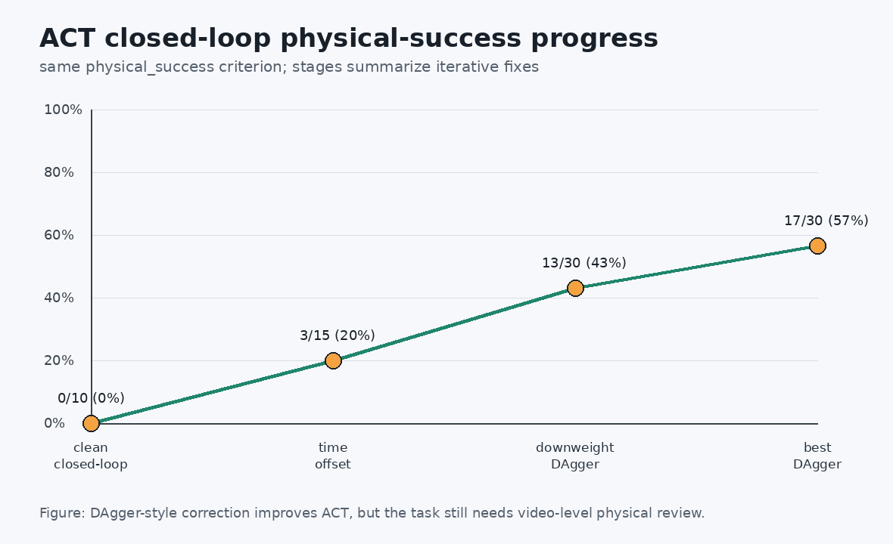
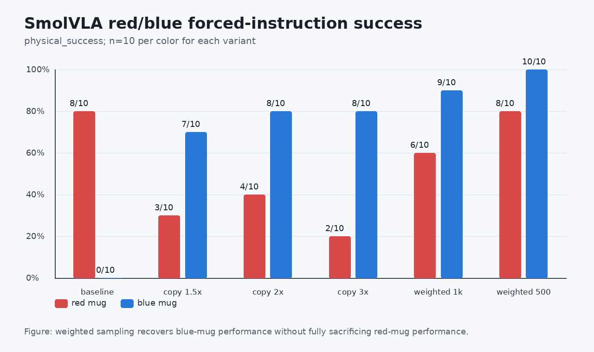
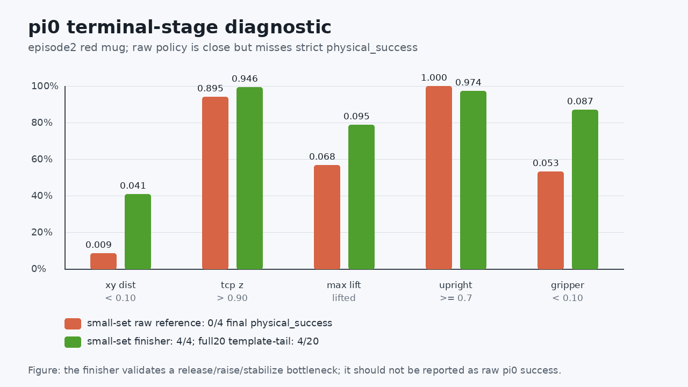

# Указатель случаев отладки ROCm

В этой главе собраны ключевые проблемы, возникавшие при воспроизведении ACT, SmolVLA и pi_0 на устройстве AMD ROCm, оформленные как учебные случаи. Команды здесь не перечисляются в хронологическом порядке: каждая проблема разбирается как цепочка диагностики — сначала наблюдается симптом, затем собираются доказательства, устанавливается первопричина, и наконец то же самое оценочное правило подтверждает, что исправление работает.

Основной метод изложен в [справочнике по отладке ROCm](../06-rocm-debugging-review-and-troubleshooting-cases.md); практический Notebook: [06_rocm_debug_playbook.ipynb](../notebooks/06_rocm_debug_playbook.ipynb).

Эта глава помогает:

- определить, совпадает ли «успех в журнале» с «физическим успехом»;
- понять, когда нужно вернуться к сбору данных и проверке воспроизведения;
- понять, почему ACT нужно дообучать через замкнутый DAgger, а не только по loss обучения;
- понять, почему для смещения по цвету в SmolVLA нужна оценка с принудительными инструкциями красная/синяя;
- понять, почему raw-политику pi_0 и диагностику со скриптовым финишером нужно докладывать раздельно;
- находить типичные проблемы процессов, видеопамяти, путей и зависимостей на удалённом ROCm-узле;
- безопасно обращаться с закрытыми моделями Hugging Face, токенами и кэшем.

## От симптома к выводу

Во время воспроизведения не стоит сохранять только один длинный журнал. Гораздо полезнее оформить каждый сбой как небольшой разбираемый случай: как проблема была замечена, какие есть доказательства, какие направления исключены и как проверено, что исправление действительно работает.

Рекомендуемая структура записи о случае:

| Поле | Что записывать |
| --- | --- |
| Симптом | Наблюдаемая ошибка, поведение на видео или аномалия метрики |
| Доказательства | JSONL, summary, ключевые кадры видео, состояние GPU или короткий журнал |
| Первопричина | Причина, подтверждённая доказательствами; догадки не записываются как факты |
| Исправление | Какой критерий, скрипт, стратегия данных или параметр обучения изменены |
| Проверка | Что получилось после исправления при том же протоколе оценки |
| Вывод для обучения | Что этот случай даёт для последующих воспроизведений |

Команды и пути записываются в переносимом виде, например `$PROJECT_ROOT`, `$DATA_ROOT`, `$OUTPUT_ROOT`. Так же можно будет воспроизвести всё на своей рабочей станции, в облачной машине или на учебном сервере.

## Случай 1: старый success не означает настоящего захвата

**Симптом**: в одной из оценок ACT отмечен успех, однако на видео кружка не поднята, а вытеснена концевым эффектором почти к тарелке и при этом опрокинута.

**Доказательства**: старая функция `env.check_success()` опирается главным образом на геометрию конечного состояния: если кружка оказалась рядом с тарелкой, захват открыт, а высота руки подходит, она возвращает успех. Просмотр видео показал, что такой «успех» не обязательно включает полный путь: захват, перенос, освобождение и вертикальную укладку.

**Исправление**: в учебнике введён единый критерий `physical_success`, который проверяет как минимум:

1. исходное геометрическое условие успеха выполнено;
2. целевая кружка поднята достаточно высоко, например подъём больше `0.03 м`;
3. подъём сохраняется в течение нескольких управляющих тактов;
4. в конечном состоянии кружка стоит почти вертикально, например cos вертикальности выше порога.

**Вывод для обучения**: при сравнении моделей сначала сообщайте `physical_success`. Старый success можно указывать как вспомогательный показатель, но не как единственное доказательство воспроизведения.

## Случай 2: данные демонстраций тоже нужно проверять

**Симптом**: ранние обучения ACT часто выучивали «зажать и не отпускать» либо нестабильно отпускали захват на финальном участке. Пока оценивалась только геометрическая успешность при воспроизведении, данные казались корректными, однако в замкнутом цикле было много неудач.

**Первопричина**: в ранней версии скрипта сбора запись действия захвата на финальном участке делалась неверно. В данные записывалось реально наблюдаемое состояние захвата из окружения, а не управляющее действие. В итоге метки конца эпизода больше напоминали «сохранять закрытым», а не «выполнить освобождение». Такая ошибка учит стратегию неправильно.

**Исправление**:

- скрипт сбора исправлен так, чтобы сохранять исходное управляющее действие по измерению захвата;
- для уже собранных данных выполнен ремонт финального участка;
- перед обучением каждый эпизод проходит аудит open-loop физического воспроизведения, который подтверждает, что демонстрация действительно включает захват и укладку.

**Вывод для обучения**: если стратегия постоянно ломается на финальной стадии, не спешите считать модель слабой. Сначала проверьте, действительно ли действия в данных выражают освобождение захвата.

## Случай 3: снижение loss у ACT не гарантирует устойчивость в замкнутом цикле

**Симптом**: ACT обучается нормально, а диагностика open-loop или teacher-forced показывает хороший результат, но в замкнутом rollout траектория уходит от демонстраций: кружку не касаются, после подъёма её опрокидывают, укладка смещается.

**Путь диагностики**:

| Этап | Результат физического успеха | Что это показало |
| --- | --- | --- |
| Чистый closed-loop | 0/10 | Одних офлайн-данных недостаточно, чтобы доказать работоспособность в замкнутом цикле |
| Смещение временной метки | 3/15 | После выравнивания фазы суффикса изредка появляется настоящий захват |
| DAgger с пониженным весом | 13/30 | Снижение веса данных коррекции защищает основное распределение от reset |
| Лучший DAgger | 17/30 | Случай ACT полностью разобран, но обобщение ещё далеко не сильное |



Рисунок 1: отладка ACT не сводится к «обучить ещё несколько шагов». Нужно последовательно выяснять проблемы распределения данных, временного выравнивания и коррекции состояний в замкнутом цикле.

**Вывод для обучения**: ключевое в ACT — не просто получить checkpoint, а показать, что он может продолжать выполнять задачу на состояниях, которые сам же и создаёт.

## Случай 4: не все данные DAgger улучшают результат

**Симптом**: после добавления новых данных DAgger или failure-bucket некоторые ветки ухудшаются. Когда данные неудач из полного reset с высоким весом вливаются в основное обучение, успешность в замкнутом цикле заметно падает.

**Первопричина**: данные состояний неудач и основное распределение, начинающееся с reset, не всегда совместимы. Прямое добавление с высоким весом может заставить модель забыть поведение, которое уже было выучено для стартовых состояний. Кроме того, у некоторых суффиксов коррекции временная метка и фаза не согласованы с эпизодами, начинающимися с reset.

**Стратегия исправления**:

- защищать лучший на текущий момент checkpoint, чтобы последующие эксперименты не перезаписывали его;
- сравнивать новые данные только при одном наборе seed и одном определении `physical_success`;
- для эпизодов коррекции использовать смещение временной метки;
- понижать вес выборки коррекции, например до `0.25`;
- сохранять выводы по ухудшившимся веткам, но не делать их основной линией.

**Вывод для обучения**: цель DAgger — восполнить состояния, в которые стратегия сбивается в замкнутом цикле, а не сваливать в обучение все неудачные траектории. До добавления новых данных нужно ответить на вопрос, какое распределение состояний они восполняют.

## Случай 5: SmolVLA не разучилась захватывать, а имеет смещение по задаче

**Симптом**: baseline SmolVLA в случайной оценке выглядит достаточно успешной. Однако при принудительных инструкциях для красной и синей кружки разница очень заметна: красная кружка получается, синяя почти не получается.

**Доказательства**: одни и те же seeds запускаются с двумя фиксированными инструкциями:

```text
Place the red mug on the plate.
Place the blue mug on the plate.
```

Строгие физические результаты baseline: красная `8/10`, синяя `0/10`. Количество эпизодов с красной и синей кружкой в наборе данных не было существенно несбалансированным, но задача с синей кружкой дальше и сложнее, поэтому модель нестабильно выполняет захват на начальном участке.



Рисунок 2: оценка при принудительных инструкциях красная/синяя позволяет отделить «модель не умеет захватывать» от «у модели есть смещение к определённому типу задачи».

**Вывод для обучения**: языковую стратегию нужно оценивать отдельно по каждой инструкции. Общая успешность легко скрывает смещения по цвету, расстоянию и сложности задачи.

## Случай 6: копирование данных не всегда лучше взвешенной выборки

**Симптом**: чтобы исправить неудачи с синей кружкой, напрашивается копирование эпизодов с синей кружкой. Копии в пропорции 1,5x, 2x и 3x действительно повышают успешность синей кружки, но заметно снижают успешность красной.

**Сравнение результатов**:

| Стратегия | Красная physical success | Синяя physical success | Вывод |
| --- | --- | --- | --- |
| baseline | 8/10 | 0/10 | Красная хорошо, синяя не получается |
| копия синей 1,5x | 3/10 | 7/10 | Синяя растёт, но красная деградирует |
| копия синей 2x | 4/10 | 8/10 | Всё ещё смещение к синей |
| копия синей 3x | 2/10 | 8/10 | Избыточная выборка сильнее вредит красной |
| взвешенная синяя 2.0, step1000 | 6/10 | 9/10 | Баланс лучше, чем у копирования |
| взвешенная синяя 2.0, step500 | 8/10 | 10/10 | Текущий защищённый базовый вариант |

**Первопричина**: копирование эпизодов меняет распределение эпизодов и статистику набора и легко подталкивает модель к одной из задач по цвету. Взвешенный sampler не меняет исходные файлы данных и лишь корректирует вероятности выборки, поэтому его проще откатывать и сравнивать.

**Вывод для обучения**: при балансировке задач на малом наборе данных сначала пробуйте мягкое взвешивание на уровне sampler или loss, и только потом копирование данных. Промежуточные checkpoint тоже нужно оценивать: финальный шаг не обязательно лучший.

## Случай 7: видео — это доказательство, но успешность считается по пакетному JSONL

**Симптом**: некоторые seed в пакетной оценке падают, но при отдельной перезаписи видео оказываются успешными. Бывает и обратное: seed проходит в пакете, а при отдельном повторе — нет.

**Причина**: в rollout MuJoCo, рендеринге, тайминге управления и выборке стратегии возможна недетерминированность на границе. Одиночное видео хорошо подходит для демонстрации, но не заменяет статистику по пакетному JSONL.

**Рекомендуемый способ отчёта**:

- успешность считать по пакетной оценке на фиксированных seed;
- успешные и неуспешные видео использовать для объяснения поведения;
- пограничные неуспешные seed повторять 3 раза, чтобы понять, стабильный ли это провал или случайный;
- в подписи к рисунку ясно указывать, что видео показывает типичное поведение, а не является самой статистикой успешности.

**Вывод для обучения**: не подменяйте таблицу статистики самым красивым видео и не отбрасывайте checkpoint из-за одного неудачного видео. Смотреть нужно на оба источника вместе.

## Случай 8: отладку ROCm на удалённом узле стоит переводить в скрипты, а не держать в Notebook

**Симптом**: Notebook хорошо подходит для объяснений, но длительное обучение, пакетная оценка и запись видео чаще сталкиваются с обрывами, путями, процессами и ресурсами.

В этом раунде отладки встречались такие типовые проблемы:

| Проблема | Проявление | Решение |
| --- | --- | --- |
| Не задан `PYTHONPATH` | Временный скрипт не находит модули проекта | В корне удалённого проекта задать `PYTHONPATH=$PWD:${PYTHONPATH:-}` |
| Утечка файловых дескрипторов | После пакетной оценки seed возникают ошибки загрузки ресурсов | Явно закрывать каждую среду и viewer после использования; при необходимости делить оценку на партии |
| Кэш итератора обучения | RAM растёт во время длительного обучения, а GPU простаивает | Не использовать бесконечный `cycle`, который кэширует батчи; пересоздавать iterator после исчерпания |
| Оставшиеся процессы | Занятость GPU или видеопамяти не совпадает с ожиданиями | Проверять точной командой и PID; останавливать только те задачи, которые точно свои |
| Высокая температура | GPU долго работает на полной нагрузке | Записывать температуру, видеопамять и режим fan/performance; если обучение стабильно и нет OOM или падения ядра, продолжать сравнивать модели |

Пакетные задания удобно оформлять как скрипты, например:

```bash
cd "$PROJECT_ROOT"
export PYTHONPATH="$PWD:${PYTHONPATH:-}"
export TOKENIZERS_PARALLELISM=false

./.venv/bin/python eval_policy_success.py \
  --policy act \
  --act-policy-path "$MODEL_ROOT/act_best/step_5000" \
  --physical-success \
  --seed-start 1000 \
  --episodes 10 \
  --output-jsonl "$OUTPUT_ROOT/act_seen_1000_1009.jsonl"
```

**Вывод для обучения**: Notebook нужен для объяснения и пошагового наблюдения, а скрипты — для получения сравнимых результатов. Перед тем как сообщать о проценте успеха, убедитесь, что журналы, JSONL, видео и состояние GPU согласуются друг с другом.

## Случай 8.1: видно GPU в ROCm — ещё не значит, что PyTorch стабильно обучается

**Симптом**: `rocm-smi` видит устройство, `torch.cuda.is_available()` возвращает `True`, но стоит выполнить `x.to("cuda")` или загрузить большие веса pi_0, как процесс Python аварийно завершается. Такой сбой легко принять за проблему кода модели, видеопамяти или температуры.

**Доказательство**: достаточно минимального теста тензора, без запуска обучения:

```python
import torch

print(torch.__version__)
print(torch.cuda.is_available())
x = torch.randn(1024, 1024)
y = x.to("cuda")
print(y.mean())
```

Если этот фрагмент падает, то обучение ACT, SmolVLA и pi_0 не имеет смысла диагностировать: сначала исправляйте среду выполнения, и только потом переходите к модели.

**Первопричина**: Ryzen AI MAX+ 395 соответствует архитектуре `gfx1151`. Документация AMD для ROCm 7.13 уже включает Ryzen AI Max+ 395 / `gfx1151` в список поддерживаемых; в примечаниях к выпуску ROCm 7.13 указана поддержка серии Ryzen AI Max 300. Одновременно системное руководство AMD по RDNA3.5 объясняет, что для серии Ryzen AI Max нужны определённые исправления ядра Linux и KFD, иначе вычислительные нагрузки могут не инициализироваться или вести себя непредсказуемо.

Поэтому это не значит, что «экосистема ROCm не работает», а что APU / RDNA3.5 / `gfx1151` требует строго согласованных ядра, драйвера, ROCm и колеса PyTorch. Если установить более новое, но не покрывающее `gfx1151` ночное колесо (nightly wheel), то может получиться состояние, когда `cuda.is_available=True`, но любая операция с тензором на GPU аварийно завершает процесс.

**Исправление**: сначала переходим на пару колёс ROCm / PyTorch, явно поддерживающую `gfx1151`, и только потом выполняем минимальный дымовой тест. В примерном эксперименте использовалась такая комбинация:

```text
torch 2.11.0+rocm7.13.0a20260425
torchvision 0.26.0+rocm7.13.0a20260425
rocm[libraries] 7.13.0a20260425
triton 3.6.0+rocm7.13.0a20260425
HIP 7.13.26162
```

Эти номера версий не обязательно повторять дословно: важен принцип. Сначала PyTorch и ROCm должны совпадать с аппаратной целью `gfx1151`, и только потом начинается обучение. После установки выполните как минимум четыре проверки:

```python
import torch

for dtype in [torch.float32, torch.float16, torch.bfloat16]:
    x = torch.randn(1024, 1024, dtype=dtype, device="cuda")
    print(dtype, x.mean().item())

big = torch.empty((512 * 1024 * 1024 // 4,), dtype=torch.float32, device="cuda")
print("512 MiB tensor ok", big.numel())
```

**Проверка**: когда базовые тензоры, float32/float16/bfloat16 и тензор на 512 МиБ проходят, можно переходить к `steps=0` инициализации pi_0, одному шагу обратного прохода только на экспертных данных и сохранению небольшого checkpoint. Только когда всё это проходит, можно утверждать, что среда выполнения восстановлена.

**Вывод для обучения**: ROCm уже покрывает APU класса Ryzen AI Max, но «официальная поддержка» не означает, что любое колесо из pip будет работать. Минимальный тест тензоров — первый барьер; пока он не пройден, длинные журналы обучения бесполезны.

Источники:

- [ROCm 7.13 compatibility matrix](https://rocm.docs.amd.com/en/7.13.0-preview/compatibility/compatibility-matrix.html)
- [ROCm 7.13 release notes](https://rocm.docs.amd.com/en/7.13.0-preview/about/release-notes.html)
- [AMD RDNA3.5 system optimization](https://rocm.docs.amd.com/en/latest/how-to/system-optimization/rdna3-5.html)

## Случай 8.2: загрузка больших весов модели тоже может обрушить ROCm

**Симптом**: минимальный тест тензоров уже проходит, но загрузка больших checkpoint вроде pi_0 всё равно приводит к падению, особенно на пути, где `safetensors` загружает веса сразу на GPU.

**Доказательство**: файл `model.safetensors` у `lerobot/pi0` и у локального checkpoint pi_0 очень большой, и при загрузке видеопамять быстро растёт. Если падение происходит до начала прямого и обратного проходов обучения, сначала нужно подозревать путь загрузки весов.

**Исправление**: веса safetensors сначала загружаются на CPU, и только потом вся модель переносится на GPU вызовом `policy.to("cuda")`. Эта правка не меняет структуру модели и данные обучения, она лишь меняет порядок загрузки:

```text
safetensors -> CPU state_dict -> policy.load_state_dict(...) -> policy.to("cuda")
```

В примерном эксперименте этот шаг снял падение при прямой загрузке больших весов pi_0 на GPU. После исправления локальный checkpoint на 20 шагов загружается на GPU, занимая около 7,5 ГБ видеопамяти.

**Проверка**: одного успешного импорта мало. Нужно выполнить как минимум:

1. загрузить политику из локального checkpoint;
2. вызвать `policy.to("cuda")`;
3. вывести `torch.cuda.memory_allocated()`;
4. построить минимальный батч или выполнить один шаг дымового теста.

**Вывод для обучения**: адаптация к ROCm не всегда означает «изменить код обучения». Часто достаточно разнести по времени загрузку данных, весов и перенос тензоров, чтобы ошибка проявлялась на самом маленьком диагностируемом шаге.

## Случай 8.3: при resume нельзя подменять путь checkpoint на базовую модель

**Симптом**: при продолжении обучения с 500-го шага checkpoint pi_0 команда содержит `resume=true`, однако внутри скрипта обучения путь `cfg.policy.pretrained_path` принудительно возвращается на `lerobot/pi0`. Тогда получается, что веса модели загружаются из базовой политики, а состояние оптимизатора — из локального checkpoint. По смыслу это уже не «продолжение с 500 шага».

**Первопричина**: в учебном коде для удобства первого обучения была заложена логика по умолчанию, которая выполняется до создания политики:

```python
if cfg.policy.type == "pi0":
    cfg.policy.pretrained_path = "lerobot/pi0"
```

Для первого обучения это удобно, но при resume опасно. Метод `cfg.validate()` уже нашёл каталог `pretrained_model` локального checkpoint в `train_config.json`, и его нельзя перезаписывать позже.

**Исправление**: базовую модель по умолчанию задавать только при обычном, не resume, запуске:

```python
if cfg.policy.type == "pi0" and not cfg.resume:
    cfg.policy.pretrained_path = "lerobot/pi0"
elif cfg.policy.type == "smolvla" and not cfg.resume:
    cfg.policy.pretrained_path = "lerobot/smolvla_base"
```

Кроме того, в этой старой версии LeRobot у парсера есть особенность: `config_path` нужно передавать через знак равенства, тогда `validate()` сможет прочитать путь из исходных аргументов CLI:

```bash
python train_model.py \
  --config_path="$MODEL_ROOT/checkpoints/000500/pretrained_model/train_config.json" \
  --resume=true \
  --output_dir="$MODEL_ROOT/pi0_resume_1500" \
  --steps=1500
```

Если написать `--config_path path/to/train_config.json`, основной парсер может прочитать значение, но `validate()` при обратном просмотре аргументов его не найдёт, и появится ошибка «A config_path is expected when resuming a run».

**Проверка**: в журнале обучения должно быть:

```text
resume: True
Creating policy
Loading weights from local directory
Start offline training on a fixed dataset
step:550 ...
```

Если продолжение идёт от checkpoint на 500 шагах, следующая запись журнала должна начинаться примерно с `step:550`, а не с `step:50`. Это важная деталь: она подтверждает, что состояние обучения, планировщик и оптимизатор действительно подхвачены.

**Вывод для обучения**: resume — это не «запустилось, значит успешно». Проверяйте в журнале номер шага, скорость обучения, источник checkpoint и выходной каталог. Особенно для больших политик неправильное возобновление тратит много времени и искажает последующий анализ успешности.

## Случай 8.4: аварии и восстановление тоже стоит описывать, но без раскрытия личных путей

**Симптом**: в одной из команд слияния данных на удалённом узле использовалась строка SSH в двойных кавычках. Удалённая переменная раскрылась в локальном shell ещё до отправки и стала пустой, из-за чего путь вывода для `fast_merge --overwrite` оказался пустым. В результате очистился набор незарегистрированных больших каталогов внутри проекта. Исходный код можно восстановить из Git, но незарегистрированные ресурсы — checkpoint, `notebook_runs` и временный корень данных — сами не вернутся.

**Первопричина**: в многострочных удалённых командах переменные вроде `$OUT_ROOT` нужно раскрывать уже на удалённой стороне. Если весь фрагмент находится в локальных двойных кавычках, переменная может раскрыться локально, и на удалённую сторону придёт пустая строка.

**Исправление**:

1. Сложные удалённые команды передавать через heredoc:

   ```bash
   ssh user@host 'bash -s' <<'REMOTE'
   set -euo pipefail
   OUT_ROOT="/path/to/output"
   echo "OUT_ROOT=$OUT_ROOT"
   # следующие команды
   REMOTE
   ```

2. Все скрипты с `--overwrite`, `rm -rf` или `shutil.rmtree` предварять защитой пути: отклонять пустой путь, `.`, корень проекта и родительские каталоги.
3. Крупные checkpoint, наборы данных и результаты оценки нельзя хранить только в незарегистрированных каталогах. Нужно хотя бы одно описание для восстановления: из какого репозитория Hugging Face взяты данные, каким скриптом собраны, какой конфигурацией обучен checkpoint.

**Проверка**: после исправления ошибочная команда должна сразу завершаться, а не продолжать работу:

```text
refuse unsafe output_root: .
refuse empty output_root
```

Затем учебный базис восстанавливается из открытого набора данных: `demo_data_language` скачивается заново, 20 эпизодов / 2621 кадр, `observation.state` размерностью 6, `action` размерностью 7; после этого последовательно проходят `steps=0`, один шаг обратного прохода, checkpoint на 20 шагов, checkpoint на 500 шагов и оценка на фиксированной малой панели красных и синих.

**Вывод для обучения**: в открытом учебнике не нужно расписывать происшествие как личный журнал, но уроки инженерного характера стоит сохранить: раскрытие переменных на удалённой стороне, защита от перезаписи в скриптах, воспроизводимость открытых данных, а также то, что checkpoint не коммитятся в репозиторий, но команды обучения и результаты должны позволять их восстановить.

## Случай 9: pi_0 сначала проходит права и дымовой тест, и только потом обучение

**Симптом**: pi_0 нельзя просто запустить на обучение. Она зависит от закрытой модели, токена Hugging Face, загрузки весов, кэша и инициализации большой модели. Некоторые сбои происходят ещё до обучения.

**Порядок диагностики**:

1. Убедиться, что токен действителен, но не выводить его в командной строке и журналах.
2. Убедиться, что аккаунт принял условия закрытых моделей, например PaliGemma.
3. Проверить, что `lerobot/pi0` и связанные модели читаются.
4. Убедиться, что сеть или прокси на удалённом узле стабильно загружают веса.
5. Выполнить дымовой тест на 1 шаг.
6. Только после него запускать полное обучение и принудительную оценку красная/синяя.

**Состояние на этапе**: в примерном эксперименте pi_0 прошла предобучающие ворота и перешла к диагностике после обучения. Права, загрузка, построение политики и обучение работают, что подтверждает работоспособность цепочки. Но способна ли модель воспроизвести задачу, всё равно определяется `physical_success` при фиксированных seeds.

**Вывод для обучения**: для больших политик права доступа, загрузка и построение политики сами по себе являются экспериментальными воротами. Пока дымовой тест на 1 шаг не пройден, длительное обучение не запускаем.

## Случай 10: сбой pi_0 в хвостовой фазе не означает, что вся траектория не выучена

**Симптом**: после донастройки на малом наборе raw-политика pi_0 в эталонном открытом воспроизведении на наборе 2 синих и 2 красных даёт `0/4 final_physical_success`; повторный прогон того же набора на граничных образцах может дать `1/4`. Поэтому малый набор полезнее для поиска этапа, на котором происходит сбой, а не как оценка обобщения. На полных 20 эпизодах открытого воспроизведения raw-политика даёт `1/20 final_physical_success` и `3/20 physical_success_ever`; при строгом замкнутом цикле на 20 seeds — `0/20 physical_success`, а по старому геометрическому критерию — `2/20`.

**Доказательства**: если посмотреть на конечные метрики каждого эпизода, видно, что raw-политика часто уже доводит кружку до тарелки, но не хватает последних шагов — освобождения, подъёма и устойчивой укладки. Например, у представительного эпизода 2 конечное xy-расстояние raw-политики всего `0.0087 м`, кружка сохраняет вертикальность, однако координата z TCP равна `0.8953 м`, и строгий порог не выполнен. На полном открытом наборе в трёх эпизодах `physical_success` появлялся ненадолго, но только в одном из них сохранился в конце. В строгом замкнутом цикле ни один эпизод не удерживал успех; основные категории отказов — «после подъёма кружка не вертикальна» и «подъём недостаточен». Это наглядно показывает разницу между «приблизиться» и «устойчиво завершить».



Рисунок 3: raw-политика pi_0 уже очень близка к цели, но release / raise / stabilize не переходят порог физического успеха устойчиво. Зелёные столбцы отражают тот же диагностический случай после подключения скриптового финишера.

**Техническая справка**: такие сбои — не «pi_0 изначально умеет учить только промежуточные действия». Скорее они отражают эффект усиления в хвосте, когда работают вместе малый объём данных, длинные траектории и блочное предсказание действий (action chunking).

- [Статья о pi_0](https://arxiv.org/html/2410.24164v1) ставит в центр масштабные многозадачные данные с разных роботов и рецепт постобучения. Особо подчёркивается ценность корректирующих данных и данных восстановления. У нас обучение идёт на малом наборе захвата кружек, с объёмом покрытия и восстановительных действий на несколько порядков меньше, поэтому нельзя рассчитывать, что модель сама выучит незнакомые хвостовые стратегии восстановления.
- [Real-Time Action Chunking от Physical Intelligence](https://www.pi.website/research/real_time_chunking) описывает модели вроде pi_0 как предсказывающие сегмент действий за раз, а не одно действие; в примере 50 действий примерно соответствуют 1 секунде управления. Блочное предсказание делает движения более связными, но граница между блоками, задержка инференса и паузы, которых не было в обучении, создают дополнительные проблемы.
- [Real-Time Execution of Action Chunking Flow Policies](https://arxiv.org/html/2506.07339v1) проясняет, что блочное предсказание улучшает временную согласованность, но граница блоков и задержки всё равно влияют на реальное исполнение. После донастройки на малом наборе начальная фаза «подойти к кружке и переместиться к тарелке» ещё может усредниться, а последние сантиметры release / raise / stabilize легко ломаются накапливающейся ошибкой.
- [Документация LeRobot по сбору данных с участием человека (Human-in-the-Loop)](https://huggingface.co/docs/lerobot/en/hil_data_collection) подробно описывает накапливающиеся ошибки и покрытие состояний помимо успешных демонстраций: если учитываются только успешные траектории, стратегия при первом отклонении попадает в состояния, которых не было в обучении. Чтобы модель научилась возвращаться из отклонения, коррекции и восстановление должны записываться внутрь эпизодов.

Применительно к нашей задаче с кружкой это объясняет наблюдения: raw-политика не полностью неспособна двигаться, она подталкивает или переносит кружку к тарелке, но для release / raise / stabilize нужны очень малые ошибки концевого эффектора, правильный тайминг захвата и достаточная устойчивость в конечном состоянии. Снижение loss при обучении не обязательно исправит этот участок: ему не хватает покрытия хвостовых состояний, границ фаз и цели физического успеха, а не только дополнительных шагов.

**Проверка исправления**: чтобы понять, сосредоточена ли проблема в хвосте, мы не объявляли raw-политику успешной, а добавили диагностический скриптовый финишер. Он строит средние действия release / raise / stabilize по хвосту набора данных и останавливается сразу, как только достигнут `physical_success`. Гибридная схема на малом наборе 2 синих и 2 красных дала `4/4 final_physical_success`.

Затем эту же идею распространили на полный `demo_data_language` из 20 эпизодов. Для варианта `pi_0 step1500 + all-episode template tail40 + blend20 + stop-on-physical-success` результат открытого воспроизведения teacher-forced составил `4/20 final_physical_success`; успешными стали эпизоды `7, 9, 13, 14`, по цветам — красная `2/10`, синяя `2/10`. Этот результат делает вывод точнее: фиксированный скриптовый хвост действительно спасает часть почти успешных траекторий, но это не общее решение. В неудачных образцах чаще всего xy далеко, кружка не вертикальна, а у части даже не происходит устойчивого подъёма. Контакт в начале, захват, перенос и освобождение в хвосте связаны между собой, и их нельзя исправить усреднением последних 40 кадров.

Дальше мы провели более строгую каузальную декомпозицию: вместо префикса pi_0 сначала scripted oracle доводил эпизод до разных точек передачи управления, а затем управление передавалось финишеру, обученному только на суффиксах из 10 эпизодов. Префиксы `120/180/240/300` на seeds `1000/1001` дали во всех случаях `0/2 physical_success`. В части прогонов кружку уже поднимали и удерживали вертикально, но конечное xy оставалось на уровне `0.22-0.60 м`: кружку уносило далеко от тарелки. Значит, дело не только в том, «слишком рано или слишком поздно» передана управление, но и в том, что цель переноса, направление и условие освобождения у финишера ещё не выучены надёжно.

Плотная трасса целевых действий подтверждает это. Для seed `1000` после oracle-префикса `180` финишер в первые 80 тактов управления проходил фазы так: `move_pregrasp` 28 шагов, `move_grasp` 35 шагов, `close_gripper` 17 шагов. То есть уже после подъёма кружки финишер возвращался к фазам подхода и повторного захвата. Целевой TCP находился в среднем в `0.481 м` от центра тарелки и в `0.147 м` от кружки; компонента y относительно центра тарелки всё время была положительной, от `+0.295 м` до `+0.554 м`. Это означает, что после отбора по позе относительно тарелки целевая точка финишера оставалась на стороне кружки, а не над тарелкой. Такое числовое свидетельство убедительнее одних видео: оно прямо показывает, что стратегия не выучила относительную позу тарелки как устойчивую цель управления.

Ручное ускорение фаз тоже не помогло. Мы сократили время `move_pregrasp/move_grasp/lift` финишера до одного шага. Даже с префиксом `180` и seeds `1000/1001` результат остался `0/2 physical_success`, конечное xy около `0.534/0.494 м`. Поэтому следующий шаг — не просто подбирать время фаз, а вместе с состоянием относительно тарелки передавать в следующую версию политики сигнал смещения фазы или головы фазы.

Далее мы провели диагностику со сдвигом расписания: без изменения весов финишер начинал воспроизводить `dataset_schedule` с начала `move_preplace` или с `lower_to_plate`. Старт с `move_preplace` всё ещё давал `0/2`, однако у seed `1000` конечное xy снизилось до `0.140 м`, то есть начальная фаза действительно помогает. У seed `1001` xy осталось на `0.410 м`, и захват слишком рано раскрывался. Старт с `lower_to_plate` оказался хуже: оба seed оканчивались на `0.44-0.45 м`, то есть переход к опусканию и освобождению наступал слишком поздно, а кружка ещё не была доставлена над тарелкой. Добавление скриптового тайминга захвата снова дало `0/2`, хотя у seed `1001` xy уменьшилось с `0.410` до `0.171 м`. Граница проблемы стала яснее: фаза и тайминг захвата необходимы, но сами по себе не решают задачу, потому что у поздней политики ещё не выучена стабильная цель переноса относительно тарелки.

Поэтому следующая версия явно вводит в состояние позу относительно тарелки. Новое 22-мерное состояние записывается так:

```text
joint6 + timestamp + phase_index_norm + phase_onehot11 + tcp_to_plate3
```

Здесь `tcp_to_plate` — это вектор от текущего TCP до центра тарелки. В обучающих данных используется приближение: первый кадр TCP берётся из `prefix_end_debug.tcp_pos` сбора, а дальше позиция выводится из цели `eef_abs` предыдущего кадра. В замкнутой оценке используется реальный `tcp_link - body_obj_plate_11`, взятый напрямую из MuJoCo. Этот шаг соответствует корневой причине из трассы: цель поздней стратегии всё ещё смотрит на сторону кружки, поэтому «где тарелка относительно меня» передаётся как обучаемый вход, а не оставляется для неявной догадки модели по малым обучающим изображениям.

В этом раунде встретилась типичная проблема переноса: в старом checkpoint `normalize_inputs.buffer_observation_state.mean/std` имеют размерность 19, а новое состояние — 22, поэтому прямая загрузка даёт несовпадение форм. Исправление не требует переобучать всё: копируем старый checkpoint, удаляем только эти два буфера нормализатора состояния, чтобы статистика нового набора 22-мерных данных инициализировалась заново, а веса основной части pi_0 остаются от прежнего финишера. Затем обучение продолжалось 250 шагов; loss держался около `0.012-0.019`, видеопамять и температура были стабильными, без OOM и падений ядра.

Проверка велась с сохранением границ диагностики: сначала `oracle prefix180` доводит кружку до состояния, пригодного для передачи, затем 22-мерный финишер берёт управление из фазы `move_preplace`. На 10 seeds результат — strict `5/10`, legacy `6/10`, вместо `0/2` в предыдущем варианте с отрицательным результатом. Успешные seeds: `1000, 1001, 1004, 1005, 1006`. Среди неудач `1002/1007/1008/1009` кружку поднимали, но не доносили до центра тарелки; `1003` подошёл к центру, но кружка опрокинулась. Итог: относительное состояние относительно тарелки — полезный сигнал, однако тайминг захвата, устойчивость после освобождения и переход от каркаса к сырой политике ещё не решены.

Ещё один узкий контрольный опыт: руку по-прежнему ведёт pi_0, но захват переведён на скриптовое открытие и закрытие по фазам. Strict вырос с `5/10` до `7/10`, успешные seeds стали `1000, 1002, 1003, 1004, 1005, 1006, 1008`. Этот результат надёжнее, чем впечатление «кажется, с захватом что-то не так»: он показывает, что тайминг захвата действительно спасает часть опрокидываний и соскальзываний, но не является достаточным условием. Оставшиеся неудачи `1001, 1007, 1009` — все с красной кружкой, итоговое `xy` по-прежнему `0.14-0.24 м`. Значит, для точки укладки красной кружки и высоты освобождения нужны дополнительные данные по этапам или иное представление цели.

### Сначала уточняем протокол seeds

После завершения этого раунда отладки мы проверили код рандомизации среды и обнаружили, что `y_env2.py` записывал любой seed как `np.random.seed(seed=0)`. Поэтому прежние результаты `1010-1039` меняли только случайность выборки политики Pi0, а положения кружки и тарелки в среде не менялись. Эти результаты мы сохраняем, потому что они по-прежнему хорошо показывают, как расписание, голова захвата, голова переходов и протокол reset влияют на устойчивость при фиксированной сцене. Однако в этом разделе их уже нельзя называть «невиданными положениями» или «обобщением по пространству».

После исправления на `np.random.seed(seed=seed)` строгая голова визуальной истории strict-input на действительно случайных средах с seeds `41-44` дала только `1/4`. Значит, отладка старого каркаса решила проблемы временной структуры действий и семантики состояния для фиксированной сцены, а покрытие данных несколькими положениями остаётся отдельным барьером.

Затем выборку расширили до seeds политики (среда фактически фиксирована на seed 0) `1010-1039`. Если повторять 10 шаблонов schedule по кругу, этот улучшенный каркас дал strict `21/30`, legacy `23/30`, красные `12/18`, синие `9/12`. Уже это показывает, что 22D `tcp_to_plate` и скриптовый захват работают не случайно, однако неудачи очень концентрированы: все 9 строгих провалов относятся к эпизодам schedule `1, 7, 9`.

Если посмотреть на длину фаз в каждом шаблоне, причина становится очевидной. У эпизодов `1, 7, 9` фаза `move_preplace` длится всего `72-75` кадров; у длинных шаблонов `0, 2, 3, 4, 5, 6, 8` — `120-123` кадра. То есть провал вызван не «трудностью конкретного seed», а слишком короткой фазой переноса: кружка ещё не над центром тарелки, а расписание уже переходит к опусканию и освобождению. Это согласуется и с видео: неудачные образцы часто уже захвачены и стоят вертикально, но конечный y остаётся перед тарелкой, как будто руку отпустили раньше, чем нужно было доставить кружку.

Гипотезу можно проверить, изменив только шаблон расписания. Все 9 неудачных seeds переводятся на длинный шаблон episode `0`, и все 9 проходят строгий порог `9/9`. Затем все 30 seeds политики принудительно переводятся на длинный шаблон `move_preplace` эпизода 0: strict `30/30`, legacy `30/30`, красные `18/18`, синие `12/12`, средний конечный `xy` около `0.0281 м`, максимальный около `0.0739 м`. Модель и обучение при этом не менялись, поэтому короткий шаблон `move_preplace` — самое крупное из устранимых узких мест в этом раунде.

Затем начали разбирать сам каркас. Сначала убрали две зависимости по отдельности: при отключённом скриптовом захвате, но с oracle-префиксом и длинным расписанием, на seeds политики `1010-1019` получилось strict `5/10`; если же заменить oracle-префикс текущим префиксом политики, но оставить скриптовый захват и длинное расписание, — strict `3/10`. Эти числа показывают, что тайминг захвата можно сделать первым локальным узким местом для устранения, тогда как префикс политики пока не может сразу заменить oracle-префикс.

Поэтому обучили небольшую логистическую голову захвата, которая предсказывает только открытие и закрытие захвата; руку и EEF по-прежнему выдаёт 22D-финишер. Первая версия использовала полное 22D-состояние. На обучающей выборке точность составила `100%`, но на seed `1010` в замкнутом цикле она провалилась: голова выучила не только окно фазы, но и корреляции между суставами и TCP из обучения, которые в замкнутом цикле смещаются. Во второй версии вход ограничили фазой: `timestamp + phase_index_norm + phase_onehot11`. Точность на обучении по-прежнему `100%`, но замкнутая проверка прошла: smoke seed `1010` — `1/1`; seeds политики `1010-1019` — strict `10/10`; полный набор `1010-1039` — strict `30/30`, legacy `30/30`, красные `18/18`, синие `12/12`, средний конечный `xy` около `0.0272 м`, максимальный около `0.0735 м`.

Этот шаг полезен для обучения тем, что большая голова не всегда лучше. Для короткого события вроде открытия и закрытия захвата вход только по фазе стабильнее полного состояния: он прямо задаёт, в каком окне захвата находится робот, и не добавляет детали движения руки, которые в замкнутом цикле дрейфуют. Итог: ручное правило захвата заменено обучаемой малой головой, которую можно сохранить и повторно использовать. Однако это ещё не успех raw pi_0: oracle-префикс, ручное начало `move_preplace`, явный `tcp_to_plate` и принудительное длинное расписание пока остаются.

Второй слой каркаса — принудительный длинный эпизод 0. Новый адаптивный gate `move_preplace` по-прежнему использует расписания `0..9`, но не выпускает захват сразу, когда короткий шаблон переходит к `lower_to_plate`. Если живой `tcp_to_plate_xy` ещё велик, последний кадр `move_preplace` удерживается; когда TCP подходит к центру тарелки или достигнут безопасный предел, начинаются опускание и освобождение. Этот шаг не меняет checkpoint, выход EEF/руки и голову захвата; он заменяет только слой «фиксированный длинный шаблон».

Самая устойчивая конфигурация здесь — `xy=0.05m, min_steps=20, max_steps=180`: seeds политики `1010-1019` — strict `10/10`; полный набор `1010-1039` — strict `30/30`, legacy `30/30`, красные `18/18`, синие `12/12`, средний `xy` около `0.0281 м`, максимальный около `0.0617 м`. Значит, не обязательно заставлять все образцы идти по длинному эпизоду 0: можно дополнить фазу переноса короткого расписания по живому прогрессу.

Но это ещё не полноценная обученная голова переходов. В трассе seed `1011` переключение `move_preplace -> lower_to_plate` при `0.05 м` происходит только по страховке `max_steps=180`, и живое `tcp_to_plate_xy` на этот момент примерно `0.0574 м`. Если расширить порог до `0.09 м`, seed `1011` переключается сам на шаге `163`, что похоже на настоящий gate прогресса. Однако на полном наборе из 30 seeds результат ухудшается: strict `29/30`, seed `1034` провалился, итоговое `xy` выросло до `3.16 м`. Порог `0.08 м` на probe-seeds `1011/1034` даёт `2/2`, но в полном прогоне seed `1012` уже строго провалился. Поэтому переход нельзя определять одним широким порогом по `xy`: нужно одновременно учитывать z, подъём, устойчивость, контакт и время внутри фазы.

Следующая попытка — заменить gate логистической головой перехода. Первая полная версия использовала `tcp_to_plate_x/y/z`, `tcp_to_plate_xy`, `abs_z` и число шагов внутри фазы. Точность на обучении около `99.27%`, но на seed `1010` переход случился примерно на шаге финишера `59-60`, когда живое `tcp_to_plate_xy` было около `0.35 м`, а кружка ещё не стояла над центром тарелки. Это типичная картина: высокая точность на обучении не означает надёжность в замкнутом цикле. Голова с полным набором признаков приняла корреляции направления и высоты за условие освобождения.

Вторая версия оставила только `tcp_to_plate_xy + local_step_norm`. Точность на обучении снизилась до `95.01%`, но замкнутый цикл стал стабильнее: seed `1010` перешёл из провала в строгий успех, переключение произошло на шаге финишера `136`, а не по страховке `max_steps`. Затем seeds политики `1010-1019` — strict `10/10`; полный набор `1010-1039` — strict `30/30`, legacy `30/30`, красные `18/18`, синие `12/12`, средний конечный `xy` около `0.0279 м`, максимальный около `0.0741 м`. Из 30 эпизодов `29/30` переключились по решению головы перехода; только seed `1021` дошёл до страховки `max_steps=180`, и он тоже был успешен.

Этот шаг важен: второй слой каркаса перешёл от принудительного длинного шаблона к обучаемой голове перехода с предохранителем по максимальному числу шагов. Это всё ещё не raw pi_0 и не полностью свободная динамическая политика фаз: остаются oracle-префикс, явный `tcp_to_plate`, расписание хвоста и страховка `max_steps`. Однако теперь можно точно сказать: тайминг захвата и переход `move_preplace -> lower_to_plate` в хвосте pi_0 имеют обучаемые версии в виде малых голов и на 30 seeds политики при фиксированной среде проходят строгую физическую проверку.

Третий слой — контактные примитивы. Первый вариант, где все головы `pregrasp_to_descend / descend_to_close / close_to_lift / lift_to_hold` обучали на фазовых хвостах, был поучительным контрпримером: точность на обучении была неплохой, но на smoke seeds `1010/1011` результат `0/2`. В трассе `descend_to_close` срабатывал, когда TCP находился примерно на `0.08 м` выше пола захвата, затем раньше времени запускался `close_to_lift`, и кружка начинала подниматься, ещё не попав в захват. Вывод: хвост фазы — это не условие контакта. Нельзя заменять вопрос «можно ли безопасно закрыть захват сейчас?» вопросом «скоро ли закончится фаза?».

Исправленный вариант изменил только `pregrasp_to_descend` на геометрическую метку и добавил признаки `tcp_to_grasp_xy`, `abs_tcp_to_pregrasp_z`, `tcp_to_floor_z`, `abs_tcp_to_floor_z`. Переход `descend_to_close` по-прежнему учится по фазовому хвосту, но при развёртывании добавлен `descend_floor_guard`: пока TCP не подошёл к полу захвата, закрывать нельзя. Smoke seeds `1010/1011` стали `2/2`, полный набор `1010-1039` — strict `30/30`, legacy `30/30`. Во всех 30 эпизодах `pregrasp->descend`, `descend->close` и `close->lift` срабатывали по решению головы, а floor guard заблокировал `342` попытки закрыть захват на высоте. Версия стала на один шаг чище: ручных геометрических переходов `pregrasp/descend` больше нет, но контактный каркас относительно цели, защита от пола и финишер хвоста остались.

Четвёртый слой — хвостовое расписание `dataset_schedule`. Новый финишер `dynamic_timed` стартует с `move_preplace` и генерирует временную метку и one-hot фазы онлайн-трекером, не читая расписание из набора. Первый полный прогон на seeds политики `1010-1039` дал strict `27/30`. Неудачи `1021/1031/1036` — не «отсутствие контакта»: `1021` поднялась, но осталась за пределами тарелки, `1031` отбросило далеко, а синяя кружка `1036` застряла перед тарелкой. Сначала казалось, что дело в фиксированной длительности `move_preplace=260`, но разбор кода показал более конкретную причину: `--tcpplate-prefix-target-state` предназначен для префиксной политики и задаёт `tcp_to_target`, однако он действовал и для динамического финишера. Финишер обучали на `tcp_to_plate`, а в работе он получал `tcp_to_target`.

Исправление: построитель состояния стал учитывать стадию. На этапе префикса берётся `tcp_link - target_mug`, на этапе финишера — `tcp_link - plate`; контактные примитивы ограничены префиксом, чтобы не просачиваться в динамический хвост, где нет `scheduled_states`. После исправления провалившиеся `1021/1031/1036` стали `3/3`. Повторный полный прогон seeds политики `1010-1039` дал strict/physical `30/30`, legacy `30/30`, красные `18/18`, синие `12/12`, средний `xy=0.0244 м`, максимальный `xy=0.0993 м`. Худший `xy` и минимальный cos вертикальности относились к seed `1036`, и он выглядел как пограничный успех.

Дальнейший разбор трасс выявил более тонкий баг. При последовательной оценке нескольких seeds в одной среде начальные положения кружки иногда выходили за пределы выборки для своего seed. У seed `1035` кружка появлялась примерно в `[0.2679, 0.1625, 0.8441]`, тогда как при отдельном `reset(seed=1035)` нормальная позиция около `[0.2944, 0.1912, 0.8447]`. Это значит, что сложность была не в самом seed, а в остаточной динамике qvel / ctrl / free-joint от предыдущего эпизода, которая попадала в следующий. `SimpleEnv2.reset(seed)` перезадаёт qpos объектов, но не очищает полностью низкоуровневый `mjData` MuJoCo.

Добавлены два переключателя протокола: `--fresh-env-per-episode` создаёт среду для каждого seed (чистый, но тяжёлый вариант; на малой панели `1036/1035/1020/1029` даёт `4/4`, однако на большой панели периодически вызывает ошибку провайдера ассетов); `--hard-reset-sim-data` переиспользует одну среду, но перед каждым `env.reset(seed)` вызывает сброс парсера, очищающий остатки qvel, ctrl и динамики свободного сустава. Для полной оценки на 30 seeds рекомендуется второй вариант. Повторный прогон seeds `1010-1039` с `--hard-reset-sim-data` дал strict/physical `30/30`, legacy `30/30`, красные `18/18`, синие `12/12`, средний `xy=0.0219 м`, максимальный `xy=0.0450 м`, минимальный подъём `0.1093 м`, минимальный cos вертикальности `0.9504`. Seed `1036` перестал быть пограничным; прежние `0.0993 м` были, по-видимому, артефактом остаточного состояния между эпизодами.

Этот случай хорошо подходит как шаблон отладки. Если одна и та же обёртка одновременно обслуживает префикс и финишер, глобальный переключатель легко выходит за пределы своей роли: `tcp_to_target` — хороший признак для захвата, но в хвосте он даёт неверную информацию; `tcp_to_plate` хорош для переноса и укладки, но на фазе захвата недостаточно прямой. Такой баг не обязательно вызывает ошибку и может не проявиться на дымовом тесте из 2 seeds; он проявляется на полной панели из 30 seeds как случайные выбросы, промахи мимо тарелки и перенос сверх меры. Точно так же грязный reset среды может выдавать «граничный провал политики» за «недостаток способностей модели». Поэтому при отладке нужно одновременно фиксировать стадию, семантику состояния, протокол reset и критерий успеха, а не смотреть только на итоговое число `physical_success`.

Это по-прежнему не успех raw pi_0. Точнее так: хвостовой финишер pi_0 впервые стал воспроизводимо успешным после добавления относительной позы относительно центра тарелки; затем, когда исправили длительность переноса и окно захвата, инженерный каркас стабильно выполнял задачу на 30 seeds политики при фиксированной среде; а после замены скриптового захвата на голову только по фазам, принудительного длинного эпизода — на голову перехода, а расписания хвоста — на динамический финишер с учётом стадии, результат сохранялся при чистом протоколе. Дальше, помимо снятия каркаса, приоритетом является повторный сбор данных с несколькими положениями, уже с исправленным seed среды.

### От каркаса к строгой голове визуальной истории

Продолжение обучения raw-модели Pi0 на большее число шагов не дало устойчивого успеха в замкнутом цикле. Поэтому эксперимент перешли на двухслойную схему: сохраняются визуально-языковой основной блок Pi0 и выход исходной политики, а сверху обучается голова визуальной истории, которая использует только информацию, доступную при развёртывании. Новые данные полной задачи делятся на две группы по 10 эпизодов, всего 20; seeds обучения — `21-32`, seeds проверки — `33-36`. После отбора в группах 3586 и 3164 кадра соответственно; в них есть и подход с контактом, и перенос, освобождение и устойчивая стабилизация в конце. Обучение больше не ограничивается маленьким отрезком контактного суффикса.

На вход визуальной ключевой голове подаются токены изображений с камер agent и wrist, полученные основным блоком Pi0/SigLIP, эмбеддинг языка, текущая 6D-проприоцепция робота и 7D-команда EEF/захват, которую политика сама выполнила на предыдущем шаге. Здесь нет координат цели или тарелки, GT-фазы, оракульного действия и будущих меток. У GRU-головы захвата убрана последняя размерность предыдущего состояния захвата из direct-головы; вместо неё используется только предыдущее исполненное действие EEF `[:6]`, чтобы не копировать состояние захвата с предыдущего кадра.

Первая линейная голова захвата показала общую точность на валидации `99.66%`, но на отложенных переходах освобождения было `0/4`. Причина понятна: эпизод длится сотни кадров, а реальные переключения захвата происходят только в считаных кадрах, поэтому общая точность почти полностью определяется удержанием текущего состояния. Переход на GRU-последовательности с повышенным весом потерь для кадров переходов и отдельной метрикой выбора по событиям закрытия и освобождения исправил ситуацию. Лучшая эпоха — 20; на валидации 2164 последовательных примера, 5 закрытий и 5 освобождений, при выбранном пороге `0.825` закрытие/освобождение `5/5`, сбалансированная точность около `96.8%`. При развёртывании для замкнутого гейта использовался более консервативный порог `0.5`.

Критерий успеха в замкнутом цикле также ужесточён. Помимо старого геометрического успеха, требуется реальный подъём не менее `0.03 м` в течение трёх подряд шагов, cos вертикальности не ниже `0.7`, разница высот кружки и тарелки не больше `0.08 м`, смещение тарелки в плоскости XY не больше `0.05 м` и выполнение условий укладки в течение 5 шагов подряд. Это отсекает два прежних ложных срабатывания: кружку, которая висит над тарелкой, и тарелку, которую вместе с кружкой толкнули. При фиксированной среде seed 0 и тех же 12 seeds политики сырая защищённая Pi0 даёт `0/12`, а голова визуальной истории GRU — итоговые строгие `6/12`; успешные seeds политики: `3, 8, 18, 33, 34, 40`. Прежний мягкий критерий по конечному состоянию показывал `8/12`, но seed 36 и seed 39 исключены итоговым критерием из-за смещения тарелки на `12.27 см` и `5.59 см`.

Рост результата связан с повторным сбором полной задачи, но не сводится к увеличению объёма данных. Сработали четыре вещи одновременно: данные покрывают все фазы задачи; голова визуальной истории получает наблюдаемый временной вход; переходы захвата взвешены отдельно; исполнитель переводит вероятность захвата в явную команду открытия или закрытия. Проблема тоже не решена полностью: после исправления seed среды на действительно случайных средах `41-44` результат `1/4`. Это значит, что 20 восстановительных эпизодов по-прежнему покрывают в основном фиксированную сцену.

Последний контрпример касается языкового протокола. С полной обучающей инструкцией `Pick up the blue mug and place it on the plate.` голова активировалась у seed 3 на 269 шагов и прошла итоговую строгую проверку на шаге 270. Но при замене на короткую синонимичную фразу `Place the blue mug on the plate.` gate по расстоянию до прототипа не разрешил вмешательство ни разу, и попытка провалилась. Текущая голова на небольшом наборе использует корректный языковой вход, но пока не обобщает переформулировки инструкции. В следующем раунде нужно пересобрать 30–50 траекторий с несколькими положениями после исправления seed, добавить аугментацию переформулировками промпта и проверить три гейта отдельно: фиксированная сцена, случайная позиция и языковая переформулировка.

<video controls muted preload="metadata" width="100%">
  <source src="../assets/pi0_ep2_raw_vs_finisher_side_by_side.mp4" type="video/mp4">
</video>

Рисунок 4: сравнение raw и гибридного варианта на одном эпизоде. Слева сырой pi_0 не проходит строгий физический успех; справа после подключения скриптового финишера успех достигается. Видео нужно для локализации узкого места в хвосте, а не как доказательство успешности raw pi_0.

**Что делать дальше**: не продолжать слепо добавлять шаги обучения. Сначала траекторию нужно разбить на фазы — приближение, контакт при захвате, перенос, освобождение, подъём руки и стабилизацию в конце — и проверять каждую отдельно. Для pi_0 разумен параллельный маршрут из четырёх направлений:

1. Совместить границы эпизода с реальной точкой завершения задачи. Если нужно, чтобы модель выучила «открыть захват, поднять руку, дождаться стабилизации, вернуться в безопасную позу», эти действия должны быть записаны внутри эпизода. Если это лишь сброс после оценки, не смешивайте его с успехом задачи.
2. Добавить данные по фазам: специально собрать или сгенерировать хвост release / raise / stabilize, включая коррекционные движения после небольшого смещения, а не только брать короткий отрезок из идеальных траекторий.
3. Использовать финишер `tcp_to_plate` размерностью 22D как новую базовую линию диагностики хвоста. Без скриптового захвата strict `5/10`, с захватом по фазам `7/10`, на 30 seeds политики с коротким шаблоном расписания `21/30`, с принудительным длинным шаблоном `move_preplace` — `30/30`. Во всех этих числах нужно указывать условия каркаса и не писать их как успех raw-модели.
4. Сохранить голову захвата только по фазам как первый результат снятия каркаса. Полное состояние даёт `100%` на обучении, но в замкнутом цикле на seed `1010` проваливается; голова только по фазам на `1010-1039` даёт strict `30/30`, что говорит о необходимости ограничивать входы коротких событийных голов.
5. Сохранить адаптивный гейт `move_preplace` как инженерную версию второго слоя. Конфигурация `0.05m + max_steps=180` даёт strict `30/30` на `1010-1039` и больше не требует длинного эпизода 0. Однако контрпримеры `0.08/0.09 м` показывают, что фиксированный порог нельзя выдавать за полноценную обученную голову перехода.
6. Сохранить голову перехода `xy_step` как обучаемую версию второго слоя. Голова на полном состоянии лучше на обучении, но в seed `1010` освобождает раньше времени; с признаками `tcp_to_plate_xy + local_step_norm` на `1010-1039` strict `30/30`, причём `29/30` переходов инициирует сама голова, а не страховка по `max_steps`.
7. Сохранить голову переходов по геометрии захвата и контакту как результат третьего слоя. Наивная голова на всех фазах закрывает захват на высоте; с геометрическими метками и `descend_floor_guard` на `1010-1039` strict `30/30`, но это по-прежнему контактный каркас, а не raw-политика.
8. Сохранить динамический финишер с учётом стадии как результат четвёртого слоя. До исправления границ состояния `dynamic_timed` дал `27/30`, после исправления target/plate prefix/finisher — `30/30`; после дополнительного `--hard-reset-sim-data` для исключения остаточной динамики между эпизодами — снова `30/30`. Это показывает, что границы интерфейса, протокол reset и способности модели одинаково важны.
9. Продолжать снимать каркас: вместо очередного глобального переключателя сделать условия выхода из динамической фазы, освобождения и стабилизации обучаемыми головами или более чистыми данными, а затем постепенно отделить префикс политики от контактного каркаса.
10. Оставить скриптовый финишер как диагностику и инженерную страховку. Он доказывает, что хвост — одно из узких мест, но на полных 20 эпизодах даёт лишь `4/20`, а в старом пробном переходе по oracle-префиксу — `0/2`. Поэтому нельзя записывать `pi_0 + финишер` как успех raw pi_0, а фиксированный хвост — как общее решение.

Более полный экспериментальный маршрут описан в разделе «Как поднять успешность pi_0» главы [Pi0/Pi0.5: права доступа, короткое обучение и замкнутая оценка](../05-pi0-rocm-permission-smoke-and-training-gatekeeping.md). Там собраны текущая базовая линия, уже отброшенные направления, поэтапная политика, представление действий EEF/TCP, корректирующие данные on-policy и новые пороги оценки; последующие эксперименты удобно вести по этой дорожной карте.

## Случай 11: покадровые oracle-метки не всегда образуют action chunk

**Симптом**: чтобы дать Pi0.5 примеры для выхода из отклонённых состояний, первая версия сборщика позволяла политике сначала выполнить 40 шагов, а затем в каждом её состоянии вычислялась коррекция oracle. После добавления 5 эпизодов в обучение ошибка захвата на офлайн-данных немного снизилась, однако на полностью новых seeds и на ранее собранных seeds результат оставался `0/4`. Дело не в том, что «мало данных DAgger»: сама временная семантика данных неверна.

Pi0.5 за один раз обучается на предсказании следующих 50 действий. Логика первой версии сборщика эквивалентна такой последовательности:

```text
obs_0 --student_action_0--> obs_1 --student_action_1--> obs_2 ...
  |                          |
  +-- oracle_label_0         +-- oracle_label_1
```

`oracle_label_0` означает лишь «если бы управление перехватили в `obs_0`, первое действие должно было быть таким». Это действие не выполнялось. `obs_1` получено после выполнения `student_action_0`, а не `oracle_label_0`. Аналогично `oracle_label_1` — ещё один контрфактический одношаговый ярлык. Если собрать `[oracle_label_0, oracle_label_1, ...]` в один будущий action chunk, модель будет учиться выполнять траекторию, которой в среде никогда не было.

На одношаговом поведенческом клонировании эта ошибка не сразу заметна: каждая пара `(observation, one_step_label)` по отдельности выглядит разумной. Для политики с action chunk это структурная ошибка: действия со второго по пятидесятое в блоке предполагают, что предыдущие метки выполнены, а наблюдения в данных продвигались действиями студента. Две цепочки состояний не совпадают.

**Исправление**: переход к непрерывному экспертному перехвату. Pi0.5 сначала выполняет 10 шагов, затем эксперт по-настоящему берёт управление с текущего отклонённого состояния, и сборщик сохраняет только непрерывный суффикс после перехвата:

```text
student prefix --> takeover_state
takeover_state --oracle_0--> state_1 --oracle_1--> state_2 ...
                    |                    |
                  save                 save
```

Теперь каждое будущее действие опирается на состояние, в котором предыдущее экспертное действие уже выполнено, и 50-шаговый chunk имеет реальный физический смысл. Кандидаты seeds `2100-2119` дали 20 траекторий; строго успешных после физической проверки сохранено 11, всего 4504 кадра. Неуспешные траектории в обучение не попадали. При длительном сборе со свежей средой встретилась ошибка `Too many open files`; её обошли, переключившись на пакеты по 5 кандидатов и добавление с `--resume`. После сборки проверяли индексы эпизодов, число кадров и manifest, без ручных правок метаданных.

Даже с исправленными данными результат нужно оценивать честно. После обучения на clean53 и coherent recovery11 ошибка захвата по MAE снизилась с `0.25659` до `0.08261`, то есть непрерывные восстановительные данные действительно научили часть временной логики открытия и закрытия. Однако ошибка xyz не улучшилась, а на полностью новых случайных seeds `2120-2123` строгий результат по-прежнему `0/4`. Поэтому в этом случае два вывода независимы: первая версия DAgger с chunk была временно неверной и её надо было исправить; но после исправления непрерывности пространственное направление к кружке остаётся отдельным узким местом, и решённая инженерная проблема данных сама по себе не означает, что модель уже работает.

При дальнейшем аудите DAgger с action chunk стоит проверять по пунктам:

| Пункт проверки | Условие прохождения |
| --- | --- |
| Кто создаёт следующее состояние observation | Совпадает с тем, кто выполнил действие, сохранённое как label |
| Действия внутри chunk выполнялись последовательно | Да, либо генерируются одной и той же динамикой rollout |
| Префикс политики записан в обучающий набор | Только если метки согласованы с цепочкой состояний |
| Суффикс перехвата физически успешен | Подтверждается строгим успехом и видео |
| Как обрабатываются неуспешные траектории | Сохраняются отдельно для диагностики, по умолчанию не смешиваются с данными успешного BC |
| Полнота эпизода после resume | Проверяются manifest, набор эпизодов, число кадров и непрерывность индексов |

Таблица 6: ключ к DAgger — не наличие oracle-меток, а то, что метки, наблюдения и переходы среды относятся к одной исполнимой траектории.

## Случай 12: все `index` на месте, но action chunk всё равно может сдвигаться по кадрам

**Симптом**: после агрегации 64 траекторий EEF-delta и 27 восстановительных траекторий coherent получились метаданные 91 эпизод и 35284 кадра; при сортировке по `index` значения точно `0..35283`. Все эти проверки прошли, но при выборке обучения у некоторых позиций `action_chunk[0]` не совпадал с действием текущей строки parquet. Обучение продолжалось, loss мог снижаться, но наблюдения и будущая разметка действий не совпадали, поэтому стабильный порядок стадий в замкнутом цикле не выучивался.

Чтение chunk в LeRobot можно упрощённо описать так:

```text
current_observation = physical_rows[idx]
future_actions = physical_rows[clamp(idx + delta, episode_start, episode_end - 1)]
```

Здесь `idx` — позиция физической строки в Hugging Face Dataset, а не значение `index` из строки с последующим повторным поиском. Если parquet при загрузке по имени файла содержит на физической позиции `21105` сохранённый `index` `21510`, то `idx + delta` ведёт на неверный кадр, даже если набор `index` в итоге полностью совпадает. В исходной агрегации было `4909` строк с физическим смещением; первое смещение — ровно `21105 -> 21510`.

Ошибка также искажает sampler. В одной из прежних сводок центр перехода захвата резко переходил с `21028` на `25707/25937`, а затем возвращался к `21195`. Центр перехода должен монотонно расти вместе с порядком эпизодов; такой скачок — след беспорядка физических строк.

**Первопричина**: инструмент агрегации проверял, что после сортировки по глобальному `index` значения идут подряд и все эпизоды на месте, но не проверял, что при фактической загрузке parquet позиция `i` содержит сохранённый `index = i`. Эпизоды, добавленные при восстановлении, изменили соответствие между номерами файлов, номерами эпизодов и глобальными `index`. Кроме того, в старых статистиках действий эпизодов оставалась размерность `eef_abs`, что усиливало риск ложной уверенности.

**Исправление**: исходные данные не изменяются; создаётся отдельная канонизированная копия:

1. по фактическому `episode_index` находится исходный parquet каждой траектории;
2. внутри каждого эпизода строки сортируются по `frame_index`;
3. каждый эпизод записывается отдельным файлом `file-{episode_index}.parquet`;
4. в порядке эпизодов заново строятся глобальный `index` и `dataset_from/to_index`;
5. исправляется сопоставление файлов data/meta и пересчитываются статистики по эпизодам и глобальные статистики по реальным значениям;
6. после записи все нетиндексные колонки Arrow сравниваются поэлементно: байты изображений, состояние, действия и информация о задаче не должны измениться.

Для этого используются скрипты [`pi05_canonicalize_lerobot_v3.py`](../code/pi0/pi05_canonicalize_lerobot_v3.py) и [`pi05_validate_chunk_alignment.py`](../code/pi0/pi05_validate_chunk_alignment.py). Структурные смещения в canonical91 снизились с `4909` до `0`. Затем через реальный интерфейс LeRobot `delta_timestamps` для horizon 10 и 50 проверили по 1318 репрезентативных позиций; все 553560 скалярных значений действий и 28240 шагов заполнения в конце эпизодов совпали, максимальная абсолютная ошибка `0`.

**Порядок переобучения**: checkpoint, обученные на сбитых данных, нельзя продолжать как чистую базу, даже если loss выглядит хорошо. Часть наблюдений и chunk-меток уже рассогласована, поэтому самое надёжное — переобучить с официальной базовой модели Pi0.5. Скрипт `pi05_rocm_finetune.py` получил также стартовый фильтр: если физические позиции, глобальный `index`, границы эпизодов, `frame_index` или граничный `chunk[0]` не согласованы, скрипт завершается с ошибкой до загрузки модели объёмом 7 ГБ.

Для агрегированных action-chunk данных в будущем нужно проверять одновременно четыре уровня:

| Уровень | Что должно выполняться |
| --- | --- |
| Набор | Эпизоды, кадры и набор `index` полные |
| Физический порядок строк | Строка `i` содержит сохранённый `index` = `i` |
| Границы эпизодов | Каждая траектория непрерывна, frame растёт от 0, from/to в метаданных согласованы |
| Чтение моделью | `chunk[0] == current action`, будущие действия не переходят в другой эпизод, хвостовое заполнение корректно |

Таблица 7: для policy с action chunk именно четвёртый уровень ближе всего к тому, что модель реально читает при обучении. Если проверять только первый уровень, остаётся самая опасная тихая ошибка.

## Случай 13: снижение офлайн-ошибки при нулевом успехе на обучающих и новых seeds

**Симптом**: после прохождения canonical91 проверок физического порядка строк и action chunk Pi0.5 переобучили на 800 шагов с официальной базы. Flow loss снизился с `1.86613` до `0.72765`, MAE действия — с `0.07255` до `0.04588`, MAE захвата — с `0.49882` до `0.31419`. По этим числам очень легко решить, что следующим шагом надо расширить оценку на невиданных положениях.

Строгий замкнутый цикл дал другой вывод: обучающие положения `1000-1003` — `0/4`, новые положения `2180-2183` — тоже `0/4`. Ни в одном эпизоде не возникло устойчивого подъёма не менее `3 см` в течение трёх подряд шагов. Если даже близкие к обучающим положения не проходят, текущую проблему нельзя объяснять в первую очередь недостатком пространственного обобщения.

В этом раунде встретилась и ложная ошибка инструмента. Новый запускатор по SSH не унаследовал графические переменные рабочего стола, и `pyautogui` на этапе импорта падал с `KeyError: 'DISPLAY'`, так что rollout даже не начинался. На удалённой машине существовала графическая сессия `:0`, а старые скрипты ACT/SmolVLA/Pi0 использовали `DISPLAY=:0` и `MUJOCO_GL=glfw`. После установки этих двух переменных строгая загрузка модели, инициализация MuJoCo и четыре rollout завершились нормально. Первый сбой следует отнести к проблеме среды оценки и не включать в знаменатель успешности модели.

Пошаговые траектории информативнее, чем итоговый `0/4`. Для четырёх новых seeds TCP при наибольшем приближении к кружке находился на горизонтальном расстоянии около `5.4-6.7 см`, но всё ещё на `10.4-13.8 см` выше центра кружки; захват уже почти закрыт. Затем манипулятор проходил мимо кружки и только при горизонтальном расстоянии около `24.6-34.3 см` опускался ниже уровня тела кружки. Последовательность провала такая:

```text
распознать синюю кружку и приблизиться -> закрыть захват на высоте -> продолжить движение мимо цели -> опускаться уже за кружкой
```

**Вывод о причине**: при 800 шагах и batch size 4 использовано лишь `3200` текущих наблюдений, то есть около `9.1%` из 35284 кадров. Взвешенный sampler к тому же повторно выбирает начало эпизодов, хвосты восстановления и окна переходов захвата. Каждое наблюдение задаёт будущие 10 действий, но эти действия разделяют одно текущее визуальное состояние, поэтому считать их как 10 независимых наблюдений нельзя. Значит, картина больше похожа на общее недообучение плюс несвоевременное переключение фаз, а не на отдельный провал из-за новых положений.

**Дальнейший контроль**: сохраняем checkpoint на 800 шагах как чистую базовую линию, затем продолжаем обучение по сегментам с новым seed sampler и меньшей скоростью обучения. После каждого сегмента проводятся два фиксированных набора проверок:

| Панель | На какой вопрос отвечает |
| --- | --- |
| Положения из обучения | Усвоила ли модель хотя бы распределение уже виденных состояний |
| Новые случайные положения | Переносится ли визуальная локализация на новые положения после прохождения первой проверки |

Только когда успешность появляется на положениях, близких к обучающим, а на невиданных остаётся нулевой, основная проблема переключается на обобщение и покрытие данных. Если обе панели неуспешны, нужно проверять покрытие обучения, метки фаз, представление действий и on-policy коррекции, а не смягчать критерий успеха ради видимости прогресса.

## Случай 14: провал GT-воспроизведения действий не обязательно означает, что числа действий неверны

**Симптом**: canonical91 уже прошёл проверку порядка строк parquet и согласованности chunk. Теоретически, если воспроизвести в среде каждое GT-действие EEF-delta/захват, результат должен быть близок к `91/91`. Однако первый пакетный прогон дал `6/10`, а при другом способе reset — даже `2/10`. Если объяснить это «плохим качеством экспертных траекторий», будет удалено много полезных восстановительных эпизодов.

Здесь легко смешать три разных состояния:

1. `obj_init` хранит логическую информацию о размещении объекта, которая не обязательно совпадает с финальным состоянием свободного сустава после reset, гравитации и контактного установления;
2. `seed` имеет смысл только вместе с исходным `position_profile`: именно так при сборе получалось случайное положение;
3. Траектории восстановления не начинаются с reset: первый кадр экспертного суффикса опирается на состояние перехвата, которое возникло после выполнения префикса Pi0.

После выравнивания по каждому пункту получилась полезная лестница диагностики:

| Настройка воспроизведения | strict |
| --- | ---: |
| Принудительная запись логического `obj_init` после reset, первые 10 эпизодов | `6/10` |
| Установившаяся поза, но без профиля `pnp_generalization_v1`, первые 10 | `2/10` |
| seed + профиль + установившаяся поза, первые 10 | `9/10` |
| Все 91 эпизод, но восстановление не воспроизводит сохранённый префикс | `57/91` |
| Все 91 эпизод, восстановлен реальный префикс | `82/91` |
| Из них 38 восстановительных эпизодов | `38/38` |

**Первопричина**: GT-действие задано относительно текущего состояния симуляции. Если не совпадают reset, осаждение объектов, профиль случайного положения или префикс перехвата, то даже побайтно идентичные действия перестают соответствовать той же динамической траектории.

**Исправление**: в `batch_replay_pi0_dataset_predictions.py` эти протоколы добавлены и закреплены:

- исходный seed среды берётся из метаданных эпизода;
- при reset явно используется исходный `position_profile`;
- повторно используется поза объектов, которая установилась естественным образом после reset;
- перед каждым эпизодом выполняется hard reset всего динамического состояния MuJoCo;
- для восстановительных эпизодов через `--prefix-replay-map-json` воспроизводится префикс, сохранённый при сборе;
- при большой панели используется одна и та же среда, чтобы не исчерпывать дескрипторы файлов и провайдеры ассетов.

В итоге все 9 строгих провалов относятся к базовым эпизодам `1, 13, 17, 20, 22, 25, 37, 45, 47`; все 38 восстановительных эпизодов с правильным префиксом проходят. Новый replayable82 отфильтровывает только эти 9 базовых эпизодов, сохраняет все восстановительные, затем заново нумерует данные, пересчитывает статистики и проверяет horizon 10 и 50.

Общий вывод: GT-воспроизведение — не просто «прочитать action и вызвать `env.step`». Для delta-действий, контактных задач и DAgger по суффиксам нужно восстанавливать цепочку состояний, в которой действия были определены. Если GT-воспроизведение не проходит, сначала проверяют reset, профиль, осаждение и префикс; не нужно сразу винить модель или удалять данные.

## Случай 15: формально размороженное зрение ещё не означает, что зрение действительно обновляется

**Симптом**: режим action-expert-only, продолженный от s800 до s2400, снизил MAE захвата с `0.31419` до `0.08073`, однако 10-seed панели на обучающих и на новых положениях остались `0/10`. Фиксированный предел `4 мм` тоже дал `0/10`. Продолжение обновления только экспертной части, вероятно, лишь точнее подгоняет среднее действие под уже имеющееся визуальное представление, но не исправляет локализацию в случайных положениях.

Первый вариант датчика параметров зрения стоял на BF16 post-layernorm. Обновление порядка `1e-6` в BF16 может после квантования оставаться нулём, и тогда «недостаточная точность датчика» легко принимается за «у зрения нет градиента». После исправления проверку перенесли на FP32 patch embedding визуальной части, сохранив датчики головы действий и языкового слоя:

```text
Условие прохождения expert_vision:
delta головы действий > 0
delta FP32 patch embedding визуальной части > 0
delta языкового слоя == 0
```

В smoke на 1 шаг максимальные изменения для action и vision были около `1.0e-6`, для language — `0`. Это показало, что в этом режиме действительно обновляются экспертная часть, визуальная башня и мультимодальная проекция, а языковая модель остаётся замороженной.

Вторая ловушка — оценка объёма объединённой памяти. Один шаг с batch 16 и выключенными контрольными точками градиентов проходит, но пиковое значение PyTorch составляет `52.80 GiB`. Это без учёта рабочего стола, среды ROCm, системных служб и кэша, поэтому такая конфигурация не годится для долгого обучения. Для 10-шагового непрерывного smoke с batch 32 и включёнными контрольными точками пик составил `24.89 GiB`, визуальная часть продолжала обновляться, язык оставался равным 0, поэтому выбрали именно эту конфигурацию.

Третья ловушка — sampler восстановления. В replayable82 первые 44 эпизода — полные траектории от reset до успеха, а последние 38 — суффиксы перехвата. Если умножить вес начала эпизода на первые 60 кадров всех эпизодов, начало суффикса будет ошибочно принято за начало задачи. Поэтому введён параметр `--episode-start-episode-count 44`: окно начала сокращается с 4920 до 2640 кадров, а восстановительные эпизоды взвешиваются отдельно через `--tail-episode-count 38`. Информация о выборке не подаётся на вход модели, поэтому утечки target, фазы или оракула не возникает.

Эта проверка разбивает задачу на четыре проверяемых вопроса: можно ли строго воспроизвести данные, согласован ли action chunk, действительно ли обновляются визуальные параметры, есть ли запас в конфигурации памяти объёмом 64 ГиБ. Только когда все четыре пункта проходят, стоит тратить несколько часов на обучение. После него всё равно нужно смотреть на raw strict closed-loop, а не на изменение параметров или offline loss.

## Случай 16: после исправления prefix DAgger raw strict всё ещё `0/10`

Предыдущие случаи уже исправили две легко пропускаемые ошибки данных: первая версия prefix DAgger не выполняла метки оракула на самом деле, и её заменили непрерывным экспертным перехватом; а агрегированные данные LeRobot повторно канонизированы по физическому порядку строк parquet, чтобы `index`, который выглядит непрерывным, не скрывал сдвиг chunk действий. Теперь нужно проверить, выучил ли Pi0.5 после исправления семантики данных приближение к цели в замкнутом цикле, начиная с визуального входа.

В этом раунде сравнили три ветки; все они проверялись в режиме raw strict. При развёртывании политике подаются только изображения, язык, проприоцепция робота и история исполненных действий; target/plate, GT-фаза, oracle-действия и состояние каркаса не используются.

| Ветка | Настройка обучения | Офлайн-результат | Результат strict |
| --- | --- | --- | --- |
| action-only correction | 97 траекторий контактного восстановления, только expert, 240 шагов | MAE действия `0.00264`, MAE захвата `0.01313` | Фиксированная обучающая панель `0/10`, новые положения `0/10` |
| expert_vision | canonical92, зрение + экспертная часть действий, 400 шагов | MAE действия `0.01169`, MAE xyz `0.00206`, MAE захвата `0.07566` | Фиксированная обучающая панель `0/10`, новые положения `0/10` |
| Контроль clean S400 | Продолжение от clean S400 на 160 шагов | Обычные веса MAE действия `0.01205`; при весе z ×4 `0.01174` | Обычная ветка `0/2 + 0/2`; ветка с весом z `0/4`; контроль chunk 5 `0/1` |

Здесь важнее не конкретное значение loss, а порядок исключения гипотез. Режим action-only сильно снижал офлайн-ошибку, но не поднимал замкнутый успех даже на уже виденных положениях. После размораживания зрения FP32 patch embedding действительно обновлялся, а языковой слой оставался замороженным, поэтому объяснение «зрение не обучается» отпадает. Уменьшение chunk действий с 10 до 5 тоже не помогло, значит, проблема не только в слишком длинном блоке. Глобальное увеличение веса ошибки по оси z также не прошло строгий гейт.

Пошаговые траектории показывают более конкретную картину. У части seeds движения в начале приближаются к кружке, минимальное горизонтальное расстояние достигает `4–15 см`, однако предсказанная величина по оси z заметно меньше метки префикса: в первых 20 записанных шагах ранних rollout среднее смещение по z составляет около `-0.0002 м`, а метка — около `-0.004 м`. Затем модель часто закрывает захват раньше времени, продолжает двигаться по горизонтали мимо кружки и только потом опускается за её пределами. У других seeds удаётся приблизиться к кружке, но не возникает непрерывного эффективного подъёма. Это «цель видна, но устойчивая последовательность приближения, контакта и закрытия захвата не выполняется», а не чистый провал пространственного обобщения.

В этом же раунде проверена граница объёма данных. Суффиксы устойчивого подъёма на 15 примерах дают `15/15` по критерию стабильного подъёма, однако физический успех остаётся `0/15`: эти образцы начинаются уже после контакта и не могут научить модель тому, как из reset дойти до контакта, опираясь на зрение. Корректирующих префиксных данных с эффективным вмешательством стало больше в canonical92; порядок строк, границы эпизодов и начала chunk прошли проверку, но корректная структура данных ещё не означает достаточного покрытия замкнутого цикла.

Текущий вывод: у Pi0.5 пока нет end-to-end успеха в режиме raw. Дальнейшее слепое увеличение обычных шагов обучения, повторение суффиксов, перебор chunk или изменение одного глобального веса z не даёт новых проверяемых гипотез. Следующий эксперимент должен собрать более длинные непрерывные on-policy префиксные коррекции, например 80–120 шагов исполнения: оракул непрерывно перехватывает управление из реального отклонённого состояния политики и сохраняет каждое фактически наступившее следующее состояние. После этого от чистой базы S400 проводится небольшой контрольный эксперимент с малым числом шагов. Новые данные обязаны фиксировать, был ли префикс действительно исполнен, записано ли его состояние, из какого источника взята фаза оракула, seed/профиль эпизода и результат физического аудита. Оценка по-прежнему проводится только в raw strict; метки оракула, использованные при обучении, не должны становиться входом для развёртывания.

### Критерии приёмки этого раунда

1. Сначала проверить данные: порядок физических строк, границы эпизодов, `chunk[0]`, размерности состояния и действий должны проходить все проверки.
2. Затем проверить офлайн: отдельно сообщать MAE по xyz, захвату и общему действию, чтобы снижение ошибки захвата не скрывало отсутствие улучшения по пространству.
3. После каждого короткого сегмента обучения прогонять хотя бы одну фиксированную панель обучающих положений и одну панель новых положений. Если на обучающих положениях тоже `0`, не записывать проблему как провал обобщения.
4. Расширять панель с невиданными положениями только тогда, когда raw strict сначала даёт успех на обучающих положениях. Если результат по-прежнему `0`, возвращаться к покрытию по оси z и по фазам, а также к семантике on-policy данных, а не заменять критерий успеха более мягким.

## Случай 17: изменение переменных кэша HF перед обучением может вызвать падение libamdhip64 на ROCm

Такую проблему легко принять за «модель слишком большая» или «не хватает видеопамяти». В этом раунде обучения Pi0.5 данные уже прошли проверки физического порядка строк, границ эпизодов и начал action chunk, но процесс завершался при переносе модели на GPU; в журнале ядра был SIGSEGV в `libamdhip64.so.7`, записей OOM не было.

При диагностике переменные кэша нужно проверять по отдельности, а не переносить все временные каталоги в tmpfs сразу:

```text
Чистый тест тензоров HIP                    проходит
Загрузка модели на CPU                      проходит
Загрузка модели на GPU с окружением по умолчанию  проходит
Задан только HF_DATASETS_CACHE              проходит
HF_HOME и TMPDIR переведены на tmpfs        SIGSEGV
```

На этой системе ROCm безопаснее всего так: кэш Arrow/данных можно вынести в отдельный каталог кэша с понятным объёмом; `HF_HOME` и `TMPDIR` остаются по умолчанию или указывают на стабильный диск, а не на `/dev/shm` без необходимости. После исправления сначала проходит 1-step smoke, и только затем длительное обучение. Успешный 1-step показывает, что среда стабильна, но не означает, что модель сошлась.

В этом раунде после исправления 1-step smoke прошёл с пиком около `14.27 GiB`; 400-шаговое обучение завершилось стабильно с пиком около `15.68 GiB` и без новых ошибок ядра. Однако итоговая офлайн-ошибка почти не изменилась, а строгий raw-результат остался `legacy 1/10, physical 0/10`. Поэтому «исправление среды выполнения» и «исправление возможностей стратегии» нужно записывать как два независимых вывода.

## Случай 18: более длинный префикс коррекции и 400 шагов обучения не заменяют обучение контакту в замкнутом цикле

Чтобы проверить гипотезу «префиксы слишком короткие, а шагов обучения недостаточно», мы продолжили от базы clean S400 с экспертным зрением, используя 80-шаговые непрерывные префиксные коррекции. Объединённые данные содержат `102 эпизода / 32792 кадра`, несоответствие физического порядка строк у action-chunk EEF-delta — `0`. Обучение шло в режиме `expert_vision`, batch 8, chunk 10, 400 шагов. При развёртывании не использовались префиксы от оракула, координаты target/plate, GT-фаза, скриптовый захват или финишер.

Офлайн-результаты:

| Показатель | baseline | final |
| --- | ---: | ---: |
| MAE действия | 0.01550 | 0.01550 |
| MAE xyz | 0.00225 | 0.00220 |
| MAE захвата | 0.10173 | 0.10189 |

На 10 обучающих seeds по старому геометрическому критерию прошёл `1/10`, строгий физический успех — `0/10`. Единственный seed, который прошёл геометрический критерий, поднял кружку на `0.1286 м`, но в конце она опрокинулась, cos вертикальности составил лишь `0.207`; остальные seeds в большинстве не дали непрерывного подъёма не менее `3 см`. Этот результат показывает: формат данных с более длинным префиксом и семантика chunk могут быть правильными, зрение действительно обновляется, но если покрытие недостаточно или цели действий плохо подходят для контактной замкнутой системы, дальнейшее увеличение шагов само по себе не даст успеха raw VLA.

Итоги диагностики стоит записывать на три уровня:

1. Уровень данных: слияние canonical и выравнивание chunk пройдены.
2. Уровень исполнения: настройка кэша ROCm исправлена, 400 шагов завершились стабильно.
3. Уровень возможностей: временная последовательность приближения, спуска к контакту, закрытия захвата и подъёма ещё не выучена устойчиво.

Следующий шаг должен менять проверяемое предположение моделирования: например, использовать только изображения, язык и проприоцепцию робота для головы фазы, прогресса или контакта, либо обучаемую поправку EEF, либо временную агрегацию, а затем сначала проверять её на фиксированной обучающей панели. Не стоит продолжать упаковывать сырой провал более мягким критерием успеха.

## Случай 19: 800 шагов обучения завершены, но raw Pi0.5 всё ещё `0/10`

### Предыстория

Случай 18 уже показал, что физический порядок строк и выравнивание action chunk в canonical102 корректны, а 400-шаговое продолжение с экспертным зрением стабильно завершается, однако строгий raw-результат физического успеха по-прежнему нулевой. В этом раунде проверяется более узкое предположение: может ли обучение на большее число шагов, продолженное от проверенной базы clean S400 до 800 шагов, выучить фазу контакта.

Входы и протокол оценки не меняются: два изображения с камер, язык, проприоцепция робота; действие EEF-delta размерностью 7; chunk 10; свежая среда и hard reset. Префиксные коррекции в метках используются только для обучения, а при развёртывании не читаются координаты target, тарелки, префикс оракула, GT-фаза, скриптовый захват или внешний финишер/голова контакта.

### Сначала разобраться с обрезанным checkpoint, а не с ошибкой модели

В первой попытке на 800 шагов обновления оптимизатора прошли, но при сохранении на `/dev/shm` не хватило места. По заголовку файл модели должен занимать 7473096344 байт, фактически записано 6865059840 байт. Проверка через `safe_open` показала «file not fully covered», строгая загрузка не прошла.

Этот сбой нужно фиксировать отдельно от провала обучения: в журналах нет OOM, NaN, SIGSEGV или ошибок ядра, корень проблемы — заполнение tmpfs старыми checkpoint, кэшем модели и временными файлами, из-за чего запись была обрезана. Удалены неудачные результаты этого раунда и устаревший кэш, после чего обучение перезапущено; обрезанный файл не передавали дальше на оценку.

### Результат повторного запуска

После перезапуска размер checkpoint совпал с ожидаемым значением из заголовка, `safe_open` прочитал 812 тензоров, пиковая унифицированная память составила около 33.56 GiB, новых сбоев ROCm не было. Офлайн-метрики до и после обучения:

| Показатель | baseline | final |
| --- | ---: | ---: |
| flow loss | 0.90623 | 0.87770 |
| MAE действия | 0.011642 | 0.011985 |
| MAE xyz | 0.002580 | 0.002533 |
| MAE захвата | 0.073754 | 0.076300 |

Снижение flow loss не означает успеха в замкнутом цикле. MAE действия и MAE захвата не улучшились, xyz изменился незначительно, то есть продолженное обучение не сформировало достаточно сильного нового поведения.

### Строгая raw-оценка

На 10 свежих seeds (1000, 1009, 1018, 1023, 1037, 1044, 1055, 1060, 1068, 1078) legacy success был `0/10`, строгий physical success тоже `0/10`. Во время оценки число активных шагов визуальной головы контакта составило `0`, поэтому результат не связан с тем, что голова или финишер не срабатывали: это действительно поведение чистого raw Pi0.5, которое не завершает задачу.

Разбор типов провалов информативнее, чем одна доля успеха. Большинство траекторий не формирует эффективного подъёма; у 1009 и 1068 после приближения происходит закрытие на большой высоте или наклон при отпускании; у 1078 максимальный подъём около `0.0278 м`, близко к порогу `0.03 м`, однако кружка в конце опрокидывается. То есть модель иногда входит в локальное состояние, похожее на захват, но не может стабильно пройти полный замкнутый цикл: контакт, закрытие захвата, подъём и удержание в вертикальном положении.

### Три уровня вывода

1. Уровень исполнения пройден: официальные веса Pi0.5 строго загружаются на ROCm, 800 шагов стабильно выполняются, обрезка checkpoint обнаружена и исправлена.
2. Уровень данных пройден: физический порядок строк, границы эпизодов и начала chunk в canonical102 не дают ни одного несоответствия.
3. Уровень возможностей не пройден: направление движения от зрения к первому EEF-delta, момент контакта, событие захвата и удержание подъёма не сложились в обобщаемую замкнутую последовательность.

Поэтому следующий шаг не должен повторять ту же сетку по числу шагов, скорости обучения и chunk с теми же данными и тем же представлением действий. Более информативный эксперимент — дать текущей модели Pi0.5 самостоятельно дойти до состояний без подъёма, закрытия на высоте и наклонного отпускания, затем эксперт должен непрерывно перехватывать управление из этих реальных состояний и формировать on-policy коррекцию. Параллельно можно реализовать голову фазы, прогресса или контакта, которая использует только изображения, язык и проприоцепцию робота, либо поправку EEF, либо временную агрегацию для стабилизации блоков действий. Все кандидаты должны проверяться на raw strict и независимых seeds отдельно, без повторного введения оракула или ручного финишера.

## Шаблон минимальной записи об отладке

Для новой проблемы можно скопировать такой шаблон и заполнить его по ходу эксперимента:

```markdown
### Название проблемы

- Симптом:
- Команда воспроизведения:
- Ключевые доказательства:
- Исключённые гипотезы:
- Первопричина:
- Исправление:
- Проверка после исправления:
- Вывод для обучения:
```

Вывод для обучения лучше формулировать одним предложением, которое подскажет следующий эксперимент, например: «Старый success нельзя заменять проверкой физического успеха» или «Копирование эпизодов повышает синюю кружку, но может ухудшить красную».

## Checkpoint

Завершив эту главу, вы должны уметь ответить:

- почему проект не использует старый `success` для итоговых результатов;
- почему ACT нужен DAgger, но нельзя бездумно смешивать в обучение все неудачные данные;
- почему оценку SmolVLA нужно разбивать на фиксированные инструкции для красной и синей кружки;
- почему взвешенный sampler лучше простого копирования эпизодов для исправления синих кружек;
- почему raw-политику pi_0 нельзя записывать как успешное воспроизведение, а pi_0 + скриптовый финишер годится только как диагностика хвоста;
- почему для данных LeRobot недостаточно непрерывности набора `index` и нужно проверять физический порядок строк parquet и фактический action chunk;
- как оформить собственные записи об отладке в виде разбираемых экспериментальных случаев, а не копировать сырой журнал.
