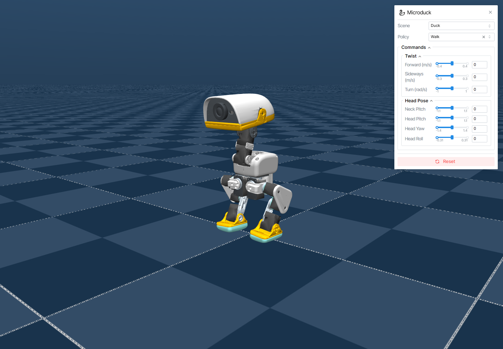
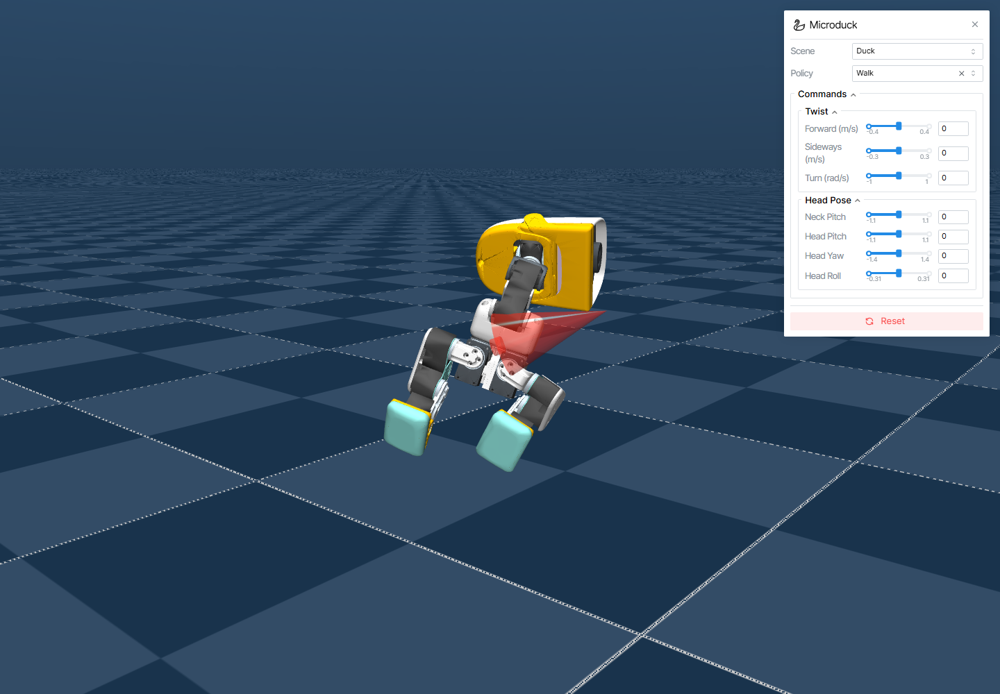
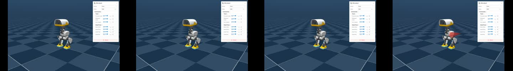

# mjswan + MicroDuck: перенос стратегии в браузер и падение от реального физического толчка

Этот раздел воспроизводит учебный эксперимент, который хорошо подходит для публичной демонстрации: официальный `mjswan_playground` собирает браузерную сцену MicroDuck на MuJoCo; в браузере ONNX-стратегия управляет утёнком, а мышью можно потянуть тело утёнка и приложить реальную внешнюю силу MuJoCo.

Важно сразу обозначить границы:

- это не переобучение MicroDuck и не видео, превращённое в интерактивную анимацию;
- браузер по-прежнему загружает сцену, физический движок, модель стратегии и панель управления;
- при перетаскивании mjswan преобразует смещение указателя в силу, приложенную к твёрдому телу; после отпускания мыши дальнейшее движение считает физический движок;
- раздел проверяет цепочку «повтор стратегии + физическое взаимодействие в браузере + статическое развёртывание», а не то, что реальный MicroDuck уже безопасно выполняет эти движения.

## 1. Что именно мы запускаем

В итоге получается веб-приложение, которое открывается через статический HTTP-сервер:

1. модель MuJoCo упаковывается в сценарный файл, пригодный для загрузки в браузер;
2. стратегия MicroDuck экспортируется в ONNX;
3. MuJoCo WASM в браузере выполняет динамику;
4. ONNX Runtime Web выполняет вывод стратегии;
5. Three.js отвечает за рендеринг;
6. панель управления переключает сцену, стратегию и команды скорости;
7. перетаскивание мышью прикладывает внешнюю силу к динамическому телу.

В локальной проверке обычный повтор показывает MicroDuck корректно; при перетаскивании утёнка появляются стрелки силы, и утёнок падает из-за внешней силы и динамики контакта, а не проигрывает заранее записанную траекторию.

Рисунок 1: локально собранное приложение mjswan с MicroDuck; панель стратегии и сцена MuJoCo загружены.

Рисунок 2: состояние во время удержания и перетаскивания утёнка. Красная стрелка показывает текущую приложенную силу, а изменение позы утёнка создаёт физическая симуляция.

Ниже — анимация официального примера из проекта mjswan_playground; она показывает исходное взаимодействие в браузере, а два PNG выше — наши локальные скриншоты, собранные и проверенные на собственной машине.

Рисунок 3: официальный пример MicroDuck в браузере. Источник: [ttktjmt/mjswan_playground](https://github.com/ttktjmt/mjswan_playground).

Рисунок 4: записанные вручную серии перетаскивания. Видео последовательно показывает подъём вверх и вправо, толчок слева и диагональное раскачивание; между попытками сцена сбрасывается, чтобы можно было сравнить, как направление внешней силы влияет на позу и момент падения.

## 2. Проект и точки входа в код

| Ресурс | Адрес | Назначение |
| --- | --- | --- |
| Движок mjswan | [ttktjmt/mjswan](https://github.com/ttktjmt/mjswan) | Объединяет модель MuJoCo, логику управления и браузерный рендеринг |
| Документация mjswan | [muwanx.readthedocs.io](https://muwanx.readthedocs.io/) | Установка, примеры, сборка и запуск в браузере |
| mjswan Playground | [ttktjmt/mjswan_playground](https://github.com/ttktjmt/mjswan_playground) | Официальный проект-пример и вход для сборки |
| Исходный код примера MicroDuck | [mjswan_playground/microduck](https://github.com/ttktjmt/mjswan_playground/tree/main/src/mjswan_playground/microduck) | Сцены MicroDuck, стратегии и конфигурация Builder |
| Проект робота MicroDuck | [pollen-robotics/microduck](https://github.com/pollen-robotics/microduck) | Модель робота, интерфейс управления и аппаратный контекст |
| Среда обучения MicroDuck | [pollen-robotics/microduck_rl](https://github.com/pollen-robotics/microduck_rl) | Среда обучения, стратегии и ресурсы развёртывания |
| Официальный онлайн-просмотр | [mjswan.com/s/DOGILsh](https://mjswan.com/s/DOGILsh) | Посмотреть официальный пример без установки окружения |

Пример MicroDuck в официальном Playground — не отдельная страница с видео, а статическое веб-приложение со сценами и стратегиями. После сборки для выполнения каждого шага симуляции не нужен серверный Python: браузерные WASM, ONNX Runtime Web и WebGL выполняют всё вместе.

## 3. Общая архитектура

~~~mermaid
graph LR
    A[MicroDuck MJCF / XML сцена] --> B[Builder mjswan_playground]
    C[ONNX-стратегии MicroDuck] --> B
    D[Ресурсы сцены MuJoCo] --> B
    B --> E[manifest.json]
    B --> F[scene.mjz / ресурсы модели]
    B --> G[policy.onnx]
    E --> H[Статический HTTP-сервер]
    F --> H
    G --> H
    H --> I[MuJoCo WASM в браузере]
    H --> J[ONNX Runtime Web]
    H --> K[Three.js / WebGL]
    I --> L[Динамика состояний и контактов]
    J --> M[14-мерное действие]
    M --> I
    N[Перетаскивание мышью] --> O[mjData.xfrc_applied]
    O --> I
    I --> P[Следующий кадр и состояние стратегии]
~~~

### 3.1. Этап сборки

Сборка выполняется в окружении Python. Builder собирает файлы сцены проекта, файлы стратегий, манифест ресурсов и браузерную среду выполнения и раскладывает всё в статический каталог, который браузер может читать напрямую.

Главные результаты сборки — не новый checkpoint обучения, а набор файлов для выполнения:

- manifest.json: индекс проекта, сцен, стратегий и ресурсов;
- .mjz или другие ресурсы сцены: сжатая модель MuJoCo;
- .onnx: файл стратегии для вывода в браузере;
- .wasm и JavaScript: среда выполнения MuJoCo в браузере;
- index.html, CSS и сборка фронтенда: панель управления и точка входа в рендеринг.

### 3.2. Этап работы в браузере

Когда страница открыта, фронтенд читает manifest.json, выбирает текущую сцену и стратегию и загружает соответствующую модель и файл ONNX. Каждый цикл управления выполняется примерно так:

~~~text
Чтение состояния MuJoCo
    -> сборка 61-мерного observation
    -> вывод ONNX Runtime Web
    -> получение 14-мерного action
    -> запись в актуаторы MuJoCo
    -> расчёт контакта, гравитации, трения и внешних сил
    -> рендеринг следующего кадра Three.js
~~~

Перетаскивание мышью встраивается в этап физического расчёта: когда указатель попадает в динамическое твёрдое тело, смещение указателя переводится в силу и момент и записывается во внешний массив сил MuJoCo. После отпускания кнопки внешняя сила сбрасывается, и утёнок продолжает двигаться по текущей скорости, позе, контактам и выходам стратегии.

## 4. Сцены, стратегии и интерфейс действий

### 4.1. Что входит в официальный пример MicroDuck

В официальном Playground вход MicroDuck объединяет несколько сцен и стратегий в одном браузерном приложении. Типичные сочетания:

| Сцена | Наблюдаемая стратегия или действие | На что смотреть |
| --- | --- | --- |
| Duck | Walk, Stand & Pose, Sit / Stand, Ground Pick, Roulade | Ходьба, стояние, сидение, подъём предметов и кувырки |
| Ball (right foot) | Kick | Удар правой ногой |
| Ball (left foot) | Kick | Удар левой ногой |
| Rollers | Roller Skate, Roller Crouch | Поза и движения в состоянии на роликах |

В разных версиях интерфейса тексты меню могут немного отличаться. Ориентируйтесь на сцены и стратегии, которые реально показаны на странице; не воспринимайте Scene и Policy в меню как два совершенно независимых робота: некоторые стратегии имеют смысл только в своей сцене.

### 4.2. Вход на 61 измерение и действие на 14 измерений

Интерфейс стратегии MicroDuck сохраняет соглашение об управлении официального робота. Стратегия в браузерном примере обычно читает 61-мерное observation и выдаёт 14-мерное действие суставов:

| Содержимое observation | Размерность |
| --- | ---: |
| Угловая скорость корпуса или информация гироскопа | 3 |
| Проекция гравитации в системе корпуса | 3 |
| Положения 14 суставов | 14 |
| Скорости 14 суставов | 14 |
| Предыдущее действие | 14 |
| Команды скорости вперёд, вбок и рыскания | 3 |
| Прочие команды embodiment / padding | 10 |
| Итого | 61 |

Самая легко пропускаемая часть — интерфейс действий. 14-мерный вектор — не «координаты XYZ, которые нужно отправить модели в браузере», а величина, связанная с порядком суставов MicroDuck, масштабированием действий и определением position actuator. При смене робота, порядка суставов или диапазона действий нельзя просто оставить тот же файл ONNX и считать, что стратегия остаётся совместимой.

Локальная проверка показала, что все ONNX-файлы читаются стандартным checker, а формы observation и action соответствуют контракту 61 → 14. Но эта проверка подтверждает только формат файла и интерфейс; она не показывает, что стратегия сохранит работоспособность на другом роботе или при других физических параметрах.

### 4.3. Отличие браузерного примера от учебной среды

Публичные учебные ресурсы MicroDuck и браузерное развёртывание находятся на разных уровнях:

- при обучении могут использоваться более сложные актуаторы, рандомизация, учебный план и наблюдения, нужные только при обучении;
- браузер требует преобразовать модель в ресурсы, которые выполняются через WASM и ONNX;
- на странице работает экспортированный актор и среда выполнения сцены;
- привилегированный критик, журналы обучения, параллельные среды и обновления PPO на этой странице не выполняются.

Поэтому mjswan подходит для проверки того, можно ли упаковать обученную стратегию и показать её интерактивно, но не заменяет исходную среду RL для большого обучения.

## 5. Как работает физическое перетаскивание

### 5.1. Это не падение, выученное стратегией

При перетаскивании утёнка красная стрелка и падение могут создать впечатление, что стратегия выучила «восстанавливаться после толчка». Фактическая цепочка выглядит так:

1. луч мыши попадает в динамическое твёрдое тело;
2. фронтенд запоминает точку попадания относительно тела;
3. смещение указателя во время перетаскивания переводится в силу и момент;
4. сила записывается в mjData.xfrc_applied MuJoCo;
5. MuJoCo рассчитывает следующий шаг с учётом массы, инерции, гравитации, контактов и трения;
6. страница отрисовывает текущую силу и позу тела.

Это внешнее возмущение на уровне движка (engine-level perturbation), а не действие, созданное головой нейросети. Различие важно:

- оно позволяет проверить, как стратегия реагирует на внешний удар;
- оно пригодно для наглядной учебной демонстрации в браузере;
- само по себе оно не доказывает способность стратегии восстанавливаться после падения;
- чтобы изучать восстановление, нужно добавлять внешние возмущения в обучающую среду, задавать награду за восстановление и использовать отдельный тестовый набор.

### 5.2. Связь с задачами MicroDuck, которые мы уже разобрали

Задача балансировки MicroDuck на свободно катящемся баскетбольном мяче рассматривает устойчивость и управление движением на подвижной опоре; этот же раздел mjswan касается браузерного развёртывания и физического взаимодействия. Эти два направления стоит дополнять, но не смешивать:

- балансировка на мяче: задача RL, награда за контакт, актор LSTM, PPO и граница sim-to-real;
- mjswan: как модель MuJoCo попадает в браузер, как выполняется ONNX и как мышиная сила попадает в физический движок;
- сцены удара правой и левой ногой в mjswan могут служить основой для демонстрации удара в браузере;
- для собственных ворот, непрерывного преследования мяча, построения 3 на 3 и политик с ограничениями реальных сервоприводов нужно отдельно изменить сцену, стратегию и интерфейс развёртывания.

## 6. Подготовка окружения

### 6.1. Рекомендуемое окружение

Основная среда разработки официального репозитория — macOS на Apple Silicon или Linux x86-64. Пользователям Windows рекомендуется WSL2. Если нужно только посмотреть уже собранную страницу, браузеру не требуется локальный MuJoCo.

Понадобятся:

- Git;
- uv;
- современный браузер с поддержкой WebGL, WebAssembly и Web Workers;
- доступ к GitHub;
- достаточно места для окружения Python, сборки фронтенда и ресурсов сцен.

### 6.2. Получение официального Playground

В терминале выполните:

~~~bash
git clone https://github.com/ttktjmt/mjswan_playground.git
cd mjswan_playground
uv sync --all-extras
~~~

После установки сначала выведите список официальных примеров:

~~~bash
uv run msp list
~~~

Обычно видны примеры microduck, husky, pacman и wbc.

## 7. Сборка и запуск MicroDuck

### 7.1. Официальные команды

В корне mjswan_playground соберите MicroDuck:

~~~bash
uv run msp build microduck --output-dir dist/microduck
~~~

После успешной сборки dist/microduck — статический каталог сайта. Не открывайте index.html двойным щелчком: браузер ограничивает загрузку модульных скриптов, WASM и worker'ов, и страница может показывать чёрный экран или вечный Loading.

В Playground есть и прямой запуск примера:

~~~bash
uv run msp run microduck --port 8092
~~~

Если команда долго ждёт автоматического получения upstream-репозитория или ресурсов GitHub, сначала проверьте сеть и учётные данные Git. Также можно вручную скачать архив исходного кода с версией, закреплённой в src/mjswan_playground/microduck/main.py, и затем использовать тот же Builder. Не копируйте весь кэш Python в репозиторий учебника.

### 7.2. Статический сервер из этого раздела

В Windows некоторые версии Python отдают файлы .js с типом text/plain, и браузер сообщает:

~~~text
Expected a JavaScript-or-Wasm module script but the server responded with a MIME type of text/plain
~~~

Скрипт serve_mjswan.py из этого раздела задаёт MIME-типы для JavaScript, WASM, JSON, ONNX и ресурсов MuJoCo и выставляет заголовки, которые обычно нужны для многопоточного WASM в браузере. После сборки запускайте его из каталога учебника:

~~~bash
python serve_mjswan.py --directory PATH/TO/dist/microduck --port 8092
~~~

Затем откройте:

~~~text
http://127.0.0.1:8092/
~~~

Если в пути есть пробелы, заключите значение --directory в кавычки. Этот сервер предназначен только для локальной учебной проверки; не публикуйте его в открытом интернете.

### 7.3. Автоматическая запись нескольких перетаскиваний

Скрипт record_mjswan_drag_demo.py из этого раздела использует Playwright, открывает уже запущенную страницу, автоматически выполняет три направления перетаскивания и сохраняет исходную запись в WebM. Он подходит для повторного создания рисунка 4 и для добавления новых движений перетаскивания:

~~~bash
uv run python record_mjswan_drag_demo.py \
  --url http://127.0.0.1:8092/ \
  --output-dir recordings
~~~

После записи FFmpeg конвертирует её в MP4, который удобнее воспроизводить в вебе и на форумах:

~~~bash
ffmpeg -i recordings/mjswan_microduck_manual_drag_demo.webm \
  -c:v libx264 -pix_fmt yuv420p -movflags +faststart \
  recordings/mjswan_microduck_manual_drag_demo.mp4
~~~

Скрипт записывает только область страницы и не захватывает адресную строку браузера, рабочий стол или другие окна; стрелки и падение в видео возникают из-за физического взаимодействия в MuJoCo в браузере.

## 8. Шаги работы в браузере

### Контрольная точка 1: загрузка базовой сцены

Откройте страницу, выберите сцену Duck и стратегию Walk. При первом открытии браузер загружает WASM, сцену и файлы ONNX; дождитесь, пока пропадёт надпись «Loading scene...», и только потом используйте панель управления.

Должно быть видно:

- модель MicroDuck;
- сетку и коллизионную сцену MuJoCo;
- блоки Scene / Policy / Commands;
- ползунки команд скорости или действий;
- в консоли браузера нет 404 для ресурсов.

Контрольная точка 1 подтверждает запуск статических ресурсов, WASM и цепочки рендеринга, но не означает, что все стратегии протестированы.

### Контрольная точка 2: повтор стратегии

Увеличьте команду Forward и наблюдайте движение ходьбы. Нажмите Reset и запустите снова, чтобы проверить, что сброс эпизода возвращает начальное состояние.

Рекомендуемая последовательность наблюдений:

1. Duck + Walk: базовая ходьба;
2. Duck + Stand & Pose: стояние и позы;
3. Duck + Sit / Stand: сидение и вставание;
4. Ball (right foot) + Kick: удар правой ногой;
5. Ball (left foot) + Kick: удар левой ногой;
6. Rollers: сцена с роликами.

На разных браузерах, устройствах и частотах кадров скорость движения стратегии может отличаться. Веб-демонстрация нужна, чтобы понять цепочку вызовов и способ взаимодействия, а не для количественных выводов о частоте управления.

### Контрольная точка 3: физическое перетаскивание

Вернитесь к сцене Duck, нажмите на тело утёнка и перемещайте его. Нормальное поведение:

- во время перетаскивания появляется стрелка силы;
- поза тела меняется;
- ноги, земля и тело продолжают взаимодействовать через коллизии и трение;
- после отпускания мыши внешняя сила исчезает;
- Reset возвращает чистое начальное состояние.

Если перетаскивание к сетке земли ничего не даёт, сначала наведите указатель на физическую модель тела или ноги утёнка. Силы создаются только тогда, когда указатель попадает в динамическое твёрдое тело.

## 9. Результаты локальной проверки

Мы не ограничились чтением страницы проекта: официальный код и Builder были использованы для сборки статического приложения MicroDuck, а затем выполнена проверка в браузере.

| Проверка | Результат |
| --- | --- |
| Синхронизация окружения официального Playground | Пройдена, mjswan 0.9.4 |
| Список примеров | Пройден, msp list показывает MicroDuck |
| Builder MicroDuck | Пройден, созданы manifest.json, ресурсы сцены и ресурсы стратегий |
| Проверка ONNX-файлов | Пройдена, 26 ONNX-файлов в каталоге сборки читаются checker |
| HTTP-сервер браузера | Пройден, статические ресурсы возвращают статус 200 |
| WebGL canvas | Пройден, на странице обнаружен 1 canvas |
| Ошибки страницы | 0 ошибок JavaScript |
| Тест физического перетаскивания | Пройден: появились стрелки силы, утёнок получил внешнюю силу и упал |

Эта проверка доказывает, что цепочка сборки и интерактивного взаимодействия работает. Это не показатель сходимости обучения и не официальный бенчмарк. Чтобы читатель различал источники свидетельств, два PNG в этом разделе — наши локальные снимки, а официальная анимация помечена отдельно как материал проекта.

## 10. Частые проблемы

### 10.1. Чёрный экран или вечный Loading

Откройте в инструментах разработчика вкладку Network и проверьте, что файлы .js, .wasm, .mjz и .onnx возвращают 200. Затем убедитесь:

- страница открыта через HTTP-сервер, а не через file://;
- статический сервер не отдаёт .js как text/plain;
- сервер не обрезает большие файлы;
- браузер поддерживает WebGL и WebAssembly;
- при первом запуске дождитесь полной загрузки ресурсов.

### 10.2. Есть модель, но нет движения

Проверьте путь к стратегии в manifest.json и сообщения ONNX Runtime в консоли браузера. Чаще всего причина в неверном пути к файлу модели, отсутствии заголовков для межсайтовых запросов или загрузке стратегии от другой сцены.

### 10.3. При перетаскивании нет стрелки силы

Возможно, указатель попал на статическую землю или в текущей сцене нет динамического тела, которое можно тянуть. Переключитесь на сцену Duck, наведите указатель на тело, голову или ногу утёнка и нажмите и потяните.

### 10.4. В Windows uv run pytest выдаёт ошибку кодировки

Некоторые тесты upstream читают исходные файлы в кодировке по умолчанию. При ошибке UnicodeDecodeError в китайской кодовой странице Windows сначала задайте:

~~~powershell
$env:PYTHONUTF8 = "1"
uv run pytest -q
~~~

Если ошибка остаётся, отличайте проблему тестового скрипта по умолчанию от сбоя браузера. Отдельно проверялись HTTP, WebGL, загрузка ONNX и физическое перетаскивание в браузере, поэтому ошибку кодировки в тестах не следует принимать за неполадку движка mjswan.

### 10.5. Медленная загрузка с GitHub

Если Builder получает зависимости или ресурсы модели, скорость сети сильно влияет на первую сборку. Рекомендуется:

1. сначала выполнить uv sync --all-extras и убедиться, что зависимости Python установлены;
2. скачать архив исходного кода по зафиксированному commit официального репозитория;
3. хранить крупный кэш вне репозитория;
4. не коммитить .cache, виртуальные окружения и полные каталоги сборки в Every Embodied.

## 11. Границы воспроизведения и возможные доработки

### 11.1. Что точно удалось проверить

- Статическое браузерное приложение MicroDuck собирается;
- сцены и ONNX-стратегии загружаются браузером;
- WASM MuJoCo выполняет динамику;
- повтор стратегии и панель управления работают;
- внешняя сила от мыши попадает в физический расчёт и вызывает заметное изменение позы.

### 11.2. Что этим не доказано

- что мы заново обучили стратегию MicroDuck;
- что браузерную стратегию можно напрямую развернуть на RDK X5;
- что частота действий в браузере равна частоте управления реальных сервоприводов;
- что стратегии ударов ногой умеют автоматически догонять мяч, бить его серийно или точно попадать в ворота;
- что после толчка, приведшего к падению, стратегия обладает выученной способностью восстанавливаться;
- что мы переупаковали полный официальный трёхмерный набор модели и обучающих ресурсов.

Если в дальнейшем нужно перенести этот пример в наш сценарий с утятами-футболистами, разумный порядок доработки такой:

1. сохранить браузерную физику и панель управления mjswan;
2. добавить собственные ворота, границы поля и материалы коллизий мяча;
3. разделить обнаружение мяча, приближение, наведение и удар на наблюдаемые состояния конечного автомата;
4. затем экспортировать обученную стратегию в ONNX для браузера;
5. передавать действия тем же интерфейсом на управляющий модуль RDK X5;
6. и только после этого проверять несколько утят, построение 3 на 3 и ограничения реальных моторов.

Так браузер будет отвечать за визуализацию и проверку взаимодействия, а RDK — за реальное исполнение и ограничение безопасности.

## 12. Лицензии и использование материалов

Код mjswan и mjswan Playground следует лицензиям соответствующих репозиториев; код и ресурсы стратегий MicroDuck используются согласно лицензиям upstream. Трёхмерные модели MicroDuck имеют отдельное некоммерческое условие с обязательным указанием авторства; в учебнике следует сохранять источники и лицензии, а не публиковать весь локальный каталог сборки как собственный ресурс Every Embodied.

В этом разделе публикуются только:

- текст учебника, который может читать студент;
- небольшие локальные проверочные снимки экрана;
- локальный архив официального примера с указанием источника;
- переиспользуемые скрипты статического сервера.

Полные результаты сборки WASM, ONNX, пакеты сцен, кэш и виртуальные окружения не публикуются. Для полноценного пакета запуска нужно повторно выполнить сборку по инструкциям upstream и официальной команде сборки.

## 13. Источники

- [mjswan на GitHub](https://github.com/ttktjmt/mjswan)
- [Документация mjswan: Installation](https://muwanx.readthedocs.io/en/latest/getting-started/installation/)
- [Документация mjswan: Examples](https://muwanx.readthedocs.io/en/latest/getting-started/examples/)
- [mjswan Playground](https://github.com/ttktjmt/mjswan_playground)
- [Исходный код MicroDuck Playground](https://github.com/ttktjmt/mjswan_playground/tree/main/src/mjswan_playground/microduck)
- [Pollen Robotics MicroDuck](https://github.com/pollen-robotics/microduck)
- [Pollen Robotics MicroDuck RL](https://github.com/pollen-robotics/microduck_rl)
- [MuJoCo](https://github.com/google-deepmind/mujoco)
