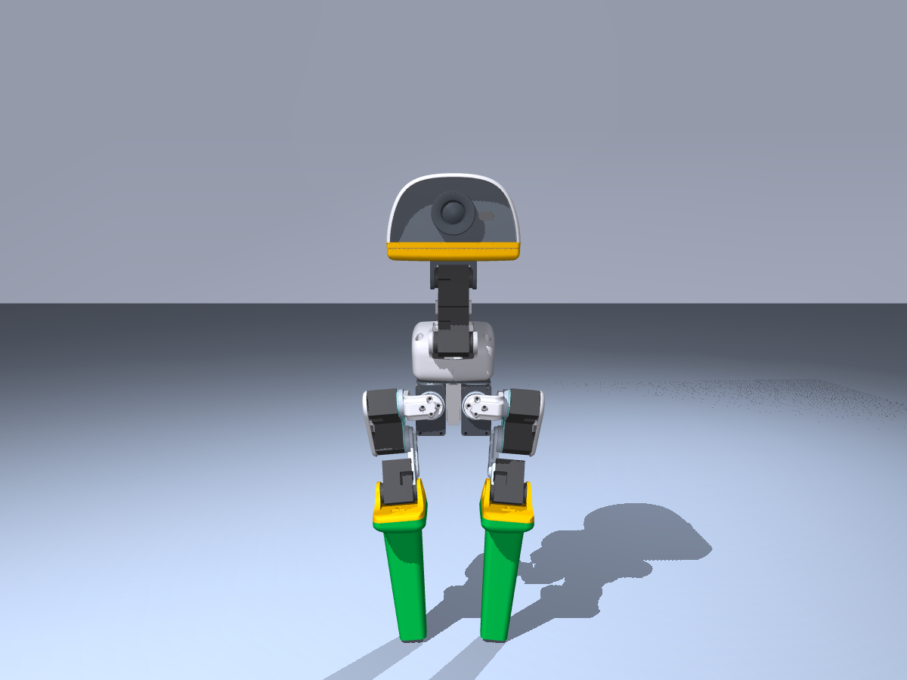
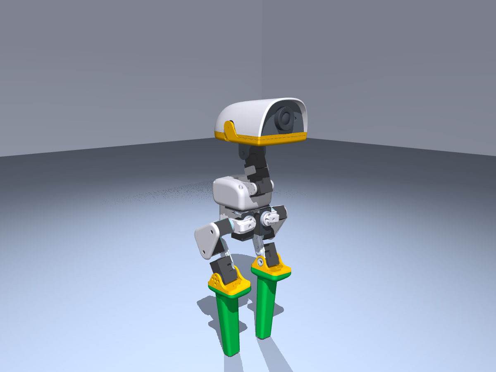
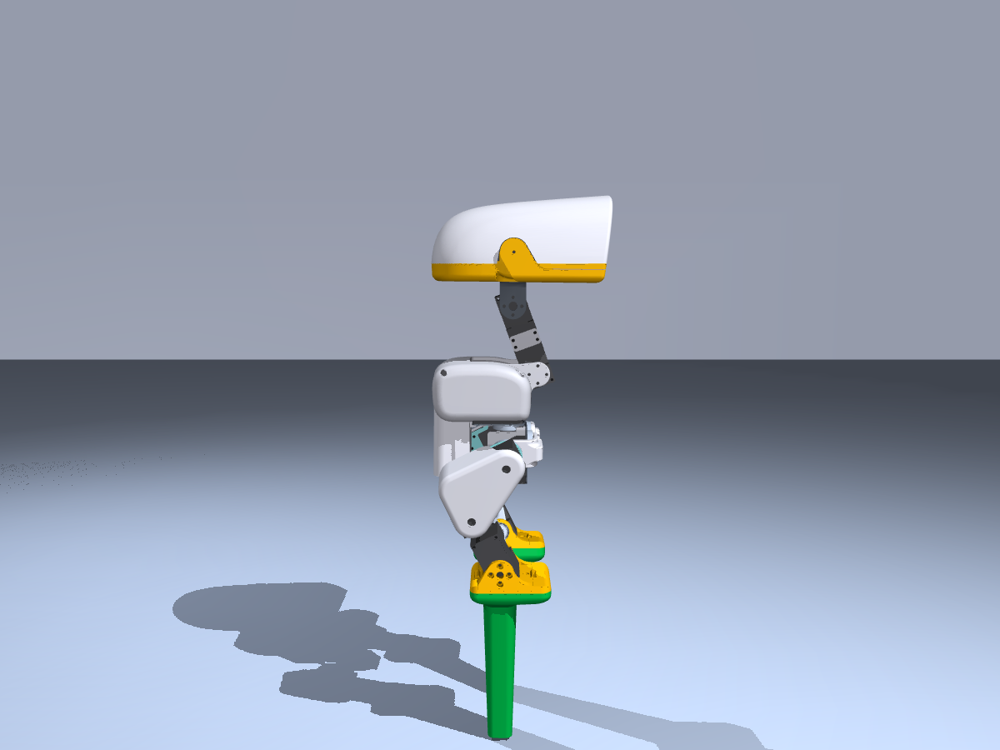
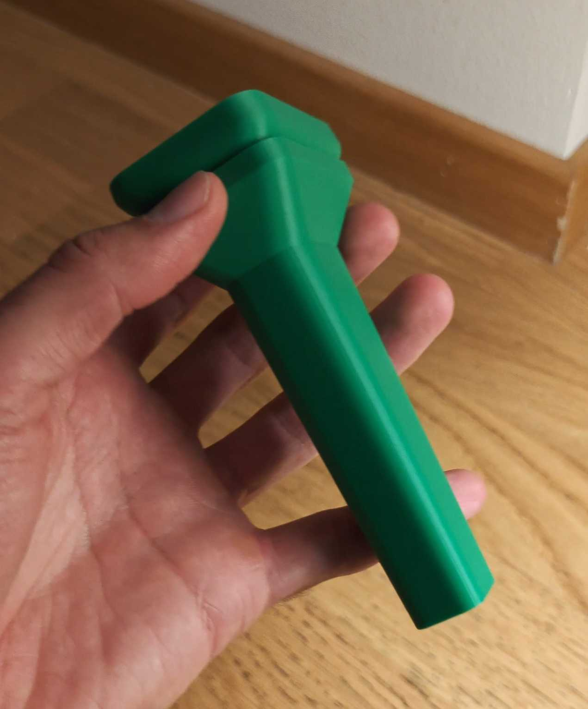
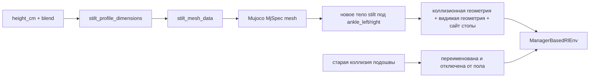
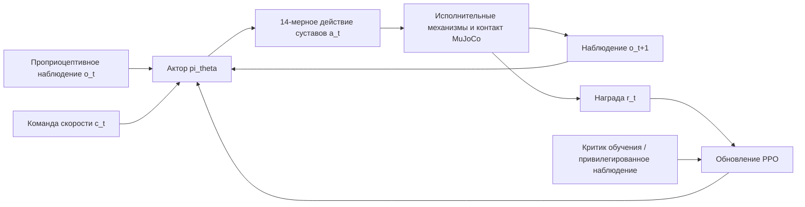
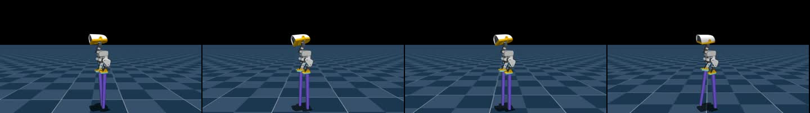
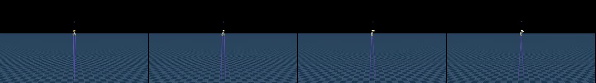
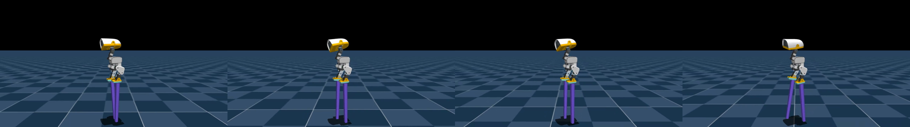
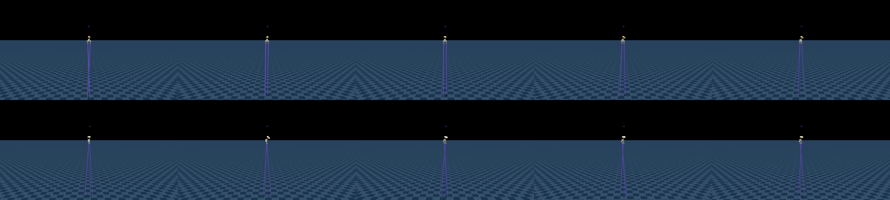

# MicroDuck на ходулях: от пошагового курса до повтора в симуляции на 2 м

## Что делает этот раздел

В недавнем видео MicroDuck показан интересный эксперимент по управлению движением: двуногому утёнку ставят всё более высокие ходули и он учится шагать по ним — сначала на низкой опоре, затем на 10 см, 50 см и примерно на 2 м. Ценность эксперимента — не в том, что ноги утёнка выглядят длиннее на картинке. Главное в другом: ходули добавляются в MuJoCo как явная новая геометрия контакта, масса и инерция, а затем обучение с подкреплением постепенно повышает сложность формы.

Раздел воспроизводит публичную версию **MicroDuck stilt walking** и делает следующее:

1. разбирает, как конструкция ходуль и геометрия робота попадают в симулятор;
2. объясняет наблюдения, действия, награды и курс обучения для `Mjlab-Stilt-Flat-MicroDuck`;
3. скачивает публичные стратегии на 25 см и 2 м, выполняет инференс ONNX и рендерит видео в локальном MuJoCo;
4. рассказывает, как продолжить обучение от публичного checkpoint и почему повтор в симуляции на 2 м нельзя сразу считать решением для реального робота;
5. связывает этот пример с балансировкой MicroDuck на мяче и браузерными возмущениями mjswan в единый путь изучения управления движением.

> **Границы воспроизведения**: раздел использует публичные checkpoint для повтора стратегий и рендеринга видео, но не запускает полное обучение PPO на 2 м. В публичной карточке модели эти стратегии отмечены как предназначенные только для симуляции; ходули в видео также не проверялись на реальном роботе. Для переноса на железо нужно заново проверить несущую способность конструкции, центр тяжести, момент сервоприводов, защиту от падения и частоту управления.

## 1. От видеоэффекта к реальной задаче управления

В видео кажется, что «утёнок надел ходули», но для контроллера одновременно меняются четыре вещи:

- **точка опоры**: нагрузку несёт не подошва исходных ступней, а концы ходуль;
- **опорный многоугольник**: концы ходуль уже, поэтому сдвиг ступни, перекат и боковой уход чувствительнее;
- **масса и инерция**: чем выше ходули, тем больше добавленная масса, а при махе ногой меняются момент инерции и опрокидывающий момент;
- **высота корпуса**: одна и та же поза корпуса соответствует другой высоте концов ног; начальные положения, положение камеры и контактные датчики нужно синхронизировать.

Если просто опустить пол или растянуть визуальную модель ног, сохранив старую подошвенную коллизию, стратегия выучит прежнюю задачу ходьбы по земле и не научится «держать равновесие на высоком рычаге». Основная идея проекта — в описании робота для MuJoCo явно добавить тело ходули, сетку, массу, геометрию коллизии и сайт опоры, а коллизию исходной подошвы отключить.

## 2. Официальная реализация и локальные ресурсы для повтора

| Ресурс | Назначение |
| :--- | :--- |
| [Набор стратегий MicroDuck stilt](https://huggingface.co/HannesVonEssen/microduck-stilts) | ONNX-файлы от 10 см до 2 м, manifest, checkpoint и официальные видео симуляции |
| [MicroDuck Playground](https://github.com/Vottivott/microduck-playground) | Среда обучения, конфигурация MuJoCo, вход PPO, скрипты оценки и экспорта |
| [Фиксированная версия `c5fcc50`](https://github.com/Vottivott/microduck-playground/tree/c5fcc50219fef01ac9931d0079c583ccbb29b689) | Версия исходного кода для этого раздела, чтобы последующие коммиты не изменили конфигурацию |
| [Каталог аппаратной части ходуль](https://github.com/Vottivott/microduck-playground/tree/c5fcc50219fef01ac9931d0079c583ccbb29b689/hardware/stilts) | Параметрические STL, рендеры, инструкции по печати и безопасности конструкции |
| [Исходный проект MicroDuck](https://github.com/pollen-robotics/microduck) | Сам робот, сервоприводы и аппаратный контекст |
| [Среда обучения MicroDuck](https://github.com/pollen-robotics/microduck_rl) | Базовые mjlab / MuJoCo Warp / PPO, на которых построен проект |
| [Публикация видео в WeChat Channels](https://weixin.qq.com/sph/AOgguA2tn7) | Источник темы и ориентир по эффекту; видео в этом разделе получены повторной локальной съёмкой публичной стратегии |

В учебник помещены только небольшие учебные материалы: официальные рендеры ходуль, локальный повтор на 25 см, повтор на 2 м и кадры из видео. Веса модели, виртуальное окружение Python, кэш MuJoCo и полный внешний репозиторий хранятся вне книги. Читатель получает их по закреплённой версии и командам загрузки из разделов ниже.

## 3. Сначала аппаратная часть: почему один интерфейс крепления подходит для разных высот

Официальная конструкция не переделывает сам MicroDuck; вместо съёмной подошвы устанавливается заменяемый держатель (carrier), к которому винтами крепятся картриджи ходуль разной высоты. Это даёт два преимущества:

1. корпус робота, сервоприводы и нулевые положения суставов не нужно перепроектировать для каждой высоты;
2. при обучении «высоту» и «форму опоры» можно рассматривать как две разные оси курса и не менять сразу слишком много физических факторов.

<table>
  <tr>
    <td align="center"><br><sub>Спереди</sub></td>
    <td align="center"><br><sub>Три четверти</sub></td>
    <td align="center"><br><sub>Сбоку</sub></td>
    <td align="center"><br><sub>Напечатанный прототип</sub></td>
  </tr>
</table>

**Рисунок 1.** Конструкция ходуль MicroDuck с одним и тем же интерфейсом крепления. Рендеры и печатный прототип взяты из каталога `hardware/stilts` официального Playground; они показывают концепцию конструкции и не означают, что несущая способность проверена на реальном роботе.

Форма опоры задаётся параметром `blend`: при `blend=0` получается скруглённая платформа около 22 мм × 32 мм, при `blend=1` — узкая круглая опора около 12 мм, а публичные стратегии используют `blend=0.5`, что соответствует концу примерно 17 мм × 22 мм. Высота задаётся отдельно переменной окружения `MICRODUCK_STILT_HEIGHT_CM`.

Масса следует простой учебной модели из публичной реализации:

```text
масса одной ходули = 0,012 кг + 0,001 кг/см × высота ходули
```

Например, для версии 25 см номинальная масса составляет 37 г на ходулю, для версии 2 м — 212 г. Это параметр симуляции, а не результат взвешивания напечатанной детали: материал, заполнение, винты, резиновая подошва и дополнительное усиление конструкции меняют реальную массу.

## 4. Метод: что именно обучается стратегия

### 4.1. Формообразование: ходули внутри MuJoCo, а не только на картинке

Основной код находится в:

```text
src/mjlab_microduck/robot/stilt_constants.py
src/mjlab_microduck/tasks/microduck_stilt_env_cfg.py
```

Поток данных в `stilt_constants.py` выглядит так:



Ключевые шаги кода:

1. вычисляются нижнее опорное кольцо и верхнее монтажное кольцо и строится выпуклая сетка ходули;
2. сетка добавляется в `MjSpec` робота как ресурс MuJoCo;
3. исходные коллизионные геометрии левой и правой стопы переименовываются в `*_original_sole_disabled`;
4. под лодыжками левой и правой ноги добавляются тела `stilt_left` и `stilt_right`;
5. для каждого тела создаются несущая коллизионная геометрия, фиолетовая видимая геометрия и новый сайт стопы;
6. наблюдения и награды за контакт стопы, высоту стопы и проскальзывание привязываются к новому концу ходули.

От этого зависит, с какой задачей сталкивается стратегия. Когда геометрия контакта, трение и высота ходуль попадают в физический расчёт, стратегия реально получает обратную связь за неточную постановку стопы, наклон корпуса и изменения момента при движении ноги.

### 4.2. Учебный план: сначала сузить опору, потом поднимать высоту

Публичная история обучения — не «случайно поставили 2 м и обучили один раз», а непрерывная цепочка переноса checkpoint:

| Этап | Высота | Blend опоры | Назначение |
| :---: | ---: | ---: | :--- |
| 400 | 2 см | 0,00 | Сначала научиться устойчиво стоять и ходить на широкой платформе |
| 500 | 2 см | 0,25 | Начать сужать форму опоры |
| 600 | 2 см | 0,50 | Выбрать конец около 17 × 22 мм, который используется в публичной стратегии |
| 700–800 | 3–4 см | 0,50 | Ранний переход по высоте |
| 2 000 | 5 см | 0,50 | Закрепить чередующийся шаг |
| 2 100–2 800 | 7,5–25 см | 0,50 | Продолжить подъём небольшими шагами по высоте |
| 2 900–3 400 | 27,5–50 см | 0,50 | Увеличить шаг по высоте |
| 3 500–4 200 | 55 см – 1,2 м | 0,50 | Выйти на экстремальные высоты симуляции |
| 4 300 | 1,4 м | 0,50 | Опубликованная веха для большой высоты |
| 4 600–6 000 | 1,5–1,9 м | 0,50 | Непрерывный мост к 2 м |
| 6 500 | 2,0 м | 0,50 | Опубликованная стратегия-предел для симуляции |

Главное в этом курсе — на каждом этапе меняется в основном одна переменная. Если форма опоры сужается, высота сначала не меняется; когда опора стабилизировалась, высота растёт по шагам. Тогда при неудаче видно, в чём причина: в слишком узкой ступне или в слишком большом моменте от высоты, а не в смеси изменений, из которой нельзя вывести выводы.

### 4.3. PPO, наблюдения и интерфейс действий

Стратегия по-прежнему использует интерфейс управления скоростью MicroDuck:

| Параметр | Публичное соглашение |
| :--- | :--- |
| Наблюдение актора | `float32 [1, 61]` |
| Действие | `float32 [1, 14]` |
| Частота управления | 50 Гц |
| Масштаб действия | Относительно позы HOME MicroDuck, масштабируется до 1,0 рад |
| Команда | `twist=[0.15, 0, 0]`, команды головы и корпуса равны 0 |
| Нормализация | Уже встроена в каждый файл ONNX |
| Алгоритм | PPO, обучение через `rsl_rl` и `mjlab` |

Актор получает проприоцепцию и команды: угловую скорость, проекцию гравитации, положения и скорости суставов, предыдущее действие и команду скорости. При обучении критик может использовать более полное привилегированное наблюдение, которое помогает PPO оценивать ценность состояний; при развёртывании нужен только 61-мерный вход актора.

Важно: стратегии разных высот — не одна универсальная модель, в которую можно подставить любую высоту. Каждый `policy.onnx` привязан к своей высоте ходуль, массе и форме опоры. Стратегию на 25 см нужно использовать с геометрией 25 см; нельзя подставлять к ней STL или MuJoCo-модель на 2 м.

### 4.4. Экспортированный checkpoint — не полное состояние исходного PPO

Файл `checkpoint.pt` из Hugging Face можно использовать для продолжения обучения, но в публичном описании прямо сказано: состояния критика и оптимизатора исходного обучения по ходулям не сохранены. Опубликован такой checkpoint:

- веса актора, точно соответствующие выпущенному ONNX-актору, и нормализация наблюдений;
- новый критик той же формы;
- обнулённые моменты оптимизатора;
- консервативная скорость обучения `1e-5` и стандартное отклонение исследования `0,1`;
- номер опубликованной итерации и счётчик учебного плана.

Таким образом, продолжение обучения — это **warm start с точным совпадением актора**, а не возобновление исходного PPO с бит-в-бит совпадением. В учебнике воспроизводится публичное поведение актора и не утверждается, что мы получили полное рабочее состояние авторов.

## 5. С точки зрения управления: что именно выучил утёнок

Предыдущие разделы объясняли, что есть в проекте. Этот раздел отвечает на вопрос, как утёнок учится ходить по ходулям методом проб и ошибок.

Если описать видео как «скачали модель, запустили команду и получили ролик», легко подумать, что это заранее записанная анимация или проигрывание углов суставов по времени. На деле всё иначе. Стратегия для ходуль — **замкнутый контроллер**, который во время работы получает проприоцепцию и выдаёт действия суставов. Видео — результат его взаимодействия с физическим миром MuJoCo.

### 5.1. Задача как замкнутый контур управления

В момент времени $t$ стратегия получает наблюдение $o_t$ и команду скорости $c_t$ и выдаёт действие $a_t$:

$$
a_t = \pi_\theta(o_t, c_t)
$$

Действие через исполнительные механизмы и контактную динамику даёт следующее состояние:

$$
s_{t+1} = F(s_t, a_t, \text{contact}, \text{friction}, \text{mass}, \text{inertia})
$$

Среда по результатам короткого отрезка движения возвращает награду $r_t$: насколько движение ближе к цели. Затем управление снова начинается с нового наблюдения. Значит, и обучение, и развёртывание можно описать одной цепочкой:



Здесь важны три момента:

1. **Стратегия не планирует весь шаг заранее.** Она заново смотрит на состояние тела 50 раз в секунду и корректирует суставы на короткий интервал.
2. **Действие — не «переставить стопу в точку на картинке».** Актор выдаёт смещения 14 суставов, которые затем проходят модель приводов и превращаются в реальные моменты и движение.
3. **Награда — не разметка с готовым движением.** Никто не говорит, какой должна быть высота поднятой ноги в конкретный кадр; стратегия узнаёт через награду, какое движение устойчивее и ближе к команде вперёд.

Поэтому сгенерированное видео — не офлайн-анимация, а траектория, которая в реальном времени управляется замкнутым контроллером при текущих геометрии ходули, массе, трении и столкновениях.

### 5.2. Что означают 61 вход и 14 выходов

Рабочий интерфейс публичной стратегии: `observation: [1, 61] → action: [1, 14]`. Входы можно разбить по назначению:

| Блок наблюдения | Размерность | Что сообщает стратегии |
| :--- | :---: | :--- |
| Угловая скорость корпуса | 3 | С какой скоростью и в каком направлении утёнок вращается |
| Проекция гравитации | 3 | Направление силы тяжести в системе корпуса; по нему видно наклон |
| 14 положений суставов | 14 | Текущая поза ног и корпуса |
| 14 скоростей суставов | 14 | Куда и насколько быстро движутся суставы |
| Предыдущее действие | 14 | Какое управление было отправлено на прошлом шаге; помогает избежать скачков |
| Команда скорости | 3 | Желаемая скорость вперёд, вбок и поворота |
| Состояние головы и корпуса | 4 + 6 | Локальные величины, совместимые с общим интерфейсом задачи |

В этом наборе нет изображения с камеры, мяча, ворот или верхней плоскости ходуль как визуального маркера. Поэтому стратегия учится **проприоцептивному управлению движением**, а не визуальной навигации и не футбольной тактике. Она знает, что корпус наклонён, стопы движутся, суставы близко к пределам, но не знает, какие объекты находятся в сцене.

Выход на 14 измерений тоже нужно понимать правильно. Это смещения суставов относительно позы `HOME` MicroDuck, масштабированные коэффициентом `action scale = 1,0 рад`, которые передаются в приводы. Это не 14 «шаговых меток» и не прямые мировые координаты. Длина ходуль, масса и контактная поверхность меняют физический эффект одного и того же действия.

### 5.3. Как утёнок выучил чередующийся шаг

С точки зрения управления даже один «простой шаг» включает несколько связанных поведений:

1. **Сначала перенести центр тяжести на текущую опору.** Если обе ходули касаются земли, стратегия должна сместить проекцию центра масс к ещё опирающейся стороне.
2. **Поднять маховую сторону.** Маховая нога поднимается не просто так: контроллер регулирует позу ноги и угловую скорость корпуса, чтобы при подъёме не опрокинуть всё тело.
3. **Вернуть ходулю на опорную позицию.** Ставить её слишком рано — значит скользить, слишком поздно — потерять опору; чем длиннее ходуля, тем заметнее ошибка постановки.
4. **Быстро скорректировать после контакта.** Удар о землю меняет угловую скорость корпуса; на следующем наблюдении проекция гравитации, угловая скорость и обратная связь суставов передают это изменение актору.
5. **Повторить смену опоры.** Когда одна сторона снова стабилизировалась, стратегия может перенести нагрузку на другую.

В коде нет жёстко заданной последовательности «левая, правая, левая, правая». Чередование возникает из нескольких факторов:

- левая и правая стороны робота почти симметричны;
- награда за скорость поощряет движение корпуса в направлении команды;
- награда за время отрыва стопы и высоту подъёма поощряет настоящий маховый шаг;
- штрафы за проскальзывание стопы, самопересечение, изменение действий и выход за пределы суставов подавляют волочение, дрожь и опасные позы;
- контакт, трение, масса и инерция MuJoCo определяют реальные последствия каждого действия.

Иначе говоря, стратегия не запоминает видео, а в процессе физической обратной связи выясняет, что **сначала стабилизировать опору, затем сменить опору, и только потом корректировать посадку**, получает больше долгосрочной награды, чем одновременные беспорядочные движения обеих ног. Именно это в проекте называется «научиться ходить».

### 5.4. Награды, критик и PPO: зачем нужна каждая часть

| Компонент | Роль | Нужен ли при развёртывании |
| :--- | :--- | :---: |
| Актор $\pi_\theta$ | По наблюдению выдаёт следующее действие суставов | Да |
| Награда | Оценивает, быстрее ли, устойчивее и правильнее ли шаг | Нет |
| Критик $V_\phi$ | Оценивает, насколько успешно состояние может продолжиться | Обычно нет |

Награда для ходуль оценивает результат управления в совокупности, а не сравнивает с эталонным кадром видео. Публичная конфигурация состоит из следующих групп:

- отслеживание скорости и угловой скорости: идёт ли утёнок в команду и поворачивает ли;
- положение и угловая скорость корпуса: остаётся ли он вертикальным, не раскачивается ли сильно;
- отрыв стопы, подъём и время в воздухе: образуется ли реальный маховый шаг;
- проскальзывание стопы, самопересечение, пределы суставов: нет ли волочения, удара и опасных поз;
- изменение действий и связанные с энергией ограничения: нет ли высокочастотной дрожи, которой можно «обмануть» короткую награду.

Во время обучения критик может видеть более полное состояние симуляции, в том числе контактную информацию, и это помогает точнее оценивать будущий успех. Однако это не означает, что при развёртывании робот получает ответы через «подглядывание». В актор входят только 61 признак проприоцепции.

Интуиция PPO такова: старая стратегия собирает много траекторий, для каждого действия вычисляется преимущество $A_t$ относительно ожидаемого результата, затем политика обновляется с ограничением отношения вероятностей:

$$L^{\mathrm{CLIP}}(\theta)=\mathbb{E}_t\left[\min\left(r_t(\theta)A_t,\operatorname{clip}\left(r_t(\theta),1-\epsilon,1+\epsilon\right)A_t\right)\right]$$

Ограничение нужно, чтобы одна партия удачных или неудачных эпизодов не меняла стратегию слишком резко. Для задачи, чувствительной к контакту, важнее маленькие стабильные шаги обновления, чем агрессивное изменение политики.

### 5.5. Зачем учебный план по форме

Если сразу дать стратегии ходить на ходулях 2 м, исследование в начале почти всегда приводит к быстрой потере опоры; награда редкая, и трудно понять, какой сустав менять первым. Учебный план разбивает задачу на последовательность безопасных ступеней:

1. сначала научиться управлять скоростью на коротких ходулях или почти плоской опоре;
2. постепенно сужать опору и усиливать чувствительность к контакту и маху;
3. затем шаг за шагом поднимать высоту, чтобы актор адаптировался к большому плечу момента, массе и наклонам корпуса;
4. каждый этап использовать как инициализацию следующего, а не начинать заново со случайной стратегии.

Поэтому курс — не «подсказка-шпаргалка», а изменение сложности задачи, которое делает награду и физическую обратную связь полезными на раннем этапе обучения. Опубликованные стратегии на 10 см, 25 см, 50 см, 1 м, 2 м следует понимать как специализированные стратегии разных этапов курса, а не как одну универсальную модель, которая сама подберёт безопасный шаг для любой высоты.

### 5.6. Что стратегия выучила и чего не выучила

**Она выучила:**

- поддерживать тело устойчивым при низкой скорости команды на заданной форме ходули и трении;
- создавать чередующийся шаг за счёт смены опорной стороны;
- корректировать положение после падения стопы по угловой скорости, проекции гравитации и обратной связи суставов;
- сохранять работоспособность в пределах возмущений контакта, изменений массы и шума действия, которые встречались при обучении.

**Она не выучила:**

- распознавать мяч, ворота или препятствия по камере;
- планировать длинную последовательность «подойти к мячу — выровняться — ударить — восстановиться»;
- автоматически строить работоспособную стратегию для любой новой высоты;
- доказывать, что конструкция 2 м может быть напечатана, собрана и безопасно нести реального MicroDuck;
- заменять на реальном роботе ограничения сервоприводов, аварийную остановку, низкоуровневое управление и ручные проверки безопасности.

Эти границы важны. Они объясняют, почему высокие ходули хорошо подходят для учебного курса по управлению и обучению с подкреплением, но не заменяют наши предыдущие разработки по видению мяча, планированию ворот и развёртыванию на RDK.

### 5.7. Место этой задачи в ряду экспериментов с утёнком

| Эксперимент | Вход | Цель обучения | Ключевая идея |
| :--- | :--- | :--- | :--- |
| Ходьба по земле | Проприоцепция + команда скорости | Освоить базовый чередующийся шаг | Управление движением в замкнутом контуре через PPO |
| Ходьба на ходулях | Проприоцепция + изменённый контакт | Ходить по более неустойчивой опоре | Формообразование в MuJoCo и учебный план |
| Балансировка на мяче | Проприоцепция + контакт с поверхностью мяча | Удерживать равновесие на подвижной опоре | Контакт, трение и восстановление |
| Футбольная задача | Визуальная цель + проприоцепция | Найти мяч, подойти, выровняться, ударить | Сочетание восприятия, планирования и управления |
| Браузер mjswan | Ввод в браузере или внешняя сила | Наблюдать и трогать физическую систему | Интерактивная симуляция и проверка визуализации |

Таким образом, MicroDuck — не набор «забавных веб-анимаций», а учебная среда, в которой задача постепенно усложняется. Сначала утёнок учится управлять собственным телом, затем — менять контакт, потом — работать с визуальной целью, многими утятами и реальными ограничениями железа. Для каждой новой задачи полезно сначала ответить на три вопроса: **что стратегия видит, что её действие может изменить и что награда на самом деле поощряет.**

## 6. Подготовка локальной среды

### 6.1. Рекомендуемая конфигурация

- Python `>=3.12, <3.13`;
- `uv`;
- Linux и GPU с CUDA лучше подходят для полного обучения PPO;
- Windows или компьютер без CUDA подойдёт для инференса публичного checkpoint на CPU и рендеринга видео, однако компиляция MuJoCo Warp и шаги физики будут заметно медленнее;
- свободное место для зависимостей Python, кэша моделей и выходного видео.

Раздел использует закреплённую версию исходного кода. Не следуйте последнему `main` репозитория: изменения скриптов обучения, зависимостей или регистрации задач могут дать другой результат.

### 6.2. Клонирование закреплённой версии и установка зависимостей

В каталоге, где вы храните внешние проекты, выполните:

```bash
git clone https://github.com/Vottivott/microduck-playground.git
cd microduck-playground
git checkout c5fcc50219fef01ac9931d0079c583ccbb29b689
uv sync
```

Проверьте, что задача зарегистрирована:

```bash
uv run list-envs | grep Stilt
```

В PowerShell без `grep` можно использовать:

```powershell
uv run list-envs | Select-String Stilt
```

Ожидается, что появится `Mjlab-Stilt-Flat-MicroDuck`. Если нужно проверить только конфигурацию и вход обучения, запустите тесты из репозитория:

```bash
uv run --with pytest pytest tests/test_stilt_cfg.py tests/test_train_cli.py tests/test_onnx_policy_contract.py -q
```

Этот тест подтверждает регистрацию задачи, ограничения параметров и контракт ONNX, но не означает, что PPO уже сошёлся.

## 7. Загрузка публичной стратегии и ONNX-проверка

### 7.1. Загрузка стратегии на 25 см

Для первого знакомства лучше начать с 25 см: там легче рассмотреть чередующуюся опорную работу ног, а структура проще, чем на 2 м.

```bash
mkdir -p policies/stilts
uv run hf download HannesVonEssen/microduck-stilts \
  25cm/policy.onnx 25cm/checkpoint.pt 25cm/manifest.json config.json \
  --local-dir policies/stilts
```

Если нужен только ONNX-инференс без дообучения, достаточно файлов `25cm/policy.onnx` и `25cm/manifest.json`. Для записи видео через `scripts/export.py` из следующего раздела понадобится также `checkpoint.pt`.

Проверка входов и выходов ONNX Runtime:

```bash
uv run python -c "import onnxruntime as ort, numpy as np; p='policies/stilts/25cm/policy.onnx'; s=ort.InferenceSession(p, providers=['CPUExecutionProvider']); i=s.get_inputs()[0]; o=s.get_outputs()[0]; y=s.run(None, {i.name: np.zeros((1, 61), dtype=np.float32)})[0]; print(i.name, i.shape, o.name, o.shape, y.shape)"
```

Ожидаемый результат примерно такой:

```text
obs [1, 61] actions [1, 14] (1, 14)
```

Этот шаг проверяет только тензорный интерфейс и целостность файла модели. Действие, полученное для нулевого наблюдения, нельзя считать нормальным качеством ходьбы.

### 7.2. Загрузка стратегии на 2 м

После проверки 25 см можно загрузить самую «зрелищную» версию из видео — 2 м:

```bash
uv run hf download HannesVonEssen/microduck-stilts \
  200cm/policy.onnx 200cm/checkpoint.pt 200cm/manifest.json \
  --local-dir policies/stilts
```

Версия на 2 м — результат экстремальной симуляции, её нельзя рассматривать как рекомендацию по размеру для печатной детали. Публичная страница также отдельно отмечает, что фрагменты на 3 м — это провал стратегии на 2 м без дообучения (zero-shot), и отдельной стратегии на 3 м не обучали.

## 8. Локальный видеоповтор публичного checkpoint в MuJoCo

### 8.1. 25 см: сначала посмотреть действия и контакт

Скрипт `scripts/export.py` загружает `Mjlab-Stilt-Flat-MicroDuck`, собирает модель MuJoCo с соответствующей высотой, затем вызывает актор из checkpoint и формирует повтор. Команда ниже ничего не обучает: она записывает 4-секундное видео 50 кадров/с и экспортирует ONNX:

```powershell
$env:MICRODUCK_STILT_HEIGHT_CM = "25"
$env:MICRODUCK_STILT_BLEND = "0.5"
uv run python scripts/export.py Mjlab-Stilt-Flat-MicroDuck `
  --checkpoint-file policies/stilts/25cm/checkpoint.pt `
  --device cpu --num-envs 1 `
  --video True --video-length 200 `
  --video-height 720 --video-width 1280 `
  --viewer auto --running-speed 0.15 `
  --onnx-file artifacts/stilts_25cm.onnx
```

Та же команда для Linux или macOS:

```bash
export MICRODUCK_STILT_HEIGHT_CM=25
export MICRODUCK_STILT_BLEND=0.5
uv run python scripts/export.py Mjlab-Stilt-Flat-MicroDuck \
  --checkpoint-file policies/stilts/25cm/checkpoint.pt \
  --device cpu --num-envs 1 \
  --video True --video-length 200 \
  --video-height 720 --video-width 1280 \
  --viewer auto --running-speed 0.15 \
  --onnx-file artifacts/stilts_25cm.onnx
```

Видео по умолчанию лежит рядом с checkpoint:

```text
policies/stilts/25cm/videos/play/rl-video-step-0.mp4
```

Если окружение PyTorch с CUDA, вместо `--device cpu` можно указать `--device cuda:0`. Не стоит считать, что PyTorch использует CUDA только потому, что Warp видит GPU: обучение и инференс актора зависят от версии колёс PyTorch и драйвера.

### 8.2. 2 м: повтор экстремальной высоты из видео

```powershell
$env:MICRODUCK_STILT_HEIGHT_CM = "200"
$env:MICRODUCK_STILT_BLEND = "0.5"
uv run python scripts/export.py Mjlab-Stilt-Flat-MicroDuck `
  --checkpoint-file policies/stilts/200cm/checkpoint.pt `
  --device cpu --num-envs 1 `
  --video True --video-length 500 `
  --video-height 720 --video-width 1280 `
  --viewer auto --running-speed 0.15 `
  --onnx-file artifacts/stilts_200cm.onnx
```

500 шагов среды соответствуют 10 секундам, так как шаг среды в этой задаче — 20 мс. В видео на 2 м утёнок выглядит меньше: камера отодвигается, чтобы в кадр помещалась вся ходуля. Для проверки ног сначала удобнее смотреть фрагмент на 25 см, а для оценки общей устойчивости — на 2 м.

### 8.3. Результаты локальной генерации

Два видео ниже получены повторно в локальном MuJoCo по приведённым публичным командам и публичному checkpoint; они служат учебным материалом:

<table>
  <tr>
    <td>
      
      <p><strong>Рисунок 2.</strong> Ходули 25 см, 4 секунды, 1280×720, 50 кадров/с. Локальный воспроизведённый фрагмент; хорошо видно чередующуюся опору и фиолетовые ходули, касающиеся земли.</p>
    </td>
    <td>
      
      <p><strong>Рисунок 3.</strong> Ходули 2 м, 10 секунд, 1280×720, 50 кадров/с. Локальный воспроизведённый фрагмент; показывает ходьбу в симуляции при экстремальной высоте.</p>
    </td>
  </tr>
</table>

Записи локальной проверки:

| Проверка | Результат |
| :--- | :--- |
| Закреплённая версия исходного кода | `c5fcc50219fef01ac9931d0079c583ccbb29b689` |
| Тесты конфигурации и интерфейса | `23 passed` |
| Повтор 25 см | 200 шагов, 4 с, H.264, 1280×720, 50 кадров/с |
| Повтор 2 м | 500 шагов, 10 с, H.264, 1280×720, 50 кадров/с |
| Контракт ONNX | `obs [1,61] -> actions [1,14]` |
| Наблюдение за кадрами | В обеих версиях видна опора на концы ходуль и чередование; существенного падения и сброса не замечено |

Ключевые кадры удобны для быстрого сравнения высот, а судить о непрерывности шага нужно по самому видео:



**Рисунок 4.** Кадры повтора на 25 см. Фиолетовая сетка ходули — реальная видимая геометрия в сцене симуляции, а не наложение в постобработке.



**Рисунок 5.** Кадры повтора на 2 м. При увеличении высоты камера отодвигается, чтобы вместить всю ходулю, поэтому утёнок в кадре выглядит меньше.

## 9. Обучение с нуля: почему нужен учебный план

Повтор публичного checkpoint помогает проверить код и интерфейс. Чтобы исследовать награды, рандомизацию массы или новую форму ходули, нужно продолжать обучение с этапа учебного плана.

### 9.1. Smoke-тест обучения

```bash
export MICRODUCK_STILT_HEIGHT_CM=2
export MICRODUCK_STILT_BLEND=0
uv run train Mjlab-Stilt-Flat-MicroDuck \
  --env.scene.num-envs 64 \
  --agent.max-iterations 5
```

Этот smoke-тест проверяет только то, что задача компилируется, сетка добавляется в MuJoCo, сброс и контакты работают и PPO выполняет несколько шагов сбора данных и оптимизации. Он не доказывает, что стратегия научилась ходить.

### 9.2. Продолжение от публичного актора

Пример с 25 см. Сначала скопируйте публичный checkpoint в обычный каталог запуска rsl_rl:

```bash
mkdir -p logs/rsl_rl/stilt_locomotion/release-25cm
cp policies/stilts/25cm/checkpoint.pt \
  logs/rsl_rl/stilt_locomotion/release-25cm/model_2800.pt

export MICRODUCK_STILT_HEIGHT_CM=25
export MICRODUCK_STILT_BLEND=0.5
uv run train Mjlab-Stilt-Flat-MicroDuck \
  --agent.resume True \
  --agent.load-run release-25cm \
  --agent.load-checkpoint model_2800.pt \
  --agent.max-iterations 100
```

При продолжении сначала фиксируйте форму опоры и наблюдайте value loss, долю завершения эпизодов, идентичность контакта стопы и видео. Не меняйте одновременно высоту, сужение опоры и силу случайных возмущений. Переходите к следующему этапу, когда текущая форма уже стабильна.

### 9.3. Стоимость обучения и выбор оборудования

Полное обучение с 4096 параллельными средами требует CUDA GPU и MuJoCo Warp. Обычная рабочая станция Ubuntu или облачный GPU подходит для серьёзного обучения; CPU удобнее для проверки конфигурации, одиночного повтора и экспорта видео. Число `4096` — это количество параллельных сред, и не обязательно начинать с него: сначала smoke-тест на 64 средах, затем постепенное увеличение.

Если перед обучением появляются `cuda device_count == 0`, Warp не может выбрать устройство или не хватает видеопамяти, сначала проверьте, что PyTorch установлен из CUDA-колеса, драйвер совместим и `--env.scene.num-envs` не слишком велик. Не принимайте эти проблемы за ошибку в награде ходуль.

## 10. Частые вопросы

### 10.1. `policy.onnx` загружается, но утёнок падает сразу

Проверьте три вещи:

1. `MICRODUCK_STILT_HEIGHT_CM` совпадает с каталогом стратегии;
2. `MICRODUCK_STILT_BLEND` равен опубликованному значению `0,5`;
3. в проект не попали обычная сцена `microduck`, старая коллизия подошвы или HOME-поза другой версии.

Одинаковые размерности входа и выхода у стратегий разных высот не означают, что их можно менять местами. Для совместимости важны сетка, масса, коллизии, сайт стопы, высота сброса и checkpoint.

### 10.2. На Windows `scripts/infer_policy.py` выдаёт `No module named termios`

Этот скрипт — демонстрация с клавиатурным вводом в терминале, и он напрямую импортирует модули Linux `termios` и `tty`. В Windows можно использовать безголовый путь записи через `scripts/export.py` из этого раздела: он не требует клавиатурного ввода. Для интерактивного просмотра лучше запускать в Linux или WSL либо адаптировать локальную копию под клавиатурный ввод конкретной платформы.

### 10.3. Видео пустое или содержит только первый кадр

Убедитесь, что:

- используется режим checkpoint `--agent trained`, а не dummy-агент;
- передан флаг `--video True`;
- `--checkpoint-file` указывает на существующий файл `.pt`;
- заданы переменные окружения, соответствующие высоте;
- вы дождались строки `Written ...onnx` в конце `scripts/export.py`, и только после этого ищете MP4 в каталоге `videos/play/` рядом с checkpoint.

### 10.4. Можно ли напечатать ходули 2 м и поставить их на MicroDuck

Так рассуждать нельзя. Версия на 2 м — результат экстремальной симуляции, а публичная аппаратная документация явно указывает, что геометрии от 50 см до 2 м — это симуляционная или справочная модель, а не рекомендация к печати целиком. Для реальной конструкции обязательно нужно:

- непрерывный несущий путь из металла или композита;
- расчёт изгиба и продольной устойчивости стопы;
- проверку винтов, нагрузок, ударов и крутящих моментов;
- испытания защиты по току, пределов и нагрева;
- свободный трос безопасности, мягкое покрытие и огороженная зона для падения.

Публичная массовая оценка для 10 см — это проверка чувствительности на 64 средах за 10 секунд, и она не заменяет испытаний на реальном роботе. Файлы 3D-модели распространяются по лицензии аппаратной части проекта; перед использованием прочитайте `LICENSE-HARDWARE` в репозитории.

## 11. Связь с другими материалами MicroDuck в Every Embodied

Этот раздел продолжает два предыдущих:

- [MicroDuck: балансировка на баскетбольном мяче](../01-microduck-basketball-balance-reinforcement-learning/README.md) — как сохранить равновесие на подвижной опоре, используя проприоцепцию и память;
- [mjswan: браузерные физические возмущения](../02-mjswan-microduck-browser-physical-disturbance/README.md) — как обученная стратегия попадает в браузер и взаимодействует с внешними силами через MuJoCo WASM;
- **этот раздел — ходьба на ходулях**: как изменение геометрии робота и контакта требует нового обучения через PPO и учебный план.

Три примера вместе показывают, что стратегия движения — не программный файл, существующий отдельно от формы робота. Если меняются опора, масса, контактные точки, масштаб действий или определения суставов, нужно заново проверить модель симуляции, контракт наблюдений и границы применимости стратегии.

## 12. Лицензии и цитирование

- Программный код: по лицензии [MicroDuck Playground](https://github.com/Vottivott/microduck-playground/blob/c5fcc50219fef01ac9931d0079c583ccbb29b689/LICENSE), в репозитории указана Apache-2.0;
- Аппаратные файлы ходуль: по [LICENSE-HARDWARE](https://github.com/Vottivott/microduck-playground/blob/c5fcc50219fef01ac9931d0079c583ccbb29b689/LICENSE-HARDWARE); локальную копию из учебника нельзя считать собственным аппаратным активом Every Embodied;
- Модели и видео: по карточке, manifest и условиям файлов [HannesVonEssen/microduck-stilts](https://huggingface.co/HannesVonEssen/microduck-stilts);
- Локальные видео этого раздела: повторно отрендерены в MuJoCo по публичной стратегии и закреплённому исходному коду для учебной проверки и демонстрации; они не являются официальной аппаратной демонстрацией.

### Источники

1. [HannesVonEssen/microduck-stilts](https://huggingface.co/HannesVonEssen/microduck-stilts)
2. [Vottivott/microduck-playground](https://github.com/Vottivott/microduck-playground/tree/c5fcc50219fef01ac9931d0079c583ccbb29b689)
3. [Журнал обучения ходуль `experiments/stilts/TRAINING.md`](https://github.com/Vottivott/microduck-playground/blob/c5fcc50219fef01ac9931d0079c583ccbb29b689/experiments/stilts/TRAINING.md)
4. [Описание аппаратной части ходуль `hardware/stilts/README.md`](https://github.com/Vottivott/microduck-playground/blob/c5fcc50219fef01ac9931d0079c583ccbb29b689/hardware/stilts/README.md)
5. [Pollen Robotics MicroDuck](https://github.com/pollen-robotics/microduck)
