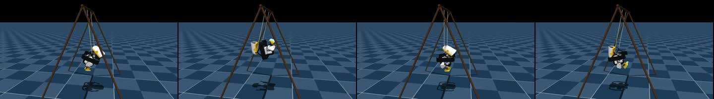
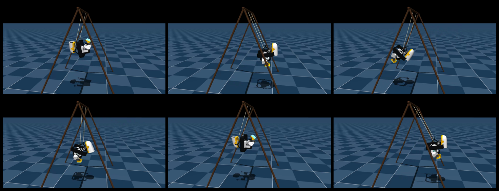
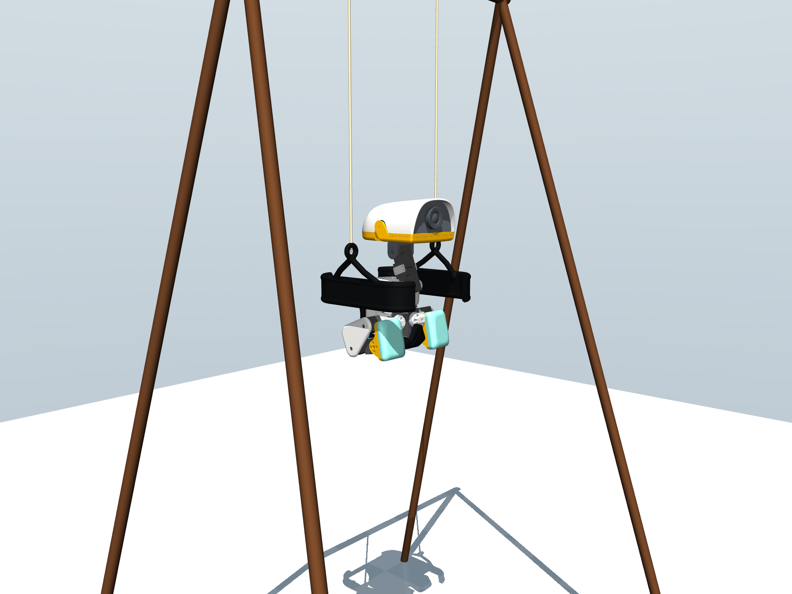
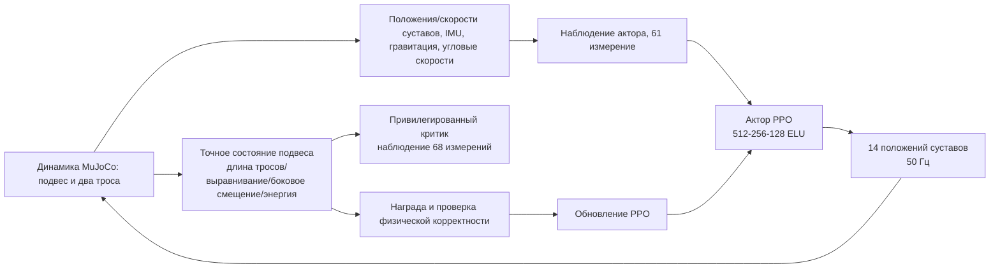

# MicroDuck, качание: от накачки маятника до проверки физической корректности

## Что делает этот раздел

В этом разделе воспроизводится задача, которая интереснее «удержать утёнка на ногах», но легче искажается в видео: MicroDuck сидит на сиденье, подвешенном на двух мягких верёвках, из положения покоя в самой низкой точке и только движениями головы и ног постепенно увеличивает амплитуду.

В видео часто говорят, что «утка сделала много оборотов». Здесь важно различать две величины:

- **размах качания** (пик-пик): наибольший угловой диапазон, который подвес проходит из одной стороны плоскости в другую в пределах одной геометрической плоскости;
- **суммарный угол / число оборотов**: сумма угловых перемещений на протяжении дальнейшего движения. Это удобно для показа, но не означает, что подвес всё время совершает допустимое полное круговое движение на 360°.

Раздел использует публичную стратегию `alpha050` из открытого репозитория и зафиксированную версию исходного кода. Мы объясним, почему она может «раскачать себя», как награда не даёт обмануть систему боковыми рывками, как экспортировать ONNX и почему «суммарный угол 2717,8°» из видео нельзя записывать как «завершён полный круг 360° без разрыва».

## 1. Сначала посмотрите локальный результат

Представительный повтор публичной стратегии размещён в ресурсах этого раздела. Видео — повтор симуляции MuJoCo с неподвижной камерой; в кадре сохранены тень и отметка максимального пик-пик размаха во время работы.



**Рисунок 1.** Локальный 36-секундный повтор, экспортированный из публичного `alpha050.pt`. Он показывает «активную накачку маятника из покоя», а не начальный импульс, который кто-то передаёт подвесу извне.



**Рисунок 1.1.** Шесть моментов локально экспортированного видео. Такие кадры помогают быстро проверить, что подвес, поза утёнка и камера правильно записаны в видео.



**Рисунок 2.** Два независимых мягких троса и сохранённая конструкция сиденья. Трос может только растягиваться, а не сжиматься; поэтому «натянут» и «сжат» нельзя считать одинаково допустимыми ограничениями.

## 2. В чём трудность задачи

Подвес сам по себе — колебательная динамическая система. Утёнок начинает в самой низкой точке, скорость и угол близки к нулю. Если стратегия выдаёт фиксированное периодическое действие, его фаза быстро расходится с движением подвеса, и энергия не накапливается, а гасится.

На каждом управляющем шаге стратегия должна решить замкнутую задачу:

> В какую сторону сейчас движется подвес? Должно ли тело вытянуться или сжаться заранее? Какие движения ног и головы передадут движение центра масс в направлении качания и при этом не уведут энергию вбок и в рыскание?

Это не просто подача «угла качания» в таблицу. В публичной реализации точная длина тросов, состояние сиденья и геометрические величины остаются у критика и оценщика; актор опирается в основном на проприоцепцию, доступную при развёртывании.

## 3. Архитектура задачи: актор, критик и динамика подвеса



**Рисунок 3.** Цепочка обучения. Актор выдаёт итоговое действие для развёртывания; критик может использовать больше состояний симуляции во время обучения, но эти привилегированные данные не входят в ONNX для развёртывания.

### 3.1. Почему актор всё же может определять фазу качания

Вход актора по-прежнему 61-мерный, выход — 14 положений суставов. Входные данные:

| Группа входов | Назначение |
|---|---|
| Угловая скорость базы и проекция гравитации | Оценка вращения корпуса и отклонения от вертикали |
| 14 положений и 14 скоростей суставов | Наблюдение, в какой позе находятся ноги и голова и насколько быстро они движутся |
| Предыдущее действие | Актор знает, насколько сильно он только что изменил форму тела |
| Команды скорости, головы и корпуса | Сохраняют единый интерфейс управления MicroDuck |

Состояние подвеса не появляется как привилегированная скалярная величина «`swing_angle`», но проявляется через угловую скорость базы, направление гравитации, отклик суставов и результаты контакта. Пока стратегия работает во времени, по этим сигналам она может оценить, находится ли подвес в фазе подъёма, прохождения верхней точки или спуска.

### 3.2. Почему критик может видеть больше

Вход критика — 68 измерений и дополнительно включает точное состояние подвеса. Это уменьшает шум оценки ценности. Такой подход называется асимметричным актор-критиком: во время обучения критику легче понять, увеличивает ли данное действие реальный эффективный размах, а при развёртывании сохраняется только то, что доступно актору от датчиков.

Отсюда частое недоразумение: **то, что критик видит длину тросов, не означает, что стратегия на реальном роботе имеет идеальный датчик длины.** Экспортированный ONNX должен использовать только 61 вход актора.

## 4. Как «самонакачка» получается при обучении

Поведение можно разделить на три уровня:

1. **Введение энергии**: тело и ноги в определённой фазе качания растягиваются или сжимаются, и движение суставов превращается в полезную энергию вдоль дуги подвеса;
2. **Ограничение направления**: награда поощряет качание вперёд и назад, но штрафует боковое смещение, боковую скорость, угловую скорость крена и рыскания, а также несовпадение точек подвеса;
3. **Физические границы**: если тросы провисают, перетягиваются, тело выходит за геометрию подвеса или появляется NaN, стратегия не может скрыть это быстрым сбросом.

Поэтому обучается не анимация с фиксированной фазой движения ног, а контроллер накачки, который замыкает ощущения собственного тела и динамику контакта. При изменении начального шума или параметров приводов фаза движений всё равно должна корректироваться обратной связью.

## 5. Награда и отбор по физической корректности

В публичной конфигурации важнейшие члены награды не сводятся к «чем больше угол, тем лучше», а образуют набор одновременно действующих целей:

| Категория | Представительные члены | Назначение |
|---|---|---|
| Прогресс | `swing_peak_progress` | Поощряет новый фронт достигнутого размаха и не даёт качаться лишь с малой амплитудой |
| Высота и энергия | `swing_height`, `swing_late_height`, `swing_energy` | Поддерживает энергию во второй половине эпизода, а не только в первые секунды с последующим срывом |
| Плоскостные ограничения | `swing_lateral`, `swing_lateral_velocity`, `swing_out_of_plane_angular_velocity` | Удерживает качание вблизи целевой плоскости |
| Ограничения механизма | `swing_alignment`, `string_slack`, `string_extension_barrier` | Не допускает смещения точек подвеса, провисания или чрезмерного растяжения троса |
| Сглаживание управления | `action_rate_l2`, `joint_torques_l2`, пределы суставов | Не даёт получить внешне большой угол ценой высокочастотной дрожи и ударов о пределы |

При оценке также проверяется, полностью ли прошёл временной интервал, были ли сбросы, не вышли ли тросы за геометрическую оболочку, контролируется ли боковое смещение, и разумны ли напряжение, ток и крутящий момент приводов BAM.

## 6. Реальные показатели публичной стратегии

Для раздела использована следующая зафиксированная версия исходного кода:

```text
https://github.com/Vottivott/microduck-playground
commit: c5fcc50219fef01ac9931d0079c583ccbb29b689
```

Результаты выбора `alpha050`:

| Показатель | Значение |
|---|---:|
| Случайная оценка | 100 seed × 36 секунд |
| Прошли строгий полный временной интервал | 71/100 |
| Прошли без геометрических нарушений | 73/100 |
| Медиана пик-пик размаха | 163,03° |
| Лучший строгий повтор | seed 27, 173,20° |
| Максимальное боковое смещение для seed 27 | 10,35 мм |

В видео есть цифры «60 с», «7 оборотов» и «2717,8°» — это показатели суммарного угла для демонстрации. Строгий пик-пик размах публичной выбранной стратегии — около 173,2°. Один из 60-секундных повторов достиг 180,2°, но вышел за точную геометрическую оболочку, поэтому его нельзя считать официальным результатом, прошедшим физические ограничения.

## 7. От исходного кода до ONNX

### 7.1. Получение исходного кода и зависимостей

```bash
git clone https://github.com/Vottivott/microduck-playground.git
cd microduck-playground
git checkout c5fcc50219fef01ac9931d0079c583ccbb29b689
uv sync
```

Если указанный commit не найден, ориентируйтесь на актуальную экспериментальную версию качания в официальном репозитории. Фиксация commit в учебнике нужна, чтобы модель, конфигурация и метрики однозначно соответствовали друг другу.

### 7.2. Тесты и физический аудит

```bash
uv run --with pytest pytest tests/test_swing_cfg.py

uv run python scripts/evaluate_swing_checkpoint.py \
  experiments/swing/checkpoints/alpha050.pt \
  --output /tmp/swing-seed27.json \
  --device cpu \
  --duration 36 \
  --seed 27
```

Тесты подтверждают только то, что конфигурация, регистрация задачи и скрипт аудита работают; они не равны полной статистике по 100 seed и не являются проверкой безопасности на реальном роботе.

### 7.3. Экспорт стратегии для развёртывания

```bash
uv run python scripts/export.py Mjlab-SwingPump-MicroDuck \
  --checkpoint-file experiments/swing/checkpoints/alpha050.pt \
  --onnx-file artifacts/microduck-swing.onnx \
  --device cpu

uv run python scripts/verify_swing_onnx_parity.py \
  experiments/swing/checkpoints/alpha050.pt \
  artifacts/microduck-swing.onnx \
  --device cpu \
  --duration 36 \
  --seed 27
```

Скрипт экспорта записывает в граф нормализатор наблюдений и ограничение действий, использованные при обучении. Не следует вручную переводить `state_dict` актора PyTorch в ONNX: это чаще всего приводит к несогласованной нормализации входов и дрейфу амплитуды действий.

Файл `assets/microduck_swing_alpha050.onnx` в этом разделе — уже выполненный локальный экспорт. Он подходит для проверки интерфейса, но не должен восприниматься как официальный пакет для аппаратного развёртывания.

## 8. Обучение, а не только повтор

Публичный репозиторий содержит точки входа для обучения с нуля и для продолжения с выпущенного checkpoint:

```bash
# Сначала smoke-тест на 5 итераций
uv run train Mjlab-SwingPump-MicroDuck \
  --env.scene.num-envs 64 \
  --agent.max-iterations 5

# Затем увеличиваем число параллельных сред
uv run train Mjlab-SwingPump-MicroDuck \
  --env.scene.num-envs 4096
```

Само обучение — стохастическая оптимизация, и нельзя обещать побитово одинаковый checkpoint при разных GPU, MuJoCo Warp, PyTorch и порядке параллельных редукций. Более корректная запись эксперимента включает commit исходного кода, random seed, число сред, критерии физической корректности и долю прохождения полного временного интервала, а не только видео с наибольшим углом.

## 9. Можно ли сразу переносить на реального робота

Нет, из этого результата нельзя напрямую сделать такой вывод. Подушка сиденья, узлы тросов, гибкость рамы, модель столкновений, насыщение приводов и защита от падения меняют динамику реальной системы. В публичном репозитории в обучение включены приводы BAM, падение напряжения, трение, демпфирование, задержка управления и рандомизация тросов, но это всё ещё диапазон, охваченный симуляцией.

Для исследований на реальном роботе как минимум нужно:

1. Сначала зафиксировать сиденье и страховочные тросы и проверить низкоамплитудное качание вперёд и назад;
2. Отдельно записывать ток, нагрев, ошибку положения и частоту действий каждого сустава;
3. Считать боковую потерю устойчивости, провисание тросов и выход сиденья из креплений жёсткими условиями аварийной остановки;
4. Постепенно увеличивать амплитуду, не делая «суммарное число оборотов» единственной целью;
5. Повторно оценивать результат после калибровки реальной механики, а не полагаться на видео симуляции как на гарантию работы железа.

## 10. Связь с другими экспериментами MicroDuck в Every Embodied

| Эксперимент | Основная задача | Ключевой урок |
|---|---|---|
| Балансировка на шаре | Свободно катящаяся опорная поверхность | Проприоцепция, контакт и восстановление |
| Ходьба на ходулях | Изменение геометрии опоры и высоты центра тяжести | Конструирование формы тела, учебный план |
| Качание и вращение | Внешняя подвесная динамика и ввод энергии | Фазовая обратная связь, плоскостные ограничения, физический отбор |
| Перетаскивание в mjswan | Обученная стратегия под внешними силами в браузере | WASM, ONNX и взаимодействие при контакте |

Вместе эти четыре примера показывают полный взгляд на обучение нового движения: сначала определяется динамика контакта, затем проектируются наблюдения, пригодные для развёртывания, и только после этого награда и ограничения безопасности оформляются как проверяемые показатели.

## 11. Источники и лицензии

- [Официальный репозиторий microduck-playground](https://github.com/Vottivott/microduck-playground)
- [Описание эксперимента swing](https://github.com/Vottivott/microduck-playground/tree/c5fcc50219fef01ac9931d0079c583ccbb29b689/experiments/swing)
- [Публичная модель Hugging Face `HannesVonEssen/microduck-swing`](https://huggingface.co/HannesVonEssen/microduck-swing)
- [Pollen Robotics MicroDuck](https://github.com/pollen-robotics/microduck)

Лицензии исходного кода, моделей, файлов конструкции подвеса и видео различаются. При загрузке или повторной публикации ориентируйтесь на лицензии соответствующих репозиториев и карточек моделей. Локальные видео и ONNX в Every Embodied служат только учебными материалами для воспроизведения и не меняют права вышестоящих авторов.
