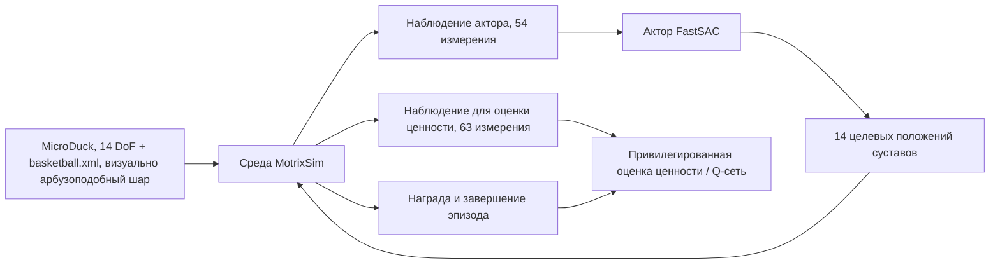

# MotrixLab: балансировка MicroDuck на мяче и обучение FastSAC

## Что решает этот раздел

В Every Embodied уже есть учебник по балансировке на баскетбольном мяче на основе `microduck-playground`. Этот раздел описывает другой путь реализации: используем открытый проект **MotrixLab** от Motphys и напрямую запускаем встроенную задачу `microduck-ball-balance` в manager-based формате и обучающий модуль Motrix FastSAC.

Оба пути изучают одну и ту же задачу — утёнок стоит на свободно катящейся сфере и сохраняет равновесие, — но это не один и тот же checkpoint, не одно и то же наблюдение и не один алгоритм. Сравнение помогает понять: **изменения среды, наблюдений, награды и обучающего модуля напрямую меняют способ управления, которому учится стратегия.**

## 1. Официальные ресурсы и локальный результат


**Рисунок 1.** Официальный постер задачи балансировки на мяче в MotrixLab. Видеоматериал взят из документации MotrixLab, файл `_static/videos/microduck-ball-balance.mp4`, и не является результатом обучения в этом учебнике.


**Рисунок 2.** Официальный пример из MotrixLab. Он помогает увидеть, как выглядит задача, прежде чем начинать собственное обучение.


**Локальный результат.** Используя официальную задачу `microduck-ball-balance` из MotrixLab, мы обучили стратегию на пути Windows CUDA eager примерно до 5000 итерации и с checkpoint `model_0005002.pt` записали 10-секундный повтор в разрешении 720×720. Этот checkpoint проверяет цепочку «среда — обучение — сохранение — повтор — экспорт видео»; мы не выдаём короткое обучение за сошедшуюся лучшую стратегию.

Состояние обучения, записанное в консоли при остановке, помогает понять силу результата:

| Показатель | Локальная запись |
|---|---:|
| Прогресс обучения | `5 202 / 20 000` итераций |
| Награда последнего эпизода | `+68,71` |
| Длина последнего эпизода | `570,6` шагов |
| Пропускная способность сбора данных | `14 334` шага среды в секунду |
| Видео повтора | 10 секунд, 720×720, H.264 |

Эти числа — журнал одного запуска на совместимом с Windows пути. Это не официальный бенчмарк MotrixLab и не показатель сходимости по разным seed.

Официальные репозитории:

- [MotrixLab на GitHub](https://github.com/Motphys/MotrixLab)
- [Документация MotrixLab на китайском языке](https://motrixlab.readthedocs.io/zh-cn/stable/)
- [Документация по балансировке на сфере](https://motrixlab.readthedocs.io/zh-cn/latest/user_guide/envs/ball_balance.html)
- [Модель робота MicroDuck](https://github.com/pollen-robotics/microduck)

## 2. Уточнение: задача называется «баскетбол», но объект выглядит как арбуз

Зрительный образ «арбуза» имеет основание: в официальном видео MotrixLab и в локальных повторах объект — зелёный полосатый шар, то есть похож на арбуз. Однако в текущем открытом коде сохраняются названия `microduck-ball-balance`, `basketball.xml`, `Basketball` и `basketball_visual`. Значит, **семантика задачи — балансировка на сфере, имена в исходном коде сохраняют «баскетбол», а визуально объект выглядит как арбуз**; по имени файла нельзя судить о содержимом сцены.

Физический мяч в этой задаче по-прежнему свободный шар радиусом `0,14 м` и массой `0,45 кг`; полоски — только визуальная сетка и текстура. Поэтому мы выполнили **прямое воспроизведение официальной задачи балансировки на арбузоподобном шаре**. Если в будущем потребуется изучить настоящий арбуз с его массой, инерцией, трением или неправильной формой, придётся создать отдельную модель и заново обучать стратегию: одной заменой текстуры тут не обойтись.

## 3. Структура задачи в MotrixLab



**Рисунок 3.** Цепочка вызовов задачи балансировки в MotrixLab. Среда и обучающий бэкенд здесь управляются MotrixLab; это отдельная реализация, отличная от PPO/LSTM в `microduck-playground`.

### 3.1. Сцена и динамика

Файлы конфигурации находятся по путям:

```text
motrix_envs/src/motrix_envs/locomotion/ball_balance/microduck.py
motrix_envs/src/motrix_envs/locomotion/ball_balance/assets/basketball.xml
```

Начальная высота базы робота задана как `0,12 + 2 × 0,14 = 0,40 м`, поэтому ступни начинают около верхушки шара. Этот шар — свободное твёрдое тело, а не «платформа», прикреплённая к ногам. Как только проекция стопы на горизонтальную плоскость отклоняется от центра шара, шар катится, и робот должен всем телом вернуть его под стопы.

### 3.2. Наблюдения актора и критика

Задача MotrixLab — не «слепой» актор. Актор получает положение и скорость мяча относительно системы координат робота:

| Наблюдение | Актор | Критик | Пояснение |
|---|---:|---:|---|
| Проекция гравитации | 3 | 3 | Определяет, стоит ли корпус вертикально |
| Угловая скорость базы | 3 | 3 | Определяет тенденцию к опрокидыванию |
| Положение мяча относительно робота | 3 | 3 | Положение мяча в системе координат корпуса |
| Скорость мяча относительно робота | 3 | 3 | Как мяч катится относительно робота |
| Положения суставов | 14 | 14 | Смещение от стандартной позы |
| Скорости суставов | 14 | 14 | Скорость движения ног и корпуса |
| Предыдущее действие | 14 | 14 | Ограничивает непрерывность действий |
| Линейная скорость базы / мировое состояние мяча | — | 9 | Привилегированное состояние для критика |

Итого: 54 измерения для актора и 63 для критика. Этот интерфейс не совпадает с 61-мерным LSTM-актором из раздела о балансировке в `microduck-playground`, поэтому ONNX-модели этих двух путей нельзя заменить друг другом.

### 3.3. Действие и исполнительные механизмы

Действие — 14-мерные целевые положения суставов. Оно масштабируется общим коэффициентом `action_scale=0,5` и добавляется к стандартной стойке; затем позиционные приводы модели, коэффициенты PD и ограничения крутящего момента выполняют низкоуровневое управление. Обучающий модуль выдаёт целевое управление, а не изменяет положение мяча напрямую и не придаёт мячу скриптованную скорость.

### 3.4. Награда и завершение эпизода

Основные награды конфигурации:

- `upright` — корпус сохраняет вертикальность;
- `base_height` — высота базы остаётся около высоты стояния на мяче;
- `ball_under_feet` — центр мяча находится под серединой стоп;
- `dof_default` — суставы не уходят без нужды далеко от стандартной позы;
- `action_rate_l2`, `limits_dof_pos` — подавляют дрожь и удары о пределы;
- `undesired_contacts` — штрафует нежелательные контакты корпуса, не связанные со стопами.

Завершение эпизода происходит, если база слишком низко, корпус сильно наклонён, мяч выкатился из-под стоп, а углы или скорости суставов выходят за допустимые пределы. Длина эпизода по умолчанию — 20 секунд. В физике не применяется рандомизация массы, трения или коэффициентов приводов; случайность в основном задаётся начальными состояниями и шумом наблюдений актора. Поэтому результаты обучения нельзя принимать за гарантию sim-to-real.

## 4. Установка и запуск на Windows

MotrixLab требует Python 3.10.x и `uv`. В Windows выполняйте команды из корня репозитория:

```powershell
git clone https://github.com/Motphys/MotrixLab.git
cd MotrixLab
git lfs pull
uv sync --all-packages --extra cuda
```

Дополнение `cuda` здесь важно. Простой `uv sync` установит PyTorch для CPU; при этом асинхронный сборщик данных в настройке FastSAC по умолчанию запрашивает CUDA, и возникает ошибка:

```text
collector_inference_device='cuda' requested CUDA, but CUDA is unavailable
```

Если нужно только проверить зависимости Python без обучения, выполните:

```powershell
.\\.venv\\Scripts\\python.exe -c "import torch; print(torch.__version__); print(torch.cuda.is_available())"
```

В Windows есть типичная ловушка: в репозитории колёса CUDA входят в дополнение `cuda`, но для Windows нет официального колеса Triton. Если оставить стандартную конфигурацию `torch.compile`, сборщик может упасть во время прогрева с `TritonMissing`. Команды Windows в этом учебнике отключают два переключателя компиляции и используют CUDA в режиме eager; на Linux с CUDA и Triton можно оставить настройки по умолчанию.

### 4.1. Прямое обучение официальной задачи

Команда пользователя выполняется из корня репозитория. В Windows рекомендуется вызывать Python из уже синхронизированного виртуального окружения и отключить путь компиляции, зависящий от Triton:

```powershell
.\\.venv\\Scripts\\python.exe scripts\\train.py `
  task=microduck-ball-balance/motrix.fastsac `
  play=true `
  algo.agent.compile=false `
  algo.trainer.async_options.collector_compile=false
```

Не запускайте `uv run` без дополнения, если уже установлено дополнение CUDA: `uv` может заново синхронизировать зависимости по умолчанию, установить CPU-версию PyTorch, и снова появится ошибка «CUDA is unavailable». Если `uv run` всё же нужен, записывайте `uv run --extra cuda ...` или, как выше, вызывайте `.\\.venv\\Scripts\\python.exe` напрямую.

Конфигурация по умолчанию находится здесь:

```text
configs/task/microduck-ball-balance/motrix.fastsac.yaml
```

Текущая публичная конфигурация использует:

| Параметр | Значение по умолчанию |
|---|---:|
| Параллельные среды | 2048 |
| Среды для повтора | 16 |
| Итерации обучения FastSAC | 20 000 |
| Шаг управления | 0,02 с |
| Шаг симуляции | 0,005 с |
| Размер батча повтора | 2048 |

Это не обещание, что обучение завершится за 5–10 минут на любой машине. Фактическое время зависит от колёс CUDA, видеокарты, версии MotrixSim, диска и того, включён ли рендеринг. При первом запуске также придётся дождаться ресурсов Git LFS и кэша ядер CUDA.

### 4.2. Сначала smoke-тест на малом масштабе

Перед полным обучением полезно уменьшить число сред и итераций, чтобы проверить сцену, награду, сборщик данных и запись checkpoint:

```powershell
.\\.venv\\Scripts\\python.exe scripts\\train.py `
  task=microduck-ball-balance/motrix.fastsac `
  num_envs=64 `
  play_num_envs=4 `
  algo.trainer.num_learning_iterations=5 `
  algo.agent.compile=false `
  algo.trainer.async_options.collector_compile=false `
  play=false
```

Этот smoke-тест подтверждает только загрузку данных, прямой проход, обратный проход и работу оптимизатора; он не доказывает, что балансировка на мяче уже освоена. На нашей машине команда завершилась с кодом возврата 0 и записала `checkpoints/latest.pt`.

### 4.3. Повтор и каталог результатов

Результаты обучения записываются в:

```text
runs/microduck-ball-balance/motrix/torch/fastsac/<timestamp>/
```

После обучения последнюю стратегию с метаданными можно сразу воспроизвести:

```powershell
.\\.venv\\Scripts\\python.exe scripts\\play.py env=microduck-ball-balance num_envs=16
```

Если нужно записать видео, сначала посмотрите поля, которые поддерживает текущая версия `configs/play.yaml` и `scripts/play.py`, затем используйте `record_video=true`. Не переносите названия параметров из старых версий вручную. Итоговое видео стоит подписывать как повтор MotrixLab и записывать checkpoint, число сред и random seed.

## 5. Сравнение с учебником по балансировке на мяче

| Параметр | Задача `microduck-playground` (PPO) | Балансировка MotrixLab |
|---|---|---|
| Алгоритм обучения | PPO | Motrix FastSAC |
| Актор | Рекуррентный LSTM без зрения | MLP-актор в manager-based формате |
| Видит ли актор состояние мяча | В основном опирается на проприоцепцию | Читает положение и скорость мяча относительно робота |
| Интерфейс наблюдений | Рекуррентный интерфейс 61 измерения | Актор 54, критик 63 |
| Основная цель | Ближе к существующему интерфейсу публичной стратегии MicroDuck | Изучение инженерной цепочки MotrixSim и FastSAC |
| Прямая замена checkpoint | Нет | Нет |

Здесь нет вопроса о том, какой путь «лучше». Первый лучше показывает проприоцепцию и временную память, второй — manager-based среды, единую конфигурацию, асинхронный сборщик и FastSAC. Оба пути нужно запускать с собственным контрактом наблюдений и действий.

## 6. Если нужно изучить «настоящий арбуз»

Нынешняя официальная задача уже использует арбузоподобный визуальный шар. Чтобы исследовать настоящий арбуз, а не сферу с полосатой текстурой, нужно рассматривать это как расширение физической модели:

1. задать геометрию, радиус, массу, инерцию и трение арбуза в MuJoCo XML или сетке;
2. решить, свободно ли катится арбуз, ограничен ли он плоскостью среза или имеет локальные впадины;
3. заново определить запросы относительного положения и скорости шара, а также награду;
4. заново проверить контакт подошв, высоту базы и пороги завершения эпизода;
5. сначала запустить физический smoke-тест на 5–20 средах и только потом переходить к параллельному обучению;
6. называть результат «повтором балансировки арбуза» только после того, как получены устойчивые показатели по разным seed и видео.

В текущем репозитории нет отдельной конфигурации с именем `watermelon`, поэтому в этом разделе не утверждается, что выполнено самостоятельное исследование настоящего арбуза с его материалом, массой и неправильной формой. Здесь воспроизводится официальная задача балансировки на арбузоподобном шаре.

## 7. Источники

- [Исходный код MotrixLab](https://github.com/Motphys/MotrixLab)
- [Исходный код задачи балансировки на мяче MotrixLab](https://github.com/Motphys/MotrixLab/blob/main/motrix_envs/src/motrix_envs/locomotion/ball_balance/microduck.py)
- [Конфигурация FastSAC в MotrixLab](https://github.com/Motphys/MotrixLab/blob/main/configs/task/microduck-ball-balance/motrix.fastsac.yaml)
- [Every Embodied: учебник по балансировке MicroDuck на мяче с PPO](../01-microduck-basketball-balance-reinforcement-learning/README.md)
- [Pollen Robotics MicroDuck](https://github.com/pollen-robotics/microduck)
