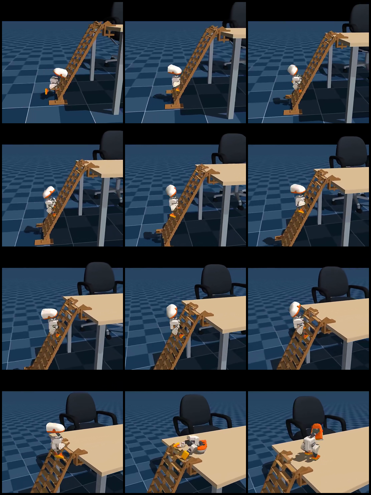
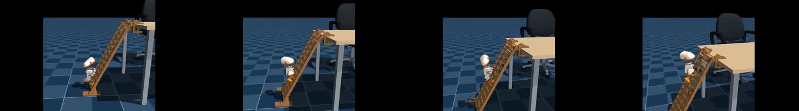
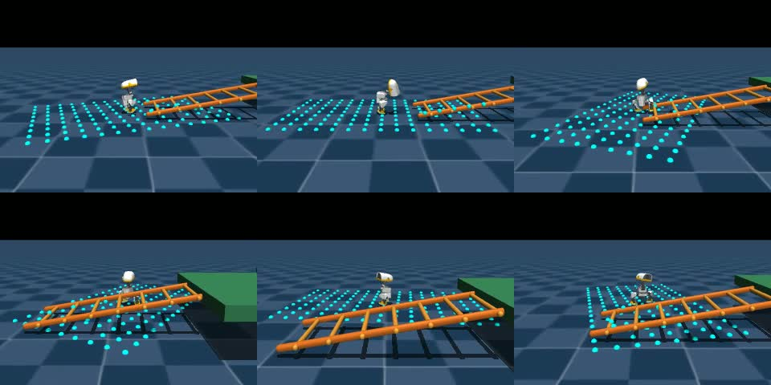
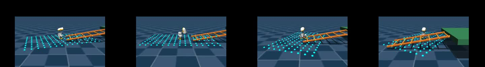
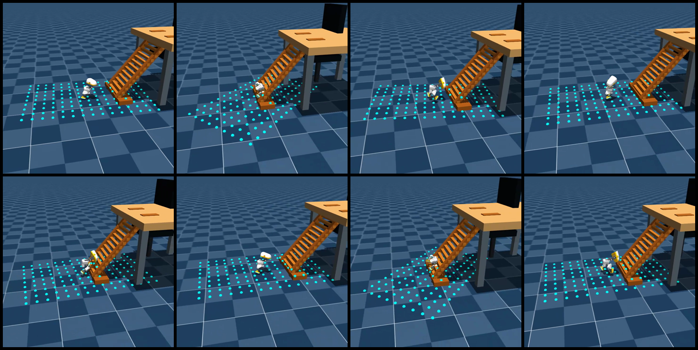
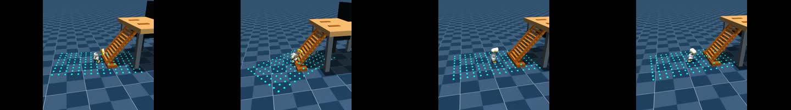
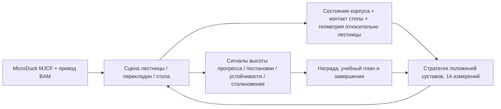

# MicroDuck, подъём по лестнице: от видеоэффекта к воспроизводимой задаче обучения с подкреплением

## Подъём по лестнице и выход на стол


MicroDuck поэтапно наступает на перекладины, забирается на столешницу и встаёт. Выше показан 24-секундный GPU-вывод, сохранённый в Notebook 06; используются два актора — `climber` и `getup`, а физику и рендеринг обеспечивает MuJoCo.

| Проверка | Запись |
| --- | --- |
| Вход / выход | 61 измерение наблюдения / 14 измерений действия; 13 слотов команд нулевые |
| Передача управления | Шаг 575, около 11,5 секунды |
| Устойчивое стояние на столе | `stable_seconds=11.54` |
| Вся последовательность | `handoff_success=true` |
| Объём записи | Один GPU-запуск симуляции, 1200 управляющих шагов |

## Среда и маршрут обучения

Сначала запустите описанную выше пару стратегий «подъём и вставание», затем с помощью среды V1/V2/V3 из этого раздела изучите геометрию лестницы, награду за контакт и учебный план. Конфигурации задач, checkpoint и результаты оценки двух маршрутов хранятся раздельно. Источники моделей, команды запуска и шаги дообучения пары стратегий описаны в [разделе 6](#6-пошаговое-воспроизведение-подъёма-и-выхода-на-стол).

> **Локальная запись по экспериментам с лестницей:** в одном обучении V3 при воспроизведении зафиксирована постановка на перекладину: `TARGET_STEPS=[28, 76, 77]`, `MAX_PHYSICAL_RUNG_TARGET=1`, `SUCCESS_COUNT=1`. В независимой оценке этапа C при `active_rungs=3` получено `MAX_PHYSICAL_RUNG_TARGET=0`, `SUCCESS_COUNT=0`. Эти записи относятся к разным этапам обучения и оценки; локальный учебный план продолжает переход к чередованию одной ноги и непрерывным целям перекладин.

Пользовательское видео показывает, как MicroDuck поднимается от земли по наклонной лестнице с перекладинами и в конце переворачивается на стол. Мы сохранили кадры из этого видео как справочный материал раздела:



**Рисунок 1.** 12 выбранных кадров из справочного видео.



**Видео 1.** Исходный справочный фрагмент, подготовленный для этого раздела; используется для анализа фаз задачи и контактов.

### Сборный показ этапов навыков

Видео с комбинацией обхода препятствий, физических возмущений, балансировки на сфере и контакта с лестницей:


В финальных титрах отмечены готовые демонстрации и обучаемые задачи — `GroundPick`, непрерывная смена ступеней, постановка на верхнюю площадку. Результаты оценки V3 смотрите в числах и журналах этого раздела.

## Локальный V1: среда и цепочка контактов

Локальная задача V1 построена на стеке обучения MuJoCo/MicroDuck, в который добавлены:

- регистрация задачи `Mjlab-Ladder-Climb-MicroDuck`;
- настоящие коллизионные геометрии MuJoCo: два наклонных бруса, 7 перекладин, верхняя площадка и упорный барьер;
- в наблюдение добавлено сканирование лучами вперёд: актор расширен с 61 до 196 измерений, критик — до 211;
- награда строится на разности потенциальной энергии вперёд/вверх, вертикальности корпуса, контакте стоп и сглаживании действий;
- условие успеха — достичь верхней площадки и сохранить устойчивость позы;
- первый входной слой расширен от публичной стратегии ходьбы MicroDuck: сначала тёплый старт, затем обучение стратегии для лестницы.

Версия V1 обучена на GPU с 256 средами за 150 итераций, повтор записан в H.264 длительностью 12 секунд. Утёнок доходит до лестницы, физически соприкасается с перекладинами и поднимается до середины. В этом прогоне `ladder_success=0`; устойчивое закрепление на верхней площадке остаётся целью последующего обучения.



**Рисунок 2.** Шесть моментов локального воспроизведения V1. Бирюзовые точки — результаты лучевого сканирования лестницы, оранжевые тела — настоящие коллизионные перекладины. Видно, что стратегия уже вошла в фазу контакта с лестницей.



**Видео 2.** Локальное частичное воспроизведение подъёма V1 в MuJoCo; стабильное закрепление на верхней площадке — цель следующей проверки.

## 2.1 Геометрия лестницы V2, воспроизведённая по исходному видео

Проблема V1 заключалась не в том, что «наклон окрасили в другой цвет», а в несоответствии структуры лестницы справочному видео. V2 перестроена по пространственным связям из исходного ролика: одна высокая столешница, два наклонных прямоугольных бруса по скату, 14 плотных поперечных перекладин, деревянные упоры основания, четыре ножки стола и визуальная конструкция стула за столом. Перекладины остаются ориентированными по мировой поперечной оси и не превращаются в вертикальный забор; все бруса, перекладины, столешница и упоры — настоящая коллизионная геометрия MuJoCo. Угол наклона брусьев, положение их верхнего стыка и высоту стола подогнали по референсному кадру, чтобы не получилась ошибочная конструкция «два столешничных щита с рядом вертикальных стоек».



**Рисунок 3.** Предпросмотр геометрии лестницы V2 и коллизий для сценария с одним утёнком.



**Видео 3.** Предпросмотр тёплого старта V2 в сценарии без опорной доски. Эта контрольная точка подходит к упору и останавливается на входе; `ladder_success=0`.

Чтобы улучшить исследование перехода от ходьбы по ровной земле к узким перекладинам, в коде предусмотрен **учебный этап с опорой**: при тех же брусах, перекладинах и столешнице добавляется сплошная наклонная поверхность, которая может сталкиваться. Сначала стратегия учится поднимать ногу и держать корпус по наклону, затем переносит навык в итоговую задачу без опорной доски.

Новые файлы кода:

- [`microduck_video_ladder_env_cfg.py`](./code/microduck_video_ladder_env_cfg.py): сцена V2 в пропорциях видео, настоящая коллизионная геометрия, итоговая задача без опорной доски и учебная задача с доской;
- [`video_ladder_mdp_terms.py`](./code/video_ladder_mdp_terms.py): формирование награды за выравнивание стопы относительно перекладины по положению конца ноги; контакт и успех по-прежнему определяются физикой MuJoCo и условиями завершения.

Проверенные в локальной работе имена задач:

```text
Mjlab-Video-Ladder-Climb-MicroDuck          # итог: без опорной доски, контакт с перекладинами
Mjlab-Video-Ladder-Support-Stage-MicroDuck  # учебный этап: с непрерывной опорной доской
```

В окружении Windows с CUDA используйте уже проверенный вход `.venv`, чтобы `uv run` не переустановил PyTorch для CPU:

```powershell
# Сначала физический smoke-тест
.\.venv\Scripts\train.exe Mjlab-Video-Ladder-Support-Stage-MicroDuck `
  --env.scene.num-envs 32 `
  --agent.max-iterations 5

# Обучение учебного этапа, затем перенос на итоговую сцену без опорной доски
.\.venv\Scripts\train.exe Mjlab-Video-Ladder-Support-Stage-MicroDuck `
  --env.scene.num-envs 256 `
  --agent.max-iterations 4000

.\.venv\Scripts\train.exe Mjlab-Video-Ladder-Climb-MicroDuck `
  --env.scene.num-envs 256 `
  --agent.max-iterations 4000 `
  --agent.resume True `
  --agent.load-run <support-stage-run> `
  --agent.load-checkpoint model_*.pt
```

Для экспорта одного утёнка используйте `scripts/export.py` с `--num-envs 1`, не выдавая мозаику из многосредного обучения за финальный показ:

```powershell
.\.venv\Scripts\python.exe scripts\export.py `
  Mjlab-Video-Ladder-Climb-MicroDuck `
  --checkpoint-file logs\rsl_rl\ladder_climb_video\<run>\model_*.pt `
  --num-envs 1 `
  --video True `
  --video-length 600 `
  --video-height 720 `
  --video-width 720 `
  --onnx-file artifacts\video_ladder.onnx
```

Текущее состояние записано честно: геометрия V2, регистрация задачи, физический smoke-тест и предпросмотр одного сценария выполнены; в коротком локальном обучении для сравнения `ladder_success=0`, итоговая стабильная контрольная точка подъёма на верх ещё не получена. Критерии завершения: успех по разным seed, максимальная высота подъёма, время стабильного контакта с перекладинами и видео постановки на стол.

## 2.2 V3: планирование по точкам опоры, корректная физика

Неудача V2 не объясняется тем, что «надо было обучать дольше». После проверки модели выявлено две структурные проблемы. Лестница использовала `contype=1/conaffinity=1`, а геометрия `self_collision_only` тела робота — `contype=2/conaffinity=2`, поэтому туловище и ноги могли проходить сквозь брусья. Кроме того, награда учитывала только продвижение вперёд и высоту, и у стратегии не было причины поднимать ногу, чтобы наступить на следующую перекладину.

Новая задача V3:

```text
Mjlab-Video-Ladder-Footstep-MicroDuck
```

Сохраняются 14 дискретных перекладин в пропорциях видео, но прогресс определяется реальным состоянием опоры по конечной точке стопы:

- брусья, перекладины, упоры, столешница и площадка используют `contype=3/conaffinity=3`, поэтому могут касаться и битов 1 у подошвы, и бита 2 у тела; стул остаётся чисто визуальным объектом;
- сенсор контакта читает из данных контакта MuJoCo `found/force/dist/pos/normal`; отрицательное `dist` считается штрафом за проникновение;
- сенсор контакта тела учитывает только три геометрии с битом 2 из исходной модели (туловище и обе голени), поэтому законный контакт стопы с перекладиной не принимается за столкновение тела с лестницей; лестница использует маску `(3,3)`, стопа — `(1,1)`, тело — `(2,2)`; дополнительных заменяющих геометрий туловища, меняющих топологию самостолкновений исходной модели, не добавлено;
- в наблюдения актора и критика добавлены `dx/dy/dz/yaw` для двух следующих перекладин, фаза шага, маховая стопа, относительное положение обеих стоп, реальный контакт и наблюдение этапа учебного плана;
- цель перекладины продвигается только тогда, когда указанная стопа реально касается её и удерживает контакт определённое время и конечная точка стопы находится в допуске; туловище, столкнувшееся с брусом на подходе или на подъёме, приводит к ошибке немедленно;
- этап A по-прежнему использует полную реальную коллизию лестницы, но жёсткое столкновение корпуса не является условием завершения; это правило включается только с первой перекладины, а сила контакта, проникновение и проскальзывание учитываются с первого шага, чтобы «сначала научиться стоять» не превратилось в смягчение физики;
- учебный план идёт по ступеням `0 → 1 → 2 → 3 → 7 → 14` перекладин; ступень с 2 перекладинами — добавленный для MicroDuck мостик переноса с левой ноги на правую, после которого открывается верхний переход на площадку; в финальной сцене V3 нет непрерывной опорной доски;
- этап G включается только после завершения номинального курса подъёма и добавляет небольшую рандомизацию домена: `dr.pseudo_inertia` для случайных массы и инерции, случайное трение подошв, трение суставов BAM, коэффициенты усиления приводов и начальная поза. Этапы A–F сохраняют детерминированную контактную динамику, чтобы сначала научиться движению, а затем изучать робастность к переносу на реальный робот;
- награда за продвижение корпуса V2 удалена; добавлены ошибка постановки стопы, устойчивость опоры, подъём маховой стопы, штраф за проскальзывание, удар и проникновение; выравнивание корпуса использует разность потенциальной энергии до текущей целевой перекладины, поэтому стояние на месте не приносит «награды за движение вперёд».

### Референсные подходы для humanoid-роботов в V3

Этот вариант не придумывает награду «врезаться в лестницу», а переносит уже известные методы планирования постановки стоп на двуногого робота:

- [HR-LearningHumanoidWalking](https://github.com/qiangsun89/HR-LearningHumanoidWalking): `jvrc_step` использует две будущие целевые стопы, фазу чередования левой и правой ног, а также ограничения силы и скорости конечной точки в фазах одной и двух опор; последовательность постановки продвигается, только когда целевая стопа действительно пришла на место и удерживается. `ladder_step_targets`, `ladder_phase`, `ladder_phase_contact_velocity` и конечный автомат физического контакта в V3 соответствуют этому подходу.
- [unitree_dsc_lab](https://github.com/thanhnguyencanh/unitree_dsc_lab): более новый пример для лестниц и сложного рельефа — тип рельефа, высота и глубина ступени, ориентация выражаются явными токенами рельефа, а учебные политики учителя, восприятия и суставов обучаются поэтапно. Это реализация для Isaac Lab + G1; V3 пока заимствует только интерфейс «явная информация о рельефе и поэтапное обучение», но не переносит checkpoint G1.
- Размеры робота, число суставов, пространство действий и приводы в этих проектах отличаются, поэтому checkpoint humanoid-робота нельзя просто вставить в MicroDuck. Переносится механизм планирования и обучения; MicroDuck использует собственную лестницу MuJoCo, 14-мерное действие, приводы BAM и данные реального контакта.

Поэтому порядок проверки V3 такой: сначала научиться «поднять ногу — коснуться — нести вес — удерживать» на одной перекладине, затем расширить до 3, 7 и 14 перекладин и только потом обучить переход наверх площадки; непрерывная опорная доска не должна становиться скрытым упрощением итоговой задачи.

### 2.3 Лестница, обход препятствий и захват: что уже сделано

Эти три задачи можно выстроить в один учебный маршрут MicroDuck, но их зрелость различна, поэтому их нельзя оценивать одним и тем же критерием «работает»:

| Способность | Что воспроизводимо сейчас | Чего не хватает до статуса «выполнено» |
|---|---|---|
| Подъём по лестнице | Пара стратегий `climber/getup` на GPU выполняет подъём, выход на стол и устойчивое стояние; в собственной среде V3 есть настоящее столкновение с перекладинами и конечный автомат постановки стоп | Оценка непрерывной смены ступеней V3 и передача управления парой стратегий на BPU |
| Обход препятствий | В `microduck-rl-lab` есть маршрут `walk_obstacle_entry → walk_obstacle_detour`: стратегия ходьбы доводит до препятствия, обходит его сбоку и продолжает движение | Сейчас используются истинные координаты симулятора, а не камера или ToF-навигация; для полноценной версии с восприятием нужно добавить детектирование препятствий и оценку локальной цели |
| Захват предмета | Официальная задача `Mjlab-GroundPick-Flat-MicroDuck` зарегистрирована; smoke на 64 средах и 5 итерациях на CPU выполнен; награда включает приседание, приближение рта, возврат в стойку и члены контакта | Нужна проверка полного checkpoint по этапам успеха, контакту рта и возврату в стойку на видео; smoke нельзя считать освоенным захватом |

Поэтому ближайшая надёжная схема такая: проверить маршрут обхода официальной стратегией ходьбы, продолжить обучение захвата официальной задачей GroundPick, а лестницу обучать отдельной задачей V3 по ступеням. Три части затем можно связать в один конвейер миссии `microduck-rl-lab`, но конвейер — лишь планировщик и не заменяет физическую приёмку каждого навыка.

#### Минимальное воспроизведение обхода и захвата

На рабочей станции Ubuntu с установленными зависимостями сначала выполните smoke на 64 средах:

```bash
cd /path/to/workspaces/microduck_rl
MUJOCO_GL=egl .venv/bin/train Mjlab-GroundPick-Flat-MicroDuck \
  --env.scene.num-envs 64 \
  --agent.max-iterations 5 \
  --agent.logger tensorboard \
  --agent.experiment-name ground_pick_smoke
```

Исходный код комбинированного маршрута находится в `microduck-rl-lab`; сегмент обхода препятствия в нём пока работает на истинных координатах симулятора:

```bash
cd /path/to/workspaces/microduck-rl-lab
export PYTHONPATH=/path/to/workspaces/microduck-rl-lab/src:/path/to/workspaces/microduck_rl/src
export WANDB_MODE=offline
/path/to/workspaces/microduck_rl/.venv/bin/python \
  -m microduck_playground.cli train --skill all --smoke
```

На рабочей станции Ubuntu мы действительно прогнали пятинавыковый smoke: ходьба, сесть/встать, захват с земли, кувырок и удар правой ногой; каждый навык запустился и сохранил `model_4.pt`. Это подтверждает, что регистрация задач и вход конвейера работают, но 5-итерационные checkpoint служат лишь проверкой среды и не являются финальными моделями соответствующих навыков.

Перед полным обучением сохраняйте checkpoint ходьбы, захвата с земли и лестницы отдельно и только затем связывайте их конфигурацией миссии; не переименовывайте checkpoint ходьбы в «модель обхода/захвата/лестницы».

Ядро V3 объединено с экспериментальным репозиторием в файле [`mdp.py`](https://github.com/Vottivott/microduck-playground/blob/main/src/mjlab_microduck/tasks/mdp.py); сопутствующие конфигурации учебника и скрипты инициализации находятся здесь:

- [`microduck_video_ladder_footstep_env_cfg.py`](./code/microduck_video_ladder_footstep_env_cfg.py): сцена V3, сенсоры контакта, наблюдения, награды, завершения и конфигурация учебного плана;
- [`registration_snippet.py`](./code/registration_snippet.py): фрагмент регистрации новой задачи;
- [`prepare_ladder_footstep_bootstrap.py`](./code/prepare_ladder_footstep_bootstrap.py): расширяет checkpoint ходьбы с 61/76 до 224/239 измерений для V3, добавленные наблюдения инициализируются нулями; также обнуляет сохранённый в checkpoint `common_step_counter`, чтобы не перескочить этапы учебного плана;
- [`test_video_ladder_footstep_cfg.py`](./code/test_video_ladder_footstep_cfg.py): компилирует модель MuJoCo напрямую и проверяет маски коллизий, 14 перекладин, отсутствие проникновения в начальной позе и границы этапов учебного плана.

### V3: сначала физический smoke, потом обучение

В окружении Windows с CUDA используйте `.venv`, где уже установлены MuJoCo Warp и PyTorch с GPU, и не позволяйте `uv run` заново разрешить зависимости в CPU-версию:

```powershell
# Расширить существующую стратегию ходьбы до входной ширины V3
.\.venv\Scripts\python.exe scripts\prepare_ladder_footstep_bootstrap.py `
  artifacts\running-baseline\checkpoint.pt `
  artifacts\ladder_footstep_bootstrap\checkpoint.pt

# Сначала smoke на 4 итерации с этапа A, чтобы убедиться, что учебный план не перескочил этапы
.\.venv\Scripts\train.exe Mjlab-Video-Ladder-Footstep-MicroDuck `
  --env.scene.num-envs 32 `
  --agent.max-iterations 4 `
  --agent.resume True `
  --agent.load-run bootstrap_v3 `
  --agent.load-checkpoint model_0.pt
```

Если файл bootstrap лежит в `logs/rsl_rl/ladder_climb_footstep/bootstrap_v3/model_0.pt`, указанные параметры восстановления можно использовать сразу; в противном случае замените `--agent.load-run` и `--agent.load-checkpoint` на фактический каталог логов.

В корне исходного кода `microduck-playground-stilts` физический регрессионный тест можно запустить и без pytest:

```powershell
.\.venv\Scripts\python.exe -c "import importlib.util; p='tests/test_video_ladder_footstep_cfg.py'; s=importlib.util.spec_from_file_location('v3tests',p); m=importlib.util.module_from_spec(s); s.loader.exec_module(m); [getattr(m,n)() for n in dir(m) if n.startswith('test_')]; print('V3_DIRECT_TESTS_PASSED')"
```

Результаты локальной приёмки:

- задача V3 построена на CUDA/MuJoCo Warp; размерности наблюдений актора и критика — `224/239`, размерность действия по-прежнему `14`;
- smoke из 4 итераций на 32 средах пройден; `Curriculum/ladder_stage` стартует с `0` и не переносит старые глобальные шаги ходьбы, которые перескочили бы сразу к 14 ступеням;
- при 8 итерациях этапа A на 32 средах `ladder_body_collision=0`: вход в обучение не обнуляет выборку из-за завершения эпизода при столкновении тела на начальном этапе исследования;
- этапы A/B на 512 средах уже дают частичные переходы контакта к целям входа; в оценке этапа C (`active_rungs=3`: две входные цели и первая физическая перекладина) последний результат `MAX_ENTRY_TARGET=1/2`, `MAX_PHYSICAL_RUNG_TARGET=0`, `SUCCESS_COUNT=0`. Это значит, что конечный автомат состояний и аудит реального контакта работают, но текущая стратегия остановилась у входа на лестницу и ещё не проходит физическую перекладину;
- прямая компиляция модели MuJoCo пройдена: 14 перекладин, отсутствие сплошной опорной доски, отсутствие проникновения в начальной позе; если туловище намеренно поместить на перекладину, данные контакта MuJoCo показывают реальное касание бита 2 тела с битом 3 лестницы;
- после уточнения сенсора контакта тела по геометриям с битом 2 четырёхсредный smoke на CUDA/MuJoCo Warp этапа B прошёл; наблюдения остались `224/239`, действие — `14`; касание стопой перекладины не вызывает завершения из-за столкновения тела с лестницей, а геометрическое столкновение туловища по-прежнему фиксируется и завершает эпизод на соответствующем этапе;
- это проверка физики и цепочки обучения, а не полный результат подъёма. Здесь не заявляются успехи 90% для одной перекладины, 80% для трёх или выход на площадку, и краткий вывод обучения не выдаётся за финальный видеоролик.

Дальше обучение идёт по этапам A–G, и для каждого этапа отдельно записываются успешность на одной, трёх, семи и четырнадцати перекладинах и постановка на верхнюю площадку. Рандомизация этапа G начинается с глобального шага `4500 × 24` и не включается в начале обучения, иначе проблемы контакта смешаются с возмущениями переноса на реальный робот. Запись «столкновения с лестницей» V2 сохраняется как пример неудачи и не включается в отобранные результаты учебника.

Чтобы экспортировать повтор определённого этапа учебного плана, нужно явно задать счётчик этапа; иначе новая среда воспроизведения начнёт с этапа A:

```powershell
.\.venv\Scripts\python.exe scripts\export.py `
  Mjlab-Video-Ladder-Footstep-MicroDuck `
  --checkpoint-file logs\rsl_rl\ladder_climb_footstep\<run>\model_*.pt `
  --curriculum-step 4800 `
  --num-envs 1 `
  --video True `
  --video-length 300
```

Для удобства дальнейших экспериментов новая конфигурация среды и скрипты тёплого старта собраны в `code/`:

- [`microduck_ladder_env_cfg.py`](./code/microduck_ladder_env_cfg.py): сцена лестницы, лучевые наблюдения, награды, завершения и основная конфигурация для регистрации задачи;
- [`ladder_mdp_terms.py`](./code/ladder_mdp_terms.py): разность потенциальной энергии вперёд/вверх и условие успеха на верхней площадке;
- [`registration_snippet.py`](./code/registration_snippet.py): минимальный фрагмент, который добавляет задачу в реестр `list-envs`;
- [`prepare_ladder_bootstrap.py`](./code/prepare_ladder_bootstrap.py): расширяет входы публичной стратегии ходьбы с 61/61 до 196/211 для задачи лестницы и инициализирует новые столбцы наблюдений нулевыми весами.

Эти файлы — локальный экспериментальный патч к учебнику. Для воспроизведения включите функцию награды и регистрацию задачи в соответствующие модули `microduck_rl`.

## 1. Почему это не обычная ходьба по неровному рельефу

Обычная задача rough terrain требует сохранять ходьбу на неизвестных небольших ступенях, склонах и перепадах высоты. Лестница из видео накладывает дополнительные ограничения:

- стопа должна надёжно опираться на узкую перекладину, а не просто катиться по сплошной поверхности;
- корпус поднимается по наклонной плоскости, проекция центра масс не должна постоянно выходить за опорный многоугольник;
- между перекладинами есть дискретные зазоры, поэтому высота подъёма стопы, амплитуда вперёд и момент постановки должны совпадать;
- у самой столешницы последний шаг — не «продолжить идти», а переходное действие с переходом, посадкой на площадку и повторной стабилизацией;
- если робот застревает на перекладине, скользит или падает, обучающая среда должна определять это как измеримое завершение эпизода, а не позволять стратегии получать случайную высоту за счёт удара.

Поэтому воспроизводится задача **contact-rich locomotion / climbing**, а не ходьба из видео с заменённым фоном в виде склона.

## 2. Стратегии и инженерные референсы

| Проект | Что доступно | Использование в этом разделе |
|---|---|---|
| [HannesVonEssen/microduck-climb](https://huggingface.co/HannesVonEssen/microduck-climb) | Видео поэтапного подъёма, стратегии climber/get-up, ONNX, контрольные точки PPO, код обучения и модель лестницы | Референс для действий подъёма и сквозной реализации |
| [pollen-robotics/microduck](https://github.com/pollen-robotics/microduck) | Модель робота, интерфейс времени выполнения | Понимание самого MicroDuck и интерфейса развёртывания |
| [pollen-robotics/microduck_rl](https://github.com/pollen-robotics/microduck_rl) | MuJoCo/MuJoCo Warp, приводы BAM, интерфейс 14 действий / проприоцепции, обучение на ровной и неровной поверхности | Локальная среда задач и базовая линия движения |
| [Motphys/MotrixLab](https://github.com/Motphys/MotrixLab) | Сцены MotrixSim, manager-based задачи, FastSAC и параллельный конвейер обучения | Сравнение с задачей балансировки на мяче и реализация версии задачи лестницы |
| [bihaokun/microduck-step-up-policy](https://github.com/bihaokun/microduck-step-up-policy) | Одиночная ступень 25 мм `step_up_walk`, стратегии торможения головы и восстановления стойки, ONNX / checkpoint и код оценки | Изучение подъёма ноги, перехода и восстановления на одной ступени |
| [craigm26/duckbench](https://github.com/craigm26/duckbench) | Физический бенчмарк MuJoCo, сервис стратегий MicroDuck, оценка задач лестниц и мячей, аудит | Проектирование контакта, устойчивой постановки на площадку и оценки задач |
| [microduck-stairs-challenge](https://huggingface.co/datasets/craigm26/microduck-stairs-challenge) | Задача лестниц MicroDuck, сетка тестов и метрики устойчивой постановки | Проектирование набора оценок для задачи лестниц |
| [open-microduck](https://github.com/SaberOnGo/open-microduck) | Симуляция, параметры sim-to-real и сборник рельефов | Дополнительный контекст для обучения и развёртывания робота |

Для воспроизведения поэтапного подъёма сначала используйте среду и стратегии `microduck-climb`; локальные V1/V2/V3 нужны, чтобы изучить реализацию задачи и затем менять награды, наблюдения и учебный план. Одиночная ступень и челлендж лестницы служат для изучения априорных знаний о шаге и проектирования устойчивой постановки на площадку.

## 3. Как разбить архитектуру воспроизведения



**Рисунок 4.** Замкнутая задача, которую можно воспроизвести. Первая версия не должна сразу претендовать на полное освоение подъёма: сначала разделите «стоять на перекладине, не падая» и «переступить через одну ступень» на отдельно проверяемые этапы.

### 3.1. Слой сцены

Геометрию рекомендуется разбить на четыре модуля:

1. **Основное тело лестницы**: два боковых бруса и несколько перекладин с заметным промежутком между ними;
2. **Стартовая поверхность**: позволяет управляемо войти в робота из контролируемой позы стойки на первой перекладине;
3. **Верхняя площадка**: моделирует зону приёма на столешнице из видео;
4. **Защитная оболочка**: боковые мягкие барьеры или виртуальная зона столкновений, чтобы считать выход за пределы, а не давать роботу упасть в бесконечную глубину.

Первая версия должна использовать простые коллизии box/capsule, а не импортированные сетки с высокой плотностью полигонов. Внешний вид лестницы можно передать визуальной сеткой, но для обучения коллизии лучше держать простыми, иначе трудно отличить ошибку стратегии от числовых проблем узкого пересечения.

### 3.2. Слой наблюдений

Минимально необходимо:

- ориентация корпуса, угловая скорость и проекция гравитации;
- положение и скорость 14 суставов;
- положение и скорость левой и правой стопы, состояние контакта;
- относительное направление / высота текущей целевой перекладины или площадки;
- предыдущее действие и изменение действия;
- при желании — локальная глубина или лучевая информация, по которой видно высоту следующей перекладины и промежутки.

Если нужно сохранить интерфейс официальной стратегии MicroDuck, близкий к исходному, новую информацию можно сжать в вектор команд или несколько локальных геометрических признаков, сохранив контракт 61→14. Если же целью служит визуальный подъём, нужно явно добавить визуальный энкодер, а не незаметно передавать актору полное состояние лестницы.

### 3.3. Слой наград

Объяснимая первая версия награды может выглядеть так:

| Группа награды | Цель |
|---|---|
| Подъём вверх | Поощрять подъём корпуса / центра масс вдоль лестницы, но ограничивать разовые награды за прыжки |
| Качество постановки | Поощрять устойчивый контакт подошвы в окрестности целевой перекладины |
| Устойчивость тела | Штрафовать сильные крен и тангаж, боковую скорость и удары в суставах |
| Этапы задачи | Выставлять latch/этапные награды за переступание через перекладину, устойчивое стояние и выход на площадку |
| Энергия и сглаживание | Штрафовать большие действия, ограничения суставов и высокочастотную дрожь |
| Условия завершения | Падение с лестницы, удар корпусом, застревание стопы в геометрии и расходимость численных значений завершают эпизод |

Особенно важно не дать «награде за подъём» превратиться в прыжки или удары. Задача лестницы должна включать в условие успеха реальную опорную стопу, ориентацию корпуса и полное время устойчивости.

## 4. Рекомендуемый учебный план

Не стоит сразу помещать всю лестницу из видео, столешницу и сложное трение в 4096 сред. Можно повышать сложность по ступеням:

1. **Этап A: устойчивость на одной перекладине.** Робот стартует на перекладине и сначала учится удерживать позу 3–5 секунд;
2. **Этап B: от земли до одной перекладины.** Фиксированная высота ступени; награда за переступание и последующую стабилизацию;
3. **Этап C: непрерывные низкие ступени.** Случайный шаг между перекладинами и небольшое трение; ограничение ударов при постановке;
4. **Этап D: наклонная лестница.** Постепенное увеличение уклона, промежутков и высоты цели;
5. **Этап E: верхняя площадка.** Добавление последнего шага через край и восстановления на площадке;
6. **Этап F: возмущения и рандомизация домена.** Затем вводятся случайность массы, трения, задержки привода и начальной позы.

На каждом этапе сохраняйте успешность по разным seed, максимальную высоту подъёма, время стабильности, число столкновений и первое место отказа. Если сохранить только видео, где робот «наконец поднялся», нельзя доказать, что стратегия стабильно научилась подниматься.

## 5. Что можно запустить на открытых базовых линиях сейчас

### 5.1. Базовая линия MicroDuck для неровного рельефа

В корне репозитория `microduck_rl` сначала проверьте реестр задач, поскольку имена задач в вышестоящем проекте могут меняться:

```bash
uv sync
uv run list-envs
```

По текущей публичной таблице задач базовая линия неровного рельефа обычно начинается так:

```bash
uv run train Mjlab-Velocity-Rough-MicroDuck
```

Цель этого шага — проверить, что корпус робота, приводы BAM, неровный рельеф, вход и выход стратегии и экспорт видео работают. Это не результат подъёма по лестнице.

#### 5.1.1. Материалы для воспроизведения неровного рельефа

Мы использовали публичную стратегию [`RemiFabre/microduck-rough-walk-g`](https://huggingface.co/RemiFabre/microduck-rough-walk-g) и на рабочей станции Ubuntu записали повтор в MuJoCo с внешним рендерингом. Интерфейс стратегии сохраняет публичную модель `61-D observation -> 14-D action`, частота управления 50 Гц, команда скорости `vx=0,30 м/с`.

Скрипт воспроизведения:

```bash
python scripts/render_rough_walk_video.py \
  --policy /path/to/policy.onnx \
  --output outputs/rough_walk_g_reproduction.mp4 \
  --seconds 12 \
  --command 0.30
```

Чтобы в одном видео вошла реальная вариация рельефа, можно использовать компактный курс и ближний план камеры:

```bash
MUJOCO_GL=egl python scripts/render_rough_walk_video.py \
  --policy /path/to/policy.onnx \
  --output outputs/rough_walk_g_compact_close.mp4 \
  --seconds 18 --width 1280 --height 720 \
  --command 0.30 \
  --camera-distance 1.45 --camera-lookahead 0.52 \
  --compact-course --center-y-gain 1.0 --max-lateral-command 0.30
```

В исправленном повторе на рабочей станции Ubuntu публичная стратегия сохраняет интерфейс `61-D observation -> 14-D action`, корень продвигается примерно на `0,88 м`, диапазон `y` около `-0,225–0,012 м`, высота корня около `0,114–0,135 м`, падений не было. Демонстрационный курс — непрерывная полоса низких ступеней с горизонтальным охватом; боковая скорость в замкнутом контуре удерживает маршрут видео около центра курса. Это не переобучение стратегии, а дополнительное управление воспроизведением для публичной стратегии скорости, которая не получает целевой точки на входе. Отобранные видео и файлы аудита траектории лежат в `microduck-live-materials-20260912/08_latest_additions/04_rough_walk_g_reproduction/`; рекомендуется `05_workstation_reproduction_centered_course_v2.mp4`. Видео показывает работу вывода и рендеринга публичной стратегии неровного рельефа, но не эквивалентно исходному полному сценарию обучения автора и не означает, что физический утёнок уже развёрнут; карточка модели указывает, что это проверка в симуляции.

### 5.2. Базовая линия задач лестницы

`craigm26/microduck-stairs-challenge` больше подходит для изучения дизайна оценки: он отличает «стоит ли робот на поверхности ступени» от «задевает ли ногой ступень» и оценивает результат по устойчивой постановке и набору тестовых ячеек. Этот подход можно напрямую переиспользовать в нашей задаче лестницы: условие успеха должно включать опору, позу и длительность.

Референс пошагового подъёма по лестнице: [HannesVonEssen/microduck-climb](https://huggingface.co/HannesVonEssen/microduck-climb). В видео проекта утёнок поочерёдно ступает на перекладины; на странице доступны стратегии подъёма и вставания, ONNX, контрольные точки PPO, код среды и модель лестницы. Интерфейс управления — 61 измерение наблюдения и 14 измерений действия, переключение стратегий основано на контакте стоп и положении корня в симуляции.

### 5.3. Маршрут MotrixLab

Направление MotrixLab уже подключает `microduck-ball-balance`; референсная реализация пошагового подъёма находится в `Vottivott/microduck-playground`. Чтобы обучать подобную задачу в MotrixLab, нужно добавить сцену лестницы и конфигурацию задачи контакта:

```text
motrix_envs/src/motrix_envs/locomotion/ladder_climb/
configs/task/microduck-ladder-climb/motrix.fastsac.yaml
```

Новая задача должна переиспользовать реестр роботов `Microduck`, наблюдения, действия, награды и завершения manager-based, а затем регистрировать сцену лестницы и запросы контакта. Обучающий модуль сначала можно проверить smoke-тестом FastSAC; сравнивать алгоритмы стоит уже после выравнивания с официальным PPO и контроля переменных.

### 5.4. Порядок выполнения локальной версии V1

Ниже — последовательность, которую мы выполнили. API регистрации задач в `microduck_rl` зависит от версии вышестоящего проекта, поэтому перед запуском проверьте имена задач через `list-envs`:

```bash
git clone https://github.com/Vottivott/microduck-playground.git
cd microduck-playground
uv sync
uv run list-envs
```

Скопируйте конфигурацию среды и скрипты тёплого старта из `code/` в соответствующий каталог, зарегистрируйте `Mjlab-Ladder-Climb-MicroDuck` в реестре задач и запустите физический smoke из 5 итераций:

```bash
uv run train Mjlab-Ladder-Climb-MicroDuck \
  --env.scene.num-envs 32 \
  --agent.max-iterations 5
```

Затем создайте тёплую инициализацию с входной размерностью лестницы из публичной стратегии ходьбы и запустите обучение малого масштаба:

```bash
python scripts/prepare_ladder_bootstrap.py \
  --source artifacts/running-baseline/checkpoint.pt \
  --output artifacts/ladder_bootstrap/checkpoint.pt

uv run train Mjlab-Ladder-Climb-MicroDuck \
  --env.scene.num-envs 256 \
  --agent.max-iterations 4000 \
  --agent.resume True \
  --agent.load-run bootstrap \
  --agent.load-checkpoint model_0.pt
```

В Windows, если `uv run` переустанавливает PyTorch для CPU, вызывайте уже проверенную с CUDA среду напрямую:

```powershell
.\.venv\Scripts\train.exe Mjlab-Ladder-Climb-MicroDuck `
  --env.scene.num-envs 256 `
  --agent.max-iterations 4000
```

Воспроизведение с контрольной точкой `model_*.pt` обучения:

```powershell
.\.venv\Scripts\play.exe Mjlab-Ladder-Climb-MicroDuck `
  --checkpoint-file logs\rsl_rl\ladder_climb\<run>\model_*.pt `
  --num-envs 1 --video True --video-length 600
```

150 итераций V1 — это лишь проверка среды и физики контакта, их недостаточно как конечного бюджета обучения. Дальше нужно по разделу 4 пройти учебный план одиночной перекладины, низкого уклона, непрерывных перекладин, полной наклонной лестницы и верхней площадки, а не рассчитывать, что 4000 итераций на всей лестнице гарантированно дадут успех.

## 6. Пошаговое воспроизведение подъёма и выхода на стол

### 6.1. Получение среды и модели

В этом разделе используется [задача desk-climb от Vottivott](https://github.com/Vottivott/microduck-playground/tree/main/experiments/desk-climb) и модель [HannesVonEssen/microduck-climb](https://huggingface.co/HannesVonEssen/microduck-climb). Подготовьте следующие материалы:

- [11,77-секундное видео поэтапного подъёма на перекладины](https://huggingface.co/HannesVonEssen/microduck-climb/resolve/main/media/preview.mp4);
- [стратегии, модели и страница демонстрации](https://huggingface.co/HannesVonEssen/microduck-climb): `climber.onnx` / `climber.pt` отвечают за подъём, `getup.onnx` / `getup.pt` — за вставание; обе стратегии имеют контрольные точки обучения и хэши моделей;
- [описание обучения и воспроизведения](https://github.com/Vottivott/microduck-playground/blob/main/experiments/desk-climb/TRAINING.md): код среды, фиксация зависимостей, скрипты продолжения обучения, конфигурации обучения и оценки, записанные траектории;
- [конструкция лестницы и файлы для печати](https://github.com/Vottivott/microduck-playground/blob/main/hardware/ladder/README.md): модель стола с лестницей и план печати. Лицензия программного обеспечения — Apache-2.0, аппаратные файлы распространяются по отдельным условиям CC-BY-NC-SA-4.0.

На Ubuntu получите среду, зафиксируйте зависимости и загрузите модели:

```bash
git clone https://github.com/Vottivott/microduck-playground.git
cd microduck-playground/experiments/desk-climb/source
uv sync --frozen
uv run ../training/download_models.py
```

### 6.2. Согласование действий и правил переключения

Обе стратегии имеют вид `61 → 14`, 13 слотов команд остаются нулевыми, параметры нормализации встроены в ONNX. Стадия подъёма создаёт смещения целевых положений суставов через `climber`. Когда хотя бы одна стопа реально касается столешницы и корень робота заходит на 4 см за край стола, надзиратель переключает управление на `getup`, который поднимает робота.

Параметры запуска также должны совпадать с обучением: `climber` не применяет фильтрацию; `getup` использует коэффициент фильтрации головы `0,5` и ног `0,7`, пропорциональный коэффициент усиления суставов `0,8`. В наблюдении слот предыдущего действия хранит предыдущий сырой выход стратегии; фактическое управление суставами использует постобработанное действие соответствующей стадии. Определение переключения делает симуляционный надзиратель по контакту и положению корня, сама стратегия читает только собственные наблюдения.

### 6.3. Запуск вывода на GPU

Откройте [Notebook 06](../../03-Notebook/06-ladder-climbing-contact-and-deployment-template.ipynb), укажите каталог среды подъёма и пути к двум ONNX, затем запустите ячейку вывода на GPU. Можно запустить и скрипт из этого раздела в окружении `source`:

```bash
uv run python /path/to/microduck-playground-stilts/scripts/bpu_official_ladder_pair_video.py \
  --backend gpu \
  --official-root /path/to/microduck-playground/experiments/desk-climb \
  --climber-onnx /path/to/climber.onnx \
  --getup-onnx /path/to/getup.onnx \
  --num-envs 64 --record-env 17 --seed 123 --seconds 24 \
  --output /path/to/03-Notebook/outputs/gpu_videos/ladder_gpu_latest.mp4
```

Скрипт создаёт MP4 и JSON с тем же именем. Проверьте `switch_events`, `handoff_success` и `stable_seconds`: они соответствуют моменту передачи управления, успешной полной последовательности и времени устойчивого стояния на столе. В сохранённом результате передача произошла на шаге 575, устойчивое стояние — 11,54 секунды; при записи сцену не перезапускали после падения.

### 6.4. Продолжение обучения и оценка

В каталоге `experiments/desk-climb/source` сначала проверьте выборку, обновление и сохранение, затем продолжите обучение обеих стратегий по отдельности:

```bash
uv run ../training/run.py climber --envs 64 --iterations 5 --out /tmp/desk-climber-smoke
uv run ../training/run.py getup --envs 64 --iterations 5 --out /tmp/desk-getup-smoke

uv run ../training/run.py climber --envs 1024 --iterations 250 --seed 233 --out logs/desk-climber
uv run ../training/run.py getup --envs 1024 --iterations 128 --out logs/desk-getup

uv run ../training/run.py evaluate --envs 64 --seconds 60 --seed 19923 --out logs/desk-eval
```

Эти команды продолжают обучение от опубликованных контрольных точек PPO и сохраняют состояния актора, критика и оптимизатора Adam. Новые модели экспортируются в ONNX с нормализацией, затем проверяются по контакту, передаче управления и времени стояния. Процедуры обучения собственных сред V1/V2/V3 описаны выше.

### 6.5. Переход на вывод RDK X5 BPU

Скомпилируйте обе ONNX-стратегии в HBM, на RDK запустите сервисы вывода подъёма и вставания; на Ubuntu сохраните ту же физическую сцену и надзирателя переключения. Для запуска скрипта выберите `--backend bpu`, укажите `--climber-hbm`, `--getup-hbm`, `--bpu-host` и два порта сервисов, затем оцените результат по тем же JSON-метрикам.

Сохранённое видео BPU для лестницы содержит `switch_events=[]`, `handoff_success=false`, `stable_seconds=0`, поэтому в обзоре демонстраций оно помечено как «контакт с лестницей». Полное видео подъёма на стол использует результаты GPU из этого раздела. Для физического робота потребуется эквивалентное обнаружение контакта и переключение задач.

## 7. Источники

- [Pollen Robotics MicroDuck](https://github.com/pollen-robotics/microduck)
- [Pollen Robotics MicroDuck RL](https://github.com/pollen-robotics/microduck_rl)
- [MotrixLab](https://github.com/Motphys/MotrixLab)
- [Стратегии, демонстрация и модели подъёма MicroDuck](https://huggingface.co/HannesVonEssen/microduck-climb)
- [Код обучения подъёма MicroDuck](https://github.com/Vottivott/microduck-playground/tree/main/experiments/desk-climb)
- [Стратегии, модели и демонстрация MicroDuck на ходулях](https://huggingface.co/HannesVonEssen/microduck-stilts)
- [MicroDuck Step-Up Policy (одиночная ступень 25 мм)](https://github.com/bihaokun/microduck-step-up-policy)
- [duckbench: бенчмарк MuJoCo и инструменты задач для MicroDuck](https://github.com/craigm26/duckbench)
- [Набор данных и оценка Microduck Stairs Challenge](https://huggingface.co/datasets/craigm26/microduck-stairs-challenge)
- [open-microduck: независимый проект воспроизведения](https://github.com/SaberOnGo/open-microduck)
- [LadderMan: справочная работа по лестнице с восприятием](https://arxiv.org/abs/2606.05873)
