# Open Duck Mini и Microduck: от описания URDF до обучения ходьбе, ударам по мячу и развёртывания в вебе

В этом разделе разбираются два поколения открытых двуногих «утят»: [Open Duck Mini v2](https://github.com/apirrone/Open_Duck_Mini/tree/v2) и [Microduck](https://github.com/pollen-robotics/microduck). Мы рассматриваем их не как два скрипта в одном репозитории, а как цепочку целиком: откуда берётся описание робота, как собирается среда обучения с подкреплением, как PPO учится ходить и бить по мячу, и как checkpoint экспортируется в ONNX и запускается на RDK или в браузере.

После этого раздела читатель должен уметь:

- различать зоны ответственности четырёх проектов: Open Duck Mini v2, Open Duck Playground, Microduck и Microduck RL;
- загрузить только URDF Open Duck Mini v2 вместе с сетками STL и проверить полноту ресурсов;
- для Microduck RL сначала выполнить дымовой тест на `64 среды × 5 итераций`, и только потом запускать полное обучение;
- разобрать `Mjlab-BallKick-Flat-MicroDuck`: несимметричную архитектуру актор-критик, награды, рандомизацию мяча и обучение левой и правой ногой;
- запустить локально Microduck Sandbox на базе WebAssembly MuJoCo и `onnxruntime-web` и подставить собственную стратегию удара;
- воспроизвести стратегии, записать видео симуляции, экспортировать ONNX с нормализацией наблюдений и использовать RDK X5 как «мозг» стратегии, управляющий MuJoCo на компьютере Ubuntu;
- понимать, каких инженерных звеньев не хватает, чтобы стратегия, которая «ходит в симуляции», стабильно шла на реальном роботе с частотой 50 Гц.

## 1. Сначала разведите четыре проекта

Проекты «Open Duck» прошли несколько итераций: механическая конструкция, генерация эталонных движений, обучение с подкреплением в MuJoCo и новая среда выполнения для реального робота. Названия похожи, но форматы файлов и команды нельзя смешивать.

| Проект | Роль | Описание робота | Как использовать в обучении |
| :-- | :-- | :-- | :-- |
| [Open Duck Mini v2](https://github.com/apirrone/Open_Duck_Mini/tree/v2) | Открытый центр механики и встраиваемых ресурсов, около 42 см | `robot.urdf` и `robot.xml`, в той же папке — STL | Изучение URDF, механической конструкции и раннего sim-to-real |
| [Open Duck Reference Motion Generator](https://github.com/apirrone/Open_Duck_reference_motion_generator) | Генерация эталонных походок с помощью Placo | Встроенные URDF и сетки нескольких поколений Duck | Создание `polynomial_coefficients.pkl` для награды подражания |
| [Open Duck Playground](https://github.com/apirrone/Open_Duck_Playground) | Линия обучения MuJoCo Playground/JAX для Open Duck Mini v2 | Использует MJCF из репозитория | Воспроизведение стратегии ходьбы старого большого Duck |
| [Microduck RL](https://github.com/pollen-robotics/microduck_rl) + [Microduck](https://github.com/pollen-robotics/microduck) | Новое поколение: утёнок около 25 см, 800 г; обучающая и реальная части | Для обучения используется MJCF, а не URDF | Полная цепочка `mjlab + MuJoCo Warp + PPO + ONNX + среда 50 Гц` |

> **Ключевое правило:** если цель — «скачать URDF и изучить механику», начинайте с Open Duck Mini v2; если цель — «запустить актуальное официальное обучение с подкреплением», начинайте с Microduck RL. Подстановка URDF Open Duck Mini v2 в Microduck RL автоматически не сработает, потому что имена суставов, степени свободы, массы компонентов, коллизионные тела и контракт наблюдений и действий у них различаются.

## 2. Сначала — интуиция по официальным результатам

<p align="center">
  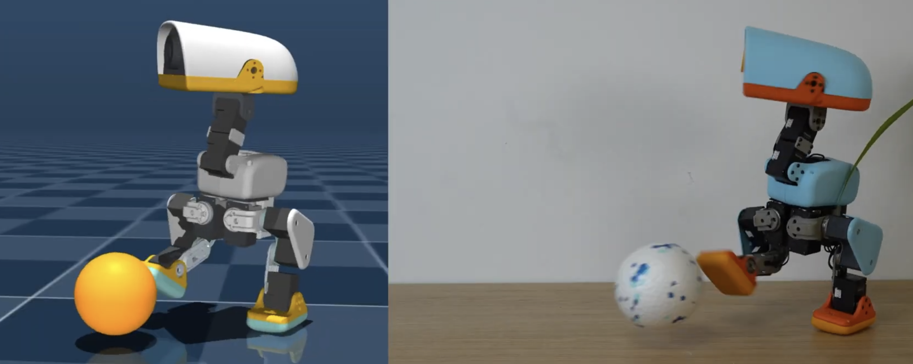
</p>

**Рисунок 1. Общий обзор проекта Microduck RL.** Новое поколение обучает не одну стратегию «ходить вперёд», а набор задач: слежение за скоростью, подъём, сидение, захват предмета, удар по мячу, кувырок вперёд и езду на роликах. Все они используют общий 61-мерный контракт наблюдения актора и 14-мерный контракт действия, поэтому в реальном роботе можно переключаться между стратегиями ходьбы, стойки и трюков.

<p align="center"><sub>Источник: заставка на первой странице README официального репозитория Pollen Robotics `microduck_rl`; исходный проект распространяется по лицензии Apache-2.0.</sub></p>

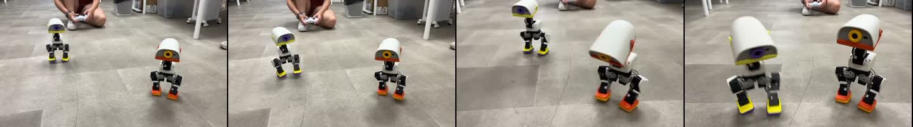

**Видео 1. Официальный фрагмент ходьбы реального Microduck.** Материал взят с официальной страницы проекта Microduck RL, в репозитории сохранены ключевые кадры, полный MP4 не публикуется. Это демонстрация официальной стратегии, а не результат локального обучения этого учебника.


**Видео 2. Фактически выполненное в этом учебнике обучение с подкреплением на 4096 средах.** Мы взяли версию `29e887e` репозитория `microduck_rl`, обучили задачу `Mjlab-Velocity-Flat-MicroDuck` за 6000 итераций PPO, затем воспроизвели финальный `model_5999.pt` с фиксированной командой движения вперёд `0,4 м/с`. В записи отключены внешние толчки тестовой фазы, но checkpoint не подвергался постобработке и видео не монтировалось из удачных отрезков. На странице показан сжатый GIF, полное видео в основной репозиторий не добавлено.

| Параметр воспроизведения | Фактическое значение |
| :-- | :-- |
| Параллельных сред | 4096 |
| Шагов выборки на среду за итерацию | 24 |
| Итераций PPO | 6000 |
| Всего шагов перехода в симуляции | 589 824 000 |
| Время обучения | 1 час 27 минут 41 секунда |
| Итоговые mean reward / mean episode length | 119,57 / 972,52 |
| Контракт экспортированного ONNX | `[1, 61] -> [1, 14]` |

Эти числа показывают происхождение видео в разделе и масштаб воспроизведения; их нельзя напрямую сравнивать с другими экспериментами без учёта версии кода, random seed и учебного плана.

Все стадии весов, финальный ONNX, конфигурация, журналы TensorBoard и проверочные видео опубликованы в [Datawhale/Microduck-RL-4096x6000](https://huggingface.co/Datawhale/Microduck-RL-4096x6000). В репозитории модели есть файл `SHA256SUMS`, с помощью которого можно проверить целостность загруженных файлов.


**Видео 3. Командная хореография на той же стратегии ходьбы.** Это не отдельно обученная стратегия танца. Мы меняем во времени команды `vx / vy / угловая скорость рыскания` и четырёхмерную команду позы головы; обученная 61-мерная стратегия в реальном времени выполняет кивки, боковые сдвиги, повороты влево и вправо, шаги вперёд и назад, дуговые движения. Все 12 секунд — непрерывный замкнутый прогон, поза робота вручную покадрово не редактировалась. Полное видео в основной репозиторий не добавлено.

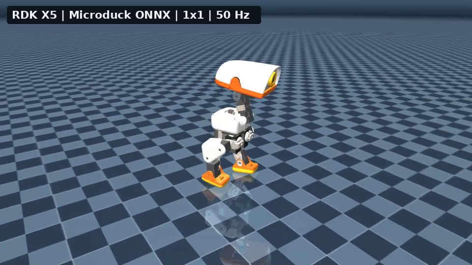

**Видео 4. RDK X5 как мозг стратегии, управляющий одним Microduck.** Компьютер Ubuntu отвечает только за физическую симуляцию MuJoCo и визуализацию. Каждый 61-мерный вектор наблюдения, который формируется с частотой управления 50 Гц, по локальной сети передаётся на RDK; RDK запускает `microduck_policy_5999.onnx` и возвращает 14-мерное действие. Видео — полный замкнутый прогон 12 секунд, 600 управляющих циклов, 360 кадров; действия заранее не рассчитывались и не проигрывались. В основной репозиторий добавлена только обложка, полное видео не публикуется.


**Видео 5. RDK X5 как мозг стратегии, управляющий квадратом Microduck 3×3.** Девять утят находятся в одном мире MuJoCo; у каждого свой свободный базис, состояние суставов, наблюдения IMU, история действий и состояние приводов BAM M6 XL330. Компьютер Ubuntu упаковывает девять наборов наблюдений в один сетевой запрос, RDK выполняет ONNX для каждого набора и возвращает девять наборов действий, которые записываются обратно в соответствующих роботов. Это проверка пакетного граничного вывода единой стратегии и многоэкземплярной визуализации; это не доказательство того, что девять роботов научились общаться или координировать действия. В основной репозиторий добавлена только обложка.


**Видео 6A. Три вида: преследование одного мяча с тремя последовательными ударами.** Браузер размещает мяч только один раз в начале; затем ни положение, ни поза, ни скорость мяча не переписываются. После первого удара утёнок ждёт, пока мяч естественно покатится в MuJoCo, затем заново обнаруживает мяч, догоняет, выравнивается и наносит второй и третий удары. Поэтому это не склейка трёх сцен, где мяч возвращают к ноге. В начале видео на короткое время показаны вид от первого лица с датчика головы и близкий план следования, затем камера переключается на стандартный третий вид и удерживает утёнка в центре кадра на этапах преследования, выравнивания стопы, переключения на стратегию BallKick, касания мяча и стабильного завершения. В трёх случаях удар выполнял правой ногой: смещение мяча в плоскости во время окна касания составило примерно `0,112 м`, `0,288 м` и `0,376 м`. После каждого касания управление возвращалось стратегии ходьбы, корпус оставался вертикальным на протяжении всего эпизода. В основной репозиторий добавлена только обложка, полное видео не публикуется.

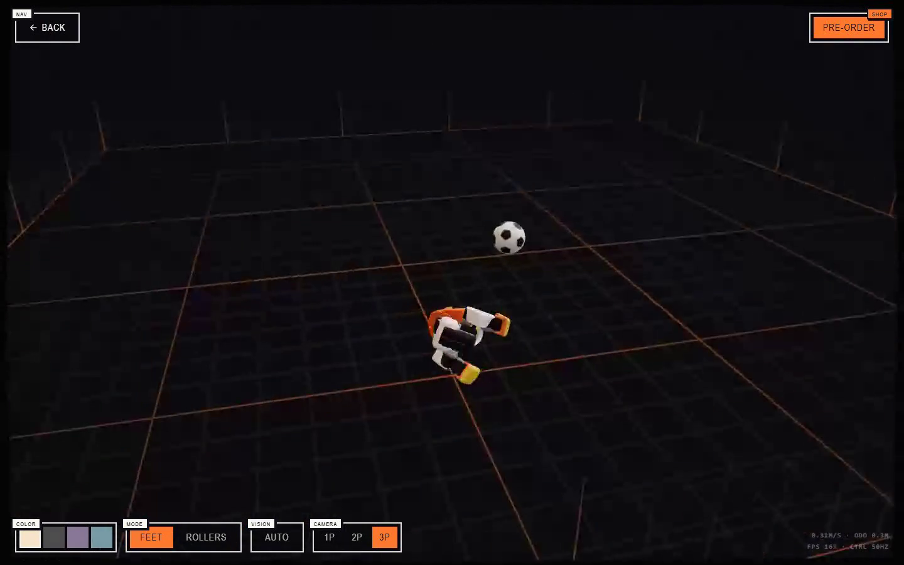

**Видео 6B. Физическое возмущение и самостоятельное вставание.** Этот тест записан отдельно от основного видео с ударом. Мы не меняем положение или кватернион робота напрямую, а сообщаем плавающему основанию однократный импульс: боковую линейную скорость и угловую скорость крена. Дальше падение, контакт с землёй и изменение позы идут за счёт гравитации, столкновений, суставных ограничений и решателя MuJoCo. Когда детектор падения фиксирует потерю устойчивости, управление берёт стратегия стойки и примерно через `1,96 с` возвращает робота в вертикальное положение; затем управление передаётся стратегии ходьбы. В конце `gravity_z=-0,99998`, высота основания около `0,1165 м`. Видео проверяет цепочку восстановления после внешнего толчка и не выдаёт прямое изменение модели за физический эксперимент.

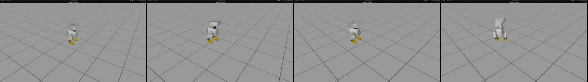

**Видео 7. Официальный фрагмент симуляционной ходьбы Open Duck Mini v2.** Фрагмент взят из раздела «Turning to MuJoCo Playground» проекта Open Duck Mini v2. Он относится к старому роботу высотой 42 см и не соответствует контракту 14 степеней свободы новой стратегии Microduck.

## 3. Полная цепочка обучения

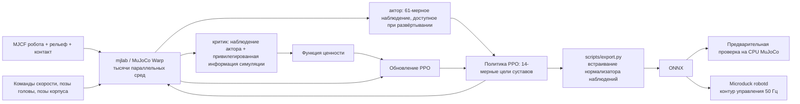

**Рисунок 2. Поток данных Microduck RL.** В этой архитектуре пять модулей, которые нельзя пропустить.

### 1. Модель робота и приводов

Основные MJCF Microduck RL находятся в:

```text
src/mjlab_microduck/robot/microduck/
├── robot_walk.xml
├── robot_allcollisions.xml
├── robot_allcollisions_rollers.xml
├── robot_*_backlash.xml
└── scene*.xml
```

`robot_walk.xml` используется для слежения за скоростью: лишние контакты туловища и головы упрощены. `robot_allcollisions.xml` сохраняет коллизии корпуса для подъёма, сидения, захвата предметов и кувырка вперёд; вариант с роликами добавляет безприводные колёса на подошвах. В обучении мотор не считается идеальным PD-приводом: используется модель привода [BAM](https://github.com/Rhoban/bam) для Dynamixel XL330 с противо-ЭДС, кулоновским и статическим трением, трением, зависящим от нагрузки, и напряжением батареи.

### 2. Наблюдения, команды и контракт действий

Новая стратегия получает на входе актора 61 измерение и выдаёт 14 измерений целей суставов. Слоты команд фиксированы:

```text
команда twist (скорость) 3 измерения
+ команда позы головы 4 измерения
+ команда позы корпуса 6 измерений
= 13-мерная подвекторная команда
```

Остальные наблюдения поступают от IMU, из положений и скоростей суставов и из истории действий. Актор не использует линейную скорость основания, которую на реальном роботе трудно надёжно измерить; критик при обучении может дополнительно получать эту истинную величину из симуляции. Это типичный асимметричный актор-критик: функция ценности учится быстрее на более полной информации, а сеть стратегии остаётся пригодной для развёртывания.

### 3. Награда — не только «идти вперёд»

Основная задача `Mjlab-Velocity-Flat-MicroDuck` включает примерно такие группы наград и ограничений:

| Категория | Представительные члены | Назначение |
| :-- | :-- | :-- |
| Награды за задачу | Отслеживание линейной и угловой скорости | Следовать командам `vx, vy, угловая скорость рыскания` |
| Награды за позу | Вертикальность, поза и отслеживание позы головы | Не опрокидываться ради скорости и сохранять управление головой |
| Награды за походку | Время в воздухе, зазор стопы, высота переноса | Заставить ногу реально отрываться от земли, а не скользить по ней |
| Сглаживание и безопасность | Скорость изменения действия, самоколлизии, проскальзывание стопы | Подавлять высокочастотную дрожь, самопересечения и чрезмерное скольжение |
| Учебный план | Доля стойки, диапазон позы головы, веса наград | Сначала освоить базовую походку, затем постепенно расширять диапазон команд и усиливать требования к форме |

Самое полезное здесь — не отдельный весовой коэффициент, а конкуренция между наградами. Например, если штраф за проскальзывание стопы слишком велик, маленький робот не сможет совершать поворот на месте, так как для него нужно вращательное скольжение опорной стопы. Если штраф за изменение действия задан слишком сильным с первого шага, стратегия ещё не научилась делать шаги и вынуждена стоять неподвижно. Поэтому официальная конфигурация использует учебный план: ограничения на сглаживание и диапазон больших команд вводятся постепенно на последующих этапах.

### 4. Четыре слоя защиты при переносе из симуляции в реальность

Microduck RL не полагается на идеально точный симулятор. Одновременно решаются четыре задачи:

1. BAM уменьшает разрыв между идеальным мотором и маленькими сервоприводами;
2. рандомизация домена охватывает массу и инерцию, центр масс, трение, напряжение, смещение монтажа IMU, нулевые смещения энкодеров и задержку действий;
3. вариант задачи `Backlash` моделирует зазор зубчатой передачи с помощью безприводного пассивного шарнира;
4. перед реальным роботом `infer_policy.py` воспроизводит тот же контракт наблюдений и действий, что и runtime, включая переключение стратегий.

## 4. Рекомендуемая основная линия: обучение новой стратегии ходьбы Microduck

### 0. Требования к окружению

Официальный проект требует:

- Linux x86_64 или официально поддерживаемый Linux ARM;
- CUDA GPU, поддерживающий текущий стек обучения; обучение выполняется через MuJoCo Warp, конкретная модель видеокарты не обязательна;
- Python `>=3.12,<3.13`, среда создаётся `uv` по `uv.lock`;
- для официального обучения по умолчанию используется Weights & Biases для сохранения экспериментов и checkpoint.

Сначала проверьте GPU и базовые утилиты:

```bash
nvidia-smi
git --version
curl --version
```

### 1. Клонирование и установка

Рабочая папка: любой Linux-путь без пробелов.

```bash
curl -LsSf https://astral.sh/uv/install.sh | sh
source "$HOME/.local/bin/env"

git clone https://github.com/pollen-robotics/microduck_rl.git
cd microduck_rl
uv sync

# Перед официальным обучением войдите в W&B, чтобы записывать кривые и checkpoint
uv run wandb login
```

Если локальная среда пока недоступна, те же команды можно выполнить на облачной машине с GPU: достаточно создать Linux-инстанс, открыть терминал Jupyter или подключиться по SSH. Код Microduck RL при этом не меняется.

> [!TIP]
> **Образ для облачного запуска.** Удобно использовать готовый образ с Ubuntu 22.04, CUDA 12.8, MuJoCo 3.4.1, `mujoco_warp` и `mujoco_playground`: он подходит для удалённого рабочего стола, Jupyter или SSH. Встроенная среда Playground в образе не является зафиксированной средой проекта Microduck RL, поэтому выполняйте `git clone` и `uv sync` и не пропускайте установку зависимостей самого проекта.

Лучше держать проект, кэш зависимостей и выходные данные обучения на диске данных, а не на системном диске:

```bash
export WORKSPACE=/path/to/workspace/microduck
export UV_CACHE_DIR=/path/to/workspace/.cache/uv

mkdir -p "$WORKSPACE" "$UV_CACHE_DIR"
cd "$WORKSPACE"

git clone https://github.com/pollen-robotics/microduck_rl.git
cd microduck_rl
uv sync
```

Далее выполняйте дымовой тест, полное обучение и экспорт ONNX по порядку. Тогда `logs/`, checkpoint, записи и `output.onnx` сохранятся в каталоге на диске данных, и их можно скачать через список файлов Jupyter. Если нужно временно прервать работу, выключите машину в консоли; удалять экземпляр стоит только после загрузки результатов и когда они уже не нужны. Выключение и удаление данных — разные действия.

На ARM-машинах (DGX Spark/GB10 или Jetson) при первой загрузке колёс CUDA официально рекомендуется увеличить тайм-аут `uv`:

```bash
export UV_HTTP_TIMEOUT=600
uv sync
```

**Контрольная точка 1.** Не начинайте обучение, сначала проверьте реестр задач и модульные тесты на CPU:

```bash
uv run list-envs | grep MicroDuck
uv run --with pytest pytest tests/
```

Если видны задачи вроде `Mjlab-Velocity-Flat-MicroDuck` и тесты проходят, это подтверждает работу зависимостей, реестра и ограничений конфигурации, но не то, что обучение на GPU будет стабильно работать долго.

### 2. Обязательный дымовой тест на пять итераций

Сопровождающие проекта в `AGENTS.md` прямо рекомендуют перед длительным обучением запустить 64 параллельные среды и 5 итераций PPO:

```bash
uv run train Mjlab-Velocity-Flat-MicroDuck \
  --env.scene.num-envs 64 \
  --agent.max_iterations 5
```

**Контрольная точка 2.** Этот маленький тест должен подтвердить, что:

- MuJoCo Warp создаёт параллельные среды на CUDA;
- размерности наблюдения и действия актора совпадают с моделью;
- каждая награда, условие завершения и событие выполняются хотя бы один раз;
- rollout не выдаёт NaN в течение нескольких шагов;
- checkpoint записывается в каталог `logs/`.

Тест не доказывает, что стратегия научилась ходить. После 5 итераций действия остаются почти случайными — это нормально.

### 3. Полное обучение

```bash
uv run train Mjlab-Velocity-Flat-MicroDuck \
  --env.scene.num-envs 4096
```

Официальный README сообщает, что при 4096 средах пригодная походка может появиться примерно через 1–2 часа, но реальное время сходимости зависит от GPU, конфигурации, random seed и учебного плана. Не воспринимайте эту цифру как гарантию.

Полная команда, с которой получено видео этого раздела, выглядит так. `WANDB_MODE=offline` сохраняет журналы обучения только локально — это удобно для рабочей станции без подключения к W&B; если нужно облачное отслеживание экспериментов, уберите эту переменную и заранее выполните `wandb login`:

```bash
WANDB_MODE=offline uv run train Mjlab-Velocity-Flat-MicroDuck \
  --env.scene.num-envs 4096 \
  --agent.max_iterations 6000 \
  --agent.save-interval 500 \
  --agent.run-name every-embodied-4096x6000
```

Если цель — пройти весь путь «обучение → checkpoint → экспорт ONNX → воспроизведение» на обычной машине или облачном инстансе, можно оставить 64 среды из дымового теста, но увеличить число итераций. Ниже — учебная конфигурация, которую легче запустить:

```bash
uv run train Mjlab-Velocity-Flat-MicroDuck \
  --env.scene.num-envs 64 \
  --agent.max_iterations 10000
```

Здесь `64 × 10000` — учебная конфигурация с уменьшенным параллелизмом, а не пятиитерационный дымовой тест и не эквивалент официальной конфигурации на 4096 среде по эффективности обучения. Для первой практики можно остановить обучение, как только убедитесь, что checkpoint записываются и кривая награды меняется, и перейти к экспорту; для более хорошей походки обучение нужно продолжить или увеличить число параллельных сред.

При нормальном обучении стоит отслеживать:

| Показатель | На что смотреть | Типичные ошибочные выводы |
| :-- | :-- | :-- |
| mean reward | Устойчивый рост в долгосрочной перспективе, а не на каждой итерации | Смотреть только на суммарную награду и не замечать, что стратегия находит лазейку |
| episode length | Интерпретировать вместе с этапом учебного плана и долей падений | «Чем длиннее эпизоды, тем лучше» |
| tracking скорости | Растут и линейная, и угловая скорость | Если умеет идти прямо, считать, что освоил поворот |
| штрафные члены | Взвешенные штрафы должны быть неположительными | Перепутан знак, и стратегия «набирает очки» через самоколлизии |
| видео движения и позы | Нет ли скольжения брюшком, опоры на попу или голову, высокочастотной дрожи | Смотреть только на графики, а не на физическое поведение |

Возобновление после прерывания выполняется командой:

```bash
uv run train Mjlab-Velocity-Flat-MicroDuck \
  --env.scene.num-envs 4096 \
  --agent.run-name resume \
  --agent.load-checkpoint model_29999.pt \
  --agent.resume True
```

#### Загрузка публичных весов этого раздела

Если не хотите повторять 6000 итераций PPO, можно скачать веса, которые использованы в этом разделе, из Hugging Face-репозитория Datawhale. В нём сохранены `model_0.pt`, промежуточные checkpoint каждые 500 итераций, финальный `model_5999.pt`, а также соответствующие `agent.yaml`, `env.yaml`, журналы обучения и ONNX со входом 61 измерение.

```bash
# Установить или обновить CLI Hugging Face
python -m pip install -U huggingface_hub

# Скачать только финальный checkpoint
hf download Datawhale/Microduck-RL-4096x6000 \
  checkpoints/model_5999.pt \
  --local-dir Microduck-RL-4096x6000

# Скачать все стадии весов и материалы для воспроизведения
hf download Datawhale/Microduck-RL-4096x6000 \
  --local-dir Microduck-RL-4096x6000
```

После загрузки проверьте по [карточке модели](https://huggingface.co/Datawhale/Microduck-RL-4096x6000) исходный коммит, контракт наблюдений и границы лицензий. Значение `mean reward = 119,57` в конце обучения — это лог конкретного запуска, его не следует принимать как эталон для разных random seed.

### 4. Воспроизведение и запись походки или хореографии

Официальный quickstart находит checkpoint по пути W&B run:

```bash
uv run play Mjlab-Velocity-Flat-MicroDuck \
  --wandb-run-path <entity/project/run_id>
```

Если checkpoint хранится локально, воспроизведите его через `--checkpoint-file`:

```bash
uv run play Mjlab-Velocity-Flat-MicroDuck \
  --checkpoint-file logs/rsl_rl/velocity/<run-name>/model_<iteration>.pt
```

Официальная команда `play` удобна для интерактивного просмотра, но после записи заданного числа кадров продолжает работать служба Viser. Чтобы на рабочей станции Linux без рабочего стола автоматически получить ограниченное по длительности видео с крупным планом, в учебнике предусмотрен скрипт `record_microduck_policy.py`:

```bash
export EVERY_EMBODIED=/path/to/every-embodied

MUJOCO_GL=egl uv run python \
  "$EVERY_EMBODIED/<папка-главы-Open-Duck-Mini-и-Microduck>/record_microduck_policy.py" \
  --checkpoint logs/rsl_rl/velocity/<run-name>/model_<iteration>.pt \
  --output-dir artifacts/microduck-video \
  --frames 600 \
  --width 960 \
  --height 540 \
  --speed 0.4 \
  --seed 42
```

`--motion walk` — режим по умолчанию. Скрипт отключает внешние толчки, которые есть при обучении, фиксирует команду скорости вперёд и завершает среду после записи 600 кадров. Видео сохраняется в `artifacts/microduck-video/`. Режим меняет только условия воспроизведения, но не checkpoint; запись — физическое доказательство того, что походка, скольжение, падения и дрожь ведут себя правильно, и её нельзя заменить кривой суммарной награды.

#### Хореография по одной и той же стратегии

Стратегия ходьбы уже получает на вход слоты команд `twist(3) + head_pose(4) + body_pose(6)`, поэтому для каждого нового показа не нужно переобучать стратегию. При параметре `--motion dance` скрипт в течение 12 секунд задаёт ограниченные, непрерывно меняющиеся команды:

```bash
MUJOCO_GL=egl uv run python \
  "$EVERY_EMBODIED/<папка-главы-Open-Duck-Mini-и-Microduck>/record_microduck_policy.py" \
  --checkpoint logs/rsl_rl/velocity/<run-name>/model_<iteration>.pt \
  --output-dir artifacts/microduck-dance \
  --motion dance \
  --frames 600 \
  --width 960 \
  --height 540 \
  --seed 42
```

| Время | Основные команды | Видимое действие |
| :-- | :-- | :-- |
| 0–2 с | Скорость ноль, синусоидальное движение головы | Кивки, покачивание головы и наклоны на месте |
| 2–4 с | Изменение `vy` влево и вправо | Боковые шаги |
| 4–6 с | Изменение `угловой скорости рыскания` влево и вправо | Повороты корпуса влево и вправо |
| 6–8 с | Смена знака `vx` | Шаги вперёд и назад |
| 8–10 с | Положительный `vx` с постоянной `угловой скоростью рыскания` | Движение по дуге |
| 10–12 с | Наложение бокового смещения, поворота и команд головы | Сложная финальная комбинация |

На каждом управляющем цикле скрипт сначала обновляет тензор команд в `command_manager`, затем формирует наблюдение, вызывает стратегию и продвигает MuJoCo. Действия по-прежнему выдаёт стратегия PPO, а не записываются предзаданные углы суставов. Все команды скорости и головы ограничены диапазоном, на котором обучалась стратегия.

Важно отличать «хореографию команд» от «обучения нового навыка». Хореография использует существующую стратегию ходьбы и подходит для быстрой проверки единого интерфейса команд. Кувырок, удар по мячу и езда на роликах меняют режим контакта или саму модель робота, поэтому им нужны отдельные официальные задачи:

| Что хотим показать | Официальная задача | Использовать ли checkpoint ходьбы |
| :-- | :-- | :-- |
| Сесть и встать | `Mjlab-SitStand-Flat-MicroDuck` | Нет |
| Кувырок вперёд | `Mjlab-Roulade-Flat-MicroDuck` | Нет |
| Удар по мячу | `Mjlab-BallKick-Flat-MicroDuck` | Нет |
| Вращение на роликах | `Mjlab-Spin-Flat-MicroDuck` | Нет, нужна модель с роликами |

В Microduck RL сейчас нет зарегистрированной задачи с именем `Dance`. Поэтому в учебнике видео честно помечено как command choreography; если нужна устойчивая к возмущениям и запускаемая по команде танцевальная способность, добавьте задачу с фазой или эталонным движением, а не выдавайте сценарий показа за результат обучения.

### 5. Обучение удару по мячу и запуск стратегии в браузере

Стратегия ходьбы решает задачу непрерывного слежения за скоростью, а удар — одноразовый контактный навык. Обе стратегии выдают 14 целей суставов, но распределения состояний и награды совершенно разные: ходьба должна непрерывно отслеживать команду скорости, а удар — сначала устойчиво стоять, затем быстро качнуть одну ногу, сохранить опорную ногу на земле и вернуться в позу, из которой можно передать управление. Поэтому нельзя переименовать ONNX ходьбы в стратегию удара и нельзя записывать жёсткие углы суставов в показательный скрипт и утверждать, что это обучение с подкреплением.

#### 5.1 Структура задачи BallKick

Официальный идентификатор задачи — `Mjlab-BallKick-Flat-MicroDuck`; основная конфигурация находится в:

```text
src/mjlab_microduck/tasks/microduck_ball_kick_env_cfg.py
```

Эта задача использует свободный мяч диаметром 70 мм и массой 15 г. Длительность эпизода — 5 секунд; центр мяча в начале находится перед ногой удара примерно на `x=0,09 м` и `|y|=0,042 м`, а в плоскости добавлено случайное смещение `±0,015 м`. Это смещение важно: у стратегии нет зрения, поэтому на реальном роботе оператор должен заранее направить робота на мяч, и стратегия может компенсировать лишь небольшую ошибку прицеливания благодаря рандомизации положения в обучении.

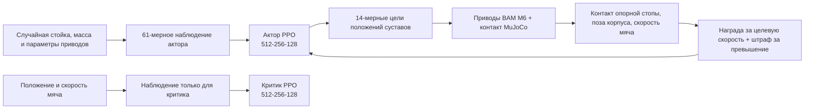

**Рисунок 3. Поток данных асимметричного актор-критика в BallKick.** Актор читает только IMU, суставы, текущую команду и историю действий; критик при обучении дополнительно получает положение и скорость мяча. При развёртывании остаётся только актор, поэтому стратегия не зависит от истинного состояния мяча в симуляторе.

Входы актора BallKick в 61 измерение сохраняют контракт, общий для всех стратегий Microduck:

| Блок | Размерность | Назначение |
| :-- | --: | :-- |
| Угловая скорость основания | 3 | Определяет вращение корпуса |
| Проекция гравитации | 3 | Определяет наклон и вертикальность |
| 14 положений суставов | 14 | Текущая поза |
| 14 скоростей суставов | 14 | Текущая тенденция движения |
| Предыдущее действие | 14 | Ограничивает резкие изменения и даёт короткую память о действиях |
| Слоты `twist + head + body` | 13 | В этой задаче сохраняется общий интерфейс, неиспользуемые слоты заполняются нулями |
| Итого | 61 | Форма входа ONNX `[1,61]` |

Обучение использует асимметричный актор-критик: критик дополнительно видит `ball_position(3) + ball_velocity(3)`, а актор мяч не видит. Так функция ценности точнее оценивает, попадёт ли данный удар по мячу, а модель, которую развёртывают, не требует датчика истинного положения мяча, которого на реальном роботе нет.

Награда не сводится к правилу «чем дальше катится мяч, тем лучше». В текущей конфигурации целевая скорость мяча задана `1,0 м/с`, а поведение формируют несколько групп условий:

| Награда или ограничение | Основная роль |
| :-- | :-- |
| `ball_forward_velocity` | Поощряет движение мяча вперёд относительно начальной ориентации робота и обрезается на целевой скорости |
| `ball_speed_overshoot` | Штрафует превышение целевой скорости, чтобы стратегия не выбирала грубый удар ради силы |
| `support_foot_grounded` | Требует, чтобы не бьющая нога оставалась на земле, подавляя прыжки на двух ногах и хаотичные столкновения с мячом |
| `pose_stand_legs` / `pose_stand_neck` | Возврат к позе стойки до и после удара, пригодной для передачи управления |
| `upright` / `height_stand` | Не даёт слишком низко присесть, упасть на бок или ударить мяч корпусом |
| `action_rate_l2` | Постепенно усиливается учебным планом, чтобы сглаживать действия |
| Самоколлизии, угловой момент и другие регуляризаторы | Снижают приёмы, которые работают только в симуляции |

В процессе обучения рандомизируются центр масс туловища и головы, моменты инерции, трение суставов, armature, угол монтажа IMU, смещения энкодеров и внешние толчки. Учебный план сначала помогает стратегии найти движение маховой ноги, а затем постепенно добавляет ограничение изменения действий и внешние толчки: если сразу включить все возмущения, короткие контактные движения находятся гораздо труднее.

#### 5.2 Проверка обучения на малом масштабе

В каталоге учебника есть скрипт [`train_microduck_ballkick.sh`](train_microduck_ballkick.sh). Он не меняет официальную задачу, а только выносит число сред, число итераций, интервал сохранения и режим W&B в переменные окружения. Перейдите в корень `microduck_rl` и сначала запустите 5 итераций на 64 средах:

```bash
export MICRODUCK_RL=$PWD
export NUM_ENVS=64
export MAX_ITERATIONS=5
export SAVE_INTERVAL=5
export WANDB_MODE=offline

bash /path/to/train_microduck_ballkick.sh
```

Этот шаг доказывает только пять вещей: задача зарегистрирована, ресурс мяча загружается, сенсоры контакта работают, PPO выполняет обратное распространение и checkpoint записывается на диск. Пять итераций не выучат пригодный удар, поэтому видео smoke-теста нельзя выдавать за результат обучения.

Мы действительно выполнили эту проверку `64 среды × 5 итераций` на официальном коммите `29e887e`: процесс завершился нормально, выполнено 7680 шагов выборки, записаны `model_0.pt`, `model_4.pt` и ONNX; средняя награда последней итерации — `1,31`. Эти числа подтверждают работоспособность цепочки выполнения, но не качество стратегии. Машиночитаемые сведения о среде, хэшах и последнем шаге обучения — в файле [`microduck_ballkick_smoke.json`](assets/local_reports/microduck_ballkick_smoke.json).

Когда видеопамять и журналы в порядке, запускайте полное обучение:

```bash
export MICRODUCK_RL=$PWD
export NUM_ENVS=4096
export MAX_ITERATIONS=6000
export SAVE_INTERVAL=250
export WANDB_MODE=offline

bash /path/to/train_microduck_ballkick.sh \
  2>&1 | tee ballkick_train.log
```

По умолчанию `KICK_FOOT = "right"`, поэтому приведённая команда обучает стратегию правой ногой. Для левой ноги запуск выполняется отдельно: в отдельной ветке Git в начале файла `microduck_ball_kick_env_cfg.py` меняется `KICK_FOOT` на `"left"`, и не следует перезаписывать журнал правой ноги в той же папке. Официально аугментация данных с левой и правой симметрией для этой задачи отключена, потому что «какой ногой бить и какой опираться» — сама суть задачи.

6000 итераций — бюджет обучения, принятый в этом разделе, а не официально гарантированная точка сходимости. Проверяя checkpoint, наблюдайте как минимум:

1. мяч движется вперёд по направлению робота после контакта ноги, а не от наложения при инициализации или удара корпусом;
2. опорная стопа остаётся на земле во время удара;
3. после удара робот возвращается в стойку;
4. стратегия попадает по мячу при разных начальных отклонениях мяча, random seed и внешних толчках;
5. не появилась ли деградация «бьёт сильнее, но штраф за превышение скорости выше».

#### 5.3 Экспорт локального checkpoint

Локальное обучение не требует предварительной загрузки в W&B. Используйте `--checkpoint-file`, чтобы указать сохранённую модель; официальный экспортёр встроит нормализатор наблюдений в ONNX:

```bash
uv run scripts/export.py Mjlab-BallKick-Flat-MicroDuck \
  --checkpoint-file logs/rsl_rl/ball_kick_right/<run-name>/model_5999.pt \
  --onnx-file ball_kick_right.onnx
```

После экспорта сначала проверьте контракт ONNX из следующего раздела: `[1,61] -> [1,14]`. Если вход имеет 51 измерение, значит, это модель со старой раскладкой команд, и её нельзя напрямую подставить в текущий веб-симулятор.

#### 5.4 Как работает веб-симулятор на скриншоте

> **Онлайн-демонстрация: [Microduck MuJoCo и ONNX в GitHub Pages](https://datawhalechina.github.io/every-embodied/zh-cn/demos/microduck/)**
>
> Этот адрес не зависит от того, включены ли компьютер автора или RDK X5. Веб-страница, девять ONNX-стратегий и ресурсы робота раздаются GitHub Pages как статические файлы; после открытия страницы MuJoCo WebAssembly и `onnxruntime-web` выполняются в браузере посетителя. По умолчанию публичная страница работает в режиме ONNX в браузере; переход на стратегию RDK возможен только при локальной отладке с параметром `?rdk=...`.

Скриншот соответствует официальному [Microduck Sandbox](https://huggingface.co/spaces/pollen-robotics/microduck-simulator) от Pollen Robotics. Это не трансляция рабочего стола Ubuntu в браузер и не Python-бэкенд вывода: физика MuJoCo и нейросеть ONNX выполняются в текущей вкладке браузера.

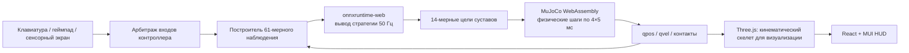

**Рисунок 4. Замкнутый контур Microduck Sandbox в браузере.** Браузер на каждом управляющем цикле выполняет ONNX и затем продвигает 4 физических шага MuJoCo по `5 мс`, получая частоту управления около 50 Гц; Three.js по `qpos` обновляет визуальные сетки.

Распределение файлов в исходниках:

| Файл | Обязанность |
| :-- | :-- |
| `app/src/game/game.js` | Загрузка MJCF, добавление земли, ограждений и мяча, построение 61-мерного наблюдения, цикл стратегии и физики 50 Гц |
| `app/src/game/duck.js` | Построение скелета Three.js по `kinematics.json` и STL/GLB |
| `app/src/game/controls/` | Общий ввод с клавиатуры, геймпада, сенсорного экрана и точек маршрута |
| `app/src/game/ball-actor.js` | Появление и исчезновение мяча, синхронизация физической позы |
| `app/src/scene/GameCanvas.jsx` | Управление холстом React Three Fiber, освещением и обновлением каждого кадра |
| `app/src/store.js` | Передача состояния между ядром симуляции и HUD React через Zustand |
| `app/public/policies/` | ONNX ходьбы, сидения/вставания, кувырка и ударов левой/правой ногой |
| `app/public/robot/mjlab/` | MJCF, описание кинематики и подготовленные сетки робота |

Полупрозрачные многопользовательские роботы соединяются через Trystero по публичному relay Nostr с WebRTC peer-to-peer и передают позы с частотой 10 Гц; они не связаны с локальным физическим контуром. Если публичный relay временно недоступен, «призраки» других игроков исчезают, но одиночная ходьба, удары по мячу и ONNX-вывод работают.

<p align="center">
  
</p>

**Рисунок 5. Момент удара правой ногой в браузере на нашей машине.** Страница использует официальную `ball_kick_right.onnx`; автоматическая проверка сначала ставит мяч в номинальную позицию правой ноги из задачи обучения, затем один раз запускает стратегию. Мяч смещается в плоскости примерно на `1,11 м`, что подтверждает работу физики WASM, вывода ONNX, переключения стратегии и контакта с мячом. Полная машиночитаемая запись — [`microduck_web_kick_qa.json`](assets/local_reports/microduck_web_kick_qa.json).

Важно: веб-страница — интерактивная песочница, а не эталон обучения. Сейчас в ней мяч весит 30 г и может появляться далеко перед уткой; задача обучения использует мяч 15 г и рандомизацию `±1,5 см` у кончика стопы. Дальность удара в вебе нельзя напрямую использовать как метрику обучения.

#### 5.5 Запуск веб-страницы локально или в локальной сети

Сначала установите Git LFS. ONNX, STL, GLB и аудио управляются через LFS; если загружен только файл-указатель длиной в несколько десятков байт, страница при запуске выдаст `Unexpected token 'v'`: строка `version https://git-lfs...` будет ошибочно разобрана как модель или JSON.

```bash
git lfs install
git clone https://huggingface.co/spaces/pollen-robotics/microduck-simulator
cd microduck-simulator
git lfs pull

cd app
npm ci
npm test
npm run dev -- --host 0.0.0.0 --port 5175
```

Откройте на этой машине `http://localhost:5175/`. Другие устройства в той же локальной сети открывают `http://<локальный адрес компьютера, на котором запущена страница>:5175/`; если страница недоступна, проверьте, что брандмауэр разрешает Node.js слушать порт 5175. Для телефона лучше использовать горизонтальную ориентацию.

Основные команды:

| Ввод | Поведение |
| :-- | :-- |
| Стрелки или WASD/ZQSD | Движение вперёд и назад, поворот |
| Q / E | Удар левой / правой ногой |
| F | Попеременные удары левой и правой ногой |
| R | Для ног — сесть или встать; для колёс — приседание и скольжение |
| G | Опустить голову и захватить предмет |
| M | Переключить FEET / ROLLERS |
| C | Переключить следящую камеру |
| Space | Сбросить сцену |

Стратегия удара в веб-версии управляет только 25 управляющими циклами, то есть `0,5 с`; затем ещё `0,4 с` ввод блокируется, после чего управление возвращается стратегии ходьбы. Такое «горячее переключение короткой навыковой стратегии на стабильную» совпадает с логикой рантайма на реальном роботе: одноразовая стратегия не продолжает выводить бессмысленные цели суставов после окончания действия.

Чтобы подставить свою локально обученную стратегию удара правой ногой, замените одноимённый ONNX и пересоберите проект:

```bash
cp /path/to/ball_kick_right.onnx \
  app/public/policies/ball_kick_right.onnx

cd app
npm test
npm run build
npm run preview -- --host 0.0.0.0 --port 5175
```

Готовые статические файлы находятся в `app/dist/`; их можно отдать Nginx, статическому хостингу вроде GitHub Pages или контейнеру. Официальный Space собирает Vite в Docker, а затем непривилегированный Nginx отдаёт файлы на порту 8080; во время работы GPU не нужен, и серверу не нужно хранить состояние симуляции. Исходный код Space открыт для чтения, но в корне репозитория нет отдельного файла `LICENSE`. Для учёбы и локального запуска препятствий нет; но если вы хотите распространять изменённую веб-версию, сначала уточните у сопровождающих, на какие части оболочки и сопутствующих материалов распространяются права.

#### 5.6 Частые проблемы в веб-версии

| Симптом | Диагноз и действие |
| :-- | :-- |
| В BIOS-заставке `SYSTEM HALTED` и текст LFS-указателя | Выполните `git lfs pull` и убедитесь, что ONNX-файлы занимают сотни килобайт, а не несколько десятков байт |
| На странице только HUD, робота нет | Проверьте WebGL2 и аппаратное ускорение браузера, посмотрите первую ошибку загрузки WASM/MJCF |
| Постоянные ошибки Nostr/WebSocket в консоли | Влияют только на синхронизацию поз нескольких игроков; если локальный `CTRL 50HZ` работает, можно продолжать |
| Q/E: нога двигается, но мяч не задет | Стратегия не видит мяч: нужно подойти на подходящее расстояние и повернуть так, чтобы мяч оказался напротив нужной ноги |
| После замены ONNX робот сразу падает | Сначала проверьте `[1,61] -> [1,14]`, встроен ли нормализатор, порядок суставов и MJCF, на котором обучали |
| Мобильный интерфейс слишком узкий | Переключите экран в горизонтальный режим; сенсорный джойстик и кнопки действий показываются по мобильной раскладке |
| После остановки dev-сервера страница перестаёт работать | `npm run dev` — процесс переднего плана; для длительного показа выполните `npm run build` и раздавайте `dist/` |

#### 5.7 От «слепого» удара к автономному удару с несколькими видами

Официальная ONNX-стратегия BallKick видит только 61-мерные собственные наблюдения; в её входе нет изображений, рамок обнаружения или координат мяча. Она хорошо выполняет задачу «когда мяч уже перед ногой, стабильно сделать один замах и контакт», но сама не находит мяч и не подходит к нему. Поэтому полноценная автономная система удара состоит как минимум из трёх уровней:

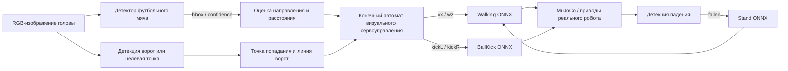

Это не усреднение нескольких одновременных выходов моделей, а иерархическое управление с чёткими обязанностями: детектор отвечает на вопрос «где мяч», стратегия ходьбы обеспечивает непрерывное движение, левый и правый BallKick активируются только на короткое окно контакта, а стратегия стойки включается только при падении.

##### 5.7.1 Смысл рамки обнаружения в браузере

В веб-демонстрации этого учебника интерфейс детектора строится по истинным координатам мяча в MuJoCo, и его форма совпадает с реальным детектором. Пусть положение робота на плоскости `(x_r, y_r, θ)`, центр мяча `(x_b, y_b)`; сначала разность мировых координат переводится в систему координат робота:

```text
dx = x_b - x_r,  dy = y_b - y_r
ball_x =  cos(θ) * dx + sin(θ) * dy
ball_y = -sin(θ) * dx + cos(θ) * dy
bearing = atan2(ball_y, ball_x)
```

Затем трёхмерный центр мяча проецируется на камеру, и по центру проекции и радиусу мяча формируется `bbox = [left, top, right, bottom]`. На HUD выводятся `BALL xx%`, расстояние, угол и рамка. Этот приём проверяет полный интерфейс: камера, выход детектора, конечный автомат управления и переключение стратегий; но **это не обученный визуальный детектор, и точность детекции нельзя считать результатом эксперимента**. При переносе на RDK или реальный робот достаточно заменить источник `bbox/confidence` на YOLO или другой детектор; конечный автомат переписывать не нужно.

Автоматическое управление и выбор вида не зависят друг от друга: при включённом `AUTO` вид можно переключать в любой момент:

| Кнопка | Вид | Что удобно проверять |
| :-- | :-- | :-- |
| `1P` | Первый вид с сенсора головы | Попадает ли мяч в поле зрения, ложится ли рамка на цель, слепая зона на близкой дистанции |
| `2P` | Близкий вид с лёгким смещением плеча | Относительное положение тела, мяча и точки опоры, процесс выравнивания левой и правой ног |
| `3P` | Центрированный вид по умолчанию | Полное наблюдение подхода, касания, падения и восстановления; камера плавно следует за корпусом и всегда смотрит на его центр |

В третьем виде мяч может перекрываться корпусом. В этом случае рисуется только расстояние, направление и выбор ноги, вычисленные конечным автоматом, а двумерная рамка не выводится; так мы не нарисуем проекцию скрытого мяча поверх тела робота. Обычная ссылка по умолчанию открывает **режим одного утёнка**; только при явном `?multiplayer=1` подключается комната и показываются утки из других вкладок или устройств. Поэтому несколько открытых локальных страниц больше не создают «лишнего утёнка» в сцене.

##### 5.7.2 Зачем выбирать ногу «позже»

Левое или правое положение мяча в поле зрения меняется, пока робот поворачивается. Если выбрать левую или правую ногу уже при первом обнаружении, к моменту подхода мяч может оказаться за средней линией тела. Поэтому в учебной реализации нога выбирается только после того, как расстояние становится меньше `0,24 м`, по `ball_y`, и решение может меняться до начала удара:

| Условие | Решение |
| :-- | :-- |
| `ball_y > 0,006 м` | Склоняться к левой ноге; целевая поперечная позиция около `+0,043 м` |
| Иначе | Склоняться к правой ноге; целевая поперечная позиция около `-0,043 м` |
| Поступил ввод с клавиатуры, геймпада или сенсорного экрана | Ручной ввод сразу перебивает автоматику, автоматические команды обнуляются |

Знаки направлений здесь соответствуют системе координат Microduck и не должны переноситься без изменений на робота с другими именами суставов или зеркальной камерой.

##### 5.7.3 Модель ворот и геометрия точного удара

Ворота в онлайн-демонстрации — не фоновая картинка. В физическом слое это статические коллизионные тела MuJoCo: два цилиндрических столба, перекладина, два боковых сетчатых щита и задняя сетка. В визуальном слое те же размеры воспроизводятся трубами и сеткой Three.js. Оба слоя используют общие `lineX`, `halfWidth`, `height`, `postRadius` и координаты целевой точки, чтобы не возникало ситуации «на экране гол засчитан, а физика использует другую линию».

Модуль зрения хранит одновременно цель — мяч и цель — ворота. Если центр мяча `b`, выбранная точка внутри ворот `g`, то ожидаемое направление удара и точка подготовки за мячом задаются так:

```text
d = normalize(g - b)
p_stage = b - 0.27 * d
theta_shot = atan2(d_y, d_x)
```

Контроллер не бежит от текущего положения робота прямо к мячу. Сначала он проверяет, находится ли робот со стороны `-d`. Если робот стоит перед мячом или сбоку, выбирается точка обхода слева или справа сзади мяча; после выхода в зону подготовки выравнивается `theta_shot` и только потом включается выбор ноги и управление ближним контактом. Поскольку стратегия ходьбы не умеет надёжно двигаться боком, обход реализован дискретной навигацией «повернуться на месте + шагнуть вперёд»; если расстояние до мяча меньше `0,27 м`, сначала происходит отход до `0,38 м` с гистерезисом, чтобы не возникало предельного цикла «кружить вокруг мяча».

Гол засчитывается не тогда, когда центр мяча коснулся линии ворот. Только выполнение трёх условий одновременно выводит на HUD `SCORE 1 / VERIFIED OVER LINE`:

```text
ball_x - radius > goal_line_x
abs(ball_y) + radius < goal_half_width - post_radius
ball_z + radius < goal_height - post_radius
```

Первое условие требует, чтобы **весь** мяч пересёк линию ворот; вторые два — чтобы он полностью находился между столбами и под перекладиной. После попадания мяч останавливается на задней сетке с коллизиями, а AUTO обнуляется, чтобы можно было проверить конечное состояние. Перекрестие `GOAL TARGET` на странице — проекция этой трёхмерной целевой точки на текущую камеру. В учебной версии интерфейс с той же формой, что у детектора, строится по истинным координатам MuJoCo; на реальном роботе можно заменить их ключевыми точками ворот, семантической сегментацией или маркерами AprilTag.

##### 5.7.4 Визуальный сервоконтроллер из девяти стадий

| Состояние | Условие входа | Выход и условие выхода |
| :-- | :-- | :-- |
| `searching` | Мяча нет или он вне поля зрения | Поиск на месте; после обнаружения мяча переход к выравниванию |
| `circling-ball` | Робот не находится за линией «мяч — ворота» | Выбирается сторона обхода, чтобы не ударить мяч, подходя спереди |
| `clearing-ball` | При перепланировании расстояние до мяча меньше `0,27 м` | Радиальный отход; после `0,38 м` — новое планирование |
| `staging-shot` | Робот уже сзади мяча, но ещё не в точке подготовки | Движение к точке подготовки примерно в `0,27 м` от мяча |
| `aligning-shot` | Точка подготовки достигнута, но направление не на ворота | Выравнивание направления от центра мяча к целевой точке |
| `aligning` | Азимут мяча большой | Поворот стратегией ходьбы с гистерезисом, чтобы не дрожать влево и вправо |
| `approaching` | Мяч впереди и далеко | Прямое движение с небольшой угловой поправкой |
| `aligning-foot` | Мяч вошёл в ближнюю зону примерно `0,17 м` | Поворот на месте, чтобы переместить мяч в поперечную полосу контакта выбранной ноги |
| `approaching-foot` | Поперечная позиция допустима, продольная ещё немного далека | Медленное прямое движение до положения перед кончиком стопы |
| `kick-ready / kicking` | `x≈0,07–0,122 м` и поперечная ошибка достаточно мала | Сначала нулевые команды на `0,55 с` для устойчивости, затем соответствующая BallKick ONNX на `0,5 с` |
| `goal` | Весь мяч пересёк линию ворот и находится в створе | Фиксация гола, остановка выдачи команд и сохранение конечного физического состояния мяча и робота |

Поворот и движение вперёд выполняются дискретными стадиями, а не постоянной комбинацией небольших `vx+wz`. Дело не в том, что классический контроллер не может описывать дуги; для этой уже обученной стратегии ходьбы комбинированные команды при малых скоростях могут приводить к позе почти без движения. Поэтому сначала поворот, затем движение, и гистерезис — более стабильный вариант.

##### 5.7.5 Определение окна удара через сканирование контакта

«Нога визуально близко к мячу» — ненадёжный порог. В учебнике при фиксированной стойке робота в той же веб-среде перебирались `x={0,08,0,10,0,12,0,14,0,16} м` и `y={-0,08,-0,04,0,+0,04,+0,08} м`; для каждой точки запускались левая и правая стратегии удара, и регистрировалось горизонтальное смещение мяча. Эффективный контакт сосредоточен в следующих зонах:

| Стратегия | Основная зона контакта | Максимальное смещение при сканировании |
| :-- | :-- | :-- |
| Левая нога | `x≈0,08–0,12 м, y≈+0,04 м` | около `1,03 м` |
| Правая нога | `x≈0,08–0,12 м, y≈-0,04 м` | около `0,93 м` |

Максимальное смещение используется только для поиска горячей зоны контакта, а не как статистика устойчивости. Официальная приёмка должна начинаться с более удалённого смещённого положения мяча: стратегия ходьбы сама подходит к мячу, а успех определяется изменением координат мяча, а не переходом в состояние `kicking`. В видео 6A мяч в начале помещается один раз в механической системе координат `(0,42, -0,11) м`; две последующие попытки преследуют тот же мяч, который продолжает движение после предыдущего удара. Конечная точка первого касания `(-0,070, -0,134) м` и начальная точка второго поиска `(0,052, -0,150) м` не совпадают, потому что мяч после удара продолжает катиться под действием инерции, трения и контактов до повторного захвата; скрипт не записывал новых координат мяча. Таким же образом обстоит дело со вторым и третьим ударами. Все три попытки дают измеримое смещение, а итоговая проекция силы тяжести `gravity_z=-0,99996` показывает, что корпус остался вертикальным.

##### 5.7.6 Обнаружение падения и восстановление

На веб-странице на каждом управляющем цикле 50 Гц проверяется проекция силы тяжести в системе корпуса. Если `gravity_z > -0,5` держится `0,2 с`, значит наклон туловища заметно отклонился от вертикали; конечный автомат сначала замораживает управление на `0,3 с`, чтобы дать стабилизироваться контакту, затем переключает управление на стратегию стойки. Восстановление считается успешным только тогда, когда `gravity_z < -0,85` сохраняется `1 с`; после этого управление возвращается стратегии ходьбы. Если за `6 с` восстановления не произошло, сцена сбрасывается, чтобы не допустить бесконечной работы в неправильном состоянии.

Проверка восстановления использует импульс обобщённой скорости, чтобы смоделировать мгновенное внешнее воздействие: скорость плавающего основания по боковой оси увеличивается на `1,55 м/с`, угловая скорость крена — на `5,4 рад/с`. Такой тест эквивалентен идеальному мгновенному импульсу на свободное основание: меняется скорость, а не положение; дальнейшее движение подчиняется динамике симуляции. Для длительной нагрузки или контактного столкновения можно в нескольких подшагах MuJoCo записывать `qfrc_applied`, одновременно фиксируя силу, контактный импульс и изменение энергии.

Итоговый checkpoint, правая ONNX-стратегия и машиночитаемые записи приёмки опубликованы в [Datawhale/Microduck-BallKick-4096x6000](https://huggingface.co/Datawhale/Microduck-BallKick-4096x6000). Скачивание локально:

```bash
hf download Datawhale/Microduck-BallKick-4096x6000 \
  --local-dir Microduck-BallKick-4096x6000
```

Подробные записи обучения и веб-данных — в файле [`microduck_ballkick_visual_qa.json`](assets/local_reports/microduck_ballkick_visual_qa.json). При воспроизведении сохраняйте одновременно: коммит кода, имя задачи, число параллельных сред, хэши checkpoint и ONNX, начальную позу мяча, результат выбора ноги, смещение мяча и конечное состояние корпуса; одного только видео недостаточно, чтобы понять, совпадает ли контракт стратегии.

### 6. Экспорт ONNX и проверка на CPU в MuJoCo

```bash
uv run scripts/export.py Mjlab-Velocity-Flat-MicroDuck \
  --wandb-run-path <entity/project/run_id> \
  --onnx-file output.onnx

uv run scripts/infer_policy.py --walking output.onnx --new-cmd-obs
```

`scripts/export.py` — не просто переименование суффикса у сети PyTorch. Он встраивает в граф ONNX нормализатор наблюдений, который использовался при обучении. Ручная конвертация checkpoint может совпасть по размерностям, но на развёртывании полностью перестанет работать, если входы не нормализованы.

Перед открытием окна MuJoCo полезно выполнить проверку контракта ONNX без монитора:

```bash
uv run python - <<'PY'
import numpy as np
import onnxruntime as ort

session = ort.InferenceSession("output.onnx")
model_input = session.get_inputs()[0]
model_output = session.get_outputs()[0]
print(f"input : {model_input.name} {model_input.shape} {model_input.type}")
print(f"output: {model_output.name} {model_output.shape} {model_output.type}")

assert model_input.shape == [1, 61], model_input.shape
assert model_output.shape == [1, 14], model_output.shape
action = session.run(None, {model_input.name: np.zeros((1, 61), dtype=np.float32)})[0]
assert action.shape == (1, 14) and np.isfinite(action).all()
print("ONNX contract and one-step inference: PASS")
PY
```

Текущая стратегия получает 61-мерный вход из 48 измерений собственных наблюдений и 13 измерений команд; раскладка команд — `twist(3) + head_pose(4) + body_pose(6)`. Для совместимости со старыми checkpoint `infer_policy.py` по умолчанию собирает вход из 51 измерения: 48 измерений собственных наблюдений и старые 3 измерения команд. Поэтому если у новой модели не указать `--new-cmd-obs`, появится ошибка `Got: 51 Expected: 61`. Здесь нужно исправить параметры инференса, а не обрезать вход модели и не добивать его нулями наугад: семантика и порядок слотов команд должны совпадать с обучением.

`infer_policy.py` поддерживает ввод скорости с клавиатуры и может одновременно загружать стратегии ходьбы, стойки, сидения/вставания и кувырка:

```bash
uv run scripts/infer_policy.py \
  --walking walk.onnx \
  --standing stand.onnx \
  --sitstand sitstand.onnx \
  --roulade roulade.onnx \
  --new-cmd-obs
```

На этом шаге проверяйте три вещи: вход/выход ONNX равны `[1,61] -> [1,14]`, раскладка команд совпадает с runtime, а при переключении стратегий нет резкого скачка позы.

`infer_policy.py` использует нативное интерактивное окно MuJoCo и требует рабочей графической сессии и контекста OpenGL. При запуске через чистый SSH-терминал после исправления размерности модели может появиться ошибка `GLXBadDrawable`; это проблема графического пути, а не самого ONNX — это две разные проблемы. Для управления с клавиатуры запускайте команду в терминале на локальном рабочем столе или в сеансе удалённого рабочего стола/VNC. Если нужно только проверить модель на сервере без экрана, используйте контрольную проверку выше, а для видео без интерактива — скрипт записи с EGL из предыдущего раздела:

```bash
MUJOCO_GL=egl uv run python \
  "$EVERY_EMBODIED/<папка-главы-Open-Duck-Mini-и-Microduck>/record_microduck_policy.py" \
  --checkpoint logs/rsl_rl/velocity/<run-name>/model_<iteration>.pt \
  --output-dir artifacts/microduck-video
```

Если контрольная проверка прошла, а окно не открывается, ищите проблему в `DISPLAY`, удалённом рабочем столе и OpenGL/GLX, а ONNX заново не экспортируйте. Если же падает сама контрольная проверка, возвращайтесь к checkpoint, скрипту экспорта и контракту наблюдений.

### 7. RDK X5 как стратегия, Ubuntu-компьютер как симуляция и визуализация

Запускать MuJoCo непосредственно на RDK можно. В учебнике проверено: после установки `mujoco==3.3.7` на RDK X5 можно скомпилировать официальный MJCF Microduck, запустить привод BAM и вывести видео H.264. Однако встроенный драйвер EGL на RDK не предоставляет `eglQueryDevicesEXT`, которая нужна для безголового рендеринга MuJoCo; переход на OSMesa делает рендеринг подробных STL-сеток намного дороже, чем сам вывод стратегии. Поэтому больше соответствует реальной робототехнической системе разделение обязанностей:

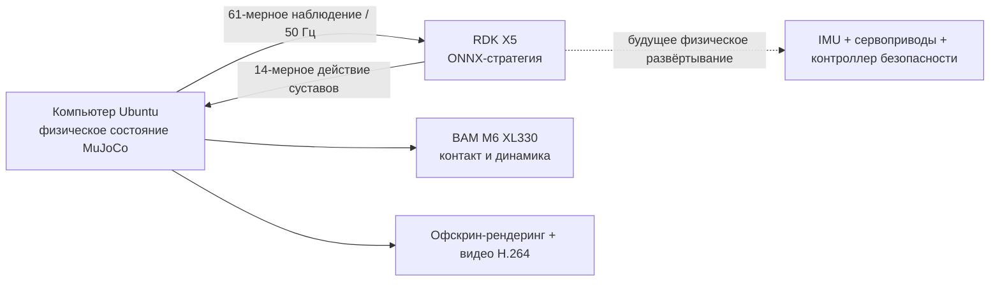

**Рисунок 3. Разделение обязанностей между RDK как «мозгом» стратегии и симуляцией на Ubuntu.** Здесь не ONNX оставляется на Ubuntu, чтобы имитировать работу на плате. В удалённом режиме скрипт рендеринга не создаёт локальную сессию ONNX Runtime: сервис на RDK при запуске возвращает размерности входа и выхода модели и SHA256, после чего по одному постоянному TCP-соединению принимает наблюдения и возвращает действия. Ubuntu-компьютер хранит и продвигает только физическое состояние, поэтому при разрыве связи с RDK или несовпадении размерностей симуляция останавливается.

В учебнике есть три скрипта:

| Скрипт | Где запускается | Назначение |
| :-- | :-- | :-- |
| `rdk_policy_smoke.py` | RDK | Проверка контракта ONNX, чистой задержки вывода и дедлайна 50 Гц |
| `rdk_policy_server.py` | RDK | Пакетный вывод `61 -> 14` по постоянному TCP-соединению |
| `rdk_microduck_video.py` | Ubuntu | Запуск одного или нескольких утят в MuJoCo, запрос действий у RDK и кодирование MP4 |

#### Первый шаг: запуск сервиса стратегии на RDK

Скопируйте ONNX и `rdk_policy_server.py` на RDK. На плате не нужны `mjlab`, PyTorch или MuJoCo — достаточно NumPy и ONNX Runtime:

```bash
python3 -m pip install --user numpy onnxruntime

python3 rdk_policy_smoke.py \
  --model microduck_policy_5999.onnx \
  --iterations 2000 \
  --paced-steps 250 \
  --control-hz 50 \
  --json-output rdk_smoke_report.json

python3 rdk_policy_server.py \
  --model microduck_policy_5999.onnx \
  --host 0.0.0.0 \
  --port 8765
```

Протокол сервера сначала отправляет рукопожатие `MDP1 + размерность входа + размерность выхода + SHA256 модели`. Каждый запрос состоит из размера пакета и последовательных `float32`-наблюдений, ответ — тот же размер пакета и `float32`-действия. Запрос одного утёнка — `[1,61] -> [1,14]`; квадрат из девяти утят в одном цикле управления отправляет `[9,61]`, RDK выполняет ONNX для каждого набора с фиксированным батчем 1 и возвращает `[9,14]`. Так сохраняется статический контракт батча текущей модели и не нужно заново экспортировать другую модель для видео.

#### Второй шаг: генерация видео одного утёнка на Ubuntu

На компьютере Ubuntu должны быть установлены окружение Microduck RL и `ffmpeg`. Параметр `--policy-host` должен указывать адрес RDK в той же локальной сети; в удалённом режиме `--model` не нужен:

```bash
export EVERY_EMBODIED=/path/to/every-embodied
export MICRODUCK_RL=/path/to/microduck_rl
cd "$MICRODUCK_RL"

MUJOCO_GL=egl uv run python \
  "$EVERY_EMBODIED/<папка-главы-Open-Duck-Mini-и-Microduck>/rdk_microduck_video.py" \
  --microduck-repo "$MICRODUCK_RL" \
  --policy-host <RDK_IP> \
  --policy-port 8765 \
  --output microduck_rdk_brain_single_12s.mp4 \
  --rows 1 --cols 1 \
  --duration 12 --fps 30 \
  --width 960 --height 540 \
  --speed 0.30 \
  --camera-distance 0.70
```

Скрипт строит наблюдение из тех же величин, что и обучение: проекция гравитации, относительные положения суставов, скорости суставов, история действий и 13 слотов команд. Физика продвигается с управляющим циклом `4 x 0,005 с = 20 мс`. Рядом с видео записывается JSON с хэшем модели, числом управляющих шагов, задержкой кругового обращения к RDK, смещением каждого робота, минимальной высотой корпуса и параметрами кодирования видео.

#### Третий шаг: квадрат из девяти утят в одной сцене

Квадрат не получен копированием одного видео девять раз. Скрипт с помощью `MjSpec.attach` объединяет девять экземпляров Microduck с независимыми префиксами имён в один мир MuJoCo и затем создаёт для каждого робота свои индексы суставов, IMU, истории действий и приводов:

```bash
MUJOCO_GL=egl uv run python \
  "$EVERY_EMBODIED/<папка-главы-Open-Duck-Mini-и-Microduck>/rdk_microduck_video.py" \
  --microduck-repo "$MICRODUCK_RL" \
  --policy-host <RDK_IP> \
  --policy-port 8765 \
  --output microduck_rdk_brain_3x3_12s.mp4 \
  --rows 3 --cols 3 \
  --duration 12 --fps 30 \
  --width 960 --height 540 \
  --speed 0.30 \
  --camera-distance 1.65
```

Девять утят используют одну и ту же весовую модель и одну и ту же команду скорости, но не разделяют физическое состояние. Их движения выглядят синхронно потому, что начальные позы и детерминированная стратегия одинаковы; небольшие различия возникают из-за того, что контакт решается отдельно в каждом экземпляре того же мира. Чтобы исследовать сохранение строя, избегание столкновений или связь между роботами, в наблюдения, награду и обучающую задачу нужно явно добавить состояние соседей. Это выходит за рамки проверки граничного вывода.

#### Фактически проверенные результаты

| Проверка | Результат на RDK X5 |
| :-- | :-- |
| Система и среда выполнения | Система RDK `3.3.3`, ARM64, ONNX Runtime `1.23.2` |
| Контракт модели | `obs [1,61] -> actions [1,14]` |
| SHA256 модели | `216fff94da1b88159327c426686fcfcca4763f571b4d123be6b2ca549042f9f0` |
| 2000 выводов на плате | В среднем `0,315 мс`, p50 `0,309 мс`, p99 `0,437 мс` |
| Цикл 50 Гц на 250 шагов | p50 `0,399 мс`, p99 `0,785 мс`, максимум `0,809 мс`, пропущенных дедлайнов `0/250` |
| Полный замкнутый цикл одного утёнка | 12 секунд, 600 запросов к RDK, видео H.264 из 360 кадров |
| Полный замкнутый цикл квадрата 3×3 | 12 секунд, 600 пакетных запросов, всего 5400 выводов ONNX на RDK, видео H.264 из 360 кадров |

Записи проверки на плате и полного запуска сохранены в [`rdk_policy_smoke_report.json`](assets/local_reports/rdk_policy_smoke_report.json), [`microduck_rdk_brain_single_12s.json`](assets/local_reports/microduck_rdk_brain_single_12s.json) и [`microduck_rdk_brain_3x3_12s.json`](assets/local_reports/microduck_rdk_brain_3x3_12s.json). Эти данные показывают, что контракт модели на плате, непрерывный вывод и замкнутый контур управления работают; сравнивать скорость с другими аппаратными платформами по ним нельзя.

Системы RDK содержат `hobot_dnn`, `hrt_model_exec` и узлы устройства BPU, но `hrt_model_exec` не может напрямую загрузить обычный ONNX: сначала модель нужно конвертировать в формат платы соответствующим инструментарием D-Robotics. Текущая 14-степенная MLP-модель на CPU уже намного меньше бюджета управления 20 мс, поэтому перенос маленькой стратегии на BPU не даёт реальной выгоды. Когда к системе добавится визуальный детектор или глубокая сеть восприятия, разумнее оставлять BPU для них.

#### Четвёртый шаг: превращение RDK в мозг с несколькими навыками

Служба `MDP1` загружает только одну модель ходьбы и подходит для проверки одного утёнка и квадрата. Для веб-страницы с футболом нужно переключаться между ходьбой, ударами левой и правой ногой и восстановлением после падения, поэтому в учебнике добавлен протокол с несколькими стратегиями `MDP2`. При запуске RDK возвращает каталог именованных стратегий, Ubuntu или веб-страница запрашивают действие по имени:

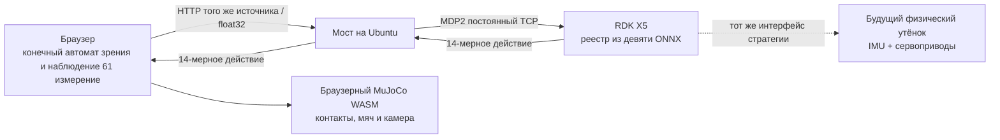

Границы ответственности здесь важны: браузер отвечает за результаты обнаружения мяча, автоматическое приближение, выравнивание, выбор ноги и MuJoCo; RDK X5 лишь запускает выбранную ONNX-модель по 61-мерному наблюдению актора и возвращает 14-мерное действие. Актор BallKick во время обучения мяч не видит, мяч доступен только критику, поэтому слежение за мячом остаётся задачей визуального слоя управления и не может тайно передаваться в развёртываемый актор.

Новые скрипты:

| Файл | Где запускается | Назначение |
| :-- | :-- | :-- |
| `rdk_policy_protocol.py` | Обе стороны | Рукопожатие `MDP2`, именованные запросы и ответы об ошибках |
| `rdk_multi_policy_server.py` | RDK X5 | Несколько клиентов, реестр из девяти стратегий; каждая модель сообщает размерности и SHA256 |
| `start_rdk_brain.sh` | RDK X5 | Запуск полного набора навыков веб-страницы под фиксированными именами стратегий |
| `rdk_policy_client.py` | Ubuntu | Строгий клиент: проверка размерностей, конечности значений, обязательных стратегий и задержки |
| `rdk_multi_policy_smoke.py` | Ubuntu | Параллельная приёмка walking и ударов левой и правой ногой, даже когда веб-страница онлайн |
| `rdk_web_policy_bridge.py` | Ubuntu | Тонкий мост между HTTP браузера и TCP MDP2 на плате; может также раздавать статические файлы страницы |
| `rdk_web_policy_provider.js` | Исходники браузера | Сопоставляет `walk/kickL/kickR/...` с именами стратегий RDK и проверяет ответы |
| `rdk_microduck_soccer.py` | Ubuntu | Нативный офскрин-замкнутый цикл MuJoCo, непрерывное преследование одного мяча и кодирование MP4 |

Положите девять ONNX из браузерного симулятора на RDK. Пример предполагает, что перечисленные Python- и shell-файлы находятся в каталоге `~/microduck_policy_v2/`:

```bash
# Выполнять на компьютере Ubuntu; <RDK_IP> замените адресом платы.
scp microduck-simulator/app/public/policies/*.onnx \
  sunrise@<RDK_IP>:~/microduck_policy_v2/models/

scp rdk_policy_protocol.py rdk_multi_policy_server.py start_rdk_brain.sh \
  sunrise@<RDK_IP>:~/microduck_policy_v2/

ssh sunrise@<RDK_IP> \
  'chmod +x ~/microduck_policy_v2/start_rdk_brain.sh && \
   cd ~/microduck_policy_v2 && \
   nohup ./start_rdk_brain.sh >logs/server.log 2>&1 &'
```

Девять имён — не угаданные имена файлов, а стабильный интерфейс между конечным автоматом веб-страницы и реестром на плате:

| Имя на RDK | Файл ONNX | Поведение на веб-странице |
| :-- | :-- | :-- |
| `walking` | `BEST_alpha_walking.onnx` | Ходьба, поворот, преследование мяча и корректировка положения ног |
| `kick_left` / `kick_right` | `ball_kick_left.onnx` / `ball_kick_right.onnx` | Одноразовые трюки левой и правой ногой |
| `stand` | `BEST_alpha_stand.onnx` | Подъём после падения |
| `sitstand` | `BEST_alpha_sitstand.onnx` | Сесть и встать |
| `roll` | `roulade.onnx` | Кувырок |
| `groundpick` | `alpha_ground_pick.onnx` | Наклон головы и захват с земли |
| `drive` / `crouch` | `BEST_roller.onnx` / `BEST_roller_crouch.onnx` | Езда на роликах и присед на роликах |

Сначала проведите независимую приёмку. Скрипт открывает второе TCP-соединение, поэтому его можно запускать, пока веб-страница остаётся подключённой:

```bash
python rdk_multi_policy_smoke.py \
  --host <RDK_IP> --port 8766 \
  --iterations 100 \
  --json-output rdk_multi_policy_smoke_report.json
```

Переходить к замкнутому циклу в браузере можно только тогда, когда в каталоге все девять стратегий имеют размерность `[1,61] -> [1,14]`, а `walking`, `kick_left` и `kick_right` возвращают конечные значения. В отчёте сохраняются провайдер ONNX Runtime на плате, SHA256 каждой модели и задержка сетевого обмена, чтобы не спутать checkpoint и не судить только по картинке.

#### Пятый шаг: веб-MuJoCo получает действия от RDK X5

Браузер не может открыть сырое TCP-соединение, поэтому на Ubuntu нужен тонкий мост. Мост не выполняет вывод: он только пересылает `float32`-наблюдения и действия; при перезапуске RDK он переподключается, но локальной сессии ONNX не создаёт. Сначала соберите изменённую версию Microduck Sandbox:

```bash
cd /path/to/microduck-simulator/app
npm ci
npm run build

python "$EVERY_EMBODIED/<папка-главы-Open-Duck-Mini-и-Microduck>/rdk_web_policy_bridge.py" \
  --rdk-host <RDK_IP> --rdk-port 8766 \
  --listen-host 0.0.0.0 --listen-port 8767 \
  --static-root "$PWD/dist"
```

Откройте в браузере в той же локальной сети:

```text
http://<UBUNTU_IP>:8767/?rdk=self
```

Параметр `rdk=self` означает, что страница и API моста работают на одном источнике, поэтому при каждом 50-герцовом цикле не возникают дополнительные предварительные CORS-запросы. Во время разработки в Vite можно проксировать `/rdk-api` на `127.0.0.1:8767` и открывать `http://localhost:5173/?rdk=/rdk-api`.

При интеграции на веб-странице замените исходный код:

```js
const out = await activeSession().run({
  obs: new ort.Tensor("float32", observation, [1, 61]),
});
const action = out.actions.data;
```

на:

```js
const rdk = await RdkPolicyProvider.connect(window.location.origin);
const { actions, latencyMs } = await rdk.run(activePolicySlot(), observation);
```

В удалённом режиме больше не скачивайте ONNX стратегий walking, kick или stand. Если в каталоге нет обязательной стратегии, запуск завершается ошибкой; если RDK обрывает связь во время работы, управление останавливается и на экране появляется `RDK X5 / OFFLINE`. Только такое поведение «при сбое — остановка» позволяет доказать, что движения на экране действительно поступают с платы.

В проверке страница запускалась с начальной сцены: на третьем виде последовательно появлялись `AUTO APPROACH`, `ALIGN TARGET`; после срабатывания `kick_right` утёнок возвращался в `SEARCH BALL` и продолжал поиск того же мяча, который не сбрасывался. Весь период в HUD показывался `BRAIN RDK X5 / ONLINE`; журнал моста зафиксировал успешные ответы для walking и `kick_right`, при этом локальная стратегия в качестве запасного варианта на странице не загружалась. Отдельный smoke на 300 запросов показал среднее время обмена по локальной сети около `2,1 мс`; исходная запись — в [`rdk_multi_policy_smoke_report.json`](assets/local_reports/rdk_multi_policy_smoke_report.json). Эти числа нужны для проверки бюджета управления 20 мс, а не для сравнения аппаратуры.

#### Шестой шаг: видео удара, записанное нативным MuJoCo на Ubuntu

Когда нужно получить архивный H.264-файл без браузера, запускайте нативный скрипт. Мяч ставится только один раз в начале; после удара он не телепортируется обратно, а контроллер продолжает искать тот же катящийся мяч:

```bash
MUJOCO_GL=egl uv run python \
  "$EVERY_EMBODIED/<папка-главы-Open-Duck-Mini-и-Microduck>/rdk_microduck_soccer.py" \
  --microduck-repo "$MICRODUCK_RL" \
  --policy-host <RDK_IP> --policy-port 8766 \
  --output microduck_rdk_soccer.mp4 \
  --max-kicks 3 --max-duration 90 \
  --fps 30 --width 1280 --height 720
```

Скрипт не принимает локальный параметр `--model` и не переходит на локальную модель при разрыве связи. Приёмка непрерывного преследования мяча считается выполненной только тогда, когда в JSON `ball_placement_count = 1`, `completed_kicks = 3`, а в `rdk_latency` одновременно присутствуют walking и стратегия удара.

Если позже вы будете обучать новые трюки на мощной видеокарте, менять протокол не нужно: экспортируйте ONNX `[1,61] -> [1,14]` официальным экспортёром, скопируйте его на RDK, добавьте в `start_rdk_brain.sh` строку `--policy имя_навыка=models/файл.onnx`, а в конечный автомат веб-страницы — соответствующее имя. Видеокарта отвечает за обучение, Ubuntu — за мир и изображение, а RDK X5 остаётся «мозгом» стратегии в развёртывании.

### 8. Границы для реального робота

Служба `robotd` в реальном репозитории Microduck работает с частотой 50 Гц: читает IMU и состояние сервоприводов, формирует 61-мерное наблюдение, вызывает ONNX-стратегию и превращает 14-мерное действие в цели суставов. Но между `output.onnx` и реальным роботом обязательно должны быть:

- проверка порядка, направления, нулевых положений и пределов суставов;
- калибровка системы координат IMU и смещения монтажа;
- защита от потери связи, перегрева, падения, аномально большой амплитуды действий и ошибки загрузки стратегии;
- испытания: сначала малые движения в воздухе, затем на опорной стойке, затем с защитным тросом при падении, и только после этого — свободная ходьба.

Поэтому команды этого раздела доходят до проверки на CPU в MuJoCo. Пока калибровка оборудования и барьеры безопасности не пройдены, новую стратегию нельзя записывать в реального робота.

## Пятый раздел. Загрузка URDF Open Duck Mini v2 и полной сетки

URDF `robot.urdf` для Open Duck Mini v2 — не однофайловая модель. Он содержит 21 звено (link), 20 суставов (joint) и ссылается на 45 типов STL-сеток в той же папке. Если загрузить только `robot.urdf` со страницы GitHub, при открытии появится ошибка вроде `body_front.stl not found`.

### Способ A: разреженное клонирование папки с моделью робота

```bash
git clone --depth 1 --filter=blob:none --sparse --branch v2 \
  https://github.com/apirrone/Open_Duck_Mini.git
cd Open_Duck_Mini
git sparse-checkout set mini_bdx/robots/open_duck_mini_v2
```

Ключевые файлы после загрузки:

```text
Open_Duck_Mini/mini_bdx/robots/open_duck_mini_v2/
├── robot.urdf
├── robot.xml
├── robot_motors.xml
├── config.json
├── *.stl
└── *.part
```

Проверка полноты:

```bash
MODEL_DIR=mini_bdx/robots/open_duck_mini_v2
test -f "$MODEL_DIR/robot.urdf"
test "$(find "$MODEL_DIR" -maxdepth 1 -name '*.stl' | wc -l)" -gt 0
grep -n 'mesh filename' "$MODEL_DIR/robot.urdf" | head
```

В URDF пути к сеткам записаны в виде `package:///body_front.stl`. Разные загрузчики по-разному обрабатывают пустое имя пакета: если просмотрщик не находит сетку, укажите корень ресурсов (package/resource root) на эту папку модели, а не удаляйте все ссылки на mesh.

В окружении с установленным ROS можно сначала проверить дерево XML и звеньев:

```bash
check_urdf "$MODEL_DIR/robot.urdf"
```

Успешный `check_urdf` ещё не подтверждает, что пути к сеткам, инерция, коллизионные тела и направления суставов проверены в целевом симуляторе: это только первая структурная проверка.

### Способ B: URDF из репозитория эталонных движений

Если цель — получить эталонные траектории для имитационного обучения, лучше клонировать репозиторий reference-motion. В нём используется Git LFS:

```bash
sudo apt update
sudo apt install -y git-lfs
git lfs install

git clone https://github.com/apirrone/Open_Duck_reference_motion_generator.git
cd Open_Duck_reference_motion_generator
git lfs pull

uv run scripts/auto_waddle.py -j4 \
  --duck open_duck_mini_v2 \
  --sweep

uv run scripts/fit_poly.py --ref_motion recordings/
uv run scripts/replay_motion.py -f recordings/<motion-file>.json
```

После `-j` всегда указывайте число параллельных процессов, например `-j4`. Официальный README предупреждает, что голое `-j` попытается занять все ядра процессора, и на обычной машине это может привести к зависанию из-за памяти и планировщика.

## Шестой раздел. Воспроизведение старой линии обучения Open Duck Mini v2

Если цель — 42-сантиметровый Open Duck Mini v2, используйте сопровождающий его Open Duck Playground, а не новую задачу Microduck.

```bash
git clone https://github.com/apirrone/Open_Duck_Playground.git
cd Open_Duck_Playground

curl -LsSf https://astral.sh/uv/install.sh | sh
source "$HOME/.local/bin/env"

uv run playground/open_duck_mini_v2/runner.py \
  --task flat_terrain_backlash \
  --num_timesteps 300000000
```

Воспроизведение экспортированного ONNX:

```bash
uv run playground/open_duck_mini_v2/mujoco_infer.py \
  -o <path-to-policy.onnx>
```

Чтобы включить награду за подражание, скопируйте `polynomial_coefficients.pkl`, созданный в предыдущем разделе, в:

```text
playground/open_duck_mini_v2/data/polynomial_coefficients.pkl
```

Затем в `playground/open_duck_mini_v2/joystick.py` установите `USE_IMITATION_REWARD` в `True`. Это самостоятельная линия воспроизведения старого робота: её checkpoint нельзя напрямую подставлять в `robotd` нового Microduck.

## Седьмой раздел. Частые ошибки и поиск причин

| Симптом | Первопричина | Что делать |
| :-- | :-- | :-- |
| `uv sync` не может загрузить колёса CUDA из-за тайм-аута | На ARM нужно загрузить несколько гигабайт зависимостей впервые | Выполнить `export UV_HTTP_TIMEOUT=600` и повторить попытку |
| При запуске обучения не находится GPU | Установлен PyTorch только для CPU или CUDA/драйвер недоступны | Проверить `nvidia-smi` и `uv run python -c "import torch; print(torch.cuda.is_available())"` |
| В URDF видны только оси координат, а внешнего вида робота нет | Загружен только `robot.urdf`, либо неверный корень ресурсов | Скачать всю папку `open_duck_mini_v2/` и указать корень ресурсов на папку с STL |
| Награда при обучении растёт, но робот не идёт | Стратегия нашла лазейку, например качание на месте или касание земли | Записать повтор и проверить по отдельности tracking, air-time, slip и action-rate |
| В симуляции повтор нормальный, а вручную экспортированный ONNX не работает | Нормализатор наблюдений не встроен в граф вычислений | Экспортировать только через `scripts/export.py` |
| ONNX Runtime выдаёт `Got: 51 Expected: 61` | Новая 61-мерная модель получает старые 51-мерные наблюдения | Сначала проверить контракт ONNX, затем добавить `--new-cmd-obs` в `infer_policy.py` |
| Удалённый запуск выдаёт `GLXBadDrawable` | SSH-сессия без рабочего стола и контекста GLX, либо окно графики уже недействительно | Интерактивное воспроизведение запускать на локальном рабочем столе или в VNC; видео без интерфейса записывать с `MUJOCO_GL=egl` |
| Стратегия на реальном роботе дрожит на высокой частоте | Задержка действий, порядок суставов, нулевые положения или динамика приводов не совпадают | Вернуться к CPU-проверке в MuJoCo и испытаниям с малой амплитудой в воздухе; на полу не продолжать подбор на ходу |
| Генератор эталонов выдаёт ошибку представления STL в Git LFS | Сетки LFS не загружены | Выполнить `git lfs pull` в репозитории |

## Восьмой раздел. Рекомендуемый порядок изучения

1. Сначала посмотрите два официальных видео в этом разделе, чтобы понять целевой эффект для реального робота и для симуляции.
2. Разреженно клонируйте папку модели Open Duck Mini v2 и разберитесь в соответствии URDF, STL, звеньев и суставов.
3. В Microduck RL пройдите CPU-тесты и дымовой тест `64 среды × 5 итераций`.
4. Запустите полное обучение на 4096 средах и одновременно смотрите покомпонентные награды и видео поведения.
5. Отдельно обучите BallKick и проверьте направление удара, контакт опорной ноги и устойчивость после удара, не выдавая стратегию ходьбы за стратегию трюка.
6. Экспортируйте ONNX официальным скриптом, сначала проверьте её на CPU в MuJoCo, затем подставьте в Microduck Sandbox для проверки в браузере.
7. Переходите к реальному роботу только после того, как пройдены проверка контракта наблюдений, калибровка суставов и механизмы безопасности.

## Девятый раздел. Источники и происхождение материалов

- [Pollen Robotics Microduck: среда выполнения реального робота](https://github.com/pollen-robotics/microduck)
- [Pollen Robotics Microduck RL](https://github.com/pollen-robotics/microduck_rl)
- [Pollen Robotics Microduck Sandbox (официальный браузерный симулятор)](https://huggingface.co/spaces/pollen-robotics/microduck-simulator)
- [Исходный код Microduck Sandbox](https://huggingface.co/spaces/pollen-robotics/microduck-simulator/tree/main)
- [Open Duck Mini v2](https://github.com/apirrone/Open_Duck_Mini/tree/v2)
- [Open Duck Playground](https://github.com/apirrone/Open_Duck_Playground)
- [Open Duck Reference Motion Generator](https://github.com/apirrone/Open_Duck_reference_motion_generator)
- [BAM: Better Actuator Models](https://github.com/Rhoban/bam)
- [mjlab](https://github.com/mujocolab/mjlab)
- [MuJoCo Playground](https://github.com/google-deepmind/mujoco_playground)
- [Руководство по полному обучению Microduck (Bilibili)](https://www.bilibili.com/video/BV1jUtG6KEiC/)

Официальные видео и обложка этого раздела взяты с перечисленных страниц проектов; видео только переформатированы, масштабированы и обрезаны, содержание эксперимента не изменено. Рисунок 5 — наш локальный снимок официального Sandbox. Программный код Microduck и Microduck RL распространяется по лицензии Apache-2.0; 3D-модели Microduck RL — по лицензии Creative Commons BY-SA-NC. Sandbox сейчас открыт для чтения, но отдельного файла `LICENSE` в корне исходников нет, поэтому учебник не зеркалирует его полный код. Код и механические материалы Open Duck Mini также нужно проверять по `LICENSE` соответствующих репозиториев и отдельным декларациям о сторонних ресурсах. Видеоролик Bilibili приведён только ссылкой; его файл в этом репозитории не воспроизводится.
