# Обзор демонстраций задач MicroDuck

Здесь демонстрации собраны по задачам: сначала вывод на GPU, затем вывод на BPU. Раскрывающиеся разделы содержат дополнительные версии; обучение, источники моделей и шаги реализации описаны в учебниках по задачам.

GPU вычисляет действия на рабочей станции; BPU вычисляет действия на RDK X5, а рабочая станция отвечает за симуляцию и рендеринг. На странице показаны сохранённые видео задач; порядок повторного запуска описан в [пояснении к Notebook](../../03-Notebook/README.md).

## Notebook: по одной группе на каждую задачу

| Notebook и задача | Вывод GPU | Вывод BPU |
| --- | --- | --- |
| `01` Балансировка на мяче | 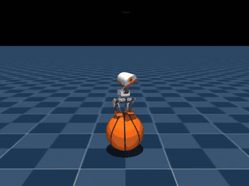 | 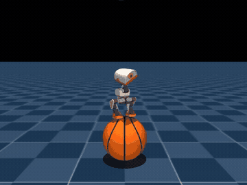 |
| `02` Физические возмущения в браузере | 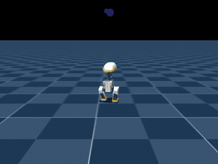 | 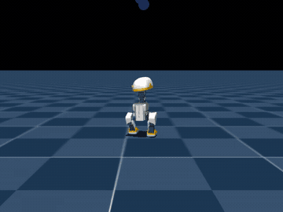 |
| `03` Ходьба на ходулях | 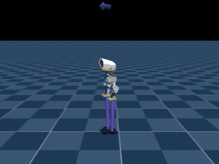 | 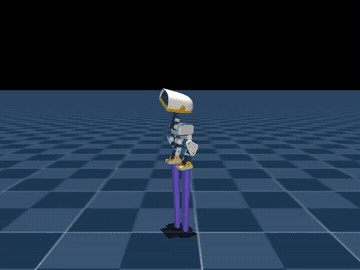 |
| `04` Качание и вращение | 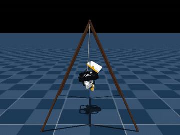 | 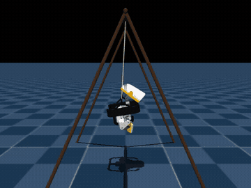 |
| `05` Балансировка на шаре FastSAC | 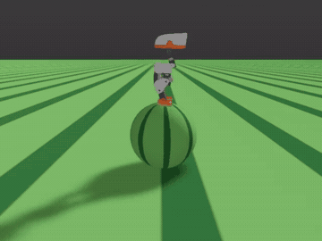 | 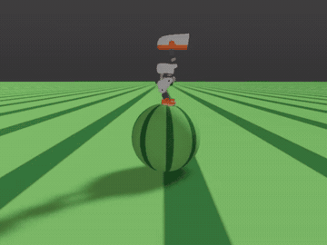 |
| `06` Подъём по лестнице | 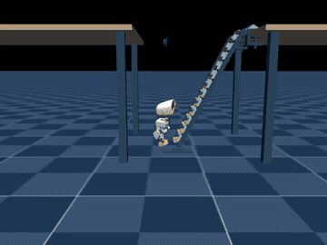 Поэтапный подъём, выход на стол и устойчивое стояние | 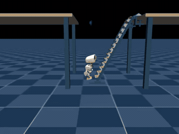 Контакт с перекладиной |
| `07` Подключение стратегии ходьбы | 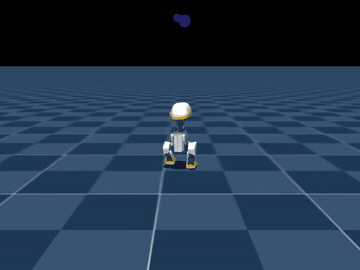 | 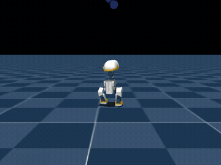 |

Первые 7 Notebook сохранили 64 выполненные ячейки кода с номерами выполнения и выводом; 8-й Notebook добавляет 12 выполненных ячеек. Всего сохранены выводы 76 ячеек кода. Состояние запуска и необязательные шаги описаны в [пояснении к Notebook](../../03-Notebook/README.md). Исходные MP4 не публикуются; на странице показаны сжатые GIF.

## LightNav-0: многосценная навигация

[Восьмой Notebook](../../03-Notebook/08-lightnav0-vision-language-navigation-gpu-multi-scene.ipynb) подключает предобученную модель навигации на GPU, читает изображение от первого лица и языковую команду. Для трёх сцен создаются отдельные видео; шаги запуска, интерфейс управления и источники модели см. в [руководстве по навигации](../../02-executable-code/lightnav-learning/README.md).

| Официальная квартира | Собственная гостиная | Собственный коридор |
| --- | --- | --- |
| 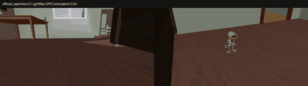 Поиск стола слева в квартире | 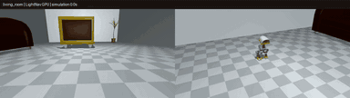 Подход к креслу в гостиной | 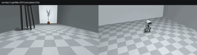 Поиск цветочного горшка в коридоре |

## Подъём по лестнице и выход на стол

Робот поэтапно ступает на перекладины, затем выходит на стол и встаёт. Переключение двух стратегий, методы обучения и источники моделей описаны в [учебнике по подъёму по лестнице](../06-microduck-tread-climbing-reinforcement-learning-guide/README.md).

## Ходьба на ходулях: 25 см и 200 см

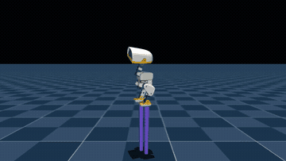

Попеременная опорная ходьба на разной высоте. Учебный план по форме, источники моделей и конфигурации размеров описаны в [учебнике по ходьбе на ходулях](../03-microduck-stilt-walker-reinforcement-learning-reproduction/README.md).

## Другие версии задач

Здесь собраны дополнительные движения и этапы обучения для каждой задачи.

Ходьба, обход препятствий и командная хореография

Команды скорости и направления:

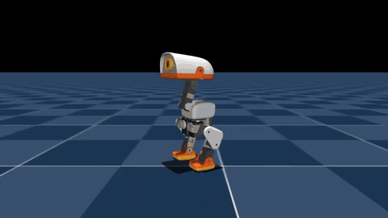

Сцена с препятствиями:

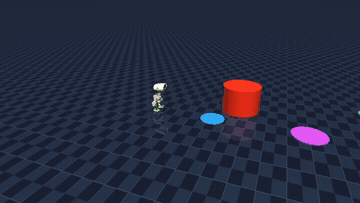

Балансировка на баскетбольном мяче

Физические возмущения в браузере

Внешнюю силу задают перетаскиванием утёнка мышью; наблюдаются силы и изменения движения в симуляции.

Качание и вращение

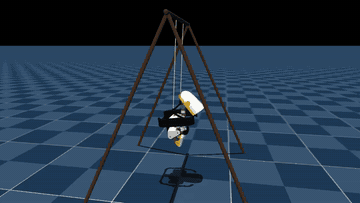

Движения качания и вращения.

Балансировка на шаре и обучение FastSAC

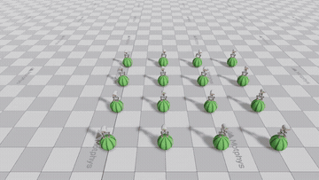

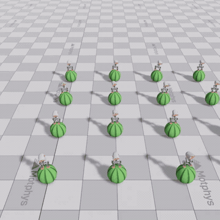

Обучение FastSAC балансировке на сферической поверхности.

Подъём по лестнице: анализ действий и этапы обучения

Полный подъём и выход на стол показаны в демонстрации выше; ниже — эталон действий и этапы обучения V1/V2/V3. Ход реализации описан в [учебнике по подъёму по лестнице](../06-microduck-tread-climbing-reinforcement-learning-guide/README.md).

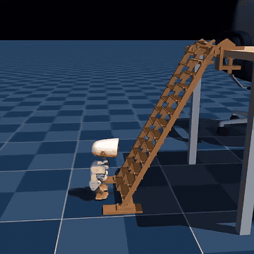

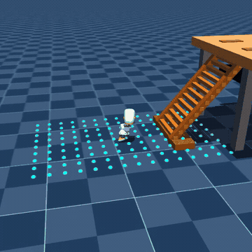

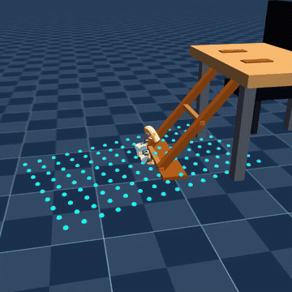

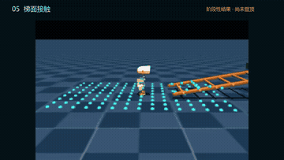

Контакт с перекладиной, подход стопы и начальная поза.

Обзор связки навыков

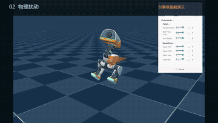

Монтаж нескольких задач; полные демонстрации каждой задачи — в соответствующих разделах выше.

## Материалы и воспроизведение

- Все опубликованные предпросмотры видео — в формате GIF. Первые 7 Notebook показывают видео через относительные ссылки на GIF; 8-й Notebook сохраняет небольшие изображения и графики траекторий, а после запуска новое MP4 проигрывается в ячейке.
- Исходные MP4 остаются на рабочей станции симуляции, чтобы уменьшить объём клонирования и просмотра. Окружения, модели, метрики и шаги воспроизведения каждой задачи — в README соответствующей задачи.
- Повторный запуск Notebook создаёт новые MP4 задач и отчёты об оценке.
