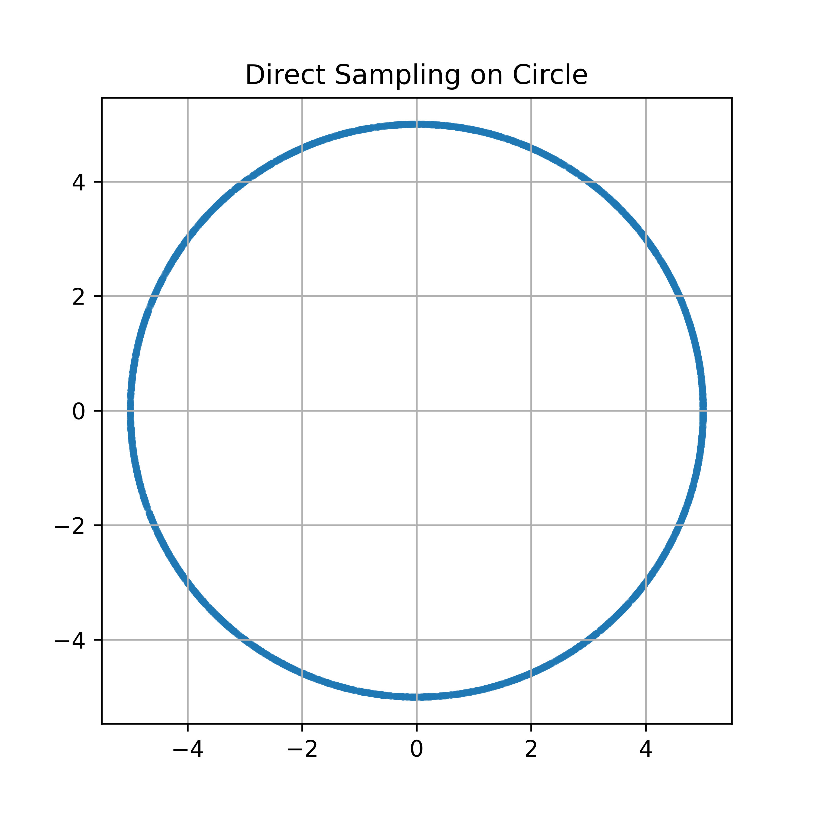
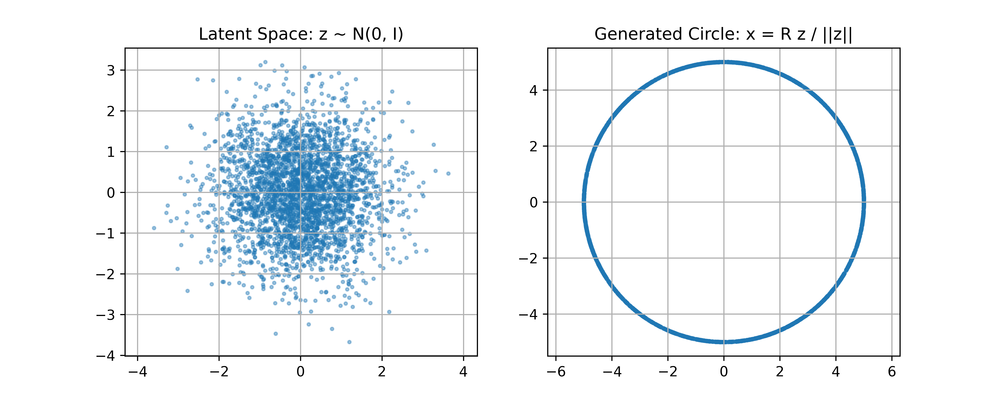
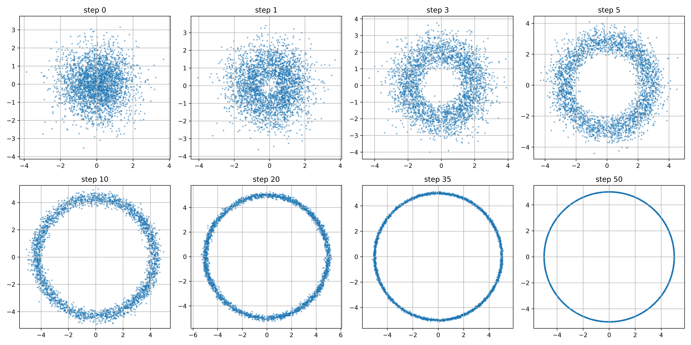

# Основы математики диффузии и введение в разбор задач

### Главная задача генеративной модели

Мы хотим, чтобы модель выучила распределение данных $P_{data}(x)$, а затем могла брать из него новые образцы $x$.

Например: распределение изображений лиц, распределение рукописных цифр, распределение точек окружности, распределение текстов, аудио и видео.

Но распределение данных обычно очень сложное: мы не можем явно записать ни его распределение, ни функцию плотности, поэтому нужны специальные приёмы.

### Многих новичков отпугивает обилие формул при изучении диффузионных моделей. На самом деле идея диффузии проста. Этот текст объясняет диффузионные модели с помощью простого кода и помогает освоить VAE и DDPM без сложных выводов. Первая часть даёт математическую базу, которая понадобится для последующих формул. Если вы хотите сразу почувствовать диффузию, перейдите ко второй части: там упрощённые версии VAE и DDPM, которые дают полный и простой опыт. Третья часть на примере второй показывает, почему некоторые функции из второй части нельзя получить напрямую и поэтому нужна диффузионная модель.

## Часть 1. Математическая база

## 1. Формула Байеса

Формула Байеса часто записывается так:

$$
p(z \mid x) = \frac{p(x \mid z)p(z)}{p(x)}
$$

Главная идея формулы: **увидев результат, восстанавливаем наиболее вероятную причину, которая его породила.**

В машинном обучении, статистическом выводе, распознавании образов и обработке естественного языка формула Байеса очень важна. Разберём каждый символ формулы.

| Символ | Название | Смысл |
|---|---|---|
| $z$ | Скрытая переменная / латентная причина | Ненаблюдаемая причина, которую мы хотим восстановить |
| $x$ | Наблюдаемые данные | Данные или явление, которые мы уже видим |
| $p(z)$ | Априорная вероятность | Вероятность причины $z$ до того, как мы увидели данные $x$ |
| $p(x \mid z)$ | Правдоподобие | Вероятность увидеть данные $x$, если причина $z$ известна |
| $p(z \mid x)$ | Апостериорная вероятность | Вероятность причины $z$ после того, как мы увидели данные $x$ |
| $p(x)$ | Свидетельство / маргинальное правдоподобие | Общая вероятность наблюдать данные $x$ |

### $z$: латентная причина

$z$ — объект, который мы хотим восстановить. Обычно он не наблюдается напрямую, а скрыт за данными, поэтому его называют **скрытой переменной**.

Например: по симптомам пациента мы хотим понять, какая у него болезнь.

### $x$: наблюдаемые данные

$x$ — данные, которые мы уже наблюдаем.

Например: набор симптомов.
В формуле Байеса мы по наблюдаемому $x$ восстанавливаем причину $z$.

То есть $x$ — результат, а $z$ — возможная причина этого результата.

---

### $p(x)$: свидетельство или маргинальное правдоподобие

$p(x)$ — общая вероятность наблюдать данные $x$. Её называют **свидетельством** или **маргинальным правдоподобием**.

Например, симптомы «высокая температура, кашель, насморк» могут быть вызваны многими причинами: простудой, гриппом, аллергией, пневмонией, другими заболеваниями.

Поэтому $p(x)$ учитывает вероятность такого результата со стороны всех возможных причин.

Если причины дискретны, можно записать: $p(x) = \sum_z p(x \mid z)p(z)$

Его главная роль: нормировать вероятности, чтобы апостериорные вероятности всех возможных причин в сумме давали 1.

### $p(z)$: априорная вероятность

$p(z)$ — наше начальное представление о причине $z$ до того, как мы увидели данные $x$. Её называют **априорной вероятностью**.

Например, при оценке того, болен ли человек простудой, если сейчас сезон гриппа, то сама причина «простуда» встречается чаще; если это не сезон, вероятность может быть ниже.

Поэтому $p(z)$ — это наше суждение о причине на основе опыта до наблюдения свидетельств.

### $p(x \mid z)$: правдоподобие

$p(x \mid z)$ — вероятность наблюдать данные $x$, если причина $z$ уже определена. Её называют **правдоподобием**.

Например: если человек действительно простужен, какова вероятность, что у него будут «высокая температура, кашель, насморк»?

Здесь связь такая: $p(\text{симптомы} \mid \text{простуда})$

Она измеряет, насколько хорошо данная причина объясняет наблюдаемое явление. Если причина хорошо объясняет данные, правдоподобие велико; если плохо, оно мало.

### $p(z \mid x)$: апостериорная вероятность

$p(z \mid x)$ — вероятность причины $z$ после того, как мы наблюдали данные $x$. Её называют **апостериорной вероятностью**.

Это то, что формула Байеса в итоге должна вычислить.

Например: увидев у человека «высокую температуру, кашель, насморк», мы хотим знать, насколько вероятно, что у него действительно простуда: $p(\text{простуда} \mid \text{симптомы})$

То есть апостериорная вероятность — это переоценка причины после того, как увидели результат.

Роль формулы Байеса — объединить априорную вероятность и наблюдаемые данные и получить апостериорную вероятность.

---

#### Формула Байеса:

$$
p(z \mid x) = \frac{p(x \mid z)p(z)}{p(x)}
$$

Её можно понимать так: **апостериорная вероятность = правдоподобие × априорная вероятность ÷ свидетельство**.

То есть:

| Элемент формулы | Интуитивный смысл |
|---|---|
| $p(z \mid x)$ | Насколько вероятна причина, если результат уже виден |
| $p(x \mid z)$ | Насколько вероятен результат, если причина верна |
| $p(z)$ | Насколько причина вероятна сама по себе |
| $p(x)$ | Насколько результат вообще распространён |

Таким образом, главная роль формулы Байеса: **по уже наблюдаемым данным и с учётом накопленного опыта обновить наше представление о причине.**

## 2. Неравенство Йенсена

Для вогнутой функции $f$ верно:

$$
f(\mathbb{E}[X]) \geq \mathbb{E}[f(X)]
$$

Для выпуклой функции $f$ верно:

$$
f(\mathbb{E}[X]) \leq \mathbb{E}[f(X)]
$$

В машинном обучении обычно $\log x$ обозначает $\ln x$, и это **вогнутая** функция, поэтому:

$$
\log \mathbb{E}[X] \geq \mathbb{E}[\log X]
$$

Во многих моделях мы хотим максимизировать $\log p(x)$, но $p(x)$ часто представляет собой интеграл:

$$
p(x)=\int p(x,z)\,dz
$$

Значит:

$$
\log p(x)=\log \int p(x,z)\,dz
$$

Такую величину обычно трудно оптимизировать напрямую. Неравенство Йенсена позволяет построить **нижнюю границу**, то есть:

$$
\log p(x) \geq \text{некоторая оптимизируемая цель}
$$

Эта нижняя граница лежит в основе многих генеративных моделей.

## 3. Гауссово распределение

Гауссово распределение, также называемое нормальным, — самое частое распределение в генеративных моделях.

### Одномерное гауссово распределение

Одномерное гауссово распределение записывается как:

$$
x \sim \mathcal{N}(\mu,\sigma^2)
$$

Теперь выведем его функцию плотности.

Начнём со стандартного нормального распределения:

$$
X\sim N(0,1)
$$

Плотность стандартного нормального распределения можно записать как:

$$
f(x)=Ce^{-\frac{x^2}{2}}
$$

где $C$ — неизвестная константа. Так как $f(x)$ — плотность вероятности, она должна удовлетворять условию нормировки:

$$
\int_{-\infty}^{+\infty}f(x)\,dx=1
$$

Подставляем $f(x)=Ce^{-\frac{x^2}{2}}$:

$$
\int_{-\infty}^{+\infty}Ce^{-\frac{x^2}{2}}\,dx=1
$$

$$
C\int_{-\infty}^{+\infty}e^{-\frac{x^2}{2}}\,dx=1
$$

А гауссов интеграл равен:

$$
\int_{-\infty}^{+\infty}e^{-\frac{x^2}{2}}\,dx=\sqrt{2\pi}
$$

Значит: $C\sqrt{2\pi}=1$

Откуда:

$$
C=\frac{1}{\sqrt{2\pi}}
$$

Итак, плотность стандартного нормального распределения:

$$
f(x)=\frac{1}{\sqrt{2\pi}}e^{-\frac{x^2}{2}}
$$

Пусть случайная величина $X$ имеет общее нормальное распределение:

$$
X\sim N(\mu,\sigma^2)
$$

Одномерное гауссово распределение можно привести к стандартному.

Положим:

$$
u=\frac{x-\mu}{\sigma}
$$

Тогда плотность стандартного нормального распределения:

$$
\varphi(u)=\frac{1}{\sqrt{2\pi}}e^{-\frac{u^2}{2}}
$$

Поскольку:

$$
u=\frac{x-\mu}{\sigma}
$$

получаем:

$$
\frac{du}{dx}=\frac{1}{\sigma}
$$

По формуле преобразования плотности непрерывной случайной величины:

$$
f_X(x)=\varphi(u)\left|\frac{du}{dx}\right|
$$

Подставляем $u=\frac{x-\mu}{\sigma}$:

$$
f_X(x)
=
\varphi\left(\frac{x-\mu}{\sigma}\right)\cdot \frac{1}{\sigma}
$$

Подставляем плотность стандартного нормального распределения:

$$
f_X(x)
=
\frac{1}{\sqrt{2\pi}}
e^{-\frac{1}{2}\left(\frac{x-\mu}{\sigma}\right)^2}
\cdot \frac{1}{\sigma}
$$

Упрощаем:

$$
f_X(x)
=
\frac{1}{\sqrt{2\pi}\sigma}
e^{-\frac{(x-\mu)^2}{2\sigma^2}}
$$

Итак, плотность общего нормального распределения:

$$
f_X(x)=\frac{1}{\sqrt{2\pi}\sigma}
\exp\left(-\frac{(x-\mu)^2}{2\sigma^2}\right)
$$

Здесь $\mu$ — среднее, $\sigma^2$ — дисперсия, $\sigma$ — стандартное отклонение. Среднее задаёт центр распределения, дисперсия — его ширину.

### Многомерное гауссово распределение

В задачах воплощённого ИИ изображения, латентные переменные и двумерные точки обычно являются не одномерными величинами, а многомерными векторами.

Многомерное гауссово распределение записывается как:

$$
x \sim \mathcal{N}(\mu,\Sigma)
$$

Его плотность:

$$
p(x)=
\frac{1}
{\sqrt{(2\pi)^d|\Sigma|}}
\exp
\left(
-\frac{1}{2}(x-\mu)^T\Sigma^{-1}(x-\mu)
\right)
$$

Здесь: $d$ — размерность, $\mu \in \mathbb{R}^d$ — вектор среднего, $\Sigma \in \mathbb{R}^{d \times d}$ — ковариационная матрица.

Если ковариация — единичная матрица:

$$
\Sigma=I
$$

то получаем стандартное многомерное гауссово распределение:

$$
x \sim \mathcal{N}(0,I)
$$

## 4. Дивергенция Кульбака — Лейблера (KL)

**Дивергенция KL** измеряет различие между двумя распределениями вероятностей; её также называют **относительной энтропией**.

Пусть есть два распределения: истинное $P$ и приближающее $Q$.

Тогда KL-дивергенция для приближения $P$ с помощью $Q$ определяется как:

$$
D_{KL}(P \parallel Q)=\sum_x P(x)\log \frac{P(x)}{Q(x)}
$$

Для непрерывных случайных величин:

$$
D_{KL}(P \parallel Q)=\int P(x)\log \frac{P(x)}{Q(x)}\,dx
$$

KL-дивергенцию можно понимать так: если истинное распределение — $P$, а вы кодируете или моделируете его с помощью $Q$, то в среднем вы переплачиваете определённое количество информации.

То есть $P$ — реальная ситуация, $Q$ — ваше модельное предположение. Чем меньше KL-дивергенция, тем ближе $Q$ к $P$; если она равна $0$, распределения совпадают.

Простой пример

Пусть:

$$
P=(0.5,0.5)
$$

$$
Q=(0.9,0.1)
$$

Тогда:

$$
D_{KL}(P \parallel Q)
=0.5\log\frac{0.5}{0.9}+0.5\log\frac{0.5}{0.1}
$$

$$
=0.5\log\frac{5}{9}+0.5\log 5
$$

При натуральном логарифме результат приблизительно равен:

$$
D_{KL}(P \parallel Q)\approx 0.5108
$$

**Связь KL-дивергенции и перекрёстной энтропии**

Перекрёстная энтропия определяется как:

$$
H(P,Q)=-\sum_x P(x)\log Q(x)
$$

Энтропия:

$$
H(P)=-\sum_x P(x)\log P(x)
$$

KL-дивергенция удовлетворяет:

$$
D_{KL}(P \parallel Q)=H(P,Q)-H(P)
$$

Поэтому в машинном обучении **минимизация перекрёстной энтропии** при фиксированном $P$ эквивалентна **минимизации KL-дивергенции**.

**Итак, KL-дивергенция измеряет, сколько информации в среднем мы теряем, когда используем распределение $Q$ вместо истинного $P$.**

## Часть 2. Простой пример генерации

Прямое изучение VAE, DDPM и потоковых моделей (FM) может сбивать с толку. Я сам в начале был в растерянности, поэтому объясняю процесс генерации на простом примере. Это хорошо подготовит к диффузионным моделям. Мы разберём базовые шаги генерации на примере кольца.

Мы ничего не обучаем, а используем **явно написанные правила**, чтобы смоделировать три подхода к генерации:

1. **Прямое сэмплирование**: берём точки непосредственно из математического определения окружности.

2. **Имитация сэмплирования VAE**: сначала сэмплируем из априорного распределения латентной переменной, затем с помощью декодера в один шаг получаем точку на окружности.

3. **Имитация сэмплирования DDPM**: начинаем с гауссова шума и шаг за шагом убираем шум, пока точки не окажутся на окружности.

Целевое распределение — двумерная окружность: $x_1^2+x_2^2=R^2$, то есть окружность радиуса $R$.

Мы хотим сгенерировать набор двумерных точек:

$$
x=
\begin{pmatrix}
x_1 \\
x_2
\end{pmatrix}
$$

которые лежат на окружности радиуса $R$:

$$
x_1^2+x_2^2=R^2
$$

Например, пусть:

$$
R=5
$$

Тогда цель — получить распределение такого вида:

```text
        * * * * *
     *             *
   *                 *
  *                   *
  *                   *
   *                 *
     *             *
        * * * * *
```

---

### Способ первый: прямое сэмплирование окружности

Точку на окружности можно параметризовать углом:

$$
x_1=R\cos\theta
$$

$$
x_2=R\sin\theta
$$

Если хотим, чтобы точки были равномерно распределены по окружности, достаточно равномерно распределить угол:

$$
\theta \sim Uniform(0,2\pi)
$$

Затем вычисляем:

$$
x=
\begin{pmatrix}
R\cos\theta \\
R\sin\theta
\end{pmatrix}
$$

Это самое прямое сэмплирование окружности: если известна явная форма целевого распределения, из него можно сэмплировать напрямую.

Реализация — в файле `direct.py` из папки code; результат:



### Способ второй: имитация сэмплирования окружности VAE

Процесс генерации VAE обычно такой:

$$
z \sim p(z)
$$

$$
x \sim p_\theta(x|z)
$$

Самое распространённое априорное распределение — стандартное нормальное:

$$
z \sim \mathcal{N}(0,I)
$$

Если декодер детерминированный, можно упростить:

$$
x=f_\theta(z)
$$

То есть основная логика генерации VAE: сначала сэмплируем латентную переменную $z$, затем через декодер получаем $x$.

Можно задать «ручной» декодер:

$$
z \sim \mathcal{N}(0,I)
$$

где:

$$
z=
\begin{pmatrix}
z_1 \\
z_2
\end{pmatrix}
$$

Затем проецируем эту двумерную гауссову точку на окружность радиуса $R$:

$$
x=R\frac{z}{\|z\|}
$$

где:

$$
\|z\|=\sqrt{z_1^2+z_2^2}
$$

Раскрывая:

$$
x_1=R\frac{z_1}{\sqrt{z_1^2+z_2^2}}
$$

$$
x_2=R\frac{z_2}{\sqrt{z_1^2+z_2^2}}
$$

Реализация — в файле `vae_imitat.py` из папки code; результат:



Реальный VAE генерирует данные обычно за один шаг. Это может привести к тому, что результаты будут смещаться к среднему; поэтому появился DDPM. Сейчас полезно просто понимать эту разницу; подробнее мы разберём VAE отдельно.

Разница между DDPM и VAE

VAE:

$$
z \sim \mathcal{N}(0,I)
$$

$$
x=f_\theta(z)
$$

Это **генерация в один шаг**.

DDPM:

$$
x_T \sim \mathcal{N}(0,I)
$$

$$
x_T \rightarrow x_{T-1} \rightarrow \cdots \rightarrow x_0
$$

Это **многошаговая генерация**.

### Способ третий: имитация сэмплирования окружности DDPM

Генерация DDPM выполняется не за один шаг.

Её процесс:

$$
x_T \sim \mathcal{N}(0,I)
$$

затем постепенное удаление шума:

$$
x_T \rightarrow x_{T-1} \rightarrow x_{T-2} \rightarrow \cdots \rightarrow x_0
$$

и в конце получаем образец данных:

$$
x_0 \sim p_{\text{data}}
$$

Для окружности это означает, что в конце хотим:

$$
x_1^2+x_2^2 \approx R^2
$$

Настоящий DDPM состоит из двух процессов: 1. **прямого зашумления** и 2. **обратного удаления шума**.

Чтобы понять идею, мы сначала напишем **ручное правило удаления шума**, имитирующее сэмплирование DDPM.

Основная идея такая:

1. Начинаем с гауссова шума.

2. На каждом шаге предсказываем «чистую» точку на окружности.

3. Текущая точка сдвигается к предсказанной точке на окружности.

4. На каждом шаге добавляем немного шума, который постепенно уменьшается.

5. В конце точки оказываются около окружности.

Для любой текущей точки $x_t$ можно спроецировать её на окружность радиуса $R$:

$$
\hat{x}_0=R\frac{x_t}{\|x_t\|}
$$

Это можно рассматривать как ручную модель удаления шума: в настоящем DDPM $\hat{x}_0$ предсказывает нейронная сеть.

Пусть текущая точка — $x_t$, предсказанная чистая точка:

$$
\hat{x}_0=R\frac{x_t}{\|x_t\|}
$$

Затем обновляем:

$$
x_{t-1}
=
(1-\gamma_t)x_t+\gamma_t\hat{x}_0+\sigma_t\eta
$$

где:

$$
\eta \sim \mathcal{N}(0,I)
$$

Здесь $\gamma_t$ определяет, насколько сильно мы приближаемся к окружности на каждом шаге, а $\sigma_t$ — сколько случайного шума добавляется. По мере продвижения сэмплирования $\sigma_t$ должно уменьшаться.

Реализация — в файле `ddpm_imitat.py` из папки code; результат:



Вы увидите процесс:

```text
стандартный гауссов шум -> точки постепенно притягиваются к окружности -> в итоге образуется окружность радиуса R
```

## Часть 3. Упрощения в реальных моделях

### 1. VAE

Настоящий VAE задаётся так:

$$
z \sim \mathcal{N}(0,I)
$$

$$
x \sim p_\theta(x|z)
$$

где $p_\theta(x|z)$ — распределение, которое определяет нейросетевой декодер.

Типичная форма:

$$
p_\theta(x|z)=\mathcal{N}(\mu_\theta(z),\sigma^2I)
$$

При сэмплировании:

$$
x=\mu_\theta(z)+\sigma\epsilon
$$

где:

$$
\epsilon \sim \mathcal{N}(0,I)
$$

В нашей упрощённой версии:

$$
\mu_\theta(z)
$$

заменено на:

$$
\mu(z)=R\frac{z}{\|z\|}
$$

---

## 2. DDPM

Прямой процесс настоящего DDPM:

$$
x_t=\sqrt{\bar{\alpha}_t}x_0+\sqrt{1-\bar{\alpha}_t}\epsilon
$$

Обучаем нейросеть:

$$
\epsilon_\theta(x_t,t)\approx \epsilon
$$

При сэмплировании начинаем с:

$$
x_T \sim \mathcal{N}(0,I)
$$

и шаг за шагом удаляем шум.

В нашей упрощённой версии предсказание нейросети заменено геометрической проекцией:

$$
\hat{x}_0=R\frac{x_t}{\|x_t\|}
$$

То есть в настоящем DDPM нейросеть учится превращать $x_t$ в $x_0$, а в нашей упрощённой версии мы напрямую проецируем $x_t$ на окружность с помощью ручного правила.

**В реальных задачах у нас нет возможности получить распределение, которое можно записать явной математической формулой, как окружность. Поэтому нужны нейросети, кодирование и декодирование, репараметризация и другие приёмы, чтобы выучить такое распределение.**

Как именно VAE, DDPM и FM учат распределения и генерируют данные, а также о современных применениях диффузионной генерации в воплощённом ИИ, например DreamDojo, DreamZero, и о других моделях понимания и генерации, таких как JEPA и LeWM, мы расскажем в следующих главах. Надеюсь, после этой главы у вас появится первичное понимание диффузионных моделей.

Спасибо за чтение, пристегните ремни! Поехали к следующим главам~
