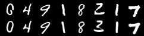
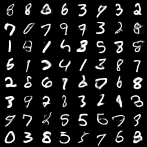
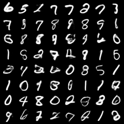

# VAE: подробное описание и генерация изображений MNIST

### В этом руководстве от мотивации VAE, вероятностной модели, вывода ELBO и итоговой цели обучения переходим к реализации генерации изображений MNIST. Главное — понять, почему VAE устроен именно так, и как при обучении и генерации проверить, действительно ли модель выучила латентное пространство, из которого можно сэмплировать.

---

## 0. Путь изучения

Основную линию VAE можно свести к четырём шагам:

1. Обычный автоэнкодер умеет восстанавливать данные, но его латентное пространство не обязательно пригодно для случайного сэмплирования.
2. Модель с латентной переменной описывает схему «сначала сэмплируем $z$, затем генерируем $x$», но предельное правдоподобие $\log p_{\theta}(x)$ трудно вычислить напрямую.
3. VAE вводит приближённое апостериорное распределение $q_{\phi}(z|x)$ и использует ELBO вместо непосредственно не оптимизируемого истинного правдоподобия.
4. Итоговая цель обучения — «функция потерь реконструкции + функция потерь KL»: модель должна хорошо восстанавливать данные и одновременно держать латентное пространство близким к стандартному нормальному распределению.

> VAE — генеративная модель с вероятностным латентным пространством. Она объединяет способность автоэнкодера к реконструкции и вероятностный подход вариационного вывода, благодаря чему можно сэмплировать из простого априорного распределения $p(z)=\mathcal{N}(0,I)$ и генерировать новые данные.

---

## 1. Зачем нужен VAE

### 1.1 Что на самом деле хочет выучить генеративная модель

Пусть есть обучающие данные:

$$
x_1,x_2,\dots,x_n
$$

Генеративная модель стремится выучить истинное распределение данных:

$$
p_{\theta}(x)
$$

где $x$ — данные, $\theta$ — параметры модели. Цель обучения по максимуму правдоподобия:

$$
\max_{\theta}\sum_{i=1}^{n}\log p_{\theta}(x_i)
$$

Эта цель означает: реальные образцы должны получать высокую вероятность в распределении модели.

После обучения генеративная модель должна уметь:

- оценивать, похож ли образец на реальные данные;
- случайно сэмплировать новые образцы;
- интерполировать и управлять в латентном пространстве;
- выявлять низкоразмерную структуру, лежащую в основе данных.

### 1.2 Проблемы обычного автоэнкодера

Обычный автоэнкодер устроен так:

$$
x \rightarrow Encoder \rightarrow z \rightarrow Decoder \rightarrow \hat{x}
$$

Цель — чтобы реконструкция $\hat{x}$ была близка к исходному входу $x$:

$$
\hat{x}\approx x
$$

Обычный AE подходит для сжатия, снижения размерности, удаления шума и обучения признаков, но сам по себе он не является генеративной моделью. Причина в том, что энкодер AE выдаёт одну точку:

$$
z=f_{\phi}(x)
$$

Это лишь гарантирует, что обучающие образцы отображаются в какие-то точки латентного пространства, но не гарантирует, что всё пространство непрерывно, регулярно и пригодно для сэмплирования.

Поэтому возникают три проблемы:

1. В латентном пространстве могут быть «дыры».
2. Случайно сэмплированные $z$ не обязательно дают осмысленные образцы.
3. Интерполяция между двумя образцами в латентном пространстве может давать бессмысленные результаты.

Обычный AE умеет восстанавливать, но не гарантирует генерацию.

### 1.3 Естественная идея латентной генеративной модели

Чтобы генерировать данные, можно предположить, что за каждым образцом стоит латентная переменная $z$. Процесс генерации:

$$
z\sim p(z)
$$

$$
x\sim p_{\theta}(x|z)
$$

Обычно априорное распределение берут стандартным нормальным:

$$
p(z)=\mathcal{N}(0,I)
$$

Совместное распределение:

$$
p_{\theta}(x,z)=p_{\theta}(x|z)p(z)
$$

Если модель удаётся обучить, генерация сводится к тому, чтобы сэмплировать $z$ из $p(z)$ и пропустить его через декодер, получив $x$.

### 1.4 Почему прямое обучение латентной модели трудно

В обучающих данных есть только $x$, но нет соответствующих $z$. Поэтому обучение опирается на предельное правдоподобие:

$$
p_{\theta}(x)=\int p_{\theta}(x,z)dz
=\int p_{\theta}(x|z)p(z)dz
$$

Если декодер — нейросеть, этот интеграл обычно не имеет аналитического решения. Причины:

- $z$ — многомерная непрерывная переменная;
- $p_{\theta}(x|z)$ задаётся сложной нелинейной нейросетью;
- интеграл не имеет аналитического решения;
- численное интегрирование для каждого образца слишком дорого.

Истинное апостериорное распределение тоже не вычислить напрямую:

$$
p_{\theta}(z|x)
{=}
\frac{p_{\theta}(x|z)p(z)}{p_{\theta}(x)}
$$

Поскольку знаменатель $p_{\theta}(x)$ не вычисляется, $p_{\theta}(z|x)$ тоже недоступно.

Ключевой ход VAE — заменить истинное апостериорное распределение $p_{\theta}(z|x)$ обучаемым приближённым распределением $q_{\phi}(z|x)$ и построить оптимизируемую нижнюю границу.

### 1.5 Базовая модель VAE

В VAE есть три вероятностных объекта:

1. Априорное распределение:

$$
p(z)=\mathcal{N}(0,I)
$$

2. Распределение генерации:

$$
p_{\theta}(x|z)
$$

3. Приближённое апостериорное распределение:

$$
q_{\phi}(z|x)
$$

В нейросетевой реализации:

- энкодер задаёт $q_{\phi}(z|x)$;
- декодер задаёт $p_{\theta}(x|z)$;
- стандартное нормальное распределение задаёт $p(z)$.

Энкодер больше не выдаёт одну точку, а выдаёт распределение:

$$
q_{\phi}(z|x)=
\mathcal{N}\left(
\mu_{\phi}(x),
\mathrm{diag}(\sigma_{\phi}^{2}(x))
\right)
$$

То есть он выводит среднее $\mu$ и логарифм дисперсии $\log\sigma^2$. Затем из этого распределения сэмплируется $z$, который подаётся в декодер для реконструкции или генерации.

Главное отличие VAE от обычного AE:

$$
\text{AE: } z=f_{\phi}(x)
$$

$$
\text{VAE: } z\sim q_{\phi}(z|x)
$$

Это изменение превращает латентную переменную из «точки кодирования» в «распределение», и именно это создаёт основу для случайной генерации и регуляризации латентного пространства.

---

## 2. Вывод модели VAE

В этом разделе рассмотрены два пути вывода. Они дают один и тот же ELBO, но отвечают на разные вопросы.

- **Путь 1: неравенство Йенсена**  
  Отвечает на вопрос: почему можно превратить невычислимое $\log p_{\theta}(x)$ в оптимизируемую нижнюю границу.

- **Путь 2: разложение правдоподобия**  
  Отвечает на вопрос: чем ELBO отличается от истинного $\log p_{\theta}(x)$.

### 2.1 Путь 1: получаем оптимизируемую нижнюю границу через неравенство Йенсена

Цель этого пути — из исходной цели построить нижнюю границу, которую можно оптимизировать.

VAE изначально хочет максимизировать предельное логарифмическое правдоподобие:

$$
\log p_{\theta}(x)
{=}
\log \int p_{\theta}(x,z)dz
$$

Проблема в том, что интеграл невычислим. Поскольку в обучающих данных есть только $x$, а $z$ не наблюдается, все возможные $z$ нужно проинтегрировать.

Первый шаг — умножить и разделить подынтегральное выражение на распределение $q_{\phi}(z|x)$:

$$
\log p_{\theta}(x)
{=}
\log \int
q_{\phi}(z|x)
\frac{p_{\theta}(x,z)}{q_{\phi}(z|x)}
dz
$$

Это не меняет значения, так как мы одновременно умножаем и делим на одну и ту же величину. Цель такого преобразования — переписать интеграл как математическое ожидание по $q_{\phi}(z|x)$:

$$
\log p_{\theta}(x)
{=}
\log
\mathbb{E}_{q_{\phi}(z|x)}
\left[
\frac{p_{\theta}(x,z)}{q_{\phi}(z|x)}
\right]
$$

Второй шаг — внести логарифм под знак математического ожидания с помощью неравенства Йенсена. Поскольку $\log$ — вогнутая функция:

$$
\log \mathbb{E}[Y]\geq \mathbb{E}[\log Y]
$$

Положим:

$$
Y=
\frac{p_{\theta}(x,z)}{q_{\phi}(z|x)}
$$

Получаем:

$$
\log p_{\theta}(x)
\geq
\mathbb{E}_{q_{\phi}(z|x)}
\left[
\log
\frac{p_{\theta}(x,z)}{q_{\phi}(z|x)}
\right]
$$

Правая часть и есть ELBO:

$$
\mathcal{L}(\theta,\phi;x)
{=}
\mathbb{E}_{q_{\phi}(z|x)}
\left[
\log
\frac{p_{\theta}(x,z)}{q_{\phi}(z|x)}
\right]
$$

Поэтому VAE оптимизирует не невычислимое $\log p_{\theta}(x)$, а его нижнюю границу:

$$
\log p_{\theta}(x)\geq \mathcal{L}(\theta,\phi;x)
$$

Теперь разложим ELBO на реализуемую форму. Из совместного распределения:

$$
p_{\theta}(x,z)=p_{\theta}(x|z)p(z)
$$

получаем:

$$
\mathcal{L}(\theta,\phi;x)
{=}
\mathbb{E}_{q_{\phi}(z|x)}
\left[
\log p_{\theta}(x|z)+\log p(z)-\log q_{\phi}(z|x)
\right]
$$

Разделяем член реконструкции и член KL:

$$
\mathcal{L}(\theta,\phi;x)
{=}
\mathbb{E}_{q_{\phi}(z|x)}
\left[
\log p_{\theta}(x|z)
\right]
{-}
D_{KL}\left(q_{\phi}(z|x)\|p(z)\right)
$$

Это итог пути 1:

$$
\boxed{
\mathcal{L}(\theta,\phi;x)
{=}
\mathbb{E}_{q_{\phi}(z|x)}
\left[
\log p_{\theta}(x|z)
\right]
{-}
D_{KL}\left(q_{\phi}(z|x)\|p(z)\right)
}
$$

В нём два члена:

- $\mathbb{E}_{q_{\phi}(z|x)}[\log p_{\theta}(x|z)]$ — член реконструкции, который побуждает декодер восстанавливать $x$ из $z$;
- $D_{KL}(q_{\phi}(z|x)\|p(z))$ — член априорной регуляризации, который побуждает распределение энкодера приближаться к стандартному нормальному распределению.

При обучении обычно минимизируют отрицательный ELBO:

$$
\text{Loss}
{=}
{-}
\mathcal{L}(\theta,\phi;x)
$$

То есть:

$$
\boxed{
\text{VAE Loss}
{=}
\text{Reconstruction Loss}
+
\text{KL Loss}
}
$$

Если:

$$
q_{\phi}(z|x)=
\mathcal{N}
\left(
\mu,
\mathrm{diag}(\sigma^2)
\right)
$$

и:

$$
p(z)=\mathcal{N}(0,I)
$$

то член KL имеет аналитическое решение:

$$
D_{KL}\left(q_{\phi}(z|x)\|p(z)\right)
{=}
\frac{1}{2}
\sum_j
\left(
\mu_j^2+\sigma_j^2-\log\sigma_j^2-1
\right)
$$

Если сеть выводит $\log\sigma^2$, обозначаемый `logvar`, то часто записывают:

$$
D_{KL}
{=}
{-}
\frac{1}{2}
\sum_j
\left(
1+\text{logvar}_j-\mu_j^2-\exp(\text{logvar}_j)
\right)
$$

### 2.2 Путь 2: понимаем разрыв между ELBO и правдоподобием через разложение

Этот путь не начинает с неравенства Йенсена, а сразу раскладывает истинное логарифмическое правдоподобие на две части. Цель — объяснить, почему ELBO является нижней границей и насколько она отличается от искомой величины.

Поскольку $\log p_{\theta}(x)$ не зависит от $z$:

$$
\log p_{\theta}(x)
{=}
\mathbb{E}_{q_{\phi}(z|x)}[\log p_{\theta}(x)]
$$

Далее переписываем $p_{\theta}(x)$ через байесовское соотношение. Из:

$$
p_{\theta}(x)=\frac{p_{\theta}(x,z)}{p_{\theta}(z|x)}
$$

получаем:

$$
\log p_{\theta}(x)
{=}
\mathbb{E}_{q_{\phi}(z|x)}
\left[
\log
\frac{p_{\theta}(x,z)}{p_{\theta}(z|x)}
\right]
$$

Затем вводим $q_{\phi}(z|x)$ в дробь:

$$
\log p_{\theta}(x)
{=}
\mathbb{E}_{q_{\phi}(z|x)}
\left[
\log
\left(
\frac{p_{\theta}(x,z)}{q_{\phi}(z|x)}
\cdot
\frac{q_{\phi}(z|x)}{p_{\theta}(z|x)}
\right)
\right]
$$

Разбиваем произведение под логарифмом на сумму:

$$
\log p_{\theta}(x)
{=}
\mathbb{E}_{q_{\phi}(z|x)}
\left[
\log
\frac{p_{\theta}(x,z)}{q_{\phi}(z|x)}
\right]
+
\mathbb{E}_{q_{\phi}(z|x)}
\left[
\log
\frac{q_{\phi}(z|x)}{p_{\theta}(z|x)}
\right]
$$

Первый член — ELBO:

$$
\mathcal{L}(\theta,\phi;x)
{=}
\mathbb{E}_{q_{\phi}(z|x)}
\left[
\log
\frac{p_{\theta}(x,z)}{q_{\phi}(z|x)}
\right]
$$

Второй член — KL-дивергенция между приближённым и истинным апостериорным распределениями:

$$
D_{KL}
\left(
q_{\phi}(z|x)\|p_{\theta}(z|x)
\right)
$$

Итак:

$$
\boxed{
\log p_{\theta}(x)
{=}
\mathcal{L}(\theta,\phi;x)
+
D_{KL}
\left(
q_{\phi}(z|x)\|p_{\theta}(z|x)
\right)
}
$$

Поскольку KL-дивергенция всегда неотрицательна:

$$
D_{KL}
\left(
q_{\phi}(z|x)\|p_{\theta}(z|x)
\right)
\geq 0
$$

имеем:

$$
\mathcal{L}(\theta,\phi;x)\leq \log p_{\theta}(x)
$$

Это итог пути 2:

> ELBO является нижней границей, потому что отличается от истинного $\log p_{\theta}(x)$ на неотрицательную величину — KL-дивергенцию апостериорного распределения.

Этот путь также объясняет два разных KL-члена:

- $D_{KL}(q_{\phi}(z|x)\|p_{\theta}(z|x))$ — теоретическая разница между апостериорными распределениями, которая объясняет разрыв между ELBO и истинным правдоподобием, но не может вычисляться напрямую, так как истинное апостериорное распределение недоступно;
- $D_{KL}(q_{\phi}(z|x)\|p(z))$ — априорный член в функции потерь, который можно вычислять напрямую и который делает латентное пространство близким к стандартному нормальному распределению.

Оба пути приводят к одной и той же цели обучения. Итоговая модель VAE устроена так:

- энкодер выводит $\mu$ и $\log\sigma^2$;
- с помощью репараметризации получаем $z$;
- декодер реконструирует или генерирует изображение из $z$;
- функция потерь состоит из члена реконструкции и члена KL.

---

## 3. Реализация VAE на коде

В этом разделе фрагменты кода поясняют способ реализации. Полный код находится в файлах:

- `code/train_mnist_unet_vae.py`
- `code/generate_mnist_unet_vae.py`

Набор данных — MNIST. Он скачивается автоматически, поэтому о данных беспокоиться не нужно; достаточно самостоятельно установить torch.

Здесь модель использует структуру в духе U-Net с каскадной свёрточной субдискретизацией и повышением разрешения. Важно: на этапе генерации есть только случайная латентная переменная $z$ и нет входного изображения, поэтому нельзя опираться на пропускные признаки (skip feature) из входа. В коде используется «иерархическая свёрточная структура в духе U-Net», а не полноценный U-Net с пропусками от входа.

### 3.1 Структура модели

Основная модель в скрипте обучения — `UNetVAE`. Энкодер уменьшает изображение MNIST $1\times28\times28$ до высокоразмерных признаков, а затем выводит `mu` и `logvar`:

```python
self.enc1 = nn.Sequential(nn.Conv2d(1, base, 3, padding=1), nn.GroupNorm(4, base), nn.SiLU())
self.enc2 = nn.Sequential(nn.Conv2d(base, base * 2, 4, stride=2, padding=1), nn.GroupNorm(8, base * 2), nn.SiLU())
self.enc3 = nn.Sequential(nn.Conv2d(base * 2, base * 4, 4, stride=2, padding=1), nn.GroupNorm(8, base * 4), nn.SiLU())
self.fc_mu = nn.Linear(base * 4 * 7 * 7, latent_dim)
self.fc_logvar = nn.Linear(base * 4 * 7 * 7, latent_dim)
```

Декодер проецирует латентную переменную $z$ обратно в карту признаков $7\times7$, а затем поэтапно повышает разрешение до $28\times28$:

```python
self.fc_dec = nn.Linear(latent_dim, base * 4 * 7 * 7)
self.dec1 = nn.Sequential(nn.ConvTranspose2d(base * 4, base * 2, 4, stride=2, padding=1), nn.GroupNorm(8, base * 2), nn.SiLU())
self.dec2 = nn.Sequential(nn.ConvTranspose2d(base * 2, base, 4, stride=2, padding=1), nn.GroupNorm(4, base), nn.SiLU())
self.out = nn.Conv2d(base, 1, 3, padding=1)
```

Выходной слой не подключает `sigmoid` напрямую; при обучении используется `binary_cross_entropy_with_logits`. Так вычисления численно устойчивее.

### 3.2 Репараметризация

Исходная форма выборки:

$$
z\sim\mathcal{N}(\mu,\sigma^2)
$$

Репараметризация записывает её так:

$$
\epsilon\sim\mathcal{N}(0,I)
$$

$$
z=\mu+\sigma\odot\epsilon
$$

Код:

```python
std = torch.exp(0.5 * logvar)
eps = torch.randn_like(std)
z = mu + std * eps
```

Таким образом, случайность приходит из `eps`, а `z` — дифференцируемая функция `mu` и `logvar`, поэтому градиенты проходят от декодера к энкодеру.

После репараметризации модель при обучении фактически вычисляет дифференцируемую оценку отрицательного ELBO. Для одного обучающего образца $x$ поток вычислений можно записать так:

$$
q_{\phi}(z|x)
{=}
\mathcal{N}
\left(
\mu_{\phi}(x),
\mathrm{diag}(\sigma_{\phi}^2(x))
\right)
$$

$$
\epsilon\sim\mathcal{N}(0,I),
\quad
z=\mu_{\phi}(x)+\sigma_{\phi}(x)\odot\epsilon
$$

$$
\hat{x}=\mu_{\theta}(z)
$$

Тогда цель для одного образца:

$$
\mathcal{J}(\theta,\phi;x)
{=}
{-}
\log p_{\theta}(x|z)
+
D_{KL}
\left(
q_{\phi}(z|x)\|p(z)
\right)
$$

Если выходное распределение декодера — гауссово:

$$
p_{\theta}(x|z)
{=}
\mathcal{N}
\left(
\mu_{\theta}(z),
\sigma_x^2 I
\right)
$$

то после отбрасывания констант, не зависящих от параметров модели, член реконструкции эквивалентен среднеквадратичной ошибке, и фактически оптимизируется выражение:

$$
\mathcal{J}(\theta,\phi;x)
\propto
\left\|x-\mu_{\theta}(z)\right\|^2
+
\frac{1}{2}
\sum_d
\left(
\mu_{\phi,d}(x)^2
+
\sigma_{\phi,d}(x)^2
{-}
1
{-}
2\log\sigma_{\phi,d}(x)
\right)
$$

Здесь первый член — ошибка реконструкции, второй — KL-дивергенция между $q_{\phi}(z|x)$ и стандартным нормальным априорным распределением $p(z)=\mathcal{N}(0,I)$. При обучении с мини-батчем обычно берут среднее по образцам батча:

$$
\mathcal{J}_{batch}
{=}
\frac{1}{B}
\sum_{i=1}^{B}
\left[
\mathrm{Recon}
\left(
x_i,
\mathrm{Decoder}_{\theta}(z_i)
\right)
+
\beta
D_{KL}
\left(
q_{\phi}(z|x_i)\|p(z)
\right)
\right]
$$

В приведённом ниже коде MNIST энкодер выводит `logvar`, то есть $\log\sigma^2$, поэтому KL-член записывается так:

$$
D_{KL}
{=}
{-}
\frac{1}{2}
\sum_d
\left(
1+\text{logvar}_d-\mu_d^2-\exp(\text{logvar}_d)
\right)
$$

Если член реконструкции использует `binary_cross_entropy_with_logits`, то итоговый loss кода реализует эту цель для батча:

$$
\text{loss}
{=}
\text{BCEWithLogits}
\left(
\text{recon\_logits},
x
\right)
+
\beta D_{KL}
$$

### 3.3 Цель обучения

Пиксели MNIST нормированы в $[0,1]$, поэтому для члена реконструкции используется бинарная перекрёстная энтропия. В скрипте обучения применяется её версия на логитах:

```python
recon_loss = F.binary_cross_entropy_with_logits(recon_logits, x, reduction="sum") / x.size(0)
kl_loss = -0.5 * torch.sum(1 + logvar - mu.pow(2) - logvar.exp()) / x.size(0)
loss = recon_loss + beta * kl_loss
```

Здесь `beta` — вес KL. В начале обучения можно использовать прогрев KL (KL warm-up):

```python
beta = min(1.0, epoch / max(1, args.warmup_epochs)) * args.beta
```

Так модель сначала учится базовой реконструкции, а затем постепенно усиливается ограничение на латентное пространство, что помогает смягчить эффект «исчезновения KL».

### 3.4 Выходные данные скрипта обучения

`train_mnist_unet_vae.py` сохраняет:

- `checkpoints/mnist_unet_vae.pt` — веса модели и конфигурацию;
- `outputs/recon_epoch_XXX.png` — сравнение исходных изображений и реконструкций;
- `outputs/sample_epoch_XXX.png` — изображения, сгенерированные из стандартного нормального априорного распределения.

Запуск:

```bash
python train_mnist_unet_vae.py --epochs 20 --batch-size 128 --latent-dim 32
```

Если есть CUDA, скрипт автоматически использует GPU.

Результаты выполнения:

(1)Результат реконструкции исходных изображений



(2)Результат генерации по выборке



### 3.5 Проверка скрипта генерации

`generate_mnist_unet_vae.py` выполняет только генерацию:

1. загружает обученный checkpoint;
2. сэмплирует $z\sim\mathcal{N}(0,I)$;
3. подаёт его в декодер;
4. сохраняет сетку сгенерированных изображений.

Запуск:

```bash
python generate_mnist_unet_vae.py --checkpoint checkpoints/mnist_unet_vae.pt --num-samples 64
```

Скрипту генерации не нужны обучающие данные: он опирается только на обученный декодер.

Результат тестовой генерации:



### 3.6 Практические приёмы реализации

1. **Лучше выводить `logvar`.**  
   Прямой вывод дисперсии может давать отрицательные значения или численный взрыв. Логарифм дисперсии стабильнее.

2. **Записывайте отдельно члены реконструкции и KL.**  
   Только общий loss — недостаточно. KL, близкий к 0, может означать, что латентная переменная не используется.

3. **Сохраняйте изображения реконструкции и генерации.**  
   По реконструкции видно, научились ли энкодер и декодер сжимать и восстанавливать; по сгенерированным образцам — пригодно ли латентное пространство для генерации.

4. **Структура в духе U-Net должна подходить задаче генерации.**  
   Классический U-Net использует пропускные соединения от входа. В VAE при генерации входного изображения нет, поэтому здесь используется иерархическая свёрточная структура без пропусков от входа.

5. **Не увеличивайте размерность латентного пространства без разбора.**  
   Для MNIST можно начинать с 16, 32 или 64. Слишком маленькая размерность даёт плохую реконструкцию, слишком большая может оставить часть измерений неиспользуемыми.

---

## 4. Частые вопросы

### 4.1 Не является ли VAE обычным AE с добавлением шума?

Нет. Основа VAE — вероятностная латентная модель и цель обучения ELBO. Шум — лишь часть выборки из апостериорного распределения.

### 4.2 Почему VAE может генерировать изображения из случайного $z$

При обучении KL-член приближает $q_{\phi}(z|x)$ к $p(z)=\mathcal{N}(0,I)$. Поэтому после обучения $z$, взятый из стандартного нормального распределения, с большей вероятностью попадает в область, которую декодер умеет декодировать.

### 4.3 Почему в коде обучения используются логиты

Для MNIST с бинарной перекрёстной энтропией `binary_cross_entropy_with_logits` стабильнее, чем сначала применить `sigmoid`, а затем BCE. Сигмоиду применяют при генерации и сохранении изображений.

### 4.4 Почему не используются пропуски (skip) из традиционного U-Net

Пропуски классического U-Net передают признаки входного изображения в декодер. При генерации VAE входного изображения нет, есть только случайный $z$, поэтому такие входные признаки использовать нельзя. Здесь применяется структура в духе U-Net с каскадной субдискретизацией и повышением разрешения.

---

## 5. Итоги

Итоговая модель VAE состоит из трёх частей:

$$
q_{\phi}(z|x)
{=}
\mathcal{N}
\left(
\mu_{\phi}(x),
\mathrm{diag}(\sigma_{\phi}^{2}(x))
\right)
$$

$$
z=\mu+\sigma\odot\epsilon,\quad \epsilon\sim\mathcal{N}(0,I)
$$

$$
x\sim p_{\theta}(x|z)
$$

Итоговая цель обучения:

$$
\text{Loss}
{=}
\text{Reconstruction Loss}
+
\text{KL Loss}
$$

где:

$$
\text{KL Loss}
{=}
D_{KL}\left(q_{\phi}(z|x)\|p(z)\right)
$$

Ценность VAE в том, что модель не просто учится воспроизводить вход, а организует данные в непрерывное, регулярное и пригодное для выборки латентное пространство. Такое пространство позволяет генерировать новые образцы, интерполировать и заниматься обучением представлений.

---

## 6. Задания для самопроверки

1. Почему обычный AE не гарантирует эффективность случайной выборки?
2. Почему VAE заставляет энкодер выводить распределение, а не точку?
3. Почему $\log p_{\theta}(x)$ трудно оптимизировать напрямую?
4. Как из неравенства Йенсена получается ELBO?
5. Что показывает соотношение $\log p_{\theta}(x)=ELBO+KL(q_{\phi}(z|x)\|p_{\theta}(z|x))$?
6. Почему KL-член в функции потерь обучения — это $KL(q_{\phi}(z|x)\|p(z))$?
7. Почему трюк репараметризации делает процесс выборки обучаемым?
8. Что может означать KL-потеря, близкая к 0?
9. Почему при оценке VAE нужно смотреть одновременно на изображения реконструкции и на случайно сэмплированные образцы?
