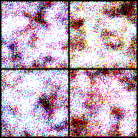
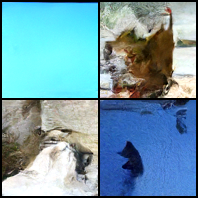
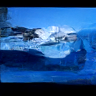

# DDPM: подробное описание и реализация в коде

### В этом руководстве мы начинаем с ограничений VAE, объясняем, почему DDPM заменяет «генерацию за один шаг» на «многошаговое удаление шума», и шаг за шагом выводим прямой процесс добавления шума, обратную генерацию, ELBO, истинное апостериорное распределение, цель предсказания шума, а затем итоговые формулы обучения и сэмплирования.

---

## 0. Путь изучения

Основную линию DDPM можно свести к пяти шагам:

1. VAE генерирует изображение через латентную переменную $z$ за один шаг, но допущения о сжатии и реконструкции могут приводить к потере деталей.
2. DDPM не старается сразу создать полное изображение, а сначала задаёт фиксированный процесс добавления шума, который постепенно превращает реальное изображение в гауссов шум.
3. При генерации мы начинаем с гауссова шума и обучаем нейросеть понимать, как на каждом шаге убрать немного шума.
4. Строгий вывод опирается на максимальное правдоподобие и ELBO, но в итоге задача упрощается до интуитивной задачи обучения с учителем: предсказать шум, добавленный к изображению.
5. При реализации ключевое — не сложная функция потерь, а правильная работа с расписанием шума, временными шагами, входами и выходами U-Net, формулой сэмплирования и диапазоном значений.

> DDPM постепенно добавляет шум к изображению, пока оно не станет почти чистым шумом, а затем обучает модель обратному процессу — шаг за шагом убирать шум. Так сложная задача «сгенерировать изображение за один шаг» разбивается на множество простых задач «предсказать и убрать немного шума».

Наиболее распространённая цель обучения DDPM:

$$
\mathcal{L}_{\mathrm{simple}}(\theta)
{=}
\mathbb{E}_{t,x_0,\epsilon}
\left[
\left\|
\epsilon-\epsilon_\theta(x_t,t)
\right\|^2
\right]
$$

где:

$$
x_t
{=}
\sqrt{\bar{\alpha}_t}x_0
+
\sqrt{1-\bar{\alpha}_t}\epsilon,
\quad
\epsilon\sim\mathcal{N}(0,I)
$$

То есть при обучении мы знаем истинный шум $\epsilon$, а сеть должна по зашумлённому изображению $x_t$ и шагу $t$ предсказать этот шум.

---

## 1. Зачем нужен DDPM

### 1.1 Проблемы VAE

VAE важен, но у него есть несколько типичных проблем.

Во-первых, VAE обычно сжимает изображение в низкоразмерную латентную переменную:

$$
x\rightarrow z\rightarrow \hat{x}
$$

Если ёмкость $z$ недостаточна, детали теряются, и генерируемые изображения часто выходят размытыми.

Во-вторых, член реконструкции VAE часто соответствует поточечному правдоподобию. Для гауссова правдоподобия максимизация $\log p_\theta(x|z)$ обычно эквивалентна минимизации среднеквадратичной ошибки. Среднеквадратичная ошибка поощряет модель выдавать «усреднённый ответ», а усреднённые изображения часто выглядят недостаточно резкими.

В-третьих, VAE генерирует $x$ из $z$ за один шаг:

$$
z\rightarrow x
$$

Это требует, чтобы декодер за один прямой проход перешёл от абстрактной семантики к всем пиксельным деталям. Для сложных изображений такая нагрузка очень велика.

Основное противоречие VAE можно понимать так:

> Он хочет генерировать изображения из регулярного, пригодного для выборки латентного пространства, но сжатие и однократное декодирование могут терять высокочастотные детали.

### 1.2 Как DDPM меняет подход

DDPM больше не рассматривает генерацию как:

$$
z\rightarrow x
$$

а как:

$$
x_T\rightarrow x_{T-1}\rightarrow\cdots\rightarrow x_1\rightarrow x_0
$$

Здесь:

- $x_0$ — реальное чистое изображение;
- $x_1,\dots,x_T$ — изображения, которые постепенно зашумляются;
- $x_T$ близко к стандартному гауссову шуму.

При генерации сначала сэмплируется:

$$
x_T\sim\mathcal{N}(0,I)
$$

а затем на каждом шаге выполняется простая операция:

> По текущему зашумлённому изображению предсказать шум и убрать немного шума.

Преимущества DDPM:

1. Стабильная цель обучения; не нужно состязательное обучение, как в GAN.
2. Каждый шаг решает простую задачу — локальное удаление шума.
3. Генерация происходит в пространстве изображений постепенно, и не нужно сжимать все детали в маленькую латентную переменную.
4. U-Net может сохранять пространственные детали на разных масштабах.
5. Из вывода по ELBO можно получить простую MSE-цель для предсказания шума.

---

## 2. Базовая постановка DDPM

DDPM включает два процесса:

1. Прямой процесс диффузии: фиксированное правило, не требующее обучения; постепенно добавляет шум к реальному изображению.
2. Обратный процесс генерации: обучаемый; из шума постепенно восстанавливает изображение.

### 2.1 Прямой процесс диффузии

Прямой процесс начинается с реального изображения $x_0$:

$$
x_0\rightarrow x_1\rightarrow x_2\rightarrow\cdots\rightarrow x_T
$$

DDPM задаёт его как цепь Маркова:

$$
q(x_{1:T}|x_0)
{=}
\prod_{t=1}^{T}
q(x_t|x_{t-1})
$$

Марковская цепь означает: если известно $x_{t-1}$, то для получения $x_t$ не нужно напрямую смотреть на более ранние состояния.

Добавление шума на каждом шаге задаётся так:

$$
q(x_t|x_{t-1})
{=}
\mathcal{N}
\left(
x_t;
\sqrt{1-\beta_t}x_{t-1},
\beta_t I
\right)
$$

Здесь:

- $\beta_t$ — интенсивность шума на шаге $t$;
- $\beta_t I$ означает, что в каждом измерении добавляется независимый гауссов шум с дисперсией $\beta_t$;
- $\sqrt{1-\beta_t}x_{t-1}$ сохраняет часть сигнала предыдущего изображения.

Обычно вводят:

$$
\alpha_t=1-\beta_t
$$

Тогда:

$$
\boxed{
q(x_t|x_{t-1})
{=}
\mathcal{N}
\left(
x_t;
\sqrt{\alpha_t}x_{t-1},
(1-\alpha_t)I
\right)
}
$$

### 2.2 Переход от распределения к формуле сэмплирования

Если:

$$
x\sim\mathcal{N}(\mu,\sigma^2I)
$$

то можно записать:

$$
x=\mu+\sigma\epsilon,
\quad
\epsilon\sim\mathcal{N}(0,I)
$$

Применяя это к одношаговому прямому распределению DDPM:

$$
x_t|x_{t-1}
\sim
\mathcal{N}
\left(
\sqrt{\alpha_t}x_{t-1},
(1-\alpha_t)I
\right)
$$

получаем:

$$
\boxed{
x_t
{=}
\sqrt{\alpha_t}x_{t-1}
+
\sqrt{1-\alpha_t}\epsilon_t
}
$$

где:

$$
\epsilon_t\sim\mathcal{N}(0,I)
$$

Это формула одношагового добавления шума.

### 2.3 Почему коэффициенты берутся с квадратным корнем

Многие новички спрашивают: почему $\sqrt{1-\beta_t}$, а не $1-\beta_t$?

Предположим, что дисперсия $x_{t-1}$ примерно равна $I$, а дисперсия шума $\epsilon_t$ тоже равна $I$. Если:

$$
x_t
{=}
\sqrt{1-\beta_t}x_{t-1}
+
\sqrt{\beta_t}\epsilon_t
$$

то дисперсия примерно равна:

$$
\mathrm{Var}(x_t)
{=}
(1-\beta_t)I+\beta_t I
{=}
I
$$

То есть после каждого шага добавления шума общий масштаб не становится внезапно больше или меньше.

Если же взять:

$$
x_t=(1-\beta_t)x_{t-1}+\sqrt{\beta_t}\epsilon_t
$$

то дисперсия станет:

$$
(1-\beta_t)^2I+\beta_t I
$$

и она уже не будет точно равна $I$. Поэтому в DDPM используется квадратный корень: он сохраняет стабильное соотношение дисперсий сигнала и шума.

---

## 3. От одношагового добавления шума к добавлению шума на произвольном шаге

При обучении DDPM добавлять шум от $x_0$ до $x_t$ шаг за шагом было бы медленно. К счастью, у прямого процесса есть замкнутая формула, которая позволяет напрямую получить $x_t$ из $x_0$ для любого шага.

Итоговая формула:

$$
\boxed{
q(x_t|x_0)
{=}
\mathcal{N}
\left(
x_t;
\sqrt{\bar{\alpha}_t}x_0,
(1-\bar{\alpha}_t)I
\right)
}
$$

где:

$$
\bar{\alpha}_t
{=}
\prod_{s=1}^{t}\alpha_s
$$

Соответствующая формула сэмплирования:

$$
\boxed{
x_t
{=}
\sqrt{\bar{\alpha}_t}x_0
+
\sqrt{1-\bar{\alpha}_t}\epsilon
}
$$

где:

$$
\epsilon\sim\mathcal{N}(0,I)
$$

Эта формула очень важна. Она означает, что при обучении можно случайно выбрать шаг $t$ и сразу построить соответствующее зашумлённое изображение $x_t$.

### 3.1 Разворачиваем замкнутую формулу в два шага

Формула одного шага:

$$
x_t
{=}
\sqrt{\alpha_t}x_{t-1}
+
\sqrt{1-\alpha_t}\epsilon_t
$$

Запишем предыдущий шаг:

$$
x_{t-1}
{=}
\sqrt{\alpha_{t-1}}x_{t-2}
+
\sqrt{1-\alpha_{t-1}}\epsilon_{t-1}
$$

Подставим в первую формулу:

$$
x_t
{=}
\sqrt{\alpha_t}
\left(
\sqrt{\alpha_{t-1}}x_{t-2}
+
\sqrt{1-\alpha_{t-1}}\epsilon_{t-1}
\right)
+
\sqrt{1-\alpha_t}\epsilon_t
$$

Раскроем скобки:

$$
x_t
{=}
\sqrt{\alpha_t\alpha_{t-1}}x_{t-2}
+
\sqrt{\alpha_t(1-\alpha_{t-1})}\epsilon_{t-1}
+
\sqrt{1-\alpha_t}\epsilon_t
$$

Последние два члена — линейные комбинации независимых гауссовых шумов, поэтому они тоже гауссовы. Их дисперсия равна:

$$
\alpha_t(1-\alpha_{t-1})+(1-\alpha_t)
{=}
1-\alpha_t\alpha_{t-1}
$$

Поэтому их можно объединить в один новый стандартный гауссов шум $\epsilon$:

$$
x_t
{=}
\sqrt{\alpha_t\alpha_{t-1}}x_{t-2}
+
\sqrt{1-\alpha_t\alpha_{t-1}}\epsilon
$$

Продолжая подстановку до $x_0$, получим:

$$
x_t
{=}
\sqrt{\alpha_t\alpha_{t-1}\cdots\alpha_1}x_0
+
\sqrt{1-\alpha_t\alpha_{t-1}\cdots\alpha_1}\epsilon
$$

Определим:

$$
\bar{\alpha}_t
{=}
\alpha_t\alpha_{t-1}\cdots\alpha_1
$$

и получим формулу для произвольного шага:

$$
x_t
{=}
\sqrt{\bar{\alpha}_t}x_0
+
\sqrt{1-\bar{\alpha}_t}\epsilon
$$

### 3.2 Почему $x_T$ близок к стандартному гауссову шуму

Поскольку:

$$
\bar{\alpha}_t
{=}
\prod_{s=1}^{t}\alpha_s
$$

а:

$$
\alpha_s=1-\beta_s<1
$$

при достаточно большом $t$:

$$
\bar{\alpha}_t\rightarrow 0
$$

Подставим в:

$$
x_t
{=}
\sqrt{\bar{\alpha}_t}x_0
+
\sqrt{1-\bar{\alpha}_t}\epsilon
$$

Первый член исчезает:

$$
\sqrt{\bar{\alpha}_t}x_0\rightarrow 0
$$

а второй превращается в:

$$
\sqrt{1-\bar{\alpha}_t}\epsilon\rightarrow\epsilon
$$

Итак:

$$
x_T\approx\epsilon\sim\mathcal{N}(0,I)
$$

Это объясняет, почему генерация может начинаться с чистого гауссова шума.

---

## 4. Обратный процесс диффузии

Прямой процесс задан вручную и не обучается. Обучению подлежит обратный процесс:

$$
x_T\rightarrow x_{T-1}\rightarrow\cdots\rightarrow x_0
$$

Совместное распределение модели:

$$
p_\theta(x_{0:T})
{=}
p(x_T)
\prod_{t=1}^{T}
p_\theta(x_{t-1}|x_t)
$$

где:

$$
p(x_T)=\mathcal{N}(0,I)
$$

Обратный шаг также обычно задаётся гауссовым распределением:

$$
\boxed{
p_\theta(x_{t-1}|x_t)
{=}
\mathcal{N}
\left(
x_{t-1};
\mu_\theta(x_t,t),
\sigma_t^2I
\right)
}
$$

Здесь:

- $\mu_\theta(x_t,t)$ — обратное среднее, предсказываемое нейросетью;
- $\sigma_t^2I$ — обратная дисперсия, которую в базовых реализациях часто фиксируют и не обучают;
- вход сети — зашумлённое изображение $x_t$ и шаг $t$;
- выход сети можно задать как среднее, предсказание исходного изображения $x_0$ или предсказание шума $\epsilon$.

Интуитивно, один обратный шаг делает следующее:

> По текущему зашумлённому изображению $x_t$ предположить, где должно находиться немного более чистое изображение $x_{t-1}$.

---

## 5. Цель обучения: от максимального правдоподобия к ELBO

Как генеративная модель, DDPM в идеале должен максимизировать правдоподобие реальных изображений:

$$
\log p_\theta(x_0)
$$

Но:

$$
p_\theta(x_0)
{=}
\int p_\theta(x_{0:T})dx_{1:T}
$$

Этот интеграл требует проинтегрировать все промежуточные переменные $x_1,\dots,x_T$, и напрямую вычислить его сложно.

Поэтому DDPM использует вариационную нижнюю границу. При обучении минимизируется отрицательный ELBO:

$$
\mathcal{L}
{=}
\mathbb{E}_{q(x_{1:T}|x_0)}
\left[
{-}
\log
\frac{
p_\theta(x_{0:T})
}{
q(x_{1:T}|x_0)
}
\right]
$$

где:

$$
p_\theta(x_{0:T})
{=}
p(x_T)
\prod_{t=1}^{T}
p_\theta(x_{t-1}|x_t)
$$

$$
q(x_{1:T}|x_0)
{=}
\prod_{t=1}^{T}
q(x_t|x_{t-1})
$$

Подробный алгебраический вывод приведён в приложении A. В основном тексте оставлен только итог:

$$
\boxed{
\mathcal{L}
{=}
\mathbb{E}_q
\left[
D_{\mathrm{KL}}
\left(
q(x_T|x_0)\|p(x_T)
\right)
+
\sum_{t>1}
D_{\mathrm{KL}}
\left(
q(x_{t-1}|x_t,x_0)
\|
p_\theta(x_{t-1}|x_t)
\right)
{-}
\log p_\theta(x_0|x_1)
\right]
}
$$

Здесь три типа членов.

Первый член:

$$
D_{\mathrm{KL}}
\left(
q(x_T|x_0)\|p(x_T)
\right)
$$

выражает требование, чтобы конечное распределение шума было близко к стандартному гауссову. Поскольку при достаточно большом $T$ верно $q(x_T|x_0)\approx\mathcal{N}(0,I)$, этот член обычно близок к константе.

Средние члены:

$$
D_{\mathrm{KL}}
\left(
q(x_{t-1}|x_t,x_0)
\|
p_\theta(x_{t-1}|x_t)
\right)
$$

составляют основу обучения. Они требуют, чтобы обратный шаг, предсказанный моделью $p_\theta(x_{t-1}|x_t)$, был близок к истинной апостериорной вероятности $q(x_{t-1}|x_t,x_0)$.

Последний член:

$$
-\log p_\theta(x_0|x_1)
$$

— ошибка восстановления $x_0$ из $x_1$.

Таким образом, ключевой вопрос DDPM:

> Как заставить нейросеть научиться приближать истинную апостериорную вероятность $q(x_{t-1}|x_t,x_0)$?

---

## 6. Истинная апостериорная вероятность и сопоставление средних

Истинная апостериорная вероятность:

$$
q(x_{t-1}|x_t,x_0)
$$

означает: если известны исходное изображение $x_0$ и текущее зашумлённое $x_t$, то каким должно быть распределение предыдущего состояния $x_{t-1}$.

По формуле Байеса:

$$
q(x_{t-1}|x_t,x_0)
{=}
\frac{
q(x_t|x_{t-1},x_0)
q(x_{t-1}|x_0)
}{
q(x_t|x_0)
}
$$

Поскольку прямой процесс — марковская цепь:

$$
q(x_t|x_{t-1},x_0)
{=}
q(x_t|x_{t-1})
$$

поэтому:

$$
q(x_{t-1}|x_t,x_0)
{=}
\frac{
q(x_t|x_{t-1})
q(x_{t-1}|x_0)
}{
q(x_t|x_0)
}
$$

Все три распределения справа гауссовы, поэтому результат тоже гауссов:

$$
\boxed{
q(x_{t-1}|x_t,x_0)
{=}
\mathcal{N}
\left(
x_{t-1};
\widetilde{\mu}_t(x_t,x_0),
\widetilde{\beta}_tI
\right)
}
$$

где:

$$
\boxed{
\widetilde{\mu}_t(x_t,x_0)
{=}
\frac{
\sqrt{\bar{\alpha}_{t-1}}\beta_t
}{
1-\bar{\alpha}_t
}
x_0
+
\frac{
\sqrt{\alpha_t}(1-\bar{\alpha}_{t-1})
}{
1-\bar{\alpha}_t
}
x_t
}
$$

и:

$$
\boxed{
\widetilde{\beta}_t
{=}
\frac{
1-\bar{\alpha}_{t-1}
}{
1-\bar{\alpha}_t
}
\beta_t
}
$$

Подробный вывод коэффициентов — в приложении B. Сейчас важен смысл:

- истинное апостериорное среднее $\widetilde{\mu}_t(x_t,x_0)$ — линейная комбинация $x_0$ и $x_t$;
- оно показывает наиболее разумное центральное положение, если идти от $x_t$ назад на один шаг;
- при обучении можно потребовать, чтобы предсказанное моделью среднее $\mu_\theta(x_t,t)$ приближалось к этому истинному среднему.

Модель обратного распределения:

$$
p_\theta(x_{t-1}|x_t)
{=}
\mathcal{N}
\left(
x_{t-1};
\mu_\theta(x_t,t),
\sigma_t^2I
\right)
$$

Если дисперсия фиксирована, то часть KL, зависящая от параметров модели, сводится к MSE между средними:

$$
L_{t-1}
{=}
\mathbb{E}_q
\left[
\frac{1}{2\sigma_t^2}
\left\|
\widetilde{\mu}_t(x_t,x_0)
{-}
\mu_\theta(x_t,t)
\right\|^2
\right]
+
C
$$

где $C$ — константа, не зависящая от параметров $\theta$.

Этот шаг превращает сложную задачу сопоставления вероятностей в более простую:

> Заставить предсказанное моделью обратное среднее приближаться к истинному среднему апостериорного распределения.

---

## 7. От предсказания среднего к предсказанию шума

Теоретически сеть может напрямую предсказывать:

$$
\mu_\theta(x_t,t)
$$

Но в практике DDPM чаще предсказывают шум:

$$
\epsilon_\theta(x_t,t)
$$

Этот переход кажется внезапным, но на самом деле он следует из переписывания формул.

### 7.1 Сначала предсказываем $x_0$

Истинное апостериорное среднее можно записать как:

$$
\widetilde{\mu}_t(x_t,x_0)
{=}
A_tx_0+B_tx_t
$$

где:

$$
A_t
{=}
\frac{
\sqrt{\bar{\alpha}_{t-1}}\beta_t
}{
1-\bar{\alpha}_t
}
$$

$$
B_t
{=}
\frac{
\sqrt{\alpha_t}(1-\bar{\alpha}_{t-1})
}{
1-\bar{\alpha}_t
}
$$

При генерации истинного $x_0$ мы не знаем, поэтому можно пусть сеть предсказывает исходное изображение:

$$
x_{0,\theta}(x_t,t)
$$

и построить:

$$
\mu_\theta(x_t,t)
{=}
\widetilde{\mu}_t
\left(
x_t,
x_{0,\theta}(x_t,t)
\right)
$$

Это показывает, что предсказание исходного изображения $x_0$ и предсказание среднего $\mu_\theta$ можно преобразовать друг в друга.

### 7.2 Затем переходим от предсказания $x_0$ к предсказанию шума

Прямая формула:

$$
x_t
{=}
\sqrt{\bar{\alpha}_t}x_0
+
\sqrt{1-\bar{\alpha}_t}\epsilon
$$

Выразим $x_0$:

$$
x_0
{=}
\frac{
x_t-\sqrt{1-\bar{\alpha}_t}\epsilon
}{
\sqrt{\bar{\alpha}_t}
}
$$

Если сеть предсказывает шум:

$$
\epsilon_\theta(x_t,t)
$$

то можно построить предсказанное исходное изображение:

$$
\boxed{
x_{0,\theta}(x_t,t)
{=}
\frac{
x_t-\sqrt{1-\bar{\alpha}_t}\epsilon_\theta(x_t,t)
}{
\sqrt{\bar{\alpha}_t}
}
}
$$

Подставив $x_{0,\theta}$ в среднее из предыдущего раздела, получаем наиболее распространённую параметризацию обратного среднего DDPM:

$$
\boxed{
\mu_\theta(x_t,t)
{=}
\frac{1}{\sqrt{\alpha_t}}
\left(
x_t
{-}
\frac{
\beta_t
}{
\sqrt{1-\bar{\alpha}_t}
}
\epsilon_\theta(x_t,t)
\right)
}
$$

Полное алгебраическое упрощение — в приложении C.

### 7.3 Почему предпочитают предсказывать шум

Предсказание шума имеет три интуитивных преимущества.

Первое — контрольный сигнал доступен. При обучении мы сами сэмплируем:

$$
\epsilon\sim\mathcal{N}(0,I)
$$

а затем строим:

$$
x_t
{=}
\sqrt{\bar{\alpha}_t}x_0
+
\sqrt{1-\bar{\alpha}_t}\epsilon
$$

поэтому истинный шум $\epsilon$ — известная метка.

Второе — единая форма цели. Каким бы сложным ни было содержание изображения, шум всегда берётся из стандартного нормального распределения:

$$
\epsilon\sim\mathcal{N}(0,I)
$$

Третье — интуитивная формула сэмплирования. Модель предсказывает шум в текущем изображении, а затем вычитает его из $x_t$.

---

## 8. Итоговая цель обучения и формулы сэмплирования

### 8.1 От сопоставления средних к MSE для шума

Истинное апостериорное среднее можно записать через шум:

$$
\widetilde{\mu}_t(x_t,x_0)
{=}
\frac{1}{\sqrt{\alpha_t}}
\left(
x_t
{-}
\frac{
\beta_t
}{
\sqrt{1-\bar{\alpha}_t}
}
\epsilon
\right)
$$

Среднее модели:

$$
\mu_\theta(x_t,t)
{=}
\frac{1}{\sqrt{\alpha_t}}
\left(
x_t
{-}
\frac{
\beta_t
}{
\sqrt{1-\bar{\alpha}_t}
}
\epsilon_\theta(x_t,t)
\right)
$$

Их разность:

$$
\widetilde{\mu}_t(x_t,x_0)
{-}
\mu_\theta(x_t,t)
{=}
\frac{
\beta_t
}{
\sqrt{\alpha_t}\sqrt{1-\bar{\alpha}_t}
}
\left(
\epsilon_\theta(x_t,t)-\epsilon
\right)
$$

Следовательно:

$$
\left\|
\widetilde{\mu}_t(x_t,x_0)
{-}
\mu_\theta(x_t,t)
\right\|^2
{=}
\frac{
\beta_t^2
}{
\alpha_t(1-\bar{\alpha}_t)
}
\left\|
\epsilon-\epsilon_\theta(x_t,t)
\right\|^2
$$

Подставляя это в член сопоставления средних для KL, получаем взвешенную MSE для шума:

$$
L_{t-1}
{=}
\mathbb{E}
\left[
\frac{
\beta_t^2
}{
2\sigma_t^2\alpha_t(1-\bar{\alpha}_t)
}
\left\|
\epsilon-\epsilon_\theta(x_t,t)
\right\|^2
\right]
+
C
$$

В практике DDPM часто используют упрощённую цель без сложного весового множителя:

$$
\boxed{
\mathcal{L}_{\mathrm{simple}}(\theta)
{=}
\mathbb{E}_{t,x_0,\epsilon}
\left[
\left\|
\epsilon-\epsilon_\theta(x_t,t)
\right\|^2
\right]
}
$$

где:

$$
\boxed{
x_t
{=}
\sqrt{\bar{\alpha}_t}x_0
+
\sqrt{1-\bar{\alpha}_t}\epsilon
}
$$

Это самая распространённая цель обучения DDPM.

### 8.2 Процесс обучения

Одна итерация обучения состоит из следующих шагов:

1. Взять реальное изображение из набора данных:

$$
x_0\sim q_{\mathrm{data}}(x_0)
$$

2. Случайно выбрать шаг времени:

$$
t\sim\mathrm{Uniform}(\{1,\dots,T\})
$$

3. Сэмплировать гауссов шум:

$$
\epsilon\sim\mathcal{N}(0,I)
$$

4. Построить зашумлённое изображение по замкнутой формуле:

$$
x_t
{=}
\sqrt{\bar{\alpha}_t}x_0
+
\sqrt{1-\bar{\alpha}_t}\epsilon
$$

5. Попросить сеть предсказать шум:

$$
\epsilon_\theta(x_t,t)
$$

6. Минимизировать ошибку предсказания шума:

$$
\left\|
\epsilon-\epsilon_\theta(x_t,t)
\right\|^2
$$

### 8.3 Процесс сэмплирования

После обучения генерация начинается с чистого гауссова шума:

$$
x_T\sim\mathcal{N}(0,I)
$$

затем от $t=T$ до $t=1$ выполняется шаг:

$$
x_{t-1}
{=}
\mu_\theta(x_t,t)
+
\sigma_tz
$$

где:

$$
z\sim\mathcal{N}(0,I)
$$

Подставив среднее в форме предсказания шума:

$$
\boxed{
x_{t-1}
{=}
\frac{1}{\sqrt{\alpha_t}}
\left(
x_t
{-}
\frac{
\beta_t
}{
\sqrt{1-\bar{\alpha}_t}
}
\epsilon_\theta(x_t,t)
\right)
+
\sigma_tz
}
$$

Обычно на последнем шаге $t=1$ случайный шум больше не добавляют, то есть принимают:

$$
z=0
$$

Так итоговый $x_0$ не будет дополнительно искажён последним шумом.

---

## 9. Реализация DDPM на коде

В этом разделе код STL10 показывает, как формулы DDPM превращаются в реализацию на PyTorch. Полный код находится в файлах:

- `code/train_stl10_ddpm.py`
- `code/generate_stl10_ddpm.py`

Набор данных — STL10: в коде используется `split="train"`, изображения по умолчанию приводятся к размеру $96\times96$. При первом запуске набор скачивается автоматически; заранее установите `torch` и `torchvision`.

Реализация использует базовую конфигурацию DDPM: линейное расписание beta, цель предсказания шума, MSE-потерю и небольшой U-Net как предсказатель шума. Цель — сначала запустить замкнутый цикл «при обучении добавляем шум, модель предсказывает шум, при сэмплировании шаг за шагом убираем шум», а не создать самую мощную диффузионную модель.

### 9.1 Набор данных и диапазон изображений

STL10 — RGB-изображения, поэтому входная форма модели:

$$
x_0\in\mathbb{R}^{3\times96\times96}
$$

В скрипте обучения сначала изображения изменяются до заданного размера, затем пиксели нормируются в $[-1,1]$:

```python
transform = transforms.Compose(
    [
        transforms.Resize((args.image_size, args.image_size)),
        transforms.ToTensor(),
        transforms.Normalize((0.5, 0.5, 0.5), (0.5, 0.5, 0.5)),
    ]
)
train_set = datasets.STL10(
    root=args.data_dir,
    split="train",
    download=True,
    transform=transform,
)
```

`Normalize((0.5,0.5,0.5),(0.5,0.5,0.5))` переводит исходные пиксели из $[0,1]$ в $[-1,1]$:

$$
x_{\text{norm}}=2x-1
$$

Причина в том, что DDPM в итоге постепенно приближает изображения к гауссову шуму. Когда диапазон изображения близок к $[-1,1]$, масштаб данных и масштаб шума лучше согласуются. При сохранении изображений результат переводится обратно в $[0,1]$:

```python
utils.save_image((images + 1) / 2, out_path, nrow=int(num_samples**0.5))
```

### 9.2 Временное вложение

Сеть DDPM не может смотреть только на зашумлённое изображение $x_t$; ей также необходимо знать текущий шаг времени $t$. Одно и то же изображение при $t=50$ и при $t=900$ имеет совершенно разный уровень шума, и без информации о времени сеть не знает, сколько шума нужно убрать.

В коде используется синусоидальное временное вложение, которое превращает целочисленный шаг в непрерывный вектор:

```python
class SinusoidalTimeEmbedding(nn.Module):
    def __init__(self, dim: int) -> None:
        super().__init__()
        self.dim = dim

    def forward(self, t: torch.Tensor) -> torch.Tensor:
        half = self.dim // 2
        freq = torch.exp(
            -math.log(10000)
            * torch.arange(half, device=t.device, dtype=torch.float32)
            / max(half - 1, 1)
        )
        angles = t.float()[:, None] * freq[None, :]
        emb = torch.cat([angles.sin(), angles.cos()], dim=-1)
        return F.pad(emb, (0, self.dim % 2))
```

Полученный временной вектор проходит через MLP:

```python
self.time_mlp = nn.Sequential(
    SinusoidalTimeEmbedding(time_dim),
    nn.Linear(time_dim, time_dim),
    nn.SiLU(),
    nn.Linear(time_dim, time_dim),
)
```

Так каждый шаг времени получает условный вектор, который может использовать сеть.

### 9.3 Как остаточные блоки вводят информацию о времени

Каждый остаточный блок U-Net получает два входа: признаки изображения `x` и временные признаки `time_emb`. Временные признаки сначала проецируются линейным слоем до текущего числа каналов и затем добавляются к свёрточной карте признаков:

```python
class ResBlock(nn.Module):
    def __init__(self, in_ch: int, out_ch: int, time_dim: int) -> None:
        super().__init__()
        self.conv1 = nn.Conv2d(in_ch, out_ch, 3, padding=1)
        self.norm1 = nn.GroupNorm(norm_groups(out_ch), out_ch)
        self.conv2 = nn.Conv2d(out_ch, out_ch, 3, padding=1)
        self.norm2 = nn.GroupNorm(norm_groups(out_ch), out_ch)
        self.time_proj = nn.Sequential(nn.SiLU(), nn.Linear(time_dim, out_ch))
        self.skip = nn.Conv2d(in_ch, out_ch, 1) if in_ch != out_ch else nn.Identity()

    def forward(self, x: torch.Tensor, time_emb: torch.Tensor) -> torch.Tensor:
        h = F.silu(self.norm1(self.conv1(x)))
        h = h + self.time_proj(time_emb)[:, :, None, None]
        h = F.silu(self.norm2(self.conv2(h)))
        return h + self.skip(x)
```

Здесь:

- `time_proj(time_emb)` имеет форму `[B, C]`;
- `[:, :, None, None]` превращает её в `[B, C, 1, 1]`;
- при сложении с `h` она автоматически распространяется (broadcast) на всю карту признаков.

Этот шаг соответствует условной сети в формуле:

$$
\epsilon_\theta(x_t,t)
$$

То есть при предсказании шума модель одновременно зависит от состояния изображения $x_t$ и шага времени $t$.

### 9.4 U-Net как предсказатель шума

Основная модель скрипта обучения — `UNet96`. Она получает зашумлённое RGB-изображение $96\times96$ и выводит предсказание шума того же размера:

$$
x_t\in\mathbb{R}^{3\times96\times96}
$$

$$
\epsilon_\theta(x_t,t)\in\mathbb{R}^{3\times96\times96}
$$

Модель сначала понижает разрешение, извлекая семантические признаки, а затем повышает его, восстанавливая пространственное разрешение:

```python
self.in_conv = nn.Conv2d(in_ch, base, 3, padding=1)
self.down1 = ResBlock(base, base, time_dim)
self.down2 = ResBlock(base, base * 2, time_dim)
self.down3 = ResBlock(base * 2, base * 4, time_dim)
self.down4 = ResBlock(base * 4, base * 8, time_dim)
self.mid = ResBlock(base * 8, base * 8, time_dim)

self.up3 = ResBlock(base * 8 + base * 4, base * 4, time_dim)
self.up2 = ResBlock(base * 4 + base * 2, base * 2, time_dim)
self.up1 = ResBlock(base * 2 + base, base, time_dim)
self.out = nn.Sequential(
    nn.GroupNorm(norm_groups(base), base),
    nn.SiLU(),
    nn.Conv2d(base, in_ch, 3, padding=1),
)
```

При прямом проходе на этапе повышения разрешения глубокие признаки конкатенируются с признаками, сохранёнными на этапе понижения:

```python
x1 = self.down1(self.in_conv(x), time_emb)
x2 = self.down2(self.pool(x1), time_emb)
x3 = self.down3(self.pool(x2), time_emb)
x4 = self.down4(self.pool(x3), time_emb)
h = self.mid(x4, time_emb)

h = F.interpolate(h, scale_factor=2, mode="nearest")
h = self.up3(torch.cat([h, x3], dim=1), time_emb)
h = F.interpolate(h, scale_factor=2, mode="nearest")
h = self.up2(torch.cat([h, x2], dim=1), time_emb)
h = F.interpolate(h, scale_factor=2, mode="nearest")
h = self.up1(torch.cat([h, x1], dim=1), time_emb)
return self.out(h)
```

Пропускные соединения здесь очень важны. DDPM предсказывает шум для каждого пикселя, поэтому нужны одновременно глобальная семантика и локальная текстура с точным положением. Ветвь понижения разрешения расширяет рецептивное поле, ветвь повышения восстанавливает разрешение, а пропускные соединения возвращают в декодер мелкие детали.

### 9.5 Вспомогательный класс Diffusion

Класс `Diffusion` выполняет две задачи:

1. заранее вычисляет коэффициенты, нужные для прямой диффузии и обратного сэмплирования;
2. предоставляет две основные функции: `q_sample` и `sample`.

При инициализации сначала задаётся линейное расписание beta:

```python
self.betas = torch.linspace(beta_start, beta_end, timesteps, device=self.device)
self.alphas = 1.0 - self.betas
self.alpha_bars = torch.cumprod(self.alphas, dim=0)
self.sqrt_alpha_bars = torch.sqrt(self.alpha_bars)
self.sqrt_one_minus_alpha_bars = torch.sqrt(1.0 - self.alpha_bars)
```

Это соответствует ранее выведенным соотношениям:

$$
\alpha_t=1-\beta_t
$$

$$
\bar{\alpha}_t=\prod_{s=1}^{t}\alpha_s
$$

Поскольку эти величины зависят только от шага времени, их следует вычислить один раз при инициализации, а не пересчитывать на каждом батче.

`_extract` берёт из таблицы коэффициентов длины `timesteps` значения, соответствующие шагам текущего батча:

```python
def _extract(self, values: torch.Tensor, t: torch.Tensor, x: torch.Tensor) -> torch.Tensor:
    return values.gather(0, t).view(t.size(0), *((1,) * (x.ndim - 1)))
```

Например, если в батче 32 изображения и для каждого случайно выбран свой шаг, `_extract` извлекает 32 соответствующих значения $\sqrt{\bar{\alpha}_t}$ и приводит их к форме `[B,1,1,1]`, чтобы их можно было умножать на тензор изображений.

### 9.6 Как при обучении построить $x_t$

Обучение DDPM не требует пошагового добавления шума от $x_0$ до $x_t$: используется замкнутая формула:

$$
x_t
{=}
\sqrt{\bar{\alpha}_t}x_0
+
\sqrt{1-\bar{\alpha}_t}\epsilon
$$

Функция `q_sample` в коде реализует именно эту формулу:

```python
def q_sample(
    self,
    x0: torch.Tensor,
    t: torch.Tensor,
    noise: torch.Tensor | None = None,
) -> torch.Tensor:
    if noise is None:
        noise = torch.randn_like(x0)
    return (
        self._extract(self.sqrt_alpha_bars, t, x0) * x0
        + self._extract(self.sqrt_one_minus_alpha_bars, t, x0) * noise
    )
```

Здесь `noise` — контрольный сигнал $\epsilon$ для обучения. Поскольку шум сэмплируется нами самими, метка обучения известна заранее и не требует ручной разметки.

### 9.7 Цель обучения

Одна итерация обучения состоит из пяти шагов:

1. взять из набора реальное изображение $x_0$;
2. случайно выбрать шаг времени $t$;
3. случайно сэмплировать шум $\epsilon$;
4. по замкнутой формуле получить $x_t$;
5. попросить модель по $(x_t,t)$ предсказать $\epsilon$.

Ключевой код скрипта обучения:

```python
for x0, _ in train_loader:
    x0 = x0.to(device)
    t = torch.randint(0, args.timesteps, (x0.size(0),), device=device)
    noise = torch.randn_like(x0)
    xt = diffusion.q_sample(x0, t, noise)
    loss = F.mse_loss(model(xt, t), noise)

    optimizer.zero_grad(set_to_none=True)
    loss.backward()
    optimizer.step()
```

Это прямо соответствует упрощённой цели:

$$
\mathcal{L}_{\mathrm{simple}}(\theta)
{=}
\mathbb{E}_{t,x_0,\epsilon}
\left[
\left\|
\epsilon-\epsilon_\theta(x_t,t)
\right\|^2
\right]
$$

Обратите внимание: модель не предсказывает напрямую чистое изображение $x_0$, а предсказывает шум $\epsilon$, добавленный на этом шаге. После предсказания шума при сэмплировании можно по формуле DDPM построить обратное среднее.

### 9.8 Выходные данные скрипта обучения

`train_stl10_ddpm.py` сохраняет:

- `checkpoints/stl10_ddpm.pt` — веса модели и необходимую конфигурацию;
- `outputs/stl10_sample_epoch_XXX.png` — изображения в стиле STL10, сгенерированные из шума во время обучения.

В checkpoint сохраняется:

```python
{
    "model_state": model.state_dict(),
    "base": args.base,
    "timesteps": args.timesteps,
    "image_size": args.image_size,
}
```

Эти параметры используются скриптом генерации. Особенно важен `image_size`: STL10 по умолчанию использует $96\times96$, и на этапе генерации он должен совпадать с обучением.

Пример запуска:

```bash
python train_stl10_ddpm.py --epochs 200 --batch-size 32 --image-size 96
```

Результаты показаны ниже. В начале обучения шум сильный, а к 200-й эпохе модель уже восстанавливает некоторые контуры, но качество остаётся средним. Чтобы материал было проще понять, в руководстве не добавлено много улучшений — например, механизма внимания или генерации с условием по классу. После прохождения курса их можно изучить самостоятельно.

<p align="center">
  
  
</p>

### 9.9 Процесс генерации

После обучения генерация начинается с чистого гауссова шума:

$$
x_T\sim\mathcal{N}(0,I)
$$

затем выполняется обратный цикл по шагам времени:

$$
x_T\rightarrow x_{T-1}\rightarrow\cdots\rightarrow x_0
$$

Этот процесс реализован функцией `sample`:

```python
@torch.no_grad()
def sample(self, model: nn.Module, shape: tuple[int, int, int, int]) -> torch.Tensor:
    model.eval()
    x = torch.randn(shape, device=self.device)

    for step in reversed(range(self.timesteps)):
        t = torch.full((shape[0],), step, device=self.device, dtype=torch.long)
        pred_noise = model(x, t)
        beta_t = self._extract(self.betas, t, x)
        alpha_t = self._extract(self.alphas, t, x)
        alpha_bar_t = self._extract(self.alpha_bars, t, x)
        mean = (1.0 / torch.sqrt(alpha_t)) * (
            x - beta_t / torch.sqrt(1.0 - alpha_bar_t) * pred_noise
        )
        x = mean if step == 0 else mean + torch.sqrt(beta_t) * torch.randn_like(x)

    return x.clamp(-1, 1)
```

Обратное среднее:

$$
\mu_\theta(x_t,t)
{=}
\frac{1}{\sqrt{\alpha_t}}
\left(
x_t
{-}
\frac{\beta_t}{\sqrt{1-\bar{\alpha}_t}}
\epsilon_\theta(x_t,t)
\right)
$$

Строка кода:

```python
x = mean if step == 0 else mean + torch.sqrt(beta_t) * torch.randn_like(x)
```

означает, что на последнем шаге дополнительный случайный шум не добавляется. Иначе итоговый $x_0$ был бы искажён последним шумом.

### 9.10 Проверка скрипта генерации

`generate_stl10_ddpm.py` выполняет только генерацию и не читает обучающие данные. Его поток:

1. загрузить `checkpoints/stl10_ddpm.pt`;
2. по `base` и `image_size` из checkpoint восстановить `UNet96`;
3. загрузить веса модели;
4. выполнить обратное сэмплирование из стандартного гауссова шума;
5. сохранить сгенерированные изображения.

Ключевой код:

```python
checkpoint = torch.load(args.checkpoint, map_location=device)
image_size = int(checkpoint.get("image_size", 96))
model = UNet96(base=int(checkpoint["base"])).to(device)
model.load_state_dict(checkpoint["model_state"])

diffusion = Diffusion(timesteps=int(checkpoint["timesteps"]), device=device)
with torch.no_grad():
    images = diffusion.sample(model, (args.num_samples, 3, image_size, image_size))
    utils.save_image((images + 1) / 2, args.out, nrow=max(1, int(args.num_samples**0.5)))
```

Пример запуска:

```bash
python generate_stl10_ddpm.py --checkpoint checkpoints/stl10_ddpm.pt --out outputs/generated_stl10.png --num-samples 1
```

По умолчанию генерируется одно изображение $96\times96$, чтобы быстро проверить, действительно ли модель может получить видимую структуру из шума. Чтобы увидеть несколько изображений, увеличьте `--num-samples`.

Результат генерации:



---

## 10. Частые вопросы

### 10.1 Прямой процесс DDPM выучивается?

Нет. Прямой процесс:

$$
q(x_t|x_{t-1})
{=}
\mathcal{N}
\left(
x_t;
\sqrt{\alpha_t}x_{t-1},
\beta_tI
\right)
$$

задан вручную как фиксированное правило добавления шума. Обучается обратный процесс:

$$
p_\theta(x_{t-1}|x_t)
$$

### 10.2 Почему при обучении не добавляют шум пошагово

Потому что существует замкнутая формула:

$$
x_t
{=}
\sqrt{\bar{\alpha}_t}x_0
+
\sqrt{1-\bar{\alpha}_t}\epsilon
$$

которая позволяет получить из $x_0$ сразу $x_t$ для любого шага.

### 10.3 Почему цель — предсказание шума, а не изображения

Потому что при обучении шум $\epsilon$ мы сэмплируем сами, и он естественно является меткой обучения. После предсказания шума можно либо восстановить $x_0$, либо построить обратное среднее:

$$
\mu_\theta(x_t,t)
{=}
\frac{1}{\sqrt{\alpha_t}}
\left(
x_t
{-}
\frac{
\beta_t
}{
\sqrt{1-\bar{\alpha}_t}
}
\epsilon_\theta(x_t,t)
\right)
$$

Поэтому предсказание шума не слабее: оно эквивалентно обучению шага обратного удаления шума.

### 10.4 В чём главное различие между DDPM и VAE

VAE:

$$
z\sim\mathcal{N}(0,I),
\quad
x\sim p_\theta(x|z)
$$

то есть генерирует изображение из латентной переменной за один шаг.

DDPM:

$$
x_T\sim\mathcal{N}(0,I)
$$

$$
x_T\rightarrow x_{T-1}\rightarrow\cdots\rightarrow x_0
$$

то есть генерирует изображение из шума за несколько шагов удаления шума.

### 10.5 Каковы недостатки DDPM

Главный недостаток — медленное сэмплирование. Обычно нужно пройти от $T$ к $1$ шаг за шагом; базовая версия может требовать от нескольких сотен до тысяч шагов. Для ускорения можно использовать DDIM, ускоренные сэмплеры или методы дистилляции.

---

## 11. Итоги

Основная логика DDPM такая:

1. Фиксированное прямое добавление шума:

$$
q(x_t|x_{t-1})
{=}
\mathcal{N}
\left(
x_t;
\sqrt{\alpha_t}x_{t-1},
\beta_tI
\right)
$$

2. Получение зашумления на произвольном шаге:

$$
x_t
{=}
\sqrt{\bar{\alpha}_t}x_0
+
\sqrt{1-\bar{\alpha}_t}\epsilon
$$

3. Обучение обратному удалению шума:

$$
p_\theta(x_{t-1}|x_t)
{=}
\mathcal{N}
\left(
x_{t-1};
\mu_\theta(x_t,t),
\sigma_t^2I
\right)
$$

4. Использование ELBO для сопоставления с истинной апостериорной вероятностью:

$$
D_{\mathrm{KL}}
\left(
q(x_{t-1}|x_t,x_0)
\|
p_\theta(x_{t-1}|x_t)
\right)
$$

5. Перевод гауссовой KL в MSE для средних и затем в MSE для предсказания шума:

$$
\boxed{
\mathcal{L}_{\mathrm{simple}}(\theta)
{=}
\mathbb{E}_{t,x_0,\epsilon}
\left[
\left\|
\epsilon-\epsilon_\theta(x_t,t)
\right\|^2
\right]
}
$$

По сравнению с VAE, DDPM не сжимает всю информацию изображения в низкоразмерную латентную переменную, а постепенно удаляет шум прямо в пространстве изображений. Его цель выводится из вероятностных соображений, но в итоге она сводится к очень простой задаче обучения с учителем.

---

## 12. Задания для самопроверки

1. Почему VAE склонен генерировать размытые изображения?
2. Почему DDPM не генерирует изображение из латентной переменной за один шаг?
3. За что отвечает $\beta_t$ в прямом процессе?
4. Почему в формуле одношагового добавления шума используются квадратные корни?
5. Как напрямую сэмплировать $x_t$ для любого шага из $x_0$?
6. Почему $x_T$ близок к стандартному гауссову шуму?
7. Почему обратный процесс DDPM моделируют гауссовым распределением?
8. Какое ограничение задаёт средний член KL в разложении ELBO?
9. Почему истинная апостериорная вероятность $q(x_{t-1}|x_t,x_0)$ имеет аналитическое решение?
10. Почему предсказание шума $\epsilon$ эквивалентно обучению обратному удалению шума?
11. Почему при сэмплировании на последнем шаге обычно не добавляют шум?
12. Что произойдёт с сетью DDPM без временного вложения?

---

## Приложение A: подробный вывод разложения ELBO для DDPM

DDPM минимизирует отрицательный ELBO:

$$
\mathcal{L}
{=}
\mathbb{E}_{q(x_{1:T}|x_0)}
\left[
{-}
\log
\frac{
p_\theta(x_{0:T})
}{
q(x_{1:T}|x_0)
}
\right]
$$

Раскроем совместное распределение модели:

$$
p_\theta(x_{0:T})
{=}
p(x_T)
\prod_{t=1}^{T}
p_\theta(x_{t-1}|x_t)
$$

Раскроем прямое распределение:

$$
q(x_{1:T}|x_0)
{=}
\prod_{t=1}^{T}
q(x_t|x_{t-1})
$$

Подставим:

$$
\mathcal{L}
{=}
\mathbb{E}_q
\left[
{-}
\log
\frac{
p(x_T)
\prod_{t=1}^{T}
p_\theta(x_{t-1}|x_t)
}{
\prod_{t=1}^{T}
q(x_t|x_{t-1})
}
\right]
$$

Разобьём логарифм на сумму:

$$
\mathcal{L}
{=}
\mathbb{E}_q
\left[
{-}
\log p(x_T)
{-}
\sum_{t=1}^{T}
\log p_\theta(x_{t-1}|x_t)
+
\sum_{t=1}^{T}
\log q(x_t|x_{t-1})
\right]
$$

Для $t>1$ используем:

$$
q(x_{t-1}|x_t,x_0)
{=}
\frac{
q(x_t|x_{t-1})q(x_{t-1}|x_0)
}{
q(x_t|x_0)
}
$$

откуда:

$$
q(x_t|x_{t-1})
{=}
\frac{
q(x_{t-1}|x_t,x_0)q(x_t|x_0)
}{
q(x_{t-1}|x_0)
}
$$

Подставив эти величины и сократив телескопические члены, получим:

$$
\mathcal{L}
{=}
\mathbb{E}_q
\left[
{-}
\log
\frac{
p(x_T)
}{
q(x_T|x_0)
}
{-}
\sum_{t>1}
\log
\frac{
p_\theta(x_{t-1}|x_t)
}{
q(x_{t-1}|x_t,x_0)
}
{-}
\log p_\theta(x_0|x_1)
\right]
$$

Записав в форме KL:

$$
\boxed{
\mathcal{L}
{=}
\mathbb{E}_q
\left[
D_{\mathrm{KL}}
\left(
q(x_T|x_0)\|p(x_T)
\right)
+
\sum_{t>1}
D_{\mathrm{KL}}
\left(
q(x_{t-1}|x_t,x_0)
\|
p_\theta(x_{t-1}|x_t)
\right)
{-}
\log p_\theta(x_0|x_1)
\right]
}
$$

Это показывает, что обучение DDPM по сути состоит в том, чтобы обратный шаг модели совпадал с истинной апостериорной вероятностью, выведенной из прямого процесса.

---

## Приложение B: подробный вывод истинной апостериорной вероятности $q(x_{t-1}|x_t,x_0)$

Обозначим:

$$
z=x_{t-1}
$$

Требуется найти:

$$
q(z|x_t,x_0)
$$

По формуле Байеса:

$$
q(z|x_t,x_0)
\propto
q(x_t|z)q(z|x_0)
$$

где:

$$
q(x_t|z)
{=}
\mathcal{N}
\left(
x_t;
\sqrt{\alpha_t}z,
\beta_tI
\right)
$$

$$
q(z|x_0)
{=}
\mathcal{N}
\left(
z;
\sqrt{\bar{\alpha}_{t-1}}x_0,
(1-\bar{\alpha}_{t-1})I
\right)
$$

Рассмотрим только экспоненциальную часть, зависящую от $z$:

$$
q(z|x_t,x_0)
\propto
\exp
\left(
{-}
\frac{1}{2\beta_t}
\left\|
x_t-\sqrt{\alpha_t}z
\right\|^2
{-}
\frac{1}{2(1-\bar{\alpha}_{t-1})}
\left\|
z-\sqrt{\bar{\alpha}_{t-1}}x_0
\right\|^2
\right)
$$

Раскроем первый член:

$$
\left\|
x_t-\sqrt{\alpha_t}z
\right\|^2
{=}
\left\|x_t\right\|^2
{-}
2\sqrt{\alpha_t}x_t^\top z
+
\alpha_t\left\|z\right\|^2
$$

Члены, зависящие от $z$:

$$
{-}
\frac{\alpha_t}{2\beta_t}
\left\|z\right\|^2
+
\frac{\sqrt{\alpha_t}}{\beta_t}
x_t^\top z
$$

Раскроем второй член:

$$
\left\|
z-\sqrt{\bar{\alpha}_{t-1}}x_0
\right\|^2
{=}
\left\|z\right\|^2
{-}
2\sqrt{\bar{\alpha}_{t-1}}x_0^\top z
+
\bar{\alpha}_{t-1}
\left\|x_0\right\|^2
$$

Члены, зависящие от $z$:

$$
{-}
\frac{1}{2(1-\bar{\alpha}_{t-1})}
\left\|z\right\|^2
+
\frac{\sqrt{\bar{\alpha}_{t-1}}}{1-\bar{\alpha}_{t-1}}
x_0^\top z
$$

Объединяем:

$$
\log q(z|x_t,x_0)
{=}
{-}
\frac{1}{2}
\left(
\frac{\alpha_t}{\beta_t}
+
\frac{1}{1-\bar{\alpha}_{t-1}}
\right)
\left\|z\right\|^2
+
\left(
\frac{\sqrt{\alpha_t}}{\beta_t}x_t
+
\frac{\sqrt{\bar{\alpha}_{t-1}}}{1-\bar{\alpha}_{t-1}}x_0
\right)^\top z
+
C
$$

Стандартная экспоненциальная форма гауссова распределения:

$$
\log\mathcal{N}(z;\mu,\Sigma)
{=}
{-}
\frac{1}{2}
z^\top\Sigma^{-1}z
+
z^\top\Sigma^{-1}\mu
+
C
$$

Сравниваем коэффициенты при квадратичном члене:

$$
\Sigma^{-1}
{=}
\left(
\frac{\alpha_t}{\beta_t}
+
\frac{1}{1-\bar{\alpha}_{t-1}}
\right)I
$$

Значит:

$$
\Sigma
{=}
\left(
\frac{\alpha_t}{\beta_t}
+
\frac{1}{1-\bar{\alpha}_{t-1}}
\right)^{-1}I
$$

Приведём к общему знаменателю:

$$
\Sigma
{=}
\frac{
\beta_t(1-\bar{\alpha}_{t-1})
}{
\alpha_t(1-\bar{\alpha}_{t-1})+\beta_t
}
I
$$

Так как:

$$
\bar{\alpha}_t=\alpha_t\bar{\alpha}_{t-1}
$$

и:

$$
\alpha_t+\beta_t=1
$$

то:

$$
\alpha_t(1-\bar{\alpha}_{t-1})+\beta_t
{=}
1-\bar{\alpha}_t
$$

Поэтому:

$$
\Sigma
{=}
\frac{
\beta_t(1-\bar{\alpha}_{t-1})
}{
1-\bar{\alpha}_t
}
I
$$

То есть:

$$
\boxed{
\widetilde{\beta}_t
{=}
\frac{
1-\bar{\alpha}_{t-1}
}{
1-\bar{\alpha}_t
}
\beta_t
}
$$

Теперь найдём среднее. Из линейного члена:

$$
\Sigma^{-1}\mu
{=}
\frac{\sqrt{\alpha_t}}{\beta_t}x_t
+
\frac{\sqrt{\bar{\alpha}_{t-1}}}{1-\bar{\alpha}_{t-1}}x_0
$$

Следовательно:

$$
\mu
{=}
\Sigma
\left(
\frac{\sqrt{\alpha_t}}{\beta_t}x_t
+
\frac{\sqrt{\bar{\alpha}_{t-1}}}{1-\bar{\alpha}_{t-1}}x_0
\right)
$$

Подставим $\Sigma$:

$$
\mu
{=}
\frac{
\beta_t(1-\bar{\alpha}_{t-1})
}{
1-\bar{\alpha}_t
}
\left(
\frac{\sqrt{\alpha_t}}{\beta_t}x_t
+
\frac{\sqrt{\bar{\alpha}_{t-1}}}{1-\bar{\alpha}_{t-1}}x_0
\right)
$$

Получаем:

$$
\mu
{=}
\frac{
\sqrt{\alpha_t}(1-\bar{\alpha}_{t-1})
}{
1-\bar{\alpha}_t
}
x_t
+
\frac{
\sqrt{\bar{\alpha}_{t-1}}\beta_t
}{
1-\bar{\alpha}_t
}
x_0
$$

Итак:

$$
\boxed{
\widetilde{\mu}_t(x_t,x_0)
{=}
\frac{
\sqrt{\bar{\alpha}_{t-1}}\beta_t
}{
1-\bar{\alpha}_t
}
x_0
+
\frac{
\sqrt{\alpha_t}(1-\bar{\alpha}_{t-1})
}{
1-\bar{\alpha}_t
}
x_t
}
$$

---

## Приложение C: вывод формулы обратного среднего через предсказание шума

Известно:

$$
\mu_\theta(x_t,t)
{=}
\frac{
\sqrt{\bar{\alpha}_{t-1}}\beta_t
}{
1-\bar{\alpha}_t
}
x_{0,\theta}(x_t,t)
+
\frac{
\sqrt{\alpha_t}(1-\bar{\alpha}_{t-1})
}{
1-\bar{\alpha}_t
}
x_t
$$

И:

$$
x_{0,\theta}(x_t,t)
{=}
\frac{
x_t-\sqrt{1-\bar{\alpha}_t}\epsilon_\theta(x_t,t)
}{
\sqrt{\bar{\alpha}_t}
}
$$

Подставим:

$$
\mu_\theta(x_t,t)
{=}
\frac{
\sqrt{\bar{\alpha}_{t-1}}\beta_t
}{
1-\bar{\alpha}_t
}
\cdot
\frac{
x_t-\sqrt{1-\bar{\alpha}_t}\epsilon_\theta(x_t,t)
}{
\sqrt{\bar{\alpha}_t}
}
+
\frac{
\sqrt{\alpha_t}(1-\bar{\alpha}_{t-1})
}{
1-\bar{\alpha}_t
}
x_t
$$

Поскольку:

$$
\bar{\alpha}_t=\alpha_t\bar{\alpha}_{t-1}
$$

имеем:

$$
\frac{
\sqrt{\bar{\alpha}_{t-1}}
}{
\sqrt{\bar{\alpha}_t}
}
{=}
\frac{1}{\sqrt{\alpha_t}}
$$

Значит:

$$
\mu_\theta(x_t,t)
{=}
\frac{
\beta_t
}{
\sqrt{\alpha_t}(1-\bar{\alpha}_t)
}
x_t
{-}
\frac{
\beta_t
}{
\sqrt{\alpha_t}\sqrt{1-\bar{\alpha}_t}
}
\epsilon_\theta(x_t,t)
+
\frac{
\sqrt{\alpha_t}(1-\bar{\alpha}_{t-1})
}{
1-\bar{\alpha}_t
}
x_t
$$

Объединим коэффициенты при $x_t$:

$$
\frac{
\beta_t
}{
\sqrt{\alpha_t}(1-\bar{\alpha}_t)
}
+
\frac{
\sqrt{\alpha_t}(1-\bar{\alpha}_{t-1})
}{
1-\bar{\alpha}_t
}
$$

Приведём к общему знаменателю:

$$
\frac{
\beta_t+\alpha_t(1-\bar{\alpha}_{t-1})
}{
\sqrt{\alpha_t}(1-\bar{\alpha}_t)
}
$$

Так как:

$$
\beta_t+\alpha_t=1
$$

и:

$$
\alpha_t\bar{\alpha}_{t-1}=\bar{\alpha}_t
$$

то:

$$
\beta_t+\alpha_t(1-\bar{\alpha}_{t-1})
{=}
\beta_t+\alpha_t-\alpha_t\bar{\alpha}_{t-1}
{=}
1-\bar{\alpha}_t
$$

Значит, коэффициент при $x_t$ равен:

$$
\frac{1}{\sqrt{\alpha_t}}
$$

Итого:

$$
\mu_\theta(x_t,t)
{=}
\frac{1}{\sqrt{\alpha_t}}x_t
{-}
\frac{
\beta_t
}{
\sqrt{\alpha_t}\sqrt{1-\bar{\alpha}_t}
}
\epsilon_\theta(x_t,t)
$$

Вынесем $\frac{1}{\sqrt{\alpha_t}}$:

$$
\boxed{
\mu_\theta(x_t,t)
{=}
\frac{1}{\sqrt{\alpha_t}}
\left(
x_t
{-}
\frac{
\beta_t
}{
\sqrt{1-\bar{\alpha}_t}
}
\epsilon_\theta(x_t,t)
\right)
}
$$
