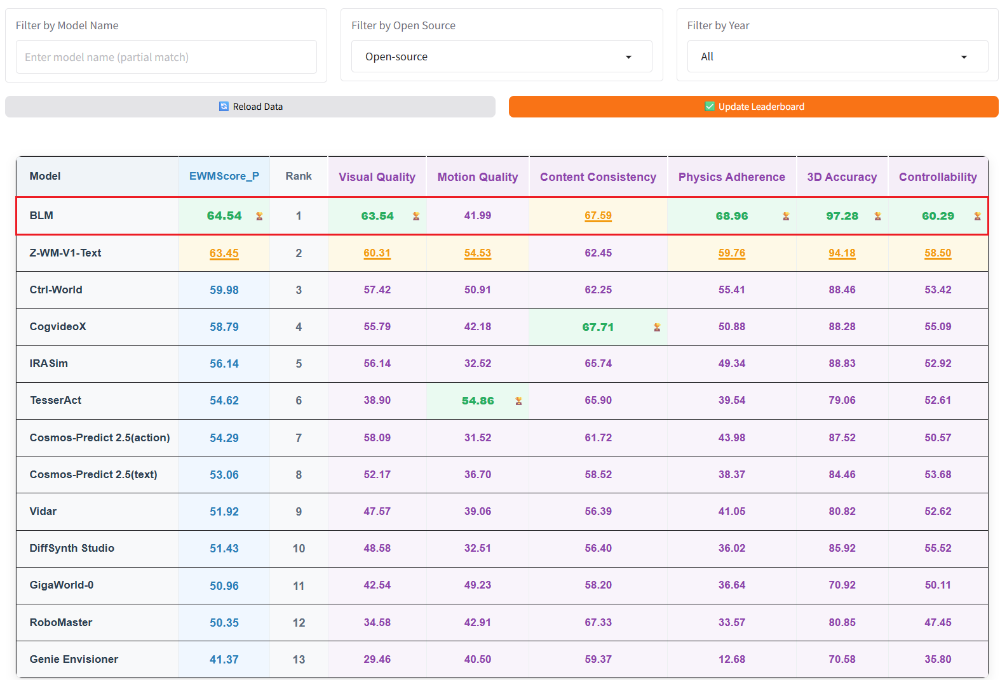
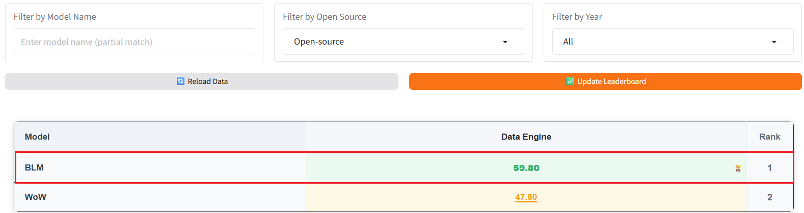
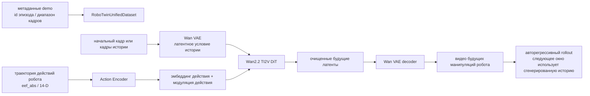
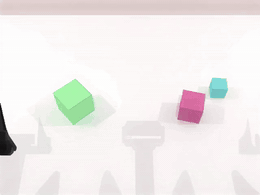
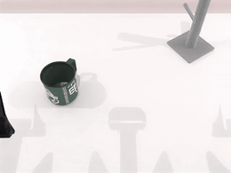
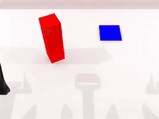
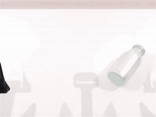
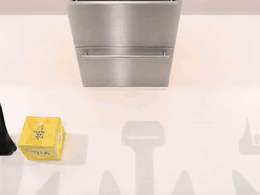

# BWM: модель мира с условием по действиям от команды Boundless (Университет Тунцзи)

Этот раздел посвящён **Boundless-World-Model**, или **BWM** — открытому проекту Boundless Large Model Lab Университета Тунцзи. Репозиторий проекта: [boundless-large-model/boundless-world-model](https://github.com/boundless-large-model/boundless-world-model), веса модели опубликованы на [BLM-Lab/Boundless-World-Model](https://huggingface.co/BLM-Lab/Boundless-World-Model).

Раздел уместно поставить в главу `17-world-models` после RAW-Dream, WoG, WALL-WM, RoboDream и Gamma-World. Причина в том, что BWM прямо определяет себя как **physically consistent, action-conditioned video world model** — физически согласованную видеомодель мира с условием по действиям. Её цель — дать для манипуляций роботов недорогой видеосимулятор мира с высокой достоверностью.

После этого раздела важно усвоить одну мысль:

> BWM — не сама VLA-политика и не обычная видеомодель, которая генерирует видео только по тексту. Это надстройка над Wan2.2-TI2V-5B: траектория действий робота подаётся в видеодиффузионную модель как условие, и модель, отталкиваясь от начального наблюдения и последовательности действий, авторегрессивно генерирует видео дальнейших манипуляций робота.

Назначение модели можно представить так:

```text
начальное изображение / кадры истории видео
        +
траектория действий робота
        ↓
видеомодель мира с условием по действиям
        ↓
rollout видео будущих манипуляций
        ↓
оценка того, разумны ли действия; генерация данных; помощь при обучении или отладке политики
```

Связь с VLA взаимодополняющая. VLA выдаёт действия, а BWM предсказывает, к каким последствиям в визуальном мире эти действия приведут. Сама модель не управляет роботом, но может стать движком данных, оценщиком политики или модулем воображаемого rollout.

## 1. Статус открытого кода и точки входа

| Проект | Текущий статус |
| :--- | :--- |
| GitHub | [boundless-large-model/boundless-world-model](https://github.com/boundless-large-model/boundless-world-model), Apache-2.0 |
| Hugging Face | [BLM-Lab/Boundless-World-Model](https://huggingface.co/BLM-Lab/Boundless-World-Model) |
| Базовая модель | [Wan2.2-TI2V-5B](https://github.com/Wan-Video/Wan2.2) |
| Фреймворк | [DiffSynth-Studio](https://github.com/modelscope/DiffSynth-Studio) |
| Таблица результатов | [WorldArena Hugging Face Space](https://huggingface.co/spaces/WorldArena/WorldArena) |
| Опубликовано | код инференса, описание модели, веса модели |
| Не опубликовано | код обучения; технический отчёт ещё пишется |

Сейчас лучше всего не заниматься воспроизведением обучения с нуля, а сделать следующее:

1. Разобраться в идее модели и понять, чем модель мира с условием по действиям отличается от обычной модели генерации видео.
2. Скачать базовую модель Wan2.2-TI2V-5B и checkpoint BWM.
3. Один раз запустить `scripts/infer_example.sh` на встроенных данных `demo/`.
4. Сравнить сгенерированное видео с ожидаемым и проверить, согласованы ли движения робота, состояние объектов и контакты.

## 2. Как читать результаты WorldArena

<p align="center">
  
</p>

**Рис. 1. WorldArena, Track 1, рейтинг открытых моделей.** BLM занимает первое место среди открытых моделей. Метрики охватывают визуальное качество, качество движения, согласованность содержания, соответствие физике, 3D-точность и управляемость.

Источник: [официальный репозиторий BWM на GitHub](https://github.com/boundless-large-model/boundless-world-model).

<p align="center">
  
</p>

**Рис. 2. WorldArena, Track 2, рейтинг открытых Data Engine.** В README указано, что BLM занимает первое место среди открытых моделей в Track 2 Data Engine.

Источник: [официальный репозиторий BWM на GitHub](https://github.com/boundless-large-model/boundless-world-model).

<p align="center">
  
</p>

**Рис. 3. WorldArena, Track 1, общий рейтинг.** В README указано, что BWM-fast занимает второе место в общем рейтинге Track 1. Это и есть источник формулировки «первое место среди открытых, второе среди закрытых».

Источник: [официальный репозиторий BWM на GitHub](https://github.com/boundless-large-model/boundless-world-model).

Эти рейтинги нужно разделять.

| Название | Смысл | Место BWM/BLM |
| :--- | :--- | :--- |
| Track 1, открытые модели | сравнение только открытых моделей world model с условием по действиям | BLM — первое место |
| Track 2, открытые Data Engine | сравнение только открытых решений, связанных с движками данных | BLM — первое место |
| Track 1, общий рейтинг | открытые и закрытые модели сравниваются вместе | BWM-fast — второе место |

Метрики WorldArena не сводятся к тому, «насколько похоже на видео». По названиям столбцов видно, что оцениваются Visual Quality, Motion Quality, Content Consistency, Physics Adherence, 3D Accuracy и Controllability. Для моделей мира особенно важны три последних: модель должна сохранять идентичность объектов, пространственную структуру, соответствие условию по действиям и физические ограничения. Иначе даже красивое видео нельзя использовать в робототехнике.

## 3. Место BWM среди моделей мира

Ранее в этой главе уже были разобраны несколько моделей мира. BWM можно поместить в такую систему координат:

| Метод | Условия на входе | Выход | Основное применение |
| :--- | :--- | :--- | :--- |
| RAW-Dream | текущее изображение, задача, действие, reward модели мира | воображаемый rollout и обновление RL | усиление VLA внутри модели мира, не зависящей от задачи |
| WoG | латентное условие, дистиллированное из будущих наблюдений | признаки условия, связанные с действием | улучшение предсказания действий VLA |
| WALL-WM | текущее наблюдение, условие действия на уровне событий | будущее видео и действия на уровне событий | предсказание на длинном горизонте |
| RoboDream | траектории только робота, априорные данные о сцене и объектах | синтетические видео демонстраций робота | генерация данных |
| Gamma-World | многоагентные многоракурсные наблюдения и действия | общий видеопоток мира | моделирование мира для нескольких агентов |
| **BWM** | начальный / исторический кадр + траектория действий робота | будущий видео rollout с условием по действиям | симуляция манипуляций, движок данных, оценка |

BWM ближе всего к WALL-WM: обе — видеомодели мира с условием по действиям. Однако открытая часть BWM сейчас ориентирована на инженерный вход для инференса: есть код инференса на основе Wan2.2-TI2V-5B, checkpoint, демонстрационные данные и результаты WorldArena. WALL-WM больше сосредоточен на разборе метода моделирования событийного мира и действий. Поэтому эти две модели удобно сравнивать вместе.

## 4. Общая архитектура: как видеомодель Wan2.2 получает действия

Ключевая информация из карточки модели на Hugging Face:

| Свойство | Публичные сведения о BWM |
| :--- | :--- |
| Базовая модель | Wan2.2-TI2V-5B |
| Разрешение | 480 x 640 |
| Кадры | 81 кадр |
| Управляющие сигналы | траектории действий робота |
| Архитектура | обучаемый DiT + Action Encoder |

В конфигурации инференса репозитория используется `configs/infer/infer.yaml`. Публичные параметры: `height=672`, `width=896`, `num_frames=57`, `num_history_frames=9`, `fps=24`, `action_dim=14`, `action_type=eef_abs`, `action_mode=adaln`. Это значит, что сводка из карточки модели и демонстрационная конфигурация репозитория не полностью совпадают: карточка описывает возможности модели, а репозиторий — конкретный профиль примера инференса.

Открытую архитектуру BWM можно представить такой цепочкой:



Здесь важны несколько моментов.

Во-первых, BWM не управляется текстом. В конфигурации инференса стоит `text_mode: none`, а текстовый путь Wan2.2 TI2V в коде отключён. Модель опирается на историю видеокадров и траекторию действий.

Во-вторых, действие — не постобработанная метка, а вход в процесс генерации DiT. В открытом коде `WanVideoActionEncoder` кодирует последовательность действий в `action_emb` и `action_mod_emb`. При `action_mode=adaln` модуляция действием добавляется к эмбеддингу временной модуляции, а эмбеддинг действия попадает в контекстную последовательность. Иными словами, на каждом шаге шумоподавления модель «знает», что робот собирается делать дальше.

В-третьих, BWM использует историю кадров для авторегрессивной генерации. `scripts/infer.py` сначала сохраняет историю из входного видео, затем генерирует будущие кадры окнами. При генерации следующего сегмента уже созданные кадры становятся новым условием истории. Благодаря этому модель может делать rollout на длинном горизонте, а не только короткий фрагмент фиксированной длины.

## 5. Авторегрессивный rollout: почему это похоже на симулятор

В README репозитория BWM описан как низкозатратный высокодостоверный симулятор манипуляций роботов. Однако под симулятором здесь не стоит понимать физический движок вроде MuJoCo или Isaac Sim. Скорее это нейронный видеосимулятор:

| Традиционный физический симулятор | Видеомодель мира, как BWM |
| :--- | :--- |
| вход: URDF/MJCF, физические параметры, управляющие сигналы | вход: начальное визуальное наблюдение, кадры истории, траектория действий |
| явно моделирует твёрдые тела, суставы, столкновения, контакты | выучивает визуальные и физические последствия из данных |
| выход: состояние, изображения, механические величины | выход: в основном видео будущего |
| интерпретируем и управляем, но дорог в построении модели | реалистичен и дёшев в построении, но физическую надёжность нужно проверять оценкой |

Логика авторегрессии в BWM задаётся `scripts/infer.py`:

1. Из метаданных demo читается один эпизод.
2. Читаются начальные видеокадры и траектория действий.
3. В качестве условия истории берутся `num_history_frames` кадров.
4. По последовательности действий генерируются будущие кадры текущего окна.
5. Новые кадры добавляются в историю.
6. Процесс повторяется, пока не будет покрыта длина целевого эпизода.
7. Результат записывается в `outputs/inference/episode*.mp4`.

Именно поэтому модель похожа на симулятор: при заданной последовательности действий она разворачивает визуальные последствия этих действий. Но у неё есть и границы. Выход в основном видео, а не полное запрашиваемое физическое состояние. На длинном горизонте ошибки могут накапливаться. Использовать модель для замкнутого обучения политики можно только при согласованном пространстве действий, интерфейсе наблюдений, оценке ошибок и построении reward.

## 6. Качественные результаты: что модель действительно предсказывает

Ниже показаны GIF из официального README. Все они получены так: BWM авторегрессивно генерирует видео манипуляций по начальному кадру и последовательности действий на тестовом наборе WorldArena.

<table>
  <tr>
    <td width="50%" align="center">
      
      <br><strong>Рис. 4a. Упорядочивание кубиков по размеру</strong>
    </td>
    <td width="50%" align="center">
      
      <br><strong>Рис. 4b. Открывание микроволновки</strong>
    </td>
  </tr>
  <tr>
    <td width="50%" align="center">
      
      <br><strong>Рис. 4c. Вешание кружки</strong>
    </td>
    <td width="50%" align="center">
      
      <br><strong>Рис. 4d. Передача кубика двумя руками</strong>
    </td>
  </tr>
</table>

Источник: [официальный репозиторий BWM на GitHub](https://github.com/boundless-large-model/boundless-world-model).

Эти примеры проверяют разные трудности.

Упорядочивание кубиков по размеру проверяет сохранение идентичности нескольких объектов, пространственный порядок и устойчивость контакта. Если модель мира лишь создаёт видео, где «робот как будто двигается», легко получить сбой: кубики меняют идентичность, соотношение размеров нарушается, или объект дрожит после установки.

Открывание микроволновки проверяет сочленённый объект. Дверца не свободно плавает, а вращается вокруг шарнира; состояние меняется с закрытого на открытое и должно удерживаться в последующих кадрах.

Вешание кружки проверяет тонкий аффорданс. Модель должна «понимать» связь между ручкой кружки, крючком, положением захвата в точке контакта и итоговым состоянием подвешивания.

Передача кубика двумя руками проверяет совместную работу двух манипуляторов и окклюзию. Когда две руки приближаются к одному объекту, модель должна сохранять его непрерывность и не допускать исчезновения или скачков объекта при кратковременной окклюзии.

<p align="center">
  
</p>

**Рис. 5. Размещение с ограничениями на длинном горизонте.** Помещение предмета в шкаф требует транспортировки, обработки окклюзии и итогового пространственного ограничения. Это сложнее одного шага захвата и лучше проверяет согласованность на длинном горизонте.

Источник: [официальный репозиторий BWM на GitHub](https://github.com/boundless-large-model/boundless-world-model).

В таких примерах важна не отдельная картинка и не отдельный кадр, а то, сохраняются ли физическое состояние и состояние задачи во времени. Хорошая модель мира как минимум должна: не менять объекты без причины; обеспечивать правдоподобный контакт захвата с предметом; менять направление изменений в зависимости от действия; сохранять результат выполненной задачи.

## 7. Обобщение на OOD: сохраняется ли прогноз при смене начальной сцены

<table>
  <tr>
    <td width="50%" align="center">
      
      <br><strong>Рис. 6a. Пример OOD-начальной сцены 1</strong>
    </td>
    <td width="50%" align="center">
      
      <br><strong>Рис. 6b. Пример OOD-начальной сцены 2</strong>
    </td>
  </tr>
</table>

Источник: [официальный репозиторий BWM на GitHub](https://github.com/boundless-large-model/boundless-world-model).

В официальном README также показано OOD-обобщение: новые начальные сцены строятся с помощью GPT-Image-2, после чего используется исходная последовательность действий робота, и BWM делает авторегрессивный rollout. Этот тест отвечает на вопрос: модель лишь запомнила начальные кадры бенчмарка или может продолжать предсказывать динамику по условию действий, когда меняются внешний вид объектов, их расположение или фон.

Здесь важно не делать поспешных выводов. OOD-GIF показывают, что модель обладает некоторой способностью переноса внешнего вида. Но это не означает, что замкнутое обобщение в реальных условиях решено. Причин три:

- последовательность действий по-прежнему взята из исходного бенчмарка, а не спланирована самой моделью;
- начальное изображение построено генеративной моделью изображений и отличается от реального шума датчиков, калибровки камеры и ошибок управления роботом;
- успешный видео-rollout не равен успешному выполнению политики, если результат не подключён к reward, обновлению политики или онлайн-оценке в замкнутом цикле.

## 8. Как запустить официальный демонстрационный инференс

Этот раздел описывает только smoke-тест инференса, а не воспроизведение обучения: в официальном README раздел training пока помечен как `Coming soon`.

Рекомендуется машина с Linux и CUDA. В README указаны Python 3.10.20, PyTorch 2.8.0 cu128 и DiffSynth 2.0.11. Зависимости репозитория также включают `numpy==1.26.4`, `omegaconf==2.3.0`, `imageio`, `imageio-ffmpeg`, `pyarrow`, `Pillow`, `einops`, `tqdm` и `safetensors`.

Из корня проекта выполните:

```bash
git clone https://github.com/boundless-large-model/boundless-world-model.git
cd boundless-world-model

conda create -n BWM python=3.10.20
conda activate BWM

pip install torch==2.8.0 torchvision==0.23.0 torchaudio==2.8.0 \
  --index-url https://download.pytorch.org/whl/cu128
pip install diffsynth==2.0.11
pip install -r requirements.txt
```

Скачайте базовую модель Wan2.2-TI2V-5B:

```bash
modelscope download --model Wan-AI/Wan2.2-TI2V-5B \
  --local_dir models/Wan2.2-TI2V-5B
```

Скачайте checkpoint BWM:

```bash
hf download BLM-Lab/Boundless-World-Model step-12000.safetensors \
  --local-dir ckpt/BLM
```

Скопируйте пример локальной конфигурации путей:

```bash
cp scripts/local.example.sh scripts/local.sh
```

Затем отредактируйте `scripts/local.sh`, указав пути вашей машины. Ключевые переменные официального примера:

```bash
export CUDA_VISIBLE_DEVICES="0"

CONFIG_PATH="configs/infer/infer.yaml"
PYTHON_BIN="python"
MODEL_PATHS="/path/to/Wan-AI/Wan2.2-TI2V-5B"
CKPT_PATH="ckpt/BLM/step-12000.safetensors"
DATASET_BASE_PATH="demo"
DATASET_METADATA_PATH="demo/demo.jsonl"
ACTION_STAT_PATH="demo/stat.json"
OUTPUT_PATH="outputs/inference"
MAX_SAMPLES="1"
```

Запустите инференс:

```bash
bash scripts/infer_example.sh
```

При успешном запуске скрипт выведет разрешённую конфигурацию, информацию о примере и ход rollout по окнам, а в `outputs/inference/` появится файл `episode*.mp4`. Этот smoke-тест подтверждает четыре вещи: базовая модель Wan2.2 загружается, checkpoint BWM загружается, видео и траектории действий из demo читаются, а цепочка авторегрессивной генерации с условием по действиям работает.

Он не подтверждает три другие вещи: что код обучения работает, что можно воспроизвести результаты WorldArena, и что ваши собственные данные робота дадут такой же эффект без доработки.

## 9. Как понимать параметры конфигурации

В `configs/infer/infer.yaml` стоит отдельно рассмотреть несколько параметров.

| Параметр | Пример значения | Смысл |
| :--- | :--- | :--- |
| `num_frames` | `57` | число кадров, обрабатываемых в одном окне генерации |
| `num_history_frames` | `9` | число исторических кадров, поступающих на вход как условие |
| `time_division_factor` | `4` | выравнивание по временным группам латентов Wan |
| `action_type` | `eef_abs` | абсолютные позы типа конечного эффектора |
| `action_dim` | `14` | размерность действия; обычно соответствует двум рукам или многостепенному состоянию конечного эффектора |
| `action_mode` | `adaln` | действие вводится в DiT через AdaLN / модуляцию по времени |
| `cfg_scale` | `1.0` | сила classifier-free guidance при инференсе |
| `num_inference_steps` | `50` | число шагов диффузионного шумоподавления |
| `fps` | `24` | частота кадров выходного видео |

Если подключать собственные данные, сначала нужно согласовать интерфейс данных, а не менять модель. Видеокадры, последовательности действий, метаданные эпизодов и статистика нормализации действий должны совпадать. Иначе модель может работать, но выдавать неверную динамику из-за ошибок масштаба действий или временного выравнивания.

## 10. Связь с воспроизведением VLA

BWM сама по себе не является политикой, но для VLA у неё есть три возможных применения.

Первое — **офлайн-оценка последовательностей действий**. Для траектории, выданной VLA, BWM может сгенерировать визуальные последствия и помочь понять, приведёт ли действие к перемещению объекта, открыванию дверцы, подвешиванию кружки или провалу задачи.

Второе — **генерация данных**. Если модель мира достаточно надёжна, её можно использовать для расширения видеоданных с разными начальными состояниями, внешним видом объектов и вариантами действий, что даст дополнительный контроль для обучения политики.

Третье — **воображаемый rollout и RL**. По аналогии с RAW-Dream в будущем можно подключить к BWM reward-модель или VLM-судью, оценивать качество действий в видео, сгенерированном моделью, и на этой основе улучшать политику.

Все эти применения опираются на одно условие: модель мира должна быть чувствительна к действиям, а физическая ошибка должна быть достаточно мала. Если модель лишь создаёт правдоподобное видео, но не соблюдает условие по действиям строго, она будет вводить политику в заблуждение при обучении.

## 11. Текущие границы

BWM сейчас стоит отслеживать, но использовать её нужно с учётом ограничений.

Первое: технический отчёт ещё не опубликован. Многие детали обучения, состав данных, стратегия отправки на WorldArena и результаты абляций пока нельзя систематически проверить по статье.

Второе: код обучения ещё не опубликован. Текущий учебный материал позволяет запускать инференс и разбирать структуру модели, но не обещает воспроизведения процесса обучения.

Третье: результаты WorldArena взяты из официального README и скриншотов таблиц. Они показывают высокую эффективность модели по протоколу этой таблицы, но не гарантируют надёжности для любых роботов, любых камер и любых пространств действий.

Четвёртое: выход BWM в основном видео. В отличие от MuJoCo или Isaac Sim, модель не даёт объяснимого физического состояния, сил контакта, состояний суставов или ограничений столкновений. Для использования в замкнутом управлении потребуется дополнительно строить извлечение состояния, reward, оценку неопределённости и обнаружение сбоев.

## 12. Что в этом разделе стоит изучить

Главное, чему стоит научиться у BWM, — инженерный путь превращения универсальной видеомодели в модель мира для роботов:

| Решение | Ценность |
| :--- | :--- |
| выбор Wan2.2-TI2V-5B | опора на сильные априорные знания видеогенерации вместо обучения видеодиффузии с нуля |
| введение Action Encoder | траектория действий робота входит в процесс генерации, модель не просто «дописывает видео» |
| модуляция AdaLN по действию | действие влияет на временную динамику в процессе шумоподавления |
| условие по историческим кадрам | сохраняются начальная сцена, идентичность объектов и локальная визуальная согласованность |
| авторегрессивный rollout по окнам | поддерживается предсказание видео на длинном горизонте |
| многометрическая оценка WorldArena | оценивается не только качество картинки, но и управляемость, соответствие физике и 3D-точность |

Для студентов курса этот раздел хорош как вход в инженерную реализацию воплощённых моделей мира. У него есть результаты на таблице лидеров, код и веса, но при этом многие детали не опубликованы, и это напоминает: демонстрационное видео модели мира не стоит принимать за готовый симулятор.

## 13. Ссылки

- [Boundless-World-Model на GitHub](https://github.com/boundless-large-model/boundless-world-model)
- [BLM-Lab/Boundless-World-Model на Hugging Face](https://huggingface.co/BLM-Lab/Boundless-World-Model)
- [WorldArena на Hugging Face Space](https://huggingface.co/spaces/WorldArena/WorldArena)
- [Wan2.2 на GitHub](https://github.com/Wan-Video/Wan2.2)
- [DiffSynth-Studio на GitHub](https://github.com/modelscope/DiffSynth-Studio)
- [WorldArena на GitHub](https://github.com/tsinghua-fib-lab/WorldArena/)
- [ABot-PhysWorld на GitHub](https://github.com/amap-cvlab/ABot-PhysWorld)
