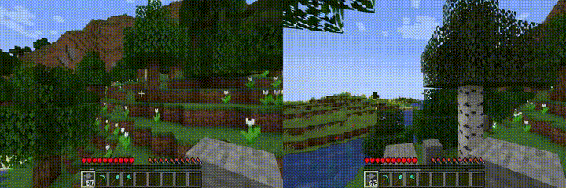
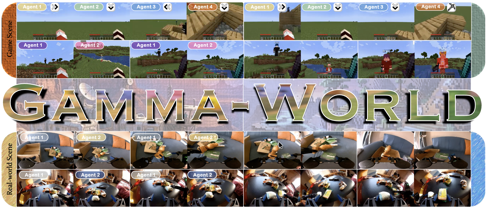
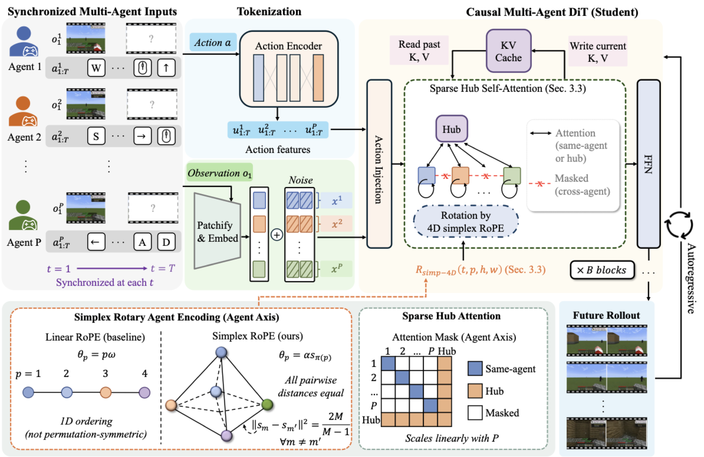
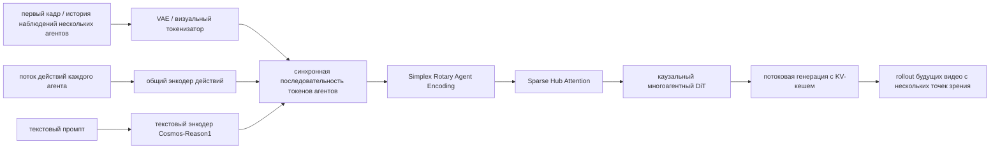
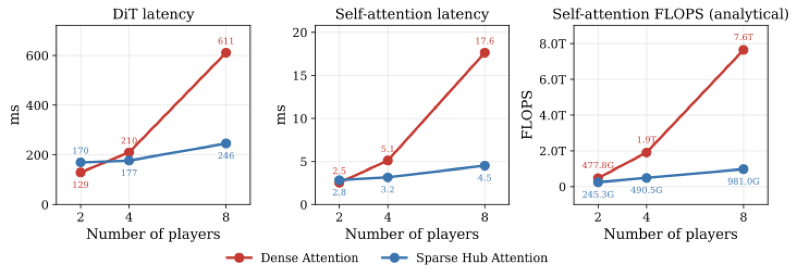
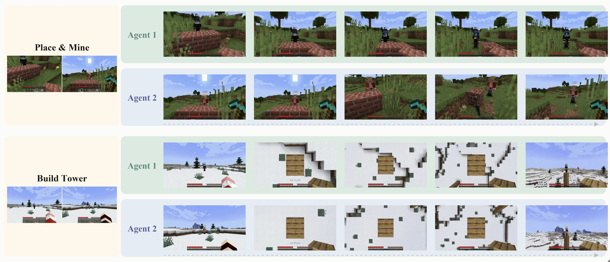
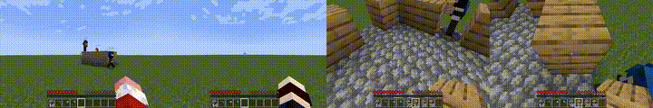
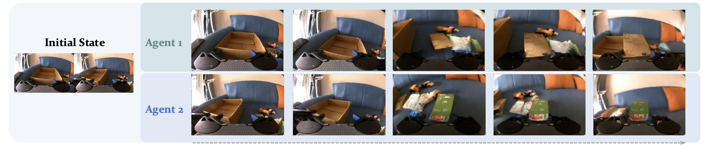

# Gamma-World: от модели мира для одного агента к общему миру нескольких агентов

Этот раздел разбирает статью **Gamma-World: Generative Multi-Agent World Modeling Beyond Two Players**, проект также называется **γ-World**. Работа выполнена командой NVIDIA, Университета Цинхуа, Университета Торонто и Vector Institute. Версия на arXiv опубликована 27.05.2026, страница проекта появилась 28.05.2026, код и пайплайн обучения открыты 16.06.2026.

Раздел уместно поставить в главу `17-world-models` после LeWM, RISE, RAW-Dream, WoG, WALL-WM и RoboDream. Это не основа VLA и не просто модель генерации видео, а **генеративная модель мира для нескольких агентов** для интерактивной симуляции: по синхронным наблюдениям и действиям нескольких агентов она генерирует будущее видео с разных точек зрения в одном общем мире.

После этой главы важно усвоить следующее:

> Ключевая идея γ-World — не в том, чтобы просто запустить несколько однопользовательских моделей мира параллельно. Она явно добавляет ось агентов в структуру модели, чтобы несколько независимо управляемых агентов в одном генерируемом мире оставались причинно связанными, согласованными по точке зрения и отзывчивыми в реальном времени.

## 1. Проект, статья, код и вход в модель

| Проект | Информация |
| :--- | :--- |
| Страница проекта | [NVIDIA Research: γ-World](https://research.nvidia.com/labs/sil/projects/gamma-world/) |
| Статья | [arXiv:2605.28816](https://arxiv.org/abs/2605.28816) |
| Hugging Face Paper | [Gamma-World: Generative Multi-Agent World Modeling Beyond Two Players](https://huggingface.co/papers/2605.28816); 28.05.2026 — `#1 Paper of the day` |
| Репозиторий кода | [nv-tlabs/Gamma-World](https://github.com/nv-tlabs/Gamma-World), Apache-2.0 |
| Веса модели | [chijw/Gamma-World](https://huggingface.co/chijw/Gamma-World) |
| Основа | [nvidia/Cosmos-Predict2.5-2B](https://huggingface.co/nvidia/Cosmos-Predict2.5-2B) / семейство Cosmos-Predict2.5 |
| Текстовый энкодер | [nvidia/Cosmos-Reason1-7B](https://huggingface.co/nvidia/Cosmos-Reason1-7B), требуется принять NVIDIA Open Model License |
| Официальная документация | [Setup](https://github.com/nv-tlabs/Gamma-World/blob/main/docs/setup.md), [Inference](https://github.com/nv-tlabs/Gamma-World/blob/main/docs/inference.md), [Training](https://github.com/nv-tlabs/Gamma-World/blob/main/docs/training.md) |

Звание «первое место за день» на Hugging Face говорит о высоком интересе сообщества, но это не рейтинг по успешности роботов. Оценивая техническую ценность, нужно вернуться к трём вопросам статьи: как представить идентичность нескольких агентов, как агенты обмениваются информацией и как добиться потокового rollout в реальном времени.

## 2. Предварительный показ результатов: несколько агентов живут в одном сгенерированном мире

<p align="center">
  
</p>

**Рис. 1. Вводное видео из официального материала, преобразованное в GIF.** γ-World начинает с начальных точек зрения и потоков действий нескольких агентов и генерирует несколько будущих видео одной общей среды. Агенты управляются независимо, но видят один и тот же мир, который меняется вместе с действиями всех.

Источник: [страница проекта γ-World от NVIDIA](https://research.nvidia.com/labs/sil/projects/gamma-world/).

В этой анимации важна не качество картинки, а **согласованность общего мира**. Если агент A идёт вперёд, а агент B поворачивает голову, изменения окружения в двух видах должны быть совместимы друг с другом. Если один агент меняет состояние сцены, то вид другого агента не должен оставаться таким, будто он находится в параллельной вселенной. Однопользовательская модель мира обычно предсказывает будущее одного потока управления, а γ-World должна одновременно обрабатывать несколько потоков действий и несколько видов.

## 3. Почему многоагентная модель мира — не простое объединение

Многие интерактивные модели мира можно понимать как «один игрок управляет одним миром»:

```text
первый кадр + промпт + один поток действий -> будущее видео
```

Многоагентная задача превращается в такую постановку:

```text
общий начальный мир
  + наблюдение/действие agent_1
  + наблюдение/действие agent_2
  + ...
  + наблюдение/действие agent_N
  -> синхронные будущие видео для всех агентов
```

Если просто склеить несколько видов пространственно или назначить каждому игроку фиксированный slot-эмбеддинг, возникают три проблемы.

| Проблема | Конкретное проявление | Последствие |
| :--- | :--- | :--- |
| Независимая управляемость | у каждого агента свой поток действий, и модель не должна смешивать все действия в один глобальный управляющий сигнал | действие A может ошибочно влиять на локальное движение B, либо действие B будет проигнорировано |
| Перестановочная симметрия | номер агента не должен нести смысл «игрок 1 всегда особенный, игрок 2 всегда второстепенный» | после обучения на двух игроках трудно естественно расширить модель до четырёх |
| Стоимость коммуникации | если все токены агентов используют плотное all-to-all внимание, сложность растёт квадратично с числом агентов | для сцен с четырьмя и восемью игроками задержка и требования к памяти быстро ухудшаются |

Дизайн γ-World строится вокруг этих трёх пунктов: **Simplex Rotary Agent Encoding** представляет идентичность, **Sparse Hub Attention** отвечает за коммуникацию между агентами, а **block-causal student + KV cache + few-step distillation** обеспечивает потоковую генерацию в реальном времени.

## 4. Общая схема: общий мир, несколько видов, отклик на действия

<p align="center">
  
</p>

**Рис. 2. Teaser γ-World.** На рисунке одновременно показаны сцены с двумя и четырьмя агентами, а также двусторонняя координация реального робота. Модель генерирует синхронное будущее нескольких агентов в одной среде, а не несколько не связанных видеофрагментов.

Источник: [страница проекта γ-World от NVIDIA](https://research.nvidia.com/labs/sil/projects/gamma-world/).

Этот рисунок удобно читать в три уровня.

Первый уровень — **игровая сцена**. Многопользовательская среда в стиле Minecraft даёт дискретные действия клавиатуры и непрерывные действия камеры. Она хорошо подходит для проверки «совместная сцена + отклик на действия + согласованность видов».

Второй уровень — **масштабирование по числу агентов**. В статье показано, как обучение на двух агентах переносится на вывод для четырёх, без необходимости переобучать модель с фиксированными слотами для сцены с четырьмя игроками.

Третий уровень — **координация роботов**. В экспериментах с реальными роботами левую и правую механические руки рассматривают как двух агентов, у каждого есть своё непрерывное действие концевого эффектора. Этот эксперимент показывает, что многоагентный интерфейс γ-World применим не только к игровому управлению, но и к координации двух рук робота.

## 5. Схема метода: явная ось агентов и каузальный многоагентный DiT

<p align="center">
  
</p>

**Рис. 3. Схема метода γ-World.** Модель получает синхронные наблюдения и действия нескольких агентов, токенизирует видео- и action-потоки каждого агента, а затем через Simplex Rotary Agent Encoding и Sparse Hub Attention генерирует будущий многоракурсный rollout.

Источник: [страница проекта γ-World от NVIDIA](https://research.nvidia.com/labs/sil/projects/gamma-world/).

Если разобрать эту схему по частям, получается основной путь γ-World:



Ключевой момент: `agent` моделируется как **явная ось**, а не как результат грубого склеивания всех изображений. В приложении к статье описаны детали реализации: для игрового ввода на каждого агента и каждый кадр приходится 25 измерений действий — 23 дискретных управления клавиатурой и 2 непрерывных управления камерой; для робота на каждую механическую руку и кадр приходится 10 непрерывных измерений — трёхмерная позиция концевого эффектора, 6D-поза и раскрытие захвата.

## 6. Simplex Rotary Agent Encoding: почему не обычная нумерация игроков

Многоагентной модели нужно знать, «какому агенту принадлежит этот токен», но эта идентичность не должна быть жёстко зашита как обычный слот. Например, если при обучении было только два игрока и модель выучила «слот 0 — всегда левый игрок, слот 1 — всегда правый», то при выводе с третьим и четвёртым игроками она будет вести себя неуклюже.

γ-World использует **Simplex Rotary Agent Encoding**. Интуитивно:

- агенту не назначается обучаемый эмбеддинг;
- агентам не присваиваются целочисленные номера 0, 1, 2, 3;
- каждый агент помещается в вершину правильного симплекса в пространстве ротационных углов.

Преимущество правильного симплекса в том, что все вершины равноудалены друг от друга. Иначе говоря, у каждого агента своя фаза, но ни для одной пары агентов нет смещения «кто важнее». Это соответствует понятию permutation-equivalent из статьи: перестановка порядка агентов не должна менять смысл модели из-за номеров слотов.

Можно представить так:

```text
обычный slot-эмбеддинг:
agent_0 имеет фиксированную ролевую поправку
agent_1 имеет фиксированную ролевую поправку
agent_2 при обучении могла не встречаться

Simplex RoPE:
агенты A/B/C/D получают разные вращательные фазы
геометрическая связь любых двух агентов эквивалентна
модель легче обобщается с 2 агентов на 4
```

В реализации статьи есть полезный приём обучения: используется пул симплекса размером 4, но в обучении активны только 2 слота выполнения; на каждом шаге случайно выбираются 2 вершины и перемешивается порядок слотов агентов. Это заставляет модель не запоминать слоты, а различать игроков по симплексному маркеру. Этот приём — одна из основ утверждения «обучение на двух игроках — вывод для четырёх».

## 7. Sparse Hub Attention: многоагентная коммуникация не должна быть полностью попарной

<p align="center">
  
</p>

**Рис. 4. Сравнение эффективности Sparse Hub Attention.** Вычисления для плотного межагентного внимания быстро растут с числом агентов. Sparse Hub Attention использует небольшое число токенов-хабов как общий канал коммуникации и снижает стоимость межагентного обмена с квадратичной до линейной.

Источник: [страница проекта γ-World от NVIDIA](https://research.nvidia.com/labs/sil/projects/gamma-world/).

Если есть N агентов, самый прямой способ — плотное all-to-all внимание между всеми токенами агентов. Такая схема выразительна, но её сложность равна `O(N^2)`, и чем больше агентов, тем труднее работать в реальном времени.

Sparse Hub Attention напоминает «общую доску объявлений» для многоагентной системы:

```text
токены agent_1 -> токены-хабы <- токены agent_2
токены agent_3 -> токены-хабы <- токены agent_4
```

Каждый агент в основном смотрит на свои токены и на токены-хабы; хабы собирают межагентную информацию и рассылают её обратно агентам. Так агентам не нужно плотно внимать друг другу попарно, а общее состояние мира всё равно передаётся через хабы.

По умолчанию в статье используется `K = 8` токенов-хабов. Абляция в приложении показывает, что при увеличении K с 1 до 8 качество заметно растёт, а при 32 и 128 улучшение есть, но вычисления увеличиваются. Поэтому K=8 — инженерный компромисс: этого достаточно для межагентного взаимодействия, но канал коммуникации не становится слишком тяжёлым.

## 8. Учитель, каузальный ученик и дистилляция за несколько шагов

γ-World нужна интерактивность в реальном времени, а не только высокое качество офлайн-видео. В статье обучение разбито на три этапа:

```text
двунаправленный учитель -> каузальный ученик -> DMD / ученик на нескольких шагах
```

| Этап | Назначение | Особенности |
| :--- | :--- | :--- |
| Двунаправленный учитель | изучает высококачественное распределение будущего для многих агентов | видит полный контекст, даёт высокое качество, но не работает в потоковом режиме в реальном времени |
| Каузальный ученик | изучает блочную авторегрессивную генерацию | смотрит только на прошлые блоки, поддерживает KV-кеш, но качество ниже |
| DMD / ученик на нескольких шагах | сжимает каузального ученика до выборки за малое число шагов | 4 шага шумоподавления, рассчитано на интерактивный отклик 24 FPS |

Эти три этапа соответствуют типичному инженерному компромиссу: высококачественный диффузионный учитель обычно медленный, а каузальный потоковый ученик интерактивен, но качество у него хуже. Цель дистилляции — сохранить по возможности качество учителя и одновременно способность ученика работать в онлайн-режиме.

В официальной документации по выводу есть три режима:

| `--mode` | Значение | Выборка |
| :--- | :--- | :--- |
| `bidirectional` | учитель с полным контекстом | около 35 шагов, single-shot |
| `causal` | блочный каузальный ученик | около 35 шагов, KV-кеш |
| `causal_few_step` | дистиллированный потоковый ученик | 4 шага `[1000, 750, 500, 250]`, KV-кеш |

Поэтому при курсовом воспроизведении стоит сначала запускать `causal_few_step`. Это не режим максимального офлайн-качества, но он лучше всего отражает главное преимущество γ-World: реакция на действия, потоковость и близость к реальному времени.

## 9. Взаимодействие двух игроков, обобщение на четырёх и координация роботов

<p align="center">
  
</p>

**Рис. 5. Результаты взаимодействия двух агентов.** Два агента могут вводить действия независимо, но результат всё равно сохраняет пространственно-временную согласованность в одном мире.

Источник: [страница проекта γ-World от NVIDIA](https://research.nvidia.com/labs/sil/projects/gamma-world/).

<p align="center">
  
</p>

**Рис. 6. Анимация обобщения на четырёх агентов, преобразованная в GIF.** Официальный результат показывает нулевое расширение от обучения на двух агентах к выводу для четырёх.

Источник: [страница проекта γ-World от NVIDIA](https://research.nvidia.com/labs/sil/projects/gamma-world/).

<p align="center">
  
</p>

**Рис. 7. Координация двух рук реального робота.** В статье использованы данные RealOmin-Open; левая и правая механические руки рассматриваются как два взаимно влияющих агента, а формат действий — непрерывные позы концевого эффектора и раскрытие захвата.

Источник: [страница проекта γ-World от NVIDIA](https://research.nvidia.com/labs/sil/projects/gamma-world/).

К части про роботов нужно относиться спокойно. Она показывает, что тот же интерфейс многоагентной модели мира можно подключить к данным двурукого реального робота, но это ещё не замкнутый контроллер робота и не замена физических симуляторов вроде Isaac Sim или MuJoCo. Модель генерирует видео rollout, условное по действиям, которое помогает понять будущие наблюдения нескольких агентов, а не выдаёт силовые траектории для реального робота.

## 10. Как читать экспериментальные результаты

В статье γ-World сравнивается с Solaris и базовым методом frame concat. Ниже приведены только ключевые результаты FVD/FID; чем меньше значение, тем лучше.

| Метод | Memory FVD / FID | Grounding FVD / FID | Movement FVD / FID | Building FVD / FID | Consistency FVD / FID |
| :--- | :--- | :--- | :--- | :--- | :--- |
| Frame concat | 450.6 / 69.8 | 528.3 / 63.2 | 556.9 / 65.0 | 551.8 / 87.3 | 576.0 / 123.2 |
| Solaris | 333.8 / 51.7 | 301.9 / 36.1 | 311.1 / 36.3 | 448.6 / 71.0 | 443.1 / 94.8 |
| γ-World | 184.1 / 24.8 | 199.3 / 24.0 | 191.5 / 21.2 | 264.5 / 32.1 | 280.0 / 46.9 |

Таблица показывает, что преимущество γ-World не ограничивается одним показателем: модель заметно лучше базовых методов по памяти, привязке к языку и цели, перемещению, строительству и согласованности в многопользовательском взаимодействии. Особенно важен столбец Consistency: именно там обычно ломается общий мир нескольких агентов.

Полезны и результаты абляции архитектуры:

| Комбинация | Agent Encoding | Interaction | FVD | FID | LPIPS | PSNR | SSIM |
| :--- | :--- | :--- | :--- | :--- | :--- | :--- | :--- |
| Spatial concat | None | Full | 312.4 | 38.7 | 0.326 | 24.8 | 0.782 |
| Sequence concat | None | Full | 285.6 | 35.2 | 0.298 | 25.6 | 0.798 |
| Sequence concat | View embedding | Full | 256.3 | 32.4 | 0.281 | 26.4 | 0.815 |
| Sequence concat | Simplex | Full | 228.5 | 29.6 | 0.265 | 27.5 | 0.830 |
| γ-World full | Simplex | Sparse Hub | 223.4 | 30.2 | 0.269 | 27.7 | 0.836 |

Читать эту таблицу можно так. Сначала переход от spatial concat к sequence concat показывает, что более подходящая организация агентов и времени в последовательности токенов помогает. Затем замена view embedding на Simplex показывает пользу перестановочно-симметричного кодирования идентичности. Наконец, переход к Sparse Hub даёт дальнейшее улучшение FVD и SSIM и одновременно лучше масштабируется.

## 11. Как воспроизвести: самый реалистичный путь для изучения

Код и пайплайн обучения γ-World уже открыты, но полное обучение очень тяжёлое. В официальном приложении сказано, что и двунаправленный учитель, и каузальный ученик обучались на 32 GPU NVIDIA GB200. Обычному учащемуся не стоит сразу пытаться повторить полное обучение. Рекомендуется идти в таком порядке:

### 11.1 Подготовка окружения

Требования официального репозитория:

- Linux x86-64;
- GPU NVIDIA архитектуры Ampere или новее;
- драйвер NVIDIA `>=570.124.06`, совместимый с CUDA 12.8.1;
- glibc `>=2.35`, например Ubuntu 22.04 и новее;
- `git-lfs`, потому что в репозитории есть примеры и ассеты, управляемые LFS.

Лучше сначала использовать официальный Docker или окружение на `uv`, а не пытаться собирать всё в старом conda-окружении.

```bash
git clone https://github.com/nv-tlabs/Gamma-World.git
cd Gamma-World
git lfs pull

sudo apt update && sudo apt -y install curl ffmpeg libx11-dev tree wget
curl -LsSf https://astral.sh/uv/install.sh | sh
source "$HOME/.local/bin/env"
uv python install
uv sync --extra=cu128
source .venv/bin/activate
```

Если используется CUDA 13.0, например на DGX Spark или Jetson AGX, официальная документация требует заменить команду на:

```bash
uv sync --extra=cu130
```

### 11.2 Загрузка весов

Gamma-World использует три группы весов:

| Компонент | Репозиторий HuggingFace | Содержимое |
| :--- | :--- | :--- |
| Сети модели мира | `chijw/Gamma-World` | `model.safetensors` в папках `bidirectional/`, `causal/`, `causal-few-step/` |
| Токенизатор VAE | `chijw/Gamma-World` | `tokenizer.pth` |
| Текстовый энкодер | `nvidia/Cosmos-Reason1-7B` | энкодер текстовых промптов |

Сначала нужен токен HuggingFace, и на странице Cosmos-Reason1-7B нужно принять NVIDIA Open Model License.

```bash
uv tool install -U "huggingface_hub[cli]"
hf auth login
hf download chijw/Gamma-World --local-dir ./checkpoints/Gamma-World
hf download nvidia/Cosmos-Reason1-7B --local-dir ./checkpoints/Cosmos-Reason1-7B
```

Если соединение быстрое, можно использовать стандартные URI `hf://` из официальной конфигурации: скрипт сам скачает веса при первом запуске.

### 11.3 Минимальный smoke test вывода

В официальном репозитории есть демонстрационные данные в папке `data/`. Каждый каталог примера содержит:

- `first_frame.png`: первый кадр нескольких игроков, склеенный по горизонтали;
- `prompt.txt`: текстовый промпт;
- `action_left.json` / `action_right.json` или `action_0.json` … `action_N.json`: последовательности действий каждого агента.

Минимальная команда вывода:

```bash
torchrun --nproc_per_node=1 scripts/inference.py \
    --mode causal_few_step \
    --eval-dir data \
    --n-players 2 \
    --max-eval-samples 1 \
    --output results/examples
```

При успехе появится файл:

```text
results/examples/<sample>/generated.mp4
```

Этот smoke test подтверждает три вещи: окружение загружается, веса HuggingFace доступны, а цепочка вывода `causal_few_step` генерирует видео. Он не доказывает, что вы воспроизвели метрики статьи и что модель работает на реальных роботах.

### 11.4 Тест с четырьмя агентами

Для четырёх агентов не нужно переобучать модель, но входные образцы должны соответствовать четырём агентам:

- `first_frame.png` должен содержать четыре вида, склеенных по горизонтали;
- файлы действий должны быть `action_0.json`, `action_1.json`, `action_2.json`, `action_3.json`;
- при выводе указывается `--n-players 4`.

Пример команды:

```bash
torchrun --nproc_per_node=1 scripts/inference.py \
    --mode causal_few_step \
    --eval-dir /path/to/four_player_samples \
    --n-players 4 \
    --output results/four_player
```

Здесь трудность заключается не в изменении одного параметра, а в подготовке корректных входных данных для четырёх игроков. Если данных для учебного задания нет, сначала можно изучить официальную визуализацию для четырёх агентов и не пытаться воспроизвести демо с четырьмя игроками насильно.

### 11.5 Вход в обучение

Официальное обучение состоит из трёх этапов:

```text
инициализация Cosmos-Predict2.5-2B
  -> двунаправленный учитель
  -> каузальный ученик
  -> DMD / ученик causal_few_step
```

Перед обучением контрольную точку Cosmos-Predict2.5-2B нужно преобразовать в формат DCP:

```bash
PRETRAINED_CKPT=$(uvx "hf>=1.3.5" download nvidia/Cosmos-Predict2.5-2B \
    --repo-type model \
    --revision 15a82a2ec231bc318692aa0456a36537c806e7d4 \
    base/pre-trained/d20b7120-df3e-4911-919d-db6e08bad31c_ema_bf16.pt)

python scripts/convert_checkpoint_to_dcp.py \
    --input "$PRETRAINED_CKPT" \
    --output /path/to/converted_pretrained_dcp
```

В официальной документации по обучению приведён вход `torchrun` для 8 карт, но объём обучения в статье заметно превосходит ресурсы обычного учащегося. Для открытого учебного материала разумная практическая цель такая:

- сначала запустить вывод;
- затем разобрать формат данных с несколькими агентами в `gamma_world/_src/gamma_world/datasets/`;
- и в конце выполнить только mock-данные или небольшое smoke-обучение, чтобы проверить связку trainer и конфигурации.

## 12. Связь с другими моделями мира в этом репозитории

| Учебный материал | Тип | Отличие от γ-World |
| :--- | :--- | :--- |
| LeWM | введение и воспроизведение модели мира для воплощённого ИИ | больше ориентирован на введение в моделирование мира одного агента для роботов |
| RISE | модель мира + самоулучшающаяся политика | ключевое — улучшение политики через воображаемый rollout |
| RAW-Dream | усиление VLA внутри модели мира, не зависящей от задачи | пост-обучение VLA с видеомоделью мира и VLM-наградой |
| WoG | модель мира в условном пространстве | сжимает будущие наблюдения в латентное условие, связанное с действием |
| WALL-WM | модель мира на уровне событий | предварительно прогоняет действия и видео по границам событий |
| RoboDream | синтез данных в композиционной модели мира | синтезирует демонстрации по траекториям только робота и априорным данным о сцене и объектах |
| γ-World | генеративная модель мира для нескольких агентов | ключевое — общий мир, независимое управление агентами, перестановочная симметрия и потоковый rollout в реальном времени |

Если классифицировать по тому, что модель предсказывает, γ-World предсказывает **синхронное будущее видео нескольких агентов**. Если классифицировать по решаемой робототехнической задаче, она служит многоробототным и многоручным сценариям, генерации данных для многопользовательских игр и симуляции, а в перспективе — обучению многоагентных политик.

## 13. Ограничения и открытые вопросы для дальнейшего изучения

Первое: основные эксперименты пока проводятся в игровой среде в стиле Minecraft, а часть для роботов — это качественная демонстрация и генерация будущих кадров на реальных данных двух рук. Её нельзя приравнивать к проценту успешного замкнутого управления роботом.

Второе: 24 FPS в реальном времени — это инженерный результат при заявленных в статье условиях и аппаратной цели. Сможет ли обычная видеокарта достичь той же частоты кадров, зависит от GPU, разрешения, числа игроков, режима выборки и I/O.

Третье: обобщение на четырёх агентов основано на структурном дизайне «обучение на двух агентах + симплексный пул + перестановочное обучение», но вопросы о большем числе агентов, более сложных физических контактах и более длинной памяти остаются открытыми.

Четвёртое: Sparse Hub Attention сжимает межагентную коммуникацию через токены-хабы и очень эффективен, но если хабов слишком мало, можно потерять мелкие взаимодействия; если их слишком много, стоимость снова приближается к плотной коммуникации.

Пятое: это ещё не традиционный физический симулятор. Модель генерирует видео rollout, условное по действиям, но не даёт строгой проверки столкновений, динамики, сил контакта и проверяемых переходов состояний. Для обучения роботов γ-World скорее служит «интерактивной видеомоделью мира» и вспомогательным инструментом генерации и оценки данных, а не прямой заменой MuJoCo или Isaac Sim.

## 14. Рекомендуемый порядок чтения

Лучше читать в таком порядке:

1. [Математические основы диффузии и разбор проблем](../01-diffusion-mathematics-and-problem-analysis/diffusion-mathematics-and-problem-analysis.md): сначала понять базовые понятия видеодиффузии и выборки.
2. [WoG: руководство по условной пространственной модели мира](../wog-conditional-space-world-model-guide/README.md): понять, что модели мира не обязаны явно генерировать полное будущее видео.
3. [RAW-Dream: модель мира, не зависящая от задачи, для усиления VLA](../raw-dream-task-agnostic-world-model-reinforcement-for-vla/README.md): понять, как видеомодель мира помогает посттренировке VLA.
4. [RoboDream: руководство по композиционной модели мира для синтеза данных](../robodream-compositional-world-model-data-synthesis-guide/README.md): понять связь модели мира и синтеза данных.
5. Этот раздел: понять, почему многоагентным моделям мира нужны новая идентичность агентов, межагентная коммуникация и потоковый вывод.

## 15. Ссылки

- [γ-World, страница проекта NVIDIA](https://research.nvidia.com/labs/sil/projects/gamma-world/)
- [Gamma-World на GitHub](https://github.com/nv-tlabs/Gamma-World)
- [Gamma-World на HuggingFace, модель](https://huggingface.co/chijw/Gamma-World)
- [Gamma-World на HuggingFace, статья](https://huggingface.co/papers/2605.28816)
- [Gamma-World на arXiv](https://arxiv.org/abs/2605.28816)
- [Cosmos-Predict2.5-2B](https://huggingface.co/nvidia/Cosmos-Predict2.5-2B)
- [Cosmos-Reason1-7B](https://huggingface.co/nvidia/Cosmos-Reason1-7B)
