# GE-Sim 2.0: обзор замкнутого видеосимулятора мира

> Этот раздел — обзор **GE-Sim 2.0: A Roadmap Towards Comprehensive Closed-loop Video World Simulators for Robotic Manipulation**. Статья на arXiv имеет номер `2605.27491v1` и была отправлена 26 мая 2026 года. Проект создан командами AgiBot, BUAA, LV-NUS Lab, TJU и других. Страница проекта: [ge-sim-v2.github.io](https://ge-sim-v2.github.io/), репозиторий кода: [AgibotTech/GE-Sim-V2](https://github.com/AgibotTech/GE-Sim-V2).

## 1. Главный вывод: почему эта работа входит в главу о моделях мира

GE-Sim 2.0 расшифровывается как **Genie Envisioner World Simulator 2.0**. Это не сама VLA-политика и не физический движок вроде MuJoCo или Isaac Sim. Точнее, её можно описать так:

```text
история многоракурсных видеокадров
    +
траектория действий робота
    ↓
видеомодель мира с условием по действиям
    ↓
rollout видео с нескольких ракурсов в будущем
    +
предсказанное состояние тела робота (проприоцепция)
    +
внешняя или предложенная в статье оценка выполнения задачи (reward)
```

Поэтому раздел должен находиться в главе `17-world-models`, а не в главе о VLA. Причина в том, что главный вопрос GE-Sim 2.0 — не «как политика выдаёт действие», а «может ли модель мира, получив действие политики, выдать его последствия, как симулятор, и позволить политике выполнять, оценивать и обучаться внутри этого выученного мира в замкнутом цикле».

Ценность статьи в том, что она продвигает **генерацию видео с условием по действиям (action-conditioned video generation)** к **замкнутому видеосимулятору мира (closed-loop world simulator)**. GE-Sim 1.0, BWM и WALL-WM уже умеют генерировать будущее видео по действиям, но для обучения робототехнических политик одной генерации видео недостаточно. Замкнутый цикл требует ещё трёх вещей:

1. Следующему шагу политики нужна проприоцепция, одного видео мало.
2. Результаты rollout должны автоматически оцениваться, иначе каждое видео придётся смотреть человеку.
3. Генерация должна быть достаточно быстрой, иначе политики нельзя оценивать в большом масштабе.

GE-Sim 2.0 добавляет три модуля:

- **Proprioceptive State Expert**: декодирует углы суставов обеих рук и состояние захватов из латентного представления видео.
- **World Judge**: по инструкции к задаче и сгенерированному видео выдаёт сигнал успеха или прогресса.
- **Acceleration Framework**: ускоряет rollout за счёт немногошагового вывода и пропуска кадров.

Суть в одной фразе:

> Главное в GE-Sim 2.0 — не «видео стало более похожим», а превращение видеомодели мира в интерфейс замкнутой среды, который политика может вызывать.

## 2. Статья, проект, код и веса

| Пункт | Ссылка | Текущий статус |
| :--- | :--- | :--- |
| Страница проекта | [GE-Sim 2.0 Project Page](https://ge-sim-v2.github.io/) | официальная страница проекта с архитектурой, демонстрацией возможностей и сценариями применения |
| Статья | [arXiv:2605.27491](https://arxiv.org/abs/2605.27491) / [HTML](https://arxiv.org/html/2605.27491v1) / [PDF](https://arxiv.org/pdf/2605.27491) | отправлена 26.05.2026 |
| GitHub | [AgibotTech/GE-Sim-V2](https://github.com/AgibotTech/GE-Sim-V2) | код открыт; в репозитории есть server, examples, docs, tests и подмодуль openpi |
| Hugging Face | [agibot-world/Genie-Envisioner-Sim-v2.0](https://huggingface.co/agibot-world/Genie-Envisioner-Sim-v2.0) | опубликованы веса симулятора мира на 2B и веса демонстрационной политики pi05 |
| Опубликованная модель мира | `gesim_community_v2.0.1_g01op_distill_2B` | дообучена и дистиллирована для Genie-01 / G01 + OmniPicker |
| Демонстрационная политика | `pi05_gesim_g01op_test` | используется для замкнутого rollout демонстрационной задачи |
| World Judge | предложен в статье; на карточке HF написано `coming soon` | в README на GitHub указано, что reward-модель по умолчанию не встроена и подключается через `RewardClient` |
| Лицензия | на странице GitHub указана Apache-2.0; в README уточнено, что часть данных и кода распространяется по CC BY-NC-SA 4.0 | при повторном использовании нужно отдельно проверять лицензии Diffusers, Cosmos, openpi, условия Gemma и указания самого репозитория |

Статус открытого кода нужно читать внимательно. В новостях GitHub указано, что 25.06.2026 были опубликованы код и веса модели; на карточке модели на Hugging Face перечислены опубликованные контрольные точки: симулятор мира на 2B и политика pi05. При этом на HF World Judge отмечен как `coming soon`, а в примере кода README `reward` по умолчанию равен `None`, пока не подключён собственный `RewardClient`. Поэтому сейчас можно воспроизвести **replay, сервер модели мира, замкнутый rollout pi05 и dashboard**. Полный замкнутый цикл обучения с наградой World Judge, описанный в статье, по официальному коду одной командой не воспроизводится.

## 3. Общая схема: от генерации видео к замкнутому симулятору мира

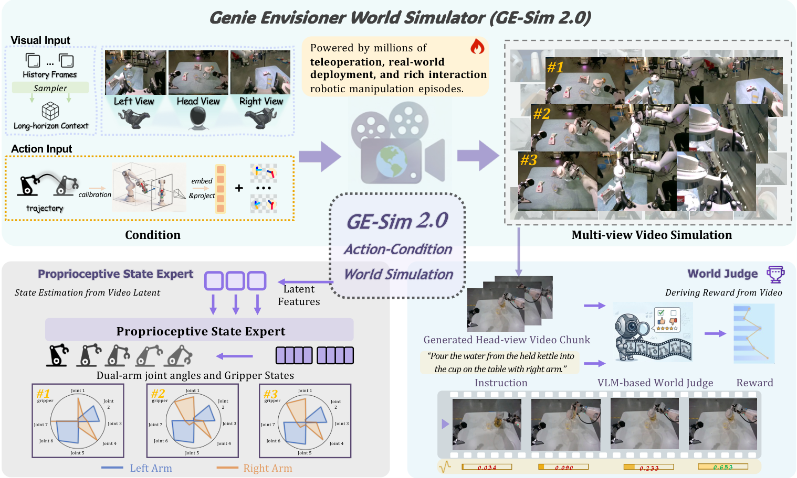

**Рис. 1. Общая схема GE-Sim 2.0.** Верхняя часть — action-conditioned multi-view rollout: модель по истории многоракурсных кадров и траектории действий генерирует будущее видео. Нижняя часть — возможности замкнутого цикла: State Expert добавляет политике проприоцепцию, World Judge оценивает rollout. Вместе они делают модель мира не только «похожей на правду», но и пригодной для оценки и дальнейшего использования политикой.  
Источник: [официальный репозиторий AgibotTech/GE-Sim-V2 на GitHub](https://github.com/AgibotTech/GE-Sim-V2).

Эту схему удобно читать в три слоя.

Первый слой — **визуальное моделирование мира**. Входом служит не текстовый промпт, а реальные наблюдения робота и траектория действий. GE-Sim 2.0 получает историю кадров с нескольких камер — head view, left wrist, right wrist — и проецирует траекторию двурукого действия в пространственно выровненные условия по действию, после чего генерирует будущее видео с нескольких ракурсов.

Второй слой — **замыкание по состоянию тела**. Обычная видеомодель мира выдаёт только изображения, а следующему шагу политики по-прежнему нужны углы суставов, открытие захватов и другие данные проприоцепции. GE-Sim 2.0 использует State Expert, чтобы предсказать углы суставов обеих рук и состояние захватов из латентного представления видео. Так VLA или политика получают визуальные и состояния наблюдения, необходимые для следующего фрагмента действий.

Третий слой — **замыкание по награде**. World Judge получает сгенерированный rollout и инструкцию к задаче и выдаёт сигналы «продолжается» или «успех». Цель — заменить ручной просмотр видео «успешно или нет» машиночитаемой наградой, чтобы модель мира можно было использовать для оценки политики, отбора данных и обучения с наградой.

Поэтому GE-Sim 2.0 делает больше, чем «генерация видео по действию»: он стремится стать **выученной средой (learned environment)**.

## 4. Архитектура статьи: связь GE-Base, GE-Sim и GE-Sim 2.0

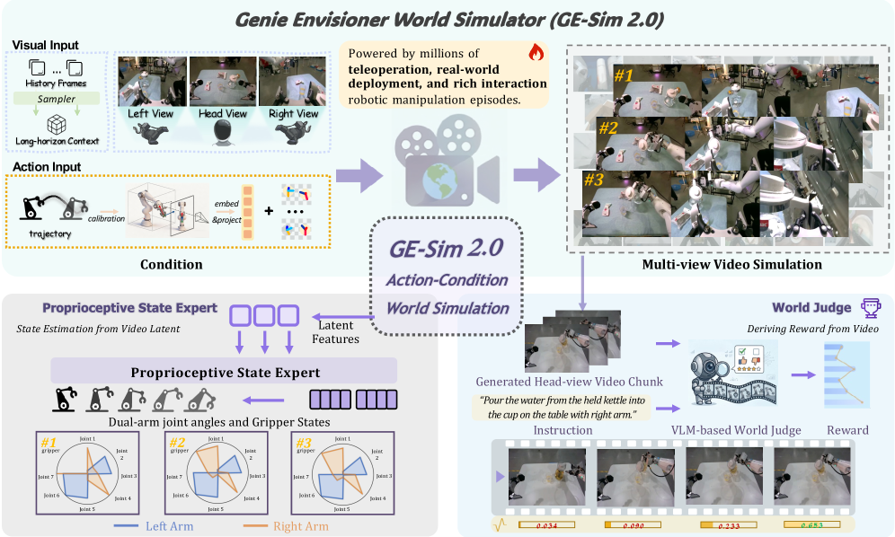

**Рис. 2. Figure 1 из статьи.** GE-Sim 2.0 сохраняет скелет GE-Sim с генерацией видео по действиям, но добавляет state expert и world judge. Так чисто визуальный rollout превращается в среду моделирования, которую политика может использовать в замкнутом цикле.  
Источник: [arXiv HTML: GE-Sim 2.0](https://arxiv.org/html/2605.27491v1).

В статье сначала определены два предшествующих понятия.

**GE-Base** — базовая фундаментальная модель мира для видео с нескольких камер. Она моделирует робота как multi-view text-and-image-to-video generation: по начальным наблюдениям с нескольких камер, языковой инструкции и кадрам долговременной памяти модель авторегрессивно предсказывает будущий фрагмент видео с нескольких камер. В качестве основы используется DiT Cosmos-Predict2-2B-Video2World, обучение идёт через latent flow matching, а согласованность между ракурсами поддерживается cross-view attention.

**GE-Sim** переводит GE-Base с управления текстом на управление действиями. Теперь будущее видео не задаётся текстовой инструкцией, а следует за траекторией низкоуровневых действий робота. Здесь действие — 14-мерный end-effector для двух рук:

```text
левая рука:  позиция + ориентация + степень раскрытия захвата
правая рука: позиция + ориентация + степень раскрытия захвата
```

Чтобы согласовать низкоразмерные действия с высокоразмерным латентным представлением видео, GE-Sim использует два вида пространственных условий:

- **Pose Image**: положение концевого эффектора, оси ориентации и раскрытие захвата отрисовываются на плоскости пикселей.
- **Camera Raymap**: для каждого пикселя кодируется соответствующий луч камеры, чтобы модель явно знала геометрию нескольких ракурсов.

Эти два условия уменьшаются до разрешения латентного пространства и конкатенируются с зашумлённым латентным представлением видео по каналам. Здесь важен принцип: действие передаётся не текстом и не как внешний управляющий сигнал после обработки, а как пространственный слой, который напрямую поступает в видеодиффузионную модель.

**GE-Sim 2.0** дополняет GE-Sim модулями для замкнутого цикла:

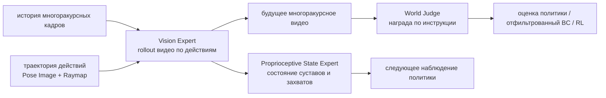

Именно это и означает «замкнутый видеосимулятор мира»: генерация видео — лишь основа, а состояние и награда позволяют политике продолжать работать внутри модели.

## 5. Условие по действию: почему его называют пиксельно выровненным

На странице проекта подчёркивается **Pixel-aligned Action Condition** (пиксельно выровненное условие по действию). Это название не декоративное: оно описывает способ пространственного выравнивания условия по действию.

Если закодировать действие робота в один вектор и подать его в видеомодель через MLP, модели придётся самой догадываться, какая рука, какой пиксель и какой ракурс соответствует каждому числу. Для многоракурсных видео это трудно, особенно потому что на головной камере и на камере запястья концевой эффектор выглядит совершенно по-разному.

GE-Sim превращает действие в условные слои того же разрешения, что и изображение:

1. С помощью прямой кинематики робота и калибровки камер позиция концевого эффектора проецируется на каждый ракурс.
2. Ориентация концевого эффектора рисуется на плоскости изображения как кодировка осей направления.
3. Раскрытие захвата отрисовывается как заметный визуальный признак.
4. Поверх накладывается camera raymap для каждого пикселя.
5. Эти условия уменьшаются до латентного пространства и конкатенируются с латентным представлением видео.

Интуиция такая:

```text
вектор действия говорит модели «как движется робот»
пиксельно выровненное условие говорит «где в кадре робот будет двигаться»
raymap говорит «какая геометрия камеры соответствует этому кадру»
```

Поэтому такой подход лучше подходит для многоракурсной видеомодели мира, чем кодирование действия одним токеном. Особенно при одновременной генерации head view, left wrist и right wrist одно и то же действие концевого эффектора проецируется в разные места в разных ракурсах, а raymap и pose image уменьшают рассогласование между ними.

## 6. State Expert: восстановление проприоцепции робота из латентного представления видео

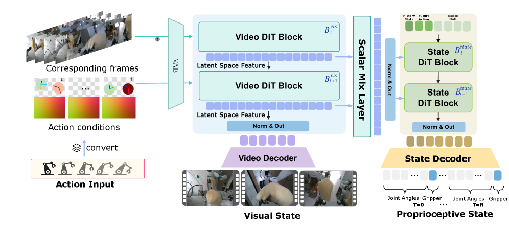

**Рис. 3. Vision Expert и Proprioceptive State Expert.** Vision Expert сначала генерирует будущее визуальное состояние; State Expert затем по латентному представлению видео предсказывает углы суставов обеих рук и раскрытие захватов. Выход модели мира расширяется от «будущего изображения» до «будущего визуального и собственного состояния тела».  
Источник: [arXiv HTML: GE-Sim 2.0](https://arxiv.org/html/2605.27491v1).

Зачем нужен State Expert? Потому что реальные VLA и политики обычно получают на вход не только изображения. Во входе многих политик есть:

- RGB с нескольких камер;
- углы суставов робота или позы концевого эффектора;
- раскрытие захватов;
- предыдущее действие или история проприоцепции.

Если модель мира выдаёт только будущее видео, то в замкнутом rollout политике остаётся использовать в качестве следующего состояния «последнее отданное командное действие». Но на реальном роботе отданная команда и фактическое состояние не совпадают. Причины:

- проскальзывание захвата;
- смещение концевого эффектора при контакте;
- податливость манипулятора;
- ошибки исполнения в суставах;
- блокировка или столкновение с объектом;
- накопление ошибки на длинном горизонте.

State Expert в GE-Sim 2.0 декодирует фактические углы суставов и состояния захватов прямо из латентного представления видео модели мира. В статье также используется history-state augmentation, которое делает модуль устойчивее к временному рассогласованию и низкочастотным возмущениям: применяются сдвиг индекса задержки (delta-index shift) и временная передискретизация (temporal resampling). Интуитивно это нужно, чтобы State Expert не запоминал идеально синхронные траектории, а мог работать при небольшом временном рассогласовании между политикой и моделью мира.

Для студентов этот модуль — ключ к пониманию замкнутости. Одно лишь генерирование видео ещё не делает симулятор замкнутым. Он приближается к интерфейсу вида `env.step(action) -> obs, reward, state, info` только тогда, когда возвращает политике состояние, нужное для следующего шага.

## 7. World Judge: модель мира должна сама выставлять оценки

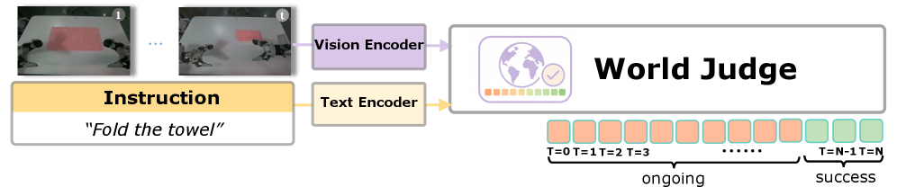

**Рис. 4. World Judge.** World Judge обрабатывает кадры rollout визуальным энкодером, инструкцию к задаче — текстовым энкодером, а затем выдаёт сигнал «продолжается» или «успех» для каждого кадра или фрагмента. Так сгенерированное видео превращается в автоматическую оценку и награду.  
Источник: [arXiv HTML: GE-Sim 2.0](https://arxiv.org/html/2605.27491v1).

World Judge решает очень практичную задачу: если видео, сгенерированное моделью мира, можно только показать человеку, его трудно использовать для масштабного обучения политики. Оценка политики требует награды, отбор данных требует награды, и offline-to-online или model-based RL тоже требуют награды.

Идея GE-Sim 2.0 в том, что VLM-судья смотрит на сгенерированный rollout и инструкцию и решает, продвигается ли задача и успешно ли она выполнена. На странице проекта модуль назван integrated world-judge reward model. В статье его применяют для замкнутой оценки политики и для behavior cloning, отфильтрованного моделью мира (WM-filtered BC).

Но границы открытого кода нужно обозначить явно. На карточке HF Hugging Face сказано **World Judge (coming soon)**. Пример `WorldModelEnv` в README на GitHub тоже показывает: если не подключён `RewardClient`, то `reward` равен `None`. То есть:

```text
метод из статьи: GE-Sim 2.0 включает World Judge как модуль замкнутой награды
текущий открытый репозиторий: модель мира, сервер и демонстрационная политика запускаются, а reward нужно подключать через собственный RewardClient или дождаться дальнейшей официальной публикации
```

Это не мелочь. Многие, увидев «замкнутый симулятор мира», ожидают, что после скачивания репозитория автоматически получат награду. На деле текущая открытая версия лучше подходит для replay и замкнутого rollout, а для обучения с наградой нужно либо подключить собственную reward-модель, либо дождаться официальной публикации World Judge.

## 8. Ускорение: почему важно, что 25 кадров генерируются за 2,3 секунды

На странице проекта и в статье особенно подчёркивается acceleration framework GE-Sim 2.0: rollout из 25 кадров на одной H100 занимает около `2.3s`, а при выводе поддерживается пропуск кадров (frame skipping) до `4x`.

Почему эта метрика важна? Если модель мира только генерирует несколько демонстрационных видео оффлайн, то небольшая задержка терпима. Но если нужно оценивать политики, запусков требуется очень много:

```text
число задач × число начальных состояний × число контрольных точек политики × число seed rollout × число action chunk
```

Если на каждый фрагмент из 25 кадров уходит несколько десятков секунд, то такой симулятор нельзя использовать для отбора политик или замкнутого обучения. 2,3 секунды пока не сравнимы со скоростью традиционного физического симулятора, но уже приближают видеомодель мира к режиму пакетной оценки.

В приложении к статье описано, что ускорение DMD2 использует замороженный учитель (teacher), ученика (student) и fake-score critic, а целью ученика служат 4 шага вывода; при обучении число шагов случайно выбирается от 1 до 4, что даёт поддержку одношагового и немногошагового вывода. Это можно понимать как дистилляцию видеомодели мира со многошаговым шумоподавлением в более быстрый симулятор с малым числом шагов.

Здесь есть и ограничение: чем сильнее ускорение, тем легче пострадать детализации видео и физической согласованности. Поэтому GE-Sim 2.0 оценивает не только пропускную способность, но и точность воспроизведения и согласованность в замкнутом цикле.

## 9. Как понимать «первое место» в WorldArena

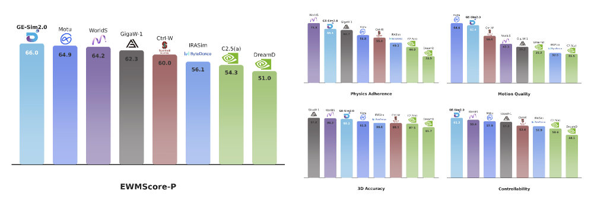

**Рис. 5. Таблица лидеров WorldArena.** Статья показывает, что GE-Sim 2.0 занимает первое место по общему баллу в публичной таблице WorldArena: при размере 2B он опережает несколько моделей мира для роботов и закрытые универсальные генераторы видео.  
Источник: [arXiv HTML: GE-Sim 2.0](https://arxiv.org/html/2605.27491v1).

Формулировка «первое место в мире» опирается на результаты таблицы WorldArena. В аннотации статьи сказано прямо: при размере только 2B параметров GE-Sim 2.0 возглавляет публичную таблицу WorldArena и превосходит специализированные модели мира для роботов и закрытые универсальные генераторы видео. На карточке модели на Hugging Face также написано, что это **чемпион CVPR Challenge WorldArena**.

Это сильный результат, но его нельзя понимать превратно.

Сильные стороны — три:

1. **Масштаб 2B.** Модель не «давит» огромной закрытой видеомоделью, а показывает высокий результат в условиях модели мира с условием по действиям для роботов.
2. **Множество метрик.** WorldArena оценивает не только качество картинки, но и управляемость действиями, соответствие физике, согласованность между ракурсами и связь с задачей.
3. **Направление замкнутого цикла.** Статья приводит не только метрики видео, но и согласованность замкнутой политики, качество награды World Judge и WM-filtered BC.

Границы тоже есть:

1. Первое место в таблице не означает, что модель может заменить физический симулятор на любом реальном роботе.
2. WorldArena остаётся протоколом бенчмарка и не покрывает все контакты, мягкие тела, прозрачные объекты, силовое управление и ограничения безопасности.
3. Открытые веса относятся к версии G01 + OmniPicker, поддержка G02 пока в планах.

Поэтому более точная формулировка такая:

> GE-Sim 2.0 занимает первое место в публичной таблице WorldArena, что подтверждает его силу как видеосимулятора мира для роботов; но это ещё не универсальный проверяемый физический движок.

## 10. Качественные результаты: почему важнее не только качество картинки

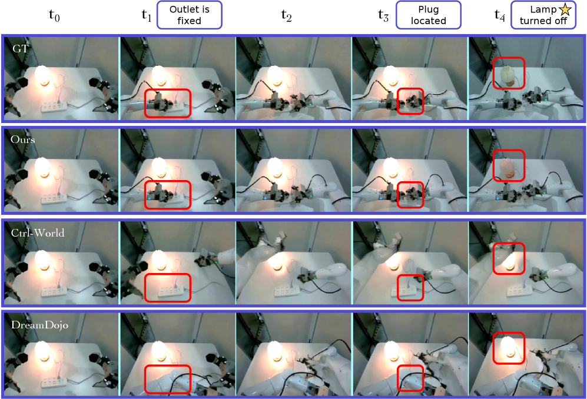

**Рис. 6. Качественное сравнение для задачи «вытащить вилку».** GE-Sim 2.0 должен не только правдоподобно показать движение манипулятора, но и сгенерировать изменение состояния задачи: вилка вынута, и настольная лампа гаснет. Ctrl-World и DreamDojo не справляются с согласованием действия и изменением состояния.  
Источник: [arXiv HTML: GE-Sim 2.0](https://arxiv.org/html/2605.27491v1).

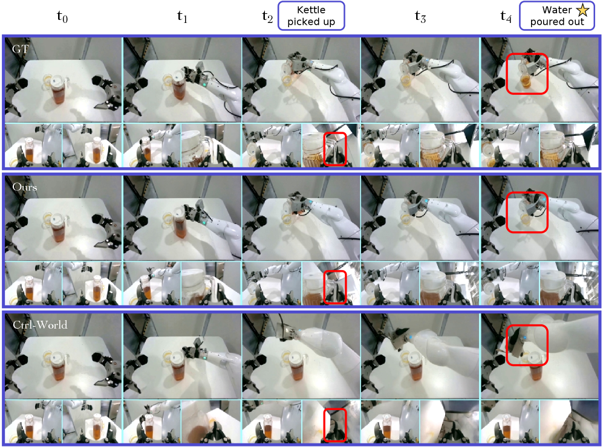

**Рис. 7. Качественное сравнение для задачи «налить воду».** Задача налива проверяет захват, подъём, наклон, поток воды и отношение между ёмкостью и содержимым. В GE-Sim 2.0 соответствие действию и генерация потока воды ближе к реальной траектории.  
Источник: [arXiv HTML: GE-Sim 2.0](https://arxiv.org/html/2605.27491v1).

Эти два набора примеров показывают, что модель мира нельзя оценивать только по чёткости картинки. В задачах робототехники важнее:

- выполняется ли условие по действию;
- действительно ли меняется состояние объекта;
- правдоподобен ли контакт;
- согласованы ли разные ракурсы;
- могут ли генерироваться провальные траектории, а не модель приукрашивает их до успеха.

Сложность «вытащить вилку» — причинное изменение состояния: после извлечения вилки лампа должна погаснуть. «Налить воду» сложнее из-за взаимодействия жидкости с сосудом. Традиционный физический движок плохо моделирует жидкость, а обычный видеогенератор может создать лишь визуальную иллюзию «похоже на налив». GE-Sim 2.0 использует большой объём реальных данных о взаимодействии с роботом и обучение с условием по действию, чтобы снизить такие галлюцинации.

На странице проекта есть наглядный пример: если обучать только на экспертных данных, модель иногда показывает, что полотенце движется, хотя захват его на самом деле не удерживает. После добавления данных телеуправления, развёртывания, взаимодействия и отказов такие галлюцинации становятся реже. Это показывает, что данные о неудачах и неэкспертном взаимодействии — не «грязные» данные, а важный источник сведений о реальных границах контакта.

## 11. Длинный горизонт и согласованность в замкнутом цикле

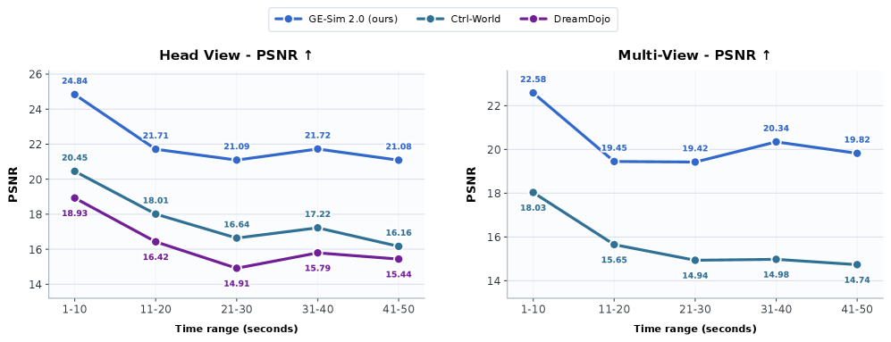

**Рис. 8. Качество replay на длинном горизонте.** В статье видео разбивается на непрерывные сегменты по 10 секунд, и для каждого считается PSNR. GE-Sim 2.0 деградирует на длинных rollout медленнее, чем другие модели.  
Источник: [arXiv HTML: GE-Sim 2.0](https://arxiv.org/html/2605.27491v1).

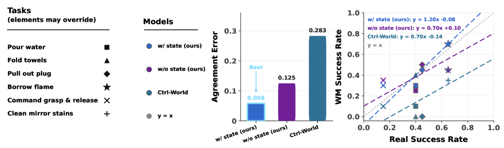

**Рис. 9. Согласованность успешности в модели мира и на реальном роботе.** Каждая точка соответствует одной задаче. Чем ближе точки к серой линии `y=x`, тем лучше успешность, измеренная в модели мира, совпадает с успешностью на реальном роботе. Добавление state conditioning улучшает согласование.  
Источник: [arXiv HTML: GE-Sim 2.0](https://arxiv.org/html/2605.27491v1).

Рис. 9 особенно важен для моделей мира роботов. Многие видеомодели создают красивые результаты, но оценивать в них политики не всегда надёжно. Политика, успешная в модели мира, ещё не обязательно успешна в реальности; если расхождение велико, модель мира может ввести в заблуждение при обучении политики.

GE-Sim 2.0 сравнивает замкнутый rollout политики с результатами на реальном роботе и показывает, что полная модель со state conditioning ближе к реальной успешности. Это подтверждает решение с State Expert: одного визуального сигнала недостаточно, политике на следующем шаге нужно более реалистичное состояние тела.

В статье также приведена матрица ошибок:

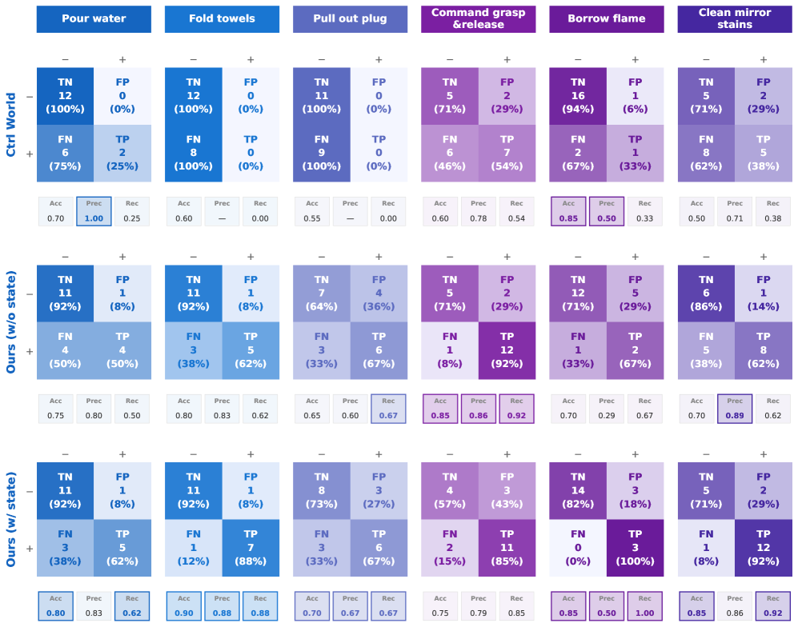

**Рис. 10. Согласованность результатов замкнутой симуляции и успеха реальных задач.** По сравнению с Ctrl-World у GE-Sim 2.0 выше доля истинно положительных срабатываний, то есть лучше сохраняются реальные паттерны успешного выполнения.  
Источник: [arXiv HTML: GE-Sim 2.0](https://arxiv.org/html/2605.27491v1).

Такие оценки ближе к потребностям робототехники, чем одна только метрика FVD. В итоге нас интересует, может ли выученный симулятор помочь определить, сможет ли конкретная политика реально выполнить задачу.

## 12. WM-filtered BC: как модель мира улучшает политику

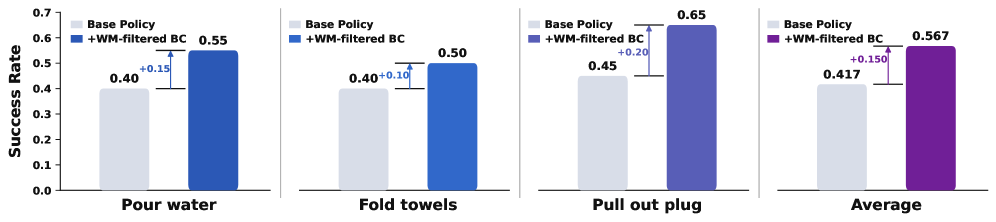

**Рис. 11. WM-filtered behavior cloning.** Политика сначала выполняет rollout в GE-Sim 2.0; World Judge или reward-модель отбирают синтетические траектории с высокой наградой; затем они смешиваются с исходными данными behavior cloning для обучения π0.5. В нескольких задачах с плотным контактом успешность повышается.  
Источник: [arXiv HTML: GE-Sim 2.0](https://arxiv.org/html/2605.27491v1).

Этот рисунок отвечает на вопрос: что ещё, кроме генерации видео, может делать модель мира?

Процесс можно записать так:

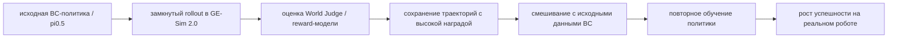

Это не классическая синтетическая аугментация данных. Ключевое слово здесь — **filtered**: траектории, сгенерированные или оценённые моделью мира, должны пройти отбор по награде или судье и сохраниться только при высокой вероятности успеха. Без фильтрации ошибочные траектории модели мира, ложные успехи и несогласованные действия могут испортить политику.

Эту линию полезно сравнить с RAW-Dream, LWD и Agentic-VLA:

- RAW-Dream выполняет воображаемый rollout в модели мира и использует VLM-награду для RL.
- LWD применяет offline-to-online RL на реальных данных развёртывания.
- Agentic-VLA синтезирует награду и использует критика исследования для онлайн-адаптации.
- GE-Sim 2.0 использует rollout выученного симулятора и награду судьи для отфильтрованного BC и оценки политики.

Все эти работы отвечают на один вопрос: VLA нельзя опираться только на статические экспертные демонстрации; до и после развёртывания нужны более дешёвые и автоматические сигналы обратной связи.

## 13. Как запустить официальный репозиторий

Официальный репозиторий уже даёт практичные точки входа. Рекомендуется сначала запустить **replay**, затем **замкнутый rollout**, а не сразу менять модель или подключать собственного робота.

### 13.1 Установка

Установка по официальному README:

```bash
git clone --recursive https://github.com/AgibotTech/GE-Sim-V2.git gesim
cd gesim

# сервер модели мира на GPU
pip install -e ".[server]"

# или только клиент
pip install -e .

# если нужен клиент политики pi05
pip install -e third_party/openpi/packages/openpi-client
```

Здесь важен флаг `--recursive`, потому что репозиторий включает подмодуль `third_party/openpi`. Без подмодулей не будет кода, нужного для сервера политики pi05.

### 13.2 Загрузка весов

```bash
huggingface-cli download agibot-world/Genie-Envisioner-Sim-v2.0 \
  --include "checkpoints/**" \
  --local-dir .
```

Эта команда загружает две основные контрольные точки:

```text
checkpoints/gesim_community_v2.0.1_g01op_distill_2B
checkpoints/pi05_gesim_g01op_test
```

Первая — симулятор мира GE-Sim 2.0, вторая — политика pi05 для демонстрационной задачи. После загрузки в `configs/gesim_v2.yaml` нужно указать в поле `checkpoint` путь к папке модели мира.

### 13.3 Replay записанного эпизода

Запускайте в двух терминалах:

```bash
# терминал 1: сервер модели мира
MODEL=gesim_v2 CONFIG=configs/gesim_v2.yaml bash scripts/serve_world_model.sh
```

```bash
# терминал 2: replay
python examples/replay.py \
  --server http://localhost:9000 \
  --episode assets/demo_000 \
  --output-dir outputs/replay
```

Смысл этого smoke-теста — проверить, что работают сервер модели мира, демонстрационный пакет данных, условие по действию и вывод видео. Замкнутый цикл политики здесь не нужен: записанный эпизод просто подаётся в модель мира для генерации.

### 13.4 Замкнутый rollout политики

Запускайте в трёх терминалах:

```bash
# терминал 1: сервер модели мира
MODEL=gesim_v2 CONFIG=configs/gesim_v2.yaml bash scripts/serve_world_model.sh
```

```bash
# терминал 2: сервер политики pi05
OPENPI_CKPT=checkpoints/pi05_gesim_g01op_test bash scripts/serve_policy_pi05.sh
```

```bash
# терминал 3: замкнутый rollout
python examples/closed_loop.py \
  --server http://localhost:9000 \
  --policy ws://localhost:8000 \
  --episode assets/demo_000 \
  --steps 8
```

Этот шаг уже близок к `env.step(actions)`. Пример на Python из Quickstart на GitHub:

```python
from gesim import WorldModelEnv
from gesim.policies import OpenPIPolicy

env = WorldModelEnv("http://localhost:9000")
policy = OpenPIPolicy("ws://localhost:8000")
policy.reset()
obs = env.reset("assets/demo_000", conditioning="action")

for _ in range(8):
    actions = policy.infer(obs)
    obs, reward, state, info = env.step(actions)

env.save_video("rollout.mp4")
```

Здесь `state` — предсказанное состояние робота формы `(T, 16)`. `reward` по умолчанию равен `None`, пока через `WorldModelEnv(reward=...)` не подключён RewardClient.

### 13.5 Dashboard

Сервер модели мира предоставляет живую панель по адресу `http://localhost:9000`. На ней видно:

- текущую фазу;
- число шагов;
- команду действия от политики;
- предсказанное модели мира состояние робота;
- предпросмотр последнего сгенерированного кадра.

Если нужно только посмотреть dashboard, не загружая реальную модель, запустите:

```bash
python -m gesim.server --demo
```

Затем откройте в браузере адрес сервера. Это подходит для знакомства с интерфейсом и API, но не означает, что вывод модели уже работает.

## 14. Официальные примеры rollout: смотрите и успехи, и неудачи

В официальном репозитории есть примеры замкнутого rollout политики pi05 в GE-Sim 2.0. Каждый клип склеивает три ракурса — head, left wrist и right wrist — по горизонтали. Сильная политика выполняет задачу, слабая допускает ошибки вроде промаха захвата или падения объекта.

<table>
  <tr>
    <td width="33%" align="center">
      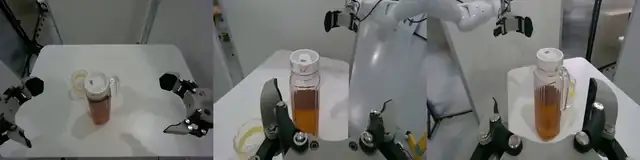
      <br><strong>Рис. 12a. Пример успешного rollout 1</strong>
    </td>
    <td width="33%" align="center">
      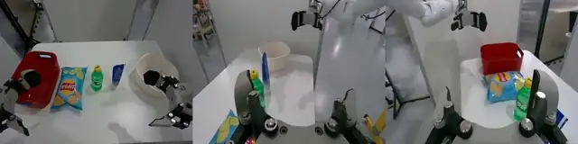
      <br><strong>Рис. 12b. Пример успешного rollout 2</strong>
    </td>
    <td width="33%" align="center">
      
      <br><strong>Рис. 12c. Пример успешного rollout 3</strong>
    </td>
  </tr>
</table>

Источник: [официальный репозиторий AgibotTech/GE-Sim-V2 на GitHub](https://github.com/AgibotTech/GE-Sim-V2).

<table>
  <tr>
    <td width="33%" align="center">
      
      <br><strong>Рис. 13a. Пример неудачного rollout 1</strong>
    </td>
    <td width="33%" align="center">
      
      <br><strong>Рис. 13b. Пример неудачного rollout 2</strong>
    </td>
    <td width="33%" align="center">
      
      <br><strong>Рис. 13c. Пример неудачного rollout 3</strong>
    </td>
  </tr>
</table>

Источник: [официальный репозиторий AgibotTech/GE-Sim-V2 на GitHub](https://github.com/AgibotTech/GE-Sim-V2).

Почему примеры неудач так важны? Потому что работоспособный симулятор мира обязан уметь генерировать провалы. Модель, которая приукрашивает все действия до успеха, непригодна для оценки политик: слабая политика будет выглядеть сильной в симуляторе, и это в итоге введёт в заблуждение при реальном развёртывании.

Обучающие данные GE-Sim 2.0 включают телеуправление, развёртывание политики на роботе, богатое взаимодействие с объектами, успешные выполнения и неудачные траектории. Неудачные траектории важны для изучения граничных состояний: промах захвата, падение, скольжение, нестабильный контакт и нарушение порядка стадий задачи.

## 15. Связь с BWM, τ0-WM и RAW-Dream

| Метод | Основной вход | Основной выход | Главное применение | Отличие GE-Sim 2.0 |
| :--- | :--- | :--- | :--- | :--- |
| BWM | начальное изображение / история кадров + траектория действий | будущее видео с условием по действиям | недорогая визуальная симуляция мира, оценка на WorldArena | BWM ближе к rollout видео; GE-Sim 2.0 добавляет state expert, judge и интерфейс замкнутого цикла server/client |
| τ0-WM | многоракурсные наблюдения, язык, состояние, кандидаты действий | action chunk, будущее видео, оценка прогресса | propose / evaluate / revise до исполнения | τ0-WM объединяет генерацию и оценку действий; GE-Sim 2.0 больше похож на внешнюю среду внешнего симулятора мира |
| RAW-Dream | действие VLA + модель мира, не зависящая от задачи, + VLM-награда | обновление imagined RL | усиление VLA внутри модели мира | RAW-Dream ближе к парадигме обучения; GE-Sim 2.0 — к пригодному для сервисного развёртывания выученному симулятору |
| WALL-WM | текущее наблюдение + условие по действию на уровне событий | будущее видео / действия на уровне событий | долгосрочная репетиция на уровне событий | GE-Sim 2.0 больше подчёркивает многоракурсность, проприоцепцию и согласованность замкнутого цикла политики |
| RoboDream | траектории только робота + априорные данные о сцене и объектах | синтетические видео демонстраций робота | генерация данных | GE-Sim 2.0 делает упор на оценку замкнутого цикла с условием по действию, а не на синтез данных |

Эти работы стоит читать вместе, так как все они отвечают на вопрос «может ли робот сначала прорепетировать действие в модели мира, прежде чем выполнить его в реальности». Но GE-Sim 2.0 упаковывает результат репетиции как интерфейс среды:

```text
env.reset(...)
obs, reward, state, info = env.step(actions)
```

Это ближе к тому, что нужно системе обучения роботов, чем просто «сгенерировать mp4 для просмотра человеком».

## 16. Границы воспроизводимости

GE-Sim 2.0 уже удобнее в работе, чем многие передовые модели мира, но у него остаются ограничения.

Первое: опубликованная контрольная точка — версия **G01 + OmniPicker**. На Hugging Face указано, что она дообучена на данных Genie-01 (G01) и OmniPicker (OP), а поддержка G02 запланирована. Нельзя считать, что другие роботы подойдут без адаптации.

Второе: World Judge пока не открыт полностью. В статье и на странице проекта показан integrated world judge, но на карточке HF написано `coming soon`, а README на GitHub сообщает, что reward по умолчанию пуст и нужно подключать `RewardClient`. Поэтому в учебном материале нельзя писать, что после загрузки уже доступно обучение с наградой.

Третье: это не строгий физический симулятор. Он выдаёт в основном видео и предсказанные состояния, но не даёт проверяемых сил контакта, ограничений столкновений, решателя твёрдых тел, динамики суставов и границ безопасности. Для обучения реального робота по-прежнему нужны реальная проверка и ограничители безопасности.

Четвёртое: у видеомодели мира есть риск галлюцинаций. Даже если GE-Sim 2.0 уменьшил число ошибок следования за действием по сравнению с предыдущими версиями, на длинном горизонте, при окклюзии, с мягкими, прозрачными и жидкими объектами и при тонких контактах ошибки всё равно возможны.

Пятое: вычислительные требования высоки. В статье приведён результат одной H100: 25 кадров за 2,3 секунды. Сможет ли обычная потребительская видеокарта стабильно запустить полный сервер, зависит от объёма видеопамяти, ядер вычислений, зависимостей diffusers/cosmos и конфигурации контрольной точки.

## 17. Рекомендованное задание для командного обучения

В направлении моделей мира (Task04) можно дать такое задание:

> Сравните BWM, τ0-WM и GE-Sim 2.0. Все три связаны с видеомоделями мира с условием по действиям, но BWM в основном показывает rollout видео по действиям, τ0-WM объединяет генерацию действий, предсказание видео и коррекцию действий на этапе тестирования, а GE-Sim 2.0 упаковывает модель мира в симулятор, которым можно управлять в замкнутом цикле. Опишите входы и выходы каждой модели, возвращают ли они проприоцепцию, есть ли встроенная награда, каковы границы текущего открытого кода и какой минимальный демонстрационный пример подходит для воспроизведения.

Сдача может не требовать обучения модели, но нужно объяснить:

- почему GE-Sim 2.0 — не просто модель генерации видео?
- какую проблему решает пиксельно выровненное условие по действию (Pixel-aligned Action Condition)?
- почему State Expert необходим для замкнутого rollout политики?
- World Judge есть в статье, но какие части открытого репозитория ещё ждут публикации или требуют собственной реализации?
- что означают `obs`, `reward`, `state` и `info`, которые возвращает `WorldModelEnv.step(actions)`?
- что показывает первое место в WorldArena, а что — не показывает?

## 18. Рекомендуемый порядок чтения

Лучше читать в таком порядке:

1. Сначала архитектурную схему на странице проекта, чтобы понять три новые возможности: state, judge и acceleration.
2. Затем Quickstart в README на GitHub, чтобы убедиться, что метод уже дошёл до работающих server и client.
3. Затем рисунки 1–3 из arXiv, чтобы разобраться в action-conditioned rollout, State Expert и World Judge.
4. Затем рисунки 7–10, чтобы понять WorldArena, согласование с реальным роботом, WM-filtered BC и матрицу ошибок.
5. В конце прочитать в docs разделы про установку, replay, замкнутый цикл и добавление наград.

Главная мысль раздела:

> Следующий шаг в моделях мира для роботов — не просто генерация более красивого будущего видео, а вывод состояния, которое политика может использовать дальше, и предоставление rollout-результатов с машинно проверяемым сигналом оценки.

## 19. Источники

Изображения взяты с [официальной страницы проекта GE-Sim 2.0](https://ge-sim-v2.github.io/), из [официального репозитория AgibotTech/GE-Sim-V2 на GitHub](https://github.com/AgibotTech/GE-Sim-V2) и [arXiv HTML](https://arxiv.org/html/2605.27491v1). Для стабильного доступа при подготовке учебного материала они сохранены локально в `assets/`. Текст опирается на [arXiv:2605.27491](https://arxiv.org/abs/2605.27491), [README на GitHub](https://github.com/AgibotTech/GE-Sim-V2), [страницу весов на Hugging Face](https://huggingface.co/agibot-world/Genie-Envisioner-Sim-v2.0) и официальную страницу проекта.
