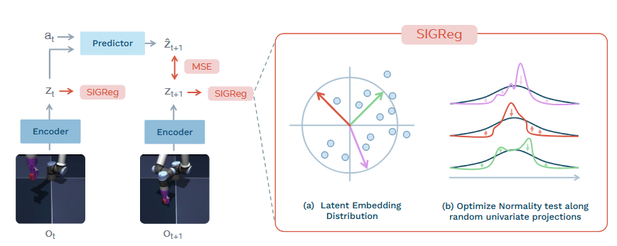
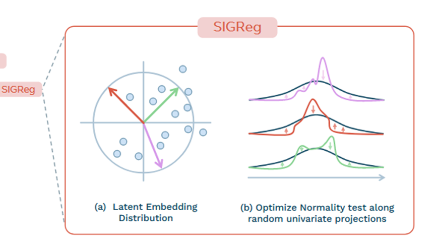
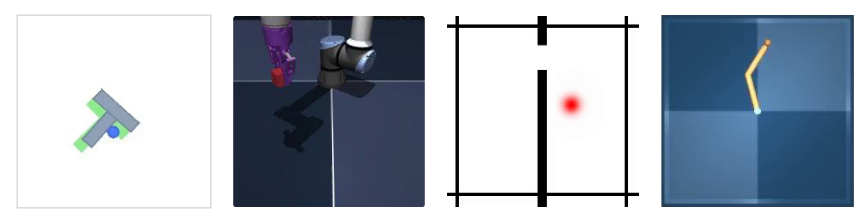
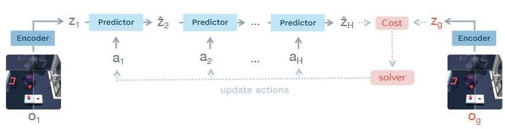
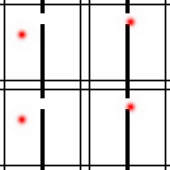
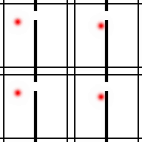
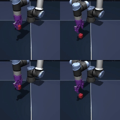
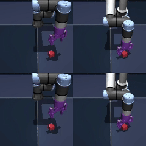

# LeWM: разбор модели мира

### Прочитали статью LeWM и всё равно ничего не поняли? Запутались в коллапсе представлений, SIGReg и многомерном нормальном распределении при воспроизведении кода? Не можете понять, почему она проще и стабильнее JEPA и PLDM?
### В этом материале LeWM объясняется простым языком и понятной структурой от начала до конца. Он поможет разобраться в новом алгоритме модели мира LeWM как новичку в области моделей мира, так и исследователю!

## 1. Главная проблема: что такое коллапс представлений?

Статья LeWM целиком посвящена решению проблемы **коллапса представлений** при обучении моделей мира.

Представим простой пример. На вход подаётся кадр работающего автомобиля, и модель должна предсказать, где окажется машина через секунду, и выдать соответствующий вектор признаков, чтобы выучить физические законы среды. Но энкодер и предиктор обучаются вместе, поэтому модели хочется «срезать путь»: что бы ни подавалось на вход, энкодер выдаёт один и тот же нулевой вектор. Тогда и предсказанное будущее состояние тоже всегда нулевое, ошибка между предсказанием и истиной точно равна нулю, функция потерь падает до минимума, и модель «выигрывает» без всякого обучения. Когда такую модель применяют к последующим задачам, она не может различить разные изображения, потому что для неё все признаки одинаковы. Обучение пропало зря, извлечённые признаки бесполезны.

Эта проблема довольно распространена в самообучении: если энкодер и предиктор обучаются сквозным образом с нуля, велик шанс на неё наткнуться.

## 2. Существующие решения и их подводные камни

### Первый класс: внешние методы, которые «лечат симптомы», а не причину

Такие методы не решают проблему внутри самой модели, а накладывают внешние «заплатки». Основных вариантов несколько.

1) Эвристические правила: задаём их по опыту, например, ограничиваем среднее и дисперсию признаков. Проблема очевидна: при смене задачи или набора данных правила перестают работать и почти не обобщаются.

2) Многокомпонентная функция потерь: помимо основной потери предсказания добавляем набор вспомогательных потерь для регуляризации признаков. Например, в статье упоминается PLDM, который использует сразу 7 функций потерь. Веса между ними приходится подбирать вручную, и если подобрать плохо, кривая обучения становится нестабильной.

3) Прямое использование предобученной модели: например, DINO-WM берёт энкодер DINOv2, предобученный на огромном объёме данных, и полностью замораживает его, никогда не обновляя параметры. Коллапса при этом точно не будет, ведь способность извлекать признаки уже обучена. Но это противоречит самой идее самообучения, когда признаки выучиваются с нуля. Это скорее уход от проблемы, чем её решение. Главное — предел качества модели оказывается заперт предобученной моделью. Допустим, вы решаете задачу захвата манипулятором, а предобученная модель обучалась на природных пейзажах и совсем не понимает ключевых признаков вашей задачи. Дообучить её вы не сможете и вынуждены будете искать другую предобученную модель, что добавляет работы.

### Второй класс: внутренние методы, которые работают, но не до конца объяснимы

К этому классу относятся методы семейства JEPA (I-JEPA, V-JEPA), которые используют stop-gradient (SG, остановку градиента) и exponential moving average (EMA, экспоненциальное скользящее среднее).

SG: модель делится на две части — ученика (онлайн-энкодер и предиктор) и учителя (целевой энкодер). Ученик ошибся, наказываем только ученика и обновляем только его параметры, параметры учителя не трогаем. Это и есть остановка градиента. Зачем так делать? Если разрешить учителю подстраиваться под ошибки ученика, то он, стремясь помочь ученику получить максимум, просто начнёт выдавать одинаковые ответы — нули, и оба «сдадутся», наступит коллапс. Остановка градиента перекрывает путь к этому «отлынивающему» решению. А откуда берутся параметры учителя? Для этого и используется EMA.

EMA: параметры учителя — это медленно усреднённые параметры ученика за некоторое время. Ученик учится быстро, а учитель мягко за ним следует. Так учитель даёт ученику осмысленные цели для обучения и при этом его параметры очень стабильны и не рушатся внезапно.

Этот подход работает довольно хорошо, его сейчас широко применяют. Но у него есть принципиальная проблема: математически невозможно объяснить, почему он работает.

В традиционном машинном обучении всё устроено так: есть явная функция потерь, при обучении мы строго берём производные, вычисляем градиенты и двигаемся по направлению спуска, чтобы найти минимум потерь. В методе же:

Остановка градиента — это искусственное отсечение потока градиентов при обратном распространении, поэтому параметры обновляются не по реальной производной всей системы. Обновление параметров учителя в EMA тоже не вычисляется через градиенты и производные, а просто взвешенно усредняется с параметрами ученика (например, новые параметры учителя = 0.99 × старые параметры учителя + 0.01 × новые параметры ученика).

Иначе говоря, это эмпирический «чёрный ящик»: он работает, но теоретически не обоснован, а настройка сложна. Небольшое изменение гиперпараметра может привести к коллапсу модели.

## 3. Основное решение LeWM: как устранить коллапс у самого корня?

Посмотрим на ключевое новшество LeWM. Оно очень изящно устраняет коллапс представлений при совместном обучении энкодера и предиктора, при этом обладает строгим теоретическим обоснованием и на практике очень простое.

### Сначала базовая архитектура LeWM



Архитектура LeWM очень проста и состоит всего из двух модулей: энкодера Encoder и предиктора Predictor.

$$
\text{Encoder: } \quad z_t = \text{enc}_\theta(o_t)
$$

$$
\text{Predictor: } \quad \hat{z}_{t+1} = \text{pred}_\phi(z_t, a_t)
$$

1) Энкодер построен на архитектуре ViT. Он получает на вход текущий кадр среды $o_t$ и сжимает его в многомерный латентный вектор признаков $z_t$, то есть выполняет извлечение признаков из изображения.

2) Предиктор получает текущий признак $z_t$ от энкодера и действие агента $a_t$ и предсказывает признак следующего момента $\hat{z}_{t+1}$. Так модель «прокручивает» в латентном пространстве дальнейшее развитие среды и выучивает физические законы.

Как же обучать такую модель? Здесь и начинается главная новизна LeWM: авторы используют изящный приём, который решает проблему, когда энкодер при совместном обучении с предиктором «ленится» и отображает все входы в одну константу. Вот код:

```python
# Функция потерь LeWM
output["pred_loss"] = (pred_emb - tgt_emb).pow(2).mean()
output["sigreg_loss"]= self.sigreg(emb.transpose(0, 1))
output["loss"] = output["pred_loss"] + lambd * output["sigreg_loss"]  
```

Видно, что в отличие от PLDM, который в статье использует 7 функций потерь и из-за этого получает нестабильные кривые обучения, LeWM использует всего две функции потерь.

`pred_loss` понять несложно: основная цель модели мира — чтобы предсказанный предиктором признак следующего момента `pred_emb` совпадал с признаком, который энкодер реально выдаёт для следующего момента `tgt_emb`. Считаем среднеквадратичную ошибку между ними. Чем она меньше, тем лучше модель предсказывает будущее и тем точнее выучила физику среды.

Но одной этой потери недостаточно: модель обязательно пойдёт по пути наименьшего сопротивления и вызовет коллапс представлений. Поэтому нужна главная новизна статьи — функция потерь SIGReg.



Вспомним, в чём суть коллапса представлений: модель отображает все входы в одинаковый константный вектор (например, нулевой). Распределение таких признаков уже не нормальное — это одна точка. Теперь развернём рассуждение: если заставить модель выдавать многомерные признаки, которые строго следуют идеальному многомерному нормальному распределению, то она не сможет превратить все признаки в одну константу, и путь к «лёгкому» решению будет перекрыт.

Но здесь возникает трудность. Для одномерных данных есть много зрелых и удобных методов проверки нормальности, например тест Эппса–Палли. А вот проверить, соответствует ли многомерный признак, скажем 192-мерный вектор из статьи, многомерному нормальному распределению, очень сложно.

Как LeWM решает эту задачу? Используется очень изящный приём: случайная проекция плюс проверка одномерной нормальности. Это и есть метод SIGReg.

$$
\text{SIGReg}(Z) \triangleq \frac{1}{M} \sum_{m=1}^{M} T(h^{(m)})
$$

$$
\mathcal{L}_{\text{LeWM}} \triangleq \mathcal{L}_{\text{pred}} + \lambda \text{SIGReg}(Z)
$$

В d-мерном пространстве признаков случайным образом выбираем M различных направлений и проецируем все многомерные признаки на эти M одномерных прямых. Получаем M наборов одномерных данных. Для каждого из них применяем зрелый тест Эппса–Палли, и заставляем каждый набор соответствовать одномерному нормальному распределению.

Теоретическое рассуждение из статьи может показаться сложным, поэтому вот понятный пример.

Представьте, что вы хотите проверить, является ли висящее в воздухе сложное облако идеальным шаром (то есть многомерным нормальным распределением). Измерять его трёхмерный объём и кривизну поверхности слишком трудно. Поэтому вы светите на облако фонариком с M случайных углов и смотрите на тени на стене. Если каждая тень выглядит как идеальный круг (то есть одномерное нормальное распределение), то облако, скорее всего, — идеальный шар.

Логика LeWM такая же: во время обучения мы случайным образом выбираем M направлений проекции и заставляем признаки выглядеть нормальными на каждом из них. По мере обучения это эквивалентно тому, что всё многомерное пространство признаков формируется в идеальное многомерное нормальное распределение. Модель хочет превратить все признаки в нули? Не получится: распределение из одних нулей не пройдёт проверку на нормальность, функция SIGReg резко вырастет, и «срезать путь» уже не удастся.

Что особенно важно, метод очень прост: нужно настроить всего два гиперпараметра — размерность случайных проекций M и вес λ между двумя функциями потерь. Выбор гиперпараметров упрощается, и новичкам легко быстро начать работать.

Есть и математическая опора — теорема Крамера–Вольда: если многомерные данные по всем возможным одномерным проекциям распределены нормально, то и сами данные образуют многомерное нормальное распределение.

## 4. Как использовать обученную LeWM: управление агентом с помощью модели мира



Цель обучения модели мира — не просто предсказывать признаки, а позволить ей реально управлять агентом, выполняющим задачу в среде, например навигацию роботов или захват манипулятором. Этот раздел объясняет, как обученную LeWM превратить в действия, которые действительно можно выполнить.

Основная функция модели мира — по текущему кадру и действию предсказывать будущее состояние, а затем «мысленно» перебирать варианты и находить оптимальное действие для достижения цели. Ниже сложный текст статьи разбит на понятные пошаговые процедуры. Надеемся, так будет намного понятнее.

### Шаг 1: закодировать текущее состояние и цель

$$
\hat{z}_1 = \text{enc}_\theta(o_1), \quad z_g = \text{enc}_\theta(o_g)
$$

С помощью обученного энкодера модели мира кодируем текущее реальное изображение и изображение конечной цели. Два изображения сжимаются в латентные векторы признаков размерности 192, которые обозначаются $z_1$ и $z_g$.

Итоговая задача: найти последовательность действий, которая переведёт агента из текущего состояния $z_1$ в целевое состояние $z_g$.

### Шаг 2: «мысленно» перебрать варианты и смоделировать будущие траектории

$$
\hat{z}_{t+1} = \text{pred}_\phi(\hat{z}_t, a_t)
$$

Случайным образом генерируем большое число кандидатных последовательностей действий. Каждая из них содержит действия на H шагов вперёд (например, при H=10 план рассчитывается на 10 шагов).



Затем каждую кандидатную последовательность подаём в предиктор LeWM. Начиная с текущего состояния $z_1$ и первого действия $a_1$, получаем $z_2$, затем с помощью $a_2$ получаем $z_3$, и так авторегрессивно продолжаем до шага H, получая итоговое состояние $z_h$.

Суть этого шага в том, что модель мира в латентном пространстве заранее моделирует, к каким результатам приведёт каждый вариант действий. Ошибаться в реальной среде не нужно.

### Шаг 3: отбор лучших действий и итеративная оптимизация

$$
\mathcal{C}(\hat{z}_H) = \|\hat{z}_H - z_g\|_2^2
$$

$$
a_{1:H}^* = \arg\min_{\boldsymbol{a}_{1:H}} \mathcal{C}(\hat{z}_H),
$$

После моделирования всех вариантов вычисляем для каждого итоговое состояние $z_h$ и измеряем расстояние до целевого состояния $z_g$. Чем меньше расстояние, тем лучше эта последовательность действий и тем вероятнее, что она поможет выполнить задачу.

Затем отбираем k лучших вариантов и по их среднему и дисперсии обновляем распределение, из которого сэмплируем действия. Как в эволюции: хорошие действия сохраняются, плохие отбраковываются. После нескольких итераций получаем оптимальную последовательность действий.

### Шаг 4: выполнить действия, двигаясь маленькими шагами

Хотя мы спланировали оптимальные действия на H шагов вперёд, выполнять все H шагов сразу не стоит. Предсказания модели мира авторегрессивны, и на каждом шаге в них накапливается небольшая ошибка. С увеличением числа шагов ошибка растёт, и если выполнить всё за раз, агент может в итоге оказаться всё дальше от цели.

## 5. Чем LeWM лучше существующих решений?

Подытожим, в чём преимущества LeWM по сравнению с предыдущими подходами и почему её стоит изучать подробнее.

1) Устраняет коллапс представлений у самого корня, и теория строгая: в отличие от «чёрного ящика» SG+EMA, LeWM опирается на свойства распределения признаков и строгую математическую теорему, что снижает вероятность того, что модель пойдёт по пути наименьшего сопротивления.

2) Очень мало гиперпараметров, стабильное обучение: модели нужно подбирать всего два гиперпараметра, M и λ. По сравнению с методами со множеством функций потерь и сложной настройкой JEPA это намного удобнее, а кривые обучения очень плавные.

3) Сквозное обучение с нуля без предобученных моделей: не нужно замораживать готовую большую модель. Можно обучить собственную модель мира под вашу задачу с нуля. Выразительная способность и потолок качества модели не ограничены, что особенно подходит для узкоспециализированных задач робототехники и воплощённого ИИ.

4) Очень простая архитектура, легко менять и расширять: никаких сложных двойных архитектур «учитель-ученик», только энкодер и предиктор. Добавлять модули или улучшать модель очень удобно.

## 6. Текущие ограничения и направления для исследований

### Текущие ограничения

1) Адаптация размерности латентного пространства: в статье используется латентное пространство размерности 192. Для таких простых задач, как tworoom, с небольшой внутренней размерностью это похоже на «стрельбу из пушки по воробьям»: избыточная размерность может нарушить естественное представление признаков и ухудшить работу модели.

2) Непроверенная применимость к сложной реальной среде: почти все эксперименты проводились в чистых и простых симуляторах. В реальной жизни есть изменения освещения, перекрытия, динамические объекты и другие помехи. Поведение модели в такой сложной среде ещё требует исследований и проверок. Например, можно попробовать увеличить размерность M, чтобы повысить способность модели описывать сложные признаки.

3) Зависимость от разметки действий: сейчас обучение требует подавать метку действия для каждого момента времени, но в реальности огромное количество видео не имеет разметки действий, и это ограничивает возможность предобучения на больших объёмах интернет-видео.

### Направления для углублённых исследований

1) Адаптивный выбор размерности латентного пространства: можно разработать схему, которая автоматически меняет размерность латентного пространства в зависимости от сложности задачи: для простых задач — низкую, для сложных — высокую. Это решит проблему «стрельбы из пушки по воробьям».

2) Отказ от зависимости от меток действий за счёт моделирования обратной динамики: в статье эта идея тоже упоминается. Вместо того чтобы полагаться на внешне заданные метки действий, можно добавить модуль обратной динамики, который учится восстанавливать действие по непрерывным кадрам. Тогда можно будет использовать неразмеченные видео из интернета и выучивать общие физические законы, что заметно повысит обобщающую способность модели.

## 7. Практическое руководство по воспроизведению: на что обратить внимание

### 1. Настройка окружения

Есть два варианта. Первый — официальный менеджер uv:

```bash
uv venv --python=3.10
source .venv/bin/activate
uv pip install stable-worldmodel[train,env]
```

Второй — привычный conda:

```bash
conda create -n lewm python=3.10
conda activate lewm
pip install stable-worldmodel[train,env]
```

### 2. Загрузка данных

Рекомендуем загрузить данные для tworoom и cube. Официальные веса модели, опубликованные на Google Drive, нам не удалось скачать из-за недоступности сайта, поэтому мы обучили обе среды, tworoom и cube, с нуля и получили два набора весов. Из-за ограниченности GPU и времени tworoom обучался полное число эпох, а cube — только 12 эпох. Попробовать можно самостоятельно. (Официальные pt-веса на Hugging Face — не тот формат ckpt, который нужен для eval, их скачивать не нужно. Либо измените тестовый файл так, чтобы загружались pt вместо ckpt.)

Адрес загрузки наших весов: https://huggingface.co/Datawhale/lewm/tree/main

Адрес данных задачи tworoom: https://huggingface.co/datasets/quentinll/lewm-tworooms/tree/main

Адрес данных задачи cube: https://huggingface.co/datasets/quentinll/lewm-cube/tree/main

Адрес данных задачи pusht: https://huggingface.co/datasets/quentinll/lewm-pusht/tree/main

Адрес данных задачи reacher: https://huggingface.co/datasets/quentinll/lewm-reacher/tree/main

Для каждой задачи создайте отдельную папку, например, структура каталогов для tworoom такая:

```text
lewm
└── tworoom
    └── tworoom
        ├── lewm_object.ckpt
        └── tworoom.h5
```

Здесь tworoom.h5 — распакованный файл данных, lewm_object.ckpt — файл весов модели.

Для задачи cube структура немного другая:

```text
lewm
└── cube
    ├── ogbench
    │   └── cube_single_expert.h5
    └── cube
        └── lewm_object.ckpt
```

Пути для остальных задач можно задать самостоятельно.

### 3. Обучение и тестирование

Сначала нужно задать путь:

Важно задать путь на одну папку глубже, иначе веса модели сохранятся прямо в каталоге lewm и будут лежать беспорядочно. Этот путь нужно указывать на каждом следующем шаге.

```bash
export STABLEWM_HOME=/home/your-user/lewm/tworoom
```

Обучение:

В файле config/train/lewm.yaml добавьте свой wandb: https://wandb.ai/home

```yaml
wandb:
  config:
    entity: your_entity
    project: your_project
```

Запуск обучения:

Вместо data укажите задачу, которую хотите обучить:

```bash
python train.py data=tworoom
```

Тестирование:

Можно использовать наши веса или собственные. Для смены задачи достаточно заменить tworoom в двух местах. Чтобы различать файлы, при загрузке мы переименовали веса tworoom и cube. Перед тестированием положите веса tworoom и cube в папку соответствующей задачи и переименуйте в lewm_object.ckpt.

```bash
python eval.py --config-name=tworoom.yaml policy=tworoom/lewm
```

### 4. Демонстрация результатов

### Результаты tworoom

```text
==== RESULTS ====
metrics: {'success_rate': 98.0, 'episode_successes': array([ True,  True,  True, False,  True,  True,  True,  True,  True,
        True,  True,  True,  True,  True,  True,  True,  True,  True,
        True,  True,  True,  True,  True,  True,  True,  True,  True,
        True,  True,  True,  True,  True,  True,  True,  True,  True,
        True,  True,  True,  True,  True,  True,  True,  True,  True,
        True,  True,  True,  True,  True]), 'seeds': None}
evaluation_time: 179.38973236083984 seconds
```

Видно, что успешность в простой навигационной задаче tworoom высокая.

<p align="center">
   &nbsp; &nbsp; &nbsp;
  
</p>

### Результаты cube

```text
==== RESULTS ====
metrics: {'success_rate': 64.0, 'episode_successes': array([False, False,  True,  True,  True,  True, False,  True,  True,
       False,  True, False,  True,  True, False,  True,  True, False,
        True,  True,  True,  True, False, False, False,  True, False,
       False,  True, False,  True, False,  True,  True,  True,  True,
       False,  True, False,  True,  True,  True, False,  True,  True,
        True, False,  True,  True,  True]), 'seeds': None}
evaluation_time: 191.06767058372498 seconds
```

Успешность в задаче захвата манипулятором ниже. Мы также заметили, что реальная успешность, возможно, ещё ниже: это может быть связано с тем, что обучали всего 12 эпох. Можно попробовать обучить полные 99 эпох, которые указаны в официальном репозитории. Однако критерий успеха в официальном исходном коде выглядит так:

```python
def _compute_successes(self):
    cube_successes = []
    for i in range(self._num_cubes):
        obj_pos = self._data.joint(f'object_joint_{i}').qpos[:3]   # текущая позиция кубика
        tar_pos = self._data.mocap_pos[self._cube_target_mocap_ids[i]]  # целевая позиция

        if np.linalg.norm(obj_pos - tar_pos) <= 0.04:  # евклидово расстояние ≤ 4 см
            cube_successes.append(True)
        else:
            cube_successes.append(False)
    return cube_successes
```

Успехом считается только правильное положение кубика, поэтому состояние самого манипулятора в критерии не учитывается, и оценка может быть немного смещённой.

<p align="center">
   &nbsp; &nbsp; &nbsp;
  
</p>

## 8. Благодарности

Материал основан на ключевых идеях оригинальной статьи LeWM, и мы искренне благодарим авторов за их отличную работу. Надеемся, что этот простой разбор поможет тем, кто хочет войти в мир моделей мира и воплощённого ИИ. Будем рады обсуждению и дополнениям к опыту воспроизведения и оптимизациям.
