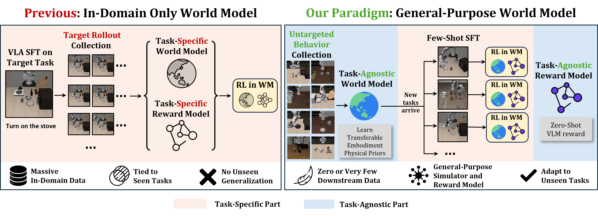
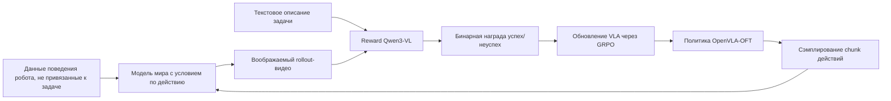
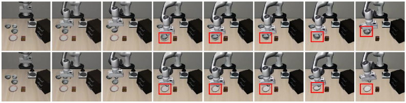
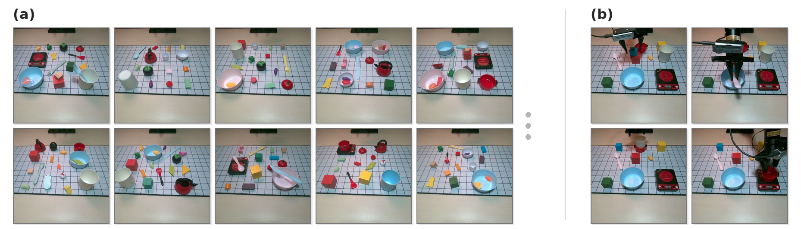
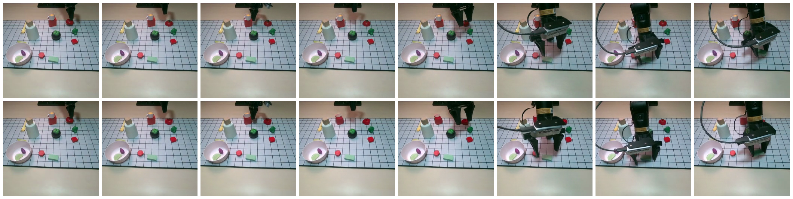

# RAW-Dream: обзор усиления VLA в модели мира, не зависящей от задачи

Этот раздел разбирает статью **Reinforcing VLAs in Task-Agnostic World Models**; метод называется **RAW-Dream**. Он подходит для главы `17-world-models`, но не как полноценное пошаговое воспроизведение: по состоянию на 27.06.2026 ни на странице автора, ни на arXiv не опубликован официальный репозиторий RAW-Dream, поэтому раздел лучше рассматривать как обзор переднего края исследований по схеме «модель мира + посттренировка VLA».

После этого раздела важно усвоить три положения:

- Работа строится не на базе pi0.5 ради рейтингов. В статье базовой политикой служит OpenVLA-OFT.
- Главная ценность — не новая базовая VLA, а RL-посттренировка VLA на воображаемых траекториях, которая опирается на модель мира, не зависящую от задачи, и на нулевой VLM-reward.
- Симуляционная оценка использует готовые held-out наборы LIBERO, а реальные эксперименты — собственная задача с AgileX Piper авторов.

## 1. Статус статьи и кода

| Пункт | Текущее состояние |
| :--- | :--- |
| Статья | [arXiv:2605.12334](https://arxiv.org/abs/2605.12334), v1 отправлена 12.05.2026, v2 исправлена 20.05.2026 |
| Страница автора | на [странице Kaixin Wang](https://kaixin96.github.io/) есть ссылка на статью на arXiv |
| Официальная страница проекта | отдельной страницы пока не найдено |
| Официальный код | официального репозитория RAW-Dream пока не найдено |
| Рекомендуемый способ чтения | сначала методологическую схему, таблицы экспериментов и детали реализации из приложения; воспроизводить сейчас не рекомендуется |

Если официальный код появится, в этом каталоге имеет смысл добавить файл `02-raw-dream-reproduction.md`; пока же этот раздел служит обзором статьи и навигацией по репозиторию.

## 2. Одна картинка: что решает метод

  

**Рис. 1. Базовая позиция RAW-Dream.** Слева — многие конвейеры RL на основе моделей мира: когда появляется новая задача, для неё нужно собрать внутридоменные rollout, а затем дообучить модель мира и модель reward. Справа — RAW-Dream: сначала обучается повторно используемая модель мира на данных поведения, не привязанных к задаче, затем готовая VLM ставит награды успеха/неуспеха для новой задачи, и VLA выполняет RL внутри модели мира.

Источник: [HTML-версия RAW-Dream на arXiv](https://arxiv.org/html/2605.12334v2).

Слово «task-agnostic» не стоит понимать так, будто данные роботов не нужны. Точнее: модель мира и модель reward не зависят от rollout целевой задачи, но сама политика всё равно проходит SFT, а модели мира нужно достаточно большое количество не привязанных к задаче данных взаимодействия.

## 3. Какие базовые модели используются

В статье три модуля, и их не стоит смешивать:

| Модуль | Выбор в статье | Роль |
| :--- | :--- | :--- |
| VLA-политика | OpenVLA-OFT | выдаёт действия, затем обновляется с помощью GRPO |
| Модель мира | на основе DiT Wan 2.1-T2V-1.3B, переделанного в видеомодель с условием по действию | по начальному наблюдению и последовательности действий генерирует воображаемый rollout |
| Модель reward | замороженная Qwen3-VL | по текстовому описанию задачи и воображаемому видео определяет Success / Failure |

Поэтому базовая модель здесь не pi0.5. В разделе related work упоминаются pi0, pi0.5 и другие VLA, но политика RAW-Dream строится на OpenVLA-OFT. В приложении также сказано, что сохранена вероятностная категориальная токенизация действий, чтобы можно было сэмплировать для GRPO. Это отличается от исходной OpenVLA-OFT, которая ближе к детерминированной голове регрессии L1.

## 4. Схема обучения и посттренировки

Конвейер RAW-Dream можно представить так:

Что касается данных:

- В симуляции авторы обучают базовую политику на LIBERO-90, затем добавляют шум в действия, чтобы собрать смешанные rollout с успехами и неудачами, и на этих данных обучают модель мира.
- На реальном роботе сначала используются данные Open X-Embodiment, затем добавляется около 4 часов неразмеченных данных телеуправляемой игры (teleoperation play data) без определения задачи.
- Для новой задачи нужно лишь небольшое количество демонстраций для SFT; этап RL в основном проходит внутри воображаемых rollout модели мира.

## 5. Самые важные приёмы

### Dual-Noise Verification (DNV)

  

**Рис. 2. Наглядный пример DNV.** Одна и та же последовательность действий, два набора шума диффузии. Если при первом прогоне Qwen3-VL засчитывает успех, а при втором, с другим шумом, — неудачу, значит первый успех, вероятно, был галлюцинацией модели мира, а не устойчивым физическим результатом.

Источник: [HTML-версия RAW-Dream на arXiv](https://arxiv.org/html/2605.12334v2).

DNV — самый инженерный приём статьи. Второй проход генерации модели мира выполняется только для тех воображаемых rollout, которые VLM уже признала успешными, а не для всех траекторий, то есть вычисления не удваиваются. Так отфильтровываются случаи «модель мира вообразила успех → reward hacking → политика учится неправильно».

### Нулевой VLM-reward

Авторы не обучают отдельную сложную модель reward под каждую новую задачу, а напрямую используют Qwen3-VL для бинарной классификации успеха. Важна абляция в статье: если обучить классификатор reward VideoMAE на 10 демонстрациях (1-shot), результат оказывается заметно хуже. Авторы объясняют это тем, что такой классификатор склонен переобучаться на внешнем виде экспертных траекторий и плохо обобщается на воображаемые rollout.

### Якорение первым кадром + постепенный шум

При длинных rollout видеомодели мира слишком сильное условие по первому кадру порождает ghosting: объект уже унесён, но на исходном месте остаётся как бы призрачный след. Авторы привязывают генерацию к первому кадру на каждом шаге авторегрессии, но постепенно увеличивают шум первого кадра. Это ослабляет механическое запоминание первого кадра, и модель всё больше опирается на недавний контекст.

## 6. На каких бенчмарках проверяется метод

  

**Рис. 3. Данные play без привязки к задаче и реальные нижестоящие задачи.** Слева — разнообразные настольные раскладки, которые используются для обучения модели мира; справа — четыре нижестоящие задачи в реальных экспериментах авторов.

Источник: [HTML-версия RAW-Dream на arXiv](https://arxiv.org/html/2605.12334v2).

Симуляционная часть использует готовый бенчмарк LIBERO, но протокол не сводится к прямому подбору результатов на обучающих задачах. Авторы обучают модель мира на LIBERO-90, затем тестируют на отложенных наборах LIBERO-Spatial, LIBERO-Object, LIBERO-Goal и LIBERO-Long. В каждом наборе по 10 задач.

Основные показатели успешности политики:

| Метод | Target data | Spatial | Object | Goal | Long | Avg. |
| :--- | :--- | ---: | ---: | ---: | ---: | ---: |
| 1-shot SFT | 10 | 54.6 | 46.4 | 52.2 | 20.2 | 43.4 |
| Online RL Short | 522 | 58.4 | 60.2 | 55.2 | 17.6 | 47.9 |
| Online RL Long | 2570 | 68.8 | 78.8 | 65.2 | 22.4 | 58.8 |
| Zero-Shot WM + Qwen3-VL | 10 | 65.8 | 47.2 | 60.2 | 35.8 | 52.3 |
| Co-Train WM + Qwen3-VL | 10 | 73.2 | 60.2 | 58.4 | 36.6 | 57.1 |
| ID-FT WM + Qwen3-VL | 510 | 82.0 | 79.8 | 63.4 | 38.6 | 66.0 |

В этой таблице важнее не единичные рекорды SOTA, а бюджет данных. Zero-Shot WM не использует дополнительных rollout для целевой задачи и всё равно поднимает результат с 43.4 у 1-shot SFT до 52.3. Если дообучить модель мира на данных той же области (in-domain fine-tuning), ID-FT WM достигает 66.0.

Реальный робот — не публичный стандартный бенчмарк, а собственный эксперимент авторов на AgileX Piper. На каждую задачу приходится 30 попыток: 3-shot SFT даёт в среднем 50.0%, после RL — в среднем 71.7%. Это показывает, что метод проверен на реальном роботе, но этого масштаба недостаточно, чтобы считать проблему «универсальной мировой моделью робота» решённой.

  

**Рис. 4. Пример rollout модели мира на реальном роботе.** Верхний ряд — реальное видео выполнения, нижний — предсказание модели мира для тех же начальных наблюдений и той же последовательности действий.

Источник: [HTML-версия RAW-Dream на arXiv](https://arxiv.org/html/2605.12334v2).

## 7. Какие репозитории изучить по этой статье

Пока у самого RAW-Dream нет официального кода, полезно изучить открытые проекты, на которые он опирается:

| Направление | Рекомендуемый источник | Зачем смотреть |
| :--- | :--- | :--- |
| Базовая VLA-политика | [moojink/openvla-oft](https://github.com/moojink/openvla-oft) и [страница проекта OpenVLA-OFT](https://openvla-oft.github.io/) | понять action chunking, оценку на LIBERO и интерфейс обучения OpenVLA-OFT |
| Базовая модель OpenVLA | [openvla/openvla](https://github.com/openvla/openvla) и [страница проекта OpenVLA](https://openvla.github.io/) | понять семейство OpenVLA и контекст предобучения на Open X-Embodiment |
| Базовая видеомодель мира | [Wan-Video/Wan2.1](https://github.com/Wan-Video/Wan2.1) и [Wan2.1-T2V-1.3B](https://huggingface.co/Wan-AI/Wan2.1-T2V-1.3B) | модель мира RAW-Dream переделана из DiT Wan 2.1-T2V-1.3B |
| VLM-reward | [QwenLM/Qwen3-VL](https://github.com/QwenLM/Qwen3-VL) и [Qwen3-VL-8B-Instruct](https://huggingface.co/Qwen/Qwen3-VL-8B-Instruct) | понять, как модель работает как zero-shot-reward успеха/неуспеха |
| Симуляционный бенчмарк | [Lifelong-Robot-Learning/LIBERO](https://github.com/Lifelong-Robot-Learning/LIBERO) и [страница проекта LIBERO](https://libero-project.github.io/main.html) | основная симуляционная оценка RAW-Dream — на отложенных наборах LIBERO |
| Данные роботов | [google-deepmind/open_x_embodiment](https://github.com/google-deepmind/open_x_embodiment) и [страница проекта Open X-Embodiment](https://robotics-transformer-x.github.io/) | один из источников предобучения модели мира для реального робота |

## 8. Как вписать статью в учебный маршрут

Рекомендуется читать эту статью после LeWM:

1. Сначала LeWM: понять, как сама модель мира учится предсказывать и как она поддерживает планирование.
2. Затем RAW-Dream: понять, как модель мира служит виртуальной средой для посттренировки VLA.
3. Наконец, OpenVLA-OFT и LIBERO: понять политику, бенчмарк и интерфейс действий.

Если вы работаете над длинногоризонтными VLA, моделированием контактных событий, физической памятью или проблемой reward hacking, то из этой статьи стоит перенять DNV и идею «задачно-независимого физического априорного знания». Вряд ли это подходящая цель для воспроизведения в ближайшее время, но для главы о моделях мира это хороший переходный обзор переднего края.

## 9. Источники

- Статья RAW-Dream: [Reinforcing VLAs in Task-Agnostic World Models](https://arxiv.org/abs/2605.12334)
- HTML-версия с иллюстрациями на arXiv: [2605.12334v2 HTML](https://arxiv.org/html/2605.12334v2)
- Страница автора: [Kaixin Wang](https://kaixin96.github.io/)
- OpenVLA-OFT: [страница проекта](https://openvla-oft.github.io/) / [код](https://github.com/moojink/openvla-oft)
- Wan 2.1: [код](https://github.com/Wan-Video/Wan2.1) / [Wan2.1-T2V-1.3B](https://huggingface.co/Wan-AI/Wan2.1-T2V-1.3B)
- Qwen3-VL: [код](https://github.com/QwenLM/Qwen3-VL)
- LIBERO: [страница проекта](https://libero-project.github.io/main.html) / [код](https://github.com/Lifelong-Robot-Learning/LIBERO)
- Open X-Embodiment: [страница проекта](https://robotics-transformer-x.github.io/) / [код](https://github.com/google-deepmind/open_x_embodiment)
