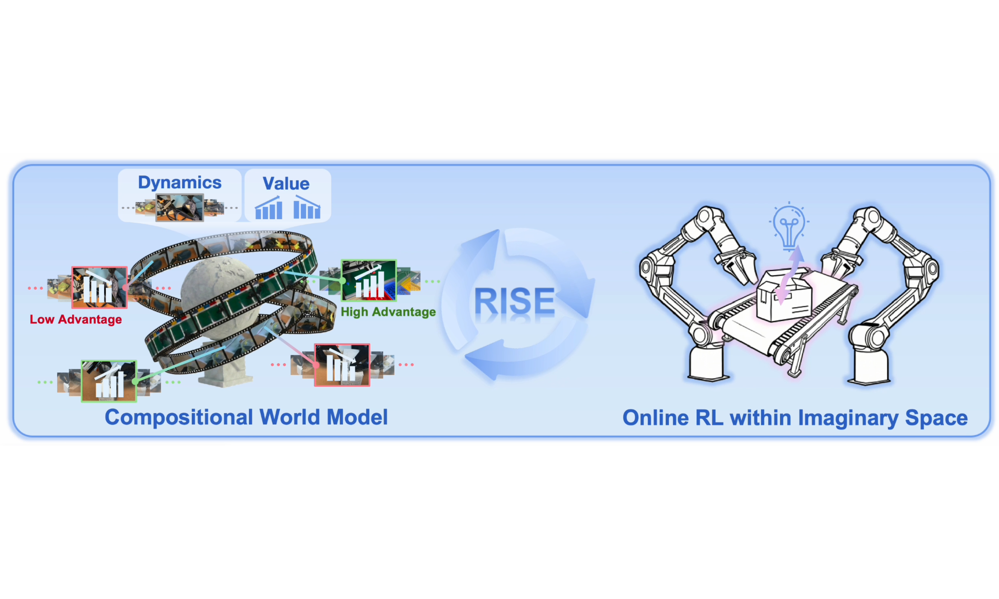
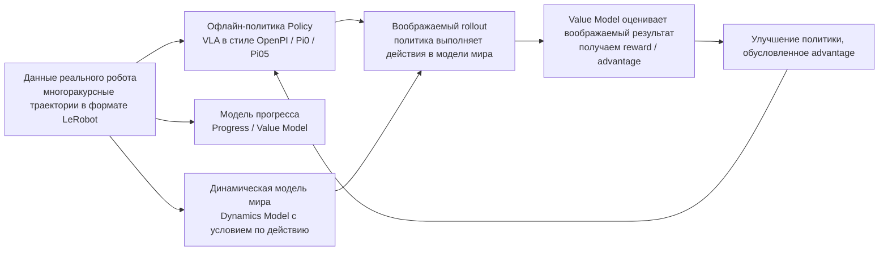
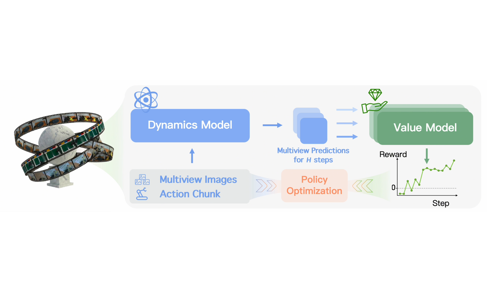
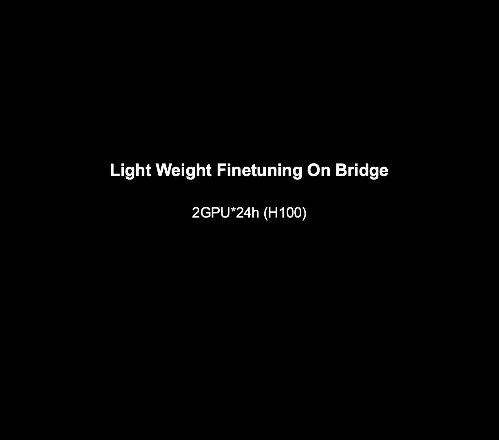
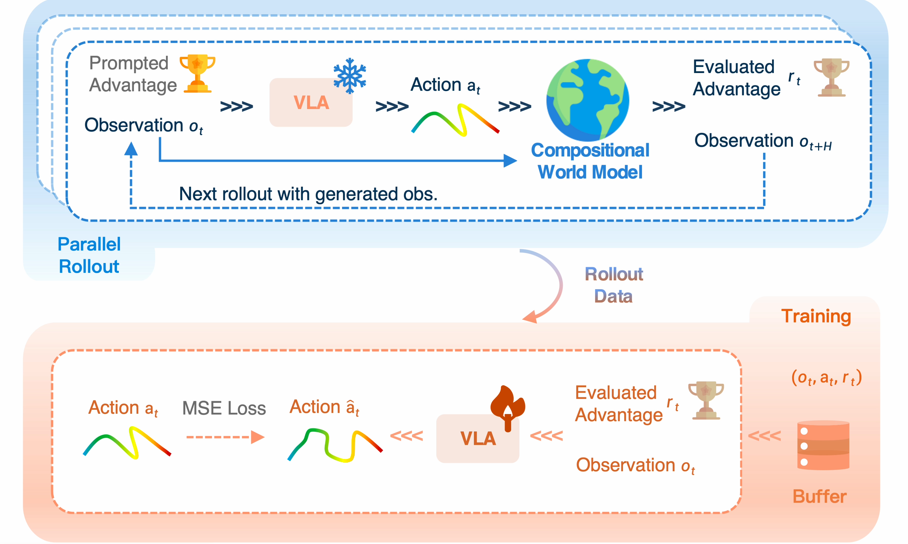
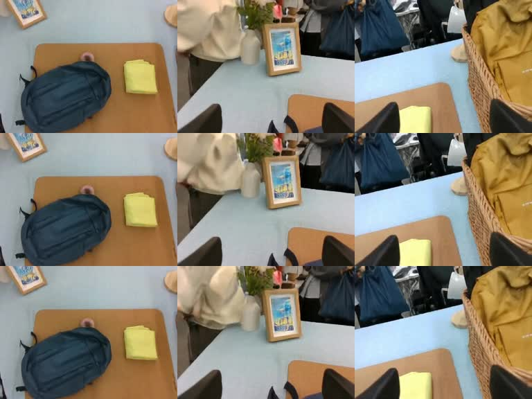

# RISE: самоулучшающаяся политика робота с композиционной моделью мира — RL «в воображении»

Эта глава знакомит с **RISE: Self-Improving Robot Policy with Compositional World Model**. Статья RISE — [arXiv:2602.11075](https://arxiv.org/abs/2602.11075), страница проекта — [OpenDriveLab RISE](https://opendrivelab.com/RISE/), официальный репозиторий — [OpenDriveLab/RISE](https://github.com/OpenDriveLab/RISE).

После этой главы вы сможете:

- понять, почему RISE улучшает политику робота внутри модели мира, а не методом проб и ошибок на реальном роботе;
- разобраться в трёхэтапном конвейере репозитория RISE: офлайн-обучение политики и оценочной модели, динамическая модель мира с условием по действию и онлайн-RL в воображении;
- воспроизвести базовое Python-окружение RISE на машине с GPU Blackwell и загрузить и проверить публичные ассеты динамической модели;
- отделить официальные результаты, локальный smoke test и границы публичных весов, чтобы не принять «окружение запускается» за «полное воспроизведение всех результатов статьи».

## 1. Какую проблему решает RISE

В задачах манипуляции роботом распространено обучение по демонстрациям: собирают набор телеуправляемых или экспертных демонстраций и обучают визуально-языковую модель действий, которая по изображениям, языковой инструкции и собственному состоянию робота выдаёт действия. Проблема в том, что политика, выученная на офлайн-данных, обычно хрупка. Если объект немного сместился, возмущение сильнее или контакт сложнее, политика может попасть в состояние, которого не было в обучающих данных.

Напрашивается прямое решение — обучать робота с подкреплением, пусть он продолжает пробовать в реальном мире. Но у реального робота есть несколько серьёзных недостатков:

- rollout на реальном роботе медленный, каждый сброс манипулятора занимает время;
- ошибочные действия могут повредить объекты, захват, манипулятор или окружение;
- в задачах вроде укладки рюкзака, закрывания коробки или сортировки на динамическом конвейере число состояний отказа очень велико, и сбор on-policy опыта дорог;
- в реальной сцене трудно параллельно запустить десятки или сотни сред.

Основная идея RISE: **не позволять роботу много пробовать в реальном мире, а обучить динамическую модель мира с условием по действию. Политика делает rollout в этом «воображаемом» окружении, модель оценки прогресса оценивает воображаемые результаты, а затем advantage передаётся обратно политике.**

<p align="center">
  
</p>

**Рис. 1. Общий обзор эффектов RISE из официального материала.** На рисунке показаны три класса реальных задач манипуляции из статьи: динамическая сортировка, укладка рюкзака и закрывание коробки. Важно понимать, что цель RISE — не универсальное управление роботом в духе чат-бота, а улучшение уже существующих манипуляционных политик в задачах с высокой динамикой, точным контактом и сильными возмущениями.

<p align="center"><sub>Источник: страница проекта RISE.</sub></p>

## 2. Архитектура RISE в одном предложении

RISE можно описать так:



Ключевое в этом конвейере — слово «композиционный». RISE не сводит всё к одной большой чёрной коробке, а делит модель мира на две взаимодополняющие части:

- **динамическая модель (dynamics model)** предсказывает, как изменятся мультиракурсные изображения после выполнения действия;
- **модель прогресса (progress value model)** оценивает, приблизилось ли это будущее к успеху или отдалилось от него.

Такое разделение хорошо подходит для обучения роботов: предсказание визуального будущего может опираться на возможности диффузионных видеомоделей, оценка прогресса задачи — на понимание политикой/оценочной моделью успешных и неуспешных траекторий, а обновление политики — на распределённую RL-систему вроде RLinf.

## 3. Официальные видео: создаём первое интуитивное впечатление

Ниже приведены видео с официальной страницы RISE или из материалов официального репозитория. Для долгосрочной доступности в учебном материале они сохранены локально в `assets/videos/`. Официальные видео помогают понять цель статьи, но не доказывают, что эта глава уже переобучила политику с таким же качеством.

<video controls muted preload="metadata" width="100%">
  <source src="assets/videos/website_teaser.mp4" type="video/mp4">
</video>

**Видео 1. Общий обзор RISE из официального материала.** Обратите внимание на сложность задачи: роботу нужно работать с динамическими объектами, гибким пространством рюкзака и нестабильными состояниями при закрывании крышки коробки в реальном физическом контакте.

<p align="center"><sub>Источник: страница проекта RISE, `website_teaser.mp4`.</sub></p>

<table>
  <tr>
    <td width="33%">
      <video controls muted preload="metadata" width="100%">
        <source src="assets/videos/conveyor_continuous_11_RISE_v3.mp4" type="video/mp4">
      </video>
      <p><strong>Видео 2. Динамическая сортировка на конвейере.</strong> Сложность в том, что цель постоянно движется, и политика должна корректировать действия по ходу наблюдения.</p>
      <p align="center"><sub>Источник: страница проекта RISE.</sub></p>
    </td>
    <td width="33%">
      <video controls muted preload="metadata" width="100%">
        <source src="assets/videos/backpack_continuous_21_RISE_v3.mp4" type="video/mp4">
      </video>
      <p><strong>Видео 3. Укладка рюкзака.</strong> Задача связана с пространственными ограничениями, гибким отверстием и многошаговым размещением, поэтому важно уметь восстанавливаться после ошибок.</p>
      <p align="center"><sub>Источник: страница проекта RISE.</sub></p>
    </td>
    <td width="33%">
      <video controls muted preload="metadata" width="100%">
        <source src="assets/videos/box_continuous_10_RISE_v3.mp4" type="video/mp4">
      </video>
      <p><strong>Видео 4. Закрывание коробки.</strong> Эта задача проверяет точность контакта: политика должна подвести объект в состояние, из которого коробку можно закрыть.</p>
      <p align="center"><sub>Источник: страница проекта RISE.</sub></p>
    </td>
  </tr>
</table>

<video controls muted preload="metadata" width="100%">
  <source src="assets/videos/dynamics_world_visualization_compressed.mp4" type="video/mp4">
</video>

**Видео 5. Визуализация динамической модели мира RISE из официального материала.** Видео показывает, как модель мира предсказывает будущий визуальный результат по историческим наблюдениям и действиям. Это не простая интерполяция кадров, а мультиракурсное предсказание будущего с условием по действию.

<p align="center"><sub>Источник: страница проекта RISE.</sub></p>

## 4. Метод: что изучает каждая из трёх моделей

Сначала переведём основные математические объекты статьи на язык инженерии. RISE обучает не просто «модель, которая умеет воображать видео», а разбивает взаимодействие с реальной средой в RL на три обучаемых модуля:

```text
политика π:    по текущему наблюдению и задаче предлагает chunk действий длиной H шагов
динамика D:    по историческим наблюдениям и chunk действий предсказывает мультиракурсные наблюдения на H шагов вперёд
оценка V:      по наблюдению и задаче оценивает, насколько текущее состояние близко к успеху
```

В статье многоракурсное наблюдение записывается как `o_t = [m_t^1, ..., m_t^n]`, где `n` — число камер. Историческое окно — `O_t = {o_{t-N}, ..., o_t}`. Действие здесь не одиночный шаг, а chunk действий:

```text
a_t = [a_t, a_{t+1}, ..., a_{t+H-1}]
```

Динамическая модель учится предсказывать:

```text
o_hat_{t+1}, ..., o_hat_{t+H} = D(O_t, a_t)
```

Модель оценки присваивает каждому воображаемому будущему состоянию оценку прогресса `V(o_hat, l)`, где `l` — языковая инструкция задачи. Ключевая формула advantage в RISE такая:

```text
A(o_t, a_t, l) = (1 / H) * sum_{k=1..H} [ V(o_hat_{t+k}, l) - V(o_t, l) ]
```

Эту формулу стоит запомнить: **хорош ли chunk действий, определяется не тем, красиво ли выглядят сами действия, а тем, насколько в среднем вырос прогресс задачи, по оценке value-модели, после предсказанного моделью мира выполнения.** Поэтому RISE нужны одновременно dynamics и value. Только динамика без value даёт будущее видео без сигнала обучения; только value без динамики не позволяет оценить, в какое состояние приведёт новое действие, предложенное текущей политикой.

Соответствие между формулами статьи и репозиторием:

| Объект в статье | Инженерный смысл | Место в коде / конфигурации |
| --- | --- | --- |
| `π` | VLA-политика, выдающая chunk действий | `policy_and_value/policy_offline_and_value` |
| `D` | видеомодель с условием по действию | `dynamics/dynamics_model/infer.py` |
| `V` | оценка прогресса / модель reward | `Policy_offline_release`, `value_release` |
| `A` | метка advantage, посчитанная по воображаемому rollout | `action_advantage`, `with_advantage_condition` |
| воображаемый rollout | взаимодействие политики с моделью мира | `policy_and_value/policy_online/examples/embodiment/config/rl_release.yaml` |

С теоретической стороны статьи выделяются три ключевых момента.

Первый: **композиционная модель мира лучше подходит для RL роботов, чем одна большая модель**. Управлению роботом нужны одновременно «предсказание будущего, управляемое действием» и «оценка прогресса, чувствительная к провалу». Эти две задачи предъявляют разные требования к структуре модели и целевой функции, поэтому RISE разделяет их на dynamics и модель прогресса, а затем комбинирует, чтобы получить advantage для политики.

Второй: **модель оценки не может учитывать только прогресс по времени**. В статье value сначала обучается регрессии прогресса `t/T`, которая даёт плотный сигнал прогресса, а затем добавляется TD-обучение: модель учится снижать ценность состояний, ведущих к ошибке, на основе успешных и неуспешных траекторий. Для задач с богатым контактом это важно: например, молния застряла или крышка коробки почти, но не до конца закрыта. Такие провалы визуально могут быть едва заметны, и модель, которая оценивает только время, станет излишне оптимистичной.

Третий: **воображаемый rollout не может бесконечно «мечтать»**. Генеративные видеомодели накапливают ошибку. В статье процесс самоулучшения берёт начальные состояния из офлайн-данных, выполняет ограниченное число шагов воображаемого rollout и затем помещает воображаемые состояния и метки advantage в буфер обучения. Эта граница важна на практике: модель мира нужна как источник дешёвых краткосрочных сигналов взаимодействия с высокой пропускной способностью, а не как замена полного долгосрочного симулятора реального мира.

### 1. Офлайн-политика: сначала научим VLA-политику выполнять задачи

Код политики и value в RISE находится в каталоге:

```text
policy_and_value/policy_offline_and_value
```

Он основан на визуально-языковой модели действий в стиле OpenPI / Pi0 / Pi05. На вход обычно подаются:

- мультиракурсные изображения, например `top_head`, `hand_left`, `hand_right`;
- проприоцепция робота, например состояния суставов;
- языковая подсказка или текст задачи;
- chunk действий, то есть предсказание сразу нескольких будущих шагов;
- в улучшенной конфигурации RISE — также `action_advantage`.

В официальной release-конфигурации стоит обратить внимание на два имени:

```text
Policy_offline_release
value_release
```

`Policy_offline_release` — конфигурация обучения политики с условием по advantage. Её трансформация repack упаковывает поле `action_advantage` из датасета во входы модели. Иначе говоря, advantage, который RISE позже вычисляет в воображении, используется не только в функции потерь PPO, но и становится частью условия политики, так что политика знает, какие действия стоит усиливать.

### 2. Модель прогресса: оцениваем, приближает ли будущее к успеху

Модель оценки использует структуру OpenPI, близкую к политике, но с включённой головой value. Она изучает не простую бинарную классификацию, а сигнал прогресса или ценности: продвигает ли текущее состояние, будущее состояние и действие задачу к успеху.

На этом шаге важно понимать ограничения. Модель мира может генерировать будущее видео, но это не значит, что она знает, хорошо ли это видео. Например, робот, подтолкнувший объект к правому краю кадра, ещё не обязательно добился успеха; в задаче с рюкзаком объект, положенный в рюкзак, но застрявший на молнии, тоже означает провал. Модель оценки превращает такие визуальные будущие состояния в оптимизируемые reward и advantage.

Когда офлайн-обучение модели оценки завершено, в репозитории есть скрипт разметки:

```bash
cd $RISE_ROOT/policy_and_value/policy_offline_and_value
bash label_value.sh vis_value_release_joint_T /path/to/value/checkpoint/steps
```

Этот скрипт добавляет в датасет LeRobot метки value / advantage. Для собственной задачи этот шаг равносилен тому, чтобы записать оценку качества траекторий обратно в датасет и подготовить данные для улучшения политики.

Обучение модели оценки в статье использует две взаимодополняющие функции потерь. Их можно понимать так:

| Потеря | Интуиция | Зачем нужна |
| --- | --- | --- |
| регрессия прогресса | value в целом растёт по мере продвижения задачи | даёт плотный, стабильный и легко оптимизируемый сигнал |
| TD-обучение | корректирует value по успешным и неуспешным возвратам | делает модель чувствительной к провалам, застреванию и отклонению от цели |

Результаты абляций в статье подтверждают эту логику: без прогресса успешность заметно падает, а без TD-обучения падение ещё сильнее. Для вашей роботизированной задачи важно помнить: если value учить только по времени, модель может выучить иллюзию «чем дольше выполняется действие, тем лучше»; если опираться только на редкие сигналы успеха и провала, обучение становится трудно стабилизировать.

### 3. Динамическая модель: видеомодель мира с условием по действию

Динамическая модель RISE находится в каталоге:

```text
dynamics/dynamics_model
```

В качестве основы используются токенизатор, текстовый энкодер T5 и VAE из LTX-Video, а сверху подключён диффузионный трансформер с условием по действию, обученный самой командой RISE. В официальной конфигурации видны такие компоненты:

```yaml
pretrained_model_name_or_path: path/checkpoints
tokenizer_class: T5Tokenizer
textenc_class: T5EncoderModel
vae_class: AutoencoderKLLTXVideo
diffusion_model_class: LTXVideoTransformer3DModel
diffusion_scheduler_class: FlowMatchEulerDiscreteScheduler
```

<p align="center">
  
</p>

**Рис. 2. Схема модели мира RISE.** Её можно понимать как «генератор будущего видео с условием по действию»: историческое мультиракурсное изображение переводится в латентное пространство VAE, токены действий управляют диффузионным трансформером, который генерирует будущие латенты, а затем VAE декодирует их в мультиракурсное видео будущего.

<p align="center"><sub>Источник: страница проекта RISE.</sub></p>

Здесь важно отличать эту модель от обычной модели text-to-video. Динамическая модель RISE не получает на вход произвольный текстовый запрос, по которому свободно генерирует робота. Она моделирует условный переход в управлении роботом:

```text
P(будущие мультиракурсные изображения | текущие/исторические мультиракурсные изображения, будущая последовательность действий, условие задачи)
```

В официальном `infer.py` вход и выход выглядят так:

| Элемент | Значение в инференсе RISE dynamics |
| --- | --- |
| вход изображений | исторические кадры трёх камер `top_head`, `hand_left`, `hand_right`; в исходном коде для каждой камеры читается `0.png` и повторяется 4 раза как память |
| вход действий | `act_tokens.pt` формы `[batch, 25, action_dim]`; в локальном smoke test используется `[1, 25, 14]` |
| текстовое условие | код загружает токенизатор и текстовый энкодер T5, но `infer.py` внутри переопределяет `prompt` как пустую строку; этот вход не предоставляет способа «генерировать видео по пользовательскому промпту» |
| выход модели | мультиракурсное предсказание примерно на 25 шагов вперёд, сохраняемое в виде `video.mp4` с горизонтальной склейкой трёх камер |

Поэтому точнее сказать так: **динамическая модель RISE — это мультиракурсная модель предсказания будущего с условием по действиям, а не универсальная модель text-to-video.** Текстовые и задачные условия важны во всём конвейере данных и политики RISE, но для официального чекпоинта динамической модели, который запускается в этой главе, проверяется главным образом цепочка «наблюдение + действие → будущее визуальное состояние».

<p align="center">
  
</p>

**Рис. 3. Схема визуализации динамической модели мира RISE.** Рисунок соответствует эффектам предсказания модели мира из официального видео. При изучении стоит отличать это от обычного предсказания видео: будущее здесь не генерируется безусловно, а управляется последовательностью действий робота.

<p align="center"><sub>Источник: страница проекта RISE.</sub></p>

В статье также подчёркиваются два практических ограничения динамической модели: **скорость** и **согласованность с действием**. RL требует большого числа rollout, и если генерация 25 шагов мультиракурсного будущего занимает много времени, всё самоулучшение упирается в пропускную способность модели мира. Кроме того, видео, которое выглядит реалистично, ещё недостаточно: предсказание должно соответствовать заданному действию, иначе advantage, который выучит политика, будет шумом. Поэтому RISE добавляет условие по действию в диффузионную основу и использует task-centric batching, чтобы усилить контрастное обучение разных действий в одной и той же задаче и сцене.

## 5. Online imagination RL: настоящее «самоулучшение в воображении»

На онлайн-этапе RISE используется каталог:

```text
policy_and_value/policy_online
```

Конфигурация находится по пути:

```text
policy_and_value/policy_online/examples/embodiment/config/rl_release.yaml
```

В этом файле есть несколько важных переключателей:

| Параметр конфигурации | Смысл |
| :-- | :-- |
| `algorithm.policy_config_name: Policy_offline_release` | онлайн-этап загружает ту же конфигурацию политики, что и офлайн-обучение |
| `rollout.model_dir` | путь к чекпоинту офлайн-политики (имитационного обучения) |
| `actor.checkpoint_load_path` | актор инициализируется из чекпоинта rollout-политики |
| `add_dynamics_model: True` | включает динамическую модель мира |
| `dynamics_model_config` | указывает на `dynamics/dynamics_model/configs/ltx_model/infer.yaml` |
| `add_reward_model: True` | включает модель прогресса / reward |
| `reward_model_config: value_release` | использует конфигурацию модели value |
| `reward_model_ckpt` | путь к чекпоинту модели value |
| `with_advantage_condition: True` | во входе политики используется условие по advantage |
| `advantage_scale: 5` | сила влияния advantage на обновление политики |

<p align="center">
  
</p>

**Рис. 4. Конвейер самоулучшения RISE.** Офлайн-политика сначала предлагает кандидатов действий; модель мира предсказывает последствия этих действий в воображении; модель value оценивает воображаемые результаты; затем advantage возвращается политике. Это замкнутый цикл улучшения политики, который не требует плотного реального пробного обучения на роботе.

<p align="center"><sub>Источник: страница проекта RISE.</sub></p>

Некоторые выводы из экспериментов статьи полезны для воспроизведения:

| Наблюдение в статье | Что это значит для воспроизведения |
| --- | --- |
| на трёх задачах (динамическая сортировка, укладка рюкзака, закрывание коробки) RISE повышает успешность примерно на 35–45% относительно сильных базовых методов | модель мира наиболее полезна в динамичных, контактно-насыщенных длинных задачах с трудным восстановлением после ошибок |
| только онлайн-действия дают ограниченный прирост, а добавление состояний онлайн, сгенерированных моделью мира, даёт заметное улучшение | не стоит понимать метод как «попробовать несколько наборов действий»; ключ в расширении распределения обучающих состояний |
| слишком низкая доля офлайн-данных ведёт к сбоям, а слишком высокая ограничивает исследование | самоулучшение всё равно должно смешивать офлайн-данные, чтобы политика не сбивалась воображаемыми данными и не забывала базовые навыки |
| удаление предобучения динамики, task-centric batching, потери прогресса и TD-обучения ухудшает результат | эти четыре компонента — не декоративные детали: они соответствуют визуальной предварительной обученности, управляемости действием, плотному сигналу прогресса и чувствительности к провалам |
| динамическая модель и модель value используются только при обучении | при развёртывании на реальном роботе выполняется улучшенная политика, и видеомодель мира не нужна на каждом шаге |

Поэтому, читая статью, не стоит запоминать только фразу «робот видит сны». Более инженерное понимание такое: RISE использует короткую, управляемую действиями и оцениваемую модель мира, чтобы заменить дорогой поток on-policy данных с реального робота высокопроизводительным потоком воображаемого опыта, а затем с помощью политики, обусловленной advantage, переносит этот опыт обратно в управляющую стратегию.

В исполнении RLinf онлайн-этап можно разложить на три группы ролей:


Здесь `EnvGroup` не обязательно означает параллельные реальные среды на роботе. Главная идея RISE в том, что дорогие rollout для улучшения политики переносятся в модель мира. Для исследований реальных роботов это означает перевод «бюджета на пробные попытки» с оборудования на GPU.

## 6. Воспроизведение репозитория: путь для Blackwell

Здесь воспроизведение выполнено на GPU Blackwell, поэтому нельзя просто повторить старую установку `install.sh` с cu124 из официального репозитория. На машине Blackwell в первую очередь нужно обеспечить, чтобы wheel PyTorch поддерживал `sm_120`.

Рекомендуется использовать отдельное окружение, чтобы не загрязнять существующее окружение OpenPI или Isaac:

```bash
export RISE_ROOT=/path/to/RISE
export RISE_ENV=/path/to/envs/rise-py311

micromamba create -y -p $RISE_ENV python=3.11
micromamba run -p $RISE_ENV python -m pip install \
  torch==2.8.0+cu128 torchvision==0.23.0+cu128 \
  --index-url https://download.pytorch.org/whl/cu128
```

Ключевые результаты локальной проверки на практике:

```text
torch: OK 2.8.0+cu128
torchvision: OK 0.23.0+cu128
torch cuda: 12.8
device: NVIDIA RTX PRO 6000 Blackwell Workstation Edition
capability: (12, 0)
arch list: ['sm_70', 'sm_75', 'sm_80', 'sm_86', 'sm_90', 'sm_100', 'sm_120']
cuda matmul: OK
```

**Checkpoint 1: проверка окружения Blackwell.** Проверка показывает, что PyTorch распознаёт GPU Blackwell, wheel содержит `sm_120`, а CUDA-умножение матриц выполняется корректно. Она не доказывает, что RISE уже сошёлся в обучении, а лишь подтверждает, что базовый стек GPU работает.

В локальном воспроизведении также добавлен скрипт проверки, который можно написать в собственном репозитории по аналогии:

```bash
cd $RISE_ROOT
bash scripts_local/check_rise_env.sh $RISE_ENV
```

Если `sm_120` отсутствует в списке архитектур, значит версия PyTorch не подходит для Blackwell. Нужно удалить старые пакеты torch / torchvision / nvidia CUDA и установить cu128 или более новый wheel с поддержкой Blackwell.

## 7. Загрузка и проверка ассетов модели

Публично опубликованные ассеты RISE в основном относятся к динамической модели. Чекпоинты политики и value в официальной release-конфигурации по-прежнему содержат пути-заглушки; их нужно обучить самостоятельно или подготовить заранее.

В этой главе были загружены и проверены такие публичные ассеты:

```text
checkpoints/
├── text_encoder/
│   ├── config.json
│   ├── model-00001-of-00004.safetensors
│   ├── model-00002-of-00004.safetensors
│   ├── model-00003-of-00004.safetensors
│   ├── model-00004-of-00004.safetensors
│   └── model.safetensors.index.json
├── tokenizer/
│   ├── added_tokens.json
│   ├── special_tokens_map.json
│   ├── spiece.model
│   └── tokenizer_config.json
├── vae/
│   ├── config.json
│   └── diffusion_pytorch_model.safetensors
└── dynamics_model/pretrained/
    └── diffusion_pytorch_model.safetensors
```

Источники загрузки:

- основа LTX-Video: [Lightricks/LTX-Video](https://huggingface.co/Lightricks/LTX-Video);
- чекпоинт динамической модели RISE: [OpenDriveLab-org/RISE_Assets](https://huggingface.co/OpenDriveLab-org/RISE_Assets).

Результаты локальной проверки:

```text
required files OK: 13
vae/diffusion_pytorch_model.safetensors keys 190
dynamics_model/pretrained/diffusion_pytorch_model.safetensors keys 797
```

**Checkpoint 2: проверка ассетов модели.** Проверка показывает, что публичные ассеты динамической модели полностью загружены и оба файла safetensors читаются. Она не означает, что обучение политики и оценочной модели завершено и что можно сразу запустить онлайн-самоулучшение.

Если загрузка больших файлов с Hugging Face в вашей сети медленная, сначала попробуйте зеркало ModelScope для ассетов LTX-Video, а затем загрузите веса динамической модели RISE с Hugging Face. Для больших файлов рекомендуется `aria2c -c`, который поддерживает докачку.

## 8. Smoke test инференса официального чекпоинта динамической модели

Чтобы убедиться, что публичный чекпоинт динамической модели не только читается, но и работает, в этой главе выполнен расширенный smoke test. Входные данные взяты из официального `backpack_packing_sample_data`, эпизод 0 в RISE_Assets:

- из трёх официальных видео `observation.images.top_head`, `observation.images.hand_left`, `observation.images.hand_right` извлечены кадры `0.png`–`3.png` как три исторических ракурса для `infer.py`;
- из поля `action` официального parquet взяты 25 шагов после 4-го кадра и сохранены в `act_tokens.pt` формы `[1, 25, 14]`;
- в качестве основы LTX-Video и чекпоинта динамической модели RISE используется `checkpoints/`, загруженный в этой главе;
- placeholder-путь `path/checkpoints` в официальном `infer.yaml` заменён на `checkpoints` в локальном конфиге учебного материала.

Эту инференс-операцию можно записать в виде такого контракта входа и выхода:

```text
вход:
  observation.images.top_head/0.png ... 3.png
  observation.images.hand_left/0.png ... 3.png
  observation.images.hand_right/0.png ... 3.png
  act_tokens.pt                     # [1, 25, 14]
  checkpoints/                      # LTX-Video + чекпоинт динамической модели RISE

выход:
  backpack_history_outputs/video.mp4 # предсказание будущего видео трёх ракурсов
```

Текстовый prompt на вход не подаётся. Хотя в компонентах модели есть текстовый энкодер T5, официальный `infer.py` задаёт `prompt` как пустую строку, а решают, как будет меняться будущее, исторические мультиракурсные изображения и токены действий. Этот шаг можно понимать так: даём модели мира короткую историю текущей сцены и сообщаем, что робот далее выполнит 25 действий, а модель предсказывает, что увидят три камеры.

Ключевые логи инференса:

```text
>>> mismatched_keys: []
>>> missing: []
>>> unexpected: []
>>> Loaded weights from pretrained checkpoint: checkpoints/model/diffusion_pytorch_model.safetensors
Total parameters for transfomer model:(1990672572, 1990672572)
100%|██████████| 50/50 [00:01<00:00, 33.09it/s]
```

<video controls muted preload="metadata" width="100%">
  <source src="assets/videos/local_official_checkpoint_backpack_history.mp4" type="video/mp4">
</video>

**Видео 6. Инференс локального официального чекпоинта динамической модели.** Видео склеивает три камеры по горизонтали, разрешение `768x192`, 10 FPS, всего 29 кадров. Здесь в качестве истории использованы настоящие 4 последовательных кадра из официального примера, а действия выравниваются с 4-го кадра на 25 шагов вперёд. По сравнению с минимальным smoke test, который повторяет только нулевой кадр, стабильность изображения заметно лучше.

<p align="center">
  
</p>

**Рис. 5. Кадры четырёх исторических входов локального чекпоинта.** Рисунок — три кадра из локально сгенерированного видео, снятые с разных моментов времени. Структура сцены у всех трёх ракурсов остаётся стабильной, но продвижение действия выражено слабо, а детализация не эквивалентна официальным демонстрационным видео. Таким образом, результат подтверждает, что инференс публичного чекпоинта работает локально и даёт относительно стабильные короткие предсказания будущего, но не доказывает достижение качества визуализации из статьи или официального видео.

Чтобы приблизить локальный результат к официальному, главное — сначала выровнять входные условия. В этой версии внесена небольшая правка: в официальном `infer.py` функция `load_images()` задаёт `n_mem = 4`, но внутри цикла индекс `i` фиксирован как `0`, поэтому фактически одно и то же начальное изображение читается повторно. Строку с фиксированным присваиванием мы убрали, так что скрипт читает четыре реальных исторических кадра `0.png`, `1.png`, `2.png`, `3.png`, а в качестве `act_tokens.pt` используются 25 шагов действий после 4-го кадра.

Даже с этим видна разница с официальными демонстрациями. Основные причины:

- в этой главе выполнен только минимальный smoke test: без дообучения под конкретную задачу и без полного онлайн-RL в воображении;
- публичные ассеты — это предобученная динамическая модель, а часть конфигураций, специфичных для задач в официальном репозитории, по-прежнему указывает на внутренние пути авторов, например `release_ckpt_dynamics/box/diffusion_pytorch_model.safetensors`;
- действия взяты из будущих 25 шагов примера, и это проверяет подключение токенов действий; они не спланированы заново уже улучшенной политикой RISE для текущего состояния;
- официальные демонстрационные видео обычно прошли подготовку конфигурации задачи, выравнивание данных и визуальное оформление, поэтому локальный smoke test не стоит сравнивать с ними напрямую.

У этого smoke test также есть чёткие границы:

- это не полный rollout на бенчмарке из статьи;
- чекпоинты политики и оценочной модели не загружались;
- онлайн-улучшение политики с RL не выполнялось;
- действия взяты из официального примера, а не сгенерированы политикой RISE;
- выходное видео служит проверкой цепочки инференса динамической модели и не должно использоваться для оценки итоговой успешности задачи.

Если вы воспроизводите самостоятельно, входные данные можно подготовить так:

```bash
cd $RISE_ROOT/dynamics/dynamics_model

# 1. Подготовьте историю из четырёх кадров 0.png–3.png для трёх камер
mkdir -p official_infer/backpack_history_input/observation.images.top_head
mkdir -p official_infer/backpack_history_input/observation.images.hand_left
mkdir -p official_infer/backpack_history_input/observation.images.hand_right

# 2. Прочитайте будущие действия после 4-го кадра из LeRobot parquet и сохраните их как act_tokens.pt формы [1, 25, 14]
# 3. Запустите официальный чекпоинт динамической модели с локальным конфигом инференса
python infer.py \
  --config_file official_infer/infer_local.yaml \
  --image_root official_infer/backpack_history_input \
  --output_path official_infer/backpack_history_outputs \
  --act_tokens_path official_infer/backpack_history_input/act_tokens.pt \
  --norm_constant FINETUNE_TASK
```

**Checkpoint 3: инференс официального чекпоинта динамической модели.** Этот шаг подтверждает, что публичная динамическая модель выполняет минимальный прямой проход и генерирует мультиракурсное видео будущего. Он не доказывает, что политика, модель value и онлайн-RL уже полностью воспроизведены.

## 9. Формат данных: почему LeRobot — промежуточный слой

Офлайн-политика и value, а также динамическая модель в RISE организованы вокруг данных в стиле LeRobot. Типичный датасет задачи выглядит так:

```text
task_A/
├── data/
│   └── chunk-000/
│       ├── episode_000000.parquet
│       └── ...
├── meta/
│   ├── info.json
│   ├── episodes.jsonl
│   ├── episodes_stats.jsonl
│   └── tasks.jsonl
└── videos/
    └── chunk-000/
        └── observation.images.<camera_name>/
            ├── episode_000000.mp4
            └── ...
```

Документация динамической модели рекомендует предварительно обработать видео до `256x192` и сохранить их в `videos_small/`. Это нужно не только для экономии видеопамяти: такой шаг также делает кодирование VAE, склейку мультиракурсных видео и батчи обучения стабильнее.

```bash
cd $RISE_ROOT/dynamics/dynamics_model
./preprocess.sh <dataset_name>
```

**Checkpoint 4: проверка предобработки видео.** После успешного запуска в каждом датасете должен появиться каталог `videos_small/` с той же структурой, что и у исходного `videos/`. Проверка подтверждает, что конвейер предобработки видео работает, но не гарантирует, что качество обучающих данных достаточно.

## 10. От нуля до полного обучения: что нужно дополнительно подготовить

Если вы хотите полностью обучить RISE на собственных данных робота, рекомендуется двигаться в таком порядке:

1. **Подготовьте данные LeRobot.** Нужны как минимум мультиракурсные видео, состояния, действия, текстовые описания задач и метаинформация. Размерность действий, имена камер и подсказки должны соответствовать конфигурации.
2. **Вычислите статистики нормализации.** Сначала запустите `Compute_norm`, чтобы политика и value знали, как нормализовать состояния и действия.
3. **Обучите офлайн-политику.** Используйте `Policy_offline_release` или измените конфигурацию под число ваших камер и размерность действий.
4. **Обучите модель value.** Используйте `value_release`, чтобы выучить сигнал прогресса / ценности.
5. **Разметьте данные моделью value.** Сгенерируйте поля `action_advantage` и другие, чтобы политика могла работать с условием по advantage.
6. **Подготовьте динамическую модель.** Можно загрузить официальный чекпоинт, а можно дообучить на собственных данных.
7. **Настройте онлайн-RL.** В `rl_release.yaml` укажите `rollout.model_dir`, `reward_model_ckpt`, `dynamics_model_config` и размещение на GPU.
8. **Запустите воображаемый rollout.** Сначала проверьте связь модели мира, модели reward и актора на малом батче и небольшом числе сред, затем масштабируйте.

Чаще всего этот путь ломается не на отдельной команде, а на **согласовании полей**: имена камер, размерность действий, chunk действий, ключи нормализации, пути к чекпоинтам и конфигурация политики должны совпадать.

## 11. Границы публичного воспроизведения

Здесь важно честно обозначить границы, чтобы не возникло неверного понимания:

- официальный репозиторий публикует код обучения, документацию, образцы данных и предобученную динамическую модель;
- в публичных ассетах нет полных чекпоинтов политики и оценочной модели;
- в `Policy_offline_release`, `value_release` и `rl_release.yaml` по-прежнему стоят пути-заглушки вроде `path/to/ckpt` и `path/to/reward/model/ckpt/steps`;
- в этой главе выполнены адаптация окружения для стека Blackwell, загрузка публичных ассетов динамической модели, проверка safetensors, локальный архив официальных медиафайлов и разбор конвейера;
- чтобы полностью воспроизвести числовые результаты статьи, нужны реальные данные робота в масштабе статьи, обучение политики и модели value, дообучение динамической модели, обучение онлайн-RL в воображении и оценка на реальном роботе.

Поэтому цель этой главы — **помочь понять метод и инженерный конвейер RISE и подготовить базовое окружение, с которым можно продолжить обучение**. Она не воспроизводит все эксперименты статьи одной командой.

## 12. Исходный код для дальнейшего изучения

| Цель обучения | Рекомендуемый путь чтения |
| :-- | :-- |
| конфигурация политики и value | `policy_and_value/policy_offline_and_value/src/openpi_value/training/config.py` |
| вход офлайн-обучения | `policy_and_value/policy_offline_and_value/train.sh` |
| разметка value | `policy_and_value/policy_offline_and_value/label_value.sh` |
| инференс динамической модели | `dynamics/dynamics_model/infer.py` |
| конфигурация динамической модели | `dynamics/dynamics_model/configs/ltx_model/infer.yaml` |
| конфигурация онлайн-RL | `policy_and_value/policy_online/examples/embodiment/config/rl_release.yaml` |
| конвертация чекпоинтов | `policy_and_value/policy_online/toolkits/ckpt_convertor/` |

Если хотите сначала понять идею, начните с `config.py`, `infer.yaml` и `rl_release.yaml`. Эти три файла соответствуют трём частям: политике и value, модели мира и онлайн-RL в воображении.

## 13. Литература и источники материалов

- Статья RISE: [RISE: Self-Improving Robot Policy with Compositional World Model](https://arxiv.org/abs/2602.11075)
- Страница проекта RISE: [https://opendrivelab.com/RISE/](https://opendrivelab.com/RISE/)
- Официальный репозиторий RISE: [OpenDriveLab/RISE](https://github.com/OpenDriveLab/RISE)
- Публичные ассеты модели RISE: [OpenDriveLab-org/RISE_Assets](https://huggingface.co/OpenDriveLab-org/RISE_Assets)
- Основа LTX-Video: [Lightricks/LTX-Video](https://huggingface.co/Lightricks/LTX-Video)
- Проект OpenPI: [openpi/openpi](https://github.com/openpi/openpi)
- Документация RLinf: [https://rlinf.readthedocs.io](https://rlinf.readthedocs.io)

Официальные изображения и видео из `assets/official_images/` и `assets/videos/` взяты со страницы проекта RISE или из официального репозитория. Локально сконвертированные `teaser.mp4`, `conveyor.mp4`, `backpack.mp4` и `box.mp4` созданы из `rise_assets/*.gif` репозитория RISE и используются только для учебной демонстрации и сравнения.

Три длинных официальных видео (`*_continuous_*_RISE_v3.mp4`, по ~20 МБ каждое) включены в `assets/videos/` по решению переводчика; их можно заменить ссылками на страницу проекта, если объём репозитория станет проблемой.
