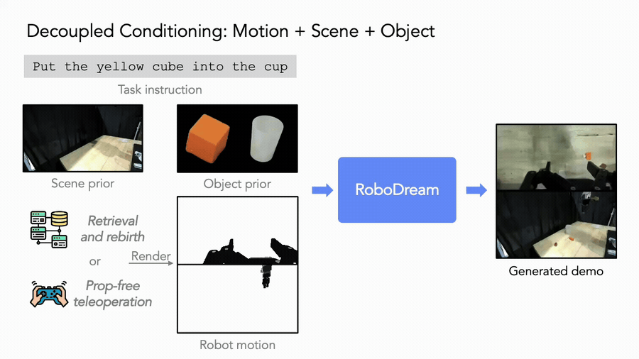
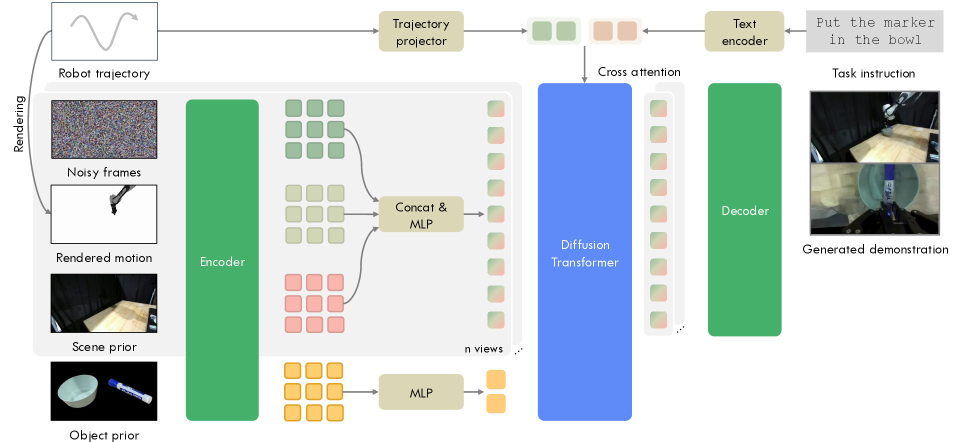
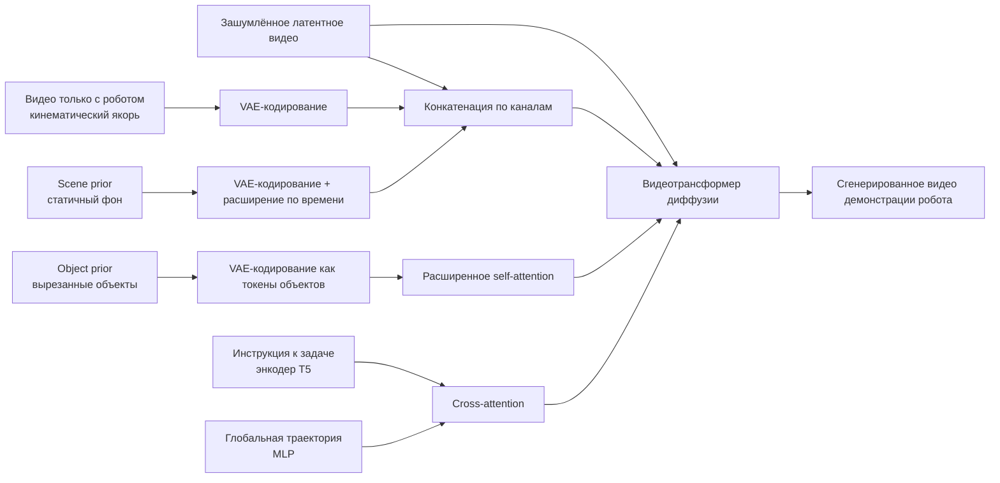
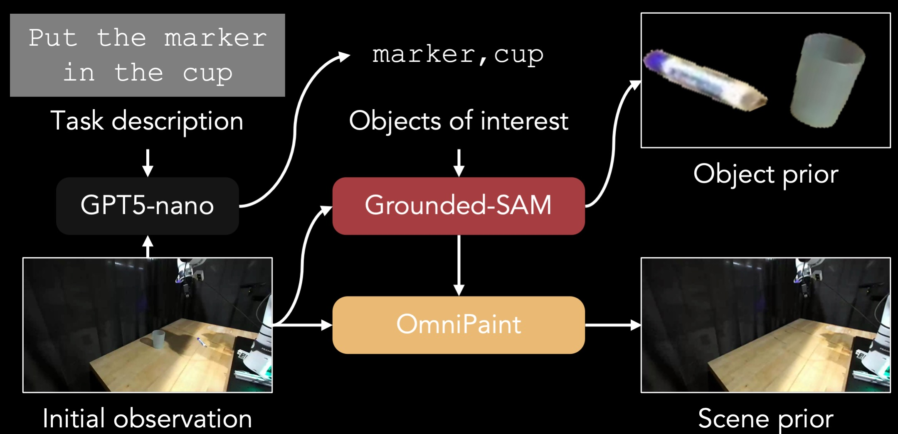
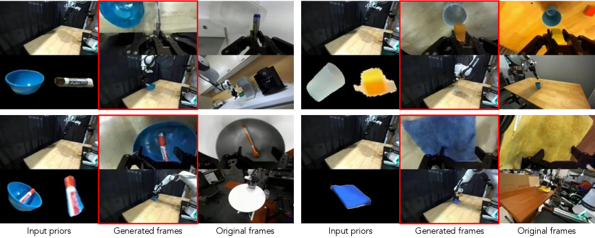
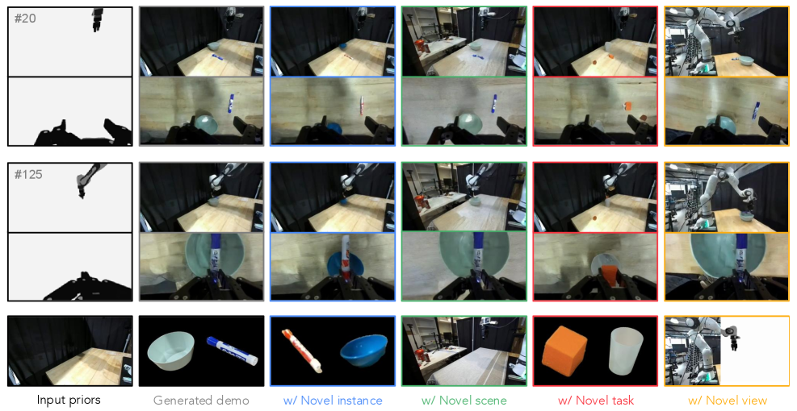
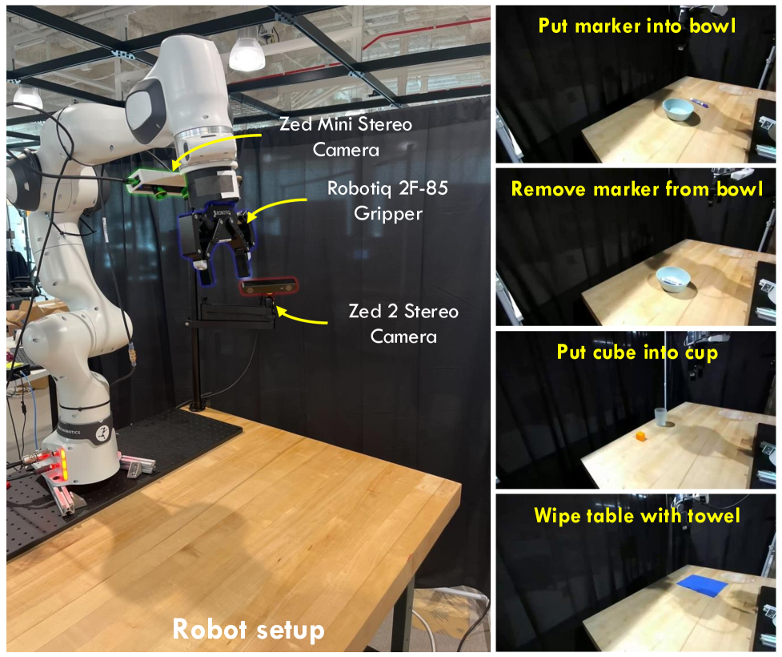

# RoboDream: руководство по композиционной модели мира для синтеза данных

Этот раздел разбирает статью **RoboDream: Compositional World Models for Scalable Robot Data Synthesis**. Препринт опубликован на arXiv 01.06.2026, авторы — из USC Physical Superintelligence Lab и Toyota Research Institute. Раздел уместно ставить в главе `17-world-models` как обзор переднего края моделей мира после WoG и WALL-WM.

Если следовать текущей структуре книги, не стоит переставлять базовые главы `01-diffusion-mathematics-and-problem-analysis`, `02-vae-explanation-and-code` и `03-ddpm-explanation-and-code`. RoboDream лучше всего смотрится как **шестой обзор** в разделе о передовых методах моделей мира: LeWM рассказывает о базовых вопросах латентной модели мира, RISE — о самоулучшении политики с помощью композиционной модели мира, RAW-Dream — об усилении VLA внутри модели мира, WoG — о моделировании в пространстве условий (condition-space world modeling), WALL-WM — о событийной модели мира с действиями, а RoboDream — о **синтезе учебных демонстраций робота с помощью композиционной видеомодели мира**.

После этого раздела важно усвоить одну фразу:

> RoboDream — не нейронный симулятор, который работает в реальном времени по схеме `step(action) -> next_state`, как MuJoCo или Isaac. Это генератор данных с моделью мира: в качестве каркаса он использует траектории, в которых видно только робота, а с помощью априорных данных о сцене и объекте перерисовывает обучающее видео демонстрации.

Эта фраза важна. Она объясняет, почему RoboDream стоит изучить, и помогает не поддаться влиянию слова «world model».

## 1. Статья, страница проекта и статус кода

| Пункт | Текущее состояние |
| :--- | :--- |
| Статья | [arXiv:2606.02577](https://arxiv.org/abs/2606.02577), отправлена 01.06.2026 |
| Страница проекта | [RoboDream project page](https://junjieye.com/RoboDream/) |
| Официальный репозиторий | [Jay-Ye/RoboDream](https://github.com/Jay-Ye/RoboDream) |
| Статус кода | по состоянию на 02.07.2026 репозиторий открыт, но в README написано **Code coming soon**: полный конвейер обучения, генерации данных и обучения политики пока не опубликован |
| Лицензия | в официальном репозитории указана Apache-2.0 |
| Базовая видеомодель | в статье сказано, что модель дообучена из **Cosmos-Predict2 2B**; в репозитории `cosmos-predict2` указано, что проект архивирован и рекомендуется переход на Cosmos-Predict2.5, поэтому при воспроизведении нужно зафиксировать версию, указанную в статье |
| Обучающие данные | около 40 тысяч эпизодов DROID с калибровкой камер |
| Вычислительные ресурсы | в статье указано: 2 узла по 8 GPU NVIDIA A100 в каждом, обучение около недели |
| Нижестоящая политика | Diffusion Policy, которая нужна, чтобы изолировать влияние данных RoboDream на обучение политики |

Этот раздел не стоит писать как пошаговое воспроизведение результатов статьи. Разумнее сначала разобрать архитектуру, поток данных, экспериментальные выводы и границы применимости, а после публикации официального кода повторить конвейер обучения, генерации и политики.

## 2. Какую проблему решает RoboDream

<p align="center">
  
</p>

**Рис. 1. Общий анимированный обзор RoboDream.** Цель не в том, чтобы создавать видео робота с нуля, а в том, чтобы при заданном каркасе движения робота перерисовать старую траекторию на новые объекты, новые сцены и новые ракурсы камеры.

Источник: [официальный репозиторий RoboDream на GitHub](https://github.com/Jay-Ye/RoboDream).

Нехватка данных для имитационного обучения роботов знакома всем. На одну задачу уходит несколько десятков или сотен реальных телеуправляемых демонстраций, и это уже требует много времени. Если ещё менять объекты, фон, ракурсы камеры и расстановку на столе, затраты быстро растут. Большие открытые наборы данных роботов, например DROID, сильно соблазняют, но исходные данные DROID часто сильно отличаются от вашего стенда:

| Отличие | Влияние на обучение политики |
| :--- | :--- |
| разные ракурсы камер | политика учится на пиксельных положениях, которые не совпадают с реальным развёртыванием |
| разная раскладка стола | фон, перекрытия и взаимное расположение объектов создают сдвиг ковариат (covariate shift) |
| разные экземпляры объектов | модель может не узнать целевой объект или неправильно выучить аффорданс захвата |
| траектории полезны, но визуальный домен не тот | каркас движения можно переиспользовать, а наблюдения напрямую — нет |

Идея RoboDream: **старые траектории действий могут быть полезны, а трудно переиспользовать именно визуальный домен.** Поэтому метод не сводится к простой аугментации изображений и не генерирует совершенно новые действия. Он выполняет более конкретную работу:

```text
уже имеющаяся или новая траектория робота
        ↓
рендеринг в Isaac Lab в виде видео только с роботом (robot-only motion video)
        ↓
добавление априорных данных о фоне целевой сцены (scene prior)
        ↓
добавление априорных данных о внешнем виде целевого объекта (object prior)
        ↓
видеомодель мира синтезирует обучающее видео в целевом домене
        ↓
обучение политики с исходными метками действий траектории
```

В этом смысл слова **Compositional World Models** в названии статьи: движение робота, внешний вид объекта, фон сцены и ракурс не привязаны жёстко к одной исходной демонстрации, а могут разбираться на части и собираться заново.

## 3. Является ли это «управляемой моделью мира»

На этот вопрос нужно ответить на двух уровнях.

В слабом смысле RoboDream управляемая. Можно контролировать:

- траекторию только робота: как движется тело робота и как открываются и закрываются захваты;
- априорные данные о сцене (scene prior): как выглядят фон и рабочая поверхность стола;
- априорные данные об объекте (object prior): как выглядит целевой объект;
- камеру и ракурс: одну и ту же траекторию можно заново отрисовать только с роботом с новой позиции камеры;
- текстовую инструкцию задачи: языковое описание накладывает семантические ограничения на процесс генерации.

В сильном смысле это не управляемый симулятор. Он не предоставляет:

```text
текущее состояние s_t + действие a_t -> следующее состояние s_{t+1}
```

Он также не позволяет, как Isaac, MuJoCo или Genesis, подавать политике или человеку действие на каждом шаге и в реальном времени получать следующий кадр, результат столкновения, награду и признак завершения. По сути это **офлайн-синтезатор видео демонстраций**: сначала ему подаётся корректная траектория, а затем он «рисует» целевой объект и сцену вокруг этой траектории.

Настоящая управляемая модель мира должна уметь как минимум следующее:

| Возможность | Сильная управляемая модель мира | Текущая роль RoboDream |
| :--- | :--- | :--- |
| Замкнутый шаг | на каждом шаге принимает действие и возвращает следующее состояние или наблюдение | API пошагового выполнения не предоставляется |
| Сохранение состояния | положение объектов, контакты и окклюзии эволюционируют непрерывно | всё видео генерируется за один раз |
| Физическая обратная связь | моделирует столкновения, скольжение, неудачный захват | опирается на визуальную согласованность, которую выучила видеомодель |
| Оценка политики | политика может выполнять rollout и пробовать в модели | в основном используется для офлайн-синтеза обучающих данных |
| Источник действий | политика сама решает действия в реальном времени | траектории заранее заданы или извлекаются из датасета |

Поэтому точнее всего назвать RoboDream так: **controllable video world model for robot data synthesis** — управляемая видеомодель мира для синтеза данных робота, а не learned physics simulator (обученный физический симулятор).

## 4. Общая архитектура: три визуальных априорных условия и два семантических и двигательных

<p align="center">
  
</p>

**Рис. 2. Архитектура RoboDream.** Читать эту схему удобнее, если разделять условия на «идущие по каналам» и «идущие через внимание»: видео только с роботом и scene prior конкатенируются с зашумлённым латентным представлением видео по каналам; object prior превращается в токены и попадает в self-attention; инструкция к задаче и глобальная траектория поступают через cross-attention.

Источник: [HTML-версия RoboDream на arXiv](https://arxiv.org/html/2606.02577).

Это самый важный рисунок статьи. Он отвечает на главный вопрос: какую информацию нужно явно подавать в видеомодель, чтобы она устойчиво генерировала демонстрации робота?

Условия RoboDream делятся на пять типов:

| Условие | Форма | Роль |
| :--- | :--- | :--- |
| Зашумлённое латентное представление видео | обрабатываемое в диффузии видео | целевое видео, которое модель в итоге генерирует |
| Видео только с роботом | видео, где отрисованы робот, но не объекты и не реальный фон | закрепляет внешний вид тела робота, его пиксельное положение и траекторию движения |
| Априорные данные о сцене (scene prior) | фон после удаления объектов задачи | задаёт стол, фон и раскладку окружения |
| Априорные данные об объекте (object prior) | изображение объектов, обрезанных по задаче | задаёт внешний вид целевого объекта |
| Инструкция и траектория | языковая инструкция + глобальное состояние траектории | ограничивают семантику задачи и структуру движения |

В архитектуре три ключевых решения.

Первое: **видео только с роботом — это пиксельный якорь движения**. Многие думают, что для управления достаточно подать углы суставов или позу концевого эффектора, но статья не ограничивается низкоразмерным состоянием. Сначала траектория рендерится в Isaac Lab как видео. Тогда модель видит в пиксельном пространстве, где в каждом кадре находится манипулятор, как он движется и когда открываются или закрываются захваты. Это похоже на видеоверсию ControlNet: форма робота не угадывается по промпту, а явно показывается модели.

Второе: **scene prior подаётся через расширение каналов**. Фон в коротком видео обычно почти статичен, поэтому статья растягивает один scene prior во времени в статичное видео и конкатенирует его по каналам с латентным представлением зашумлённого видео и видео только с роботом. Тогда на каждом временном шаге модель видит одну и ту же раскладку окружения, и фон меньше дрейфует.

Третье: **object prior вводится через self-attention**. Объект не наклеивается на фиксированные координаты, а кодируется в латентные токены объекта, которые видеотокены могут использовать в self-attention. Это тонкость: модель учится тому, **как выглядит целевой объект**, а не тому, что он обязан находиться в определённой точке априорного изображения.

Упрощённая схема потока данных:



Ценность этого решения не в том, что модель «больше», а в том, что задача генерации разбивается на несколько легко контролируемых частей: движение робота задаёт видео только с роботом, фон — scene prior, внешний вид объекта — object prior, а семантику задачи — инструкция.

## 5. Почему видео только с роботом так важно

Если генерировать видео операции робота только по тексту, модели придётся одновременно решить четыре трудные задачи:

1. тело робота не должно деформироваться;
2. движение манипулятора должно соответствовать ограничениям суставов;
3. контакт захвата с объектом должен быть правдоподобным;
4. фон и целевой объект должны соответствовать целевой сцене.

RoboDream не заставляет видеомодель решать всё это с нуля, а сначала фиксирует движение робота. Видео только с роботом выполняет три функции.

Первая: оно обеспечивает **согласованность воплощения (embodiment consistency)**. Видеомодели часто искривляют руку робота, теряют захват или неверно рисуют суставы. Видео только с роботом явно задаёт форму робота и его положение в каждом кадре, а модель в основном дорисовывает объекты и сцену.

Вторая: оно **неявно содержит информацию о камере**. Статья подчёркивает, что видео только с роботом содержит информацию о камере в пиксельной области. Если та же траектория отрисовывается с нового ракурса, проекция манипулятора в изображении меняется; вместе с scene prior для этого ракурса модель может сгенерировать демонстрацию с нового угла (novel view).

Третья: оно **сохраняет пригодность меток действий**. Во многих методах генерации робототехнических данных из текста сначала создаётся видео, а потом с помощью обратной динамики (inverse dynamics) восстанавливаются действия, и ошибка при этом легко усиливается. В RoboDream траектория действий уже существует, а видео — это перерисовка стороны наблюдений в целевой домен. Так обходится ловушка «сначала сгенерировать видео, потом угадать действие».

Но у этого достоинства есть и граница: **если входная траектория не подходит целевому объекту или раскладке, RoboDream не исправит её и не превратит в разумный план.** Он может перерисовать захват так, что он будет выглядеть как в целевом домене, но не гарантирует, что эта траектория подходит объекту с другим размером, массой или положением.

## 6. Prior extraction: как автоматически выделить объекты и сцену

<p align="center">
  
</p>

**Рис. 3. Процесс извлечения априорных данных (prior extraction).** RoboDream использует VLM, чтобы по инструкции и первому кадру найти объекты, относящиеся к задаче, затем Grounded-SAM сегментирует объекты, а OmniPaint удаляет их с исходного изображения и получает чистый scene prior.

Источник: [официальная страница проекта RoboDream](https://junjieye.com/RoboDream/).

Чтобы обучить RoboDream, нужно разделить существующие данные робота на три части: движение робота, целевой объект и фоновую сцену. Статья не требует покадровой ручной разметки, а строит обучающие пары автоматическим конвейером.

Первый шаг — **идентификация объектов**. По первому кадру и инструкции VLM выделяет объекты, действительно относящиеся к задаче. Например, для задачи «put marker into bowl» релевантны маркер и миска, а не стол, стена или основание манипулятора.

Второй шаг — **построение object prior**. Grounded-SAM сегментирует эти объекты задачи, после чего вырезанные объекты случайно поворачиваются и масштабируются и помещаются на чистый холст. Этот шаг легко упустить, но он важен: случайное размещение заставляет модель учить внешний вид объекта, а не запоминать его координаты в исходном изображении.

Третий шаг — **построение scene prior**. Объекты задачи стираются с первого кадра, а затем OmniPaint выполняет инпейнтинг, восстанавливая чистый фон. Так scene prior описывает только фон и поверхность стола, а object prior — только объекты задачи. Только после такого разделения модель действительно учится «менять объект» и «менять сцену» независимо.

Если этого не делать, возникает противоречие: в scene prior уже есть чашка, а object prior даёт ещё одну чашку, и непонятно, какая из них целевая. RoboDream устраняет эту неоднозначность, сначала удаляя объекты с фона.

## 7. Два режима работы: retrieval and rebirth и prop-free teleoperation

RoboDream предлагает не только одну архитектуру модели, но и два практических режима производства данных.

### 7.1 Retrieval and Rebirth: старая траектория «перерождается» в новой сцене

<p align="center">
  
</p>

**Рис. 4. Zero-shot демонстрационное «перерождение».** Справа — исходная траектория, найденная в DROID, в центре — демонстрация в целевом домене, которую RoboDream перерисовал по целевым object prior и scene prior.

Источник: [HTML-версия RoboDream на arXiv](https://arxiv.org/html/2606.02577).

Retrieval and Rebirth можно понимать как «найти похожий каркас движения, а затем заменить внешний вид на целевой домен». Процесс такой:

1. задать новую инструкцию к задаче;
2. закодировать инструкцию и инструкции к каждой траектории датасета энкодером T5;
3. по косинусному сходству найти в DROID траектории с близкой семантикой;
4. воспроизвести траекторию в Isaac Lab и отрисовать видео только с роботом;
5. подготовить scene prior целевой сцены и object prior целевого объекта;
6. RoboDream генерирует демонстрационное видео в целевом домене;
7. обучить нижестоящую политику на сгенерированном видео и исходных метках действий.

Этот режим лучше всего подходит, когда в открытых данных уже есть похожие движения, например приближение, захват, подъём, перемещение, укладка или протирка, а целевая среда и объекты отличаются, но каркас движения можно переиспользовать.

Он не подходит, когда для новой задачи нужна совсем другая динамика или стратегия контакта. Например, при переходе от захвата кубика к откручиванию крышки бутылки, открыванию молнии или вставке USB исходная структура действий может быть вообще несовместима. RoboDream может сменить «внешнюю одежду», но не создаст правильную стратегию контакта из ничего.

### 7.2 Prop-free teleoperation: работаем с воздухом, а объекты дорисовываем

Prop-free teleoperation — одна из самых интересных идей статьи. Она заимствует термин из кино, где актёр сначала играет с воображаемыми предметами, а реквизит добавляется на этапе постобработки. В робототехнике оператору не нужно каждый раз расставлять настоящие объекты: он может выполнять «понарошку» движения робота на пустом столе или в симуляторе и записывать только корректные траектории. Затем RoboDream добавляет целевые объекты и сцену.

У этого подхода два преимущества:

- не нужно постоянно сбрасывать положение объектов, поэтому сбор телеуправляемых данных идёт быстрее;
- одна универсальная траектория «взять и положить» с разными object prior превращается в данные для нескольких задач.

Но есть и заметный риск: тонкие корректировки контакта при реальном захвате, обратная связь от столкновений и скольжение объекта в prop-free траекториях отсутствуют. RoboDream должен «дорисовать» эти визуальные явления. Если дорисовать неправильно, видео может выглядеть правдоподобно, но метки действий и визуальный контакт окажутся рассогласованы.

Поэтому правильно считать prop-free **приближённым способом снизить стоимость сбора данных**, а не полной заменой реальной телеоперации.

## 8. Compositional generation: самое изящное в этой статье

<p align="center">
  
</p>

**Рис. 5. Возможность композиционной генерации RoboDream.** Одна и та же базовая траектория может генерировать новые экземпляры, новые сцены, новые задачи и новые точки зрения, если менять object prior, scene prior, контекст задачи и ракурс камеры.

Источник: [HTML-версия RoboDream на arXiv](https://arxiv.org/html/2606.02577).

Этот рисунок показывает главную «композиционность» статьи.

| Изменяемый фактор | Как RoboDream его контролирует | Смысл |
| :--- | :--- | :--- |
| Новые экземпляры | замена object prior | изменение внешнего вида объектов одного класса, например разные маркеры |
| Новые сцены | замена scene prior | перенос того же движения на другую поверхность или фон |
| Новые задачи | замена object prior и контекста задачи | при совместимости аффорданса интерпретация того же каркаса движения как новой задачи |
| Новые точки зрения | рендеринг видео только с роботом с новой камеры и соответствующий scene prior | генерация данных с нескольких ракурсов по одной траектории |

Здесь важно понимать границы «zero-shot». Zero-shot у RoboDream в основном означает **визуальную композиционную обобщаемость**, а не **zero-shot планирование движения**. Модель не видит новую задачу и сама не придумывает новые действия. Она берёт уже существующие или заново собранные совместимые траектории и меняет визуальный контекст: объекты, сцену и ракурс, которых не было в обучении.

Именно это делает метод сильнее обычной аугментации изображений. Обычная аугментация чаще всего меняет цвета, текстуру или фон, но базовая взаимосвязь взаимодействий остаётся прежней. RoboDream может переродить траекторию движения в новой целевой области, так что старая траектория визуально становится демонстрацией, ближе к целевой среде.

## 9. Как читать экспериментальные результаты

<p align="center">
  
</p>

**Рис. 6. Задачи реальной оценки на роботе.** В статье используется платформа Franka Panda в стиле DROID, на которой оцениваются четыре задачи: Put Marker into Bowl, Remove Marker from Bowl, Put Cube into Cup, Wipe Table with Towel.

Источник: [HTML-версия RoboDream на arXiv](https://arxiv.org/html/2606.02577).

Оценка в статье сосредоточена не на том, насколько красиво выглядит видео, а на том, помогают ли сгенерированные данные нижестоящей политике. Для обучения политики используется Diffusion Policy, а итоговое качество проверяется на реальном роботе.

### 9.1 Результаты Retrieval and Rebirth

| Задача | Real-50 | Orig-100 | Orig-Mix | Gen-100 | Gen-Mix |
| :--- | ---: | ---: | ---: | ---: | ---: |
| Put Cube into Cup | 35 | 0 | 55 | 20 | 65 |
| Put Marker into Bowl | 30 | 0 | 35 | 15 | 55 |
| Remove Marker from Bowl | 20 | 0 | 20 | 5 | 35 |
| Wipe Table with Towel | 60 | 0 | 70 | 20 | 95 |
| Среднее | 36.3 | 0 | 45.0 | 15.0 | 62.5 |

Смотреть только на максимальный Gen-Mix не стоит. Правильнее читать таблицу так:

Во-первых, Orig-100 даёт 0%. Прямое обучение политики целевой области на найденных исходных данных DROID полностью проваливается, что говорит о сильном сдвиге домена. Старые данные не бесполезны по части действий, но визуальный домен не совпадает.

Во-вторых, Gen-100 в среднем даёт всего 15.0%. Чисто сгенерированные данные сами по себе не очень сильны и заметно уступают Real-50 с 36.3%. Это значит, что RoboDream пока не может заменить реальные данные.

В-третьих, Gen-Mix в среднем даёт 62.5%, что выше и Real-50, и Orig-Mix. Самый надёжный вывод такой: **небольшой набор реальных данных как основа плюс добавление сгенерированных RoboDream данных целевого домена заметно улучшает обучение политики.**

Поэтому статья по-настоящему доказывает, что **генерируемые данные полезны как реальная аугментация данных**, а не то, что **полностью синтетические данные уже решают проблему обучения роботов**.

### 9.2 Результаты prop-free

| Задача | Real-50 | Real w/ Gen Obs | Prop-Free |
| :--- | ---: | ---: | ---: |
| Put Cube into Cup | 35 | 25 | 30 |
| Put Marker into Bowl | 30 | 20 | 20 |
| Remove Marker from Bowl | 20 | 15 | 20 |
| Wipe Table with Towel | 60 | 60 | 60 |
| Среднее | 36.3 | 30.0 | 32.5 |

Prop-free даёт в среднем 32.5%, что немного ниже Real-50 с 36.3%. Однако в статье сообщается, что сбор 50 реальных телеуправляемых эпизодов занимает около 2 часов, а 50 траекторий prop-free — около 55 минут, то есть примерно в 2,2 раза быстрее.

Смысл этого результата тоже нужно уточнить: prop-free не превосходит реальные данные по качеству, а достигает близкого эффекта при меньших затратах. Это полезно, когда нужно быстро проверить задачу или расширить каркасы движения, но если задача очень чувствительна к физике контакта, реальные данные по-прежнему незаменимы.

### 9.3 Масштабирование со сгенерированными данными

| Задача | Real-50 | Mix-100 | Mix-200 | Mix-300 | Mix-400 |
| :--- | ---: | ---: | ---: | ---: | ---: |
| Put Cube into Cup | 35 | 65 | 75 | 80 | 75 |
| Put Marker into Bowl | 30 | 55 | 70 | 70 | 70 |
| Remove Marker from Bowl | 20 | 35 | 45 | 50 | 50 |
| Wipe Table with Towel | 60 | 95 | 100 | 95 | 100 |
| Среднее | 36.3 | 62.5 | 72.5 | 73.75 | 73.75 |

Эта таблица показывает, что добавление сгенерированных данных даёт эффект масштабирования, но прирост выходит на плато примерно при Mix-200. Возможные причины: ограниченное разнообразие найденных траекторий, ограниченное качество генерации и остаточный разрыв между сгенерированными данными и реальным развёртыванием.

## 10. Сравнение с обычной генерацией видео, традиционными симуляторами и другими моделями мира

| Тип метода | Вход | Выход | Замкнутый ли | Основное применение | Место RoboDream |
| :--- | :--- | :--- | :--- | :--- | :--- |
| Обычная text-to-video | текстовый промпт | полное видео | нет | генерация визуального контента | RoboDream добавляет сильные условия: движение робота, сцену и объект |
| Аугментация изображений | исходное изображение + маска / промпт | улучшенное изображение или видео | нет | рандомизация домена, замена фона | RoboDream не только меняет текстуру, но и перерисовывает демонстрацию целевого домена |
| Традиционная физическая симуляция | состояние + действие + физический движок | следующее состояние / наблюдение | да | обучение, планирование, оценка | у RoboDream нет явного физического шага |
| Видеомодель мира с условием по действию | текущее наблюдение + последовательность действий | будущее видео | можно офлайн rollout | воображение и оценка политики | RoboDream ближе к офлайн-перерисовке данных |
| WoG | текущее наблюдение + язык | латентное условие, связанное с действием | нет | улучшение генерации действий VLA | WoG не генерирует видео, а RoboDream генерирует видео демонстраций |
| RAW-Dream | начальное наблюдение + rollout действий | воображаемый rollout + награда VLM | офлайн RL | посттренировка VLA | RAW-Dream обучает политику в модели мира, а RoboDream синтезирует данные с её помощью |
| WALL-WM | текущие многоракурсные наблюдения + следующее событие | латент видео события + действия | выполнение по событиям | моделирование мир-действие | WALL-WM ближе к генерации действий, RoboDream — к движку данных |

Из таблицы видно, что RoboDream занимает определённое место: он не VLA-основа и не полноценный интерактивный симулятор мира, а **движок перерождения траекторий (trajectory-conditioned visual rebirth engine)** для задач, в которых узкое место — данные для имитационного обучения.

## 11. Что в статье стоит изучить подробнее

Первое: удачное сокращение проблемы. Модель не придумывает движения робота из ничего, а фиксирует траекторию и учится визуальному контексту. Это значительно стабильнее, чем генерация демонстраций робота по тексту.

Второе: обход обратной динамики. Метки действий берутся из исходной траектории, а генеративная модель отвечает только за сторону наблюдений. Это лучше подходит для обучения политики, чем схема «сначала генерируем видео, потом предсказываем по нему действия».

Третье: тонкое разделение object prior и scene prior. Случайное размещение object prior не даёт модели запомнить координаты, а удаление объектов из scene prior предотвращает конфликт между двумя априорными данными. Оба решения направлены на то, чтобы модель действительно выучила композиционность.

Четвёртое: многоракурсная обработка — не простая склейка. Статья рассматривает каждый вид как отдельную видеозапись, токенизирует их по отдельности и затем объединяет токены, что уменьшает пространственную неоднозначность при простой горизонтальной склейке.

Пятое: статья показывает ценность внешних больших данных, таких как DROID, более конкретно. Прямое использование открытых данных даёт сдвиг домена, но каркасы движения в них могут быть полезны. RoboDream переводит эти каркасы в целевой визуальный домен.

## 12. Основные ограничения и риски

Главная ошибка при чтении RoboDream — принять генерацию видео за замену физической симуляции. Это неверно. Ограничения метода минимум такие:

Первое: фотореалистичность видео не равна согласованности действий. Видео может выглядеть реалистично, но захват, объект и метки действий могут не совпадать на уровне сантиметров и кадров. В задачах робототехники объект, смещённый на 2 сантиметра, может привести к тому, что политика выучит неверную связь.

Второе: траектория только с роботом должна быть правдоподобной изначально. Статья в ограничениях подчёркивает, что метод предполагает: отрисованное видео только с роботом верно описывает траекторию, которую робот должен выполнить в целевой сцене. RoboDream не отвечает за построение лучшего плана движения.

Третье: контактная физика остаётся слабым местом. Силы контакта, трение, скольжение и режимы отказа при захвате, отпускании, протирке или толкании видеодиффузия может лишь приблизительно выучить из данных, но не решить явно, как это делает физический движок.

Четвёртое: чисто генерируемых данных пока недостаточно. Gen-100 в среднем даёт 15.0%, заметно ниже Real-50. Наиболее надёжный способ использования — смешанное обучение (mixed training), а не полностью синтетическое.

Пятое: код пока не опубликован полностью. В официальном репозитории открыты README, лицензия и ресурсы, но конвейеры обучения, генерации и обучения политики по-прежнему помечены как coming soon. Воспроизведение экспериментов станет возможным после публикации кода, весов, конфигураций и скриптов обработки данных.

## 13. Что делать, если захочется воспроизвести

Сейчас не стоит сразу тратить вычислительные ресурсы на воспроизведение. Но можно заранее проверить список того, что понадобится, и следить за публикацией кода.

| Модуль | Что нужно подготовить | Сложность воспроизведения |
| :--- | :--- | :--- |
| Данные | эпизоды DROID, калибровка камер, инструкции задач, траектории действий | большой объём; траектории и калибровку камер нужно согласовать |
| Рендеринг только робота | Isaac Lab, URDF/USD робота, воспроизведение траекторий | нужно стабильно отрисовывать реальные траектории как многоракурсное видео только с роботом |
| Извлечение априорных данных | VLM для идентификации объектов, Grounded-SAM, OmniPaint | качество автоматической сегментации и инпейнтинга влияет на обучение |
| Обучение модели мира | Cosmos-Predict2 2B, латенты видео, расширение каналов, изменения attention | требуется много вычислительных ресурсов: в статье 16 GPU A100 на обучение около недели; версию Cosmos нужно зафиксировать по статье |
| Генерация данных | целевые scene prior и object prior, найденные траектории, скрипты сэмплирования | качество генерации и согласованность меток действий нужно контролировать вручную или автоматической фильтрацией |
| Обучение политики | Diffusion Policy, смешанная выборка реальных и сгенерированных данных | соотношение смеси, критерии успешности задачи и статистика rollout должны совпадать со статьёй |

Более реалистичный план на ближайшее время такой:

1. Прочитать страницу проекта и статью на arXiv, разобраться с рисунками 2, 3, 5 и 6.
2. Следить за тем, появятся ли скрипты обучения и генерации в [Jay-Ye/RoboDream](https://github.com/Jay-Ye/RoboDream).
3. Если сначала опубликуют inference, попробовать генерацию на небольшом числе траекторий DROID или собственных данных.
4. Если появится конвейер обучения политики, воспроизвести главное сравнение Real-50 и Gen-Mix.
5. При воспроизведении в первую очередь проверять согласованность действий, а не только то, насколько красиво выглядит видео.

## 14. Порядок чтения с другими статьями этого раздела

Рекомендуемый порядок чтения:

| Статья | Что изучать сначала | Какой вопрос она помогает понять |
| :--- | :--- | :--- |
| LeWM | почему модель мира должна предсказывать будущие латенты и почему представления схлопываются | основы моделей мира |
| RISE | как dynamics-модель и модель прогресса вместе улучшают политику | как модель мира служит оптимизации политики |
| RAW-Dream | как VLA выполняет RL в модели мира, не зависящей от задачи | как модель мира становится средой посттренировки |
| WoG | почему не нужно генерировать полное видео и достаточно предсказывать связанные с действием будущие условия | может ли модель мира моделировать только то, что важно для действий |
| WALL-WM | как по границам событий одновременно предсказывать будущее видео и действия | в каких единицах стоит моделировать задачи на длинном горизонте |
| RoboDream | как синтезировать демонстрации робота из траекторий только робота и априорных данных о сцене и объекте | как модели мира облегчают дефицит данных для робототехники |

Если выразить место RoboDream одной фразой:

> Он не создаёт нейронную вселенную, в которой робот может жить, а превращает уже имеющиеся траектории робота в данные, которые можно переиспользовать между объектами, сценами и ракурсами.

## 15. Ссылки

- Страница проекта RoboDream: [https://junjieye.com/RoboDream/](https://junjieye.com/RoboDream/)
- Статья RoboDream: [arXiv:2606.02577](https://arxiv.org/abs/2606.02577)
- Официальный репозиторий RoboDream: [Jay-Ye/RoboDream](https://github.com/Jay-Ye/RoboDream)
- Набор данных DROID: [DROID: A Large-Scale In-The-Wild Robot Manipulation Dataset](https://droid-dataset.github.io/)
- Cosmos-Predict2: [NVIDIA Cosmos Predict2](https://github.com/nvidia-cosmos/cosmos-predict2)
