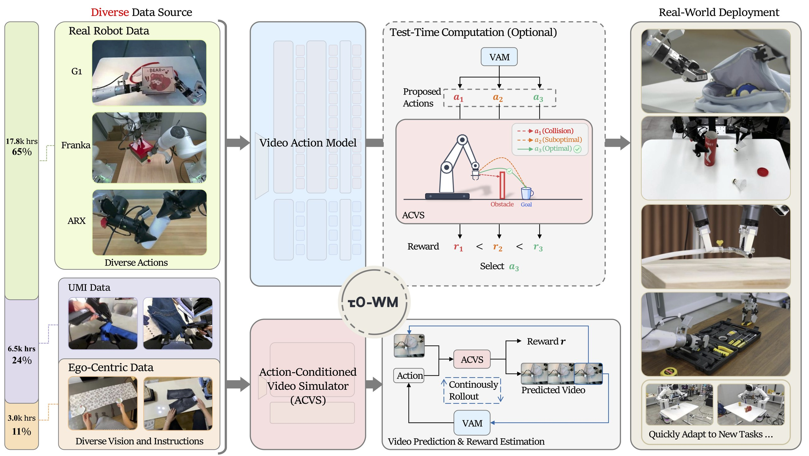
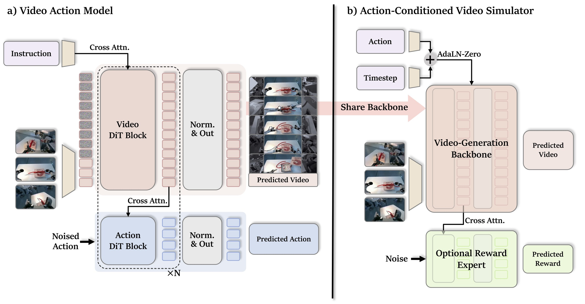
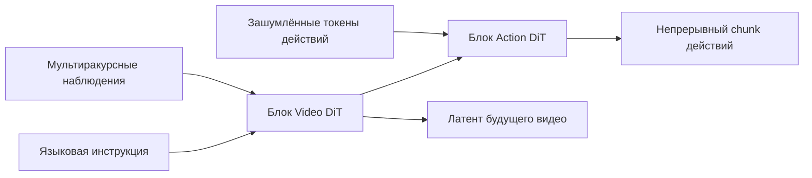
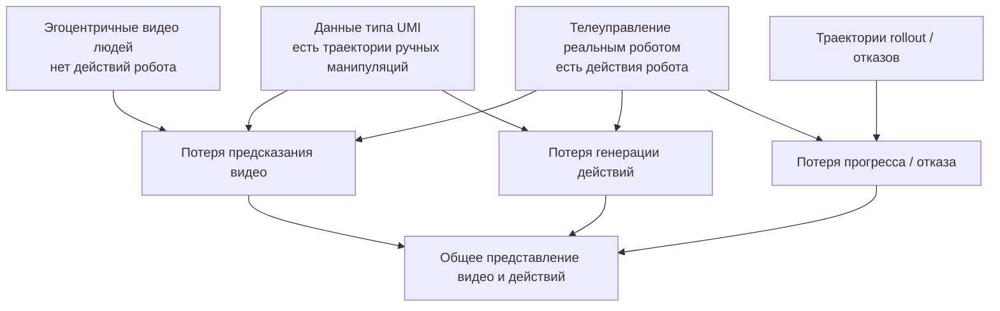
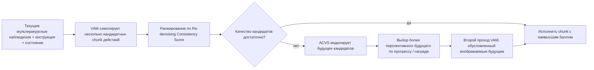
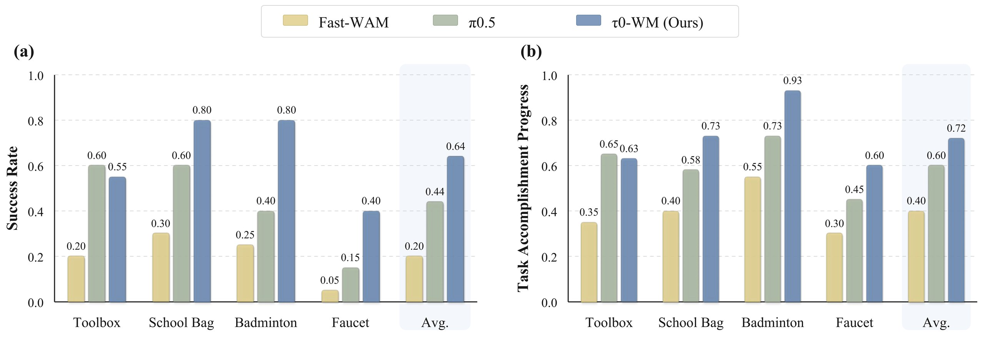

# τ0-WM: введение в унифицированную видео-действенную модель мира

> Этот раздел — обзор статьи **τ0-WM: A Unified Video-Action World Model for Robotic Manipulation**. Работа создана Shanghai Innovation Institute и AGIBOT Finch, страница проекта опубликована 31.05.2026. Официально модель позиционируется как открытая video-action world model для манипуляций роботов: она умеет предсказывать действия, предсказывать видео будущего, вызванного этими действиями, и с помощью imagined future оценивать и корректировать действия на этапе тестирования.

## 1. Главный вывод

τ0-WM — не просто VLA и не только видеомодель мира. Он объединяет в одной системе три функции:

1. **Генерация действий (Action Generation)**: как модель политики, по мультиракурсным наблюдениям, языковой инструкции и состоянию робота выдаёт исполнимый chunk действий.
2. **Предсказание видео (Video Prediction)**: как видеомодель мира, предсказывает будущие мультиракурсные визуальные латенты / видео.
3. **Оценка действий (Action Evaluation)**: как обученный симулятор или модель награды, разворачивает будущее для кандидатов действий и оценивает прогресс задачи.

Суть в одной фразе:

> Ключевая идея τ0-WM — не в том, что «робот умеет генерировать видео», а в том, что робот перед исполнением предлагает действия, представляет их последствия, оценивает эти последствия и при необходимости корректирует действия.

Раздел стоит размещать в главе `17-world-models`, а не в главе о VLA. Хотя в нём есть интерфейс политики, основное новшество — объединение policy, video prediction, action-conditioned simulator и test-time computation в единый механизм принятия решений по типу модели мира.

## 2. Статья, проект и статус открытого кода

| Пункт | Ссылка | Текущее состояние |
| :--- | :--- | :--- |
| Страница проекта | [AGIBOT Finch τ0-WM](https://finch.agibot.com/research/tau0-wm) | официальная страница проекта с рисунками, видео, статьёй, кодом и входом на HF |
| Статья | [arXiv:2606.01027](https://arxiv.org/abs/2606.01027) / [HTML](https://arxiv.org/html/2606.01027v1) | отправлена 31.05.2026 |
| PDF | [официальный PDF](https://finch-static.agibot.com/VAM/blog/tau_0_wm.pdf) | ссылка прямо со страницы проекта |
| GitHub | [sii-research/tau-0-wm](https://github.com/sii-research/tau-0-wm) | официальная реализация, Apache-2.0; опубликованы код post-training и inference |
| Hugging Face | [sii-research/tau-0-wm](https://huggingface.co/sii-research/tau-0-wm) | вход к предобученным весам VAM; на карточке модели указана Apache-2.0 |

Статус открытости нужно читать внимательно. В README на GitHub сказано:

- 26.06.2026 опубликованы код обучения post-training и код inference.
- Предобученные веса VAM размещены на Hugging Face.
- Предобученные веса Simulator по-прежнему помечены как «will be released soon».
- Код Test-Time Computation будет опубликован вместе с весами Simulator.

Поэтому сейчас стоит изучать и дорабатывать в первую очередь **веса VAM, конвейер post-training и цепочку inference policy server / client**. Полностью воспроизвести в статье ректификацию на основе симулятора ACVS (simulator-based rectification) можно будет только тогда, когда официальная команда опубликует веса Simulator и соответствующий код TTC.

## 3. Почему он входит в линию моделей мира

В этой книге уже разобрано несколько моделей мира. τ0-WM можно поместить в такую систему координат:

| Метод | Что предсказывает модель мира | Как служит роботу |
| :--- | :--- | :--- |
| LeWM | латентное будущее / динамика | вводит базовые понятия моделей мира |
| RISE | будущее с условием по действию + ценность | улучшение политики в воображении |
| RAW-Dream | видео rollout, не зависящий от задачи, + VLM-награда | посттренировка VLA с моделью мира |
| WoG | условие будущего, связанное с действием | не генерирует полное видео, сжимает будущее в условие действия |
| WALL-WM | событийное моделирование видео и действий мира | выравнивает действия и видеособытия |
| RoboDream | траектория только робота + априорные данные о сцене и объекте | синтез обучающих видео демонстраций робота |
| Gamma-World | синхронное будущее видео нескольких агентов | rollout общего мира нескольких агентов |
| BWM | rollout видео робота с условием по действию | недорогая визуальная симуляция мира |
| **τ0-WM** | **будущее видео + исполнимый chunk действий + оценка прогресса** | **предложить / оценить / скорректировать действие при исполнении** |

τ0-WM ближе всего к BWM и WALL-WM: все три относятся к линии «видеомодель мира с условием по действию / world-action model». Но τ0-WM идёт дальше: он не только генерирует видео будущего с условием по действию, но и соединяет **генератор действий VAM** и **симулятор видео с условием по действию ACVS** в один контур принятия решений на этапе тестирования.

## 4. Общий обзор: от разнородных данных до реального развёртывания



**Рис. 1. Общий обзор τ0-WM.** Слева — разнородные данные, в центре — Video Action Model и Action-Conditioned Video Simulator, справа — развёртывание на реальных роботах. Важнее всего на схеме не «5B — это много», а то, что данные из разных источников подключаются к единой модели в зависимости от того, какой сигнал супервизии каждый из них даёт.

Источник: [официальная страница проекта τ0-WM](https://finch.agibot.com/research/tau0-wm).

Схему удобно читать по четырём блокам.

Первый блок — **Diverse Data Source**. На странице проекта указано, что τ0-WM использует около 27 300 часов разнородных данных:

| Источник данных | Длительность | Доля | Какую супервизию даёт |
| :--- | :--- | :--- | :--- |
| Телеуправление реальным роботом | 17 800 часов | 65% | мультиракурсные наблюдения реального робота, состояние робота, исполнимые действия |
| Данные типа UMI | 6 500 часов | 24% | более богатое поведение манипуляций и сцены, сигналы, связанные с действиями |
| Эгоцентричные данные взаимодействия людей | 3 000 часов | 11% | видео взаимодействия людей от первого лица: движение объектов, контакты, временная структура задачи |

Здесь главное — **не считать все данные одинаковыми**. Видео людей от первого лица богато визуальной динамикой, но в нём нет меток действий в пространстве управления роботом; данные реальных роботов содержат метки действий, но дороги и узко покрывают задачи. τ0-WM использует маски супервизии по модальности (modality-specific supervision masks), так что каждый образец супервизируется только тем сигналом, который у него действительно есть.

Второй блок — **Video Action Model, VAM**. Это интерфейс, обращённый к политике: на вход подаются мультиракурсные изображения, языковая инструкция и состояние робота, на выходе — латенты будущего визуального мира и непрерывный chunk действий.

Третий блок — **Action-Conditioned Video Simulator, ACVS**. Он не генерирует видео по текстовому промпту, а по текущему наблюдению, инструкции и кандидатному chunk действий предсказывает, к каким последствиям приведёт эта последовательность, и выдаёт плотную оценку прогресса задачи / награду (dense task-progress / reward score).

Четвёртый блок — **Test-Time Computation**. На этапе развёртывания модель не выбирает одно действие и сразу его исполняет: она сэмплирует несколько кандидатов, ранжирует их по согласованности повторного шумоподавления (re-denoising consistency) и оценке симулятора; если качество кандидатов низкое, она корректирует действие по смоделированному будущему.

## 5. Схема метода: VAM и ACVS — два взаимодополняющих интерфейса



**Рис. 2. Архитектура метода τ0-WM.** Слева — VAM, справа — ACVS. VAM отвечает за генерацию действий, ACVS — за моделирование последствий действий и оценку награды; оба используют общий backbone видеогенерации.

Источник: [официальная страница проекта τ0-WM](https://finch.agibot.com/research/tau0-wm).

### 5.1 Левая половина: Video Action Model

На вход VAM подаются:

- multi-view observations: мультиракурсные текущие наблюдения;
- language instruction: инструкция на естественном языке;
- robot state: проприоцепция робота / состояние концевого эффектора;
- noised action: зашумлённые токены действий в диффузионной ветви действий.

На выходе VAM даёт:

- predicted video: предсказание будущего визуального латента / видео;
- predicted action: непрерывный chunk действий.

Структура на схеме очень важна:



Ветвь Video DiT здесь не декоративная. Action DiT читает промежуточные представления видео через послойный cross-attention, поэтому ветвь действий вынуждена использовать представление «как мир будет меняться». Это отличает метод от обычной политики, которая работает только с действиями.

Обычная VLA часто выглядит так:

```text
изображение + язык + состояние -> действие
```

VAM в τ0-WM ближе к такой схеме:

```text
изображение + язык + состояние -> латент будущего видео + действие
```

Так предсказание будущего становится целью обучения, связанной с управлением, а не дополнительным визуальным выходом.

### 5.2 Правая половина: симулятор видео с условием по действию

На вход ACVS подаётся:

```text
текущее наблюдение + инструкция + кандидатный chunk действий
```

На выходе:

```text
предсказанное мультиракурсное будущее + плотная оценка прогресса задачи
```

Это прямо дополняет VAM:

| Модуль | Какой вопрос решает | Вход | Выход |
| :--- | :--- | :--- | :--- |
| VAM | что мне делать сейчас | наблюдение, инструкция, состояние | chunk действий + латент будущего |
| ACVS | что будет, если выполнить этот chunk | наблюдение, инструкция, кандидатные действия | будущее видео + прогресс / награда |

ACVS не является традиционным физическим симулятором. У него нет явных сил контакта, состояний твёрдых тел и решателя столкновений, и он не может гарантировать проверяемость уровня MuJoCo или Isaac Sim. Скорее это **обученный оценщик визуальных последствий (learned visual consequence evaluator)**: он с помощью видеомодели мира предсказывает последствия действий, а затем с помощью оценки прогресса задачи ранжирует кандидаты.

## 6. Как понимать 5B и 5.5B

В популярных материалах τ0-WM часто называют моделью мира класса 5B. В архитектурных деталях статьи сказано точнее: VAM построен на основе Wan2.2-TI2V-5B и добавляет ветвь Action DiT примерно на 0.5B параметров, поэтому общий объём VAM — около 5.5B.

Эти два обозначения не противоречат друг другу:

| Обозначение | Смысл |
| :--- | :--- |
| 5B | масштаб видеодиффузионного бэкбона / модели мира, который подчёркивают в описании проекта |
| 5.5B VAM | в архитектуре статьи backbone видео DiT на 5B и ветвь Action DiT на 0.5B считаются вместе |

В учебном материале рекомендуется единообразно называть его **открытой воплощённой моделью мира класса 5B**, а в описании архитектуры уточнять, что VAM имеет 5.5B параметров.

## 7. Обучение на разнородных данных: каждый тип данных супервизирует только то, что в нём есть

Дизайн данных у τ0-WM стоит изучить. Он не опирается только на дорогие данные реальных роботов и не предполагает, что видео людей напрямую дают метки действий робота. Вместо этого данные используются послойно.



Логика здесь прагматичная:

- Данные реального робота самые ценные, так как связывают визуальное пространство с пространством управления роботом.
- Данные типа UMI расширяют разнообразие сцен и поведений, но всё же отличаются по воплощению от целевого робота.
- Эгоцентричные видео людей самые дешёвые и дают самое широкое покрытие, но в них нет исполнимых действий робота.
- Данные отказов и rollout важны для обучения оценке прогресса и награды, поскольку успешные демонстрации редко показывают модели, где может произойти провал.

Маски супервизии по модальности работают так: если у записи нет меток действий, потеря действий для неё не считается; если у записи отсутствует какой-то ракурс камеры, отсутствующий ракурс не даёт ложной супервизии; если есть сигнал прогресса или отказа, он используется для обучения оценочной способности ACVS.

Это типично для многомодальных предобучений: сложность состоит не в том, чтобы просто собрать данные вместе, а в том, чтобы разные данные в одной модели выполняли свою роль.

## 8. Test-Time Computation: сначала предложить, затем оценить, затем скорректировать

Самая интересная часть τ0-WM — логика вычислений на этапе развёртывания. Это не традиционная прямая политика:

```text
наблюдение -> действие -> исполнение
```

А такой процесс:



В этом процессе два ключевых приёма.

**Re-denoising Consistency Score** показывает, согласуется ли кандидатный chunk действий с условным распределением действий, которое выучила модель. Интуиция такая: если chunk действий зашумить заново и потом снова шумоподавить, а он вернётся к близкому действию, значит, он находится в области, которую модель считает надёжной; если согласованность низкая, кандидат, вероятно, неустойчив.

**Simulator-based Rectification** больше похоже на планирование с моделью мира: когда качество кандидатов низкое, ACVS предсказывает видео будущего и прогресс задачи для разных кандидатов, выбирает наиболее перспективное воображаемое будущее и использует его как условие для генерации скорректированного chunk действий.

В этом и состоит отличие τ0-WM от многих VLA: VLA обычно тратит вычисления на один прямой проход, а τ0-WM вкладывает дополнительные вычисления в оценку и коррекцию действий до исполнения.

## 9. Как читать экспериментальные результаты



**Рис. 3. Сравнение успешности и прогресса выполнения задач на реальных роботах.** В статье сравниваются Fast-WAM, π0.5 и τ0-WM на четырёх тонких манипуляционных задачах, которых не было в предобучающих данных; учитываются success rate и task accomplishment progress.

Источник: [официальная страница проекта τ0-WM](https://finch.agibot.com/research/tau0-wm).

Эксперименты охватывают три воплощения робота:

- AGIBOT-G01;
- манипуляторы ARX;
- двурукий Franka.

Задачи — Toolbox, School Bag, Badminton, Faucet; все они долгие по времени или требуют точного геометрического совмещения. В статье подчёркивается, что эти задачи не входят в предобучающий корпус и проверяют обобщение и способность к исполнению после post-training.

По рисунку 3 можно выделить несколько моментов:

| Сравнение | Наблюдение |
| :--- | :--- |
| Fast-WAM | в целом слабее на этих задачах, особенно проигрывает в длинных сценариях и сценариях с точным совмещением |
| π0.5 | сильная базовая VLA, на задаче Toolbox конкурентоспособна |
| τ0-WM | наивысшие средняя успешность и средний прогресс задач, заметное преимущество в School Bag, Badminton и Faucet |

Обратите внимание, что π0.5 здесь — базовый метод сравнения, а не основа τ0-WM. Основой τ0-WM служит видеодиффузионный backbone Wan2.2-TI2V-5B, к которому добавлены ветвь действий и механизмы симулятора / оценки.

В статье также проведена абляция данных. Сравнение Robot-only и Robot+UMI+Ego показывает:

| Настройка | Задача | Clean | Cluttered | Среднее |
| :--- | :--- | :--- | :--- | :--- |
| Robot-only | Zero-shot Pen-to-holder | 0.22 | 0.06 | 0.14 |
| Robot+UMI+Ego | Zero-shot Pen-to-holder | 0.56 | 0.53 | 0.55 |
| Robot-only | SFT Object-wipe-place | 0.85 | 0.55 | 0.70 |
| Robot+UMI+Ego | SFT Object-wipe-place | 0.90 | 0.75 | 0.83 |

Эта таблица показывает, что разнородные данные — не маркетинговый аргумент, а реально влияют на результаты zero-shot и SFT. Особенно в сценах с захламлённым фоном (cluttered) разнообразие визуальных взаимодействий из данных Ego и UMI делает модель устойчивее.

## 10. Что реально можно воспроизвести по репозиторию

Официальный GitHub сейчас предоставляет такие рабочие входы:

```bash
git clone https://github.com/sii-research/tau-0-wm.git
cd tau-0-wm
pip install -r requirements.txt
```

Основная часть README репозитория делится на три блока.

### 10.1 Inference предобученного VAM

Нужно подготовить:

- предобученные веса τ0-WM VAM;
- веса Wan2.2-TI2V-5B;
- веса VAE;
- веса текстового энкодера / токенизатора.

Затем нужно отредактировать:

```text
configs/deployment/tau_pretrain_rela_eef6d.yaml
```

В основном заменяются поля:

```text
diffusion_model.model_path
vae_path
text_encoder.checkpoint_path
text_encoder.tokenizer_path
```

Репозиторий предлагает запуск через policy server:

```bash
bash run_infer_server.sh $HOST $PORT
python web_infer_utils/simple_client.py
```

Простой клиент подаёт случайные наблюдения в качестве примера: он подтверждает работоспособность цепочки сервиса, но не доказывает, что реальная задача на роботе уже работает. При подключении реального робота нужно согласовать мультиракурсные изображения, позы концевых эффекторов обеих рук, состояние захвата и раскладку действий (action layout).

### 10.2 Post-training

В репозитории есть вход для post-training на downstream-задачах:

```bash
bash scripts/train.sh main.py \
    configs/tau_model/posttrain_taco_play_abs.yaml \
    runner/posttrain.py
```

Для downstream-задачи нужны три типа файлов:

| Файл | Назначение |
| :--- | :--- |
| Датасет в формате LeRobot | обучающие данные; официально рекомендуется LeRobot >= 0.4.0 |
| `configs/data/<task>/*.yaml` | задаёт класс датасета, пути, файлы статистик, раскладку action/state |
| `configs/tau_model/*.yaml` | задаёт модель, параметры обучения, пути к весам и каталог вывода |

Если вы будете воспроизводить работу, сначала лучше использовать официальный пример `taco_play`, а не сразу подключать собственного робота. Раскладка action/state легко ломается: позы концевого эффектора, порядок компонент кватерниона, диапазон раскрытия захвата и выбор абсолютного или относительного представления действий должны совпадать с конфигурацией модели.

### 10.3 Пространство действий

README репозитория описывает это подробно:

- состояние, которое получает server, — абсолютные позы концевых эффекторов обеих рук, всего 14 измерений: для каждой руки `xyz + quaternion`, порядок кватерниона `xyzw`;
- состояние захвата — 2 измерения, диапазон от 0 до 120, где 0 — открыт, 120 — закрыт;
- server выдаёт action размера `{T, 16}`;
- порядок выхода: поза концевого эффектора левой руки, раскрытие левого захвата, поза концевого эффектора правой руки, раскрытие правого захвата;
- на этапе предобучения внутри модели предсказываются относительные позы концевого эффектора, всего 20 измерений: для каждой руки `xyz + 6d-rotation`, код сам выполняет преобразование между кватернионом и 6D-представлением вращения.

Этот раздел критически важен для воспроизведения. Многие неудачи при воспроизведении VLA и WAM связаны не с тем, что модель не запускается, а с рассогласованием пространства действий: системы координат, порядок кватерниона, направление раскрытия захвата, смешение абсолютных и относительных действий. В результате политика выглядит «умеющей рассуждать», но выдаёт неисполнимые действия.

## 11. Почему сейчас не стоит пытаться повторить всю статью

Пока не рекомендуется перепроверять все эксперименты статьи, по трём причинам.

Во-первых, модель и зависимости тяжёлые. Wan2.2-TI2V-5B + веса VAM — это не задача для обычного ноутбука, а реальное развёртывание включает мультиракурсные камеры, интерфейс состояния робота и задержки клиент-сервер.

Во-вторых, полный test-time computation в статье зависит от весов Simulator и более полного кода TTC. README на GitHub прямо говорит, что веса Simulator и код TTC будут опубликованы позже.

В-третьих, реальные задачи на роботе — не публичный стандартный бенчмарк. В статье показаны задачи на AGIBOT-G01, ARX и двурукой Franka; без соответствующего оборудования и данных трудно повторить ту же успешность.

Поэтому в учебном материале цели воспроизведения делятся на три уровня:

| Уровень | Цель | Для кого |
| :--- | :--- | :--- |
| Понять метод | изучить статью, страницу проекта и структуру кода, разобраться в VAM / ACVS / TTC | участники командного обучения |
| Запустить цепочку кода | скачать веса VAM и Wan2.2, запустить policy server, пройти smoke test простым клиентом | те, у кого есть GPU с большой видеопамятью |
| Downstream-дообучение | подготовить датасет в формате LeRobot, изменить YAML данных и обучения | те, у кого есть данные реальных роботов или симуляции |
| Полное воспроизведение TTC | дождаться публикации весов Simulator и кода TTC | исследователи моделей мира для роботов |

## 12. Сравнение с π0.5, Fast-WAM и BWM

| Метод | Тип | Основная задача | Связь с τ0-WM |
| :--- | :--- | :--- | :--- |
| π0.5 | VLA / базовая политика | предсказание действий по визуально-языковому входу | τ0-WM использует его как сильный базовый метод; сравнение показывает пользу прогноза в духе модели мира и TTC |
| Fast-WAM | базовая video-action модель | более быстрый вывод WAM | τ0-WM сравнивается с ним на длинных тонких задачах |
| BWM | видеомодель мира с условием по действию | генерация будущего видео по начальному изображению и действиям | τ0-WM больше делает упор на генерацию действий, их оценку и коррекцию на этапе тестирования |
| RAW-Dream | модель мира + VLM-награда + RL | усиление VLA в воображаемой модели мира | τ0-WM ближе к схеме «предложить — оценить — скорректировать» на этапе развёртывания, а не к RL-посттренировке |
| WALL-WM | событийное моделирование мир-действие | выравнивание событий видео и блоков действий | τ0-WM делает упор на унифицированный интерфейс VAM + ACVS и предобучение на разнородных данных |

Если смотреть только на то, выдаёт ли модель действия, τ0-WM выглядит как VLA. Если смотреть только на то, предсказывает ли она будущее видео, — как видеомодель мира. Но её подлинная позиция — **world-action model**: действия и будущее не являются двумя задачами, а представляют собой два интерфейса к одному предиктивному представлению.

## 13. В чём действительно новизна статьи

Новизну можно разделить на четыре уровня.

### 13.1 Унифицированный интерфейс

Раньше многие методы разделяли обучение политики и моделирование мира:

```text
политика: наблюдение -> действие
модель мира: наблюдение + действие -> будущее
модель награды: будущее -> оценка
```

τ0-WM объединяет их на общем видеодиффузионном backbone, так что ветвь действий и ветвь симулятора используют один и тот же класс представлений будущего. Тогда модель мира становится не вспомогательной потерей при обучении, а модулем принятия решений, который можно вызывать на этапе развёртывания.

### 13.2 Гетерогенная супервизия

Данные реальных роботов, видео людей, данные типа UMI и данные отказов трудно напрямую смешивать. τ0-WM решает это так: одна модель, но раздельная супервизия. Если есть действия — обучаем действия; если нет действий — обучаем только видео; если есть сигнал прогресса или отказа — обучаем оценку; если нет какого-то ракурса — маскируем его.

Для роботов это очень практично: в ближайшем будущем данные роботов едва ли станут такими же чистыми и однородными, как интернет-тексты и изображения.

### 13.3 Вычисления на этапе тестирования

τ0-WM превращает «несколько сэмплов, оценка, при необходимости симуляция и коррекция» в механизм развёртывания. Это напоминает идею test-time compute в больших языковых моделях: не полагаться только на один прямой проход, а вкладывать больше вычислений в ключевые состояния ради более надёжных действий.

В робототехнике это особенно важно, поскольку одна ошибочная команда может сбить объект, заклинить захват или уронить предмет, и восстановиться после этого будет трудно.

### 13.4 Проверка на нескольких воплощениях

Статья тестирует не один фиксированный робот, а AGIBOT-G01, ARX и двурукий Franka. Это говорит о том, что интерфейс учитывает разнообразие воплощений. Но этого недостаточно для утверждения «любой робот подключается без доработок»: пространство действий, определение состояния и контроллер всё равно требуют инженерной адаптации.

## 14. Ограничения, к которым стоит отнестись трезво

Статья сильная, но не стоит позволять словам «крупнейший масштаб», «открытый код» и «модель мира» увлечь вас.

Во-первых, это не традиционный симулятор. ACVS предсказывает видео и оценку прогресса, но не даёт строгого физического состояния, сил контакта, ограничений столкновений и проверяемой динамики.

Во-вторых, полный TTC пока открыт не весь. Веса VAM и часть кода доступны, но веса Simulator и полный test-time computation запланированы официальной командой позже.

В-третьих, масштаб реальных экспериментов ограничен. Четыре задачи непростые, но они не представляют всех задач манипуляции и всех воплощений роботов.

В-четвёртых, модель тяжёлая. По данным приложения статьи, на реальном роботе инференс выполнялся на одной RTX 5090 со стандартной конфигурацией около 220 мс на запрос, с кешированием текстового представления около 180 мс, при дальнейшей оптимизации — около 140 мс. Такая скорость приемлема для замкнутого исполнения chunk действий, но это не модель для недорогого граничного развёртывания.

В-пятых, предсказание будущего видео не равно надёжному управлению. Видео может выглядеть правдоподобно, а действие при реальном контакте всё равно окажется нестабильным. Особенно это касается вставки, гибких объектов, мелких деталей и контактного состояния после перекрытия; для таких случаев могут понадобиться тактильная или силовая обратная связь.

## 15. Как использовать статью в командном обучении

Рекомендуется поместить τ0-WM в направление моделей мира, Task04, и сравнить с RAW-Dream, WALL-WM и BWM.

Рекомендуемое домашнее задание:

> Сравните RAW-Dream, BWM и τ0-WM: все три используют видеомодели мира, но в чём их отличие — они улучшают политику во время обучения, генерируют видео с условием по действиям или оценивают и корректируют действия при развёртывании?

Что сдавать:

1. Нарисовать входы и выходы VAM и ACVS.
2. Объяснить, почему τ0-WM не построен на базе π0.5.
3. Объяснить, какую супервизию даёт каждый из 27,3 тыс. часов разнородных данных.
4. Изложить интуицию Re-denoising Consistency и Simulator-based Rectification.
5. Чётко указать, что сейчас можно воспроизвести по GitHub и Hugging Face, а что пока нельзя.

## 16. Рекомендуемый порядок чтения

Если времени мало, читайте в таком порядке:

1. Сначала общий обзор на странице проекта, чтобы понять четыре блока: разнородные данные, VAM, ACVS и TTC.
2. Затем Figure 2 из статьи, чтобы понять общий backbone VAM и ACVS.
3. Далее раздел III статьи о разнородных данных и масках супервизии.
4. Затем разделы IV и V, где описаны VAM и ACVS по отдельности.
5. Раздел VI о вычислениях на этапе тестирования.
6. В конце README на GitHub, чтобы проверить текущий код, веса и границы воспроизводимости.

Главная мысль, которую стоит унести из статьи:

> Модели мира для роботов не должны ограничиваться тем, что они генерируют будущее видео для людей; они должны становиться оценщиками и корректорами действий, которые можно вызвать непосредственно перед исполнением.

## 17. Цитирование и источники изображений

Изображения взяты со [страницы проекта τ0-WM](https://finch.agibot.com/research/tau0-wm) и для стабильного доступа при подготовке учебного материала сохранены в `assets/` в сжатом виде. Текст опирается на [arXiv:2606.01027](https://arxiv.org/abs/2606.01027), [официальный PDF](https://finch-static.agibot.com/VAM/blog/tau_0_wm.pdf), [репозиторий на GitHub](https://github.com/sii-research/tau-0-wm) и [страницу весов на Hugging Face](https://huggingface.co/sii-research/tau-0-wm).
